# F-35I Adir: worked example for adding a plane

The Israeli Air Force's (IAF) F-35I is flyable as an Extras option. This page is the worked example of
[adding-a-plane.md](adding-a-plane.md):

- the choice per section of adding-a-plane.md (§1) and how to rebuild the files (§1.1);
- the real data, with sources (§2–§4, §7);
- freely licensed reference images and models (§5, §6).

Its behaviour is its aircraft definition `shared/extra/planes/f35i/airframe.json` ([adding-a-plane.md](adding-a-plane.md)
"Modern planes"): the Jet list name, cockpit, helmet HUD, voice, radar row and range, gun rounds, built-in FLIR, the
modern weapons' stations and the Arming art. Type 1000 picks it; the flight model's tables and the bdb object
(`f35i_object()`, from the F-16's) still go by the type code.

**(U)** = uncertain or estimated, as in docs/real-aircraft.md. Researched 2026-10-02.

## 1. The choice per section
Each row is a section of adding-a-plane.md and what the F-35I does there.

| § | choice |
|---|---|
| status | **flyable** from the Jet list button that Extras → "F-35I replaces" picks (row 6); `tests/godot/test_jet_list.gd` flies it from the Lavi's slot. Stations: the real F-35A's (§3.1). The bay stores show only while the doors are open; a wing pylon shows only while its station is loaded. A release waits for the doors to open (0.5 s); they close 2 s later |
| 1 type code | 1000. Fly-by-wire (the no-spin and deep-stall cases with 100 / 140). Voice warnings (`BETTY_TYPES`). Single engine |
| 2 model | **done**: andertan's CC BY model (§6), rigged by `tools/f35i/rig.py` (§1.1). 15.67 m long. Flaperons, stabilators and rudders are cut from the skins; the gear folds forward; the weapon bay doors and bays are modelled; the gear doors (the main doors and the nose doors with their drag brace) show only while the gear is not fully up, and shut nose doors (our panel, LdgDrUp) close the nose bay once it is up; the nose leg sits 6 cm lower than the download's, so all three tyres stand at the wheel height (`height`); the wheels are separate frames on the legs (WheelsA–C) for Rolling wheels (docs/part-animation.md §2.2); four wing pylons are our own (§3.1); the canopy is blended, with our frame round its foot and its dark bow on (`tools/f35i/canopy_frame.py`, §4.1 "Canopy"); the nozzle interior is decimated. IAF low-visibility livery (roundels on both intake flanks, on both upper wings outboard ahead of the flaperons and under the right wing; tail number 937, 116 Sqn badge). The F-16's pilot is borrowed at run time. Descriptor by `plane-describe --type 1000 --section F-35I --label F-35I`. Files in `shared/extra/planes/f35i/` |
| 3 flight model | `ty("F-35I", "f35i", "F-16", 1000)` plus a `Real` row based on the F-16, with data from §2. It always flies its Real row, also with Flight data = Original (`data_set.rs` `NO_ORIGINAL`). With better physics `engine_spool` (flight-model.md §10.2, `spool.rs` `ENGINES`): 4.0 s idle → military, 5.0 s back, AB light-off 0.8 s, fill 1.2 s (about 6 s idle → maximum per Pratt & Whitney; the split inferred) |
| 4 cockpit | **done**: a modelled cockpit rendered by day and by night (§4.2, `tools/f35i/cockpit3d.py`), the panoramic display drawn live (§4.3, `shared/cockpit/pcd.gd`), the cockpit-view model for looking aside or back (§4.4). Files in `shared/extra/planes/f35i/cockpit/`. A `HUD` section without glass, `Dash` 1: the helmet sight on main is the F-35's helmet display |
| 5 weapons | the F-16 object cloned with `0x5b4` 1000 (`player_aircraft.gd` `f35i_object()`). Internal load 2 × AIM-120 + 2 × GBU-31 (our record, docs/weapons.md §13); gun 180 rounds; own arming art (`JET_ART` `x_f35i`, `tools/f35i/arm_front.py`, composed by `iaf-convert arm-extra`) |
| 6 Jet list | Extras row "F-35I replaces: Off / F-15 / F-16 / F-4E / Kurnass 2000 / Lavi / Kfir / Mirage". The chosen button is relabelled F-35I (Hebrew אדיר) |
| 7 radar | its own AN/APG-81 row with either Weapon data (radar.md §1: search 80 NM, TWS / MAP 60 NM, GMT 40 NM, inferred), starting at the 80 NM scale; `RADAR_KM` 148 (U) |

Abbreviations: TSD = tactical situation display, RWR = radar warning receiver, LGB = laser-guided bomb, HUD =
head-up display, MFD = multi-function display.

## 1.1 Rebuilding the F-35I's files (what to download)
The repo already holds the built files (`shared/extra/planes/f35i/`). You need this section only to rebuild them.

| what | where to get it | put it | used by |
|---|---|---|---|
| Blender 4.x (headless is enough) | `brew install --cask blender` | `blender` on the PATH | both scripts below |
| "Lockheed Martin F35 Lightning II" by andertan (CC BY 4.0), **glTF** | https://sketchfab.com/3d-models/lockheed-martin-f35-lightning-ii-db911de503c74285a8d506951df786d6 (free Sketchfab login) | unzip anywhere | `tools/f35i/rig.py` |
| 116 Sqn badge (CC BY-SA 3.0, IDF Spokesperson's Unit) | already in the repo: `tools/f35i/assets/sqn116.png` (from https://commons.wikimedia.org/wiki/File:IAF_Squadron_116_Adir.png) | — | `rig.py` |
| the converted F-16 cockpit (MFD atlas, RWR symbols, TSD map) | your own game install, `tools/setup-cli.sh` | `assets/converted/cockpits/f16/` | the game at run time (`"Shared": "f16"`); never committed |

Steps:

1. Run the commands below in order. The `# copy` line is a manual step.
2. Before `cockpit3d.py`, check its `CENTRE_ROW`: the projection centre's panel row for the cockpit's `MainOffsetY`
   (default -116 for `MAIN_OFFSET_Y` 260, `PANEL_HEIGHT` 400; §4.2 "Layout"). Measure it in the game as
   `(cockpit.projection_centre().y - cockpit.panel_top()) / cockpit.ui_scale()`: `tests/godot/_f35i_centre_row.gd`
   prints it. It depends on the art itself, so render, measure, and render again if it moved.

```sh
blender -b --python tools/f35i/rig.py -- <unzipped>/scene.gltf /tmp/f35i         # model + IAF skin -> f35i.gltf
./target/release/iaf-convert plane-describe /tmp/f35i/f35i.gltf /tmp/f35i --type 1000 --section F-35I --label F-35I
# copy f35i.gltf, f35i.bin, textures/ and aircraft.json (set "name": "f35i", "borrow": the F-16 pilot, and "internal_stations": "CDFG", as in the tracked file) into shared/extra/planes/f35i/
blender -b --python tools/f35i/cockpit3d.py -- shared/extra/planes/f35i/cockpit     # day / night panels, lamps, cockpit.json
blender -b --python tools/f35i/bc.py -- shared/extra/planes/f35i                     # cockpit-view model f35i_bc.gltf
blender -b --python tools/f35i/canopy_frame.py -- shared/extra/planes/f35i           # canopy frame and bow canopy_frame.glb
blender -b --python tools/f35i/arm_front.py -- shared/extra/planes/f35i              # arming front view + arm.json
tools/setup-cli.sh                                  # (or just its arm-extra step) composes the arming screen locally
```

Both scripts use the shared helpers in `tools/plane/kit.py`.

## 2. Real data (F-35A airframe, F135-PW-100)
The flight model's `Real` row uses these values. Lbf = pounds of thrust; AoA = angle of attack; AB = afterburner;
mil = military (full dry) power.

| item | value | source |
|---|---|---|
| length / span / height | 51.4 ft / 35 ft / 14.4 ft | [^w1][^lm1] |
| wing area | 460 ft² (42.7 m²), aspect ratio 2.66 | [^lm1][^w1] |
| empty weight | 29,300 lb | [^w1] |
| internal fuel | 18,250 lb | [^lm1][^w1] |
| typical combat weight | 49,540 lb | [^w1] |
| max take-off weight | 65,918 lb (RAAF); "70,000 lb class" | [^w1] |
| thrust, uninstalled, mil / AB | 28,000 / 43,000 lbf (125 / 191 kN), ratio 0.65 | [^w2][^w1] |
| thrust as Lockheed Martin quotes it | 25,000 / 40,000 lb (probably installed) | [^lm1] |
| fuel use, mil / AB | about 0.7 / 2.0 lb per lbf per hour, i.e. ≈ 20,000–25,000 / ≈ 86,000 lb/h (U) | [^f1] |
| max speed | Mach 1.6 at altitude (≈ 918 kt at 40,000 ft); Mach 1.06 / 700 kt at sea level | [^w1][^lm1] |
| service ceiling | 50,000 ft | [^w1] |
| g limits | +9; −3 (U) | [^lm1] |
| max AoA | 50° | [^w1][^a1] |
| sustained turn | spec 4.6 g (cut from 5.3 g, DOT&E FY2012) | [^aa1] |
| roll rate | unpublished; we keep the F-16's (U) | — |
| approach | ≈ 150 kt at 13° AoA (U); 1 g stall ≈ 120–125 kt (U, derived) | [^f2][^a2] |
| take-off speed | ≈ 165 kt (U, weak source) | [^wn] |
| combat radius | > 590 nmi on internal fuel; Lockheed's brief to Israel 669 nmi interdiction, 760 nmi air-to-air | [^lm1][^w1] |
| drag chute | none on IAF jets | — |
| CLmax, CD0 | unpublished. Fit to 700 kt at sea level and Mach 1.6 at 40,000 ft: CD0 0.05, wave drag 0.06, 20 km thrust × 1.4 → 708 kt (Mach 1.07) and Mach 1.58 | — |

## 3. Weapons
The real stores and the game store that stands in for each.

The F-35I carries our modern records (docs/weapons.md §13) whatever Extras "Weapons" says; the rest are original
records standing in.

| real store | carried | game store |
|---|---|---|
| AIM-120 | 2 inboard bays | AIM-120 / AMRAAM |
| GBU-31 (2,000 lb) / GBU-32 (1,000 lb) | 2 outboard bays (up to 2,500 lb each) | `GBU-31` / `GBU-32` (ours) |
| AIM-9X | outboard wing pylons (stations 1 / 11), external only [^af1][^janes] | `AIM-9X` (ours) |
| Python-5 | open: weak sources claim internal certification; Janes says its integration is not complete [^janes] | none |
| SPICE 1000 | integration announced Sep 2026 (TR-3 jets) [^t1] | GBU-15 |
| GBU-39 SDB | 4 per bay (F-35A: RNLAF, RAAF) [^raaf39] | `GBU-39` (ours), 4 per bay |
| Derby, Rampage, JSOW | — | none in the game |
| GAU-22/A 25 mm | internal, left side; 3,300 rpm, 1,040 m/s, **180 rounds** | the "20 MM" gun record with 180 rounds; with Weapon data Real at the GAU-22/A's rate and speed (definition `gun`) |
| 600-gal drop tanks | Israeli-specific, contract May 2026, on stations 3 / 9 | none: the game's tanks are the F-16's, and the F-35I takes none |

Stations: 4 internal + 6 external. Payload 5,700 lb internal, 18,000 lb total [^w1][^lm1].

### 3.1 Stations: the real jet and the game
The F-35A has 11 stations, numbered from the left wing tip to the right [^w1][^lm1][^af1]:

| real station | where | carries (real) | game letter | game stores allowed (`player_aircraft.gd` `f35i_object`) |
|---|---|---|---|---|
| 1 / 11 | outboard wing pylons | AIM-9X only | A / I | AIM-9X |
| 2 / 10 | middle wing pylons | AIM-120, AIM-9X, light air-to-ground stores | none | — |
| 3 / 9 | inboard wing pylons (heavy, plumbed for tanks) | AIM-120, 2,000 lb bombs, tanks | B / H | AMRAAM, GBU-31, GBU-32, MK-84, MK-83, GBU-15 |
| 4 / 8 | weapon bays, air-to-ground (outboard side) | GBU-31 / GBU-32, AIM-120 | C / G | AMRAAM, GBU-31, GBU-32, GBU-39 (4), MK-84, MK-83 |
| 5 / 7 | weapon bays, air-to-air (on the inboard door side) | AIM-120 | D / F | AMRAAM |
| 6 | centreline | gun pod (F-35B / C only) | E | none |

- **Modern records** (`modern_weapons.gd` `LOADS`): the AIM-9X, GBU-31, GBU-32 and GBU-39 replace the stand-ins the
  F-35I had before them (the AIM-9M and Python 4 on 1 / 11, the MK-84 LGB and MK-83 LGB), which it no longer lists.
- **Stations 2 / 10** have no game letter: the game has 9 stations (A–I) and the F-35A 11. The real jet's 2 / 10
  loads hang on B / H instead.
- **The gun** (`StationGun`) is the internal GAU-22/A over the left intake.
- **The targeting sensor** is the internal EOTS (electro-optical targeting system: FLIR and laser) under the nose [^w1],
  so the F-35I has the FLIR / TV pages, the I key and the laser without a pod, as if the game's FLIR pod were loaded
  (`player_weapons.gd` `flir_pod`); laser-guided bombs need no pod.
- **Positions.** The span of each wing pylon is measured off photos of loaded F-35As and the 3-view (U): stations
  1 / 11 at 4.25 m from the centreline, 3 / 9 at 2.85 m (2 / 10 would be at 3.55 m). Each pylon is centred on the
  wing's chord there; its top follows the wing's lower surface 4 mm under it, and its station point is at its foot (`tools/f35i/rig.py` `PYLONS`). The bay stations sit in the
  modelled bays: 4 / 8 at 1.0 m, 5 / 7 at 0.55 m from the centreline.

## 4. Cockpit
### 4.1 The real cockpit
All three F-35 variants share one cockpit layout [^c1]. The public sources describe it as follows.

- **Panoramic cockpit display (PCD):** one 20 × 8 in touchscreen made of two 10 × 8 in halves side by side, each with
  its own power; if one half fails, its formats move to the other [^c1][^ain1].
  - The pilot splits it into windows ("portals"): 2 large (10 × 8 in), 4 medium (5 × 8 in), or a mix, down to 12
    small windows [^c1]. The usual layout is 4 portals with smaller windows under them and a status bar along the top
    [^lm2][^sldinfo].
  - Colours: green = good or safe, yellow = caution, red = serious; friends green, unknowns yellow, hostiles red; blue
    and magenta used sparingly; grey outlines the maps [^c1].
  - The cautions and warnings show on the display as the ICAWS (integrated caution, advisory and warning system)
    list and status bar (the demonstrator photo, §5).
  - The 2010 demonstrator photo shows dark blue format backgrounds; Lockheed Martin's Code One and the Driven
    Technologies picture show black (docs/real-mfd.md), which ours uses.
- **Standby display (ESIS):** a small display under the PCD's centre with attitude, airspeed, altitude and heading
  (the mock-up and demonstrator photos, §5).
- **HUD:** the helmet display [^c1]. The glareshield is a low, rounded coaming over the PCD.
- **HOTAS:** the side-stick on the right console and the throttle on the left console; both are active (motorised)
  [^c1]. The engine cut-off is a toggle switch [^c1].
- **Few hard switches:** the display brightness controls (HMD, MFD) under the PCD, the landing gear handle on the
  left, a few switch panels on the side walls and consoles [^c1], the photos (§5).
- **Seat:** Martin-Baker US16E [^mb1]; the firing handle is on the seat bucket[^mb2]. In the mock-up photo it is
  a yellow and black striped loop, taller than wide, standing up from a black fitting at the cushion's front
  between the thighs, with a yellow EGRESS placard beside it[^pmock].
- **Between the knees:** a centre pedestal runs from under the display down to the floor, and the legs pass either
  side of it to the rudder pedals (the mock-up photo[^pmock]; its pedestal carries the early keypad and display).
- **Side-stick and throttle, close up:** the mock-up's stick is matte black, about three times as tall as it is
  wide, leaning forward with its head bent further forward over the trigger; its hats and buttons on top are light
  grey or bare metal, and it stands in a chrome collar on a black housing at the right console's front. Its
  throttle is a broad, flat-sided grip reaching aft under the heel of the hand, a narrow neck and a head with the
  thumb's controls, on a square post in the left console[^pmock]. The demonstrators' throttle is black[^pdemo2].
- **Canopy:** front-hinged, clear all the way forward. A broad frame painted as the airframe runs round the glass's
  foot, broadest at the front corners and round its rear end (its warning reads "DO NOT CUT CANOPY WITHIN 3 INCHES
  OF CANOPY FRAME")[^pfront][^pbow]. Inside the glass a narrow dark bow arches over the cockpit from sill to sill
  just ahead of the pilot's face, its top further forward than its feet, shut[^pside][^pmau] and open[^pbow][^pvmx];
  the downloaded model's two transparencies meet there, 0.57 m ahead of our eye at the sills and 0.73 m at the top
  (`tools/f35i/canopy_frame.py`). Until 2026-11-13 we read the bow as behind the shoulders and the download's arch
  there as a HUD frame (`rig.py` drops it); the photos put it ahead of the face. Our eye stands about 0.3 m further
  aft in the canopy than the pilots' heads on the side-on photos (inferred: measured with the canopy's length as the
  scale), which is why the bow is 0.57 m ahead of it and not about 0.3 m: open.
  With the canopy up the lid's lower sides and its rear end are opaque, painted as the airframe[^pbow][^pvmx]. Our
  frame (`kit.canopy_frame`, 2026-11-14) runs from 0.15 m above the line where the airframe hides the glass when
  shut (0.28 m at the front corners) to 0.11 m below it, 2.5 cm deep, a shade darker than the airframe's grey, and
  covers the whole arch over the rear 0.55 m (the sizes inferred from the photos). The download's glass runs on down
  to 1.3 m inside the airframe; `canopy_frame.py` writes it cut 0.08 m past that line, and the part's own glass gives
  way to it (`aircraft.json` `attach_replaces`). Until 2026-11-14 the frame stopped at the line and the glass inside
  the airframe showed raised as bare sheets (the user's review: "missing the sides which are not glass"). From the
  seat the 3D cockpit has only the rails and the bow; with the canopy up the game shows a copy of the outside canopy
  (glass, frame, bow) in the 3D cockpit's frame (`sim_flight.gd` `_canopy_glass`), so the raised lid reads as a lid.
- **Canopy control:** a yellow lever on the left cockpit wall just above the console, between the start panel and
  the throttle, moved aft to open (IndiaFoxtEcho's F-35 for Microsoft Flight Simulator, its cockpit's item 8,
  "Canopy control lever"[^ife]; a simulator built from references, not a flight manual: weak). The canopy opens
  only with electrical power[^ife]. No public flight manual or photo of the real jet's left wall was found (open).
- **Seat's head box:** tall and dark, tapering to its top, with a padded front, flared upper corners and two
  canopy breakers on top[^phagel].
- **Israeli changes:** the C4 system runs as an application on the standard avionics. We found no evidence of
  Hebrew labels or a different panel layout.
- **Seen from the seat (2026-11-02):** no public-domain photo from the pilot's eye in the real jet was found on
  Wikimedia Commons. The nearest are the full mission simulator photographed from behind the pilot's left
  shoulder[^psim], the real jet's cockpit from behind the seat with the canopy open[^pjet] and the mock-up from
  above[^pmock]. They show:
  - the glareshield as a thin hood over the display, its ends running down beside the display as slim frames;
  - under the display, a narrow lower panel between the knees: the standby display under the display's centre,
    the gear handle left of it and under the display's left half, warning lamps right of it, both well inside the
    consoles;
  - the consoles low, at the lower panel's bottom corners, and the sills (the canopy rails) level with the
    display's lower edge beside the seat, converging forward.
  Over the glareshield the pilot sees the ground and sky, not the nose (2026-11-09): the program office lists
  "outstanding over-the-nose visibility"[^jpo], Flight International's test of the F-35 simulator found the view over the nose
  "excellent, enhanced by the small radome"[^fg1], and two in-flight frames from cameras on the canopy just behind
  the glareshield show a dark matte blue-grey hood with only ground past it, no nose surface (the highway landing in
  Finland[^hwy]; the Demo Team's cockpit video[^demo]). Neither camera is at the eye and no over-the-nose angle was
  found, so how far the nose lies under the glareshield is inferred.
- **Eye position (inferred, 2026-11-09):** no F-35 design eye figure is published. Ours keeps the descriptor's eye
  (`aircraft.json` `"eye"`, where `bc.py` and the game hang the cockpit) and places the cockpit round it, in these
  steps (real metres; y ahead of the eye, z up):
  1. **Seat.** MIL-STD-1333B puts the design eye 31.0 in (0.79 m) above the neutral seat reference point and,
     for its 13° seat back, 6.1 in (0.155 m) ahead of it[^mil1333]. The 50th percentile man's sitting eye height
     is 0.80 m, the 95th's 0.86 m[^ansur]; the US16E's 18.8 cm of seat height travel[^mb2] takes up the
     difference. So the seat reference point (`cockpit3d.py` `SRP`) is 0.79 m under the eye and 0.155 m behind it.
     The cushion runs 0.44 m forward from it, rising 6°. The floor is 0.11 m under it (`FLOOR_Z` −0.90;
     MIL-STD-1333B: 1.25–6.25 in).
  2. **Canopy over the head.** MIL-STD-1333B asks for 13 in (0.33 m) of head clearance round the design
     eye[^mil1333]. The arch's inner face keeps it: its top stands 0.325 m over the eye (`ARCH_TOP`, 0.21 m until
     2026-11-09).
  3. **The display.** The panoramic display's centre is 0.745 m (29 in) from the eye, inside the 26–30 in a
     fighter's head-down displays sit at in MIL-STD-1333B's geometry (inferred from it[^mil1333]); the 20 × 8 in glass then spans 38° × 15°. Unchanged.
  4. **The hands.** With the man's shoulder about 0.20 m under the eye, the upper arm (0.36 m) hanging a little
     forward and the forearm to the grip's centre (0.35 m) rising a little[^ansur], the grips' centres come
     0.45–0.50 m under the eye and 0.25–0.45 m ahead; the elbow rests 0.25 m over the seat[^ansur], 0.54 m under
     the eye. The consoles' top (`CZ`) is therefore 0.57 m under the eye, the grips' palms 0.46–0.49 m under it.
     The throttle at military power is 0.68 m from the eye and the side-stick 0.74 m. Until 2026-11-09 the consoles
     stood at 0.415 m and the palms 0.32 m under the eye, beside the face: the throttle was 0.58 m away.
  5. **Over the nose.** The glareshield's top is 18° under the eye (the airframe's own coaming 20°; §4.2), so the
     nose is not in view (above). Unchanged.
  6. **Legs.** The man's buttock–knee length (0.62 m) and knee height (0.55 m)[^ansur] put the knees 0.45 m
     ahead of the eye, about 0.12 m behind the panel's bottom edge (MIL-STD-1333B asks 1.5 in), and the feet on
     the pedals 0.90 m ahead, 0.79 m under the eye (`PEDAL_*`).

  A check against a photo: a pilot in a real F-35B has his eyes a little above the glareshield's top and his left hand
  on the throttle just under the sill[^pamos], as ours.
- **Open models:** FlightGear's FGAddon F-35B (`Aircraft/F-35B`, GPL 3.0) has a `Cockpit.ac` of about 4,500 faces
  built of plain blocks. We modelled our own cockpit instead (checked 2026-10-17).

### 4.2 Our panel (tools/f35i/cockpit3d.py)
The script models the cockpit in metres around the pilot's eye after the photos in §5 and renders it in Cycles with
the game's cockpit camera into the panel strip (1920 × 400 panel px, 4 art px per panel px):

- **Geometry:** bevelled edges throughout; the glareshield is a swept section, the canopy rails are splines with bolts
  and a black seal.
- **Fitted to the airframe:** the cockpit sits in `f35i.gltf`'s fuselage as seen from the descriptor's eye
  (1.15 m). The canopy rails lie on its sills: 0.36 m under the eye beside it, running past the glareshield and down
  along the nose to converge at the canopy's front 2 m ahead (`RAIL`; the walls step down under them). The panel
  sits `PANEL_DROP` (0.10 m) lower than first modelled, with a glareshield that falls steeply to the windscreen: its
  top is 18° under the eye, as the airframe's own coaming (20°). The airframe's nose is not drawn (§4.4), so past
  the glareshield the pilot sees the ground (§4.1). From 2026-11-02 to 2026-11-09 the nose (`f35i_bc_nose`, the
  downloaded model's crest 13° under the eye) showed over the glareshield as a pale dome; dropped on the user's
  review, with §4.1's sources. Until 2026-11-02 the panel stood as the F-16's
  2D layout placed it: glareshield 8–10° down, sills 0.17 m above the airframe's, and past the glareshield only sky
  and sea. Tried and dropped the same day: the nose turned up 8° about the eye to clear that glareshield; it read as
  a small dome stuck on the glareshield. Left out with the lower walls: the four switch panels on them. Each wall
  under a rail is one smooth plate swept along it (`WALL_PROFILE`; until 2026-11-09 fourteen stepped boxes whose
  seams showed looking aside). The consoles' top stands 0.57 m under the eye (§4.1 "Eye position").
- **Layout:** the lower panel needs a taller strip: `[PANEL] PanelHeight` 400 (the originals' 352),
  `MainOffsetY` 260 (the forward view shows the top 140 rows; the F-16 162), `MaskOffsetY2` 0. The projection
  centre follows from them and the art by the original's viewport rule (`CENTRE_ROW` −116, docs/cockpit.md "3D
  view"): 224 rows down the 480-row screen, the glareshield on row 16 of the strip. The forward view shows the
  display's top 96 rows; looking down shows the rest, the strip's bottom row on the screen's bottom (cockpit.md
  "Pans"). Until 2026-11-02 looking down or aside with the panel raised showed the ground under the strip (128
  rows): the raised panel still rose with the head. `[PANEL] ElevationAngleDeg` 25 (the default 15 panned the tall
  strip faster than the world: 65 px against 50 at the raised bound, 1920 × 994), so the panel, the helmet HUD and
  the world move together looking down: 65 / 63 px (cockpit.md "Pans").
- **Lower panel:** the gear handle's panel (with the emergency jettison button outboard of it) sits left of the
  pedestal under the display's left half, the master caution and engine fire lamps right of the standby display, as
  in the photos (§4.1); the cheeks beside the display are 6.4 cm wide. Until 2026-11-02 both panels stood 9 cm
  further out and the cheeks were 9 cm wide: the left console hid half the gear knob, the left cheek part of the
  LDG GEAR label and the right console part of ENG FIRE, in both cockpits.
- **Materials:** dark charcoal panels with mottled roughness and lighter rubbed edges, a matte rubberised
  glareshield, satin bezels, clear-coated display glass, labels. Screw heads and bolts are domed, in dark blackened
  steel; until 2026-11-02 they were flat light grey discs, which the 3D cockpit's day fill turned to white dots.
- **Day and night:** `f35panel.webp` under a bright sky; `f35panel_night.webp` dark, with the labels backlit green
  and three neutral, slightly cool white floodlights (`FLOOD_RGB` 0.92, 0.96, 1.0): 0.8 W under the glareshield's lip,
  0.12 W over each console, so the grey panels and tub read grey. The F-35's flood colour itself is open (no source
  found); white is one of the cockpit lighting colours of the NVIS standard MIL-STD-3009[^nvis], and the slight cool
  tint is inferred. Until 2026-11-08 they were warm white (1.0, 0.86, 0.66), as the F-16's
  incandescent floods, and the grey tub read brown. Until 2026-11-02 they were 0.25 / 0.15 W and bluish, and the
  night panel was nearly black; tried the same day, 1.2 / 0.6 W lit the consoles and the side-stick as light as by
  day. The art is rendered at the default 256 samples
  (`SAMPLES`, denoised): both panels and the lamp crops took 89 minutes on this laptop's CPU (an i7-1185G7, with
  other Blender jobs running), as Cycles finds no GPU it can use on its Iris Xe. Until 2026-11-08 the art was
  rendered at 64 samples. The day panel at 64 and at 256 samples, looking ahead:

  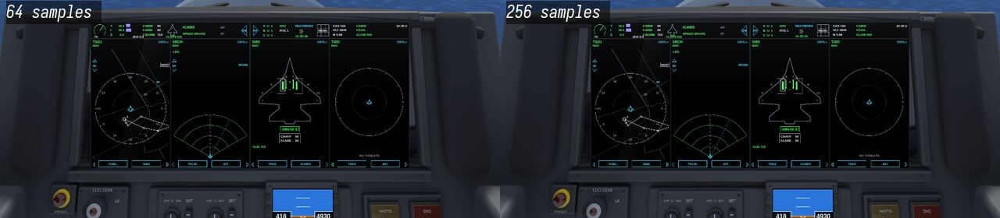

  The game shows the night art when the mission starts at night (`[PANEL] NightFileName`). At 22:00 under the warm
  floodlights and the neutral ones:

  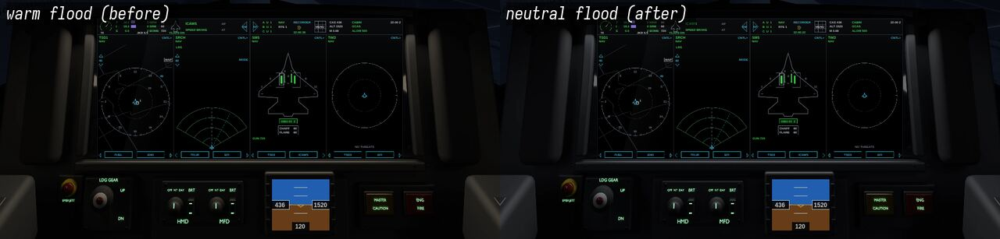
- **Lamps:** master caution (`LIGHT000`), engine fire (`LIGHT001`, blinking) and the gear handle (`LIGHT009`: up, in
  transit with its red lamp lit, down; 18 mm of travel either side of the slot's centre) are crops of the same render with the lamp lit or the handle moved
  (`f35lights.png`, `f35lights_night.png`), so they sit seamlessly in the panel.
- **The rest of the lamps** (AI, SAM, ECM, speed brake, autopilot, gear legs, flaps) are off in the panel: the display
  shows them (§4.3).
- **Fixed:** the side-stick and throttle are part of the render (the panel art, day and night, and the lamp crops
  re-rendered 2026-11-09 with the grips and console panels below, and again the same day with the consoles at the
  hands' height of §4.1 "Eye position" and the remodelled grips: only the side-stick's hats show, in the strip's
  bottom right corner, dark grey since the render of that evening (light grey before it: rendered before the hats
  turned dark); before, its whole head stood beside the display and the left console's front panel showed
  in the bottom left corner). Ahead in the 2D cockpit, before and after:

  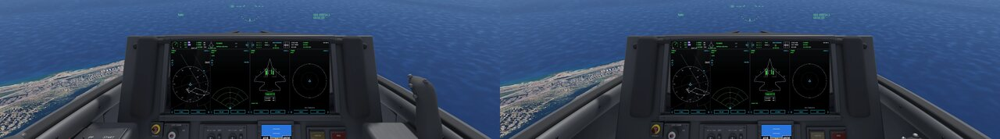
- **Side-stick and throttle (remodelled 2026-11-09, the user's review "very gamish"):** after the mock-up's close
  views (§4.1)[^pmock]. Each grip is a smooth solid round a bending spine (`grip()`: superellipse sections square to
  the spine, `STICK_GRIP`, `THROTTLE_GRIP`, under one subdivision level: no facets), in the worn matte black of the
  baked look (the wear rubs its edges lighter). The side-stick is 14 cm tall and 3.7–4.1 cm across: a slim stem with
  a small flare at its foot, swelling at the palm behind and the fingers ahead (gentle grooves), its head bulging
  forward over the trigger, the whole leaning forward 6–11° and the head up to 36°. It stands in a dark satin collar
  with the four rings of a black rubber boot on a bolted black housing at the console's front. Its trim hat on
  top, the weapon release ahead of it on the left, three thumb hats on the head's left (four-way hats with a cross
  of ridges), a curved trigger blade under the head's front and a lever low behind are parts of their own; the hats
  and buttons are dark grey satin (`Mats.hatg`, a little lighter than the grip) on black bosses. Tried the same
  day: light grey metal hats and a chrome collar and boot, as the mock-up's bare metal; in the game they read as
  white pegs and pale plastic, so they are dark as on the jets in service (inferred). The throttle is the
  mock-up's shape: a broad, flat-sided body (squarer sections) reaching aft under the heel of the hand, a narrow neck
  and a flared head leaning forward, with the slew control on top, the comm and four-way hats on the head, a boat
  switch inboard, finger buttons on the front, one behind and the speed brake slide outboard; black, as the
  demonstrators'[^pdemo2] (the mock-up's is unpainted grey). It stands on a square post with a dark satin band on a
  carriage in its track: a bolted plate with the slot between two black brush seals, end stops, a friction knob
  aft of it, and IDLE, MIL and AB marks inboard at the throttle's own travel (§4.5). Which hat does what follows the
  F-16's HOTAS (inferred: no source names the F-35's). Tried the same day: a rounder throttle body (pear-shaped from
  its post) read as a blob. From 2026-11-09 (morning) the grips were lofts of horizontal rings with plain cylinder
  hats, sitting 0.415 m under the eye (§4.1 "Eye position"); before that the stick was a tube with a bevelled box
  and a cylinder hat, the throttle a rounded box on an arm.

  The side-stick and throttle in the 3D cockpit, before and after the remodel (2026-11-09):

  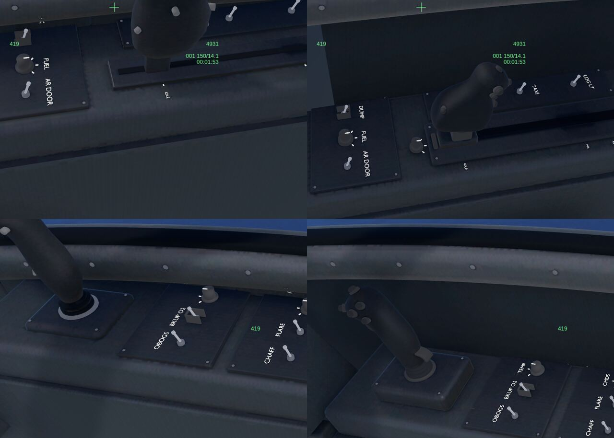
- **Console switch panels (2026-11-09):** four panels on the right console behind the stick and three on the left
  around the throttle's track (`CONSOLE_PANELS`), each with screws and three controls of the kinds the real jet's
  side panels show[^pjet]: bat toggles, guarded toggles (red or black covers), rotary knobs with an index and scale
  ticks, and square push buttons in bezels, each with its printed label (BATT, IPP, ENG, START; LDG LT, TAXI, FORM;
  DUMP, FUEL, AR DOOR; FLOOD, CONSOLE, NVIS on the left; OBOGS, BKUP O2, TEMP; CHAFF, FLARE, CMDS; POSN,
  STROBE, ANTI COLL; ZEROIZE, IFF, EMER on the right), 8.8 mm high (5.8 mm, unreadable from the seat at 1920 × 1080, until the
  same day's review). The functions and their places are inferred: the photos show the mix of switch
  types, not readable labels. Until 2026-11-09 five blank plates per console with three identical pegs each. The
  start panel (forward left) holds the start's switches in its order, BATT, IPP, ENG (red guard) and START, and a
  canopy lever on the left wall just aft of the throttle's track (2026-11-13, "Canopy control" above; from
  2026-11-09 a CANOPY toggle on a small panel of its own aft on the left console; until then the start panel held
  ENG, IPP and START and there was no battery or canopy control). The lighting panel (FLOOD, CONSOLE, NVIS) stays
  where it is.

  Looking at the left and right consoles in the 3D cockpit, before and after (2026-11-09):

  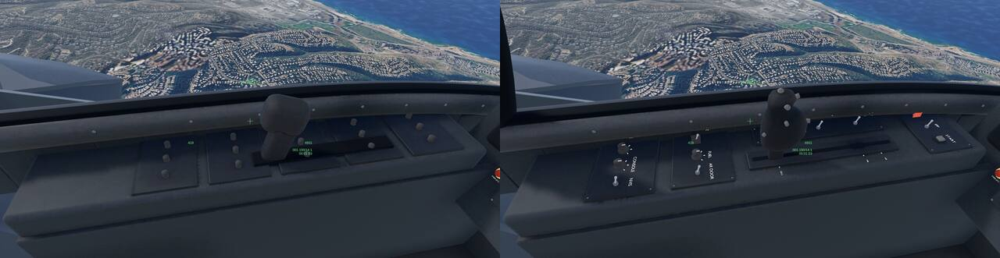

  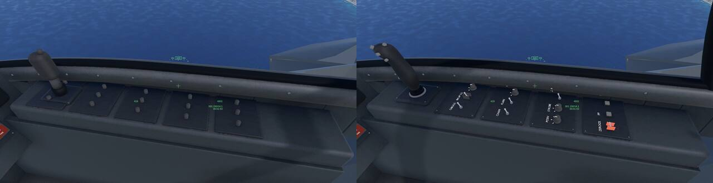

### 4.3 The display in the game (shared/cockpit/pcd.gd, pcd_formats.gd)
The display follows the real one's layout and formats (docs/real-mfd.md "F-35I"): black glass, the Function Access
Button strip, four portals. `[PCD]` in cockpit.json gives the glass and the ESIS in panel px. Everything is drawn as
vector lines and text at the screen's resolution.

| area | what it shows |
|---|---|
| strip (top) | the engine's RPM dial (AB boxed); total / internal / external fuel (thousands of lb) with purple bars and the joker; MRM / SRM / bomb counts, chaff, flares, gun rounds; the jet's outline (green, gear down) with the three leg lights and the flaps; ICAWS with the worst line in its colour; AP (LVL / NAV) / AT; SWAP across the halves' seam; radios A / B / C; NAV and the steerpoint; the recorder (the blackbox) and the time; the MENU grid; CAS, altitude, Mach; CABIN, GCAS, ALOW (yellow below 500 ft AGL); the time |
| portal header | the format's name over the master mode (NAV, A-A, A-S from the HUD mode); a click opens the MENU grid of the 11 formats |
| portal tabs | two sub-portal formats; a click swaps one with the main format |
| TSD-1 / 2 / 3 | heading-up compass rose about the ownship (radius = the range, 10 / 20 / 40 / 80 NM by the left arrows); the map's outlines grey (MAP); the route white with the steerpoint; the radar's tracks (red diamond hostile, green circle friend, direction line, white ring on the lock); the SAM sites with their rings red |
| SRCH / ASR | the radar as an azimuth / range fan (the layout is open; inferred); tracks as on the TSD; the lock's range, altitude and closure; the steerpoint; range arrows and MODE; ASR in GMT / MAP |
| SMS | the planform with stations 1–11 (the game's A–I, §3.1), each store green (missiles slim, bombs fat), the selected station boxed; the selected weapon and count; chaff, flares, gun; in Modern IAF (a game with a master arm) ARM / SAFE over the weapon (inferred) |
| TFLIR | the EO camera's picture, the cross fixed at its centre (the line of sight and the laser spot), zoom, WIDE / SPOT, the laser, the range |
| TWD | the RWR's entries at their bearing and distance by threat code: red locking, red circled and flashing on a launch, yellow searching (Extras RWR: Real) |
| EFI | attitude ball, speed and altitude boxes, Mach and g, the heading arc |
| ICAWS | every caution, warnings first: the lamps' and the damage flags' (docs/damage.md §5.2) |
| FUEL / ENG | the fuel totals and the internal tank bar with JOKER / BINGO (inferred values); the RPM dial, throttle, AB, thrust |
| ESIS (under the glass) | attitude, airspeed, altitude, heading. The ground is the part of the box below the horizon; when the horizon only grazes a corner, that part is a sliver too thin to fill, and it is left out (`pcd.gd ground_polys`) |

Defaults: TSD-1, SRCH, SMS, TWD; tabs FUEL / ENG, TFLIR / EFI, TSD-2 / ICAWS, TSD-3 / EFI. Each portal keeps a
hidden MFD node (mfd.gd) whose page follows the format (TSD 3, SRCH 2, SMS 1, TFLIR 6, TWD 7, EFI 9, ICAWS 4), so
the keys that set pages (T, D, M, a weapon's page) pick the matching format and the EO camera renders for TFLIR.
Not built: a format widened over two portals, WPN-A / WPN-S, CNI, FCS, DAS, the radar MAP picture on ASR.

The TSD's map outlines are moved onto the portal with one transform per frame, applied to each outline at once
(`pcd_formats.gd` `scope_xform`). Modern IAF's own map (OpenStreetMap, about 10,000 points) cost 64 ms a frame point by
point and slowed the jet's whole flight; with the transform it costs about 10 ms per TSD, of which the outlines'
clipping and drawing take about 6 ms (measured headless, 2026-11-08). Tested and dropped the same day: skipping the
outlines whose box lies outside the portal, which gained nothing measurable (at the TSD's ranges nearly every outline
is in view).

A faint sheen lies over the glass. The helmet HUD draws over everything.

### 4.4 Looking aside and back (tools/f35i/bc.py)
`f35i_bc.gltf` is the jet's cockpit-view model, as the originals' `*_bc.x` (docs/views.md §4.3): the airframe aft
of the eye from `f35i.gltf` (wings, spine, tails), our seat, the canopy's bow and the side rails behind the
eye. The game draws it at the Present scale (2.0), so our parts are modelled at
half size about the eye. Its own objects:

- `f35i_bc_frame`: the rails and arch, on the airframe's sills as the panel's rails (§4.2). The 3D cockpit hides it
  and draws its own (`terrain_view.gd`). The arch (`cockpit3d.py` `ARCH_*`, the same in both) is a matte black band
  9 cm wide fore and aft and 4.5 cm deep, standing on the rails 0.42 m behind the eye and leaning forward 0.28 m to
  its top
  0.21 m over the eye (§4.1; the numbers inferred). Until 2026-11-09 it was a light grey 7 × 5 cm pipe standing upright
  0.75 m behind the eye, and read as missing; tried the same day, a light grey band 12 cm wide read as a white
  beam across the back view.
- **The seat** (`bc.py` `seat()`, part of `f35i_bc`, so both cockpits show it): the Martin-Baker US16E's head box
  after the photos (§4.1): dark, tapering to its top, its black head pad on the front, the flared upper corners, two
  canopy breakers on top and the yellow warning tag on its side, with the back cushion and the guide rails under
  it. The head box is 24 cm wide and its front stands 0.90 m behind the eye (`SEAT_BACK`), further back than the
  real one, which is right behind the helmet: the camera stays at the eye when the head turns, so it shows as a
  narrow shape at the edge of the view looking back. Tried the same day: 33 cm wide at 0.30 and 0.52 m and 24 cm
  at 0.70 m, where it filled half to a quarter of that view, a dark wall. Until 2026-11-09 the downloaded
  model's own seat showed there, cut at the sill: flat grey boxes with a slot, and tall slivers of its large faces
  stood behind the left rail (the cut kept or dropped whole faces by their centres). `bc.py` now cuts with planes
  first and drops what lies inside, back to the spine's front 1.13 m behind the eye (`DECK_END`; model metres): over
  the sills (`SILL`, 0.17 m under the eye) ±0.36 m across (`CANOPY_HALF`), the downloaded model's canopy frame and
  fairings, which stood beside the left rail as a plain grey block until 2026-11-09 (user review); and inside the
  sills (`SEAT_HALF`, ±0.215 m) down to `SEAT_FLOOR` (0.40 m), its seat and tub.
- **Ours in their place** (part of `f35i_bc`, so both cockpits show them): the side wall under each rail, a smooth
  dark painted plate as the 3D cockpit's (`cockpit3d.py` `WALL_PROFILE`; until 2026-11-09 the downloaded model's
  plain grey tub walls showed outside the sills), and the aft deck under the canopy behind the seat, a dark crowned
  plate level behind the eye, then rising from under the head box to the spine (`DECK`; inferred, the canopy's aft glass covers it in the
  photos[^pjet][^phagel]), dark matte (linear 0.012, as the sills and consoles read; in the walls' paint it took
  the sun light grey), with the canopy actuator's fairing along its crown and a panel seam across it (inferred). The seat's cushion lies at the new seat height (§4.1 "Eye position").

  Looking back left in the 3D cockpit, before and after (2026-11-09):

  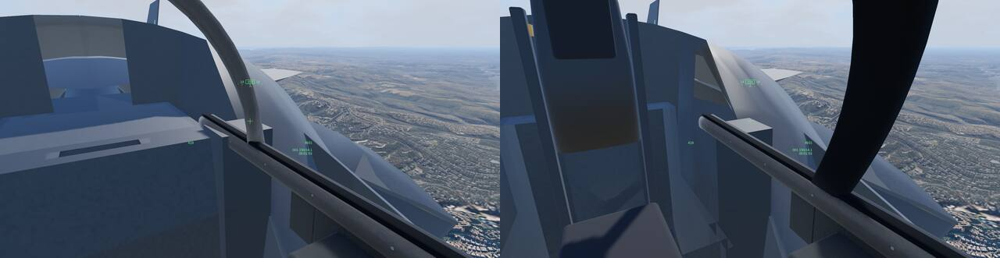

  Looking back left, before and after the grey block and walls went (2026-11-09, later):

  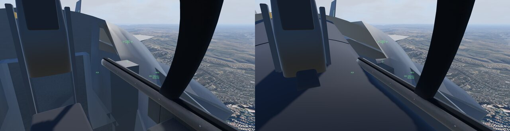
- Nothing ahead of the eye: the nose falls away under the glareshield (§4.1). Until 2026-11-09 the fuselage from
  0.85 m ahead of the eye was its own object, `f35i_bc_nose` (`f35i.gltf`'s outer skin, 1.6 k triangles), seen over
  the glareshield in both cockpits as a pale dome.

The gear, wheels and pylons are left out. The camera's near plane is 0.1 m in the F-35I (0.5 m in the other jets) so the arch close
behind the head shows.

### 4.5 The 3D cockpit (Extras "Cockpit": 3D)
With Extras "Cockpit" on 3D the F-35I flies with a real-time 3D cockpit in place of the panel art, on the F-16's
machinery (docs/cockpit.md "3D cockpit"). Its model is the panel's own scene:
`blender -b --python tools/f35i/cockpit3d.py -- shared/extra/planes/f35i/cockpit --glb
shared/extra/models/cockpit3d/f35i.glb` writes it (and `f35i.json` beside it).

- **The same geometry** as the panel render (§4.2). 74.3 k triangles, 4.9 MB (72.3 k until 2026-11-13: the canopy
  lever, the bow ahead of the eye and the rails' front ends added 2 k; 71.1 k until the evening of
  2026-11-09: the start-up's BATT and CANOPY switches added 1.2 k; 59.4 k, 4.2 MB until the second review of
  2026-11-09: the subdivided grips, the parts between the knees and the swept walls added 11.7 k; 44.2 k, 3.4 MB
  until 2026-11-09: the contoured side-stick and throttle and the console switch panels with their labels added 15 k; 40.1 k, 2.9 MB
  until 2026-11-02: the domed screw heads added 3.4 k, the rudder pedals 0.7 k).
- **The render's look, baked:** the large surfaces (panel, glareshield, cheeks, bezels, canopy frame and seals, grips,
  the tub) share one Smart UV Project atlas. Cycles bakes into it their colour with the wear (mottled paint, edges
  rubbed lighter) times the cockpit's ambient occlusion (12 cm rays, 64 samples: dark corners, under the glareshield,
  round the bezels, the footwell), 2,048 px, and their mottled roughness, 512 px (`bake_atlas`). The atlas is stored
  8 times as light under a 1/8 colour factor: the game compresses it (S3TC, 5-6-5 bit), and the dark paint at its
  own level came out speckled green and purple. Both maps are KTX2 (UASTC; ETC1S speckled the same way). The small
  parts (knobs, switches, labels, fasteners, lenses) keep plain colours. Left out: the paint grain (a sub-mm bump,
  smaller than a texel: a normal map of it would only shimmer) and the display glass's clear coat.
- **HOTAS and consoles:** the panel's own (§4.2): the side-stick and throttle and the consoles' switch panels.
- **Added for 3D:** the tub under the panel and consoles (floor, footwell front, walls, the console sides), the
  panel render never looked there. Between the knees (2026-11-09, user review "nothing between the legs?"), after
  the mock-up photo (§4.1)[^pmock]: the centre pedestal from under the panel to the floor with a bolted access plate
  on its rear face (the plate inferred), the knee panels either side of the footwell, the rudder pedals (plates
  leaning forward with toe and heel rims and tread ribs, on arms from housings in the front wall, the adjustment
  crank between them; `pedals()`), and the US16E's bucket ahead of the seat reference point (`seat_bucket()`): the
  cushion, the bucket's sides and front, the firing handle as a 12 cm striped yellow and black loop standing up
  from its black fitting at the cushion's front, and the yellow EGRESS placard beside it. All at the seat height of
  §4.1 "Eye position". Until 2026-11-09 the footwell was an empty floor with two pedal plates and a small flat
  yellow bar on the seat front. The floor is dark grey non-slip paint (`Mats.floor`, linear 0.040, lighter
  than the panels' 0.030): until 2026-11-02 it was the canopy seal's near-black rubber (0.010), and looking down the
  footwell between the consoles was a black void (sRGB 4, 5, 9). The canopy's bow: with
  the rails it stands in for `f35i_bc.gltf`'s frame (hidden in 3D), one rail with its seal and bolts from behind
  the head to the canopy's front; the bow stands 0.57 m ahead of the eye at the rails, leaning forward to 0.73 m at
  its top (`ARCH_*`; 0.42 m behind the eye until 2026-11-13). The frame (`canopy_frame`) turns about the canopy's
  front hinge with the canopy (Modern IAF's cold start); up, the rails' front ends (`canopy_tips`) show too, down to
  the hinge, so the raised rails meet it. `NO_BAKE=1` writes the model without the baked look in about a minute (a quick
  look at the geometry; the full build takes about 9 minutes).

  Looking down and into the footwell, before and after (2026-11-09):

  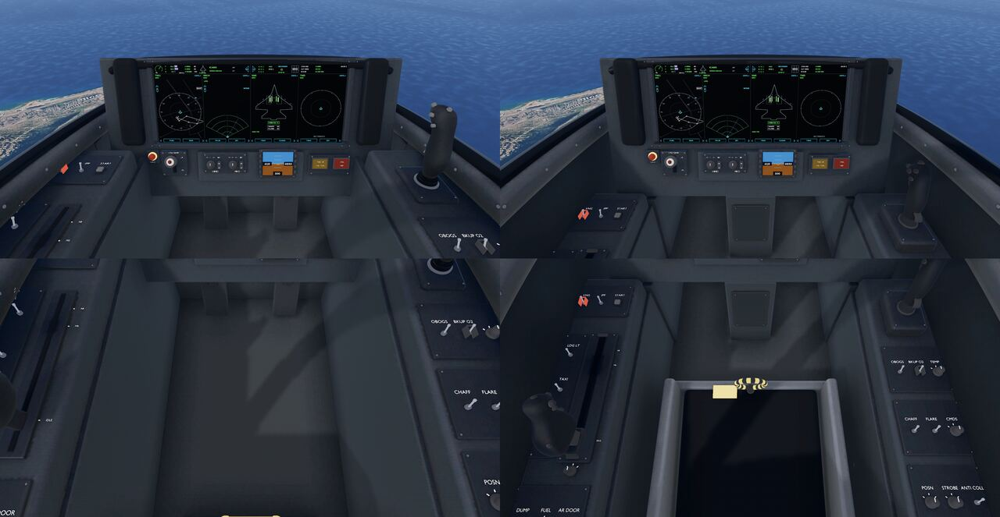
- **Named parts** (the moving parts joined from the build's `stickm_*` and `throttlem_*` objects): `PCD` and
  `ESIS`, flat quads over the glasses that the display draws on (`pcd.gd`, §4.3);
  `lamp_master_caution_0`, `lamp_eng_fire_0`, `lamp_gear_transit_0` (the gear knob's red lamp); `gear_handle`, which
  turns ±9.6° about a pivot 6 cm behind the panel instead of the 2D art's three frames; `side_stick` (grip,
  hats, trigger, paddle), which tilts 3° at full deflection about its boot with the flight model's stick (right to the right, a pull
  aft); `throttle` (arm, grip and its switches), which slides on its rail with the throttle: 18 cm aft of military power at idle,
  2.4 cm forward past the afterburner detent (0.75), 4 cm forward at full afterburner; the clickable controls
  (`CONTROLS`, below): `BATT`, `IPP`, `ENG` (each toggle's bat and tip, turning about its nut) and `CANOPY` (the
  canopy lever, about its pivot block), `START`
  (the button's cap), `HMD_BRT` and `MFD_BRT` (each knob with its index, turning about its axis).
- **The real controls:** the F-35's side-stick moves a little more than the F-16's near-rigid force stick, as the
  F-22's does[^f3]; its stick and throttle are active controllers, their forces and detents (the afterburner's
  among them) set by the flight control computers[^c1]. The throttle slides on a linear quadrant rather than
  swinging in an arc[^f3]. The 3° and the travels are inferred: no source gives them.
- **Frame:** the cockpit-view model's, half size about the descriptor's eye (as `bc.py`'s parts), so it hangs in
  `own_bc` and comes out at its real size.
- **Displays:** the PCD draws into a 1,496 × 671 px SubViewport on its glass; its taps (portal headers, tabs, MENU,
  range arrows) work through the glass. The ESIS has its own. Both glasses are matte (roughness 0.7, specular 0.12),
  as a powered display's anti-reflective coating: black by day with a faint broad sheen. At roughness 0.25 they
  mirrored the sky and their black read navy (2026-11-02).
- **HUD:** the helmet display, over the whole view.
- **Light:** by day each colour glows by itself × the sun's colour × `f35i.json` `day_fill` (0.9) besides the
  scene's light: the panel reads as light and neutral grey as the render's (sRGB 45–55 against its 40–56). The
  scene's sky light alone left it dark and blue (14–27). At night the floodlights' white on every colour
  (`night_flood`, the render's `FLOOD_RGB` × 0.4; the atlas's × `night_atlas`, 2.6, to match the plain colours'
  level) and the labels glow green, as the night render (cockpit.md "3D cockpit"): the panel reads in a dim neutral
  grey (sRGB about 15–25 under the pedestal, `_cockpit3d_shot.gd` C3D_ALL at 22:00), costing nothing (a colour per
  material). At × 0.75 it read 51, as light as by day. Until 2026-11-02 a faint blue flood (0.25–0.3) left it nearly black.
  Until 2026-11-08 the flood was warm white (0.4, 0.344, 0.264) and the grey panels and tub read brown (sRGB 18, 15,
  11 under the pedestal; now 15, 20, 25 with the scene's blue night sky). Looking down at 22:00, before and after:

  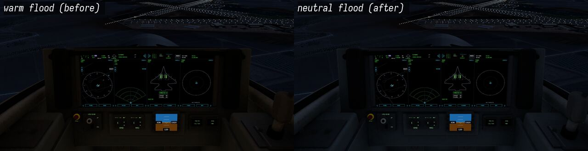
- **The gear handle's red light** lights only while a leg is not locked where the handle points
  (`cockpit3d.gd` `gear_transit`); otherwise it is dark red paint, by day and by night.
- **Cost** (Iris Xe, 1920 × 1080, `_flight_bench.gd` mission 311 with `BENCH_SET=f35i_slot=1,jet_id=1,
  cockpit_3d=3d` against `cockpit_3d=original`, 2026-11-01): GPU 13.3 / 14.7 ms against the 2D panel's 13.7 / 15.9 ms
  at 150 / 1,500 m (no cost within the noise), +17 / +21 draw calls, +22 k / +18 k primitives, +13 MB video memory.
  The PCD's SubViewport takes 0.2–0.26 ms GPU, the ESIS's 0.05 ms (`_cockpit3d_shot.gd`).
  The baked look, the moving controls and the matte glass (A/B against the plain-colour model, the same bench run
  twice each, interleaved, 2026-11-02, other jobs running on the machine): GPU 13.9–15.1 / 15.2 ms against
  13.5–13.8 / 15.4–16.1 ms at 150 / 1,500 m (no cost within the noise), −7 draw calls (one baked material for six
  plain ones), +2 k primitives, +3 MB video memory (the 2,048 px atlas compressed S3TC, the 512 px roughness map).
- **Past the glareshield:** the ground and sky, no nose (§4.1, §4.4). The canopy rails end under the glareshield
  (`cockpit3d.py` `RAIL_3D_END`, the last two of `RAIL`'s points left out): with no nose under them their tips stood
  in the air over its middle. The 2D panel art keeps the whole rails; its glareshield covers their tips. Ahead and
  looking down, before (the nose) and after (2026-11-09):

  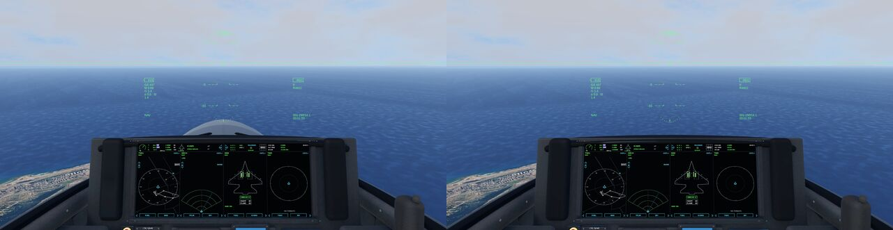

  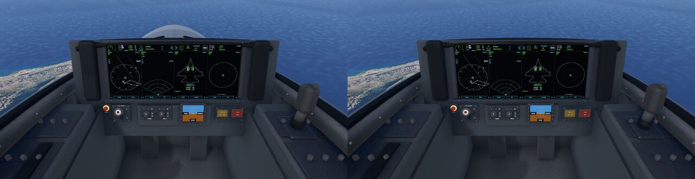
- **Clickable controls (Modern IAF, 2026-11-09):** the start-up and the display brightness work with the mouse, on
  the 3D cockpit's clickable-control layer (`shared/cockpit/cockpit3d_controls.gd`, behind
  `Settings.cockpit_controls()`: the sim only; [modern-iaf/docs/cockpit.md](../modern-iaf/docs/cockpit.md) §5.1, §5.2).
  `shared/extra/models/cockpit3d/f35i_controls.json` binds each node to its key's command; the pointer over a
  control lights it.

  | control (node) | place | a click, the wheel or a drag | does |
  |---|---|---|---|
  | BATT switch (`BATT`) | start panel, left console, forward | click: `[210, 0, 0]` (Ctrl+B) | the battery on, the checklist's step 1 |
  | IPP switch (`IPP`) | start panel | click: `[211, 0, 0]` (Ctrl+J) | the IPP starts, step 2 |
  | ENG switch (`ENG`) and START button (`START`) | start panel | click: `[212, 0, 0]`; the ENG switch's first click lifts its red guard | the engine starts, step 3 |
  | throttle (`throttle`) | left console | click: `[5, 0, 0]` (Throttle up) | out of OFF: step 3 too |
  | canopy lever (`CANOPY`) | left wall, just aft of the throttle's track | click: `[215, 0, 0]` (Ctrl+K) | the canopy closes, step 4 (forward: shut; 40° aft: open) |
  | HMD BRT knob (`HMD_BRT`) | pedestal, under the display | wheel / drag: `[123, ±25, 0]` (Shift+H steps) | the HUD's level, 2.5 % a notch or 10 px |
  | MFD BRT knob (`MFD_BRT`) | pedestal | wheel / drag: `[216, ±25, 0]` | the displays' brightness, 10–100 % |

  The switches lean forward when on (as modelled, and as the 2D panel art shows them) and 40° aft when off; the sim
  puts a cold jet's switches off and each one on when its step is taken (`f35i.json` animations on our own
  properties, `cockpit3d.gd` `SWITCH_PROPS`). The knobs turn 100° over their range, from OFF to DAY on the printed
  scale (clockwise), the index up at 50 %. The battery, IPP and engine selections are the real start's[^ayton]; the switches' places are
  inferred; the canopy lever's place is IndiaFoxtEcho's (§4.1 "Canopy control"), its shape and travel inferred. The ENG switch is guarded: its red guard (`ENG_GUARD`, hinged at its aft end) is closed
  on a cold jet; the first click lifts it 110° up and aft, the second throws the switch, as a real guarded switch
  (`f35i_controls.json` `guard`, its property `f35i/engine/eng-guard`; 2026-11-09). Closed, after the first click
  and after the second, in Modern IAF's start-up (`_switch_shot.gd` SHOT_SWITCHES=ENG):

  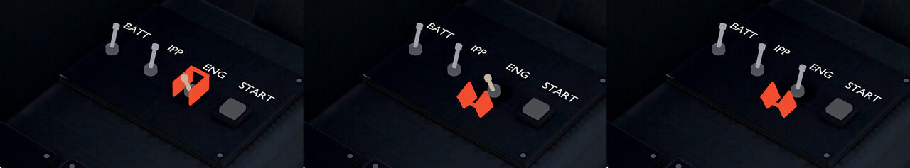

  The helmet's symbols light in the P43 green at the HMD level, as the HUD does (real-hud.md "Modern IAF's HUD
  light"). Open: the other console switches and knobs are not clickable.

## 5. Reference images (Wikimedia Commons)
Each file's page is `https://commons.wikimedia.org/wiki/File:<name>`.

| view | file | licence, author |
|---|---|---|
| panel, straight on (mock-up), best for the panel art | Lockheed_Martin_F-35_Lightning_II_mock-up_instrument_panel.JPG | PD, Ahunt |
| panel with live content (demonstrator) | NAVSTA_Rota_tries_out_F-35_cockpit_demonstrator_(5529853).jpg | PD, US Navy |
| open cockpit, real jet (sills, frame) | Open_cockpit_of_a_RAAF_F-35_in_August_2018.jpg | PD, USAF |
| 3-view F-35A | Lockheed_Martin_F-35A_Lightning_II_3-view_drawing.png | PD, jsf.mil |
| 3-view F-35I with IAF insignia | Lockheed_Martin_F-35I_Adir_3-view_drawing.png | CC BY-SA 4.0, MathKnight |
| front close-up, F-35I | 121270_face_to_face_PikiWiki_Israel.jpg | CC BY 2.5, Dudi Vardi |
| tail 951, 140 Sqn | 121266_adir_951_PikiWiki_Israel.jpg | CC BY 2.5, Dudi Vardi |
| in flight, first IAF flight | IAF-F-35I-2016-12-13_(cropped).jpg | CC BY 4.0, IAF |
| 116 Sqn pair (lion on the tail) | The_Southern_Lions._Squadron_116._I.jpg | CC BY-SA 3.0, IDF Spokesperson's Unit |
| weapon bays open | 190116-F-BQ566-003.jpg | PD, USAF |

The Commons category `F-35I_Adir_in_Israeli_service` has about 100 more.

## 6. 3D models (Sketchfab, checked 2026-10-02)
| model | triangles | licence |
|---|---|---|
| "Low poly F-35 Lightning II", S1Priv | 7.7k | CC BY: closest to the 1998 look |
| "Lockheed Martin F35 Lightning II", andertan | 83k | CC BY: measure fps before shipping |
| "F-35A Lightning II", shangus930 | 190k | CC BY: needs decimating |
| others (bohmerang, kelin322, …) | — | CC BY-NC: local use only |

Before shipping any CC BY model:

1. Re-check the licence on the model page; it can change.
2. Credit the author.

## 7. IAF facts
- **Arrival:** the first two jets (901 / 902) arrived at Nevatim on 12 Dec 2016. Operational from 6 Dec 2017. First
  combat use in the world on 22 May 2018 [^w3].
- **Squadrons at Nevatim:** 140 "Golden Eagle", 116 "Lions of the South", 117 "First Jet" (training). Test-bed jet
  #924 is at Tel Nof.
- **Fleet:** 48 delivered by Jan 2026 out of 75 ordered (100 planned) [^w3].
- **Markings:** low-observable grey, IAF roundel, black three-digit tail number (9xx), squadron badge on the fin.

[^w1]: https://en.wikipedia.org/wiki/Lockheed_Martin_F-35_Lightning_II (specifications)
[^w2]: https://en.wikipedia.org/wiki/Pratt_%26_Whitney_F135
[^w3]: https://en.wikipedia.org/wiki/Lockheed_Martin_F-35_Lightning_II_Israeli_procurement
[^lm1]: https://www.lockheedmartin.com/content/dam/lockheed-martin/aero/documents/F-35/f35A.pdf
[^af1]: Air & Space Forces Magazine, "F-35A conducts first external weapons test" (2012: two AIM-9X on the outboard
    wing stations, GBU-31s and AIM-120s internal): https://www.airandspaceforces.com/?p=28742
[^lm2]: Lockheed Martin, "F-35 Mission Systems Design, Development and Verification" (JSF18-502)
[^a1]: https://theaviationist.com/2012/11/20/f-35-aoa/
[^nvis]: Element (Elite Test), "Seeing in the Dark — NVIS Compatibility and Spectral Radiance Testing" (MIL-STD-3009
    defines NVIS Green A and B, Yellow, Red and White):
    https://www.elitetest.com/blog/photometric/seeing-in-the-dark-nvis-compatibility-and-spectral-radiance-testing/
[^a2]: https://theaviationist.com/2020/10/06/investigation-report-points-to-landing-speed-as-main-cause-of-loss-of-f-35a-at-eglin-afb-valued-176m-usd/
[^aa1]: https://australianaviation.com.au/2013/01/f-35-performance-specs-lowered/
[^t1]: https://www.twz.com/air/israel-is-bringing-spice-1000-standoff-weapon-to-the-f-35
[^f1]: https://www.f-16.net/forum/viewtopic.php?t=11567 (forum, U)
[^f2]: https://www.f-16.net/forum/viewtopic.php?t=13450 (forum, U)
[^wn]: https://www.wionews.com/photos/how-does-the-f-35-fighter-jet-stand-out-in-takeoff-speed-and-design-here-s-its-minimum-lift-off-speed-1752767093279 (weak, U)
[^sldinfo]: https://sldinfo.com/2012/04/the-f-35-cockpit-enabling-the-pilot-as-a-tactical-decision-maker/
[^c1]: Code One, "The New Front Office" (2006): https://www.codeonemagazine.com/article.html?item_id=35
[^f3]: https://www.f-16.net/forum/viewtopic.php?p=75399 (forum, 2006: the F-35's side-stick and its "linear" sliding
    throttle quadrant, U)
[^ain1]: AIN, "Elbit awarded contract to develop F-35 display replacement" (2017):
    https://www.ainonline.com/aviation-news/defense/2017-07-19/elbit-awarded-contract-develop-f-35-display-replacement
[^mb1]: Martin-Baker, US16E: https://martin-baker.com/ejection-seats/us16e/
[^mb2]: Martin-Baker, "US16E seat data sheet" (2023: firing handle on the seat bucket, 7.4 in seat actuator stroke,
    pilots 103–245 lb): https://martin-baker.com/wp-content/uploads/2023/11/MB-US16E-Seat-Data-Sheet-2023-QR.pdf
[^mil1333]: MIL-STD-1333B, "Aircrew station geometry for military aircraft" (Fig. 2: design eye 31.0 in above the
    neutral seat reference point, 6.1 in ahead of it at a 13° seat back, the seat reference point 1.25–6.25 in above
    the floor; Fig. 3: 13 in head clearance; §5.2.3.1: 1.5 in leg clearance under the panel):
    https://everyspec.com/MIL-STD/MIL-STD-1300-1399/download.php?spec=MIL_STD_1333B.525.pdf
[^ansur]: ANSUR II (2012) male public data, percentiles worked out from the file (sitting eye height 0.804 m 50th,
    0.860 m 95th; sitting height 0.918 m; elbow rest height 0.246 m; shoulder–elbow 0.363 m; forearm to grip
    centre 0.348 m; buttock–knee 0.617 m; knee height 0.553 m; all 50th):
    https://tools.openlab.psu.edu/publicData/ANSUR_II_MALE_Public.csv
[^pamos]: US Marine Corps photo, "The 35th Commandant of the Marine Corps, Gen. James F. Amos, sits in the cockpit
    of an F-35B Lightning II" (130504-M-LU710-175), public domain,
    https://commons.wikimedia.org/wiki/File:The_35th_Commandant_of_the_Marine_Corps,_Gen._James_F._Amos,_sits_in_the_cockpit_of_an_F-35B_Lightning_II_aircraft_while_visiting_the_Marine_Fighter_Attack_Training_Squadron_501_(VMFAT-501)_at_Eglin_Air_Force_130504-M-LU710-175.jpg
[^janes]: Janes, "Iran conflict 2026: Israeli F-35 claims type's first combat kill against manned aircraft", 4 March
    2026 (the F-35I carries the AIM-9X; Python 5 integration not completed),
    https://www.janes.com/osint-insights/defence-news/defence/iran-conflict-2026-israeli-f-35-claims-types-first-combat-kill-against-manned-aircraft
[^psim]: US Marine Corps, Cpl. Michael Thorn, "F-35 training system, logistic system ready for operations"
    (150630-M-EG514-000), public domain,
    https://commons.wikimedia.org/wiki/File:F-35_training_system,_logistic_system_ready_for_operations_150630-M-EG514-000.jpg
[^pjet]: US Navy photo, "Secretary of Defense Leon E. Panetta and Congressman Steny Hoyer are shown the cockpit of
    the F-35" (120120-D-BW835-017), public domain,
    https://commons.wikimedia.org/wiki/File:US_Navy_120120-D-BW835-017_Secretary_of_Defense_Leon_E._Panetta_and_Congressman_Steny_Hoyer_(D-Md)_are_shown_the_cockpit_of_the_F-35_Joint_Strike_F.jpg
[^pmock]: Ahunt, "Lockheed Martin F-35 Lightning II mock-up instrument panel", public domain,
    https://commons.wikimedia.org/wiki/File:Lockheed_Martin_F-35_Lightning_II_mock-up_instrument_panel.JPG
[^raaf39]: Australian Defence Magazine, "RAAF F-35As receive Small Diameter Bombs",
    https://australiandefence.com.au/news/raaf-f-35as-receive-small-diameter-bombs
[^jpo]: F-35 Lightning II Joint Program Office, "Cockpit": https://www.jsf.mil/cockpit
[^fg1]: Flight International, "Flight test: F-35 simulator — virtual fighter":
    https://flightglobal.com/flight-test-f-35-simulator-virtual-fighter/75335.article
[^hwy]: F-35A landing on a Finnish highway, cockpit camera (a re-upload; frame from the video's thumbnail):
    https://www.youtube.com/watch?v=XQ6B9pjzWy4
[^demo]: US Air Force F-35A Demonstration Team, "F-35 Demonstration From Inside The Cockpit":
    https://www.youtube.com/watch?v=QF7FSDpFYSs
[^pdemo]: US Navy photo, "NAVSTA Rota tries out F-35 cockpit demonstrator" (5529921), public domain,
    https://commons.wikimedia.org/wiki/File:NAVSTA_Rota_tries_out_F-35_cockpit_demonstrator_(5529921).jpg
[^pdemo2]: US Navy photo, "F-35 demonstrator" (150608-N-MH885-022), public domain,
    https://commons.wikimedia.org/wiki/File:F-35_demonstrator_150608-N-MH885-022.jpg
[^pside]: US Air Force photo, "33d Fighter Wing personnel get a look at the new F-35", public domain,
    https://commons.wikimedia.org/wiki/File:33d_Fighter_Wing_personnel_get_a_look_at_the_new_F-35.jpg
[^pmau]: US Air Force photo, "USAF Lt Col Christine Mau ... looks back from her Lightning II cockpit"
    (170227-F-HX320-005), public domain,
    https://commons.wikimedia.org/wiki/File:USAF_Lt_Col_Christine_Mau_the_first_and_only_female_F-35_fighter_pilot_in_the_world_looks_back_from_her_Lightning_II_cockpit_(170227-F-HX320-005).jpg
[^phagel]: US Air Force photo, "Air Force Technician briefs Secretary of Defense Chuck Hagel on the cockpit of an
    F-35A Lightning II aircraft" (140710-F-ZZ999-900), public domain,
    https://commons.wikimedia.org/wiki/File:Air_Force_Technician_briefs_Secretary_of_Defense_Chuck_Hagel_on_the_cockpit_of_an_F-35A_Lightning_II_aircraft_-_140710-F-ZZ999-900_(14648974131).jpg
[^ayton]: Mark Ayton, "Blue Sky OPS", AIR International, 26 April 2012, quoted on F-16.net, "Engine start up procedure" (three switch selections: battery, IPP, engine), https://www.f-16.net/forum/viewtopic.php?p=317934
[^pfront]: US Air Force photo by Samuel King Jr., "Close up of first DOD F-35 at its new home" (2011-07-14), public
    domain, https://commons.wikimedia.org/wiki/File:Close_up_of_first_DOD_F-35_at_its_new_home.jpg
[^pbow]: US Air Force photo by Samuel King Jr., "First F-35-trained pilot hops out after bringing first DOD F-35 home
    to Eglin AFB" (2011-07-14; the canopy up, its bow and frame from behind), public domain,
    https://commons.wikimedia.org/wiki/File:First_F-35-trained_pilot_hops_out_after_bringing_first_DOD_F-35_home_to_Eglin_AFB.jpg
[^pvmx]: US Marine Corps photo by Cpl. Owen Kimbrel, "VMX-22 gets hands on with F-35 Lightning II"
    (141009-M-CJ278-0124; an F-35B side on, the canopy up), public domain,
    https://commons.wikimedia.org/wiki/File:VMX-22_gets_hands_on_with_F-35_Lightning_II_141009-M-CJ278-0124.jpg
[^ife]: IndiaFoxtEcho, "F-35 Lightning II aircraft for Microsoft Flight Simulator, user manual" (the cockpit's left
    side, item 8 "Canopy control lever"; its changelog: electrical power needed to move the canopy),
    https://orbx-user-guides.storage.googleapis.com/indiafoxtecho-f35-msfs-user-guide-96295d.pdf
