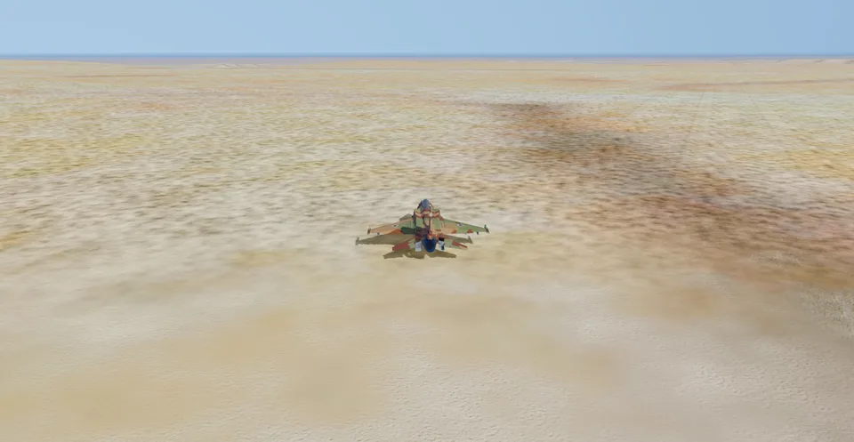
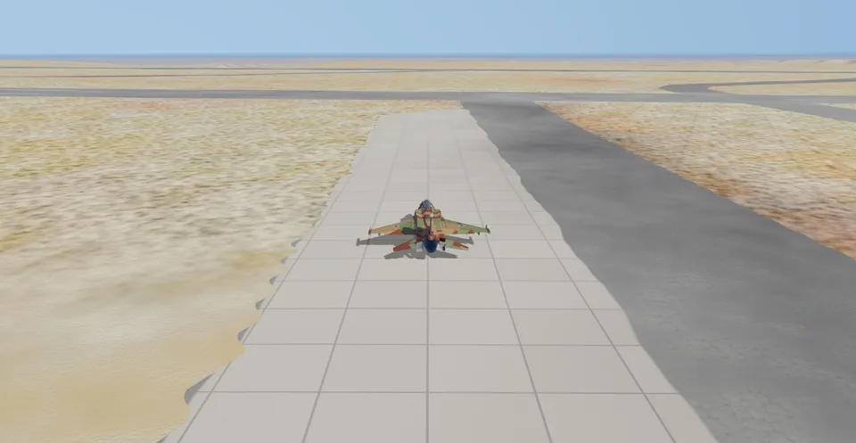

# Modern IAF: the airbases

**Terms:** OSM = OpenStreetMap; ODbL = the Open Database Licence (OSM's); OurAirports = the public-domain airport
tables at ourairports.com; lineup point = where a jet stands on the runway before take-off; HAS = hardened aircraft
shelter; S2 = Sentinel-2 (the ESA satellite pictures); "inferred" = our own reasoning; "open" = no source found.

This page holds the four airbases of Modern IAF (plan.md item B2a): Ramon, Hatzerim, Nevatim and Ramat David. Their
layouts are in `iaf-2026/data/airbases/<icao>.json`, in WGS-84 latitude / longitude and true headings (the format:
[data-formats.md](data-formats.md) §10). `iaf-sim airbases` compiles them into the sim's frame (item B2b, §9).
Research date: 2026-11-02.

```sh
python3 -I tools/iaf-2026/osm_airbase.py [--refetch] [ICAO ...]      # fetch (cached) + write the four files
python3 -I tools/iaf-2026/osm_airbase.py overlay OUT_DIR [ICAO ...]   # the check pictures (GDAL, ImageMagick)
```

## 1. Where the data comes from

| what | source | how |
|---|---|---|
| runways (ends, designator, width), stopways, taxiways, aprons, hangars, shelters, holding positions | OSM[^osm] | one Overpass query per base over the aerodrome's box; the raw answer is kept in `assets/source/osm/airbases/<icao>.json` |
| field elevation, reference point, runway end elevations, published lengths, displaced thresholds, the widths of runways OSM gives without one | OurAirports[^oa] | `airports.csv` and `runways.csv`, kept in `assets/source/ourairports/`; a runway row is matched to the OSM way by place (both its ends within 150 m of the way's line) |
| runway starts, designators of unnamed runways | inferred | §4 |
| parking spots, Nevatim's tower | inferred, by eye on the pictures | §5 |

The script asks the main Overpass server, then one mirror, once each; it never retries in a loop. Its User-Agent is
`linux-iaf-airbases/1.0`. A rerun reads the cache; `--refetch` downloads again. The OSM data dates: Ramon 2026-07-24
(the answering server's), the other three 2026-11-02.

Each item in a file names its source: `"osm": "way/…"` (the element, `https://www.openstreetmap.org/way/…`) with
`"source": "osm"`, or a `sources` map by field. The file's `footnotes` hold the full citations.

## 2. The bases

| base | ICAO | elevation | runways (OSM; published length) | what the file holds |
|---|---|---|---|---|
| Ramon | LLRM | 648 m[^oa] | 07L/25R 2685 m (2700), 07R/25L 2992 m (3010), both 45.1 m wide[^oa] | 2 runways, 4 stopways, 19 taxiways, 1 holding position, 7 aprons, 7 hangars, a Sufa spot |
| Hatzerim | LLHB | 221 m[^oa] | 10L/28R 2900 m (2423), 40 m; 10R/28L 3154 m (2943), 34 m; 10/28 1894 m, 30 m (OSM widths) | 3 runways, 89 taxiways, 9 aprons, 21 hangars, an F-15I and a Sufa spot |
| Nevatim | LLNV | 405 m[^oa] (Wikipedia: 424 m[^w-nv]) | 08L/26R 3165 m (2600), 08R/26L 3949 m (3350), both 44.8 m[^oa]; 07/25 3904 m (Wikipedia: 3900[^w-nv]), width open | 3 runways, 34 taxiways, 16 aprons, 19 hangars, 11 shelters, the tower, an F-35I spot |
| Ramat David | LLRD | 56 m[^oa] | 09/27 2928 m (2606), 44.2 m; 11/29 3148 m (2431), 35.1 m; 15/33 2943 m (2406), 45.7 m[^oa] | 3 runways, 52 taxiways, 1 apron, 15 hangars, 25 shelters, a Barak spot |

Published lengths are OurAirports'; they agree with Wikipedia's within 20 m except Hatzerim (Wikipedia: 10R/28L
2750 m, 10L/28R 2440 m[^w-hb]). Every displaced threshold is 0 in OurAirports. The ILS of every end is open
(`"ils": null`).

Naming conflicts:
- **Nevatim.** OSM names the runways 08L/26R, 08R/26L and 07/25, as Wikipedia does[^w-nv]. OurAirports calls OSM's
  08R/26L "08C/26C" and gives "08R/26L" to a 21 m strip south of it, which OSM tags as an unnamed runway (way
  130240671). The file keeps OSM's names and lists that strip as a taxiway with a note (inferred: the parallel
  taxiway; `tools/real_runways.py` also keeps only the three named runways).
- **Hatzerim.** A 15/33 (1768 m) is in OurAirports only; OSM's 10/28 north-west of the base is in OSM only. The
  10/28's use is open.
- **Ramat David.** The taxiway north of 09/27 carries the OSM ref "Runway 09/27" (kept as OSM has it).

## 3. The squadrons in 2026

| base | squadrons | jets |
|---|---|---|
| Ramon | 119 "Bat", 201 "The One", 253 "Negev"[^w-rm] | F-16I Sufa |
| Hatzerim | 69 "Hammers"[^w-hb] | F-15I Ra'am |
| | 107 "Knights of the Orange Tail"[^w-hb] | F-16I Sufa |
| | 102 "Flying Tiger" (the flight academy)[^w-hb] | M-346 Lavi |
| Nevatim | 140 "Golden Eagle" (since December 2016), 116 "Lions of the South" (since November 2019), 117 "First Jet" (since July 2021, first for training)[^w-nv] | F-35I Adir |
| Ramat David | 101 "First Fighter", 105 "Scorpion", 109 "The Valley"[^w-rd] | F-16C / F-16D Barak |

Corrections to the brief:
- **Hatzerim** also flies the Sufa (107 Squadron)[^w-hb], so its file holds a Sufa spot beside the F-15I's.
- **Ramat David's** Barak squadrons are 101, 105 and 109. 101 and 105 moved there from Hatzor in June and August
  2021[^scramble101][^scramble105], announced in March 2021[^keyaero]. 117 flies the F-35I at Nevatim[^w-nv].

The table holds the fighter squadrons, the ones the sim's jets fly with; the bases' helicopter, transport, tanker
and UAV units are in the Wikipedia pages cited.

## 4. Lineup points and runway starts

The OSM runway ways at Hatzerim, Nevatim and Ramat David run on over the paved overruns: they are 210–720 m longer
than the published length (Ramon's are within 20 m of it). There, the first taxiway that joins the runway from each
end lies where the declared runway would start: on all seven runways the two ends' entries add up to the extra
length within 110 m (Hatzerim 10L/28R: entries 504 + 22 m for 477 m extra; Ramat David 11/29: 365 + 456 for 717;
Nevatim 08R/26L: 263 + 376 for 599). So the script takes (inferred):
- **runway start** (`runway_start_m`, metres from the way's end): the first taxiway entry (a taxiway node within half
  the width + 15 m of the centreline), if it lies within the extra length + 150 m; else 0 (the way's end);
- **lineup point:** left to item B2b's compiler (Rust), from the runway start and the end's heading. The check
  pictures draw it 100 m down the centreline from the runway start (the distance iaf-sim's runway start uses,
  [data-formats.md](data-formats.md) §5).

Each end's name comes from the OSM `ref`, else OurAirports, else the magnetic heading with `tools/real_runways.py`'s
rule (one 5° E declination, inferred). A name goes to the end whose true heading is nearest its number × 10° + 5°.

Two runways start at their ways' ends (`runway_start_m` 0 at both ends) for want of a published length: Hatzerim's
10/28, and Nevatim's 07/25, whose first taxiway joins 1212 m from the 07 end (a jet backtracks from there).

## 5. Points placed by eye (for the user's approval)

The parking spots and Nevatim's tower are placed by eye on the pictures (§6) and kept in `PLACED` in the script;
each is a judgement call.

| base | point | where | lat, lon, heading |
|---|---|---|---|
| Ramon | Sufa parking | the centre of the paved pad by 07R/25L's western link (OSM apron 1496591869, the start-up mission's spot today), nose along the pad toward the runway | 30.7699350, 34.6594868, 335° |
| Hatzerim | F-15I parking | near the south end of the western of two sunshade rows by the parallel taxiway, on the row's middle (OSM apron 1157437942; moved 27 m west onto the row on 2026-11-03, when B2b's check found the first spot 6.5 m off the apron), nose to its exit | 31.2405172, 34.6612147, 195° |
| Hatzerim | Sufa parking | the same in the eastern row (OSM apron 1157437936) | 31.2401938, 34.6624651, 195° |
| Nevatim | F-35I parking | the east end of the middle lane of the apron north of 08R/26L (OSM apron 1089049618, paved in the 2021 picture, bare in 2015), nose along the lane to the apron's west exit | 31.2086757, 35.0264028, 256° |
| Nevatim | tower | the compound midfield between 08L/26R and 08R/26L (2015 photo) | 31.2058009, 35.0125383 |
| Ramat David | Barak parking | the free west part of the base's one OSM apron (1328724315, north of 09/27; its middle holds OSM buildings), nose to the taxiway south of it | 32.6679365, 35.1765842, 176° |

Which squadron uses which apron or row is open at every base. Ramon's shelters at the ends of the loop taxiways (seen
as small white roofs) are a few pixels in the 10 m picture, so the Sufa stands on the pad by the runway.

## 6. The check pictures

`overlay` draws each file on a picture of the base at 2 m per pixel, north up, with a 100 m bar in 10 m steps:
runway edges red, taxiways cyan, stopways orange, aprons yellow, hangars and shelters magenta, lineup points green,
parking spots red with a white nose line, the tower blue.

**The Survey of Israel 2015 photo blanks three of the four bases.** Ramon, Hatzerim and Ramat David show desert or
fields where the base is; only Nevatim shows. So every base is drawn on Sentinel-2 (ESA WorldCover's 2021 composite,
10 m, CC BY 4.0[^wc]; the tiles the imagery step reads, [docs/imagery.md](../../docs/imagery.md)), and Nevatim also
on the 2015 photo (`llnv_2015.png`).

What the pictures show (checked at full size, 2026-11-02):
- **Runways:** every OSM centreline lies on the photo's pavement. A cross-runway profile at nine stations per runway
  puts the pavement's centre 0–8 m from the OSM centreline at all four bases; the few stations over 10 m are
  next to a parallel taxiway (Nevatim 08R/26L in 2015, Hatzerim 10/28's west end), where the profile mixes both.
- **Taxiways and aprons:** they lie on the visible pavement where the pavement is darker than the ground (Ramon's
  links, Nevatim's taxiways in 2015 at 2 m). At 10 m a taxiway is one to two pixels wide, so offsets under 10 m
  cannot be seen at Ramon, Hatzerim and Ramat David.
- **Newer than the pictures:** at Nevatim, OSM's north-east hangars (the jagged rows by 26L) and the F-35I apron are
  bare ground in 2015; the apron is paved in 2021, the hangars not yet. At Hatzerim, OSM's taxiway and three hangars
  south-east of 28R lie on bare ground in 2021 (built later, or mapped wrong: open).

## 7. What each file holds, and from where

| item | Ramon | Hatzerim | Nevatim | Ramat David |
|---|---|---|---|---|
| runways | OSM; widths OurAirports | OSM, widths OSM | OSM; widths OurAirports, 07/25's open (45 m held) | OSM; widths OurAirports |
| taxiways | OSM, unnamed | OSM, unnamed | OSM, unnamed; one OSM runway way read as a taxiway (§2) | OSM; one ref |
| holding positions | OSM, one | — | — | — |
| aprons, hangars, shelters | OSM; the loop-end shelters seen in the pictures are open | OSM | OSM | OSM |
| parking spots | placed by eye (§5) | placed by eye | placed by eye | placed by eye |
| tower | open | open | placed by eye | open |
| PAPI, approach lights, ILS | open | open | open | open |

The `lights` list is empty at all four bases; OurAirports' Hatzerim 15/33 is described in §2.

## 8. Checks

- `cargo test -p iaf-tools --lib sim::tests::every_airbase_has_runways_with_two_ends_and_a_width`: every file parses,
  every runway has two ends with a place and a heading and a width, every source names a footnote, "inferred" or
  "open".
- The pictures, §6.

## 9. In the game

`iaf-sim airbases` (item B2b, `crates/iaf-tools/src/sim_bases.rs`; run by `iaf-sim all` once the terrain is built)
puts the four bases into the sim's frame, UTM 36N at 1:1 ([terrain.md](terrain.md) §2), in the shapes the shared
code reads ([data-formats.md](data-formats.md) §12):
- `converted/terrain/israel/airbases.json` and a paved-surface mask per base: Detailed airbases draws the real
  runways (numbers, letters, thresholds), the taxi lines and the aprons from them. The sim always draws them
  (`airbases` = `"detailed"` in `PROFILE`, `iaf-2026/sim_settings.gd`): its "original" would be the 1998 art, which
  the sim does not have, so it drew no runway, taxiway or apron (the Mac run of 2026-11-08);
- `converted/own/iaf.ibx`: tower, lineup and take-off heading, the AI's taxi paths and the parking spots, read by the
  flight model (the start rule, the AI's ground control) and the radio;
- `converted/own/terraintype.dat`: runway, sea and inland-water flags for the flight model and the water shader
  (inland water since item B3, [terrain.md](terrain.md) §11); since 2026-11-08 the taxiways, aprons and shelters'
  pads and the AI's taxi paths from every spot (23 m wide) too, as paved ground without the runway flag: before, only the runways' rectangles were paved, so a jet
  taxiing off its spot faster than 25.7 m/s (50 kt) crashed on "rough ground" (the original's rule; a Mac run's log).
- the taxiway signs in `airbases.json` (2026-11-08): at each taxiway's runway-holding position, 90 m from the
  runway's centreline (ICAO Annex 14 Table 3-2, code 4 instrument runway), a mandatory sign (white on red) with the
  runway's designations, the threshold on the taxiing jet's left first ("25R-07L"); before each junction of three or
  more taxiways, 40 m back on every arriving taxiway (inferred), a direction sign (black on yellow) with one board
  per other branch that leads to a runway: an arrow for the turn (to 45°) and the designator of the end nearer where
  that branch joins the runway. Each sign stands on the jet's left, 12 m past the taxiway's edge (Annex 14 Table 5-5).
  OpenStreetMap names none of these taxiways (no `ref`), so there are no location signs (yellow on black).
  `sign_boards.gd board()` builds them (a 0.9 m face, the lettering in the sim's display font), `airbases.gd` stands
  the nearest base's signs on the ground; nothing of the original's sign models.

| base | section | take-off | lineup (UTM 36N) | taxi points out / in | tower |
|---|---|---|---|---|---|
| Ramon | `Ramon` | 25R, 246° | 660,563, 3,406,637 | 12 / 5 | the reference point (open) |
| Ramat David | `David` | 27, 265° | 705,360, 3,616,494 | 6 / 9 | the reference point (open) |
| Hatzerim | `Hatzerim` | 28L, 284° | 659,817, 3,455,824 | 6 / 16 | the reference point (open) |
| Nevatim | `Nevatim` | 26L, 256° | 693,191, 3,454,815 | 10 / 9 | §5 |

The training missions fail a jet on the ground off the pavement (training.md §3.0); `sim_bases::Base::paved` tests
the same shapes as the mask. `sim_bases::tests::the_departure_is_paved` checks every metre of the departure from each
parking spot at Ramon, Ramat David and Nevatim. At Hatzerim the Sufa spot's first leg to the taxiways crosses about
140 m that OSM does not mark paved (2026-11-08; open: an apron missing in OSM, or the spot to move; no mission flies
from Hatzerim yet).

The take-off ends and the lineup rule are inferred (data-formats.md §12). The missions start on the parking spots of
§5 at the terrain's ground height and their runway starts on these lineup points.

What the flight takes from them (the M0 probe, `iaf-2026/tests/test_m0_boot.gd`, 2026-11-03): each MVP jet's start-up
mission parks it on its base's spot (within 1 m) on paved ground (since 2026-11-08), with its wheels on the terrain (1.7–1.9 m above the ground height:
the gear), as a ground start, and the flight model finds the base (within 5 km and 15 m of the tower). The sim has no
base move: its bases stand at their real places already (`sim_settings.gd sync_bases`). The tower's wind turn
(Better physics) mirrors the take-off lineup to the runway's other end as in the original game.

| at Ramon's parking spot, from the chase view, with the 1998 switch (2026-11-08) | with the sim's own airbases |
|---|---|
|  |  |

`iaf-2026/tests/test_sim_look.gd` checks it: no look switch of the sim holds the 1998 value, and at Ramon's spot the
first frames draw Ramon's runways and its paved mask.

Open: the towers of Ramon, Hatzerim and Ramat David (their reference points stand in); the taxiways' names (no
location signs until a source names them); one hub per base where every parking spot meets the taxiways (the
AI of a second spot at Hatzerim taxis from the first spot's hub); the radio's tower list (`radio.gd BASES`) holds
the original's ten names, so Hatzerim and Nevatim had no talking tower; since item E3b every base of the own
`iaf.ibx` talks (`Settings.tower_bases`, [training.md](training.md) §8).

[^osm]: OpenStreetMap contributors, ODbL 1.0, https://www.openstreetmap.org/copyright (Overpass API, 2026-11-02)
[^oa]: OurAirports, airports.csv and runways.csv (public domain), https://davidmegginson.github.io/ourairports-data/
[^wc]: ESA WorldCover 2021 Sentinel-2 RGBNIR composite, "Contains modified Copernicus Sentinel data (2021) processed by ESA WorldCover consortium" (CC BY 4.0), https://esa-worldcover.org
[^w-rm]: Wikipedia, "Ramon Airbase" (Units), read 2026-11-02, https://en.wikipedia.org/wiki/Ramon_Airbase
[^w-hb]: Wikipedia, "Hatzerim Airbase", read 2026-11-02, https://en.wikipedia.org/wiki/Hatzerim_Airbase
[^w-nv]: Wikipedia, "Nevatim Airbase", read 2026-11-02, https://en.wikipedia.org/wiki/Nevatim_Airbase
[^w-rd]: Wikipedia, "Ramat David Airbase", read 2026-11-02, https://en.wikipedia.org/wiki/Ramat_David_Airbase
[^keyaero]: Key.Aero, "Israel set to move two F-16 units to Ramat David", https://key.aero/index.php/article/israel-set-move-two-f-16-units-ramat-david
[^scramble101]: Scramble, "Israeli Air Force squadron updates" (101 Squadron left Hatzor on 21 June 2021), https://www.scramble.nl/military-news/israeli-air-force-squadron-updates
[^scramble105]: Scramble, "Final Baraks over Hatzor" (105 Squadron, 17 August 2021), https://scramble.nl/military-news/final-baraks-over-hatzor
