# Modern IAF cockpit

**Terms:** ADI = attitude director indicator (the attitude ball); GM = the radar's ground-map mode; HSD = the F-16's
horizontal situation display; MFD = multi-function display; ODbL = the Open Database Licence (OpenStreetMap's);
OSM = OpenStreetMap; PCD = the F-35I's panoramic cockpit display; RWR = radar warning receiver; TSD = tactical
situation display; "inferred" = our own reasoning; "open" = no source found.

The sim has only the 3D cockpit (plan.md "cockpits"). This page describes what its screens draw and the data they
draw from.

## 1. What each jet draws
| jet | 3D cockpit | HUD | head-down displays |
|---|---|---|---|
| F-16I Sufa (`f16i`) | the F-16's (FlightGear's Block 50/52 panel sheet) | the wide-angle HUD, the Real HUD symbology | both MFDs in the real formats, in colour; the RWR scope, EHSI, DED and fault list on their screens |
| F-16D Barak (`f16`) | the F-16's (the Block 40 panel sheet) | the Block 50 HUD, the Real HUD symbology | both MFDs in the real formats, in green; the same small screens |
| F-35I Adir (`f35i`) | ours (`f35i.glb`) | the helmet display over the whole view | the panoramic display with its four portals and the standby display |

The model the 3D cockpit hangs in is ours, never the original's cockpit-view model: the detailed F-16's cut model (`shared/extra/models/f16/f16d.glb`)
for the F-16s and the F-35I's cockpit-view model (`shared/extra/planes/f35i/f35i_bc.gltf`, ours). They draw the seat,
the canopy frame and the wings seen from the seat.

Day and night are the 3D cockpit's own lighting (docs/cockpit.md "3D cockpit": the sun's fill by day, the flood
lights and the lit labels at night); the panel's night art is not used.

## 2. The views
- **Ahead:** the 3D cockpit's wide view (85° across the screen, the head 12° down: the whole front panel in view), zoomed in by + / − and the mouse wheel.
- **Free look:** the pan keys, the hat and the mouse turn the head, down to 60° (the panel and consoles).
- **The F-key and Numpad snap views** (F2 back, Numpad 1–9, Alt + 1–9 in the laptop map of front-end.md §9.1; docs/views.md §2) are head poses: the head turns to the
  snap's yaw and pitch while the key is held, and the 3D cockpit turns with it. No 2D panel pans.

## 3. The profile
`iaf-2026/sim_settings.gd` (the sim's `Settings` autoload, README.md):
- `PROFILE` holds `cockpit_3d` = `"3d"`, `hud_style` = `"real"` (the Real HUD) and `real_mfds` = `"real"`, set at
  start and again over any settings file. The sim has no row for them (plan.md "options", "physics").
- `airframe_def(id)` gives each of the sim's planes (the Sufa `f16i`, the Barak `f16`, the F-35I `f35i`) its cockpit
  dir as its `cockpit` (§4). The flight scene's first cockpit is the F-16's from the same key (`cockpit.gd`
  `default_dir`), so the original's F-16 cockpit is never loaded.
- The F-35I's panoramic display is on whenever its cockpit dir's `cockpit.json` has its `[PCD]` section.

## 4. The cockpit dirs
`iaf-sim own` compiles each jet's display data from `iaf-2026/data/planes/_shared/cockpit/` (every jet's) and
`iaf-2026/data/planes/<unit>/cockpit/` (its own) into its cockpit dir `<unit>` under `assets/` (`sim_settings.gd`
`own_cockpits`). The sim reads the link from the planes' definitions (`sim_settings.gd` `_planes`): the unit
`iaf-2026/data/db/units/<unit>.json` names its aircraft definition (`"airframe"`), and a unit with a cockpit folder is
a plane the sim flies:

| jet | unit | aircraft definition | family | cockpit dir |
|---|---|---|---|---|
| Sufa | `f16i` | `f16i` | `f16` | `converted/own/cockpits/f16i` |
| Barak | `f16d` | `f16` | `f16` | `converted/own/cockpits/f16d` |
| F-35I | `f35i` | `f35i` | `f35i` | `converted/own/cockpits/f35i` |

The shared cockpit tables (the HUD's, the real MFD formats, the 3D cockpit's F-16 check, the gauges) key a cockpit on
`Settings.cockpit_folder(dir)`: in the original game the dir's name (`f16`, `phantom` …). The sim's
`cockpit_folder` answers the plane's family: its aircraft definition's `base` (`shared/extra/planes/<id>/airframe.json`),
else its id. The Sufa (base `f16`) and the Barak (the `f16` definition itself) answer `f16`, so they draw as the
F-16's.
Each dir holds, in the shapes `shared/cockpit/cockpit.gd` reads (docs/cockpit.md), only our own files:
- `cockpit.json`: the layout the 3D cockpit reads (below);
- `rwrsymb.png` (the RWR symbols), `map.json` (the TSD map in the EMF-JSON shape `IafEmf` fills), `isr.png` (the
  ground-map picture), `adi.png` (the ADI ball, which the F-16s' layout reads), `mfds.png` (the MFD atlas and its 5 × 5 font): §8.

The cockpit loads with any display file missing: the display that needs it draws without it.

### The layout (`cockpit.json`)
Ours, written for the 3D cockpit; none of the original's numbers. `"image_scale": 4` (the art's), no `"Shared"` key,
no panel art: no `FileName`, no `[PANEL]`, lamps, tapes or gauges (the 3D model draws those). `iaf-sim own` refuses a
layout that borrows (`"Shared"`) or names art. The units:
- **The layout's px:** the original 640 × 480 screen's, whose focal length is 686.2 px (docs/cockpit.md "3D view"),
  so N px from the view's centre line is atan(N / 686.2). The 3D cockpit scales them with its own focal length.
- **Rows** count up from the panel's top. With no panel it sits 50 px over the view's centre (the projection's centre
  row 240 less `MainOffsetY`'s default 190).

`[HUD]` (`hud.gd`, `cockpit.gd`):

| key | F-16s | F-35I | what it is |
|---|---|---|---|
| `BorePositionY` | 16 | 16 | the boresight: the nose, which the 3D camera sees 5.5° over the view's centre (`VIEW_LOOK_DOWN_DEG`): 686.2 · tan 5.5° = 66 px, less the 50; the 3D cockpit looks 12° down (`VIEW_3D_LOOK_DOWN_DEG`), so `view_shift` puts the HUD on the nose |
| `GunRetPositionY` | 11 | 11 | the gun cross, 5 px (0.4°) under the boresight (inferred, as the F-35I's 2D cockpit) |
| `CenterY` | −26 | 16 | the HUD's centre: the F-16s' 3.5° (42 px) under the boresight, the middle of their field; the F-35I's on the boresight |
| `LeftBorder`, `RightBorder` | 72 | 250 | the field's half width: the F-16s' ±6°, the F-35I's ±20° (its helmet's 40° field) |
| `TopBorder`, `BottomBorder` | 66, 67 | 184, 184 | the F-16s' field from 2° over the boresight to 9° under it; the F-35I's ±15° (the helmet's 30°) |
| `Dash` | 1 | 1 | the helmet display looking aside (the DASH, the F-35I's helmet) |

The F-16s' field is what fits their combiners from the eye with the Real HUD's data blocks beside it (1.8° outside
the field; docs/cockpit.md "The HUD on its glass": the Sufa's plate reaches +2.6° to −12.8°). The real F-16 HUD shows
20° × 13.5° (`real_hud/mod.rs` `fov_deg`); the 3D combiners are smaller from the eye (inferred). The F-35I's helmet
draws its own layout (`real_hud/f35.rs`); its field bounds only the ILS and steerpoint cues.

`[MFD]`: the F-16s' `LeftActive` / `RightActive` 1, `MiddleActive` 0, the offsets 0 (the screens are the model's,
each its 512 px SubViewport). The F-35I's `Portals`: four, `[x, y, scale, page]`, x every 142 px, y 26 (under the
display's strip, `pcd.gd` `FAB_H`), scale 142 / 132 (an MFD page across its portal), pages TSD, radar, stores, RWR.

`[PCD]` (the F-35I, `pcd.gd`, `cockpit3d.gd`), in the display's px, 28.4 per inch of its glass (the strip's 26 px are
0.9 in, `FAB_H`):

| key | value | what it is |
|---|---|---|
| `Rect` | 0, 0, 568, 227 | the glass, 20 × 8 in (`tools/f35i/cockpit3d.py` `PCD`): a 1,704 × 681 px SubViewport at `PCD_PX` 3, the glass's own shape |
| `Esis` | 321, 250, 94, 74 | the standby display, 84 × 66 mm, its centre 75 mm right of the glass's and 257 mm under its top (`cockpit3d.py` `ESIS`): a 282 × 222 px SubViewport |

`[PANELRWR]` `Active` 1 (the F-16s): the jet has an RWR scope (the 3D model's), so the right MFD starts on the TSD
(`cockpit.gd` `_create_mfds`).

## 5. The HUD and display fonts
`Settings.hud_font_path(name)` gives the file of every HUD and display raster font (`hud`, `mfd`, `key`), and
`Settings.display_font(style)` the real display formats' text font (`mono`: the F-16's MFD formats and the 3D
cockpit's small screens; `narrow`: the F-35I's panoramic and standby displays; `hud`: the Real HUD's texts; `ui`: the
sim's own screens). The original game returns its converted `.fnt` and the installed system fonts.

The sim's fonts (the user's decision, 2026-11-03):
- **UI text: Heebo** (Oded Ezer, SIL Open Font License 1.1[^heebo]), version 3.100, the variable font
  (weights 100–900) from Google Fonts' repository: `iaf-2026/data/fonts/Heebo-VariableFont_wght.ttf` (122,012 bytes)
  with its licence `OFL.txt`. Heebo has Hebrew and Latin letters. The sim's Settings make it the default font of every
  Control (`ThemeDB`'s default theme), so the sim's screens use it unless they set their own.
- **HUD, MFD and PCD text: Hershey Simplex** (the user's choice, Approvals A9: our own stroke font if easy, else
  Hershey's; Hershey's was the shorter way). The Roman Simplex stroke font Dr. A. V. Hershey drew at the U. S.
  National Bureau of Standards (1967), from Kamal Mostafa's `futural.jhf`[^hershey] (`tools/iaf-2026/fonts/`), is
  stroked into outlines by `python3 -I tools/iaf-2026/hershey_font.py`: each segment a bar and each vertex a round
  dot, 2 units wide (about a tenth of the capitals' 21), into `iaf-2026/data/fonts/HersheySimplex.ttf` (95 glyphs,
  ASCII 32–126, 45 KB). `sim_settings.gd` `HUD_FONT` names it; `hud_font_path` returns it for every name and
  `display_font` for every style but `ui`: the HUD's strokes thin, the displays' emboldened (as the original's bold
  system fonts). A one-stroke-width line of even weight, as a real HUD's cursive writing (inferred from HUD photos).
  The original game keeps its converted `.fnt`.

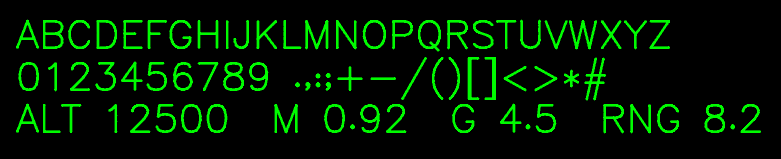

The credit lines the sim's setup wizard (Attributions) and its credits roll show: "Heebo font by Oded Ezer, © 2014 The
Heebo Project Authors, SIL Open Font License 1.1"; for Hershey, the two acknowledgements its terms ask for
(`iaf-2026/data/fonts/HERSHEY.txt`, [docs/credits.md](../../docs/credits.md) "Modern IAF's font").

### 5.1 The HUD's light (2026-11-09)

The user's approval (Approvals A10, proposal 7): "fix the green of the HUD, should be adjustable I think in real".
`Settings.hud_daylight()` is true in the sim ([docs/real-hud.md](../../docs/real-hud.md#modern-iafs-hud-light) has
the sources and the values):
- the HUD in the P43 green, 40 / 255 / 50, at the day level by day, falling to the night floor (136 / 255 of it) as
  the sun sets;
- the symbols added to the scene's light (blend_add), a faint halo under each, a 0.08° stroke;
- the combiner glass 14 % opaque in a faint cool magenta. The glass's edge line needs a rebuild of `f16.glb`: open;
- the day level is Preferences → Graphics "HUD brightness" ([front-end.md](front-end.md) §4), stored in the sim's
  settings; Shift + H ("Step HUD brightness", `data/keys.json` record 46, the laptop map the same) steps it in
  eighths in flight, as the real jet's SYM wheel.

The F-35I's helmet keeps its own green. The Sufa at the look study's Shoham pose (HDG 100, 240 m), before and after,
16:58 and 22:00:

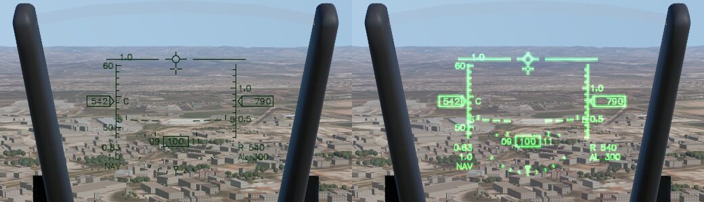
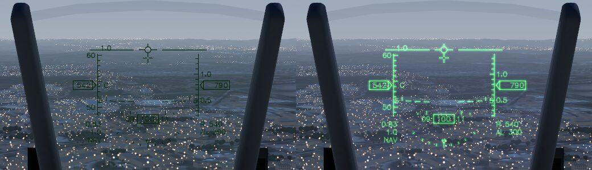

`tests/godot/test_hud.gd` checks the colours (the P43 green by day, the floor at night, the original game's darkest
green at its start); `iaf-2026/tests/test_mvp.gd` `_hud_light` checks them in the sim's cockpit with the key's steps,
the additive blend and the glass.

## 6. Tests and pictures
- `tests/godot/test_cockpit_no_panel.gd`: the profile on the sim's own cockpit dirs (`iaf-sim own`'s), the Sufa, the
  Barak and the F-35I: no panel art loaded, every display file from the sim's dir, the 3D cockpit in the jet's own
  model, the MFDs or PCD drawing into their screens, the HUD and the RWR scope drawn, an F-key snap turning the head,
  Hershey Simplex (`HUD_FONT`) on the HUD's texts and the screens.
- `tests/godot/_cockpit3d_shot.gd` with `C3D_SIM=1`, run with `--path iaf-2026`: the same in a real render, a free
  flight 1,500 m over the Negev west of Beersheba heading 060° (ahead, left, right, down, back and more;
  `C3D_HOUR=22` the night; `C3D_JET=f35i` the F-35I).

### 6.1 The pictures (2026-11-09)

Each picture: ahead, left (80° left, 30° down), right; back, down (25° down; the F-35I's 20°). The sim's key hint
strip ("Esc Pause menu") is part of the view.

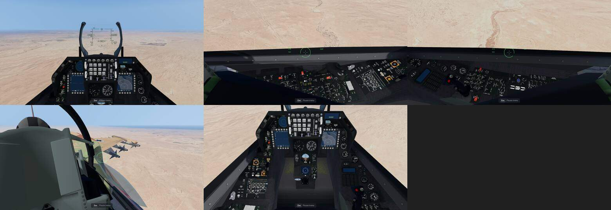
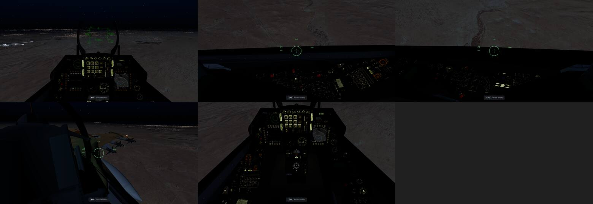

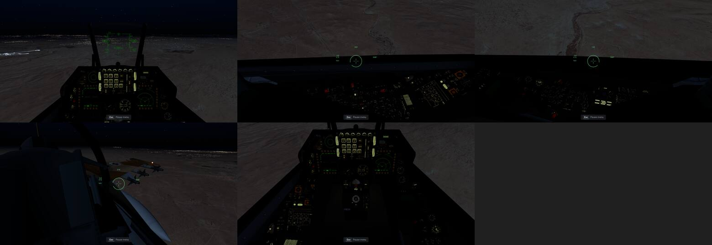
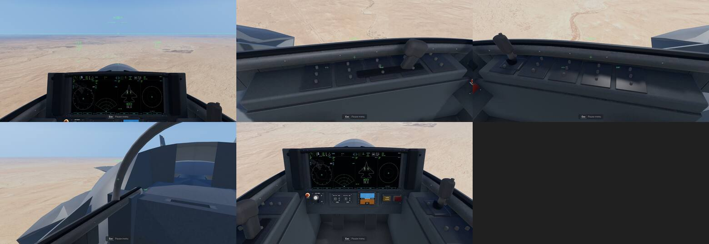
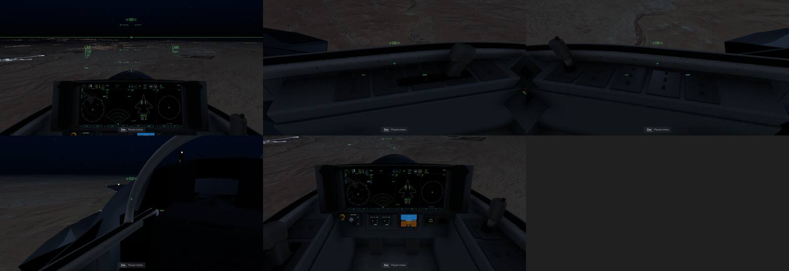

What each view shows, against the cockpit photos the docs use (docs/f16i.md, docs/f35i.md, docs/cockpit.md
"3D cockpit"):
- **Ahead (the F-16s):** the HUD's symbology in Hershey Simplex on the combiner, both MFDs live, the ICP, the DED and
  the RWR scope; no 2D art. As the photos: the frame, the ICP over the two MFDs. These pictures predate the
  HUD's light (§5.1): by day the HUD's green is the original's darkest; at night it is lifted and the flood light
  and backlit labels are on.
- **Left and right (the F-16s):** the side consoles under the canopy sill, the DASH helmet's cue and its numbers on
  the canopy. As the photos' consoles; the panels are FlightGear's flat sheet (no depth in the knobs).
- **Back (the F-16s):** the seat's headrest, the rear cockpit's helmet, the wing with the AIM-9Ms on 9, 8 and 7, the
  canopy frame.
- **Down (the F-16s):** the whole front panel, the gear panel left of the centre pedestal and the side-stick on the right console. The standby ADI ball is
  the model's.
- **The F-35I:** the panoramic display's four portals (TSD, radar, stores, threat display), the helmet's symbology
  over the whole view (its thin green over bright sand is faint, as a real helmet display by day), the side consoles
  with the stick and throttle, the standby display. The back view's seat is a plain block (f35i.md §4.5).

The displays' maps and the RWR glyphs against their references (the RWR sheet beside the 1998 one, docs/rwr.md §4;
the TSD map's reference picture in §8):

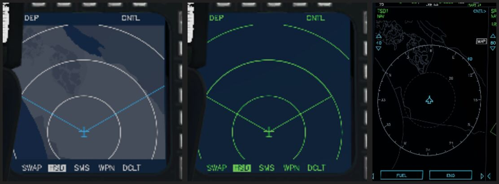
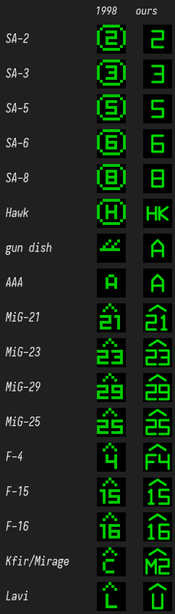

### 6.2 The cockpit at the origin (2026-11-09, the Mac play test's finding 25)

The flight's world is in 32-bit floats about the flight's start (`terrain_view.gd` `world_origin`), so far from the
start every vertex of the cockpit rounds to the step of the jet's position, which the eye 0.5–1 m away sees: the whole
cockpit jumped against the eye ("the entire cockpit shakes", the user on the Mac). The sim draws the cockpit-view
model (with the 3D cockpit, the HUD glass, the stores and the lights on it) in its own world about the origin
(`shared/cockpit/cockpit_origin.gd`, `Settings.cockpit_at_origin()`; the original game keeps it in the flight's world):
- a SubViewport the size of the screen draws that world through a camera that copies the flight camera's place and
  turn in the rig (the head look, the ground clamp), its projection (`cockpit.gd`'s frustum with its offset) and the
  rig's attitude, so the world's directions are the same in both and the sun needs no turning;
- that world's sun copies the flight's direction, colour and energy every frame (one shadow map over 8 m: the canopy
  frame, the HUD and the seat on the panel); its environment copies the flight's once a second (the sky's ambient
  light) without fog, tonemap or glow;
- its picture, linear and untonemapped with its alpha, is laid over the flight's 3D view by a full-screen quad drawn
  last in that view (`cockpit_composite.gdshader`), so the flight's auto exposure, tonemap and anti-aliasing apply to
  the cockpit as before, and the clouds, rain and effects stay outside the canopy; the 2D layers (the HUD symbology,
  the night vision goggles) lie over both as before; the quad is on the clouds' layer, which the EO sensor's camera
  leaves out, so the TV picture on the MFD shows no cockpit;
- the HUD's clip and the screens' clicks project through that world's camera (`cockpit3d.gd` `camera`), the wingtip
  vapour takes the cockpit's place in the flight's world (`terrain_view.gd` `vapour_state`).

The lights of the flight's world (flares, the muzzle flash, airbase lamps) do not reach the cockpit (inferred: the
cockpit is lit by the sun, the sky and its own flood and panel lights).

Measured by `iaf-2026/tests/_cockpit_shake_probe.gd` (a real render of mission 2012 at 1920 × 1080 on the Iris Xe,
the flight model stopped, the rig moved 0.5 mm a frame D km from the start, 40 frames; the pixel change is the mean
grey-level change between successive frames):

| D | camera ↔ cockpit moved, before / after | panel pixel change per frame, median / max, before | after |
|---|---|---|---|
| 0 | 0.25 mm / 0 | 0.47 / 1.99 | 0 / 0.49 |
| 15 km | 1.1 mm / 0 | 1.14 / 6.8 | 0 / 0.004 |
| 30 km | 3.1 mm / 0 | 0 / 10.5 | 0 / 0.004 |
| 60 km | 4.4 mm / 0 | 0 / 15.5 | 0 / 0.011 |

The worst frame-to-frame change 60 km out, 8× brighter (left: in the flight's world, the cockpit jumps as one piece;
right: in its own world, the cockpit black; what changes there is a terrain tile loading and the info line), and the
view there in both (the same frame):

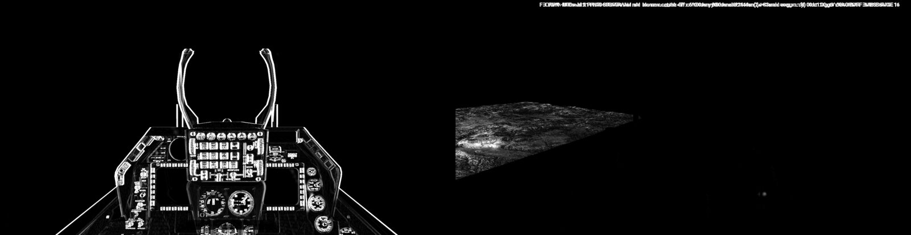
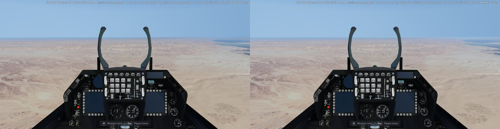

**Cost** (the same probe, the GPU time each viewport takes, 120 frames at the start): before, the flight's viewport
18.8–19.4 ms; after, the flight's 14.3–15.9 ms and the cockpit's 7.7–8.9 ms, so about +4 to +5 ms a frame on the
Iris Xe. Of the cockpit's, MSAA 4× (as the flight's) is about 3.2 ms, its shadow 1.5 ms, the sky's ambient 1 ms
(each measured off once). Kept: MSAA for the panel's printed labels (open: FXAA in the cockpit's viewport instead).

## 7. Open
- The F-16s' HUD field (§4) is sized to fit the 3D combiners, smaller than the real HUDs' 20° × 13.5°.
- The gun cross's place under the boresight (inferred).

## 8. Display data

Each jet's cockpit dir holds only what the 3D cockpit's screens draw. Nothing in it comes from the original game's
cockpit folders: the map is OpenStreetMap data, the art is our own drawing. The data lives in
`iaf-2026/data/planes/_shared/cockpit/` (the map and the art, the same for every jet) and
`iaf-2026/data/planes/<jet>/cockpit/` (the jet's layout); `iaf-sim own` compiles both into
`converted/own/cockpits/<jet>/`, the folder the shared readers take as the cockpit dir
([data-formats.md](data-formats.md) §14). The layout has no `"Shared"` key, so every file is read from that folder.

| file (compiled) | read by | what it is | jets | size |
|---|---|---|---|---|
| `rwrsymb.png` | `cockpit.gd draw_rwr_symbols` (the RWR scope) | the RWR glyph sheet: 17 slots of 10 × 10 at scale 4 (40 × 680), green on transparent | the F-16s' RWR scope; the F-35I's copy is not read (its threat display, `pcd_formats.gd` TWD, writes the same codes as text in the display font) | 3 KB |
| `adi.png` | `cockpit.gd _draw_adi`, `lens_adi.gdshader` ([LENHORIZON]) | the attitude ball, 128 × 128 at scale 4 (512 × 512) | all three (the F-35I's layout has no [LENHORIZON], so it never reads it) | 8 KB |
| `map.json` | `cockpit.gd _load_tsd_map` → the HSD (`f16_mfd.gd`), the TSD page (`mfd.gd`), the PCD's TSD (`pcd_formats.gd`) | the TSD map's polygons (EMF-JSON) in the sim's UTM frame | all three | 186 KB |
| `isr.png` | `mfd.gd _isr` (the GM picture under the radar's MAP mode) | land lit, water black, 640 × 832 at 640 m a pixel; its frame is the layout's `MAPFRAME`, which `iaf-sim own` adds | all three | 7 KB |
| `mfds.png` | `mfd.gd _blit` (the 1998 pages' tiles, range and compass sprites), `hud.gd` (the 5 × 5 font, the gun pipper) | the MFD atlas, 264 × 924 at scale 4 (1056 × 3696) | all three | 50 KB |
| `cockpit.json` | `cockpit.gd load_cockpit` | the layout (§4) | all three | 1 KB |

The real formats (the F-16's MFDs, the F-35I's PCD) draw their own vector symbology on a black screen; they take no
background picture from the cockpit dir. The MFD atlas serves the 1998 pages and HUD, which the sim does not show; it
is there so a page or HUD that reaches for it finds our own art.

### MFD atlas

The original `mfds.bmp`'s layout (docs/mfd.md §1), so every source rect the readers cut maps the same: 13 tiles of
132 × 132 (the blank page, RWR, stores, A-A radar, TSD, MAP, FLIR, GMT, TV and four unused) and the sprites in the
corner (the gun pipper, the NAV list's arrows, the 5 × 5 font, the range numbers, the compass letters). Ours: black
screens with rounded corners, the marks in the MFD green (0, 255, 0), labels in our own pixel font (4 × 5 glyphs and a
blank column: A–Z, 0–9 and `. : + - %`; the range numbers 3 × 5, the compass letters 5 × 7). The ground map's fan and
the sensor pages' video box are transparent, so the picture under them shows, as through the original's colour key.
Source: `tools/iaf-2026/cockpit/mfds.svg`.

### RWR glyph sheet

The slots keep the original sheet's order (docs/rwr.md §4, docs/mfd.md "RWR"), so `RWR_GLYPH` maps a type code to the
same slot. The symbols follow the F-16's AN/ALR-56M: a threat shows as its number or letters, an airborne emitter
under an inverted V (the "hat")[^uoaf]; the US tables may differ from the IAF's F-16s[^uoaf]. Which symbol each
type shows:

| slot (y) | type codes | ours | 1998 |
|---|---|---|---|
| 0–40 | 290, 300, 310, 320, 330 (SA-2, -3, -5, -6, -8) | 2, 3, 5, 6, 8 | the number in an octagon |
| 50 | 340 (Hawk) | HK (inferred) | H in an octagon |
| 60 | 360, 380, 390 (gun-dish radar, ships) | A (inferred) | two chevrons |
| 70 | 350 (AAA) | A (inferred) | A |
| 80–110 | 150, 160, 180, 170 (MiG-21, -23, -29, -25) | 21, 23, 29, 25 under the hat | the same |
| 120 | 120, 200 (F-4) | F4 under the hat (inferred) | 4 |
| 130, 140 | 110, 100 (F-15, F-16) | 15, 16 under the hat | the same |
| 150 | 130, 190 (Kfir, Mirage) | M2 under the hat (inferred) | C |
| 160 | 140 (Lavi) | U, an unknown airborne radar, under the hat (inferred) | L |

The glyphs are strokes of a 4 × 6 grid font in the ALR-56M display's green (inferred). The F-35I takes the same sheet:
its threat display's symbols are open. Source: `tools/iaf-2026/cockpit/rwrsymb.svg`.

### ADI ball

The texture `lens_adi.gdshader` samples: columns 64 the centre, the 128 rows 360° of pitch, the horizon at row 62,
nose up toward row 0. Ours: grey sky over black ground with a white horizon, a pitch line every 10°, longer and
numbered (3, 6) every 30°, a ring at the zenith and a crossed ring at the nadir; the lines black on the sky and
white on the ground (the F-16 ADI's grey over black, inferred from cockpit photos). The sim's 3D cockpit draws its
own ADI ball in the model; this file serves a cockpit layout with a [LENHORIZON] section. Source:
`tools/iaf-2026/cockpit/adi.svg`.

### TSD map

The original's map shows the sea and lakes navy, Israel light grey and every other land dark grey. Ours keeps those
colours and adds two greys for the West Bank and Gaza, with OpenStreetMap's geography[^osm]. The data covers both
theatres: the sim's (the UTM 36N box `sim_terrain::BOX`, [terrain.md](terrain.md) §2; 33.08–36.84° E, 29.38–34.04° N)
and the 1998 game's map frame (29.65–38.35° E, 26.99–36.62° N through the georeference), cut at 29.5–38.5° E,
26.85–36.75° N. In the sim each point is in UTM 36N, the sim's world X / Y, and each outline is cut at the box
(`compile_map`), so the map ends with its background where the terrain ends. The original game takes the same map as an
Extras option (Briefing map on Modern, docs/front-end.md §8 "Modern map"): setup's `extras` step compiles it into the
1998 frame (`sim_cockpit::extras`, `Frame::original`), and copies the RWR sheet and the ADI ball for its F-16's real
MFDs (docs/mfd.md §9). Its GM picture takes the terrain from the original's `isr.bmp` (the same 640 × 832 frame): each
land pixel of ours the original's green, the channel the GM page shows; each water pixel dark.

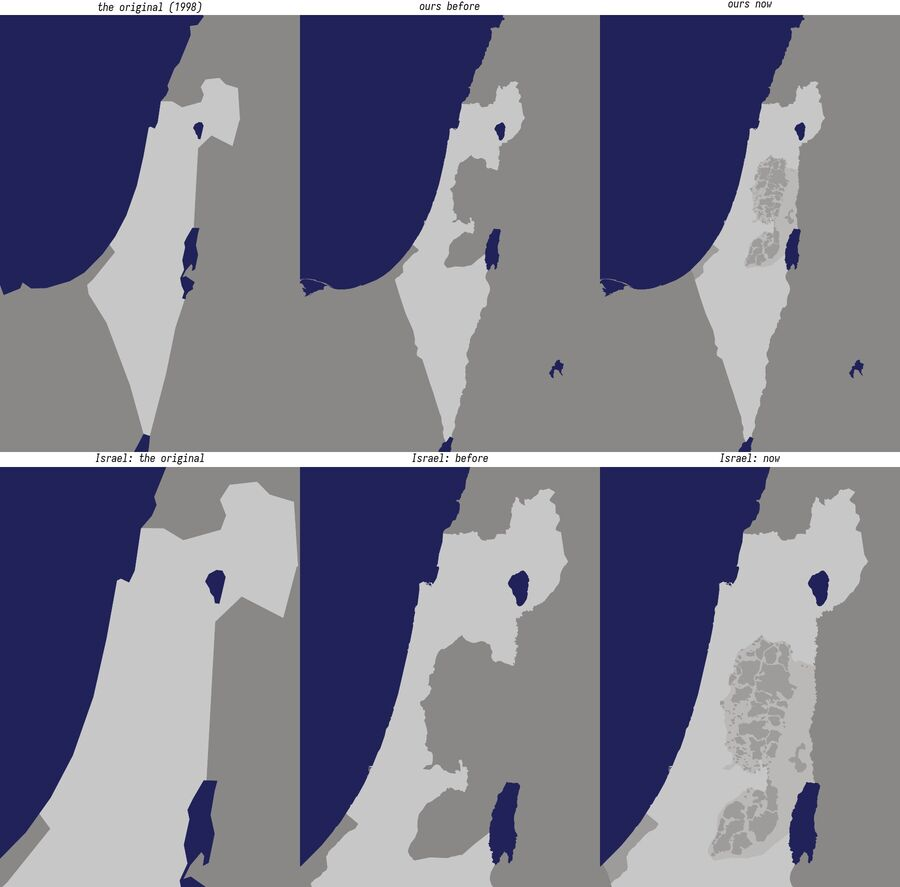

The picture shows each map in longitude / latitude over the theatre (the original's through its frame's corners, so
its edges are approximate); the lower row is Israel, the West Bank and the Golan.

The layers, in paint order:

| layer | colour (RGB) | what it is (OSM) |
|---|---|---|
| `land` | dark grey 137, 136, 135 (the original's) | every land: OSM's simplified land polygons (made from OSM's coastline)[^osmdata] |
| `israel` | light grey 200, 199, 199 (the original's) | Israel: relation 1473946 (boundary=administrative, admin_level=2) |
| `area_c` | light grey 186, 185, 184 | the West Bank's Area C, under Israeli control: relation 3791785 ("Exclusive Israeli control.") |
| `pa` | mid grey 157, 156, 154 | the Palestinian areas outside Israel's control: Area A 3791783 ("Exclusive control of the Palestinian Authority."), Area B 3791784 ("Palestinian civil control and Israeli military control."), Hebron's H1 7391021, and the Gaza Strip 1473938 |
| `lakes` | navy 34, 34, 91 (the original's) | `natural=water` lakes, lagoons and reservoirs of 15 km² or more |

**The user's decision (2026-11-03):** "follow osm, just make sure the west bank you can see what under PA and what
not, golan has updated borders". So:
- **Israel follows OSM.** Its relation holds East Jerusalem and the Golan, and leaves out the rest of the West Bank and
  Gaza. Each boundary layer is its relation's outer rings within the land polygons, so its outline follows the coast.
- **The West Bank** shows who governs each part, from OSM's Oslo II area relations (admin_level=6, source
  geomolg.ps, each with its control in its `description`). Area C's outer ring is the whole West Bank but East
  Jerusalem; the PA's areas are painted over it, in the place of its holes. Hebron's H2 (Israeli control) is a hole in
  Area C that no PA relation covers, so it stays Area C's colour. The colour rule: OSM draws Area C outside Israel's
  border, so it has its own colour, one step darker than Israel's (Israeli control); the PA's areas take the mid grey
  between Area C and the neighbours, so the PA's patches stand out from the land around them.
- **Gaza** takes the PA's colour. OSM maps it as a region (admin_level=4) of the Palestinian Territories (relation
  1703814, with the West Bank), outside Israel, with no tag on who governs it. The user's decision (2026-11-03):
  Gaza keeps the PA's colour, with the other Palestinian areas outside Israel's control.
- **The Golan** is inside Israel's colour up to the 1974 disengagement line. On Israel's relation, every way of the
  border with Syria is tagged `border_type=disengagement line`, `alt_name=A-Line`, `disputed=yes`, `claimed_by=IL`,
  `disputed_by=SY` (UN resolution 497, UNDOF; edited 2025-11-17). The UNDOF buffer zone east of it (old Quneitra) and
  the Syrian side of Mount Hermon are a neighbour's colour.

Every ring is simplified to about 150 m (under one MFD pixel at the HSD's shortest range, inferred). Islands and lakes
under 2 km² are left out, and the PA's patches under 0.3 km² (about 4 HSD pixels across at its shortest range,
inferred; 59 patches, 8 km² in all). The result: land 29 rings (3694 points), Israel 1 (724), Area C 1 (417), the
PA's areas 164 (2766), lakes 17 (2468); the data file 201 KB, map.json 186 KB (the original game's copy 176 KB). The GM picture (`isr.png`) is the same polygons:
every land at 150 of 255 (the PA's areas too), water 0.

Made by `python3 -I tools/iaf-2026/cockpit_displays.py map [--refetch]` (a generic user agent; the boundary
relations from the OSM API's `relation/<id>/full`, the lakes from the Overpass API; the downloads go to their own
folder, `assets/source/osm/tsd_map/`; GDAL's `ogr2ogr` cuts and simplifies). The relations' versions and the fetch
date are in the file's `source`. The RWR sheet and the ADI are rendered by `cockpit_displays.py art`
(`rsvg-convert`).

### Credits the sim's wizard and credits roll need

"TSD map © OpenStreetMap contributors, available under the Open Database Licence (ODbL) 1.0:
openstreetmap.org/copyright" (also in [docs/credits.md](../../docs/credits.md)).

### Open

- `mfd.gd crisp_sprite` reads the RWR glyphs from the install's `rwrsymb.bmp` (Better cockpit "crisp MFD", the 1998
  pages only); the sim does not use it.
- The sim's GM picture: every land at one brightness; its relief and cities are open (the original game's copy takes
  the original's shading, §8 "TSD map").
- The F-35I's threat symbols.
- Rivers are not drawn; the Suez Canal shows only where the land polygons leave it open (a thin line).

[^uoaf]: UOAF codex, "RWR" (Falcon BMS community reference of the US AN/ALR-56: airborne emitters "displayed with an
    inverted V on top of them", "U" unknown and "S" search radars; "Symbology may differ on foreign F16 (IAF, EAF,
    BAF etc ...)"): https://codex.uoaf.net/oldcodex/pages/main/rwr--p746.html
[^osm]: OpenStreetMap contributors, ODbL 1.0, https://www.openstreetmap.org/copyright (the relations Israel 1473946 v345, Area A 3791783 v84, Area B 3791784 v105, Area C 3791785 v182, Hebron H1 7391021 v15, the Gaza Strip 1473938 v101 via the OSM API, fetched 2026-11-03; the lakes via the Overpass API, OSM data of 2026-11-02; the land polygons fetched 2026-11-03).
[^osmdata]: OpenStreetMap Data, "Land polygons" (simplified, EPSG:3857; derived from OSM, ODbL 1.0):
    https://osmdata.openstreetmap.de/data/land-polygons.html

[^hershey]: hershey-fonts, Kamal Mostafa (`futural.jhf`; the Hershey Fonts licence in `COPYING`): https://github.com/kamalmostafa/hershey-fonts
[^heebo]: Heebo, Google Fonts' repository `ofl/heebo` (version 3.100, from github.com/OdedEzer/heebo at 76c7d53; OFL.txt): https://github.com/google/fonts/tree/main/ofl/heebo
