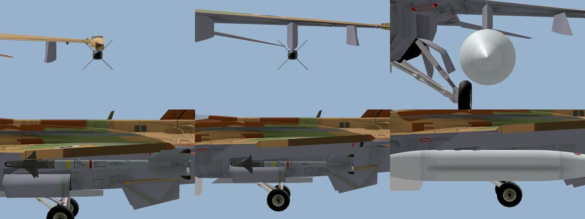
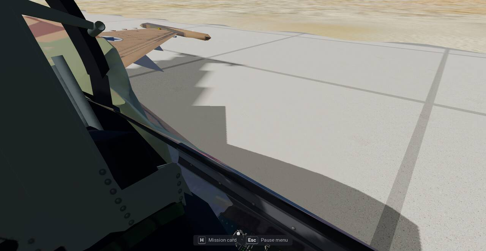
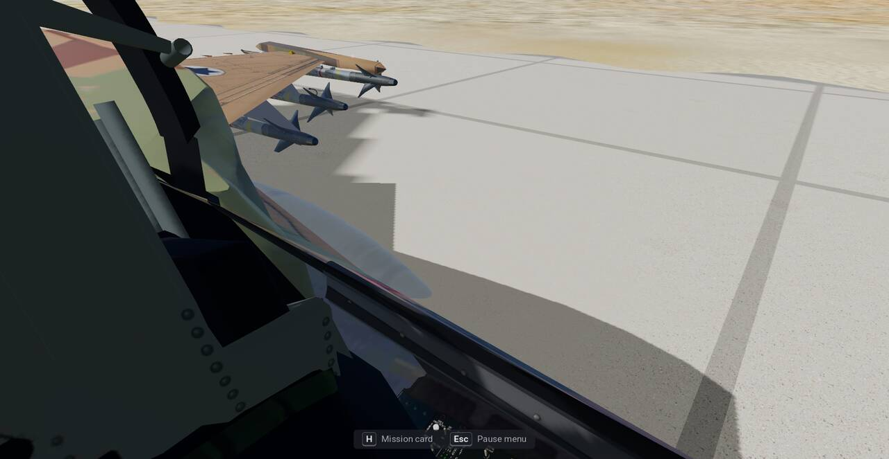

# Modern IAF data formats

**Terms:** bdb = the object database the missions name (a converted `.bdb`, docs/formats/mis.md §4); hex key = a
field name of the converted JSON (`"0x514"`); Present record = a model entry of the bdb; engine frame = the game's
world metres (X east, Y north); the sim's is UTM 36N itself ([terrain.md](terrain.md) §2); "inferred" = our own reasoning; "open" = no source found.

Modern IAF keeps its units, weapons and missions as readable JSON under `iaf-2026/data/`. The compiler `iaf-sim`
(`crates/iaf-tools/src/sim.rs`, bin `iaf-sim`) turns them into the files the shared readers already read, so no
reader changes. This document gives each format, one full example and the compiled output.

```sh
cargo run -p iaf-tools --bin iaf-sim -- all [iaf-2026/data] [assets]   # or db / own / fm / airbases / missions alone
```

| step | reads | writes (under `assets/`) |
|---|---|---|
| `iaf-sim db` | `data/db/units/*.json`, `data/db/weapons/*.json` (not the drafts in `data/db/drafts/`, §11) | `converted/missions/sim.bdb.json`; the key `"sim.bdb"` of `converted/objects/objects.json` (the other keys stay); `converted/own/resource/weaponsmotion/weapons.ibx` |
| `iaf-sim missions` | `data/missions/*.json`, the units | `converted/iaf-2026/missions/<id>.json`, `converted/iaf-2026/missions/missionlist.json` (menu id → `[<id>]`) |
| `iaf-sim airbases` | `data/airbases/*.json`, the terrain's heights (`converted/terrain/israel/`) | `converted/terrain/israel/airbases.json` and `airbases/<base>.png`, `converted/own/iaf.ibx`, `converted/own/terraintype.dat` (§12) |
| `iaf-sim terrain` | `data/airbases/*.json` (the outlines); `source/dem/` (GLO-30), `source/imagery/sentinel2/` (WorldCover tiles and listings, shared with the original game's imagery setup), `source/imagery/mapi2015/` (the Survey sheets); what is missing in the first two is downloaded into them ([terrain.md](terrain.md) §1.1) | `converted/terrain/israel/` (`L<l>/c_*.jpg`, `L<l>/h_*.png`, `meta.json`, `.work/`) |
| `iaf-sim own` | `data/sounds/soundprop.json`, `data/sounds/voices.json`, `data/sounds/*.wav`, `data/keys.json`, `data/planes/_shared/cockpit/`, `data/planes/<jet>/cockpit/` | `converted/own/resource/soundfiles/` (`soundprop.trx`, `phrasetemplates.trx`, `phraseparticalsdata.trx`, the clips; other files there are removed), `converted/own/keys.json` ([sound.md](sound.md)), `converted/own/planes/` (the F-16's aircraft descriptor from our model, `shared/extra/models/f16/f16d.glb`), `converted/own/cockpits/<jet>/` (§14) |
| `iaf-sim fm` | nothing: NASA TP-1538 and the public figures are in `crates/iaf-tools/src/sim_fm0.rs` | `converted/own/resource/md/bd.ibx`, `f16.dat`, `f15.dat` ([flight-model.md](flight-model.md)) |

`iaf-sim all` runs db, own, fm, airbases (once the terrain is built: `iaf-sim terrain`) and missions. Nothing is read
from `assets/install` or the exe. Places are the airbase files' (§10) and the missions' own lat / lon, projected to
UTM 36N.

## 1. Rules every file follows
- **Sources.** Every figure has an entry in `sources`, by field name (a nested one by a dotted name:
  `"motion._limitVel"`, `"loadout.20mm"`, `"start.lat"`). The entry is a footnote name of the file's `footnotes`,
  `"inferred"` or `"open"`, or several of them joined by commas. The compiler refuses a figure without one.
  In a mission the figures are the time, the wind, the start's place, heading and elevation, and the route (one
  source for a whole route); each flight (`start.*`, `route`) and each target or SAM site (`lat`, `lon`, `heading`,
  `alt_m`, `route`, `speed_kmh`) holds its own `sources`, naming the mission's footnotes.
- **Open values.** A field the format needs but no source gives holds a value marked `"open"`, and `notes` says
  what holds it until a source is found.
- **Notes.** `notes` explains a value by field name. No compiler reads it.
- **Numbers.** `number` is the record's id in the compiled bdb (1–999, unique per kind). Missions and loadouts
  name units and weapons by `id`, never by number.

## 2. The readable → hex mapping
One table in `sim.rs`, `FIELDS`, maps every readable field to its hex key; `CLASSES`, `KINDS` and `SIDES` map the
named values to codes. The Objects fields whose meaning is open (`OBJECT_REST`) get the format's usual values; no
reader takes them.

| record | readable | hex | named values |
|---|---|---|---|
| unit | `id`, `category` (from `class`), `label`, `brain`, `radius_m`, `strength`, `collider`, `class`, `type` | `0x514`, `0x51e`, `0x528`, `0x532`, `0x564`, `0x56e`, `0x58c`, `0x5aa`, `0x5b4` | class `fighter` 0x1c "Controlled aircraft", `radar_sam` 8 "Radar sam", `ir_sam` 9 "Infra red sam", `aaa` 10 "Gundish", `ground_radar` 11 "Ground radar" |
| unit (model) | `id`, `model`, `scale` | Present `0x640`, `0x64a`, `0x65e`; the unit's `0x53c` = its number | — |
| weapon | `name`, `kind`, `model`, `drag`, `power`, `blast_m`, `kg` (→ pounds), `generation`, type (from `kind`) | `0x708`, `0x712`, `0x730`, `0x73a`, `0x744`, `0x74e`, `0x758`, `0x762`, `0x780` | `gun` 565, `chaff` 540, `flare` 550, `ir_missile` 570, `bomb` 500, `radar_missile` 600, `semi_radar_missile` 610, `ir_sam` 620, `radar_sam` 630, `tank` 660 |
| mission | `title.en`, `time`, `wind_kt`, `wind_from`, `win.en`, `lose.en`, `category` | misc `0x44c`, `0x460`, `0x46a`, `0x474`, `0x47e`, `0x492`, `0x4d8` | — |
| placed unit | name, unit, side, x, y, `alt_m`, `heading` | `0x2bc`, `0x2c6`, `0x2d0`, `0x2e4`, `0x2ee`, `0x2f8`, `0x302` | side `blue` 1, `red` 2 |

## 3. Units: `data/db/units/<id>.json`
A unit record holds what a mission needs of a unit. A flyable jet's behaviour stays in its aircraft definition
(`shared/extra/planes/<id>/airframe.json`); the record names it in `airframe`.

| field | meaning |
|---|---|
| `id`, `number`, `name`, `label` | the unit's id, bdb number, full name and short label |
| `class` | the bdb class by name (§2) |
| `type` | the type code the shared code keys on; codes from 1000 are ours (docs/adding-a-plane.md §1) |
| `airframe` | the aircraft definition of a flyable jet; the compiler checks it exists and writes it unhexed as `"airframe"` in the Objects row |
| `model`, `scale` | the model under `assets/converted/objects/` (empty: none) and its drawn scale (1 = true size) |
| `radius_m` | the unit's radius; the blast rules take half of it (docs/damage.md §2.1) |
| `strength` | hit points on our damage scale (§6) |
| `loadout` | weapon id → count for the gun, chaff and flare stations (9–11); a unit with an `airframe` must give its gun rounds, the count the sim's gun fires down to empty ([weapons.md](weapons.md) §1) |
| `pylons` | station `A`..`I` → `{"weapon", "count"}` (the F-16s: an AIM-9M on A, B, C, G, H and I, a 370 US gal tank on D and F) |
| `range_km`, `min_range_km`, `ceiling_m`, `floor_m`, `speed_ms`, `mach`, `radar_km`, `g_limit`, `warhead_kg` | the threat set's figures (threats.md §6), checked for sources. `radar_km`, the unit's sensor reach, is compiled unhexed as `"radar_km"` into its Objects row, and the AI takes it before the type code's range (`combat.gd` `sensor_nm`); no shared reader takes the others yet |
| `status` | only in a draft: `"pending the user's decision"` (§11) |

The three MVP jets: the Sufa (`f16i`, number 1, type 100), the Barak (`f16d`, 2, type 100) and the F-35I (`f35i`,
3, type 1000). The Sufa and the Barak share the F-16's type code, which the shared code keys the F-16 family on;
their aircraft definitions tell them apart. `airframe::id_for(100, …)` picks `f16` or `f16i` by the F-16 switch alone, so the sim's settings set that switch from the player's Objects row's `"airframe"`: `Settings.set_jet(airframe)` in `iaf-2026/sim_settings.gd` (item A1, 2026-11-02). They carry the gun, chaff and flare; the F-35I carries no pylon stores. Their `model`
is empty: the player's jet is drawn from its aircraft definition, and the sim's own model index comes later.

**The F-16s' loadout (2026-11-08).** The Sufa and the Barak carry an AIM-9M on each wingtip rail, stations 1 and 9
(`pylons` A and I), an AIM-9M on each underwing missile station, 2 / 8 (B, H) and 3 / 7 (C, G), and a 370 US gal tank
on each wing's inboard pylon, stations 4 and 6 (D and F). The F-16's two
wingtip rails carry its short-range missiles[^w-f16], and the Sufa's two wingtip missiles are standard[^mf-f16i]. The
Sufa's usual missile is the Python 5[^aft-f16i]; the sim has no Python 5 record yet, so the AIM-9M stands in (inferred).
The F-16 carries AIM-9s and AIM-120s on 2 / 8 and 3 / 7, one
each[^f16net-aim9][^f16net-aim120]. The sim has records of neither the Python nor the AIM-120, so the AIM-9M stands in
on both: for the Python on 2 / 8, for the AIM-120 on 3 / 7 (stand-ins; which missile the IAF hangs on which station is
inferred). The F-16 carries two 370 US gal wing tanks[^f16net-tanks], and the Sufa's stores include them[^ipms-f16i]; that they fly
on most training flights is inferred. No other underwing stores. The F-35I stays clean.

The tank (`data/db/weapons/tank-370.json`, kind `tank`: type 660, "Shell") is named for the fuel it holds in pounds,
`2470LB`, as the original's tanks are (`2700LB`): a weapon whose name holds LB is a tank, and its weight is fuel
(`stores.rs` `is_tank`). 370 US gal (1400.6 l) of JP-8 at 0.80 kg/l (the density inferred) is 1120 kg, its `kg`. The
tank's own 443 lb (201 kg) empty weight, 18¼ ft (5.56 m) length and 26½ in (0.673 m) diameter[^f16net-tanks] are
recorded in its notes; the stores code counts a tank's weight as fuel only, as the original does. The sim
always runs with the stores weight fix (`sim_settings.gd` `_apply_profile`), so a store's weight and a tank's fuel
count in kg: each tank adds 1120 kg of fuel, not the original's pounds number as kg (2470). Its drag is open (0).

The AIM-9M's and the tank's `model` are the original's file names (`weapons/aim9/aim9_m.gltf`,
`weapons/f16ftk/f16ftk_m.gltf`), which Models: Detailed draws as ours (`shared/extra/models/stores/aim9.glb`,
`f16ftk.glb`, FlightGear's AIM-9 and 370G tank, aircraft-models.md §5). Without the install a store hangs by its own
origin (`player_weapons.gd` `_pilon_of`). The sim's F-16 descriptor (`iaf-sim own`) puts the four stations where those
origins go on our model (`sim.rs` `F16_SIM_STATIONS`): the model's own helpers are the original's, which held the
AIM-9 about a missile diameter above and outboard of our rails and the tank's top inside the wing.

- Stations 1 and 9: under the launcher rails, the AIM-9's axis one body radius below the rail, on its middle (the hang
  under the rail inferred from the F-16's LAU-129).
- Stations 2 / 8 and 3 / 7: the AIM-9's axis one body radius below the pylon's bottom, on its middle (inferred, as
  at the rails).
- Stations 4 and 6: the tank's top on the inboard pylon's bottom, on the pylon's middle.

Outside, the left wingtip, station 3 and the left tank (left to right), from the front and from the side:



The Mac play test (2026-11-08) showed the bare rail as a beige block and the bare middle pylon (station 3 / 7) as a hard
edge from the cockpit. Looking back right from the Sufa's 3D cockpit at Ramon:

| Before: the empty wingtip rail and pylons | After: the AIM-9Ms on the rail and pylons, the tank under the wing |
|---|---|
|  |  |

Example, `iaf-2026/data/db/units/f16i.json`:
```json
{
  "id": "f16i",
  "number": 1,
  "name": "F-16I Sufa",
  "label": "F-16I",
  "class": "fighter",
  "type": 100,
  "airframe": "f16i",
  "model": "",
  "scale": 1.0,
  "radius_m": 4.98,
  "strength": 300,
  "loadout": { "20mm": 511, "chaff": 60, "flare": 60 },
  "pylons": {
    "A": { "weapon": "aim-9m", "count": 1 },
    "B": { "weapon": "aim-9m", "count": 1 },
    "C": { "weapon": "aim-9m", "count": 1 },
    "D": { "weapon": "tank-370", "count": 1 },
    "F": { "weapon": "tank-370", "count": 1 },
    "G": { "weapon": "aim-9m", "count": 1 },
    "H": { "weapon": "aim-9m", "count": 1 },
    "I": { "weapon": "aim-9m", "count": 1 }
  },
  "sources": {
    "type": "inferred",
    "scale": "inferred",
    "radius_m": "w-f16",
    "strength": "inferred",
    "loadout.20mm": "gdots-f16",
    "loadout.chaff": "open",
    "loadout.flare": "open",
    "pylons": "w-f16, mf-f16i, aft-f16i, ipms-f16i, inferred, f16net-aim9, f16net-aim120"
  },
  "notes": {
    "type": "the F-16's type code, the one the shared code keys the F-16 family on; the airframe definition f16i makes it the Sufa",
    "model": "none: the player's jet is drawn from its airframe definition (shared/extra/planes/f16i/airframe.json)",
    "scale": "1: our models are built true size",
    "radius_m": "half the span over the wingtip rails, 9.96 m",
    "strength": "our damage scale's fighter (iaf-2026/docs/data-formats.md, damage scale)",
    "loadout.20mm": "M61A1, 511 rounds (the F-16's; the two-seat Sufa's count is not published, inferred the same)",
    "loadout.chaff": "no public count found; 60 held until one is",
    "loadout.flare": "no public count found; 60 held until one is",
    "pylons": "an AIM-9M on each wingtip rail (stations 1 and 9, A and I): the F-16's wingtip rails carry its short-range missiles; the Sufa's two wingtip missiles are standard (mf-f16i), its usual one the Python 5 (aft-f16i), which the sim has no record of yet, so the AIM-9M stands in (inferred); a 370 US gal tank on each wing's inboard station (stations 4 and 6, D and F; the Sufa's options list two 370 gal wing tanks, ipms-f16i), carried on most flights (inferred); no other underwing stores in training (inferred); an AIM-9M on each underwing missile station, 2 / 8 (B, H) and 3 / 7 (C, G): the F-16 carries AIM-9s and AIM-120s there (f16net-aim9, f16net-aim120); on 2 / 8 the AIM-9M stands in for the IAF's Python (aft-f16i on the Sufa, inferred on the Barak), on 3 / 7 for an AIM-120, which the sim has no record of yet (stand-ins, inferred)"
  },
  "footnotes": {
    "w-f16": "Wikipedia, \"General Dynamics F-16 Fighting Falcon\" (span 32 ft 8 in, 9.96 m), https://en.wikipedia.org/wiki/General_Dynamics_F-16_Fighting_Falcon",
    "gdots-f16": "General Dynamics OTS, \"F-16 20mm Gatling gun system\" (511 rounds), https://www.gd-ots.com/wp-content/uploads/2017/11/F-16.pdf",
    "mf-f16i": "MilitaryFactory, \"Lockheed F-16I Sufa (Storm)\" (2 x short-range air-to-air missiles on wingtip launchers), https://www.militaryfactory.com/aircraft/detail.php?aircraft_id=2191",
    "ipms-f16i": "IPMS USA, \"F-16I Sufa Part 1\" (the Sufa's stores: 2 x 370 gallon wing tanks, 2 x 600 gallon wing tanks), https://reviews.ipmsusa.org/review/f-16i-sufa-part-1",
    "aft-f16i": "Airforce Technology, \"F-16I Soufa Multirole Fighter, Israel\" (equipped with the Rafael Python 5), https://www.airforce-technology.com/projects/f-16i-soufa/",
    "f16net-aim9": "F-16.net, \"AIM-9 Sidewinder\" (stations 1 and 9, 2 and 8, 3 and 7; one missile each), https://www.f-16.net/f-16_armament_article1.html",
    "f16net-aim120": "F-16.net, \"AIM-120 AMRAAM\" (stations 1 and 9, 2 and 8, 3 and 7; one missile each), https://www.f-16.net/f-16_armament_article3.html"
  }
}
```

## 4. Weapons: `data/db/weapons/<id>.json`

| field | meaning |
|---|---|
| `id`, `number`, `name` | the weapon's id, bdb number and the name the shared code finds it by |
| `kind` | the weapon kind by name (§2), which gives its type code and station |
| `generation` | the missile generation (weapons.ibx's: 3 = 1983–1995, 4 = from 1995); 0 otherwise |
| `model` | the model under `assets/converted/objects/` (empty: none) |
| `kg` | the weight (compiled to whole pounds, as the bdb holds it); a pylon store's must be above 0 |
| `power`, `blast_m` | the warhead on our damage scale (§6) and the blast's zero-damage edge |
| `drag` | the carriage drag on the jet |
| `motion` | the weapons.ibx fields of its section (`_velocityJump`, `_absAcceleration`, `_reactionTime`, `_fireReleaseInterval`…, docs/weapons.md); a field left out takes the reader's default. Ours: `burn`, which `missile.rs` reads as Weapon data Real's burn (the zone from the distance really travelled) |
| `range_km`, `min_range_km`, `ceiling_m`, `floor_m`, `speed_ms`, `mach`, `g_limit`, `warhead_kg` | the weapon's own figures (range, altitudes, speed, g limit, warhead), checked for sources, not compiled |
| `status` | only in a draft (§11) |

Names and numbers the shared code relies on:
- `"20 MM"` (number 25), `"Chaff"` (33) and `"Flare"` (34): `player_aircraft.gd` `f35i_object` loads these numbers,
  and `real_weapons.gd` keys the M61A1 on the name.
- `"AIM-9M"` and `"MK-84"`: `modern_weapons.gd` builds the AIM-9X on the first and the GBU-31, BLU109, GBU-39 and
  GBU-28 on the second, by name. The Python 5 (on `"PYTH-4"`), GBU-32 (`"MK-83"`) and GBU-38 (`"MK-82"`) wait for
  their base records (item D2).

weapons.ibx gets one `[WEAPONnnn]` section per weapon with `type = generation · 1000 + type code`, and the first
weapon of each type code also as that code's default section (`weapon_db.gd motion_for` falls back to it), unless a
generation-0 weapon of that code has its own; two weapons on one section are refused. The sim reads this file
through `weapon_db.gd`, which takes weapons.ibx under `Settings.own_dir()`: `converted/own/` in the sim (item A1),
the install in the original game.

Example, `iaf-2026/data/db/weapons/aim-9m.json`:
```json
{
  "id": "aim-9m",
  "number": 1,
  "name": "AIM-9M",
  "kind": "ir_missile",
  "generation": 3,
  "model": "",
  "kg": 86,
  "power": 400,
  "blast_m": 9,
  "drag": 0,
  "motion": {
    "_chaseType": 2.0,
    "_absAcceleration": 120.0,
    "_spiralAccelBeta": 0.141,
    "_timeAcceleration": 19.7,
    "_timeConstVel": 0.0,
    "_timeDecceleration": 0.0,
    "_timeConstOrientation": 0.5
  },
  "sources": {
    "kg": "ds-aim9",
    "power": "inferred",
    "blast_m": "ds-aim9",
    "drag": "open",
    "motion._chaseType": "inferred",
    "motion._absAcceleration": "inferred",
    "motion._spiralAccelBeta": "inferred, ds-aim9",
    "motion._timeAcceleration": "inferred, f16net",
    "motion._timeConstVel": "inferred",
    "motion._timeDecceleration": "inferred",
    "motion._timeConstOrientation": "inferred"
  },
  "notes": {
    "number": "ours; modern_weapons.gd finds its base by the name",
    "name": "the base of the AIM-9X (modern_weapons.gd RECORDS)",
    "generation": "the third generation (weapons.ibx's generations: 1983-1995)",
    "power": "one hit destroys a fighter of strength 300 (our damage scale)",
    "blast_m": "the AIM-9A / B's effective kill radius, about 9 m (the AIM-9M's is not published)",
    "drag": "carriage drag: none until a source gives one",
    "motion._chaseType": "2 = proportional navigation",
    "motion._absAcceleration": "Mach 0.7 to Mach 2.5 in about 5 s of motor burn (the burn time is open)",
    "motion._spiralAccelBeta": "top speed a / beta = Mach 2.5 (851 m/s): 120 / 851",
    "motion._timeAcceleration": "the burn with which the missile flies 17.7 km from 250 m/s before its flight ends 6 s after the burn (real_weapons.gd's rule)",
    "motion._timeConstOrientation": "flies straight 0.5 s off the rail"
  },
  "footnotes": {
    "ds-aim9": "designation-systems.net, \"Raytheon AIM-9 Sidewinder\" (AIM-9L / M 86 kg, Mach 2.5+; AIM-9A / B effective kill radius about 9 m), https://www.designation-systems.net/dusrm/m-9.html",
    "f16net": "F-16.net, \"AIM-9 Sidewinder\" (AIM-9L / M / P 17.7 km), https://www.f-16.net/f-16_armament_article1.html"
  }
}
```

## 5. Missions: `data/missions/<id>.json`

| field | meaning |
|---|---|
| `id` | the compiled file's name (letters, digits, `_`, `-`) |
| `menu_id` | the key in the compiled `missionlist.json`; ours from 2000 |
| `title`, `briefing`, `win`, `lose` | `{"en", "he"}`; the English title and win / lose texts fill the misc header, all four go to the compiled file's own `sim` key |
| `category`, `time`, `wind_kt`, `wind_from` | the misc header: category, start time `HH:MM`, wind |
| `start` | the player's flight (Alpha): `unit`, `count` (1 or 2), `base` (the airbase file's English name without " Airbase": "Ramon", "Ramat David", "Hatzerim", "Nevatim"), `elevation_m` (the altitude when the terrain is not built), and `at`: `"parking"` (the base's parking spot for `unit`, §10; or a spot of its own with `lat`, `lon`, `heading` true), or `"runway"` with `runway` (a designator end, "25R") |
| `route` | the player's waypoints: `lat`, `lon`, `alt_m`, and `speed_kmh` or `t_s`. The compiled waypoint holds the planned arrival time in sim seconds (docs/ai.md §7.2): `t_s`, else the time from the flight's start along the legs at each point's speed. No route gives set_flight's one point 20 km ahead |
| `runway` | the runway the mission's tower clears (kept in `sim` for item E3) |
| `note` | a caveat the compiler prints and keeps in `sim` |
| `training` | the pass / fail rules ([training.md](training.md) §3), kept in `sim`: `kind` (`"startup"` or `"takeoff"`), `time_budget_s`, `end_hold_s` (the mission ends this long after its goal), `goals` (the debrief items the sheet shows, in order; ids of `training::ITEMS`, refused otherwise); a start-up by keys `checklist` (`[{"step", "key", "en", "he"}]`: the steps in order, ids of `training::STEPS`, with the key and the card's line in both languages; training.md §7.1); a take-off also `heading_tolerance_deg`, `empty_kg` and `takeoff_kt` (`[[kg, kt], …]`, rising in kg) and needs `runway`. The compiler parses them and wants a source for each figure (`"training.time_budget_s"` …) |
| `card` | optional, the mission card shown at the flight's start ([front-end.md](front-end.md) §8): `objective` `{"en", "he"}`, one line each, and `keys`, the key records that matter (indexes into `data/keys.json`, 0–124), shown in that order with their labels and keys as bound. In the objective `{key:N}` stands for record N's key ("Cmd" on macOS) and `{runway}` for `runway`. Without it the compiler writes its kind's: start-up `[119, 120, 121, 122, 123, 124, 118]` (the six checklist steps, Mission card), take-off `[47, 117, 7, 16, 15, 12, 22, 37, 38, 24, 25, 20, 118]` (the tower, the start, the throttle, the brakes, the rudder, the stick, the gear). Compiled into `sim.card`; a card without both languages or with a key outside the table is refused |
| `flights` | Bravo..Delta: `unit`, `count`, `start` {`lat`, `lon`, `heading`, `alt_m`}, `route` |
| `targets`, `sam_sites` | placed units: `unit`, `name`, `side` (default red), `lat`, `lon`, `alt_m`, `heading`, optional `route` [{`lat`, `lon`}, at least two] and `speed_kmh`; a target takes role 1, a SAM site role 2 |

How a mission compiles (`sim.rs compile_mission`): an empty mission with the seven parts (`skeleton`), then the
mission editor's builders: `blank`, `set_flight` for Alpha (Player1 at the start, role 0 "must survive") and the
other flights, `add_entity` and `set_role` for the placed units, `set_route` for their routes. A lat / lon becomes
UTM 36N metres (`sim_bases::utm36n`), and a true heading the grid's. The start's altitude is the terrain's ground at
the start (`sim_bases::Ground`, as the game's `height_at`), `elevation_m` without a terrain. The compiled file holds
`"frame": "real"`: its units stand at the real bases already, so no base move touches it. A runway start stands on
the lineup point of that runway end (§12: 100 m past the declared runway's start, inferred), on the runway's heading.

Red flights (`set_red_flight`) wait for the threat set: that builder starts a flight at one of the 1998 game's bases.

The first six missions, two per MVP base (plan.md, MVP): start-up (`<base>_startup`) and take-off (`<base>_takeoff`)
at Ramon (Sufa, menu 2011 / 2012), Ramat David (Barak, 2021 / 2022) and Nevatim (F-35I, 2031 / 2032). Each jet
stands on its base's parking spot for its unit (B2b, 2026-11-03; [airbases.md](airbases.md) §5). The take-off route is
one point 10 km beyond the runway's far end, 900 m above the field. Their pass rules are in `training`
([training.md](training.md)).

Example, `iaf-2026/data/missions/ramon_takeoff.json`:
```json
{
  "category": "training",
  "time": "08:00",
  "wind_kt": 0,
  "wind_from": 0,
  "start": {
    "unit": "f16i",
    "base": "Ramon",
    "at": "parking",
    "lat": 30.7699701,
    "lon": 34.6595291,
    "heading": 337,
    "elevation_m": 648
  },
  "flights": [],
  "targets": [],
  "sam_sites": [],
  "sources": {
    "start.lat": "osm-apron",
    "start.lon": "osm-apron",
    "start.heading": "inferred",
    "start.elevation_m": "oa",
    "route": "inferred"
  },
  "notes": {
    "start": "the centre of an apron by the runways until B2 gives the base's real parking spots",
    "start.heading": "facing the nearest runway",
    "route": "the departure point: 10 km beyond runway 25R's far end on its heading, 900 m above the field"
  },
  "footnotes": {
    "osm-apron": "OpenStreetMap contributors, ODbL 1.0, https://www.openstreetmap.org/copyright: aeroway=apron way 1496591869 (its centre, Overpass API, 2026-11-02), https://www.openstreetmap.org/way/1496591869",
    "oa": "OurAirports, airports.csv (public domain; LLRM elevation 2126 ft), https://davidmegginson.github.io/ourairports-data/airports.csv"
  },
  "id": "ramon_takeoff",
  "menu_id": 2012,
  "title": {
    "en": "Take-off from Ramon",
    "he": "המראה מרמון"
  },
  "briefing": {
    "en": "Ask the tower for start-up, taxi and take-off, taxi to runway 25R and take off on its heading.",
    "he": "בקש מהמגדל התנעה, הסעה והמראה, הסע למסלול 25R והמרא בכיוונו."
  },
  "win": {
    "en": "Mission - successful. Airborne with the gear up.",
    "he": "המשימה הצליחה. באוויר עם כן נסע אסוף."
  },
  "lose": {
    "en": "Mission - failed. Better try again.",
    "he": "המשימה נכשלה. נסה שוב."
  },
  "runway": "25R",
  "route": [
    {
      "lat": 30.73737,
      "lon": 34.55702,
      "alt_m": 1548,
      "speed_kmh": 600
    }
  ]
}
```

## 6. Our damage scale
The shared damage model compares a warhead's power with a unit's strength (docs/damage.md §2). No public source gives
either, so the sim sets its own scale (inferred): a fighter has strength 300 (the value `real_weapons.gd`'s blast
rule assumes), a 20 mm hit does 100 (three hits destroy a fighter), an AIM-9M hit 400 (one hit), and a bomb
50 points per kilogram of explosive (the Mk 84: 429 kg → 21,450). Item D2 calibrates the scale against the threat set.

## 7. Where the compiled files go, and why
- `sim.bdb.json` sits beside the original's `default6_1.bdb.json`, as the brief asks: `MissionRuntime.load_bdb` reads
  `converted/missions/<bdb>.json`, and the bdb's `_file` (`"sim.bdb"`) is how `weapon_db.gd` finds its models in
  `objects.json`.
- The missions go to `converted/iaf-2026/missions/`, not `converted/missions/` (accepted by the orchestrator,
  2026-11-02). The Rust tests that read every
  file in `converted/missions` take each mission there as an original (the calibration of `mission_edit.rs` counts
  the missions that can never pass), and a sub-folder there breaks the ones that read every entry as a file. The
  game today reads only `converted/missions/missionlist.json`; the sim's front end (item A1 / E2) hands a compiled
  mission to the flight as the mission editor's Fly does (`Settings.mission_files_override`), which
  `tests/godot/test_sim_data.gd` uses.
- The original's tools leave the sim's output out: `iaf-convert aircraft` / `objects` skip `sim.bdb.json`
  (`aircraft.rs read_bdbs`), and the scenery's and roads' fingerprint (`scenery.rs converted_inputs`) skips it and
  hashes `objects.json` without its `"sim.bdb"` key, so compiling the sim makes no scenery again.
- `iaf-sim db` changes only the `"sim.bdb"` key of `objects.json`; a missing file starts empty, any other read
  error stops the step. `iaf-convert objects` rewrites the original's keys and keeps the ones it did not write
  (`convert.rs keep_others`), so the two steps run in either order.
- Every JSON file the sim writes is compact, on one line (plan.md: JSON the game reads is compact): `iaf-sim`'s
  outputs, `user://devices.json`, the debriefs in `user://debriefs/` and the pilot log. `objects.json` keeps the
  indented form `iaf-convert objects` gives it, so the original game's converted files and the scenery's
  fingerprint stay as they are. The files a person edits, under `iaf-2026/data/`, are indented. The tests
  `every_data_file_compiles_and_loads` and `own_sounds_and_keys_compile` (`sim.rs`) check every compiled `.json`.

## 8. Checks
- `cargo test -p iaf-tools --lib sim::`: every data file compiles and loads as the game reads it (each entity's unit
  and each station's weapon exist in the bdb, each weapon type has a weapons.ibx section that the ini parser reads,
  the names the modern weapons base on exist, each mission's player must survive); a runway start takes the end its
  number names; a figure without a source is refused.
- `sim::tests::drafts_are_skipped_and_compile_once_approved`: the drafts stay out of the compile and compile cleanly
  once approved (§11).
- `tests/godot/test_sim_data.gd`: runs `target/release/iaf-sim all` itself (`tools/test.sh` builds it; NEEDS DATA
  without it), which writes only the sim's own output into the shared `assets/`; then every compiled mission and sim.bdb through `MissionRuntime`, `PlayerAircraft.object_for` and
  `weapon_db.gd` (with the AIM-9X and GBU-31 built on our bases), each jet's `"airframe"`, every weapon's motion
  section through `weapon_db.gd`'s ibx reader, and the Ramat David start-up loaded into a flight (flown on the
  sim's own terrain and bases by the M0 probe, §12).
- Further unit tests in `sim.rs`: only the player's jet must survive, placed units take the grid heading, a parking
  start takes its base's spot at the terrain's height,
  duplicate ids / too many flights / two weapons on one ibx section are refused, the original's converters skip
  `sim.bdb.json`; in `scenery.rs`: the fingerprint is the same with and without the sim's output.

## 9. Sources of the first data
Each data file holds its own footnotes. The ones the first data uses:
- the bases (`data/airbases/`, §10): OpenStreetMap[^osm]; runway widths and field elevations: OurAirports[^oa];
- the jets' spans and the F-35I's gun: Wikipedia[^w-f16][^w-f35]; the F-16's 511 rounds: General Dynamics OTS[^gdots];
- the M61A1's muzzle velocity[^m61], the AIM-9M[^ds-aim9][^f16net] and the Mk 84[^mk84].

## 10. Airbases: `data/airbases/<icao>.json`

Written by `tools/iaf-2026/osm_airbase.py` from OpenStreetMap and OurAirports ([airbases.md](airbases.md)); compiled
by `iaf-sim airbases` into the theatre's frame (§12). Places are WGS-84 `lat` / `lon`, headings true degrees,
lengths metres; a polygon or polyline is a list of `[lat, lon]`. Every item names its source as §1 asks: `"source"`
(one for the item) or `"sources"` (by field), each a footnote name of the file, `"inferred"` or `"open"`; an OSM
item also holds `"osm"`, its element (`"way/188475529"`).

| field | meaning |
|---|---|
| `icao`, `name` {`en`, `he`}, `osm` | the base; `osm` is its aerodrome way |
| `elevation_m`, `reference` {`lat`, `lon`} | the field elevation and reference point |
| `boundary` | the aerodrome way's ring |
| `runways` | `designator` ("07L/25R"), `osm`, `length_m` (the way's), `length_published_m` (null: none), `width_m`, `surface`, `ends`, `sources` |
| `runways[].ends` | two, the low number first: `designator`, `lat`, `lon` (the way's end), `heading` (toward the other end), `displaced_threshold_m`, `elevation_m` (null: none), `ils` (null: none known), `taxiway_entry_m` (the first taxiway joining from this end, null: none), `runway_start_m` (where the declared runway starts; B2b puts the lineup point from it), `sources` |
| `stopways`, `taxiways` | `osm`, `points` (the centreline); a taxiway may hold `name`, `ref`, `width_m`, `note` |
| `holding_positions` | `osm`, `lat`, `lon` |
| `aprons`, `shelters` | `osm`, `polygon`; a shelter's `kind` is `hangar` (OSM hangar) or `shelter` (OSM bunker) |
| `tower` | `lat`, `lon`, or null (`sources.tower` "open") |
| `lights` | PAPI / approach lights: `kind`, `osm`, `lat`, `lon` (none in OSM at the four bases) |
| `parking` | the start-up spots: `unit` (a unit id, `f15i` for the F-15I), `lat`, `lon`, `heading` (the nose) |
| `sources`, `footnotes` | the base's own sources and the full citations |

Example (parts of `llrm.json`):
```json
{
 "icao": "LLRM",
 "elevation_m": 648,
 "runways": [
  {
   "designator": "07L/25R",
   "osm": "way/188475529",
   "length_m": 2684.9,
   "length_published_m": 2700,
   "width_m": 45.1,
   "ends": [
    {
     "designator": "07L",
     "lat": 30.7728061,
     "lon": 34.6531986,
     "heading": 66.8,
     "displaced_threshold_m": 0.0,
     "elevation_m": 642.5,
     "ils": null,
     "taxiway_entry_m": 0,
     "runway_start_m": 0,
     "sources": {"lat": "osm", "lon": "osm", "heading": "osm", "displaced_threshold_m": "oa", "elevation_m": "oa",
                 "ils": "open", "taxiway_entry_m": "osm", "runway_start_m": "inferred"}
    }
   ],
   "sources": {"designator": "osm", "ends": "osm", "width_m": "oa", "length_published_m": "oa", "length_m": "osm",
               "surface": "osm"}
  }
 ],
 "parking": [{"unit": "f16i", "lat": 30.769935, "lon": 34.6594868, "heading": 335, "source": "inferred"}]
}
```

Check: `cargo test -p iaf-tools --lib sim::tests::every_airbase_has_runways_with_two_ends_and_a_width` (every file
parses, every runway has two ends with a place and a heading, and a width; every source resolves).

## 11. Drafts: `data/db/drafts/`
A draft is a unit or weapon record that waits for the user's decision. It sits in `data/db/drafts/units/` or
`data/db/drafts/weapons/`, in the same format as §3 / §4, with one more field:
`"status": "pending the user's decision"`.

- **Kept out:** `iaf-sim db` reads only `data/db/units/` and `data/db/weapons/`, so a draft never reaches the
  compiled files in `assets/`, and no mission can name it.
- **Approval:** move the file to `data/db/units/` or `data/db/weapons/` and delete its `status` line (`git mv`, one
  edit). The `status` field is the only mark of a draft. `iaf-sim db` refuses a record outside `drafts/` that still
  holds a `status`.
- **Checked while pending:** `sim::tests::drafts_are_skipped_and_compile_once_approved` approves every draft that
  way in a copy of the data and compiles it with the live records. It checks numbers, ids, classes, kinds, weights
  and every figure's source. It reads each weapon's own weapons.ibx section back through the ini parser, found as
  `weapon_db.gd` `motion_for` finds it (generation · 1000 + type, so the Ta'er-2B's 005630 too). It also checks a
  unit's `radar_km` in its Objects row, and each SAM's launch zone from rest against its `range_km` (§4, `burn`).

The first drafts are the threat set of [threats.md](threats.md) §6, listed with their figures and open points in
[threat-records.md](threat-records.md) (item D2, 2026-11-03).

## 12. The compiled airbases (`iaf-sim airbases`)

`crates/iaf-tools/src/sim_bases.rs` turns the four files of §10 into the three shapes the shared readers take. Every
place is UTM 36N metres (the theatre's world X / Y), every heading the grid's (clockwise from grid north; the true
heading turned by the meridian convergence, about 1° over Israel). Each base has an iaf.ibx section name, which is
also its `airbases.json` name: Ramon `Ramon`, Ramat David `David` (the original's names for these two), Hatzerim
`Hatzerim`, Nevatim `Nevatim` (appended to `iaf_flight::airbase::SECTIONS`; the original's file has neither, so the
original game reads the same ten bases as before).

**Take-off end and lineup (inferred).** Each base takes off from one runway end: Ramon 25R, Ramat David 27, Nevatim
26L (the missions' runways), Hatzerim 28L (its longest runway, into the prevailing westerly wind). A lineup point lies
on the centreline 100 m past the declared runway's start (`runway_start_m`, airbases.md §4) of its end.

**`converted/own/iaf.ibx`**: one section per base, the keys `iaf_flight::airbase::Airbase::from_section` and the
radio (`radio.gd _load_bases`) read; no other section (the readers of `[Scenario]`, `[Debrief]` and the others take
their defaults without one). Nothing in it comes from the original's file: its keys were read there to learn the names.

| key | meaning (ours) |
|---|---|
| `TowerLocX`, `TowerLocY`, `TowerLocZ` | the tower; its ground height. Only Nevatim's tower is known (airbases.md §5): the others take the base's reference point (OurAirports, inferred). The flight model calls a start at the base when it lies within 5 km and 15 m (height) of it |
| `LineupLocX`, `LineupLocY`, `LineupLocZ` | the take-off end's lineup point; its ground height. A start within 100 m of it starts with the engine running |
| `RunwayNumber` | the take-off grid heading, whole degrees (the reader truncates; written rounded) |
| `TaxiWayPtsFrom`, `FromTaxiPtX<i>`, `FromTaxiPtY<i>`, `FromTaxiPtHdg<i>` | departure: from the hub (below) along the taxiways to the take-off end's runway start, then the lineup; each point's heading is its leg's |
| `TaxiWayPtsTo`, `ToTaxiPtX<i>`, `ToTaxiPtY<i>`, `ToTaxiPtHdg<i>` | arrival: from 100 m past the other end's runway start (where a jet that landed rolls out) along the taxiways to the hub |
| `HangarsNum`, `HangarPtX<i>`, `HangarPtY<i>`, `HangarPtHdg<i>` | the parking spots (§10 `parking`, in the file's order), the nose's heading |
| `ToHangarTurnPt…<i>`, `FromHangarTurnPt…<i>` | the hub: the taxiway point nearest the first spot, where every spot joins the paths; headings toward the spot / along the departure's first leg |

The taxi paths follow the shortest way on the OSM taxiway network (Dijkstra; ways joined where they share a point,
and along each runway between the taxiway points that lie on it: at Ramat David the taxiways meet only through the
runways), thinned to the points that turn by more than 8 m (Ramer–Douglas–Peucker).

**`converted/terrain/israel/airbases.json`**: `{"bases": [...]}` in the shape `iaf-terrain airbases` writes for the
original (`airbases.gd`, `airbase_lights.gd`, the tower's wind turn), found through `Settings.airbases_file()`:
`name`, `lineup`, `runway_deg`, `runways` (the take-off runway first: `ends`, `width`, `heading` from ends[0], `length`,
`numbers`, `letters`, `thresholds` = the declared runway's start from each end; ours also `designators` and `lineups`
per end), `taxi` (the OSM taxiway centrelines), `mask` {`file` (under `converted/terrain`), `origin` (north-west
corner), `px_m` 2, `w`, `h`}; ours also `icao`, `tower`, `parking` [{`unit`, `at`, `heading`}] and `signs`
[{`at`, `facing` (grid degrees: the way the face looks, toward the taxiing jet), `panels` [{`style` "mandatory" or
"direction", `text`, `arrow` (the turn in degrees, positive right; null on a mandatory board)}, left to right]}]: the
taxiway signs ([airbases.md](airbases.md) §9).

**The masks** (`israel/airbases/<name>.png`, 2 m pixels over the base's outline and runways plus 300 m): red = paved
(runways and stopways at the runway's width, taxiways at their OSM width or 23 m, aprons and shelters), green =
concrete (aprons and shelters, blurred over one pixel), blue = the distance to the nearest taxiway centreline,
0–10 m → 0–255 (the taxi line).

**`converted/own/terraintype.dat`**: the surface flags' BSP tree (iaf_formats::terrain_types, docs/formats/ptt.md
"Terrain types") over the theatre: sea (0x4) where the 64 m height grid is 0 m and joined to the theatre's edge
(GLO-30's sea surface), within 300 m of OpenStreetMap's coastline its water side to 16 m ([terrain.md](terrain.md)
§12); inland water (0x2) inside OpenStreetMap's lakes, reservoirs and salt ponds of 10 ha or more
([terrain.md](terrain.md) §11); runways (0x10, the original's runway flag) on each runway's rectangle at its width;
the rest of each base's paved surface (taxiways, aprons, shelters' pads, stopways: the mask's red at half or more, on
an 8 m grid, a cell paved when any of its pixels is; and the AI's taxi paths from every parking spot, 23 m wide, where
OpenStreetMap maps no taxiway along them, as the 140 m from Hatzerim's Sufa spot to its hub) with no flag (0x0: not land, so not the rough ground that
destroys a jet rolling faster than 25.7 m/s; not runway, which the runways alone carry); land (0x1) elsewhere. Two
equal sibling leaves are written as one. 13.4 MB, 429,000 nodes (the reader stops at a million; 3.7 MB before the
coastline and the paved surface). GLO-30's missing tiles (open sea) are 0 m in the terrain's height nodes, so they
count as sea; a cell outside every height node counts as land.

The coastline and the inland water are cut from the OpenStreetMap extracts `sim_coast::water_extracts` lists (Israel and Palestine's
in `assets/source/scenery/`, the neighbours' whose country meets the theatre in `assets/source/roads/`: Lebanon,
Syria, Jordan, Egypt; 450 MB, the files `iaf-sim scenery` reads too); the step downloads any that is missing, and one
that cannot be downloaded fails the step. The wizard's stamp of the step holds each extract's pinned SHA-256.

The run takes about 47 s with the extracts there (40 s of it ogr2ogr cutting the water from them) and peaks at about 150 MB (measured 2026-11-03): the zero grid is one byte per 64 m cell
(43 MB), then the sea (43 MB, filled breadth first), the water classes (43 MB) and the inland cells (43 MB); the height nodes are dropped once the sweep has passed them, and
the masks are written into the image's bytes.

Checks (`cargo test -p iaf-tools --lib sim_bases`): the projection against GDAL; every lineup point on its runway's
centreline 100 m past the start; every parking spot on an apron; the departure path joins every spot to the lineup
and the iaf.ibx reads back through the flight model's reader; terraintype.dat flags a runway's centre as runway,
beside it land, every parking spot and each spot's path to the lineup (each 2 m) as not rough ground and the
ground 40 m beside the path as the mask has it; every base has taxiway signs off the paved surface, and Ramon's path
to 25R passes a holding and a direction sign naming 25R; the sea as sea, a lake as inland water and its island as land; the water polygons' filters (a river,
a seasonal salt pan and a small pond left out); the sea joined to the edge only. In the sim, the M0 probe flies each jet's
start-up (iaf-2026/tests/test_m0_boot.gd).

## 13. What a training flight writes (item E3b)
The game writes these at run time, under its `user://` folder (Linux: `~/.local/share/godot/app_userdata/Modern IAF/`;
tests: a temporary folder). [training.md](training.md) §9 tells when.

**The recording**, `user://flights/flight-<date>-m<menu id>.jsonl`:
the flight recorder's JSON Lines ([../../docs/blackbox.schema.json](../../docs/blackbox.schema.json)) at **version 2**:
the header's `"blackbox": 2`, its `"name"` (the jet's, e.g. "F-16I Sufa"; `"jet"` is the flight-model section) and two
more columns after the original's 26:

| column | type | meaning |
|---|---|---|
| `rpm` | number | engine RPM, %, 0.1 steps (0 cold; 60 at idle; 100 at military) |
| `avionics` | boolean | the avionics up (the start sequence's last step, training.md §7) |

and the event `radio`: `{"t", "event": "radio", "call": <"startup", "taxi" or "takeoff">, "answer": <the tower's
template, "KCH2" when no tower answers>, "text": <its words>}`; in a training mission the event `surface`:
`{"t", "event": "surface", "paved": false}` when the jet on the ground leaves the base's pavement (training.md §3.0);
the event `checklist`: `{"t", "event": "checklist", "step": <id>, "fault": <id, when refused>}` for each start-up
checklist key; and the event `eject`: `{"t", "event": "eject", "short": <below the seat's low limit>}` when the pilot ejects.
The original game keeps version 1 (no change).

**The debrief record**, `user://debriefs/debrief-<date>-<mission id>.json`: [training.md](training.md) §4's record
(`mission`, `kind`, `pass`, `reasons`, `items` (each with an optional `text`), `goals`, `strings` in English and Hebrew) plus `flight` (the recording's
absolute path) and `date` (local, `YYYY-MM-DDTHH:MM:SS`).

**The pilot log**, `user://pilots/<pilot id>.json` (14 until the front end's pilot list), the original game's shape
(`iaf-reborn/menu/pilots.gd`): `{"missions": [{"id": <menu id>, "attempts": [{"result": 1 pass / 0 fail, "mult": 1.0,
"bonus": 0, "kills": [], "losses": [], "debrief": <the debrief file>, "date": …}]}]}`, the newest mission first. The
original game's reader takes the same fields (it reads `kills` / `losses` as its 37 counts: empty here).

## 14. Cockpit display data: `data/planes/_shared/cockpit/`, `data/planes/<jet>/cockpit/`
The data the 3D cockpit's screens draw ([cockpit.md](cockpit.md) §8): `_shared/cockpit/` holds every jet's files
(`tsd_map.json`, `rwrsymb.png`, `mfds.png`, `adi.png`), one folder per jet (`f16i`, `f16d`, `f35i`) its own
(`cockpit.json`); a jet's file of the same name replaces the shared one. `iaf-sim own`
(`crates/iaf-tools/src/sim_cockpit.rs`) writes both to `converted/own/cockpits/<jet>/`, the cockpit dir the shared
readers take; anything there that it did not write (files and folders) is removed.

| file in the data | compiled to | rule |
|---|---|---|
| `tsd_map.json` | `map.json`, `isr.png` | the polygons in longitude / latitude become the EMF-JSON shape `cockpit.gd _load_tsd_map` reads (a background rectangle over the frame, then one `polygon` op per ring, `brush` = the layer's colour); the background rectangle covers the theatre's box (`sim_terrain::BOX`); each point to UTM 36N (`sim_bases::utm36n`; the sim's world X / Y, [terrain.md](terrain.md) §2) and the TSD frame `u = (X + 166850) / 819200 · 1.0071394`, `v = (1043816 − Y) / 1064960 · 1.0071394` (`cockpit.gd` turns it back into X / Y). The same rings fill `isr.png` (640 × 832 at 640 m a pixel from the box's north-west corner; the GM picture `mfd.gd _isr` reads) at each layer's `radar` brightness. The original game's copy (`iaf-convert extras`, setup's `extras` step, into `assets/converted/extras/cockpit/`) compiles the same file into the 1998 frame: the background over the whole map frame, each point through the georeference, `isr.png` as the original's (1280 m a pixel, its default MAPFRAME), and `tsd.json`, the same map in the front-end TSD's frame (82.emf's: v without the factor 1.0071394); docs/front-end.md §8 "Modern map" |
| `rwrsymb.png` | copied | 17 glyphs of 10 × 10 times the scale (40 × 680 at 4); required |
| `adi.png` | copied | the ball, 128 × 128 times the scale (512 × 512) |
| `mfds.png` | copied | the MFD atlas, 264 × 924 times the scale (1056 × 3696); required |
| `cockpit.json` | copied, with `MAPFRAME` | the layout ([cockpit.md](cockpit.md) §4); required. `iaf-sim own` adds `"MAPFRAME"` {`left`, `top`, `right`, `bottom`}: `isr.png`'s frame in the terms of the original's cockpits.ibx [MAPFRAME] (`mfd.gd isr_px`: col = (X + 166828 − left) / (right − left) · 640, row = (top − (Y + 21164)) / (top − bottom) · 832), so left = E0 + 166828, top = N1 + 21164, 640 m a pixel. Refused with a `"Shared"` key (an own cockpit borrows nothing) or a section naming art (`FileName`, `NightFileName`). Its `image_scale` must match the art's |
| other `.json`, `.png`, `.webp` | copied | |

`tsd_map.json`:

| key | meaning |
|---|---|
| `background`, `background_radar` | the frame's fill (the sea, navy) and its GM brightness (0) |
| `layers` | in paint order: `name`, `brush` [r, g, b], `radar` (0..255), `rings` (each `[[lon, lat], …]`, the outer ring only; a hole is a later layer painted over it). Ours: `land`, `israel`, `area_c`, `pa`, `lakes` ([cockpit.md](cockpit.md) §8) |
| `source`, `license`, `_doc` | where it came from: OpenStreetMap, ODbL 1.0[^osm] |

The PNGs and the map are made by `tools/iaf-2026/cockpit_displays.py` (`art`: the SVG sources in
`tools/iaf-2026/cockpit/`, `map`) into `_shared/cockpit/`; the data folders hold no source. `cockpit.json` is written
by hand. Check: `cargo test -p iaf-tools --lib sim_cockpit::` (every jet compiles from the shared folder and its own,
the files have the readers' shapes; read back as `cockpit.gd` does, the map paints places at their UTM metres: Tel
Aviv, Katzrin and Majdal Shams as Israel, old Quneitra and Amman as neighbours, Ramallah and Gaza City as the PA's
areas, Ariel and Ma'ale Adumim as Area C, the Mediterranean and the Sea of Galilee as water; the GM picture through
`MAPFRAME` is lit on land and dark at sea; each layout has its sections; a stale file and folder go; a `"Shared"`
cockpit or one naming panel art is refused).

The HUD and display font is read where it lies, not compiled: `data/fonts/HersheySimplex.ttf` (`sim_settings.gd`
`HUD_FONT`), made by `python3 -I tools/iaf-2026/hershey_font.py` from `tools/iaf-2026/fonts/futural.jhf`
([cockpit.md](cockpit.md) §5).

## 15. The scenery and roads (`iaf-sim scenery`)

`crates/iaf-tools/src/sim_scenery.rs` writes the original's scenery and road formats in the theatre's frame:
`converted/terrain/israel/scenery/` (`L1/s_<i>_<j>.bin` and `lights/L1/s_<i>_<j>.bin` in `iaf_avionics::scenery`'s
cell format: f32 UTM metres; `manifest.json` with `frame` "EPSG:32636"; `theatre.json` listing the cells under
`israel`) and `converted/terrain/israel/roads/` (`iaf_avionics::roads`' format; its `manifest.json` adds `frame`
{`x_shift`, `y_shift`, `units_to_metres`}: the theatre's, which cuts the `L3` blocks). What, why and where:
[scenery.md](scenery.md).

[^osm]: OpenStreetMap contributors, ODbL 1.0, https://www.openstreetmap.org/copyright (runway and apron ways via the Overpass API, 2026-10-20 and 2026-11-02).
[^oa]: OurAirports, runways.csv and airports.csv (public domain), https://davidmegginson.github.io/ourairports-data/
[^w-f16]: Wikipedia, "General Dynamics F-16 Fighting Falcon", https://en.wikipedia.org/wiki/General_Dynamics_F-16_Fighting_Falcon
[^w-f35]: Wikipedia, "Lockheed Martin F-35 Lightning II", https://en.wikipedia.org/wiki/Lockheed_Martin_F-35_Lightning_II
[^gdots]: General Dynamics OTS, "F-16 20mm Gatling gun system", https://www.gd-ots.com/wp-content/uploads/2017/11/F-16.pdf
[^m61]: Wikipedia, "M61 Vulcan", https://en.wikipedia.org/wiki/M61_Vulcan
[^ds-aim9]: designation-systems.net, "Raytheon AIM-9 Sidewinder", https://www.designation-systems.net/dusrm/m-9.html
[^f16net]: F-16.net, "AIM-9 Sidewinder", https://www.f-16.net/f-16_armament_article1.html
[^mk84]: Wikipedia, "Mark 84 bomb", https://en.wikipedia.org/wiki/Mark_84_bomb
[^mf-f16i]: MilitaryFactory, "Lockheed F-16I Sufa (Storm)" (2 x short-range air-to-air missiles on wingtip launchers), https://www.militaryfactory.com/aircraft/detail.php?aircraft_id=2191
[^aft-f16i]: Airforce Technology, "F-16I Soufa Multirole Fighter, Israel" (equipped with the Rafael Python 5), https://www.airforce-technology.com/projects/f-16i-soufa/
[^f16net-tanks]: F-16.net, "Luke F-16 jettisons fuel tanks, lands safely" (two 370 gallon tanks, 18¼ ft long, 26½ in in diameter, 443 lb empty), https://www.f-16.net/f-16-news-article2018.html
[^ipms-f16i]: IPMS USA, "F-16I Sufa Part 1" (the Sufa's stores: 2 x 370 gallon wing tanks, 2 x 600 gallon wing tanks), https://reviews.ipmsusa.org/review/f-16i-sufa-part-1
[^f16net-aim9]: F-16.net, "AIM-9 Sidewinder" (stations 1 and 9, 2 and 8, 3 and 7; one missile each), https://www.f-16.net/f-16_armament_article1.html
[^f16net-aim120]: F-16.net, "AIM-120 AMRAAM" (stations 1 and 9, 2 and 8, 3 and 7; one missile each), https://www.f-16.net/f-16_armament_article3.html
