# Modern IAF's front end

**Terms:** front end = the screens before and after a flight; inline start / end = the side a line of text starts / ends
on (the left / right in English, the right / left in Hebrew); debrief record = the scorer's JSON for one flight
([training.md](training.md) §4); pilot log = the record of every attempt ([training.md](training.md) §9).

The front end (item [E2](plan.md#e2-the-front-end)) is the sim's main scene, `iaf-2026/main.tscn`. `./modern-iaf` opens it.
It builds the round-3 design the user approved on 3 November 2026: one screen per step, in Hebrew and English, with the
Heebo font and the Israeli Air Force flag's colours.

```sh
./modern-iaf                     # Home (Pick a plane on the first start)
./modern-iaf -- --mission 2011   # flies that mission at once, then shows its debrief
```

## 1. The screens

| screen | what it does | English | Hebrew |
|---|---|---|---|
| Home | the jet, its base, Fly, the log summary (flights, flight time, the last result), the menu; before the first pick only the sim's name, Choose a plane and the menu |  |  |
| Pick a plane | the Sufa (Ramon), the Barak (Ramat David) and the Adir (Nevatim); the pick sets the jet everywhere |  |  |
| Training | the programme: its missions with their last result and the progress |  | 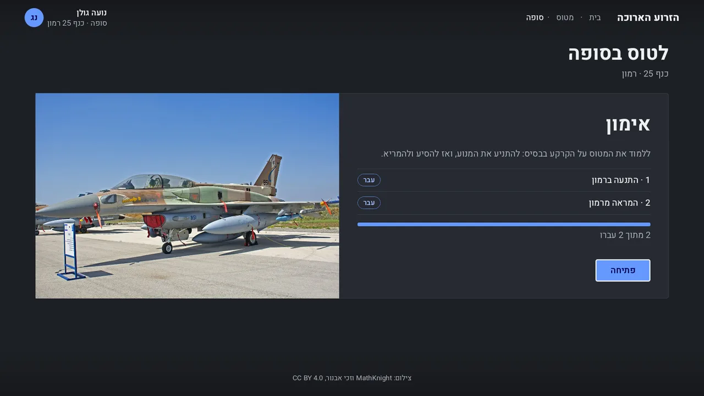 |
| Pick a mission | the missions beside the picked one's briefing: runway, time, wind, time allowed, when it passes; Fly |  |  |
| Preferences | the sections Graphics, Language, Sound and Devices, each on its own screen with its settings as controls: dropdown, switch, slider, radio list |  |  |
| Debrief | the record as a sheet: Plane flown, From, Time, Mission, Result, the mission's goals (a take-off: runway, lift-off and reference speed, centreline offset, tower calls; a start-up: none), Remarks (the fail reason first, or that it passed; the lift-off against the reference); Back to missions, Fly again |  |  |
| Pilot log | every attempt, newest first; a row opens its debrief |  |  |
| Attributions | the setup wizard's list of sources and licences, the jet photos with them |  |  |

At a training mission's end a banner over the view says "Mission complete" (or "Fail" and the reason); about 5 s
later the flight ends into its debrief ([training.md](training.md) §9).

Over a flight, Esc opens the pause menu: Continue the flight, Preferences, End the flight. It is laid out on the
front end's canvas scaled to the window and centred by a container, so it sits in the middle at any window size and in
either language (the Mac run of 2026-11-08: in Hebrew in a 2560 × 1440 window the overlay mirrored its own position
by its unscaled width and sat off the right edge, its buttons' labels outside the screen). Ending a training flight
scores it as it stands and opens its debrief; a flight that was not scored goes back to Home. The sheet shows only
the record's `goals` ([training.md](training.md) §4); every other number stays in the record file.

| the Hebrew pause menu before the fix (2026-11-08) | after |
|---|---|
| 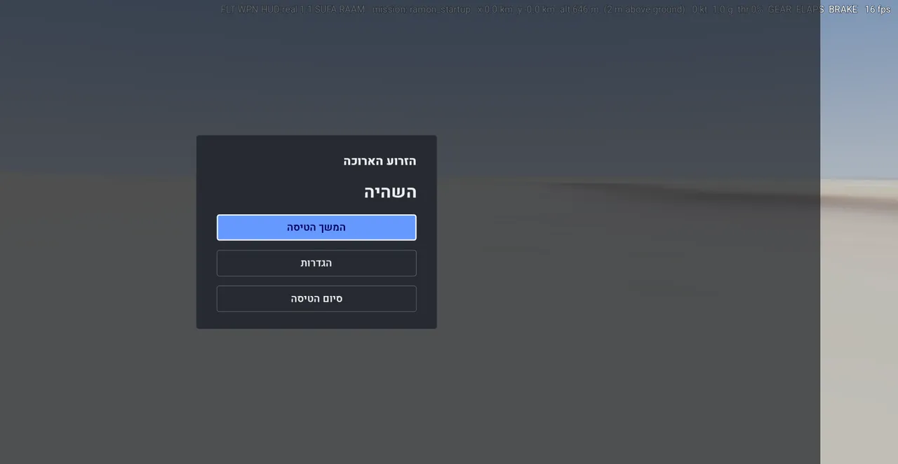 |  |

| screen | English | Hebrew |
|---|---|---|
| the pause menu over the flight | 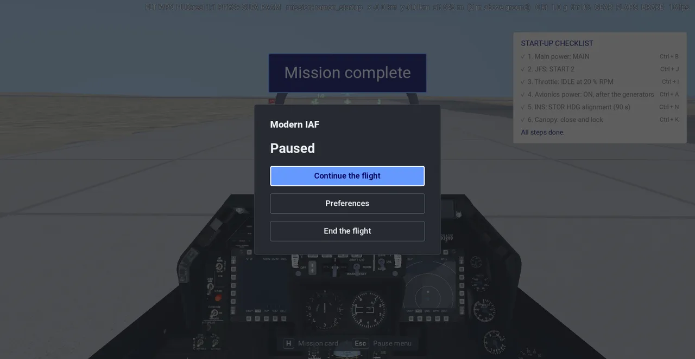 |  |
| a failed debrief (a start-up that crashed) | 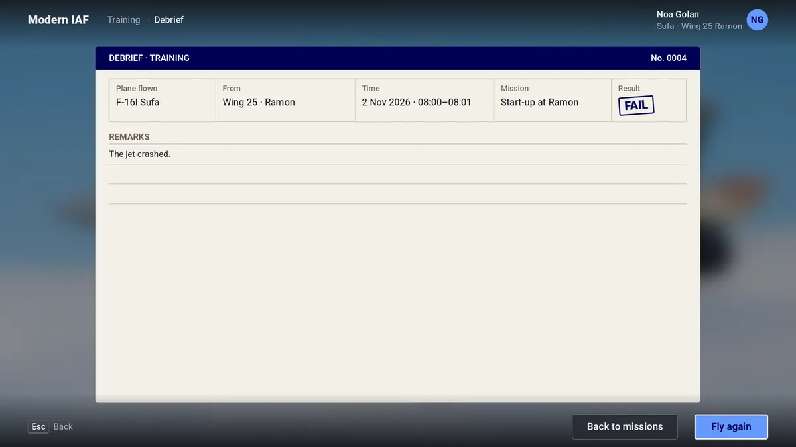 | 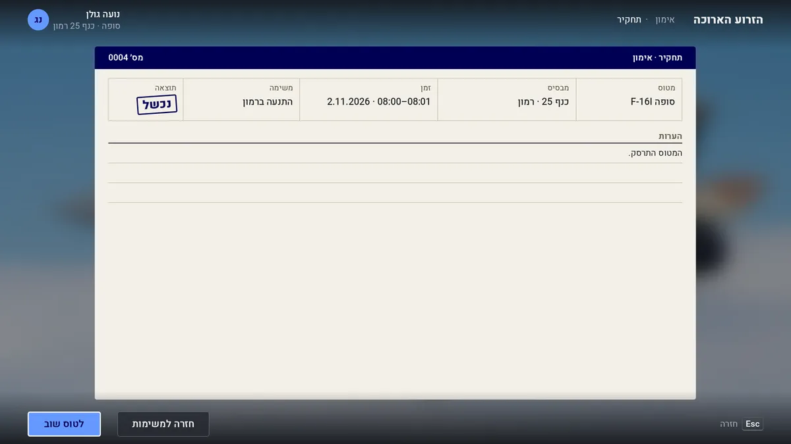 |
| the debrief of that flight |  |  |

Keys: Enter picks the focused control, Esc goes one screen back (Home has no back), the arrow keys and Tab move the
focus. The bottom bar shows the keys of each screen. Every breadcrumb in the top bar but the current one opens its
screen (a jet's name: its Training); the picks are kept.

| screen | English | Hebrew |
|---|---|---|
| Home before the first pick | 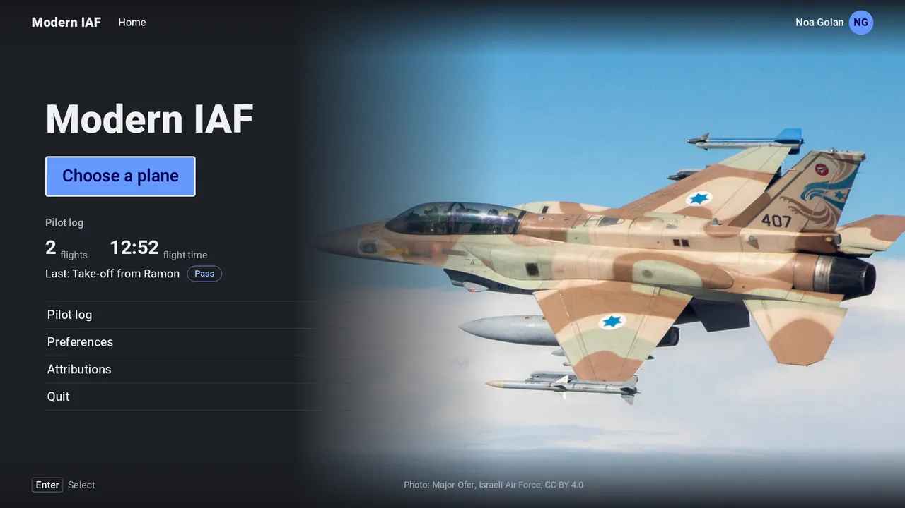 | 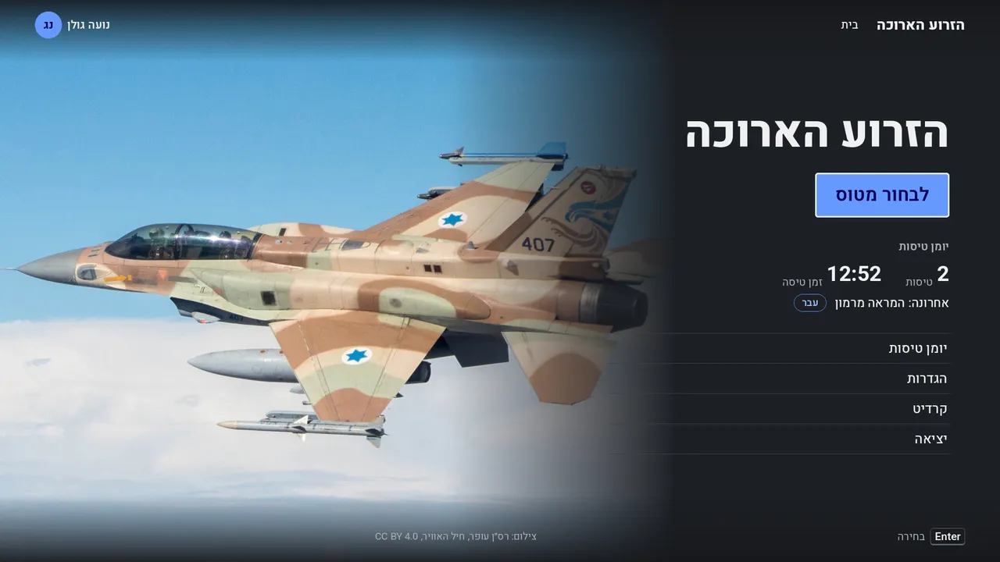 |
| Preferences: the sections |  |  |
| Preferences: Graphics | 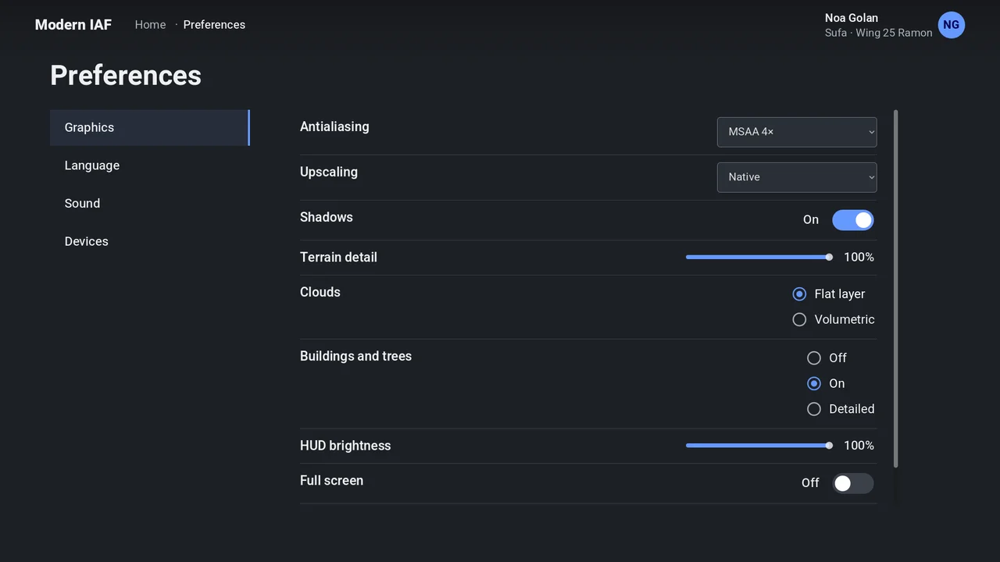 | 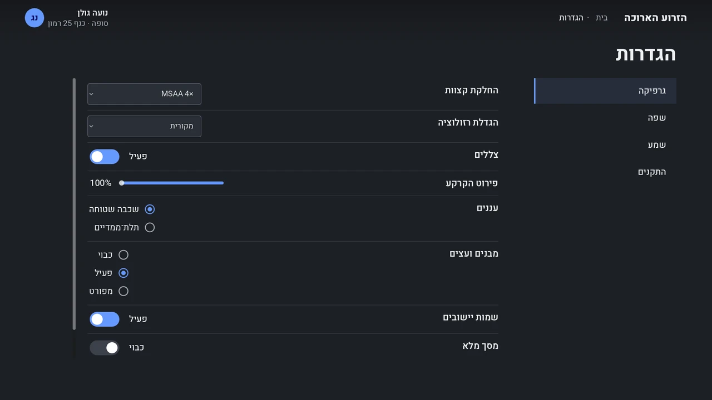 |
| Preferences: Sound | 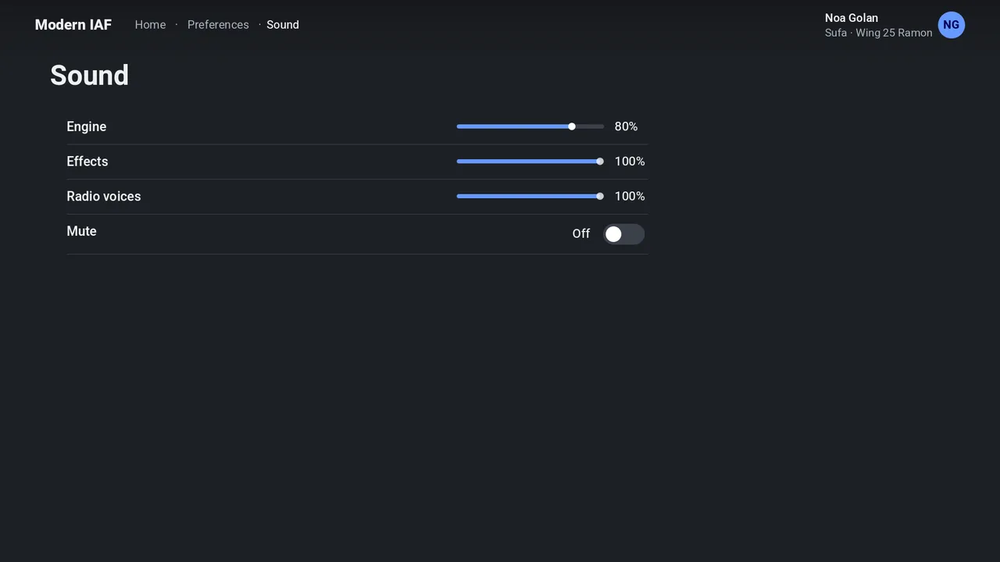 | 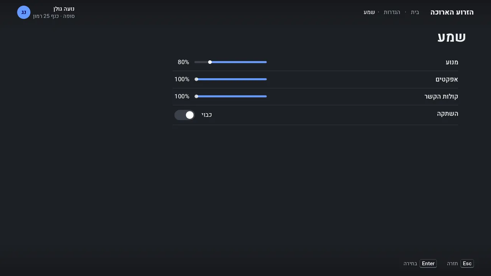 |
| Preferences: Devices | 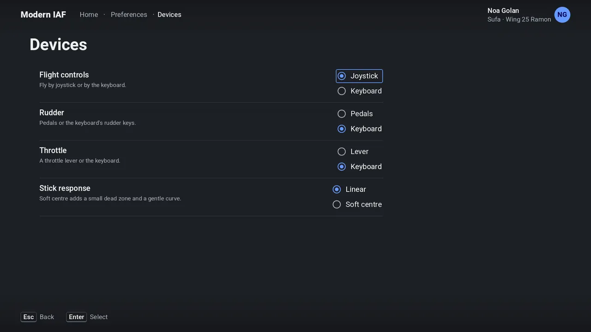 | 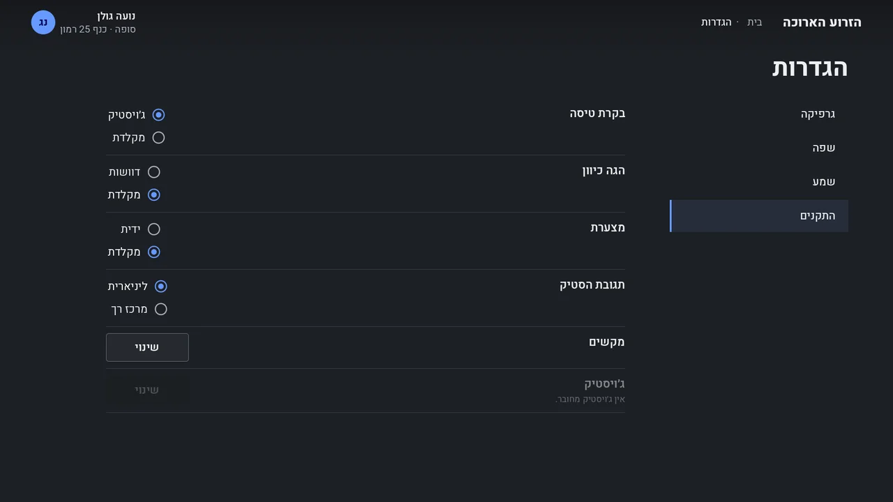 |
| Preferences: Language | 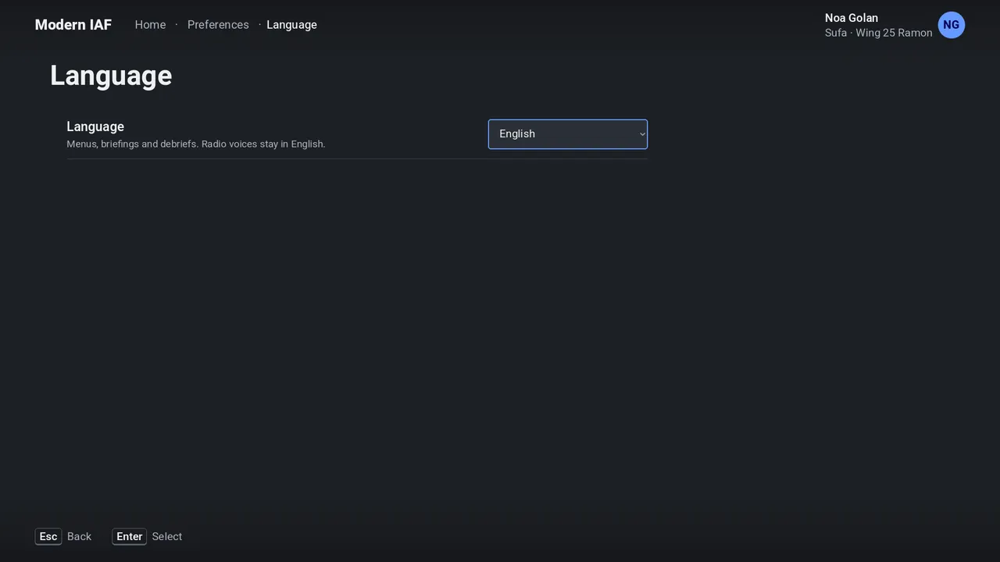 | 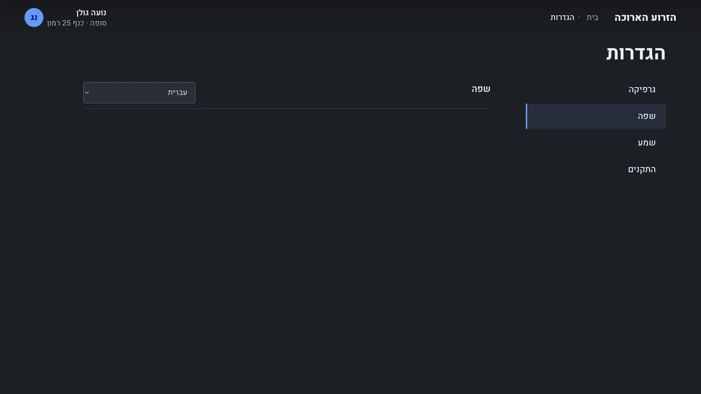 |

## 2. The flow

Home → Fly → Training → Open → Pick a mission → Fly → the flight → the debrief → Home. Change plane on Home opens Pick a
plane. Every start opens Home; until a plane is picked Home offers Choose a plane, and Pick a plane opens in place of
Training and Pick a mission. Pick a plane's Continue (off until a pick) goes to Training, Esc back to Home.

- **The plane:** a card press stores the unit (`Settings.sim_jet`: `f16i`, `f16d` or `f35i`; `settings.cfg` section
  `[sim]`, key `jet`) and sets the F-16 switch (`Settings.set_jet`).
- **The missions:** the compiled list `assets/converted/iaf-2026/missions/missionlist.json` (`iaf-sim missions`), each
  read from its readable file `iaf-2026/data/missions/<name>.json`, kept when its player unit is the picked jet and it
  has `training` rules, in menu-id order.
- **Fly:** `flight/fly.gd` `start(menu id)` loads the compiled mission, picks the mission's jet (a `--mission` run,
  Fly again on another jet's debrief) and changes to the flight scene.
- **Back to missions** on a debrief opens that mission's jet with the flown mission picked.
- **The flight's end:** the flight scene returns to `Settings.front_end_scene()` (`res://main.tscn`). When the flight
  wrote a debrief record (`flight/sim_flight.gd` sets `Settings.flown_debrief`), the front end opens it.

## 3. The data it reads

| what | where | written by |
|---|---|---|
| debrief records | `user://debriefs/debrief-<stamp>-<mission>.json` (tests: `<temp>/modern-iaf-debriefs/`) | `sim_flight.gd` at the scoring: the scorer's record plus `flight`, `date` (the end, local time) and `elapsed_s` (the flight's length, s) |
| the pilot log | `user://pilots/14.json` (tests: `<temp>/modern-iaf-debriefs/pilots/`), `Settings.pilot_log_file()` | `sim_flight.gd`, the original game's pilot record shape |
| the picked jet | `user://settings.cfg` `[sim] jet` | the front end |
| the jet photos | `iaf-2026/data/photos/` (§5) | — |

Both JSON files are written compact. The debrief's number is the record's place among the folder's records, oldest
first. Its Time is the day, then the mission's clock from its start (the mission's `time`) to the start plus
`elapsed_s`. The pilot's name is the computer's user name. The Remarks are the record's fail reasons, then what its
numbers say: the lift-off speed against the reference speed for the weight, and the largest offset from the
centreline in the roll.

## 4. Look and layout

- **Palette** (round 3): background `#1d2025`, panels `#262a31`, lines `#3b414b`, text `#eef0f2` / `#aab1bb`, the one
  accent `#6699ff` (the Air Force flag's sky blue) with `#000055` (its navy) on it, the debrief paper `#f3efe6` with
  rules `#b9b09c`. All in `iaf-2026/menu/look.gd`, which builds the theme on the wizard's Heebo
  (`setup/wizard_theme.gd`).
- **Sizes:** every screen lays out on a 1920 × 1080 canvas that the window shows scaled to its height (stretch mode
  "canvas items", aspect "expand"); the body text is 21 px, 1.9 % of the height, as in the mock-ups. The front end sets
  the scaling only while it is the scene, so the flight keeps the project's own. Over a flight the pause menu scales
  itself the same way.
- **Hebrew:** the front end's layout direction is right to left, so Godot mirrors the containers, the anchors, the
  labels' alignment, the sliders, the progress bar, the toggles (on: the knob at the inline end) and the radio lists.
  The photos never flip (their tail numbers would read backwards); Home places its photo on the inline-end side. Latin
  codes (F-16I, 25R, 08:00) run left to right inside the Hebrew lines; "MSAA 4×" carries a left-to-right mark.
- **Strings:** `iaf-2026/menu/strings_en.json` and `strings_he.json`, formal and gender-neutral (infinitives: לטוס,
  להתניע, לבקש). The Language row switches every string at once. The mission briefings are the front end's own,
  by mission kind, with the mission's runway and time allowed in them.
- **Preferences:** one screen per section, so a section can grow. Realism and aids have no switch (plan.md "physics";
  the user, 2026-11-08): the sim's `PROFILE` (`iaf-2026/sim_settings.gd`) fixes the original Gameplay page's aids off
  (easy landing, unlimited fuel, no damage, no crashes, no G effects…) and the look switches to the sim's own
  (Detailed airbases, water, night lights; the ground textures and roads whenever their data exist), so
  none of them is a row. The weather is the mission's (no Rain row). Volumetric clouds are greyed without a
  RenderingDevice. Graphics → "Buildings and trees" is the shared Scenery setting (Off / On / Detailed, On by
  default, [scenery.md](scenery.md) §6); without setup's optional scenery step it is greyed at Off, with a note
  naming that step.

## 5. The photos

Four Wikimedia Commons photos, downscaled, each credited in the footer of the screen that shows it, on Attributions
and in [../../docs/credits.md](../../docs/credits.md) "Modern IAF's photos". The list with each page:
`iaf-2026/data/photos/SOURCES.md`. Round 3's Barak photo was CC BY-SA; the front end uses a CC BY 2.0 one instead.

## 6. Checks

- `iaf-2026/tests/test_front_end.gd` walks Home → Pick a plane → Training → Pick a mission → the debrief of a stored
  record → Home in English and Hebrew: the texts, the mirrored order of the cards, the mission list and the home
  column, the layout direction; the plane pick; the Preferences' controls and the live language switch; the Pilot log
  and Attributions. With `-- --fly` it also flies Ramon's start-up from the mission screen to a pass, opens the pause
  menu, ends the flight and finds that flight's debrief. Run in a real render through `tools/godot_window.sh` it is
  the real run (`SHOT_DIR=<dir>` saves the two pictures of §1's second table).
  It also checks the first start (Home, Choose a plane, the picker, back to Home with the jet), the breadcrumbs, each
  Preferences section on its own screen with no aid, realism or weather row and no read of the original's data, the
  sim's settings (no aid on, the log dumps naming only the sim's settings), F1–F4 opening no pause menu, and the
  pause menu inside viewports of 1920 × 1080, 2560 × 1440 and 1280 × 800 in both languages.
- `iaf-2026/tests/_front_end_shot.gd` takes §1's pictures at 1920 × 1080 (its header), and the failed debrief.
- `iaf-2026/tests/test_flight_ui.gd` checks §8 in both languages.

## 7. The loading screen

While a flight waits for its ground, the sim shows its own loading screen, `iaf-2026/flight/loading_screen.gd`. The
flight scene asks `Settings.loading_screen_scene()` for it; the original game keeps its menu-art screen
(`shared/terrain/loading_screen.gd`). It reads nothing of the original game's art.

The screen is one panel in the front end's look (§4, `iaf-2026/menu/look.gd`). It shows:

- the mission's title in the sim's language (the compiled mission's `sim.title`; without a mission, the sim's name);
- its base as the wing and the base's name ("Wing 25, Ramon", "כנף 25 רמון"), from the compiled mission's `sim.base`
  (`iaf-sim missions`);
- a progress bar, fed by the flight as the original's screen is (`terrain.gd` `ground_progress()`, smoothed, never
  going back).

In Hebrew the page is mirrored: the bar fills from the inline start, the right.

| English | Hebrew |
|---|---|
|  |  |

`iaf-2026/tests/_loading_shot.gd` takes these pictures (its header).

## 8. Over the flight: the mission card, the radio lines, the key hint

The sim draws its own text over the flight in the front end's look (`iaf-2026/flight/flight_ui.gd`, Heebo, look.gd's
palette, on the 1080-high canvas scaled to the window), mirrored in Hebrew; the original game's console and panels
stay the original's (`terrain_view.gd _on_subtitle` hands each line to the flight add-on when it has a `subtitle()`).

- **The mission card** opens at a training mission's start: the mission's title, its objective with the keys as
  bound ("Ctrl + T"; "Cmd + T" on macOS) and the runway, and the keys that matter with their labels, from the
  compiled mission's `sim.card` ([data-formats.md](data-formats.md) §5; a default per mission kind). The flight is
  frozen while it is open. Space, Enter, Esc or a click close it; H (the key table's Mission card, record 118; the HUD
  colour moved to Shift + H) opens it again. Scripted runs (`IAF_DEFAULT_SETTINGS=1`) start with it closed.
- **The radio lines and messages** show in a strip centred at the top, over the sky rather than the cockpit's panel,
  the newest at the bottom, three at most, each for 8 s, wholly in the game's language ([training.md](training.md)
  §8).
- **The panel** at the inline-start top holds the radio menu (Ctrl+T) and the training result.
- **The key hint** at the bottom: the Mission card key and Esc's pause menu.

| | English | Hebrew |
|---|---|---|
| the take-off's card | 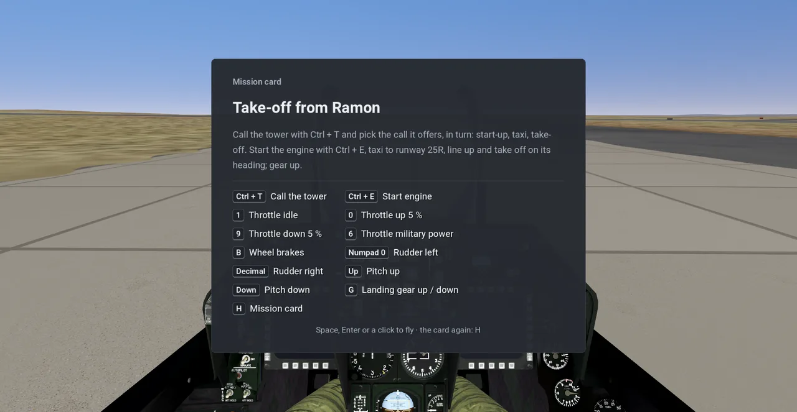 | 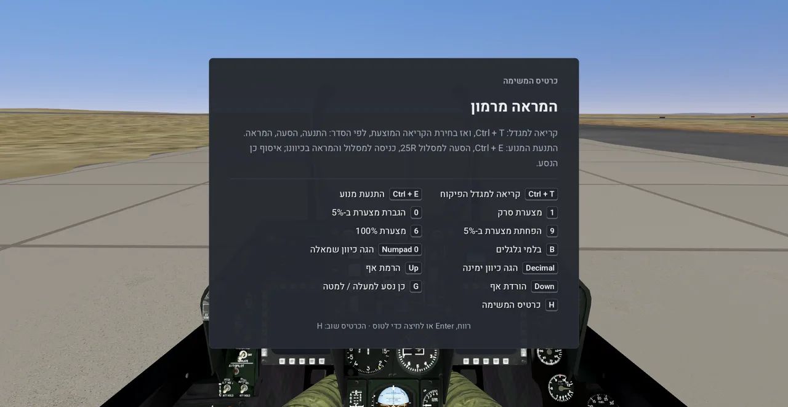 |
| the strip and the hint, after a tower call |  | 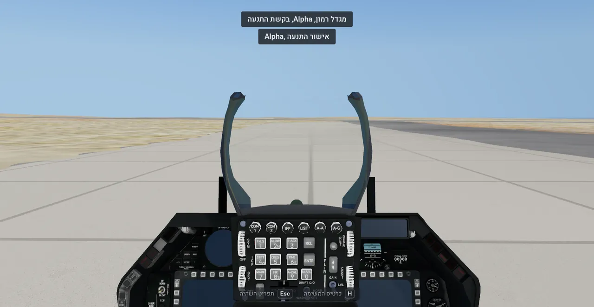 |

## 9. Keys and Joystick

Preferences → Devices has two rows that open their own screens: **Keys** and **Joystick**. Esc on either goes back to
the Devices section. Both read and write one file, the device store (§9.4). A change applies at once: the front end's
next flight reads it, and over a flight the Preferences apply it when they close.

### 9.1 Keys

The screen lists every command of the sim's key table (`iaf-2026/data/keys.json`) that has a `group`, in five groups:
Flight, Weapons, Sensors and displays, Views, General. The tabs on the inline-start side scroll to each group. A row
shows the command and its key; on macOS a key with Ctrl shows as Cmd (`key_table.gd`, docs/controls.md §2). The
table's records without a group are the commands the sim lacks (the chat, the wingman orders, the debug keys, the
screen capture): no row.

- **Rebind:** click a row, and its key reads "Press a key…". The next key with its one modifier (Ctrl / Cmd, Shift,
  Alt) becomes the command's key. Esc cancels; a lone modifier waits for the key.
- **Conflict:** a key another command already has opens a line under the row: "K already runs “Pitch up”." Its
  choices: **Swap** (the other command takes this one's old key), **Use it here** (the other command has no key then),
  **Cancel**. The check covers every record of the table, listed or not, since the flight runs the first record bound
  to a key.
- **Default** shows on a changed row and puts that command back to the table's key. **Reset all** in the bottom bar
  puts every key back.

**The laptop map.** A laptop has no numpad, so on macOS the sim starts from the laptop map: the same table with the
keys of `keys.json`'s `laptop` column (compiled into `converted/own/keys_laptop.json`; `Settings.laptop_keys`). A Mac
with a full keyboard gets it too; Rebind puts any command back on the numpad. Default and Reset all go back to the
laptop map there. The commands it moves:

| Command | Key | Laptop map |
|---|---|---|
| Rudder left / right | Numpad 0 / Decimal | Z / X |
| Weapon page full screen | Z | Shift + Z |
| Extinguish engine fire | X | Shift + X |
| Look back-left, back, back-right | Numpad 1, 2, 3 | Alt + 1, 2, 3 |
| Look left, forward, right | Numpad 4, 5, 6 | Alt + 4, 5, 6 |
| Look front-left, up, front-right | Numpad 7, 8, 9 | Alt + 7, 8, 9 |
| Free look (numpad) | Shift + Numpad 8, 2, 4, 6 | none: Shift + the arrows |
| Zoom (numpad) | Numpad − / + | none: − / = |

The key table has no trim command (the trim is the joystick's rocker), so trim needs no laptop key.

| | English | Hebrew |
|---|---|---|
| Pitch up rebound to K | 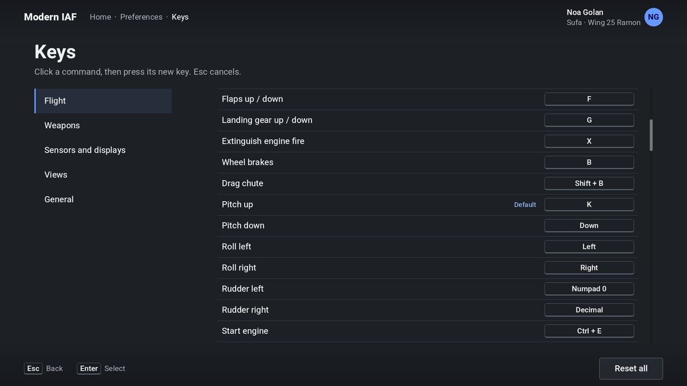 | 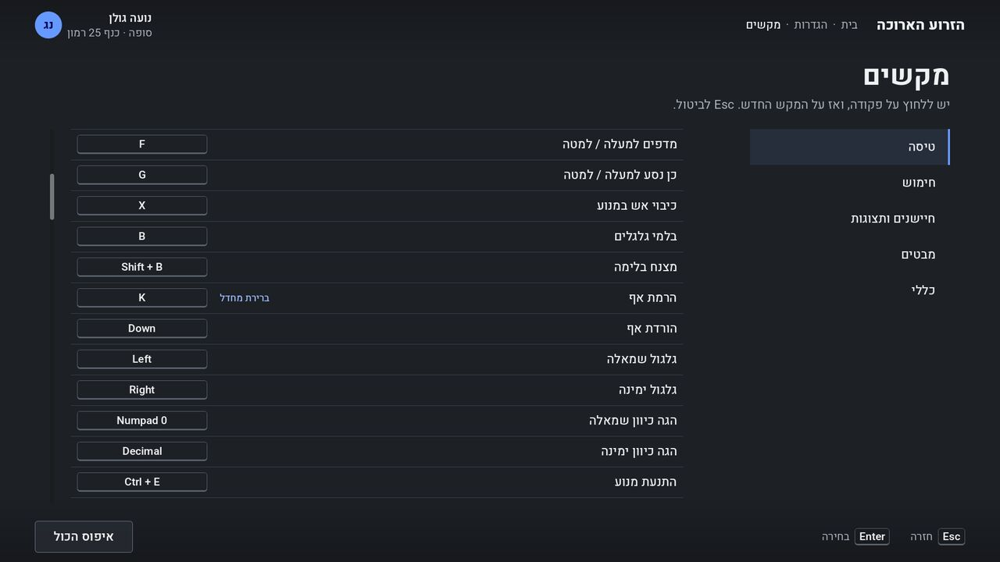 |
| K pressed for Pitch down | 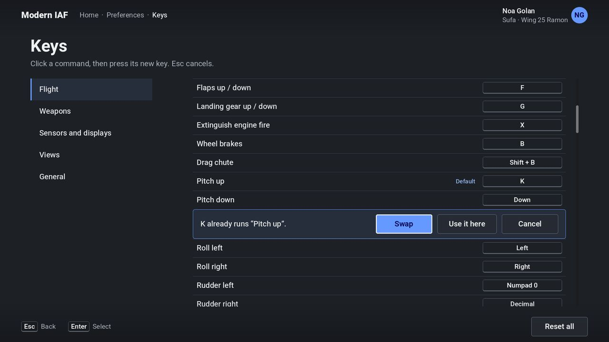 | 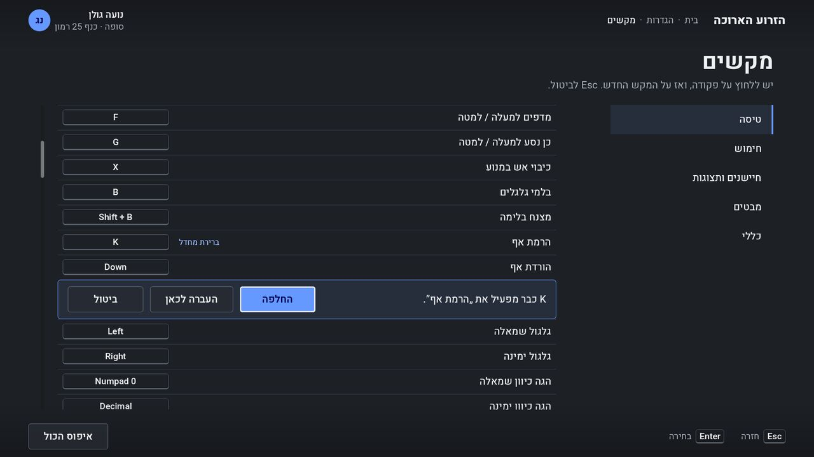 |

### 9.2 Joystick

- **Devices:** every connected joystick by name. The first one flies the jet ("Flies the jet"); the others are listed
  only. Without one the screen says so.
- **Axes:** the six axes Godot reports (fewer when the device's USB descriptor says so, `Joystick.axis_count`). Each
  row has a live bar, the axis' role, Invert and a dead zone (0–50 %). The roles: Roll, Pitch, Throttle, Rudder, Roll
  trim (the throttle rocker, docs/controls.md §5.2), None. A role sits on one axis: giving it to another axis leaves
  the old one with None. The bar shows the axis after its role's invert and dead zone, so the dead zone is visible
  as the bar's still centre. The throttle has no centre and no dead zone.
- **Buttons:** the Keys screen's list with the joystick's buttons. Click a row, then press a button or a hat
  direction. Conflicts, Default and Reset all work as on the Keys screen. The hat's four directions count as buttons
  (Hat up, Hat right, Hat down, Hat left); by default they are the four look keys (up, right, back, left).
- **Reset all** puts the buttons and the axes back to the defaults.

The Joystick screen has no rows for the Devices group's choices (Flight controls, Rudder, Throttle, Stick response):
they stay in the Preferences. A role with no axis leaves its keys working, as Keyboard does: with Roll on None and
Pitch on an axis, the roll keys roll the jet while the stick pitches it (`Joystick.stick_mixed`).

| English | Hebrew |
|---|---|
| 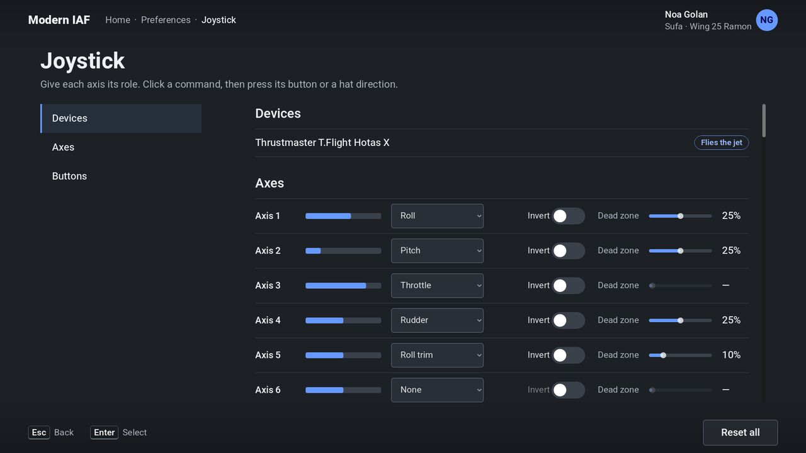 | 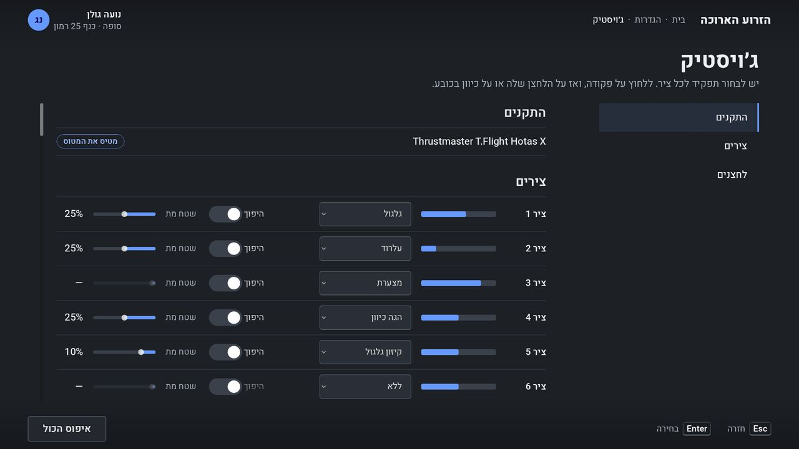 |

In Hebrew the screens are mirrored; the key names and the device name run left to right, and the axis bars keep the
stick's own direction (right is right). The dropdowns draw the same box both ways: right to left Godot draws an
OptionButton's `*_mirrored` boxes, so `look.gd` sets them to the left-to-right ones.

### 9.3 Device maps

A known joystick gets its own defaults from a device map in `iaf-2026/data/devices/` (JSON): `match` (a part of the
device's name, case ignored), `axes` (role → Godot axis) and `buttons` (key-table record → button, the hat 32–35). The
map replaces the table's whole button column for that device: a record it leaves out has no button. The first map
whose `match` is in the name wins (file-name order); a device with no map takes the table's own buttons and axes 0–4.

| file | device | axes | buttons |
|---|---|---|---|
| `hotas_x.json` | Thrustmaster T.Flight Hotas X | roll 0, pitch 1, throttle 2, rudder 3 (the twist), roll trim 4 (the rocker, 5-axis mode) | 1 gun, 2 release, 3 next target, 4 flares, 5 chaff, 6 master mode, 7 radar mode, 8 drop lock, 9 gear, 10 flaps, 11 wheel brakes, 12 autopilot; the hat: the look keys |

The Hotas X's axes are the ones docs/controls.md §5.2 found on that stick. The button choice is ours (inferred: the
trigger fires the gun, the buttons next to it release and pick targets).

### 9.4 The device store

The store is `user://devices.json`, written compact and only with what differs from the defaults:

```json
{"keys":{"24":37},"buttons":{"64":5},"axes":{"pitch":{"axis":3,"invert":true,"dead":0.1},"rudder":{"axis":-1}}}
```

- `keys`: record → key, DIK | modifiers << 16 as `key_table.gd` stores it (0 = no key).
- `buttons`: record → the joystick's 0-based button, 32–35 the hat, −1 = none.
- `axes`: role (`roll`, `pitch`, `throttle`, `rudder`, `trim`) → `axis` (−1 = none), `invert`, `dead` (0–0.9). An
  absent field is the default: the device map's axis (else 0–4 in role order), no invert, and the dead zone of
  `joystick.gd` (25 % on the stick and the rudder, 5 % with Stick response Soft centre, 10 % on the rocker). A dead
  zone outside 0–0.9 in a hand-edited file reads as its nearest end.

A missing or corrupt file reads as an empty store: every default.

Tests and pictures use a temporary file (`Settings.devices_path`, or in isolated runs a file of the process in the
temporary folder, so no run reads another's).

The logic is Rust's: `iaf_tools::devices` (unit tests in the same file) behind `IafDevices`
(`crates/iaf-godot/src/devices.rs`):

| function | does |
|---|---|
| `find_map(dir, name)` | the device map for a joystick's name, "" = none |
| `keys(table, store, map)` | the key table with the map's buttons and the store's keys and buttons in it, each record with `default_key` and `default_joystick` |
| `conflict(table, store, map, record, column, value)` | the other record bound to `value` in `column` ("key" / "button"), −1 = none |
| `bind(table, store, map, record, column, value)` | binds and writes; the entry goes when it is the default again |
| `reset(store, record, column)` | one record (−1: every record) back to its default |
| `reset_joystick(store)` | every button and axis back |
| `axes(store, map, soft)` | every role's axis, invert and dead zone |
| `set_axis(store, map, role, axis, invert, dead, soft)` | sets a role; a role on that axis gives it up |

How the flight reads it:

- **Keys and buttons:** the flight's key table is `KeyTable.load_table()`, whose contents come from
  `Settings.key_table_data()`. The original game returns the file as it is; the sim returns `IafDevices.keys` over
  its own table, the connected joystick's map and the store. The flight loads it at its start and again when the
  Preferences close over it (`terrain_view.gd _apply_preferences`).
- **Axes:** `Settings.apply_devices()` (at start, on every Preferences save, when a joystick connects) sets
  `Settings.joy_axes` to the roles' axes, `Joystick.tune` to their invert and dead zone, Roll trim on while the trim
  role has an axis, and `Joystick.hat_buttons` (the hat as buttons 32–35 in place of the original's snap views).
  `joystick.gd` reads them each poll. The original game leaves `tune` empty and `hat_buttons` off, so its joystick is
  unchanged (`tests/godot/test_joystick.gd`, `test_controls.gd`, `test_keyboard_stick.gd`).
- **The maps' folder:** `Settings.joy_maps_dir()`: the original game's `menu/joy` in the install (its `.joy` files),
  the sim's `iaf-2026/data/devices`, where the shared `.joy` reader finds none and so reads no install. A missing
  folder is skipped.

### 9.5 Checks

- `iaf-2026/tests/test_devices.gd`: the Devices rows open both screens in English and Hebrew; Pitch up bound to K by a
  synthetic key reaches the flight's key table; K for Pitch down shows the conflict, Swap trades them; Esc cancels;
  Default and Reset all; with a fake joystick, axis 4 given the pitch inverted with a 10 % dead zone drives the
  poller's stick y (+100 at +1, 0 inside the dead zone, +50 at 0.55); a button and the hat bound by pressing them;
  the Hotas X's map; with `Settings.laptop_keys` on, the laptop map: the rudder on Z / X, no key on two records, no
  numpad key, a stored key wins over it. `iaf-sim own`'s unit test checks the laptop table compiles the same way.
- `iaf-2026/tests/test_m0_boot.gd` connects a fake joystick: the probe's gate line stays at 0 refused paths.
- `iaf-2026/tests/_devices_shot.gd` takes §9's pictures (its header).
