# Modern IAF's front end

**Terms:** front end = the screens before and after a flight; inline start / end = the side a line of text starts / ends
on (the left / right in English, the right / left in Hebrew); debrief record = the scorer's JSON for one flight
([training.md](training.md) §4); pilot log = the record of every attempt ([training.md](training.md) §9).

The front end (item [E2](plan.md#e2-the-front-end)) is the sim's main scene, `iaf-2026/main.tscn`. `./iaf2026` opens it.
It builds the round-3 design the user approved on 3 November 2026: one screen per step, in Hebrew and English, with the
Heebo font and the Israeli Air Force flag's colours.

```sh
./iaf2026                     # Home (Pick a plane on the first start)
./iaf2026 -- --mission 2011   # flies that mission at once, then shows its debrief
```

## 1. The screens

| screen | what it does | English | Hebrew |
|---|---|---|---|
| Home | the jet, its base, Fly, the log summary (flights, flight time, the last result), the menu | 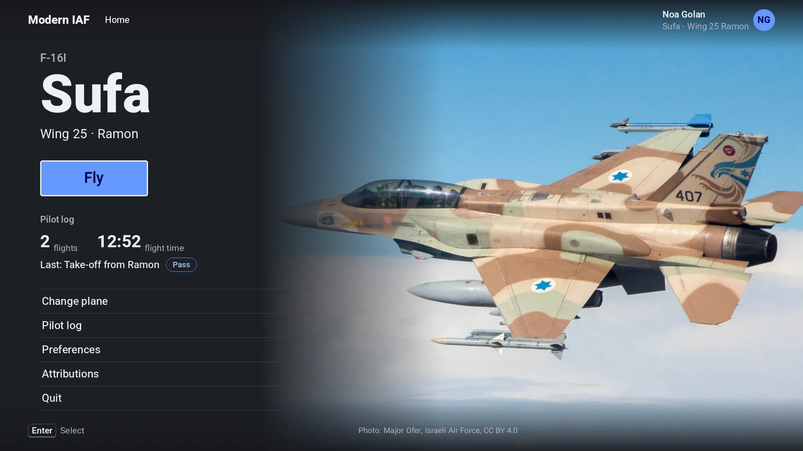 | 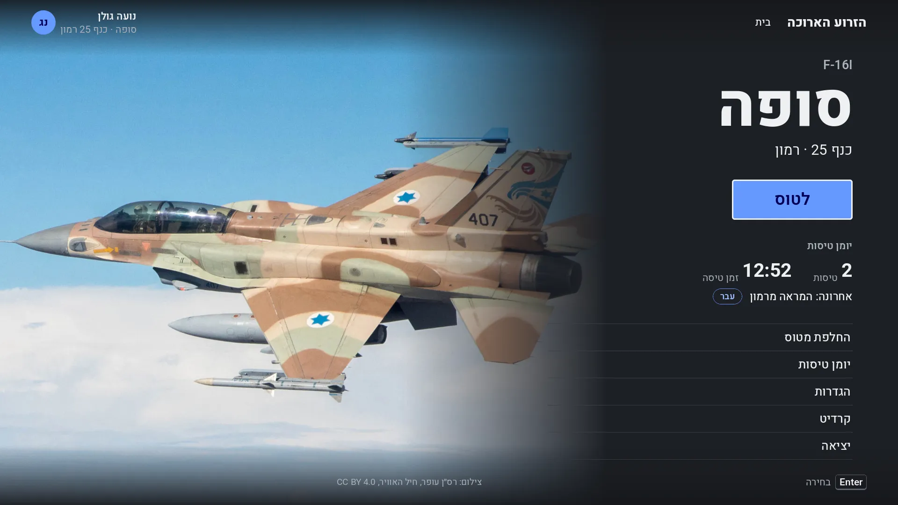 |
| Pick a plane | the Sufa (Ramon), the Barak (Ramat David) and the Adir (Nevatim); the pick sets the jet everywhere | 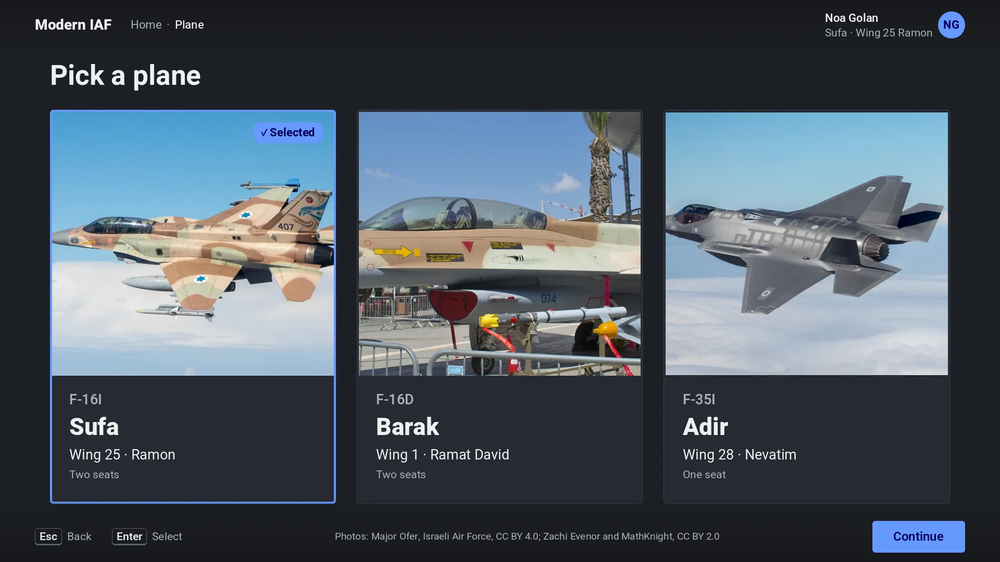 | 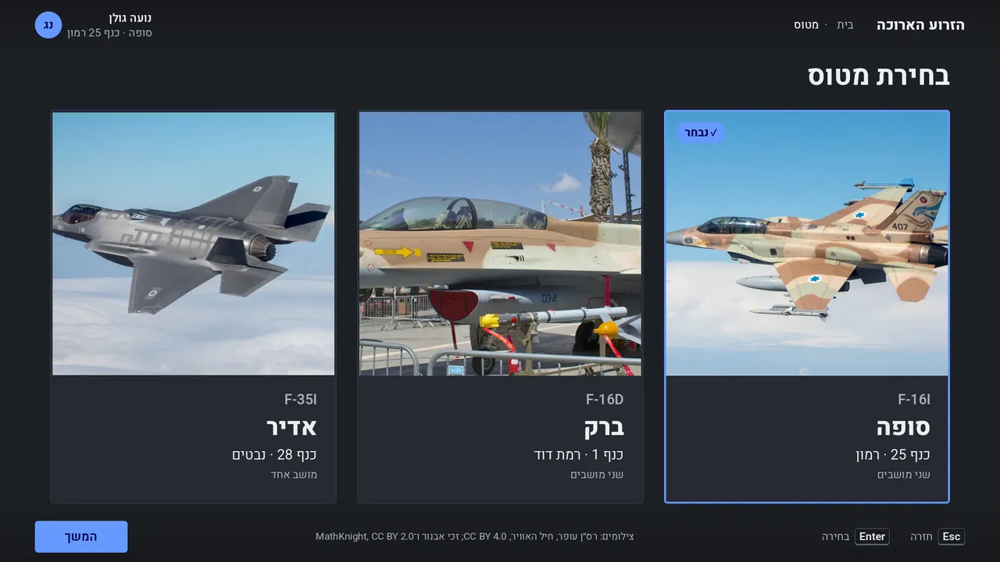 |
| Training | the programme: its missions with their last result and the progress | 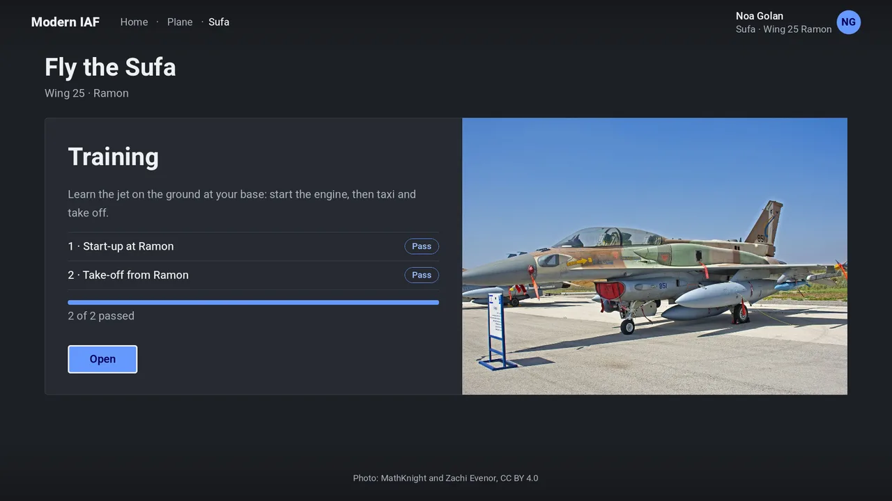 |  |
| Pick a mission | the missions beside the picked one's briefing: runway, time, wind, time allowed, when it passes; Fly | 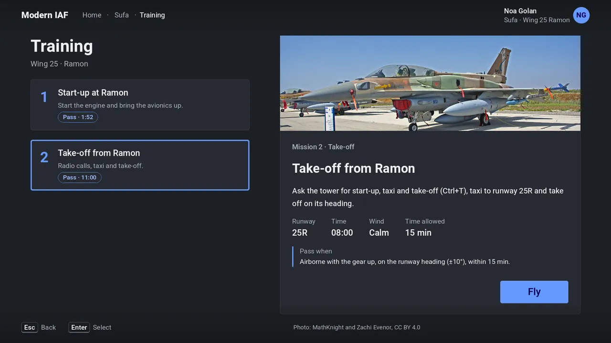 | 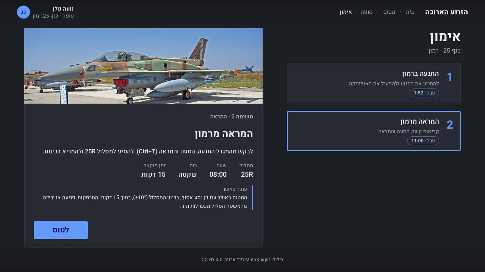 |
| Preferences | the settings as controls: dropdown, switch, slider, radio list; the groups Graphics, Language, Sound, Devices, Physics | 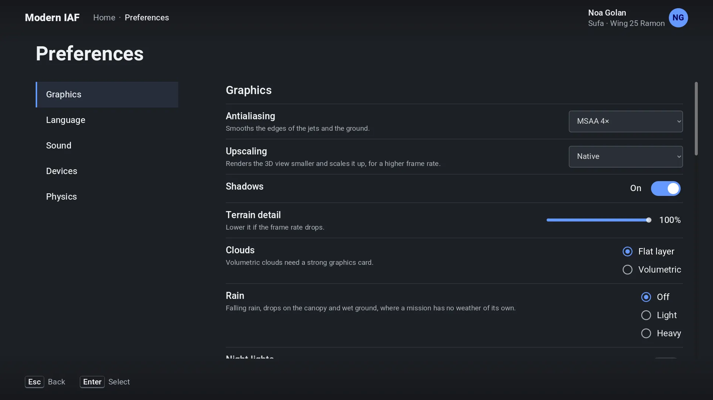 | 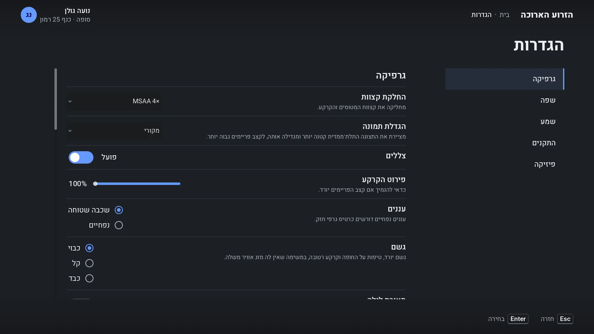 |
| Debrief | the record as a sheet: Plane flown, From, Time, Mission, Result, the numbers, Remarks; Back to missions, Fly again | 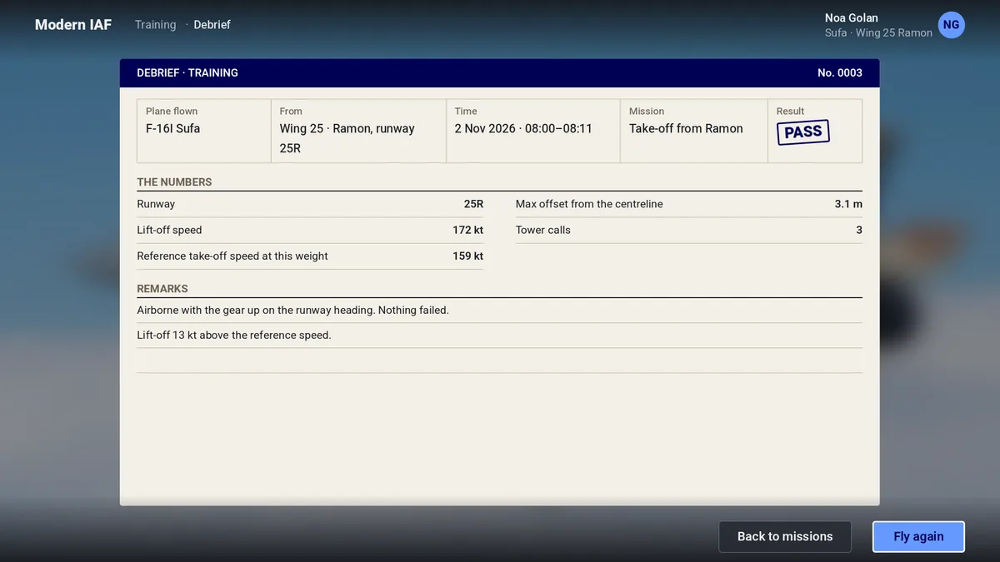 | 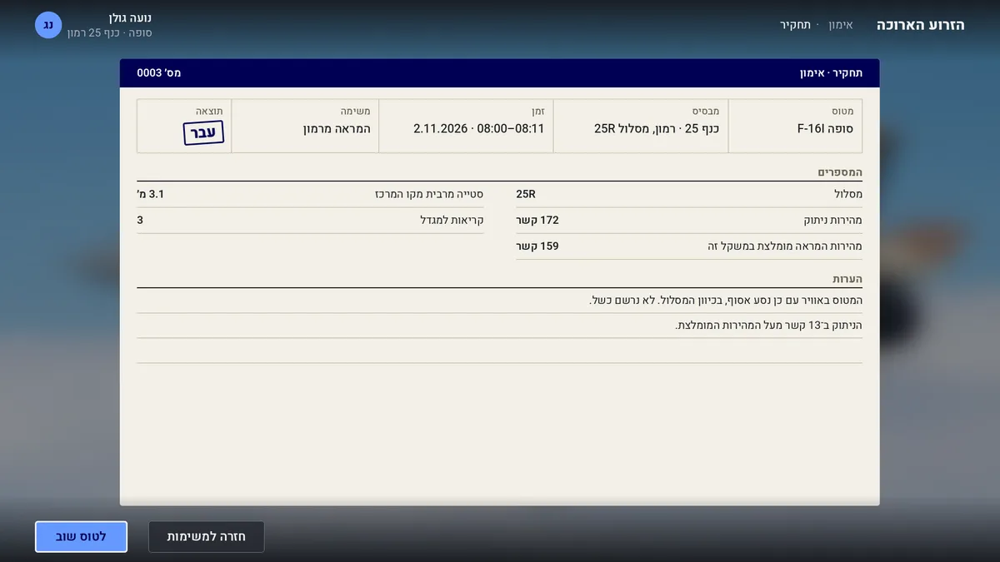 |
| Pilot log | every attempt, newest first; a row opens its debrief | 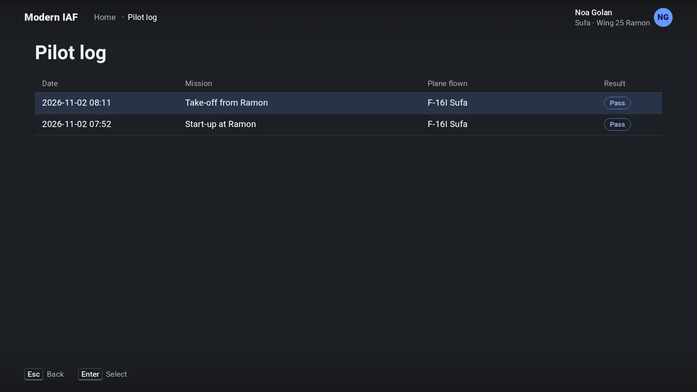 | 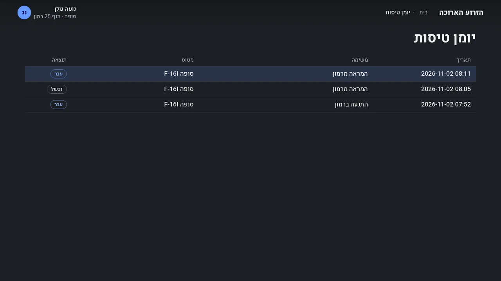 |
| Attributions | the setup wizard's list of sources and licences, the jet photos with them | 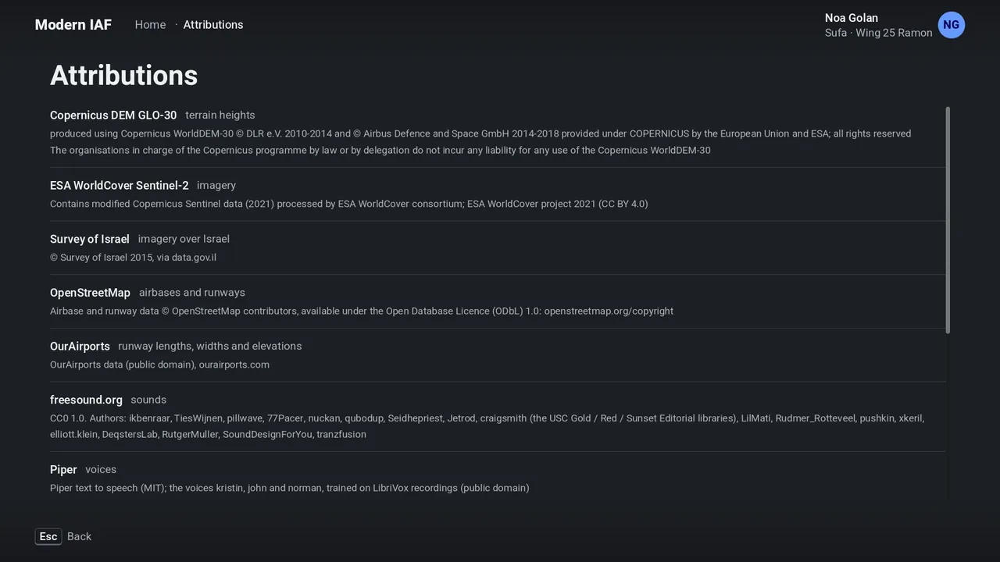 | 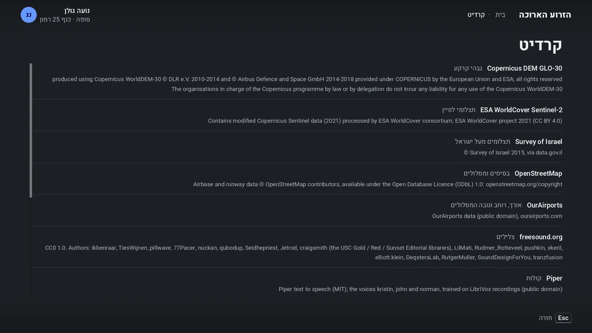 |

Over a flight, Esc opens the pause menu: Continue the flight, Preferences, End the flight. Ending a scored flight opens
its debrief; a flight that was not scored goes back to Home.

| screen | English | Hebrew |
|---|---|---|
| the pause menu over the flight |  | 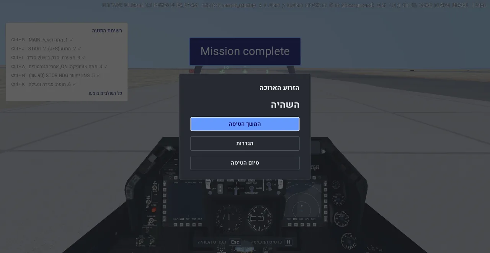 |
| the debrief of that flight | 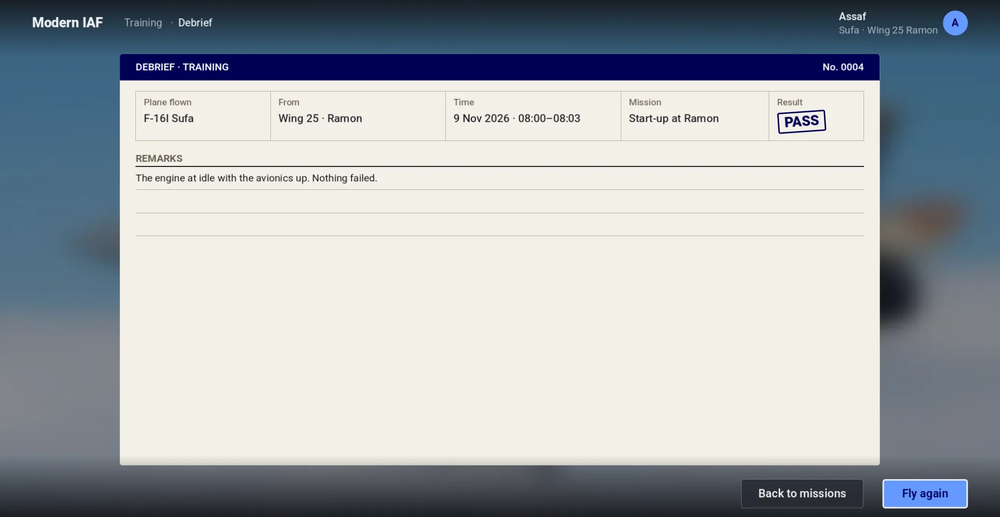 | 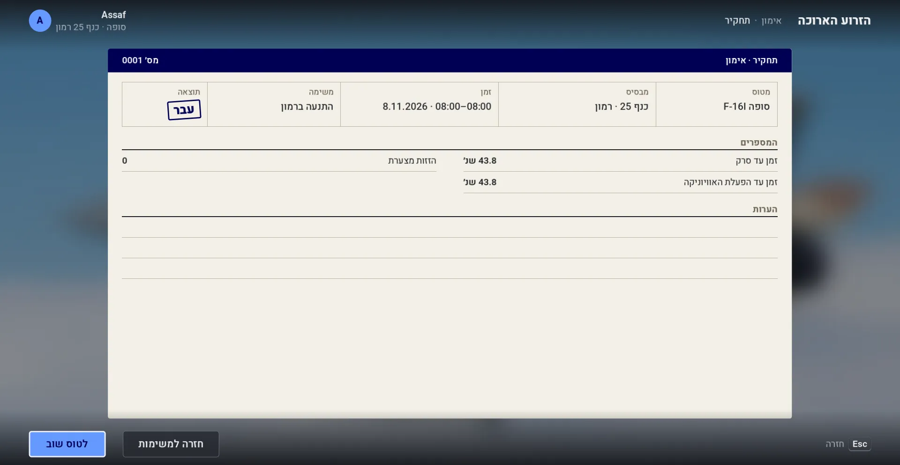 |

Keys: Enter picks the focused control, Esc goes one screen back (Home has no back), the arrow keys and Tab move the
focus. The bottom bar shows the keys of each screen.

## 2. The flow

Home → Fly → Training → Open → Pick a mission → Fly → the flight → the debrief → Home. Change plane on Home opens Pick a
plane. Until a plane is picked, Pick a plane opens in place of Home, Training and Pick a mission; its Continue (off
until a pick) goes to Training, and Esc stays on it.

- **The plane:** a card press stores the unit (`Settings.sim_jet`: `f16i`, `f16d` or `f35i`; `settings.cfg` section
  `[sim]`, key `jet`) and sets the F-16 switch (`Settings.set_jet`).
- **The missions:** the compiled list `assets/converted/iaf-2026/missions/missionlist.json` (`iaf-sim missions`), each
  read from its readable file `iaf-2026/data/missions/<name>.json`, kept when its player unit is the picked jet and it
  has `training` rules, in menu-id order.
- **Fly:** `flight/fly.gd` `start(menu id)` loads the compiled mission, picks the mission's jet (a `--mission` run,
  Fly again on another jet's debrief) and changes to the flight scene.
- **Back to missions** on a debrief opens that mission's jet with the flown mission picked.
- **The flight's end:** the flight scene returns to `Settings.front_end_scene()` (`res://main.tscn`). When the flight
  wrote a debrief record (`flight/sim_flight.gd` sets `Settings.flown_debrief`), the front end opens it.

## 3. The data it reads

| what | where | written by |
|---|---|---|
| debrief records | `user://debriefs/debrief-<stamp>-<mission>.json` (tests: `<temp>/iaf2026-debriefs/`) | `sim_flight.gd` at the scoring: the scorer's record plus `flight`, `date` (the end, local time) and `elapsed_s` (the flight's length, s) |
| the pilot log | `user://pilots/14.json` (tests: `<temp>/iaf2026-debriefs/pilots/`), `Settings.pilot_log_file()` | `sim_flight.gd`, the original game's pilot record shape |
| the picked jet | `user://settings.cfg` `[sim] jet` | the front end |
| the jet photos | `iaf-2026/data/photos/` (§5) | — |

Both JSON files are written compact. The debrief's number is the record's place among the folder's records, oldest
first. Its Time is the day, then the mission's clock from its start (the mission's `time`) to the start plus
`elapsed_s`. The pilot's name is the computer's user name. The Remarks are the record's fail reasons, then what its
numbers say: the lift-off speed against the reference speed for the weight, and the largest offset from the
centreline in the roll.

## 4. Look and layout

- **Palette** (round 3): background `#1d2025`, panels `#262a31`, lines `#3b414b`, text `#eef0f2` / `#aab1bb`, the one
  accent `#6699ff` (the Air Force flag's sky blue) with `#000055` (its navy) on it, the debrief paper `#f3efe6` with
  rules `#b9b09c`. All in `iaf-2026/menu/look.gd`, which builds the theme on the wizard's Heebo
  (`setup/wizard_theme.gd`).
- **Sizes:** every screen lays out on a 1920 × 1080 canvas that the window shows scaled to its height (stretch mode
  "canvas items", aspect "expand"); the body text is 21 px, 1.9 % of the height, as in the mock-ups. The front end sets
  the scaling only while it is the scene, so the flight keeps the project's own. Over a flight the pause menu scales
  itself the same way.
- **Hebrew:** the front end's layout direction is right to left, so Godot mirrors the containers, the anchors, the
  labels' alignment, the sliders, the progress bar, the toggles (on: the knob at the inline end) and the radio lists.
  The photos never flip (their tail numbers would read backwards); Home places its photo on the inline-end side. Latin
  codes (F-16I, 25R, 08:00) run left to right inside the Hebrew lines; "MSAA 4×" carries a left-to-right mark.
- **Strings:** `iaf-2026/menu/strings_en.json` and `strings_he.json`, formal and gender-neutral (infinitives: לטוס,
  להתניע, לבקש). The Language row switches every string at once. The mission briefings are the front end's own,
  by mission kind, with the mission's runway and time allowed in them.
- **Preferences:** realism has no switch (plan.md "physics"); the Physics group holds the aids the sim has (unlimited
  fuel, no damage, no crashes, no G effects). Ground textures and Roads are greyed until setup's optional downloads
  exist; Volumetric clouds without a RenderingDevice.

## 5. The photos

Four Wikimedia Commons photos, downscaled, each credited in the footer of the screen that shows it, on Attributions
and in [../../docs/credits.md](../../docs/credits.md) "Modern IAF's photos". The list with each page:
`iaf-2026/data/photos/SOURCES.md`. Round 3's Barak photo was CC BY-SA; the front end uses a CC BY 2.0 one instead.

## 6. Checks

- `iaf-2026/tests/test_front_end.gd` walks Home → Pick a plane → Training → Pick a mission → the debrief of a stored
  record → Home in English and Hebrew: the texts, the mirrored order of the cards, the mission list and the home
  column, the layout direction; the plane pick; the Preferences' controls and the live language switch; the Pilot log
  and Attributions. With `-- --fly` it also flies Ramon's start-up from the mission screen to a pass, opens the pause
  menu, ends the flight and finds that flight's debrief. Run in a real render through `tools/godot_window.sh` it is
  the real run (`SHOT_DIR=<dir>` saves the two pictures of §1's second table).
- `iaf-2026/tests/_front_end_shot.gd` takes §1's pictures at 1920 × 1080 (its header).

## 7. The loading screen

While a flight waits for its ground, the sim shows its own loading screen, `iaf-2026/flight/loading_screen.gd`. The
flight scene asks `Settings.loading_screen_scene()` for it; the original game keeps its menu-art screen
(`shared/terrain/loading_screen.gd`). It reads nothing of the original game's art.

The screen is one panel in the front end's look (§4, `iaf-2026/menu/look.gd`). It shows:

- the mission's title in the sim's language (the compiled mission's `sim.title`; without a mission, the sim's name);
- its base as the wing and the base's name ("Wing 25, Ramon", "כנף 25 רמון"), from the compiled mission's `sim.base`
  (`iaf-sim missions`);
- a progress bar, fed by the flight as the original's screen is (`terrain.gd` `ground_progress()`, smoothed, never
  going back).

In Hebrew the page is mirrored: the bar fills from the inline start, the right.

| English | Hebrew |
|---|---|
| 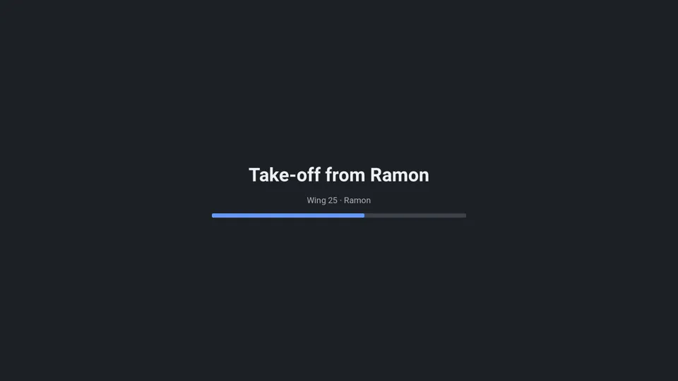 | 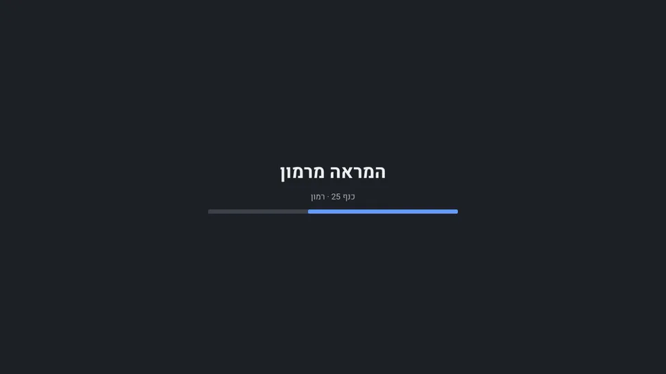 |

`iaf-2026/tests/_loading_shot.gd` takes these pictures (its header).
