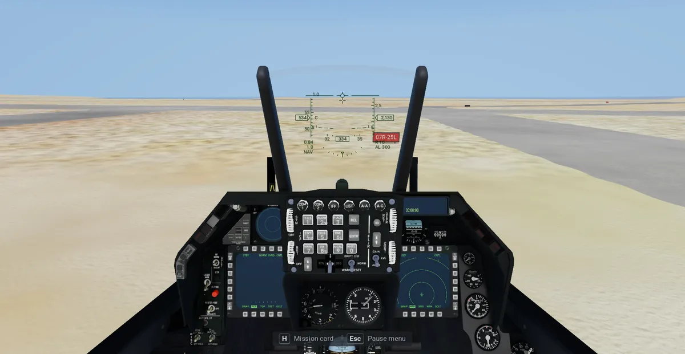
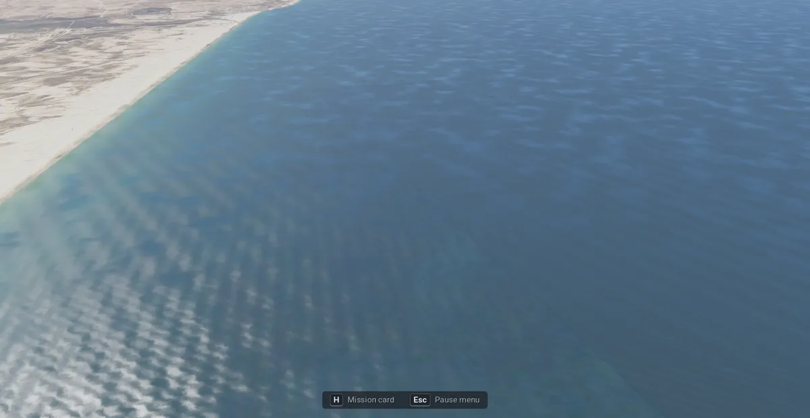
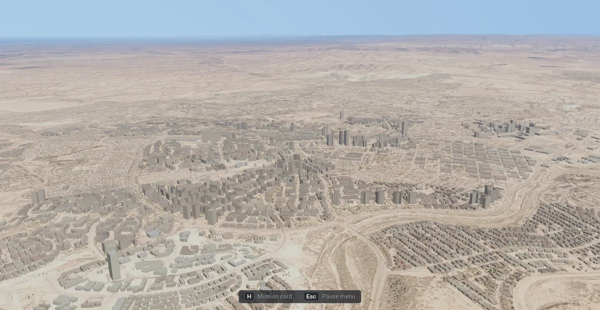
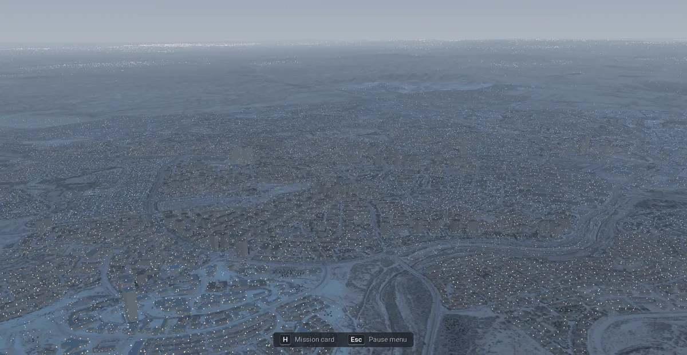
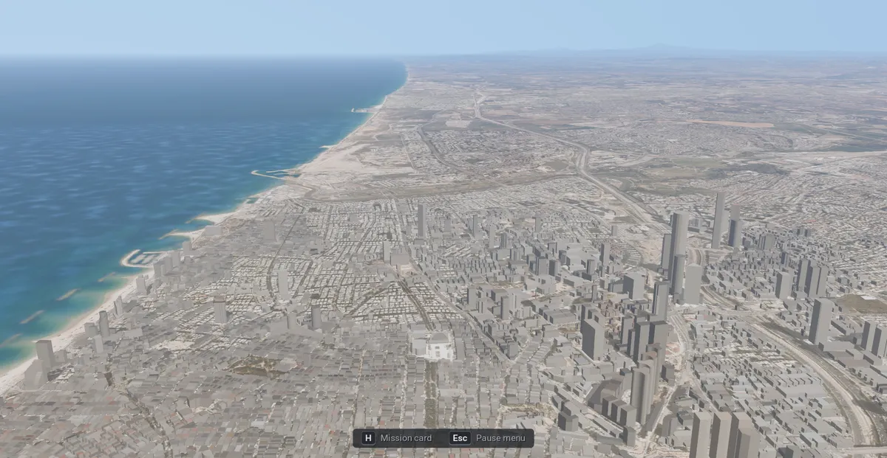
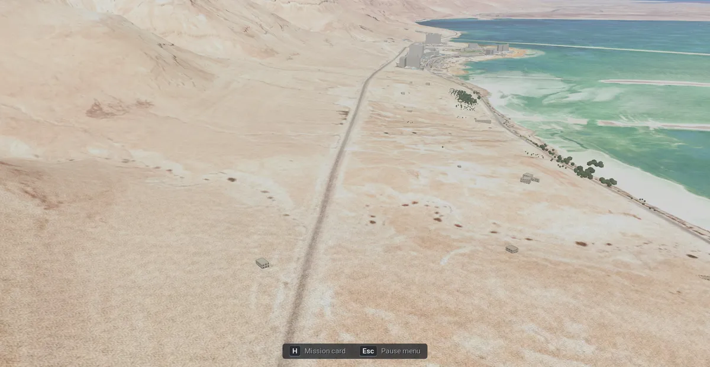

# IAF 2026: scenery, roads and city lights

**Terms:** OSM = OpenStreetMap; UTM 36N = Universal Transverse Mercator zone 36 north (EPSG:32636, the sim's frame,
[terrain.md](terrain.md) §2); node = a square of the theatre's tree (a level-1 node is 2,048 m); cell = the scenery
file of one level-1 node; "inferred" = our own reasoning; "open" = no source found.

The sim's theatre has the original game's optional scenery (docs/scenery.md): 3D buildings and trees, the road layer
drawn on the ground, the city lights at night. `iaf-sim scenery` (plan.md item B3) makes them from the same open data
as the original game's, by the same code, placed in the sim's UTM frame over the whole theatre.

```sh
cargo build --release -p iaf-tools --bin iaf-sim
target/release/iaf-sim scenery [data-dir (iaf-2026/data)] [assets-dir (assets)]   # needs GDAL; iaf-sim all runs it too
```

## 1. Sources

The sources are the original game's (docs/scenery.md §1.1, the files and their SHA-256 in
`crates/iaf-tools/src/thirdparty.rs`): Geofabrik's OSM extracts of 2026-01-01 (Israel and Palestine, Lebanon, Syria,
Jordan, Egypt, Cyprus), Microsoft's Global ML Building Footprints, JRC's GHS-BUILT-H building heights and ETH Zürich's
canopy heights. No new source: their credits are in [docs/credits.md](../../docs/credits.md), and the scenery's
`manifest.json` holds the `attribution` lines the sim's credits roll shows.

The download cache is shared with the original game: `assets/source/scenery/` and `assets/source/roads/`. The step
downloads only what the cache lacks, and only the tiles whose box meets the theatre: of the Microsoft quadkey files
and the ETH tiles, those in or around the theatre (76 of 165 Microsoft files and 6 of 10 ETH tiles; Cyprus and the
Nile delta lie outside it). A file that fails to download is logged and left out (its area has no buildings or trees);
only the Israel and Palestine extract and the Survey layer's own files (`SCENERY`) are required.

## 2. The frame

Every place goes from WGS84 to UTM 36N (`sim_bases::utm36n`, checked against GDAL to 1 cm) through a bilinear grid of
0.005° (`scenery::Warp`, as the original's georeference), so a building's world X / Y are its UTM easting and northing
([terrain.md](terrain.md) §2). The original's code takes the frame as a parameter: `scenery::Frame` (`Game`, the
1998 georeference; `Utm`, the sim's theatre with its `x_shift` / `y_shift`) gives the node rects and the gathering;
`iaf_avionics::roads::Frame` cuts the road layer's blocks (a level-3 node, 8,192 m) in the theatre's frame and is
written into the road manifest's `frame`, which `IafRoads` reads (the 1998 frame without it).

The cell files keep the original's format (`iaf_avionics::scenery`): world metres as f32. At the theatre's northings
(3.2–3.8 million) an f32 holds 0.25 m steps, so a corner lies within 0.13 m of its place (tested: a house at Ramon's
reference point lands 0.5 m or less from GDAL's UTM, the test's bound is 5 m).

## 3. What the step makes

| Path (under `assets/`) | What |
|---|---|
| `converted/terrain/israel/scenery/L1/s_<i>_<j>.bin` | one cell per level-1 node of the theatre with a building or tree |
| `converted/terrain/israel/scenery/lights/L1/s_<i>_<j>.bin` | the city lights' stand-ins where a town's footprints are sparse (docs/rendering.md §5.1) |
| `converted/terrain/israel/scenery/manifest.json` | `release`, `generator`, `kinds` (both), `made_from` (the stamp), `frame` ("EPSG:32636"), `attribution`, `licence`, the counts |
| `converted/terrain/israel/scenery/theatre.json` | the cells under `israel`: `shared/terrain/scenery.gd` streams them whatever the imagery |
| `converted/terrain/israel/roads/` | the road layer (docs/scenery.md §6): `main.bin`, `L3/r_<i>_<j>.bin`, `manifest.json` with `frame` |

They lie beside the theatre because their node keys belong to its frame: a theatre built over another box has other
keys. The sim finds them through `Settings.scenery_dir()` and `Settings.roads_dir()` (`iaf-2026/sim_settings.gd`);
`Settings.scenery_everywhere()` is true in the sim, so the scenery shows over its own ground (the original game shows
it over a Survey 2 m layer only).

How a cell is made is the original's (docs/scenery.md §1.2), with these differences:

| | The original game | IAF 2026 |
|---|---|---|
| Nodes | the Survey layer's (4,664), then the rest of the theatre's | every level-1 node of the theatre (42,500) in one run |
| Trees | one per 10 m canopy cell over the Survey layer, 20 m beyond | 10 m in every 32.8 km block that holds a Survey 2 m node, 20 m elsewhere |
| Roof colour | the photo's or the 1998 art's pixels | the theatre's own colour node under the footprint: 2 m Survey, else 8 m, else 32 m Sentinel-2; both looks the same |
| Where nothing stands | the sea, the airbases' footprints, the kept target insets, the missions' units and routes, World scale Real's sites | §4 |
| Light cells | the buildings the cells leave out, and the stand-ins | the stand-ins only: the cells stand everywhere |

## 4. Exclusion zones

`sim_scenery::open_at` decides where a building's corner or a tree may stand:

- **Water and runways**: land in the sim's `terraintype.dat` (`iaf-sim airbases`), outside a runway's rectangle,
  and outside the inland water's own polygons (`water.json` beside the theatre, [terrain.md](terrain.md) §11), not
  only its 64 m grid.
- **The photo's water**: within 1 km of a water body, no tree on a blue-green photo pixel (green over red by 20 or
  more, blue at least red; inferred from the tiles). OpenStreetMap leaves part of the Dead Sea Works' pan at Ein Bokek
  unmapped, and the canopy map reads 33 m "trees" over it.
- **The airbases**: outside each of the four bases' OSM outline (`boundary` in `iaf-2026/data/airbases/<icao>.json`).
  The bases' own buildings (hangars, shelters, the tower) are left to the airbases' models (Detailed airbases).
- **Paved ground** (the original's rule): no tree and no Microsoft footprint on OSM's roads, railways, runways,
  taxiways and aprons; OSM's own buildings stay.

The road layer's pieces over the same zones keep the off-ground flag (the map draws them, the ground does not).

The sim's missions place no units outside the bases yet, so there is no unit clearance (the original's
`scenery::clears`); open: when the sim has ground units (item D2).

## 5. The step

`iaf-sim scenery` (`crates/iaf-tools/src/sim_scenery.rs`):

1. Reads the theatre's `meta.json` (it must be the UTM theatre), the sim's `terraintype.dat` and the four bases.
2. Downloads what the shared cache lacks (§1).
3. The stamps: the road layer's and the cells' `made_from` each hash the scenery's release (the original's
   generator and pinned inputs), this step's version (`sim_scenery::VERSION`), the SHA-256 of each file that layer
   reads (a file that failed to download counts as missing, so the next run tries it again), the theatre's
   `meta.json`, the `terraintype.dat` bytes, `water.json` and the bases' outlines; the cells' also each roof image's
   name, size and modification time (the theatre's `L1`, `L3`, `L5` colour nodes). `meta.json`'s `built_from` holds
   the terrain's inputs, not its code: a redo or new terrain code rewrites the nodes with the same `meta.json`, so the
   images' times are what tells the cells their roofs changed. When both match, the step ends at once ("scenery: up
   to date"), before any download.
4. The road layer (`roads::make`, the original's), cut to the theatre's box.
5. The cells: the original's `scenery::sources` (ogr2ogr per OSM extract, the Microsoft files, GHS-BUILT-H, the canopy
   VRT) gathered per node, then per block of 16 × 16 nodes on every core `scenery::build_cell` and
   `scenery::fill_lights`. The cut extracts (`scenery/.work`) are removed at the end.

`iaf-sim all` runs it after `iaf-sim airbases` when the terrain is built; a failure there (no GDAL, offline) is
logged and the rest goes on: the sim flies without scenery. Nothing of the original game's data is read; the
original's own `scenery` step (docs/scenery.md §1.6) and its files are unchanged.

Measured on this machine (Intel laptop, 8 threads, `nice -n 15`, the cache full), 2026-11-03:

| | |
|---|---|
| Time | 3 min 0 s on a quiet machine (the road layer about 40 s); up to 14 min with another session building |
| Peak memory | 2.9 GB (the shell's `time`, max RSS) |
| Cells | 19,326 cells with 5,524,096 buildings (1,954,586 from OSM) and 44,601,934 trees; 2,485 light cells with 354,003 stand-ins; 1.06 GB |
| Roads | 708,848 ways (motorway 5,513, trunk 15,443, primary 12,155, secondary 26,484, tertiary 57,863, minor 372,493, service 120,757, track 95,721, rail 2,419), 7,471,926 points; `main.bin` 9.9 MB, 1,722 blocks, 118 MB |

## 6. Cost

Intel Iris Xe (TigerLake GT2), 2560 × 1440, `iaf-2026/tests/_flight_bench.gd` (the original's bench from the sim's
`ramon_takeoff` start) with `BENCH_BEST=1 BENCH_LEGS=500:150:15` (500 m above the ground, 150 m/s for 15 s),
`BENCH_SET=scenery=off` then `on`, two runs each under the shared GPU lock, the machine otherwise quiet (load
0.8–1.4), 2026-11-03:

| Over (`BENCH_AT`, UTM) | Scenery Off | On | lost | GPU Off → On | primitives Off → On | video memory |
|---|---|---|---|---|---|---|
| Ramon, the base and the desert west of it (657300,3403800) | 59.0, 58.6 fps | 59.0, 57.3 fps | 1.5 % | 16.7 → 17.0 ms | 589 k → 599 k | 1.09 → 1.10 GB |
| Tel Aviv, the city centre (668000,3550689) | 56.7, 54.5 fps | 47.6, 47.3 fps | 15 % | 17.7 → 20.6 ms | 573 k → 1,000 k | 1.34 → 1.58 GB |

Over Ramon the cost is within the scenery's budget (docs/scenery.md §3.1: 7 % lost at 1,500 m over the Survey
layer). Over Tel Aviv it is twice that: the theatre's densest town (the primitives drawn nearly double),
the same order as the original game's own dense-town figure (docs/scenery.md §3.1: 46 → 36 fps, 22 %, at 150 m). The
original game shows no scenery over Tel Aviv's centre (a kept target inset), so there is no like-for-like figure
there: its bench at the same place gave 66 → 64 fps with 3 k more primitives. The frame stays under 21.2 ms (p95
23.7 ms); the worst frame 37.7 ms against 33.4 ms without (the cells' upload). Open: a lighter far model for the
sim's towns: Far towns, below.

**Far towns** (Graphics → MORE, both games; the sim's profile picks Light, the original game's default is Full):
Light draws a dense cell's far ring (2.5–4.5 km) with its buildings of 15 m or 1,000 m² and up only
(docs/scenery.md §3.1). Its look: beyond 2.5 km a dense town shows its towers and halls; the low blocks show from
2.5 km in. Its cost is not measured yet (§9). A first look, taken with the machine busy (load 12, so the frame rates
do not count): over Tel Aviv the GPU took 16.5 ms with Scenery Off, 25.6 ms On, and 21.3 ms with no far ring at all,
so the far ring is about half the scenery's GPU cost there.

## 7. Pictures

Real-render pictures (`tests/godot/_imagery_shot.gd` in the sim: `SHOT_LAYERS=sim`, `SHOT_SET`, `SHOT_HOUR`,
`SHOT_HIDE_JET`), each compared with the theatre's own Survey / Sentinel-2 tiles of the same place: Ramon from 500 m,
Beersheba and Tel Aviv from 1,000 m, the Dead Sea shore at Ein Bokek, Tel Aviv at night with the city lights, and the
same with every graphics option on. Seen 2026-11-03:

- The buildings stand on the photo's: from above (Beersheba, 300 m) the blocks fill the photo's footprints and the
  streets stay clear; the river bed, the park and the industrial zone sit where the satellite shows them.
- The walls read grey where the photo's town is beige: the walls take half the photo's colour lightened toward
  plaster (docs/scenery.md §3), and the haze greys them further (terrain.md §9).
- Ramon from 500 m shows almost nothing: the desert around the base has no buildings, and the base's own are left
  to the airbases' models.
- At the Dead Sea, canopy trees stood in the evaporation pan at Ein Bokek. The water polygons' test and the photo's
  water test (§4) took the large clumps away (seen from above); from the shore (2026-11-08, below) no tree stands
  in the pan.
- At 22:00 the sky and the ground stay a dusk blue; the window and street lights show over the whole city (the shared
  night look).

In the repo (2026-11-08, Scenery On, 1920 × 1080 scaled to 1200 px; the pose after each, `--at` in UTM metres with
`--freeze`):

| Where | Picture |
|---|---|
| Ramon, on the taxiway north of the Sufa's spot: the hold sign "07R-25L" 39 m ahead, a direction sign beyond (cockpit, `658872 3405362 648 334`) |  |
| The shore south of Tel Aviv toward Ashdod, 800 m (`662200 3542000 800 202`, `SHOT_ORBIT=180,25,400`; before: [shore_before.webp](pictures/scenery/shore_before.webp)) |  |
| Beersheba from 1,000 m, day (`668500 3455500 1000 20`, `SHOT_ORBIT=180,15,200`) |  |
| The same at 22:00 (`SHOT_HOUR=22`) |  |
| Tel Aviv from 1,000 m, day, looking north along the coast (`667500 3548000 1000 15`, `SHOT_ORBIT=180,15,200`; before: [telaviv_day_before.webp](pictures/scenery/telaviv_day_before.webp)) |  |
| The Dead Sea shore at Ein Bokek, 280 m over the water, looking north (`725300 3451300 -150 345`, `SHOT_ORBIT=180,20,300`; before: [deadsea_shore_before.webp](pictures/scenery/deadsea_shore_before.webp)) |  |

Seen in them: the signs stand beside the taxiway, legible at 40 m. The beach is clean, with no white edge, and the
sea is one surface out to the horizon. Beersheba's blocks, towers and the river bed match the photo; at 22:00 the town
is a dusk blue with its lights. Tel Aviv's towers stand along the Ayalon and in the centre, the low blocks between
them follow the streets. Wrong in it: every building is one grey, with no roof colour seen from 1,000 m. At Ein Bokek
the hotels, the palms along the beach and the pan's dikes sit where the photo has them, and no tree stands in the
pan. Wrong in it: the road is a flat grey band.

Fixed on 2026-11-08 (the "before" pictures above):

- **The white patch on the sea off Tel Aviv** (off Herzliya, in fact): the Survey sheets' white no-data in a theatre
  built before the photo was cut to the coastline ([terrain.md](terrain.md) §12).
- **The sea's two blues in steps**: two seams. The 2 m photo's lighter sea beyond the coastline's 300 m reach ended at
  the sheets' straight edges; now the sea is Sentinel-2's from the beach out. And Sentinel-2's sea, whose pixels end
  in straight blocks offshore, met a darker fill; the fill is now the composite's own open-sea tone
  ([terrain.md](terrain.md) §3, §12).
- **The orange speckle near the camera at Ein Bokek**: the shared Terrain close up's colour patches, which turn pale
  ground orange; the sim draws its grain and relief only ([terrain.md](terrain.md) §13).

## 8. Checks

- `cargo test --release -p iaf-tools --lib sim_scenery`: a building at its lat / lon in UTM (within 5 m; 0.5 m in
  fact), the exclusion zones (sea, lake, runway, a pond the grid misses, inside a base's outline; the desert beside
  open), the photo's water test, the tiles' and countries' boxes and the downloads the theatre needs.
- `cargo test --release -p iaf-tools --lib sim_bases`: the inverse projection, the water flags, the water polygons'
  filters and their twins, `water.json` read back (terrain.md §11).
- `cargo test --release -p iaf-avionics --lib`: the frame's nodes in both frames (`frame`), the light far model
  (`scenery`).
- The original game: `tests/godot/test_scenery.gd`, `test_terrain.gd`, `test_startup.gd`, `test_ground_roads.gd`; its
  road layer, scenery cells, light cells and manifests built byte for byte as on main: checked again on
  2026-11-08 on the final branch against main 15067824 (`iaf-scenery roads`, then `build` and `lights` with `--near
  340250,612940,6`, each from a scratch root over the same inputs): 3,546 files, the same SHA-256 each (the whole
  road layer, 21 cells, their light cells, the manifests). The rest of the theatre (`build_theatre`, run by `build`)
  stopped with GDAL's PROJ errors on both. In the sim: `iaf-2026/tests/test_mvp.gd` and the M0
  probe.

## 9. Open

- **Far towns' cost**: Ramon and Tel Aviv at 500 m with Off, On-Full and On-Light, two runs each under the GPU lock
  on a quiet machine, are still to measure (§6).
- **Unit clearances**: when the sim has ground units (§4).
- **The rest of the theatre in the byte check**: `build_theatre` with `--near` stopped on PROJ's "moll: Invalid
  latitude" on main and on the branch alike (§8).
- **Pictures in the repo**: Ramon from 500 m, Tel Aviv at night, Tel Aviv with Far towns Full and Light, and the
  Graphics → MORE page with the Far towns row.
- **The open sea's faint line**: one texel wide where Sentinel-2's pixels end offshore, seen low over the water
  ([terrain.md](terrain.md) §3).
- **Walls' colour**: the original's wall shading greys a desert town (§7); the sim may want its own.
- **The bases' buildings**: the hangars and shelters are the airbases' models' (item B2's open points).
- **Kinds**: the sim makes both buildings and trees; one row turns both on (Preferences → Graphics → "Buildings and
  trees", [front-end.md](front-end.md) §4); a choice between them is open.
