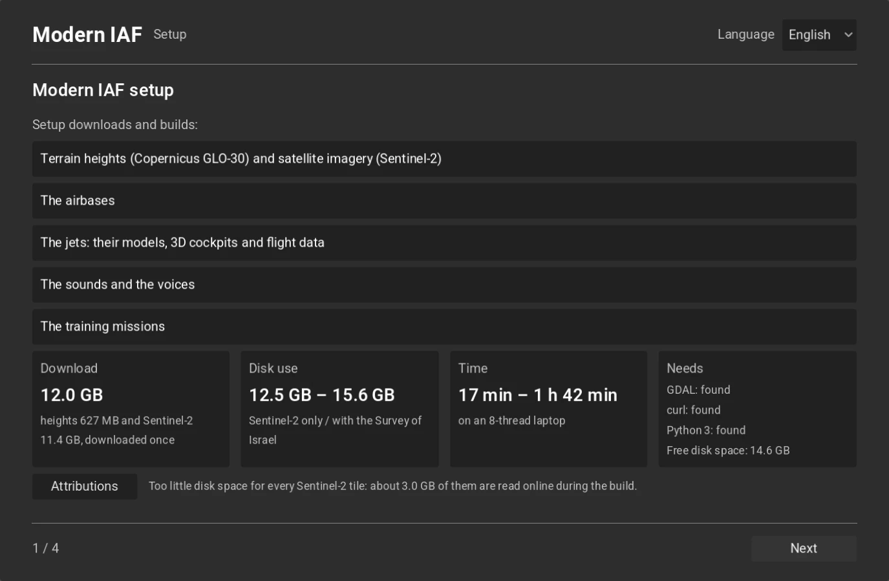
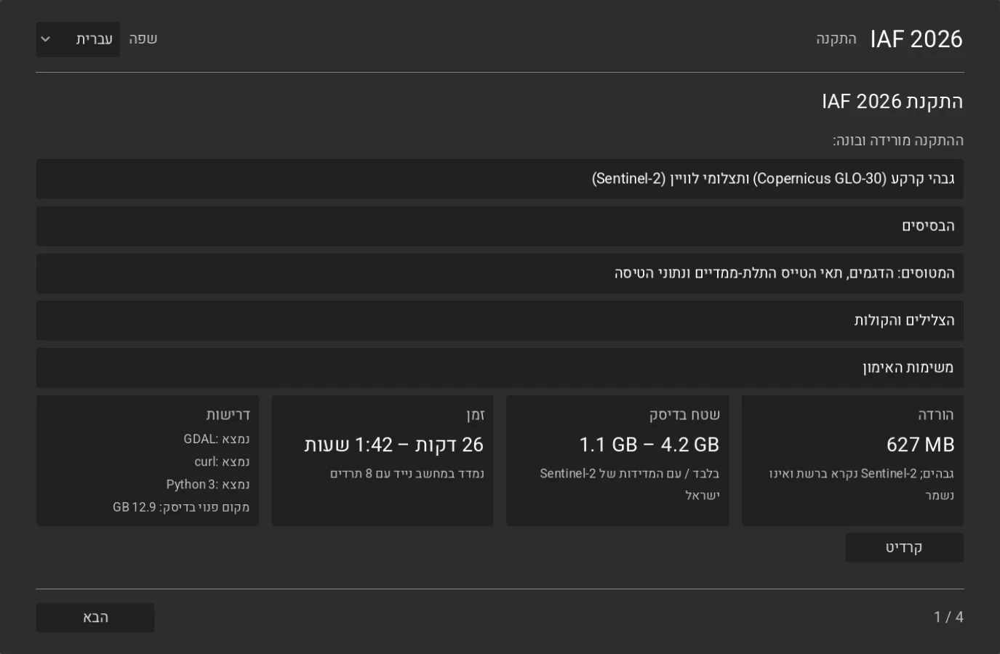
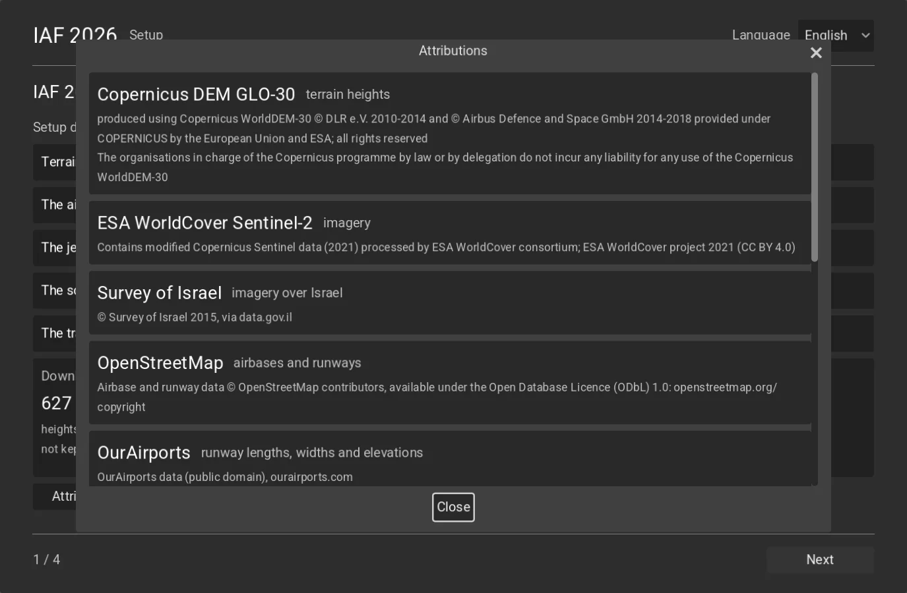
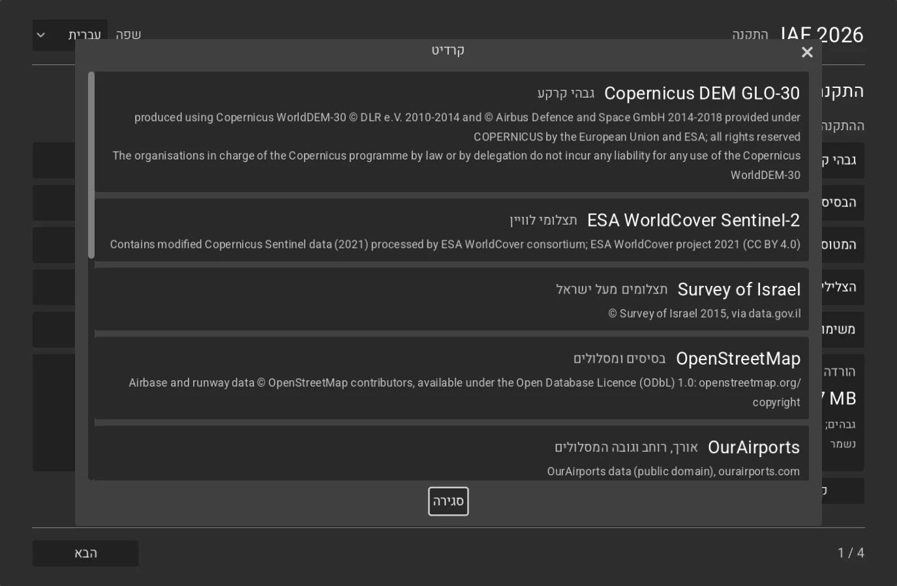
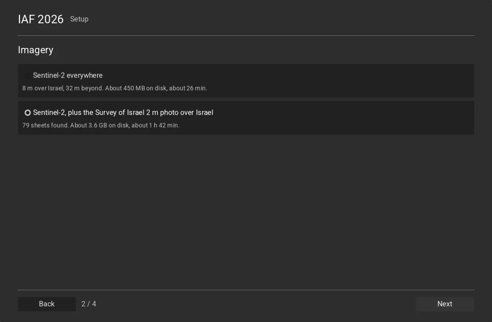
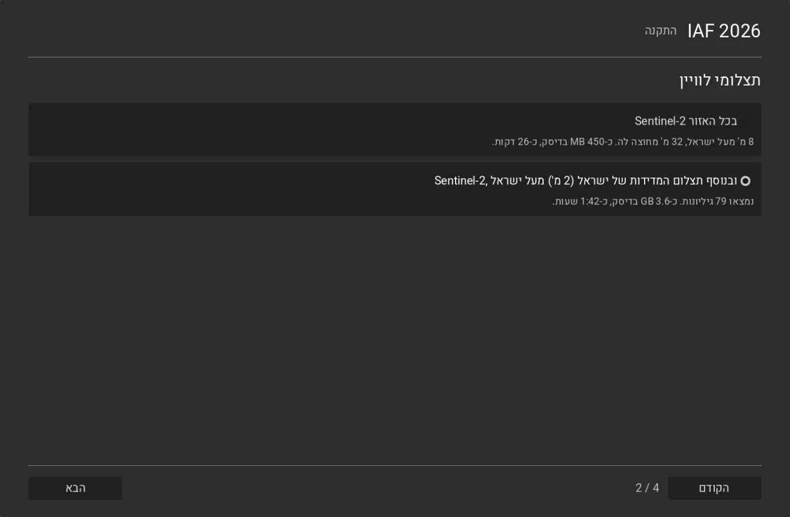
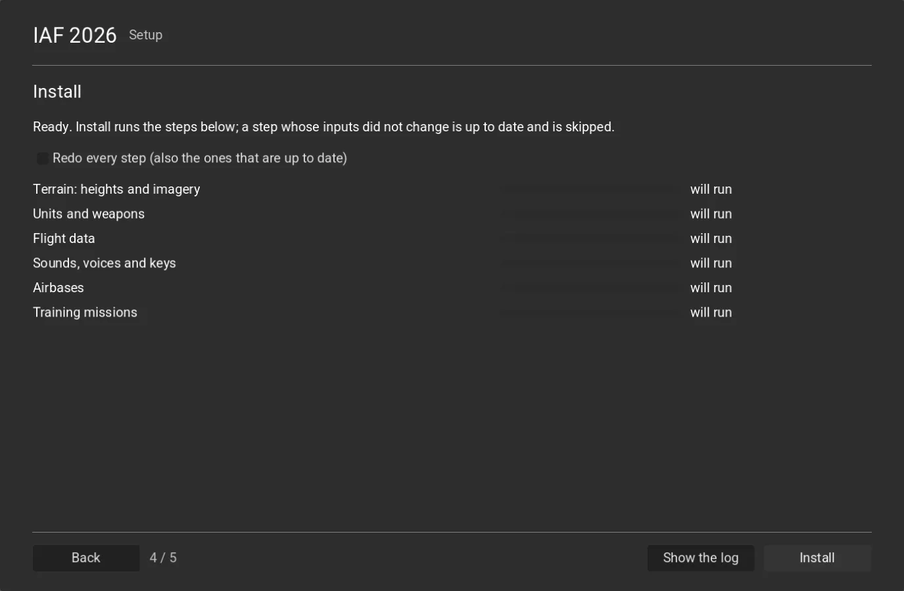
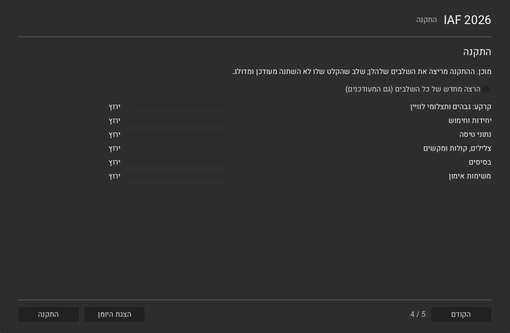
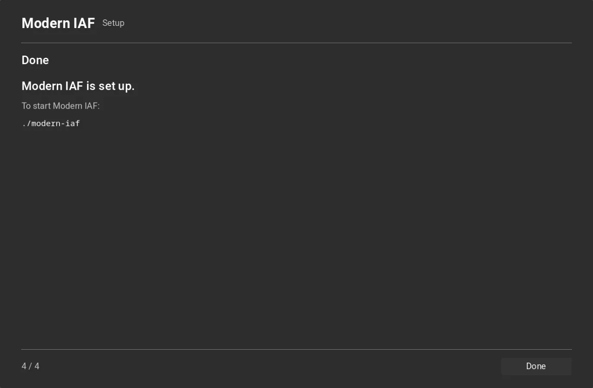
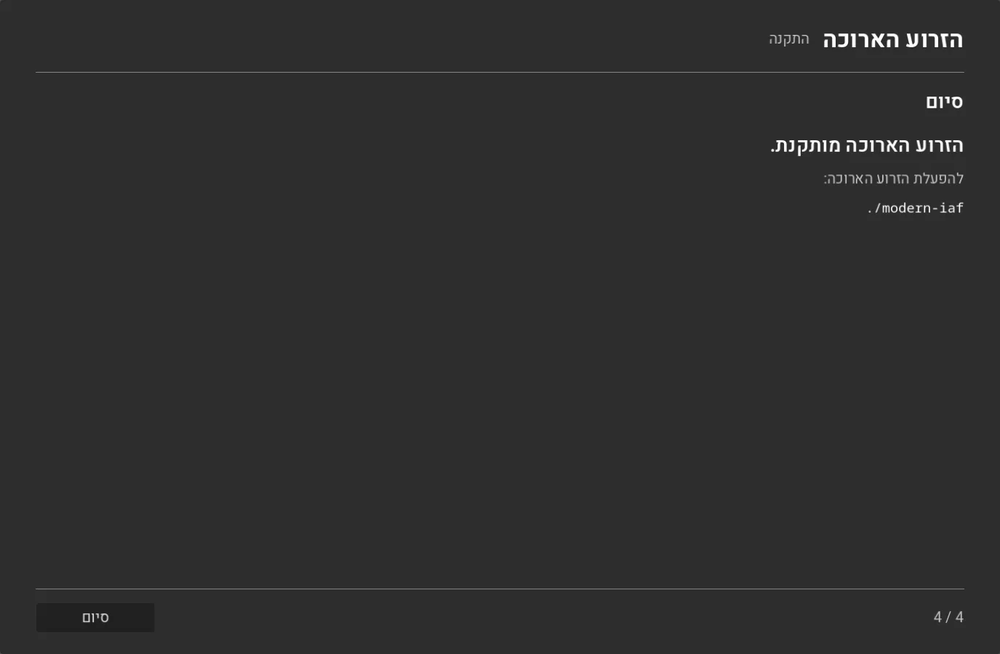

# Modern IAF: the setup wizard

The setup wizard builds the sim's data into `assets/`: the terrain, the airbases, the units and weapons, the jets'
flight data, the sounds and voices and the training missions. It is item [A3](plan.md#a3-the-setup-wizard). Start it from the repo root:

```sh
./modern-iaf-setup        # Windows: .\modern-iaf-setup.ps1
```

`./modern-iaf` starts it too while the sim's data is missing (no `assets/converted/iaf-2026/missions/`, the last step's
output). Run it again at any time: a step whose inputs did not change is "up to date" and is skipped, and a run
that stopped resumes where it stopped.

## 1. What it needs

| need | why | Linux | macOS | Windows |
|---|---|---|---|---|
| Rust (cargo) | builds the extension the wizard runs in | rustup.rs (Arch: `sudo pacman -S rustup`) | `brew install rustup`, then `$(brew --prefix rustup)/bin/rustup default stable` | `winget install Rustlang.Rustup` |
| Godot 4.7 | runs the wizard | godotengine.org (Arch: `sudo pacman -S godot`) | `brew install godot` | `winget install GodotEngine.GodotEngine` |
| GDAL | reads and reprojects the heights and the imagery; cuts the inland water and the scenery from OpenStreetMap (`ogr2ogr`) | `sudo apt install gdal-bin` (Arch: `sudo pacman -S gdal`) | `brew install gdal` | the GISInternals installer (`winget install GISInternals.GDAL`) |
| curl | downloads the height tiles | `sudo apt install curl` | in macOS | in Windows 10 and later |
| disk | the data (§4) | | | |

The launcher (`tools/launch-wizard.sh`, which the original game's `./setup` uses too) and `./modern-iaf` check Rust and
Godot 4.7 and say how to install a missing one (`tools/launch-checks.sh`). On macOS they add Homebrew's folders to
the PATH when `cargo` or `godot` is not on it (a start from a shell without Homebrew's setup). The wizard's first page checks GDAL, curl and the free disk space for the
imagery chosen at the start (the Survey's when its sheets are there); Next waits until they are there, and the page
names the install command for the system it runs on. The Sentinel-2 tiles still to download (8.28 GB, the 14 tiles under the 8 m nodes, less those
already in `assets/source/imagery/sentinel2/`, `IafSetup.sim_s2_cached`) count too: when they would leave less
than 5 GB free, the page says how much of them is read online during the build instead of kept (docs/imagery.md §2),
and Next does not wait for that.

## 2. The pages

Each page in English and in Hebrew. The language is the sim's `Settings.language`, chosen on the first page and
saved; a Hebrew page is mirrored, every control included (`layout_direction` right to left). The window fills a
large screen by its UI scale (the containers stretch; nothing has a fixed page size).

1. **Welcome**: the language; what setup downloads and builds; the download, the disk use and the time (§4); the
   requirements; the **Attributions** button ("קרדיט").
2. **Imagery**: Sentinel-2 everywhere, or Sentinel-2 plus the Survey of Israel 2 m photo over Israel, each with its
   disk use and time. The Survey choice needs the 79 sheet ZIPs (data.gov.il, 17 GB) in
   `assets/source/imagery/mapi2015/`; without them the page says so and keeps Sentinel-2.
3. **Install**: one row per step with its progress bar and state. Before a run the rows say which steps are up to
   date (a background check); during a run the page shows two estimates (see "Time left" below). Back becomes Cancel: the running steps
   stop at their next item. "Show the log" opens the log; the whole run is also in `assets/logs/modern-iaf-setup-<date>-<time>.log`.
   "Redo every step" runs the steps that are up to date too; for the terrain that is a full rebuild (its finished
   units' marks are dropped). Back from Install forgets the finished run, so other choices can be installed; a
   language change keeps it.
4. **Done**: whether the sim is set up, with two buttons. **Start the game** ("להתחיל לשחק") opens the sim's front
   end in the same process, as `./modern-iaf` starts it: the project's own window size (the wizard's 1100×720 at the
   UI scale goes), the player's full-screen choice, the joystick and keys from the files the run just built
   (`Settings.apply_devices()`), then `Settings.front_end_scene()`. The extension is built and the project imported
   already, because the wizard runs in the same project. **Close** ("סגירה") quits.

### Time left
The Install page has two estimates, labelled so they are not mixed up:

- **This step** ("שלב זה"), in a running step's row: the step's own progress against the time it has run so far.
  The terrain step's bar weighs its parts by expected seconds (§3), so a slow download stretches the whole step's
  estimate. The terrain step's log line "Sentinel-2 tiles: … about 9 min left" covers the download only.
- **All steps** ("כל השלבים"), under the status line: the steps still to finish, each by the seconds its last
  finished run took on this computer, times the part it still has to do. A step up to date counts 0. When a step
  still to finish never ran here, the line shows the step count instead of a guess ("All steps: step 4 of 7").
  Each step that finishes records its seconds in `assets/converted/iaf-2026/<step>.secs`, beside its stamp
  (`iaf_setup::time_left`, `sim_expected`). The seconds are not part of the stamp, so they never decide what runs
  or downloads. Steps that run at once are added up, so the estimate can be high when two long steps overlap.

Why the Mac run (2026-11-09) showed "about 2:50 hours left" while the log said "about 9 min left": the 2:50 was
the terrain row's estimate (there was no total yet). With the Survey chosen, the terrain bar gives the download
about 9 % of the step (13.8 MB/s assumed, `part_ends`) and the Survey's 2 m 75 minutes. The download ran at
5.3 MB/s, so the bar moved at less than half the assumed pace, and the row stretched the step's 80 minutes still to
come to about 2:50 hours (inferred from `part_ends` and the log line). The 9 minutes were the download alone.

The **Attributions** open from Welcome as a modal dialog over the page (Close or Esc closes it; it scrolls): every
source with its licence line: the Copernicus DEM's two lines word for word ([terrain.md](terrain.md) §5), ESA
WorldCover's Sentinel-2 line, the Survey of Israel, OpenStreetMap (ODbL), OurAirports, the freesound authors
([sound.md](sound.md) §6), Piper and its voices, the FlightGear F-16 (GPL), the F-35I model (CC BY 4.0), NASA
TP-1538, the Heebo font (OFL), the front end's jet photos (Wikimedia Commons, CC BY). The licence lines stay in
English in the Hebrew dialog.

The pages say only what the user decides or must know ([plan.md](plan.md) Rules).

| page | English | Hebrew |
|---|---|---|
| Welcome |  |  |
| Attributions (over Welcome) |  |  |
| Imagery |  |  |
| Install |  |  |
| Done |  |  |

### Look
The look is one file, `iaf-2026/setup/wizard_theme.gd`: Godot's default dark theme with Heebo
(`iaf-2026/data/fonts/`, SIL OFL 1.1) and the text kinds the pages ask for by name ("Heading", "Muted", "Note",
"Readout", "Card", "Primary": Done's Start the game, a white button with dark bold text). A new look replaces that file only. The strings are `iaf-2026/setup/strings_en.json` and
`strings_he.json` (formal, gender-neutral Hebrew).

## 3. The steps

The wizard runs `iaf_setup::sim_plan` through `iaf_setup::sim_run` (`crates/iaf-setup/src/sim.rs`), the same
dependency graph as the original game's setup: independent steps run at once, a failed step blocks what waits for it.

| step | does | waits for |
|---|---|---|
| `sim-terrain` | `iaf-sim terrain`: GLO-30 heights, Sentinel-2 colour, the Survey 2 m photo when chosen ([terrain.md](terrain.md)) | — |
| `sim-db` | `iaf-sim db`: the units and weapons ([data-formats.md](data-formats.md)) | — |
| `sim-fm` | `iaf-sim fm` (`crates/iaf-tools/src/sim_fm0.rs`): the jets' `bd.ibx` and envelopes ([flight-model.md](flight-model.md)) | — |
| `sim-own` | `iaf-sim own`: the sounds, the voices and the keys ([sound.md](sound.md)) | — |
| `sim-airbases` | `iaf-sim airbases`: the four bases on the terrain ([airbases.md](airbases.md) §9) | `sim-terrain` |
| `sim-missions` | `iaf-sim missions`: the training missions on the bases ([training.md](training.md)) | `sim-airbases`, `sim-db` |
| `sim-scenery` (optional) | `iaf-sim scenery`: the buildings, trees, roads and city lights ([scenery.md](scenery.md)); skipped without GDAL's `ogr2ogr`, or offline with a file still to download; the sim flies without it | `sim-airbases` |
| `sim-textures` (optional) | the ambientCG CC0 materials (the original game's `textures` step, shared): the zips (about 310 MB) kept in `assets/source/ambientcg`, packed into `assets/thirdparty/ambientcg`: the Ground textures, the Model detail and the scenery trees' foliage; skipped offline, and up to date when the original game's setup already fetched them | — |

The same steps from a terminal, from the repo root (no stamps: each command runs; the terrain still ends at once when
its `built_from` is unchanged):

```sh
cargo build --release -p iaf-tools --bin iaf-sim
target/release/iaf-sim terrain
target/release/iaf-sim all            # db, own, fm, airbases, scenery, missions
```

The terrain step's progress bar follows the colour branch, the longer of its two (the heights run beside it): the
Sentinel-2 tiles' download by the bytes still to fetch (at 13.8 MB/s), then the 32 m nodes, the 8 m nodes and the
Survey's 2 m when chosen, each by its expected seconds (`part_ends` in `sim_terrain.rs`), so the wizard's time left
holds steady through the step.

Each step keeps a stamp, `assets/converted/iaf-2026/<step>.stamp`: the fingerprint of the code that makes its output
(`stamp::STEP_SOURCES`), the authored data it reads (each file's size and CRC-32) and the
stamps of the steps it waits for; paths are relative to the repo, so a stamp is the same in every checkout and on every
system. The terrain's stamp holds what `iaf-sim terrain` itself compares (the box, the detail area, the Survey sheets'
names and sizes, the airbases' layouts, whose outlines mask the Survey photo), so a choice of the other imagery or a
changed base outline runs the terrain and what stands on it again. A theatre built before the airbases were part of
its `built_from` (3 November 2026) runs once more: its finished units' marks make that a matter of minutes. Inside a step the terrain resumes by its own marks (`.work/`): a cancelled or failed run keeps its finished
units and DEM tiles.

Downloads are kept by their source file name under `assets/source` and are never fetched again because the code
changed. The stamps cover the compilers only: the GLO-30 tiles, the Sentinel-2 tiles and their listings, the Survey sheets and the OpenStreetMap extracts are found by name in
`assets/source/` (a whole Sentinel-2 tile there is used as it is, edge tiles too; an edge tile not on disk is cut
once into its kept 20 m extract, `<tile>_20m.tif`, [terrain.md](terrain.md) §1.1).

## 4. Sizes and times

Measured on the developer's Linux laptop (Intel i7-1185G7, 8 threads), 3 November 2026 ([terrain.md](terrain.md) §7); the
Sentinel-2 column 8 November 2026 (§7).

| | Sentinel-2 everywhere | plus the Survey of Israel |
|---|---|---|
| download, once | GLO-30: 627 MB, kept in `assets/source/dem/`; the Sentinel-2 tiles: 11.4 GB, kept in `assets/source/imagery/sentinel2/`, with the edge tiles' 20 m extracts (about 0.34 GB, estimated) ([terrain.md](terrain.md) §1.1) | the same; the Survey's sheets must be there already (17 GB) |
| theatre on disk | 469 MB (levels 3–11) | 3.57 GB |
| the other steps | about 20 MB, and the OpenStreetMap extracts the airbases' inland water is cut from: 450 MB, kept in `assets/source/scenery/` and `assets/source/roads/` (the scenery reads them too) | the same |
| disk use in all | about 12.5 GB | about 15.6 GB |
| time | the first run about 17 min: the tiles' download about 14 min (11.4 GB at 13.8 MB/s), Sentinel-2 at 32 m and 8 m about 2 min, the coarser levels about 1 min, the DEM's 2 min beside them; a later run a few minutes (inferred from §7 and [terrain.md](terrain.md) §7 until measured) | 1 h 42 min |

The other five steps take seconds together. The first page shows these figures.

## 5. Checks

- `cargo test -p iaf-setup`: the plan's order, the stamps (a second run is all up to date, the Survey choice runs the
  terrain, the airbases and the missions again, a changed airbase outline the terrain), a terrain redo drops its
  marks, inputs relative to the repo; every sim step's source row holds every module its
  code reaches.
- `cargo test -p iaf-setup --test no_refetch`: with every source in `assets/source` (the edge tiles' 20 m extracts
  too), both games' fetchers make no `curl` or `gdal_translate` call (fakes on the PATH record any).
- `iaf-2026/tests/test_setup_wizard.gd` (headless, `IAF_ASSETS_DIR` at an empty folder): the four pages in order in
  both languages, the mirrored layout, the approved Hebrew words, the Attributions dialog (opens from Welcome,
  mirrored, the Copernicus lines word for word, every attribution, closes with Esc and with Close),
  no other game named, the Survey choice off without sheets, the Install rows and their preview, abandoned preview
  checks fetched, a finished run kept through a language change and forgotten by Back. `tools/test.sh` gives it a
  scratch folder.
- The pictures: `tools/godot_window.sh IAF_DEFAULT_SETTINGS=1 SHOT_DIR=<dir> -- --log-file <log> --path iaf-2026
  --resolution 1100x720 -s ../iaf-2026/tests/_setup_wizard_shot.gd`.
- A real run, 3 November 2026: §6; a run from nothing, 8 November 2026: §7.

## 6. A real run

On this laptop, 3 November 2026, from an assets root with none of the sim's files but the downloads and the built
theatre's tiles (`source/dem/` and the Survey sheets linked in, the theatre's levels hard-linked: what a machine that
built the terrain before keeps), the Survey choice:

| run | what ran | time |
|---|---|---|
| first | all six steps: `sim-terrain` found its `built_from` unchanged and ended at once; the units and weapons, the flight data, the sounds and keys, the airbases and the missions were built | 16 s |
| second | none: all six up to date | 0.5 s |

The M0 probe on that root: 41 PASS, 0 FAIL, and one NEEDS DATA, the cockpit check of that day (item E1's; since
2026-11-08 it is a PASS / FAIL check). A terrain built from nothing takes the times of §4.

## 7. Fresh-root run (2026-11-08)

The path a new Mac user takes ([README](../README.md) "Run it on a Mac"), on this laptop, from a new worktree (its
first build and first import) whose `assets/` was an empty folder with only `source/dem/` linked in (the GLO-30
tiles: their 2 min download skipped), Sentinel-2 everywhere.

| step | time |
|---|---|
| `cargo build --release -p iaf-godot`, from nothing (the first part of `./modern-iaf-setup`) | 6 min 32 s |
| Godot's first import of `iaf-2026/` (`tools/godot_import.sh`) | 12 s |
| the wizard's Install, all six steps (driven headless: Next, Next, Install) | 14 min 8 s |
| … of which `sim-terrain`: heights 15 s, Sentinel-2 at 32 m 3 min 11 s, at 8 m 9 min 17 s, the coarser levels 1 min | 13 min 45 s |
| … and `sim-db`, `sim-fm`, `sim-own` (beside the terrain), then `sim-airbases`, `sim-missions` | seconds |
| the wizard again: all six up to date | 2 s |
| the same steps from a terminal (§3): the terrain up to date, the rest rebuilt | 16 s |

This run read Sentinel-2 online, tile by tile as the nodes needed it: the machine's network traffic during the
Install was 8.3 GB (the laptop's whole traffic). Setup has since kept the tiles (main d7cf6757): the 21 tiles over the
theatre, 11.4 GB, are downloaded once into `assets/source/imagery/sentinel2/`, and a run with all of them there uses
no network ([terrain.md](terrain.md) §1.1). The root then held the theatre (469 MB) and the sim's own files (8 MB).

On that root:

| run | result |
|---|---|
| the M0 probe | 41 PASS, 0 FAIL, the one NEEDS DATA of item E1 (no 2D panel in flight) |
| `iaf-2026/tests/test_front_end.gd` (Home to a mission, a `--mission` flight to its debrief) | 126 PASS, `RESULT PASS` |
| `iaf-2026/tests/test_mvp.gd` (both missions for the three jets, to their debriefs) | 57 PASS, `RESULT PASS`, 3 min 39 s |
| `./modern-iaf` (Home) and `./modern-iaf -- --mission 2011` and `2012`, real render, 75 s each | the screen and both missions start; no script error |

What a fresh machine hit, and what was fixed on branch `wt/iaf-2026-freshroot`:

- The wizard's time left jumped (2 min, then 38 min) because the terrain's progress restarted at each part: one bar
  over the parts now, each part by its expected seconds, the tiles' download by its bytes (§3).
- The scripted way named `iaf-sim terrain` and `iaf-sim all` only; the flight data (then `fm0.py`) was a step of its own (§3). Since 9 November 2026 `iaf-sim all` writes it too (`iaf-sim fm`).
- §4 and the first page said 26 min and 450 MB for Sentinel-2 everywhere: measured 16 min (with the DEM download)
  and 469 MB.
- The first page's Download named the heights only: it names the Sentinel-2 tiles' one download too (11.4 GB),
  and the disk use counts them. In Hebrew a size in a sentence showed its unit first ("MB 627"): each size is now one
  left-to-right piece.
- `./modern-iaf` looked for the sim's data under `assets/` only, not under `IAF_ASSETS_DIR` as the game does.
- macOS: Homebrew's rustup puts `cargo` in `opt/rustup/bin`, off the PATH; the launchers add it (§1).

Each flight on that root also logged two errors, `converted/fonts/hud.fnt` and `converted/cockpits/f16/cockpit.json`
not found: the shared HUD and 2D cockpit looked for the original game's converted files. Item
[A4](plan.md#a4-the-gate), the gate, has since closed both (the sim's own HUD font and cockpit data).

## 8. Open

- Switching from the Survey choice back to Sentinel-2 everywhere leaves the Survey's 2 m tiles in the theatre (the
  terrain step writes the tiles it makes and does not delete others).
- The Survey sheets are those `iaf-imagery fetch-mapi2015` downloads; the wizard uses them when they are there.
