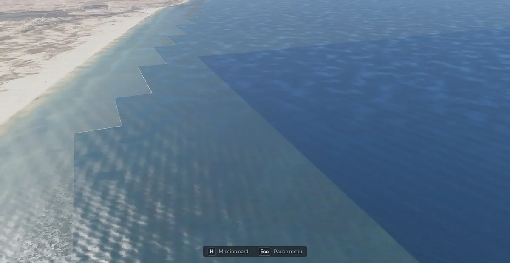
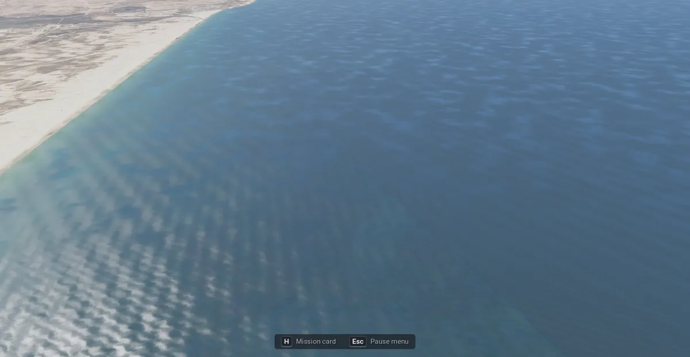

# Modern IAF: the terrain

**Terms:** DEM = digital elevation model (the ground's heights); GLO-30 = the Copernicus DEM at 30 m; S2 =
Sentinel-2 (the ESA satellite pictures); UTM 36N = Universal Transverse Mercator zone 36 north (EPSG:32636); ITM =
Israeli Transverse Mercator (EPSG:2039, the Survey of Israel's grid); node = one 1024² tile of the theatre tree; level
L = a node covers 1024 · 2^L m with a pixel of 2^L m; "inferred" = our own reasoning; "open" = no source found.

The sim's terrain is one theatre at 1:1 built from open data by `iaf-sim terrain` (plan.md item B1): heights from the
Copernicus DEM, colour from Sentinel-2 everywhere and from the Survey of Israel's 2 m photo over Israel. It is written
in the same shape as the original game's converted theatre, so `shared/terrain/terrain.gd` and `IafHeights` read it
with no change of their own.

```sh
cargo build --release -p iaf-tools --bin iaf-sim
target/release/iaf-sim terrain [assets] [--box E0 N0 E1 N1] [--out DIR] [--threads N]   # needs GDAL and curl
```

The setup wizard runs it as its first step ([setup.md](setup.md)). A run resumes: finished work units are marked in
`<out>/.work/`, and every download stays in `assets/source/` (§1.1), so a second build, or the original game's
imagery setup, reads it from there. A finished run is stamped in `meta.json` (`built_from`: the box, the
detail area and the sheet ZIPs' names and sizes); a run with the same inputs ends at once ("up to date"). To build
again, delete `meta.json` (and `.work/done_*` for the units to redo).

## 1. Sources

| what | source | licence | how it is read |
|---|---|---|---|
| heights | Copernicus DEM GLO-30[^dem] | Copernicus WorldDEM-30 licence[^dem-licence]: free use, the notices of §5 | 1° tiles (Cloud-Optimised GeoTIFF) from the public AWS bucket `copernicus-dem-30m`[^dem-aws], downloaded once into `assets/source/dem/` (a `.none` mark for a cell with no tile: open sea) |
| colour, whole box | ESA WorldCover 2021 Sentinel-2 RGBNIR composite, 10 m[^wc] | CC BY 4.0 | the 1° tiles (Cloud-Optimised GeoTIFF) in `assets/source/imagery/sentinel2/`, shared with `iaf-imagery sentinel2` (docs/imagery.md §2); the missing ones downloaded there first; their overviews serve the 32 m nodes |
| colour, Israel | Survey of Israel orthophoto 2015, 2 m[^soi] | data.gov.il open licence | the sheet ZIPs already in `assets/source/imagery/mapi2015/` (`iaf-imagery fetch-mapi2015`); nothing is downloaded for this step |
| airbase outlines | OpenStreetMap, the four bases' `boundary` in `iaf-2026/data/airbases/` ([airbases.md](airbases.md))[^osm] | ODbL 1.0 | §4 |

### 1.1 The download cache

Every source is read from `assets/source/` first; only what is missing goes over the network, into the same folder
under the same name, so the next run of either game finds it. The log says per source what was reused and what
was fetched (MB).

| what | where | name | complete when |
|---|---|---|---|
| GLO-30 tiles | `assets/source/dem/` | `Copernicus_DSM_COG_10_N31_00_E034_00_DEM.tif`, or `….none` for an open-sea cell | the file is there (renamed from `.part` only after curl ended cleanly with HTTP 200) |
| WorldCover tile list | `assets/source/imagery/sentinel2/` | `listing_N31.tsv` (tile, bytes) per latitude band | the file is there: it is written whole (a `.tmp` renamed) and only from an answer that lists tiles on one page; an empty or first-page answer is refused and asked again next run |
| WorldCover tiles | `assets/source/imagery/sentinel2/` | the bucket's own: `ESA_WorldCover_10m_2021_v200_N31E034_S2RGBNIR.tif` | its size is the listed one (a `.part` resumes; a `.lock` beside it lets one run at a time write it, so both games can build at once) |
| Survey sheets | `assets/source/imagery/mapi2015/` | `<sheet>.zip`, the original's (`iaf-imagery fetch-mapi2015`) | never downloaded here |
| Survey sheet measurements (extent, levels) | `assets/converted/imagery/.work/mapi2015/sheets.tsv`, the original's | copied into `.work/` on a first run; a line counts when its ZIP's size and date match | measuring 102 sheets takes about 13 min |
| airbase outlines | `iaf-2026/data/airbases/` (in the repo) | | never downloaded here |

A complete cache means no network at all. A tile download must leave 5 GB free on the disk
(`imagery_run::S2_KEEP_FREE`); a tile with no room is read over the network as before (`/vsicurl/`, range reads)
and the log warns. The free space is measured once per run (with `df`; Windows has none, so there is no check
there): if another job fills the disk meanwhile, the download stops with "disk full: free space and run again". The sim's theatre needs 21 WorldCover tiles, 11.4 GB; the original's whole `sentinel2` layer
up to about 28 GB. The original game's imagery setup uses the same cache (docs/imagery.md §2), and an uninstall keeps
it (`iaf_setup::KEPT` holds `source/imagery`).

GLO-30 is a surface model: its heights include buildings and trees, above the EGM2008 geoid (≈ mean sea level)[^dem].
Nothing is read from `assets/install`.

## 2. The frame and the box

The frame is UTM 36N with 1 terrain unit = 1 m. Terrain unit (tx, ty) is easting `E0 + tx`, northing `N1 − ty`, so
the engine's world X / Y (metres east / north) are the UTM easting / northing themselves. B2b places an airbase by
converting its lat / lon to UTM 36N (`gdaltransform -s_srs EPSG:4326 -t_srs EPSG:32636`, or any UTM formula) and
uses the numbers as world X / Y; no other step.

`meta.json` holds the georeference: `units_to_metres` 1, `x_shift` = E0, `y_shift` = N1, `crs` "EPSG:32636", raw
height = 5000 + 10 · metres (`sea_level_raw` 5000, `height_scale` 10: 0.1 m steps from −500 m to 6,053 m; the Dead
Sea shore is −430 m, Mount Hermon 2,814 m).

The box (`sim_terrain::BOX`), UTM 36N metres, corners on multiples of 1024 m:

| | E0 | N0 | E1 | N1 | size |
|---|---|---|---|---|---|
| theatre | 507,904 | 3,255,296 | 855,040 | 3,766,272 | 347 × 511 km |
| detail area (`DETAIL`) | 611,000 | 3,258,000 | 786,500 | 3,694,000 | Israel's bounding box: lon 34.2–35.95° E, lat 29.45–33.35° N |

The theatre is the four bases with at least 150 km around each: Ramon (659,428 E, 3,405,964 N) and Hatzerim (658,381,
3,456,728) set the west edge (−150.5 km), Ramon the south (−150.7 km), Ramat David (704,340, 3,616,248) the east
(+150.7 km) and the north (+150.0 km); Nevatim (691,678, 3,454,398) lies inside all four. In lon / lat it spans about 33.08–36.84°
E and 29.38–34.04° N: the Sinai's north, Jordan to Amman's east, Lebanon to Beirut, Syria to Damascus.

## 3. Detail by area

| level (m per pixel) | where | from |
|---|---|---|
| 1 (2 m) | where a Survey sheet has pixels, off the airbases | the Survey photo over the 8 m node (§4) |
| 2 (4 m) | over the level-1 nodes | their children; a missing child: the 8 m node |
| 3 (8 m) | the detail area, in whole level-5 nodes (32.8 km) | Sentinel-2, bilinear |
| 4 (16 m) | the detail area | the 8 m nodes |
| 5 (32 m) | outside the detail area | Sentinel-2's overviews, averaged |
| 5–11 | everywhere | their children |
| heights 6–11 (64 m … 2 km) | everywhere | GLO-30 averaged to a 64 m grid (the level-6 texel), point-sampled for the coarser levels |

The open sea has no Sentinel-2 pixels away from the coast: it takes one colour (`SEA`, RGB 53, 72, 82) at the DEM's
0 m. That is the composite's own open-sea tone where its pixels end, measured 2026-11-08 at five places off Tel Aviv
and Ashdod (50–56, 69–76, 81–83). Until then the fill was 30, 52, 78, a darker navy picked by eye, and the composite's
edge, which runs in straight blocks, showed as steps between two blues. `iaf-sim terrain` repaints the old fill in a
theatre built before (`repaint_sea`, once; the stamp's "sea" holds the colour). Left: a faint line one texel wide where the composite's pixels end (its edge texels, blended by the resampling and
JPEG), seen only low over the water.

The renderer draws the ground with one vertex per height texel at levels 0–2, so the drawn surface is GLO-30 at 64 m
(the original's level 6 was 79 m). Finer heights (a level-5 height level, 32 m) are possible later: the shape allows any
`height_level`, but the probe and the weapons' height field would need a check.

## 4. The pipeline

Steps 2 and 3–4 run at the same time on two branches: the heights (half the workers) and the colour. A failure in
one stops the other at its next check, and Cancel stops a download within a second. At most 4 downloads run at once
(the DEM tiles one by one, the WorldCover tiles 3 at once), all with the setup's stall rule (`thirdparty::CURL_PATIENCE`:
under 1 kB/s for 60 s is a stall, 5 retries, a `.part` resumes). Step 5 waits for both branches. The log names
each step (`heights:`, `sentinel-2:`, `survey:`) and ends with one summary line (`terrain done in …`).

1. **Box**: its lon / lat extent through `gdaltransform`.
2. **Heights**: the GLO-30 tiles over the extent (curl, `-A "iaf-reborn Modern IAF terrain setup (curl)"`, 4 retries;
   only a missing key, 404 or 403 with `NoSuchKey`, marks a cell as open sea), one VRT,
   one `gdalwarp` to the 64 m UTM grid (average, nodata = 0 m), then the `h_<i>_<j>.png` nodes of levels 6–11 (R = high
   byte, G = low byte, 1025² with the neighbour's first row and column, as `terrain::theatre`).
3. **Sentinel-2**: the WorldCover tiles in the extent from the cache (§1.1), one VRT over them. Work units: level-7 nodes for the 32 m nodes,
   level-5 nodes for the 8 m nodes; each is one `gdalwarp` to UTM, then `imagery::tone` (the WorldCover layer's
   modern colours) per pixel.
4. **Survey of Israel**: one VRT over the sheets within 2 km of a work unit (EPSG:2039, white = no data), kept as
   `.work/soi.vrt` and reused while its stamp (`soi.vrt.stamp`: gdalbuildvrt's options, each sheet's full GDAL path,
   its ZIP's size and modification time) is the same. A ZIP replaced by one of the same size and modification time
   keeps the old VRT, as it keeps its line in `sheets.tsv`; delete `.work/soi.vrt` then. Work units: level-4 nodes
   (16.4 km, 8192² px at 2 m). Per pixel: the sheet's levels (`imagery::sheet_levels`, haze and exposure, blended
   across sheet borders), then the sheet's colour match to Sentinel-2 (a scale and offset per band from both images'
   mean and spread over the sheet at 40 m, cached in `.work/gains.tsv`), laid over the 8 m node upsampled.
   - **Airbases**: the published Survey photo paints the military bases over with made-up ground (checked at Ramon:
     no runway in sheet SVT). Inside the four bases' OSM outlines and 160 m beyond, with the Survey fading back in
     over the next 160 m, the 8 m Sentinel-2 node shows instead (a 10 m mask: the outline rasterised, grown by 240 m,
     blurred over ± 80 m; a base counts for a unit when its outline's bounding box comes within 340 m).
5. **Coarser levels**: levels 2 and 4–11 from their four children (Triangle filter).
6. **`meta.json`**: the node lists per level, the georeference, `attribution` (§5) and `notice` (the DEM's liability
   sentence).

## 5. Credits the sim must show

The Copernicus WorldDEM-30 licence, Article 6, asks for these lines verbatim with every distribution of modified data
(we ship a converted copy)[^dem-licence]:

- (b) "produced using Copernicus WorldDEM-30 © DLR e.V. 2010-2014 and © Airbus Defence and Space GmbH 2014-2018
  provided under COPERNICUS by the European Union and ESA; all rights reserved"
- (c) "The organisations in charge of the Copernicus programme by law or by delegation do not incur any liability for
  any use of the Copernicus WorldDEM-30"

With the imagery's lines ("Contains modified Copernicus Sentinel data (2021) processed by ESA WorldCover consortium;
ESA WorldCover project 2021 (CC BY 4.0)"; "© Survey of Israel 2015, via data.gov.il") they are `ATTRIBUTION` and
`DEM_LIABILITY` in `crates/iaf-tools/src/sim_terrain.rs` and in the theatre's `meta.json`. The sim's setup wizard
(item A3) lists them on its Attributions page and the credits roll shows them; [docs/credits.md](../../docs/credits.md)
"Modern IAF data" names them.

## 6. Flying it in the original game

The original game can fly the sim's theatre for a look (screenshots, checks): the environment variable
`IAF_THEATRE=<name>` makes `Settings.theatre_dir()` answer `converted/terrain/<name>`. A theatre whose `meta.json`
has `crs` turns off what belongs to the 1998 frame: the imagery layers, `terraintype.dat` (all ground is land) and
World scale Real's base move. Missions still start at their 1998 positions, so fly free (no mission) with `--at`:

```sh
tools/godot_window.sh IAF_DEFAULT_SETTINGS=1 IAF_THEATRE=israel SHOT_DIR=/tmp/shots SHOT_NAME=ramon \
    SHOT_LAYERS=original SHOT_ORBIT=180,8,45 -- --log-file /tmp/shot.log --path iaf-reborn --resolution 1600x900 \
    -s ../tests/godot/_imagery_shot.gd -- --at 655800 3402500 930 55 -4 --freeze
```

In the sim (`iaf-2026/sim_settings.gd`) `theatre_dir()` is always `converted/terrain/israel`. The M0 probe
(`iaf-2026/tests/test_m0_boot.gd`) flies 5 s over the theatre's centre and checks the heights at the jet and that it
is above them.

## 7. Sizes and times

Measured on this Linux laptop (8 threads, `nice -n 15`, 4 workers), 2026-11-03.

| run | DEM tiles | output | time |
|---|---|---|---|
| 60 km box around Ramon (`--box 628736 3375104 690176 3436544`) | 2 tiles, 72 MB | 302 MB (L1 816 nodes, L2 206, L3 64) | 9 min (heights 14 s, 8 m nodes 1 min, colour match 4 min, Survey 4 min) |
| the theatre (§2) | 21 tiles, 627 MB (the other 3 cells are open sea) | 3.57 GB: L1 7,266 nodes, L2 1,894, L3 1,320, L4 336, L5 176, L6 48 colour + 48 height, L7–L11 19 + 19 | 1 h 42 min: DEM 2 min, Sentinel-2 21 min (32 m 9 units, 8 m 84 units; network-bound), colour match of 102 sheets 7 min, Survey 166 units 68 min, coarser levels and `meta.json` 3 min |

**With the shared cache (2026-11-08)**, on a 10 km box around Ramon (`--box 654336 3400960 664576 3411200`,
1 DEM tile, 1 WorldCover tile, 5 sheets, 52 files), `nice -n 15`, 4 workers; the outputs of all three runs are
byte-identical (every `L*` file and `meta.json` compared):

| run | time | peak memory (the process and its GDAL children) |
|---|---|---|
| before (streaming, the sheets measured again) | 31 min 18 s: 8 m node 35 s, measuring all 102 sheets and the colour match 30 min | 1.23 GB |
| after, cold (the tile fetched into the cache, 666 MB in 2 min 25 s; the sheet measurements reused) | 4 min 44 s: 8 m node 4 s, colour match 4 min 25 s | 1.23 GB |
| after, warm, network blocked (`https_proxy` / `GDAL_HTTP_PROXY` on a closed port) | succeeded with no network and the same bytes; 1 h 02 min, the machine at a load of 20–39 from other jobs (the colour match 39 min, cold 4 min 25 s), so the time is not comparable: the DEM and the tile steps took 0 s, the 8 m node 1 min 7 s | 1.26 GB |

**The Survey VRT over the nearby sheets only, kept (2026-11-08)**, the same 10 km box, `nice -n 15`, 4 workers, the
DEM and WorldCover tile cached and the sheet measurements reused; "warm" is a second run with `.work/` kept and
`meta.json` removed (a rebuild after an input changed). The VRT used to cover all 102 sheets, opening each inside its
ZIP (about 2 min 30 s on this laptop at a load of 5); now it covers the sheets within 2 km of a work unit (5 sheets
here) and is reused while its stamp is the same. Both builds' outputs are byte-identical (all 53 files, `L*` and
`meta.json`, compared):

| run | before | after |
|---|---|---|
| cold (a new output folder) | 3 min 09 s (VRT and colour match 2 min 47 s, Survey unit 19 s) | 58 s (VRT and colour match 34 s, Survey unit 22 s) |
| warm (`.work/` kept) | 2 min 47 s (the VRT 2 min 28 s) | 3 s (the VRT reused) |

The peak stays the colour-match and Survey workers' (4 GDAL warps at once); the heights branch adds the DEM grid
(about 170 MB for the whole theatre) while it runs.

The whole theatre was not rebuilt for this change (it would download 11.4 GB of tiles; this laptop had 15 GB free).
Estimated from the step times above: cold, the DEM (2 min) runs beside the tile downloads (11.4 GB, about 25–40 min
at the 4.6 MB/s measured per transfer, 3 at once) and the 8 m / 32 m nodes then read local files (4 s per 8 m unit
instead of 35 s streamed); warm, no download at all and Sentinel-2 drops from 21 min to about 6 min, so the build is
about 1 h 25 min, the Survey's 68 min dominating (estimate). Measuring the sheets (13 min) is reused from the
original's `sheets.tsv` when the original built its Survey layer.

The full build ran in three goes (a reset connection during the DEM download and two colour-match bugs, fixed in
the same change); the times above add up the parts. The disk had 23 GB free before and needs the output plus the DEM
cache (≈ 4.2 GB) and up to 1 GB of temporary rasters in `.work/` while it runs.

## 8. Checks

- `cargo test -p iaf-tools --lib sim_terrain`: the tile writer on a box of two level-6 nodes (height encoding, shared
  node edges, the east edge, level 7, the parents up to level 11, `meta.json`), the DEM reader on a synthetic lon / lat
  grid (the 64 m grid's values against `gdaltransform`), the tile names.
- The M0 probe's terrain checks (§6).
- The pictures over Ramon at 500 m and 5,000 m beside the satellite picture ("IAF 2026 Progress" page).

## 9. Why the desert renders pale

The in-game desert over Ramon is much paler than the satellite picture. Measured 2026-11-03 on a 4 × 4 km square of
open desert south-west of the base (UTM 652–656 km E, 3,398–3,402 km N), mean RGB:

| what | R | G | B |
|---|---|---|---|
| the written tiles: 2 m Survey (L1) / 8 m Sentinel-2 (L3) | 242 / 246 | 209 / 212 | 167 / 171 |
| the Sentinel-2 composite there, cut with GDAL (the same tone without its saturation step) | 243 | 212 | 176 |
| the rendered ground (500 m shot, the lower half of the frame) | 203 | 192 | 183 |
| the same spot in the original game's 1998 theatre, same renderer and settings | 182 | 180 | 186 |
| the same spot with the Survey layer `mapi2015_modern` in the 1998 frame | 93 | 98 | 103 |

The tiles hold the satellite's colours, so the colour match is right. The renderer takes the colour out: the haze and
the light of the shared terrain shader turn bright sand toward the sky's grey-white, and the 1998 art at the same spot
renders even paler. That belongs to the renderer's look (`shared/terrain/terrain.gdshader`, the sky and fog), not to
the terrain data; the pictures (`pale500` in the progress page's B1 section) set the three side by side.

## 10. Open

- **Other censored sites**: the Survey photo also paints over military sites other than the four bases; there the
  made-up ground shows (open: no list of them).
- **Survey and Sentinel-2 look**: the per-sheet colour match leaves the 2 m photo crisper and a little lighter than
  the 8 m nodes around it; the step shows at an airbase outline and at the coverage's edge.
- **Heights at 64 m**: §3.

## 11. Inland water

`iaf-sim airbases` writes the sim's `terraintype.dat` ([data-formats.md](data-formats.md) §12). Besides the sea and
the runways it flags inland water (0x2) on its 64 m grid: OpenStreetMap's standing water[^osm], cut from the extracts
the road layer reads (Israel and Palestine, Lebanon, Syria, Jordan, Egypt; [scenery.md](scenery.md) §1). A body is
kept when it is:

- a lake, reservoir, pond, lagoon or salt pond: a `natural=water`, `landuse=reservoir` or `landuse=salt_pond` polygon
  whose `water` tag names standing water (a river's, stream's or canal's polygon is its bed, and stays land);
- there all year: not tagged `intermittent` or `seasonal` (the desert's salt pans, dry in the satellite's pictures,
  such as the 148 km² sabkha east of Ma'an);
- 10 ha or more (`WATER_MIN_M2`, about 24 grid cells; inferred: a smaller body is a cell or two).

Its islands (inner rings) stay land, and the sea's flag wins where both are. The polygons are also saved beside the
theatre (`water.json`): the scenery keeps its trees and buildings off them ([scenery.md](scenery.md) §4).

Measured 2026-11-03: 316 bodies, 1,144 km²; the cut takes about 40 s of the step's 47 s.

The flight model takes both waters as water (`SURFACE_WATER` 0x6), and the water shader (Preferences "Water",
docs/rendering.md §1.3) draws waves on the photo's blue-green pixels inside them. The heights are the DEM's: GLO-30
edits each lake to one flat surface, and the step logs that surface's median for the lakes over 50 km²:

| Water body | Area (OSM) | Surface in the DEM | Published level |
|---|---|---|---|
| The Dead Sea (northern basin) | 602 km² | −427.0 m | −427.8 m in January 2013[^ds2013]; −439.78 m in 2025, falling more than 1 m a year[^ds2025] |
| The Sea of Galilee | 168 km² | −214.5 m | between −215 and −209 m with the rain; the lower red line −213.2 m, the record low −214.87 m (November 2001)[^kin] |
| The Dead Sea Works' evaporation pans (Israel) | 59 and 76 km² | −390 m, −391 m | open |
| The Arab Potash Company's evaporation pans (Jordan) | 101 km² | −395 m | open |

The DEM's surfaces are those of its radar passes (2011–2015, inferred from the levels: the Dead Sea's −427 m matches
early 2013). The Dead Sea has fallen about 13 m since, so the theatre's lake lies 13 m above today's; its shore is the
OSM polygon of 2026, smaller than the DEM's flat surface, so the exposed seabed between them is land at −427 m
(open: lowering the lake to today's level).

## 12. The coastline

OpenStreetMap's coastline (`natural=coastline`)[^osm] is the sea's one boundary near the shore (2026-11-08,
`crates/iaf-tools/src/sim_coast.rs`). Its ways keep the land on their left and the water on their right (the OSM
rule); within 300 m of them (`COAST_REACH_M`) that side decides, farther out the DEM's 0 m cells joined to the edge
do (`sea_cells`):

- **The colour**: with the Survey, the sea is Sentinel-2's from the beach out. The 2 m photo gives way to it on the
  coastline's water side, and beyond the coastline's reach wherever the 8 m Sentinel-2 nodes show open water joined
  to that side (`ShoreSea`: `imagery::is_photo_water`, a fill from the coastline's water cells, so an inland pond
  keeps the photo). Near the coast the photo's near-white pixels (all bands 235 or more: the sheets' white no-data
  with its JPEG noise) are left out too. The Survey units the coastline comes near have their own marks
  (`survey_2m_sea`), so they run again once; the theatre's `built_from` holds the extracts' hashes and the rule
  ("shore": 2).
  - Before the coastline (a Mac run, 2026-11-08), the sheets' white border showed as white patches off Tel Aviv and
    Ashdod. With the coastline alone, the photo still covered the sea beyond its 300 m reach: its levelled sea is a
    lighter grey-blue than Sentinel-2's and ends at the sheets' straight edges, so offshore two blues met in steps.
  - Measured on this machine's theatre (2026-11-08): it was built on 2026-11-03, before the coastline, so its
    `.work` had no shore marks. The white four-sided patch off Herzliya in the Tel Aviv picture (node L1 78/100–101,
    about 668.4–668.8 km E) was the sheets' no-data, 255 in every band after the levels; Sentinel-2's node there is
    clean sea. The light blocks offshore were the photo's sea. Both are gone after the rule above.
  - Tried and dropped (2026-11-08): the sea beyond the reach from Sentinel-2's own bands (near-infrared below green)
    warped per unit from the composite's tiles. It worked the same, but it reads the tiles again, and a theatre whose
    tile cache was cleared then downloads (or streams) 9.4 GB. The 8 m nodes the run wrote already hold the same
    water.
- **The surface flags**: `terraintype.dat`'s sea follows the coastline to 16 m (`COAST_LEAF_M`) within its reach; the
  flight model's water test and the water shader's mask (96 m texels, docs/rendering.md §1.3) read it.

The shore south of Tel Aviv from 800 m (2026-11-08; [scenery.md](scenery.md) §7), before and after: the teal near
the beach met the old navy fill in a straight-edged step; after, the sea is Sentinel-2's out to the fill of its tone.

| Before | After |
|---|---|
|  |  |

The extracts are the ones the inland water is cut from (§11), downloaded by `iaf-sim terrain` (with the Survey) and
`iaf-sim airbases` when missing. Where an extract has no coastline (Saudi Arabia's shore of the Gulf of Aqaba is in
none of them) the DEM decides.

Check: `cargo test -p iaf-tools --lib sim_coast` (the sides, a corner, the reach) and `sim_terrain::tests::
the_shore_follows_the_coastline` (data: 50 points along the coastline from Tel Aviv to Ashdod, 20 m seaward sea and no
near-white pixel, 20 m landward land, 1 km seaward the 2 m colour equal to the 8 m Sentinel-2 node's where that shows
water, at 25 points or more; skipped on a theatre built before the coastline).

## 13. The ground close up

The shared Terrain close up (docs/rendering.md §1.1, on in the sim's profile) adds a grain and normal detail near the
camera, and in the original game also colour patches: about 40 m and 9 m, toward a deeper, more saturated version of
the ground's colour or a paler one. The sim keeps the grain and the normal detail and draws no patches (the shader
global `terrain_patches` is 0 in `iaf-2026/project.godot`, 1 in the original game's).

Measured 2026-11-08 at Ein Bokek, 300 m behind the jet over the Dead Sea shore (the same pose as [scenery.md](scenery.md)
§7): the coarse orange speckle on the pale marl near the camera went away with the close up off, and with the patches
off alone; with the grain off alone it stayed. The deeper colour (c² / luminance) of a pale beige is orange, and the
2 m photo needs no made-up patches. The original game's picture at the same settings is unchanged, pixel for pixel.

[^dem]: ESA, "Copernicus DEM: Product Handbook" and the collection description, https://dataspace.copernicus.eu/explore-data/data-collections/copernicus-contributing-missions/collections-description/COP-DEM
[^dem-licence]: "Licence for the use of the Copernicus WorldDEM-30", Article 6, read 2026-11-02, https://documentation.dataspace.copernicus.eu/APIs/SentinelHub/Data/DEM/resources/license/License-COPDEM-30.pdf
[^dem-aws]: Registry of Open Data on AWS, "Copernicus Digital Elevation Model (DEM)", https://registry.opendata.aws/copernicus-dem/
[^wc]: ESA WorldCover 2021 Sentinel-2 RGBNIR composite, "Contains modified Copernicus Sentinel data (2021) processed by ESA WorldCover consortium" (CC BY 4.0), https://esa-worldcover.org
[^soi]: Survey of Israel, orthophoto 2015, 2 m, via data.gov.il (docs/imagery-sources.md §2.1)
[^osm]: OpenStreetMap contributors, ODbL 1.0, https://www.openstreetmap.org/copyright
[^ds2013]: The Jerusalem Post, "Despite winter storms Dead Sea water level continues to fall" (the Water Authority's
    Hydrological Service: 427.82 m below sea level in early January), https://www.jpost.com/Enviro-Tech/Despite-winter-storms-Dead-Sea-water-level-continues-to-fall-337432
[^ds2025]: Wikipedia, "Dead Sea" (read 2026-11-03: "As of 2025, the lake's surface is 439.78 metres below sea level"),
    https://en.wikipedia.org/wiki/Dead_Sea
[^kin]: Wikipedia, "Sea of Galilee" (read 2026-11-03: the level between 215 and 209 m below sea level, the red lines
    208.9 and 213.2 m, the lowest level since 1969 in November 2001), https://en.wikipedia.org/wiki/Sea_of_Galilee
