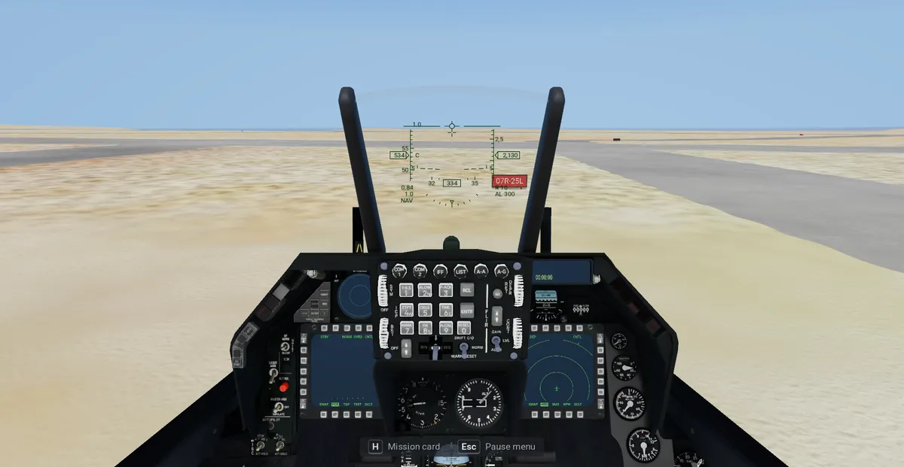
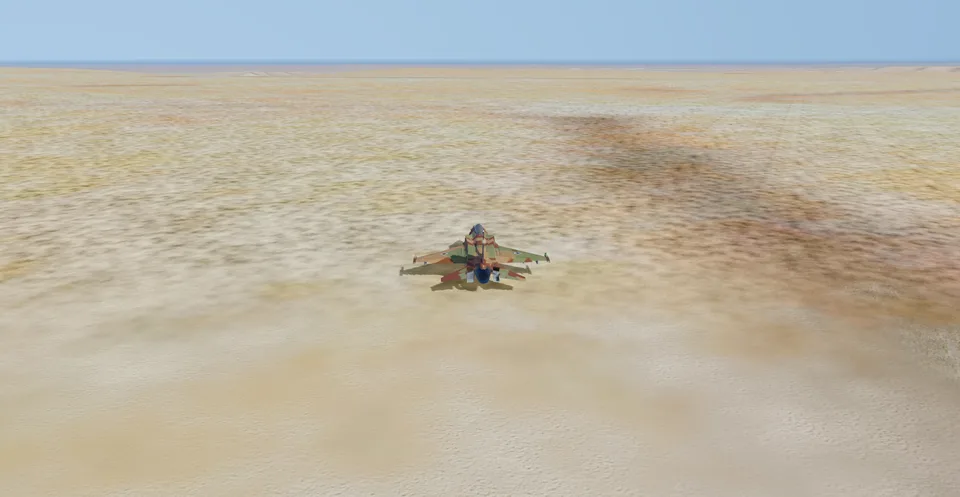
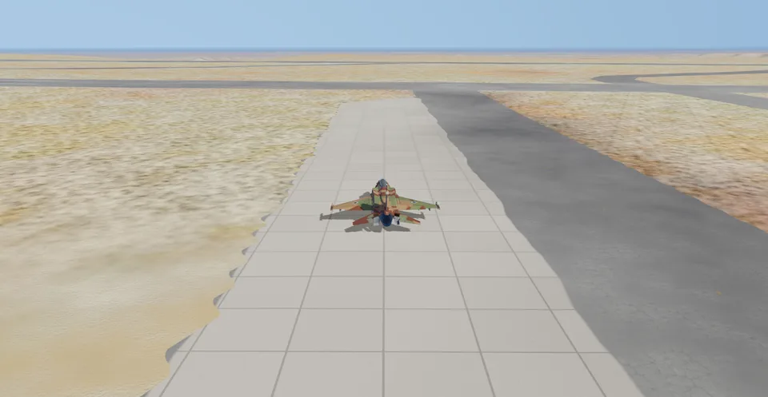

# Modern IAF: the airbases

**Terms:** OSM = OpenStreetMap; ODbL = the Open Database Licence (OSM's); OurAirports = the public-domain airport
tables at ourairports.com; lineup point = where a jet stands on the runway before take-off; HAS = hardened aircraft
shelter; S2 = Sentinel-2 (the ESA satellite pictures); "inferred" = our own reasoning; "open" = no source found.

This page holds the airbases of Modern IAF: Ramon, Hatzerim, Nevatim and Ramat David (plan.md item B2a), and Tel Nof,
the F-15C Baz's base (item D3). Their
layouts are in `modern-iaf/data/airbases/<icao>.json`, in WGS-84 latitude / longitude and true headings (the format:
[data-formats.md](data-formats.md) §10). `iaf-sim airbases` compiles them into the sim's frame (item B2b, §9).
Research date: 2026-11-02.

```sh
python3 -I tools/iaf-2026/osm_airbase.py [--refetch] [ICAO ...]      # fetch (cached) + write the files
python3 -I tools/iaf-2026/osm_airbase.py overlay OUT_DIR [ICAO ...]   # the check pictures (GDAL, ImageMagick)
```

## 1. Where the data comes from

| what | source | how |
|---|---|---|
| runways (ends, designator, width), stopways, taxiways, aprons, hangars, shelters, holding positions | OSM[^osm] | one Overpass query per base over the aerodrome's box; the raw answer is kept in `assets/source/osm/airbases/<icao>.json` |
| field elevation, reference point, runway end elevations, published lengths, displaced thresholds, the widths of runways OSM gives without one | OurAirports[^oa] | `airports.csv` and `runways.csv`, kept in `assets/source/ourairports/`; a runway row is matched to the OSM way by place (both its ends within 150 m of the way's line) |
| runway starts, designators of unnamed runways | inferred | §4 |
| parking spots, Nevatim's tower | inferred, by eye on the pictures | §5 |

The script asks the main Overpass server, then one mirror, once each; it never retries in a loop. Its User-Agent is
`linux-iaf-airbases/1.0`. A rerun reads the cache; `--refetch` downloads again. The OSM data dates: Ramon 2026-07-24
(the answering server's), the other three 2026-11-02.

Each item in a file names its source: `"osm": "way/…"` (the element, `https://www.openstreetmap.org/way/…`) with
`"source": "osm"`, or a `sources` map by field. The file's `footnotes` hold the full citations.

## 2. The bases

| base | ICAO | elevation | runways (OSM; published length) | what the file holds |
|---|---|---|---|---|
| Ramon | LLRM | 648 m[^oa] | 07L/25R 2685 m (2700), 07R/25L 2992 m (3010), both 45.1 m wide[^oa] | 2 runways, 4 stopways, 19 taxiways, 1 holding position, 7 aprons, 7 hangars, a Sufa spot |
| Hatzerim | LLHB | 221 m[^oa] | 10L/28R 2900 m (2423), 40 m; 10R/28L 3154 m (2943), 34 m; 10/28 1894 m, 30 m (OSM widths) | 3 runways, 89 taxiways, 9 aprons, 21 hangars, an F-15I and a Sufa spot |
| Nevatim | LLNV | 405 m[^oa] (Wikipedia: 424 m[^w-nv]) | 08L/26R 3165 m (2600), 08R/26L 3949 m (3350), both 44.8 m[^oa]; 07/25 3904 m (Wikipedia: 3900[^w-nv]), width open | 3 runways, 34 taxiways, 16 aprons, 19 hangars, 11 shelters, the tower, an F-35I spot |
| Ramat David | LLRD | 56 m[^oa] | 09/27 2928 m (2606), 44.2 m; 11/29 3148 m (2431), 35.1 m; 15/33 2943 m (2406), 45.7 m[^oa] | 3 runways, 52 taxiways, 1 apron, 15 hangars, 25 shelters, a Barak spot |
| Tel Nof | LLEK | 59 m[^oa] | 15L/33R 3054 m (2387), 15R/33L 3206 m (2388), 18/36 3030 m (2402), each 45.7 m[^oa] | 3 runways, 26 taxiways, 1 apron placed by eye (§5), a Baz spot |

Published lengths are OurAirports'; they agree with Wikipedia's within 20 m except Hatzerim (Wikipedia: 10R/28L
2750 m, 10L/28R 2440 m[^w-hb]). Every displaced threshold is 0 in OurAirports. The ILS of every end is open
(`"ils": null`).

Wikipedia lists a fourth runway at Tel Nof, 09/27 (1830 m)[^w-ek]; OSM and OurAirports have none, so the file has none.

Naming conflicts:
- **Nevatim.** OSM names the runways 08L/26R, 08R/26L and 07/25, as Wikipedia does[^w-nv]. OurAirports calls OSM's
  08R/26L "08C/26C" and gives "08R/26L" to a 21 m strip south of it, which OSM tags as an unnamed runway (way
  130240671). The file keeps OSM's names and lists that strip as a taxiway with a note (inferred: the parallel
  taxiway; `tools/real_runways.py` also keeps only the three named runways).
- **Hatzerim.** A 15/33 (1768 m) is in OurAirports only; OSM's 10/28 north-west of the base is in OSM only. The
  10/28's use is open.
- **Ramat David.** The taxiway north of 09/27 carries the OSM ref "Runway 09/27" (kept as OSM has it).

## 3. The squadrons in 2026

| base | squadrons | jets |
|---|---|---|
| Ramon | 119 "Bat", 201 "The One", 253 "Negev"[^w-rm] | F-16I Sufa |
| Hatzerim | 69 "Hammers"[^w-hb] | F-15I Ra'am |
| | 107 "Knights of the Orange Tail"[^w-hb] | F-16I Sufa |
| | 102 "Flying Tiger" (the flight academy)[^w-hb] | M-346 Lavi |
| Nevatim | 140 "Golden Eagle" (since December 2016), 116 "Lions of the South" (since November 2019), 117 "First Jet" (since July 2021, first for training)[^w-nv] | F-35I Adir |
| Ramat David | 101 "First Fighter", 105 "Scorpion", 109 "The Valley"[^w-rd] | F-16C / F-16D Barak |
| Tel Nof | 133 "Knights of the Twin Tail" (F-15 since 1976), 106 "Spearhead" (at Tel Nof since 1982)[^w-ek] | F-15C / D Baz (the F-15IA from 2031[^w-ek]) |

Corrections to the brief:
- **Hatzerim** also flies the Sufa (107 Squadron)[^w-hb], so its file holds a Sufa spot beside the F-15I's.
- **Ramat David's** Barak squadrons are 101, 105 and 109. 101 and 105 moved there from Hatzor in June and August
  2021[^scramble101][^scramble105], announced in March 2021[^keyaero]. 117 flies the F-35I at Nevatim[^w-nv].

The squadron the player flies with is in each base file's `squadrons` list (`unit`, `number`, `name` in English and
Hebrew, `source`: a key of the file's `footnotes`), set in `SQUADRONS` in the script. Each is the squadron whose art
the jet's model wears (the user, 2026-11-13, "change the string": the text follows the paint, the bases stay): at
Ramon 201 "The One" (האחת), which flies the F-16I from Ramon[^he-201]; at Ramat David 101 "First Fighter" (הקרב
הראשונה), at Ramat David since June 2021[^he-101]; at Nevatim 116 "Lions of the South" (אריות הדרום), the F-35I
since January 2020[^he-116]. Real 101 Squadron flies the single-seat F-16C, the sim's Barak the two-seat F-16D (the
FlightGear livery's art). Before 2026-11-13 the texts named 253 "Negev", 109 "The Valley" and 140 "Golden Eagle",
the paint 201, 101 and 116. The F-15s' squadrons, for their greyed
cards: at Hatzerim 69 "The Hammers" (הפטישים), which flies the F-15I Ra'am[^he-69]; at Tel Nof 133 "Knights of the
Twin Tail" (אבירי הזנב הכפול), which flies the F-15 Baz[^he-133]. Pick a plane's cards show them (front-end.md §1).

The table holds the fighter squadrons, the ones the sim's jets fly with; the bases' helicopter, transport, tanker
and UAV units are in the Wikipedia pages cited.

## 4. Lineup points and runway starts

The OSM runway ways at Hatzerim, Nevatim and Ramat David run on over the paved overruns: they are 210–720 m longer
than the published length (Ramon's are within 20 m of it). There, the first taxiway that joins the runway from each
end lies where the declared runway would start: on all seven runways the two ends' entries add up to the extra
length within 110 m (Hatzerim 10L/28R: entries 504 + 22 m for 477 m extra; Ramat David 11/29: 365 + 456 for 717;
Nevatim 08R/26L: 263 + 376 for 599). So the script takes (inferred):
- **runway start** (`runway_start_m`, metres from the way's end): the first taxiway entry (a taxiway node within half
  the width + 15 m of the centreline), if it lies within the extra length + 150 m; else 0 (the way's end);
- **lineup point:** left to item B2b's compiler (Rust), from the runway start and the end's heading. The check
  pictures draw it 100 m down the centreline from the runway start (the distance iaf-sim's runway start uses,
  [data-formats.md](data-formats.md) §5).

Each end's name comes from the OSM `ref`, else OurAirports, else the magnetic heading with `tools/real_runways.py`'s
rule (one 5° E declination, inferred). A name goes to the end whose true heading is nearest its number × 10° + 5°.

Two runways start at their ways' ends (`runway_start_m` 0 at both ends) for want of a published length: Hatzerim's
10/28, and Nevatim's 07/25, whose first taxiway joins 1212 m from the 07 end (a jet backtracks from there).

## 5. Points placed by eye (for the user's approval)

The parking spots and Nevatim's tower are placed by eye on the pictures (§6) and kept in `PLACED` in the script;
each is a judgement call. The script writes the spots to `modern-iaf/data/parking.json` (by ICAO code;
[data-formats.md](data-formats.md) §10) and the rest to the base's airbase file. The theatre's stamp hashes the
airbase files (`sim_terrain::stamp`), so a moved spot leaves the theatre's ground and photo as built: the airbases
and the missions are compiled again, and the scenery after them (the spots' taxi paths are paved ground in
`terraintype.dat`, which the scenery reads).

Each unit has four spots: in four shelters where the base has them (below), else in a row beside the taxi lane the jets leave by (2026-11-17, the user: "the plane, when
cold and dark, looking on the runway. it should be 90 degrees on the apron"). The spots stand 25 m apart (inferred:
an F-15's 13 m span and Annex 14's 7.5 m stand clearance), each nose square to the lane, 20–30 m from its centreline,
a 20 × 14 m footprint on the apron. The leader takes the first spot and its wingman the second
(`sim::compile_mission`, `mission_edit::set_flight`'s `wing`); the third and fourth serve a four-ship.

| base | point | where | first spot: lat, lon, heading |
|---|---|---|---|
| Ramon | Sufa shelters | four loop-end shelters of the north-east dispersal, S2, S3, S1, S5 ([base-furniture.md](base-furniture.md) §2), the shortest taxi to 25R (1.4–1.7 km); until 2026-11-19 a row on the narrow pad along the loop taxiway by 07R/25L's western link (OSM apron 1496591869) | S2: 30.7743545, 34.6811917, 138° |
| Hatzerim | F-15I parking | the western of two sunshade rows by the parallel taxiway (OSM apron 1157437942): down the row's middle from the south end, noses east to the row's eastern lane | 31.2405291, 34.6611625, 105° |
| Hatzerim | Sufa parking | the same in the eastern row (OSM apron 1157437936) | 31.2402288, 34.6623126, 105° |
| Nevatim | F-35I shelters | S8, S7, S9, S6 (taxi about 3.0 km to 26L); until 2026-11-19 a row on the apron north of 08R/26L (OSM apron 1089049618), 337 m from the lineup | S8: 31.2047489, 35.0054906, 192° |
| Nevatim | tower | the compound midfield between 08L/26R and 08R/26L (2015 photo) | 31.2058009, 35.0125383 |
| Tel Nof | apron | OSM maps no apron at Tel Nof: a ring round the pale paved pad west of 18/36's middle, out to the end of the taxiway stub from the south-east (Sentinel-2, 10 m: which squadron uses it, or whether it is an apron at all, is open) | 6 points, about 200 × 200 m |
| Tel Nof | Baz shelters | S5, S8, S6, S7 (taxi 0.5–2.7 km to 33L); until 2026-11-19 a row in that pad | S5: 31.8258363, 34.8330913, 327° |
| Ramat David | Barak shelters | S52, S50, S53, S48 (taxi 1.1–2.4 km to 27); until 2026-11-19 a row on the base's one OSM apron (1328724315) | S52: 32.6714234, 35.1835853, 160° |

Which squadron uses which apron, row or shelters is open at every base.

**Starts in shelters** (the user, 2026-11-17: "if there are shelters then start inside one"). A spot in parking.json
may name a shelter of the base's furniture file instead of a place: `{"unit": "f16i", "shelter": "S2"}`
([data-formats.md](data-formats.md) §10). The jet then starts at the shelter's middle, nose to the door, cold; the
parked jet the furniture file puts there gives way to it (`sim_bases::base`: any furniture row but the shelter within
5 m of a spot). A base whose furniture file has shelters names four of them per unit in parking.json; a base without
one keeps its apron row. Since 2026-11-19 the units of Ramon, Nevatim, Ramat David and Tel Nof start in shelters:
per unit the four whose door leads straight (within 10°) onto a taxiway 15–60 m ahead, whose taxi has no unpaved
metre and room past everything standing (`the_furniture_stands_clear`), with the shortest taxi to the take-off end;
the shelter must hold the jet (Ramat David's 11 m deep S19 does not). `sim_bases::tests::dump_shelter_starts` lists
every shelter's figures.

Open: Hatzerim's jets stay on the sunshade rows. Five of its shelters leave with room to spare (S1, S2, S4, S5, S6),
but four of them stand south-east of the runways, and their taxis to 28R make the sign builder (§9) put a board on a
shelter's apron and two boards for 28R that disagree at one junction (`signs_guide_the_taxi_to_the_runway`,
`following_the_signs_reaches_every_runway_start` fail). No lesson flies from Hatzerim. At Ramon the ground power unit,
the fuel truck and the fire extinguisher stand by the leader's shelter S2.

**Each spot's own taxi route** (2026-11-19). Every spot leaves along its nose to the first taxiway within 60 m (its
"way out": out of a shelter's door, across its apron to the loop taxiway) and from there takes the shortest way along
the taxiways to the take-off end, and back the same way after landing (`sim_bases::routes`, the per-spot keys of
iaf.ibx, [data-formats.md](data-formats.md) §12). The AI, the briefing map's dashed taxi line and the paved surface
of `terraintype.dat` (§9) follow it. Ramon's shelters stand one per loop taxiway, 200–400 m apart, so the four jets
of a flight leave by four loops and join on the way to the runway. Before, every spot joined one hub (the first
spot's way out) in a straight line, across the sand at Hatzerim's Sufa row.

## 6. The check pictures

`overlay` draws each file on a picture of the base at 2 m per pixel, north up, with a 100 m bar in 10 m steps:
runway edges red, taxiways cyan, stopways orange, aprons yellow, hangars and shelters magenta, lineup points green,
parking spots red with a white nose line, the tower blue.

**The Survey of Israel 2015 photo blanks three of the four bases.** Ramon, Hatzerim and Ramat David show desert or
fields where the base is; only Nevatim shows. So every base is drawn on Sentinel-2 (ESA WorldCover's 2021 composite,
10 m, CC BY 4.0[^wc]; the tiles the imagery step reads, [docs/imagery.md](../../docs/imagery.md)), and Nevatim also
on the 2015 photo (`llnv_2015.png`).

What the pictures show (checked at full size, 2026-11-02):
- **Runways:** every OSM centreline lies on the photo's pavement. A cross-runway profile at nine stations per runway
  puts the pavement's centre 0–8 m from the OSM centreline at all four bases; the few stations over 10 m are
  next to a parallel taxiway (Nevatim 08R/26L in 2015, Hatzerim 10/28's west end), where the profile mixes both.
- **Taxiways and aprons:** they lie on the visible pavement where the pavement is darker than the ground (Ramon's
  links, Nevatim's taxiways in 2015 at 2 m). At 10 m a taxiway is one to two pixels wide, so offsets under 10 m
  cannot be seen at Ramon, Hatzerim and Ramat David.
- **Newer than the pictures:** at Nevatim, OSM's north-east hangars (the jagged rows by 26L) and the F-35I apron are
  bare ground in 2015; the apron is paved in 2021, the hangars not yet. At Hatzerim, OSM's taxiway and three hangars
  south-east of 28R lie on bare ground in 2021 (built later, or mapped wrong: open).

## 7. What each file holds, and from where

| item | Ramon | Hatzerim | Nevatim | Ramat David |
|---|---|---|---|---|
| runways | OSM; widths OurAirports | OSM, widths OSM | OSM; widths OurAirports, 07/25's open (45 m held) | OSM; widths OurAirports |
| taxiways | OSM, unnamed | OSM, unnamed | OSM, unnamed; one OSM runway way read as a taxiway (§2) | OSM; one ref |
| holding positions | OSM, one | — | — | — |
| aprons, hangars, shelters | OSM; the loop-end shelters seen in the pictures are open | OSM | OSM | OSM |
| parking spots | placed by eye (§5) | placed by eye | placed by eye | placed by eye |
| tower | open | open | placed by eye | open |
| PAPI, approach lights, ILS | open | open | open | open |

The `lights` list is empty at every base; OurAirports' Hatzerim 15/33 is described in §2.

## 8. Checks

- `cargo test -p iaf-tools --lib sim::tests::every_airbase_has_runways_with_two_ends_and_a_width`: every file parses,
  every runway has two ends with a place and a heading and a width, every source names a footnote, "inferred" or
  "open".
- The pictures, §6.

## 9. In the game

`iaf-sim airbases` (item B2b, `crates/iaf-tools/src/sim_bases.rs`; run by `iaf-sim all` once the terrain is built)
puts the bases into the sim's frame, UTM 36N at 1:1 ([terrain.md](terrain.md) §2), in the shapes the shared
code reads ([data-formats.md](data-formats.md) §12):
- `converted/terrain/israel/airbases.json` and a paved-surface mask per base: Detailed airbases draws the real
  runways (numbers, letters, thresholds), the taxi lines and the aprons from them. The sim always draws them
  (`airbases` = `"detailed"` in `PROFILE`, `modern-iaf/sim_settings.gd`): its "original" would be the 1998 art, which
  the sim does not have, so it drew no runway, taxiway or apron (the Mac run of 2026-11-08);
- `converted/own/iaf.ibx`: tower, lineup and take-off heading, the AI's taxi paths and the parking spots, read by the
  flight model (the start rule, the AI's ground control) and the radio;
- `converted/own/terraintype.dat`: runway, sea and inland-water flags for the flight model and the water shader
  (inland water since item B3, [terrain.md](terrain.md) §11); since 2026-11-08 the taxiways, aprons and shelters'
  pads and the AI's taxi paths from every spot (23 m wide) too, as paved ground without the runway flag: before, only the runways' rectangles were paved, so a jet
  taxiing off its spot faster than 25.7 m/s (50 kt) crashed on "rough ground" (the original's rule; a Mac run's log).
- the taxiway signs in `airbases.json` (ICAO Annex 14 §5.4; `sim_bases::signs`). Each sign names only where it
  leads (the user, 2026-11-17: "how possible 25L and 07R are on the same sign", "I need something that isn't
  confusing"):
  - a runway-holding sign (white on red) at each taxiway's holding position, 90 m from the runway's centreline
    (Annex 14 Table 3-2, code 4 instrument runway), with the one end a jet takes off from there: at a runway's start
    that end (FAA AIM 2-3-8[^aim]; a start reaches from before the declared runway start to 400 m past it,
    `Runway::entry_end`, inferred), partway along the runway the nearer end, the one with more runway ahead
    (inferred). Until 2026-11-17 a sign partway along named both ends ("25L-07R");
  - a direction sign (black on yellow) before each junction on the shortest taxi from a parking spot to a runway
    start, for the jet arriving on that taxi where it has a choice (two or more of the other branches lead on to a
    runway): a board for each runway end whose taxi passes there, its designator and the arrow of the branch that
    taxi takes (45° steps, 15° at a narrow fork). The shortest taxi keeps to the taxiways (a metre along a runway
    counts as four, `RUNWAY_TAXI_COST`) and joins the runway at the end's start; where no taxiway joins there
    (Nevatim's 07, 1212 m in) it joins at the first taxiway from that end, an intersection take-off. A jet crosses a
    runway straight on; a board stands before a runway only where the taxi turns on it.

  A jet that follows one end's boards from any parking spot reaches that end's start, past a holding sign naming
  that end: `sim_bases::tests::following_the_signs_reaches_every_runway_start` taxis it from every spot to every
  end at the five bases, and from the first spot the taxi is the departure the briefing draws (`departure`).
  OpenStreetMap joins none of the base's taxiways to Hatzerim's 10/28, so no board names 10 or 28 (the test says so).
  Junctions within 12 m of each other count as one (`JOIN_M`: Hatzerim's fillets, and two taxiways' points on a
  runway, as Nevatim's crossing of 08R/26L, whose sides join it 11 m apart). The parking spots' ways out
  (`taxi_lines`: from the spot along its nose to its lane) are branches too.
  A direction sign stands 40 m before its junction (inferred; Annex 14 5.4.3.30) on the jet's left, 12 m past the
  taxiway's edge and 8 m or more from a runway's edge (Annex 14 Table 5-5); where the branch is shorter (a spot's way out), across the junction facing
  the jet (inferred).
  Signs stand apart (2026-11-13; before, at Ramon 25L and Nevatim 26L a holding sign stood 5–10 m in front of a
  direction sign and hid it): a holding sign and a direction sign facing the same way within 25 m become one array,
  the holding sign keeping its place in line with the holding position, the direction boards left to right in turn
  order ("clockwise starting from the first taxiway on the pilot's left", FAA AIM 2-3-10[^aim]), the holding board
  last, nearest the taxiway (as AIM 2-3-9's location sign; inferred for direction boards). A sign that would crowd
  another (8 m apart, or a board in the last quarter of the line of sight from the centreline 15–150 m before it,
  `HIDE_SHARE`: the pilot looks over a nearer board) takes the next place out or across the taxiway; where junctions
  crowd (Hatzerim's sunshade rows) a direction sign takes the first place 8 m from every sign. No holding sign is
  hidden. `sim_bases::tests::signs_stand_apart` checks every pair at every base.
  Earlier rules, replaced on 2026-11-17: a board for every runway end at every junction of the base (2026-11-08),
  then for runway starts only (2026-11-15, the user: "ab signs should lead to runway start only, not to the middle
  of the runway, it's confusing").
  OpenStreetMap names none of these taxiways (no `ref`), so there are no location signs (yellow on black).
  `sign_boards.gd board()` builds them (a 0.9 m face, the lettering in the sim's display font), `airbases.gd` stands
  the nearest base's signs on the ground; nothing of the original's sign models. Ramon's hold sign "07R-25L" from
  the taxiway, 39 m ahead ([scenery.md](scenery.md) §7):

  

- the painted surface (runways, taxiways, aprons and their markings, [rendering.md](../../docs/rendering.md) §7)
  out to 28 km from the camera, faded from 20 km, and far away each mask texel's paved share instead of an edge at
  half cover (2026-11-14 afternoon, for the user's look pass; awaiting his yes). From 12 to 16 km that morning
  (his yes), from 2.5 to 6 km before: beyond that only the 10 m imagery showed, where pale concrete barely differs
  from the sand, so every base's runways read faint from 8 km (reported at Hatzerim and Tel Nof, Ramon the same;
  the original game's Tel Nof showed). The edge at half cover dropped the taxiways from about 3 km and the runways
  from about 10 km. The cost on the Linux laptop's Intel Iris Xe at 1600 × 900 (median of 12 on / off pairs, Ramon):
  8 km out and 1,000 m up +0.59 ms GPU (+0.45 with the 16 km fade), 15 km out at 10,000 ft +0.27 ms (+0.11),
  parked in the cockpit +1.77 ms (+1.76). On the Mac (M4 Pro, Metal) Godot reports no GPU time, so it is not
  measured there; the shader compiles and runs (0 shader errors).
- the ground under each base: the published 2 m photo paints the bases over, so the 10 m Sentinel-2 picture shows
  there, toned to the photo around it since 2026-11-14 ([terrain.md](terrain.md) §4; before, a tan block).

| base | section | take-off | lineup (UTM 36N) | taxi points out / in | tower |
|---|---|---|---|---|---|
| Ramon | `Ramon` | 25R, 246° | 660,563, 3,406,637 | 5 / 5 | the reference point (open) |
| Ramat David | `David` | 27, 265° | 705,360, 3,616,494 | 12 / 9 | the reference point (open) |
| Hatzerim | `Hatzerim` | 28L, 284° | 659,817, 3,455,824 | 6 / 13 | the reference point (open) |
| Nevatim | `Nevatim` | 26L, 256° | 693,191, 3,454,815 | 10 / 11 | §5 |
| Tel Nof | `TelNof` | 33L, 330° | 673,422, 3,522,971 | 9 / 9 | the reference point (open) |

The training missions fail a jet on the ground off the pavement (training.md §3.0); `sim_bases::Base::paved` tests
the same shapes as the mask. `sim_bases::tests::the_departure_is_paved` checks every metre of the departure from each
parking spot at every base (since 2026-11-19, when each spot got its own way to the taxiways; before, Hatzerim's
Sufa row joined the hub across 140 m that OSM does not mark paved).

The take-off ends and the lineup rule are inferred (data-formats.md §12); Tel Nof's 33L, into the prevailing
westerly wind, is inferred too. `iaf-sim terrain` and `iaf-sim scenery` read the bases' outlines, so a theatre built
before Tel Nof's file was added takes its outline at their next run. The missions start on the parking spots of
§5 at the terrain's ground height and their runway starts on these lineup points.

What the flight takes from them (the M0 probe, `modern-iaf/tests/test_m0_boot.gd`, 2026-11-03): each MVP jet's start-up
mission parks it on its base's spot (within 1 m) on paved ground (since 2026-11-08), with its wheels on the terrain (1.7–1.9 m above the ground height:
the gear), as a ground start, and the flight model finds the base (within 5 km and 15 m of the tower). The sim has no
base move: its bases stand at their real places already (`sim_settings.gd sync_bases`). The tower's wind turn
(Better physics) mirrors the take-off lineup to the runway's other end as in the original game.

| at Ramon's parking spot, from the chase view, with the 1998 switch (2026-11-08) | with the sim's own airbases |
|---|---|
|  |  |

`modern-iaf/tests/test_sim_look.gd` checks it: no look switch of the sim holds the 1998 value, and at Ramon's spot the
first frames draw Ramon's runways and its paved mask.

Open: the towers of Ramon, Hatzerim and Ramat David (their reference points stand in); the taxiways' names (no
location signs until a source names them); Hatzerim's 10/28 (no taxiway joins it in OpenStreetMap, so no sign or
route leads there); the shelters, hangars, tower building and parked jets of every base but Ramon
([base-furniture.md](base-furniture.md)); the radio's tower list (`radio.gd BASES`) holds
the original's ten names, so Hatzerim and Nevatim had no talking tower; since item E3b every base of the own
`iaf.ibx` talks (`Settings.tower_bases`, [training.md](training.md) §8).

[^aim]: FAA, Aeronautical Information Manual 2-3-8 b (runway holding position sign: "15-33" puts runway 15's threshold on the left; at a taxiway meeting the beginning of the take-off runway only its designation may appear); 2-3-9 (a taxiway location sign collocated with a holding position sign); 2-3-10 (direction signs: on the left before the intersection, designations arranged clockwise from the pilot's left), https://www.faa.gov/air_traffic/publications/atpubs/aim_html/chap2_section_3.html
[^osm]: OpenStreetMap contributors, ODbL 1.0, https://www.openstreetmap.org/copyright (Overpass API, 2026-11-02)
[^oa]: OurAirports, airports.csv and runways.csv (public domain), https://davidmegginson.github.io/ourairports-data/
[^wc]: ESA WorldCover 2021 Sentinel-2 RGBNIR composite, "Contains modified Copernicus Sentinel data (2021) processed by ESA WorldCover consortium" (CC BY 4.0), https://esa-worldcover.org
[^w-rm]: Wikipedia, "Ramon Airbase" (Units), read 2026-11-02, https://en.wikipedia.org/wiki/Ramon_Airbase
[^w-hb]: Wikipedia, "Hatzerim Airbase", read 2026-11-02, https://en.wikipedia.org/wiki/Hatzerim_Airbase
[^w-nv]: Wikipedia, "Nevatim Airbase", read 2026-11-02, https://en.wikipedia.org/wiki/Nevatim_Airbase
[^w-rd]: Wikipedia, "Ramat David Airbase", read 2026-11-02, https://en.wikipedia.org/wiki/Ramat_David_Airbase
[^w-ek]: Wikipedia, "Tel Nof Airbase", read 2026-11-09, https://en.wikipedia.org/wiki/Tel_Nof_Airbase
[^keyaero]: Key.Aero, "Israel set to move two F-16 units to Ramat David", https://key.aero/index.php/article/israel-set-move-two-f-16-units-ramat-david
[^scramble101]: Scramble, "Israeli Air Force squadron updates" (101 Squadron left Hatzor on 21 June 2021), https://www.scramble.nl/military-news/israeli-air-force-squadron-updates
[^scramble105]: Scramble, "Final Baraks over Hatzor" (105 Squadron, 17 August 2021), https://scramble.nl/military-news/final-baraks-over-hatzor
[^he-201]: Wikipedia (Hebrew), "טייסת 201" ("האחת"; English: "201 Squadron (Israel)", "The One"), read 2026-11-13, https://he.wikipedia.org/wiki/טייסת_201
[^he-101]: Wikipedia (Hebrew), "טייסת 101" ("טייסת הקרב הראשונה"; English: "First Fighter Squadron"), read 2026-11-13, https://he.wikipedia.org/wiki/טייסת_101
[^he-116]: Wikipedia (Hebrew), "טייסת 116" ("אריות הדרום"; English: "Lions of the South Squadron"), read 2026-11-13, https://he.wikipedia.org/wiki/טייסת_116
[^he-69]: Wikipedia (Hebrew), "טייסת 69", read 2026-11-10, https://he.wikipedia.org/wiki/טייסת_69
[^he-133]: Wikipedia (Hebrew), "טייסת 133", read 2026-11-10, https://he.wikipedia.org/wiki/טייסת_133
