# Modern IAF cockpit

**Terms:** ADI = attitude director indicator (the attitude ball); GM = the radar's ground-map mode; HSD = the F-16's
horizontal situation display; MFD = multi-function display; ODbL = the Open Database Licence (OpenStreetMap's);
OSM = OpenStreetMap; PCD = the F-35I's panoramic cockpit display; RWR = radar warning receiver; TSD = tactical
situation display; "inferred" = our own reasoning; "open" = no source found.

The sim has only the 3D cockpit (plan.md "cockpits"). This page describes what its screens draw and the data they
draw from.

## 1. What each jet draws
| jet | 3D cockpit | HUD | head-down displays |
|---|---|---|---|
| F-16I Sufa (`f16i`) | the F-16's (FlightGear's Block 50/52 panel sheet) | the wide-angle HUD, the Real HUD symbology | both MFDs in the real formats, in colour; the RWR scope, EHSI, DED and fault list on their screens |
| F-16D Barak (`f16`) | the F-16's (the Block 40 panel sheet) | the Block 50 HUD, the Real HUD symbology | both MFDs in the real formats, in green; the same small screens |
| F-35I Adir (`f35i`) | ours (`f35i.glb`) | the helmet display over the whole view | the panoramic display with its four portals and the standby display |

The model the 3D cockpit hangs in is ours, never the original's cockpit-view model: the detailed F-16's cut model (`shared/extra/models/f16/f16d.glb`)
for the F-16s and the F-35I's cockpit-view model (`shared/extra/planes/f35i/f35i_bc.gltf`, ours). They draw the seat,
the canopy frame and the wings seen from the seat.

Day and night are the 3D cockpit's own lighting (docs/cockpit.md "3D cockpit": the sun's fill by day, the flood
lights and the lit labels at night); the panel's night art is not used.

## 2. The views
- **Ahead:** the 3D cockpit's wide view (85° across the screen, the head 12° down: the whole front panel in view), zoomed in by + / − and the mouse wheel.
- **Zoom:** + / − and the mouse wheel step from the wide view to the true size (the screen as a window 0.6 m from the
  eye), then on to a narrow view 20° across the screen, where the MFD pages read from the seat. 16 wheel notches
  span the range (`cockpit.gd` `view_3d_focal`, `VIEW_3D_NARROW_DEG`). Each step narrows the view: the true size is
  kept between the wide and the narrow view. The trackpad zooms as the wheel, in the system's scroll direction. One
  scroll zooms one way: a step against the last one taken under 250 ms before is dropped (`Settings.zoom_steps`; macOS
  sends events of the other sign at a scroll's end and in its momentum), and a knob that comes under the pointer during the scroll leaves
  the wheel to the zoom. Every jet opens at the wide view with the head straight ahead
  (`modern-iaf/tests/test_cockpit_view.gd`).
- **Mouse look (2026-11-11, the Mac play test's finding 9):** hold the right mouse button and move the mouse to turn
  the head; it stays where the mouse leaves it. A double right-click turns the head back to straight ahead at 45°/s.
  The pointer turns the head twice its angle on the screen (`terrain_view.gd` `MOUSE_LOOK_GAIN`): one screen's width
  of drag turns it about 170°. The left button stays on the cockpit's switches and knobs (§5.1, §5.2). The mouse
  moves the head's angle only: the head does not lean with the mouse (it bends forward on its own looking down, §5.3).
  The pointer hides while the button is held and shows again where it was on release (2026-11-13, the user's Mac: the
  pointer stayed hidden after a look). A release the view does not see (a control under the pointer took it, the
  window lost the focus) and a pause or menu end the look too (`terrain_view.gd` `_look`).
  `Settings.cockpit_mouse_look()`: true in the sim; in the original game the right drag turns the external views only.
- **Free look:** the hat and the mouse turn the head, down to 60° (the panel and consoles).
- **The F-key and Numpad snap views** (F2 back, Numpad 1–9, Alt + 1–9 in the laptop map of front-end.md §9.1; docs/views.md §2) are head poses: the head turns to the
  snap's yaw and pitch while the key is held, and the 3D cockpit turns with it. No 2D panel pans.

## 3. The profile
`modern-iaf/sim_settings.gd` (the sim's `Settings` autoload, README.md):
- `PROFILE` holds `cockpit_3d` = `"3d"`, `hud_style` = `"real"` (the Real HUD) and `real_mfds` = `"real"`, set at
  start and again over any settings file. The sim has no row for them (plan.md "options", "physics").
- `airframe_def(id)` gives each of the sim's planes (the Sufa `f16i`, the Barak `f16`, the F-35I `f35i`) its cockpit
  dir as its `cockpit` (§4). The flight scene's first cockpit is the F-16's from the same key (`cockpit.gd`
  `default_dir`), so the original's F-16 cockpit is never loaded.
- The F-35I's panoramic display is on whenever its cockpit dir's `cockpit.json` has its `[PCD]` section.

## 4. The cockpit dirs
`iaf-sim own` compiles each jet's display data from `modern-iaf/data/planes/_shared/cockpit/` (every jet's) and
`modern-iaf/data/planes/<unit>/cockpit/` (its own) into its cockpit dir `<unit>` under `assets/` (`sim_settings.gd`
`own_cockpits`). The sim reads the link from the planes' definitions (`sim_settings.gd` `_planes`): the unit
`modern-iaf/data/db/units/<unit>.json` names its aircraft definition (`"airframe"`), and a unit with a cockpit folder is
a plane the sim flies:

| jet | unit | aircraft definition | family | cockpit dir |
|---|---|---|---|---|
| Sufa | `f16i` | `f16i` | `f16` | `converted/own/cockpits/f16i` |
| Barak | `f16d` | `f16` | `f16` | `converted/own/cockpits/f16d` |
| F-35I | `f35i` | `f35i` | `f35i` | `converted/own/cockpits/f35i` |

The shared cockpit tables (the HUD's, the real MFD formats, the 3D cockpit's F-16 check, the gauges) key a cockpit on
`Settings.cockpit_folder(dir)`: in the original game the dir's name (`f16`, `phantom` …). The sim's
`cockpit_folder` answers the plane's family: its aircraft definition's `base` (`shared/extra/planes/<id>/airframe.json`),
else its id. The Sufa (base `f16`) and the Barak (the `f16` definition itself) answer `f16`, so they draw as the
F-16's.
Each dir holds, in the shapes `shared/cockpit/cockpit.gd` reads (docs/cockpit.md), only our own files:
- `cockpit.json`: the layout the 3D cockpit reads (below);
- `rwrsymb.png` (the RWR symbols), `map.json` (the TSD map in the EMF-JSON shape `IafEmf` fills), `isr.png` (the
  ground-map picture), `adi.png` (the ADI ball, which the F-16s' layout reads), `mfds.png` (the MFD atlas and its 5 × 5 font): §8.

The cockpit loads with any display file missing: the display that needs it draws without it.

### The layout (`cockpit.json`)
Ours, written for the 3D cockpit; none of the original's numbers. `"image_scale": 4` (the art's), no `"Shared"` key,
no panel art: no `FileName`, no `[PANEL]`, lamps, tapes or gauges (the 3D model draws those). `iaf-sim own` refuses a
layout that borrows (`"Shared"`) or names art. The units:
- **The layout's px:** the original 640 × 480 screen's, whose focal length is 686.2 px (docs/cockpit.md "3D view"),
  so N px from the view's centre line is atan(N / 686.2). The 3D cockpit scales them with its own focal length.
- **Rows** count up from the panel's top. With no panel it sits 50 px over the view's centre (the projection's centre
  row 240 less `MainOffsetY`'s default 190).

`[HUD]` (`hud.gd`, `cockpit.gd`):

| key | F-16s | F-35I | what it is |
|---|---|---|---|
| `BorePositionY` | 16 | 16 | the boresight: the nose, which the 3D camera sees 5.5° over the view's centre (`VIEW_LOOK_DOWN_DEG`): 686.2 · tan 5.5° = 66 px, less the 50; the 3D cockpit looks 12° down (`VIEW_3D_LOOK_DOWN_DEG`), so `view_shift` puts the HUD on the nose |
| `GunRetPositionY` | 11 | 11 | the gun cross, 5 px (0.4°) under the boresight (inferred, as the F-35I's 2D cockpit) |
| `CenterY` | −26 | 16 | the HUD's centre: the F-16s' 3.5° (42 px) under the boresight, the middle of their field; the F-35I's on the boresight |
| `LeftBorder`, `RightBorder` | 72 | 250 | the field's half width: the F-16s' ±6°, the F-35I's ±20° (its helmet's 40° field) |
| `TopBorder`, `BottomBorder` | 66, 67 | 184, 184 | the F-16s' field from 2° over the boresight to 9° under it; the F-35I's ±15° (the helmet's 30°) |
| `Dash` | 1 | 1 | the helmet display once the combiner glass is off the screen (the DASH, the F-35I's helmet); while any of the glass shows, the HUD stays on it (2026-11-11, the Mac play test's finding 10: looking down-left at the dash the HUD jumped off its glass to the DASH) |

The F-16s' field is what fits their combiners from the eye with the Real HUD's data blocks beside it (1.8° outside
the field; docs/cockpit.md "The HUD on its glass": the Sufa's plate reaches +2.6° to −12.8°). The real F-16 HUD shows
20° × 13.5° (`real_hud/mod.rs` `fov_deg`); the 3D combiners are smaller from the eye (inferred). The F-35I's helmet
draws its own layout (`real_hud/f35.rs`); its field bounds only the ILS and steerpoint cues.

`[MFD]`: the F-16s' `LeftActive` / `RightActive` 1, `MiddleActive` 0, the offsets 0 (the screens are the model's,
each its 512 px SubViewport). The F-35I's `Portals`: four, `[x, y, scale, page]`, x every 142 px, y 26 (under the
display's strip, `pcd.gd` `FAB_H`), scale 142 / 132 (an MFD page across its portal), pages TSD, radar, stores, RWR.

`[PCD]` (the F-35I, `pcd.gd`, `cockpit3d.gd`), in the display's px, 28.4 per inch of its glass (the strip's 26 px are
0.9 in, `FAB_H`):

| key | value | what it is |
|---|---|---|
| `Rect` | 0, 0, 568, 227 | the glass, 20 × 8 in (`tools/f35i/cockpit3d.py` `PCD`): a 1,704 × 681 px SubViewport at `PCD_PX` 3, the glass's own shape |
| `Esis` | 321, 250, 94, 74 | the standby display, 84 × 66 mm, its centre 75 mm right of the glass's and 257 mm under its top (`cockpit3d.py` `ESIS`): a 282 × 222 px SubViewport |

`[PANELRWR]` `Active` 1 (the F-16s): the jet has an RWR scope (the 3D model's), so the right MFD starts on the TSD
(`cockpit.gd` `_create_mfds`).

## 5. The HUD and display fonts
`Settings.hud_font_path(name)` gives the file of every HUD and display raster font (`hud`, `mfd`, `key`), and
`Settings.display_font(style)` the real display formats' text font (`mono`: the F-16's MFD formats and the 3D
cockpit's small screens; `narrow`: the F-35I's panoramic and standby displays; `hud`: the Real HUD's texts; `ui`: the
sim's own screens). The original game returns its converted `.fnt` and the installed system fonts.

The sim's fonts (the user's decision, 2026-11-03):
- **UI text: Heebo** (Oded Ezer, SIL Open Font License 1.1[^heebo]), version 3.100, the variable font
  (weights 100–900) from Google Fonts' repository: `modern-iaf/data/fonts/Heebo-VariableFont_wght.ttf` (122,012 bytes)
  with its licence `OFL.txt`. Heebo has Hebrew and Latin letters. The sim's Settings make it the default font of every
  Control (`ThemeDB`'s default theme), so the sim's screens use it unless they set their own.
- **HUD, MFD and PCD text: Hershey Simplex** (the user's choice, Approvals A9: our own stroke font if easy, else
  Hershey's; Hershey's was the shorter way). The Roman Simplex stroke font Dr. A. V. Hershey drew at the U. S.
  National Bureau of Standards (1967), from Kamal Mostafa's `futural.jhf`[^hershey] (`tools/iaf-2026/fonts/`), is
  stroked into outlines by `python3 -I tools/iaf-2026/hershey_font.py`: each segment a bar and each vertex a round
  dot, 2 units wide (about a tenth of the capitals' 21), into `modern-iaf/data/fonts/HersheySimplex.ttf` (95 glyphs,
  ASCII 32–126, 45 KB). `sim_settings.gd` `HUD_FONT` names it; `hud_font_path` returns it for every name and
  `display_font` for every style but `ui`: the HUD's strokes thin, the displays' emboldened (as the original's bold
  system fonts). A one-stroke-width line of even weight, as a real HUD's cursive writing (inferred from HUD photos).
  The original game keeps its converted `.fnt`.

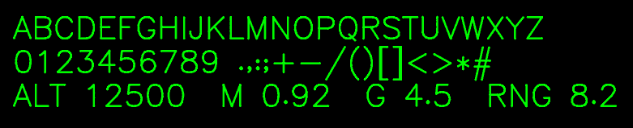

The credit lines the sim's setup wizard (Attributions) and its credits roll show: "Heebo font by Oded Ezer, © 2014 The
Heebo Project Authors, SIL Open Font License 1.1"; for Hershey, the two acknowledgements its terms ask for
(`modern-iaf/data/fonts/HERSHEY.txt`, [docs/credits.md](../../docs/credits.md) "Modern IAF's font").

### 5.1 The HUD's light (2026-11-09)

The user's approval (Approvals A10, proposal 7): "fix the green of the HUD, should be adjustable I think in real".
`Settings.hud_daylight()` is true in the sim ([docs/real-hud.md](../../docs/real-hud.md#modern-iafs-hud-light) has
the sources and the values):
- the HUD in the P43 green, 40 / 255 / 50, at the day level by day, falling to the night floor (136 / 255 of it) as
  the sun sets;
- the symbols drawn over the scene in the original game's thin pen, a faint one-pixel halo around each;
- the combiner glass untinted on both F-16s (`SIM_TINT` 0, 2026-11-13; a definition's `hud_tint` sets a jet's own),
  with no separate edge line, the Sufa's plate fitted inside its curved posts (2026-11-12,
  [docs/cockpit.md](../../docs/cockpit.md) "3D cockpit");
- the day level is the cockpit's SYM wheel (below), kept in the sim's settings file like a knob's position, with no
  Preferences row (the user, 2026-11-09: "the HUD colour should be adjustable like in the plane, not in
  Preferences!"); Shift + H ("Step HUD brightness", `data/keys.json` record 46, the laptop map the same) steps it in
  eighths in flight and turns the wheel with it.

**The SYM wheel.** On the F-16 the HUD's symbology brightness is the SYM wheel at the upper left of the ICP, under
the HUD; the DAY / AUTO BRT / NIGHT switch sits on the HUD remote control panel on the right console[^fg-hud]
[^hoggit-ip]. FlightGear's model has the wheel (`icp.xml` `sym`, a knob on `f16/avionics/hud-sym`, 240° of travel);
`tools/f16d/cockpit3d.py` `CONTROLS` makes it the node `SYM` of `f16.glb`, turning with `Settings.hud_brightness`.
In the 3D cockpit (Barak, Sufa):
- the pointer over the wheel lights it;
- the mouse wheel over it turns it 2.5 % a notch, a left drag 2.5 % per 10 px (up: brighter), as FlightGear's;
- each step is the HUD key's command `[123, ±25, 0]` (p1: thousandths) through the key path (`terrain_view.gd`
  `_press`), and the level is saved at once.

The layer is general (`shared/cockpit/cockpit3d_controls.gd`, behind `Settings.cockpit_controls()`, true in the sim,
false in the original game): a cockpit's table `<model>_controls.json` beside its model binds a node to a `click`
command (a switch) or a `turn` command (a knob: the wheel, a drag); a guarded switch names its guard's property
(`guard`): while the guard is closed a click only lifts it, the next sends the command (the F-35I's ENG switch,
docs/f35i.md §4.5); a control's hit area is its mesh's box, and the
pointer over it lights its rim (`material_overlay`, the shader `RIM`): a faint cool white, thin where the part faces
the eye and thicker where its surface turns away, so its own colour and texture still show (2026-11-11; it was a warm
yellow fill, which the user found "too yellowish" and hiding the SYM wheel's texture). The overlay is a mix of low
alpha, not an add: the cockpit's picture is composited by its alpha (`cockpit_composite.gdshader`), and an add pushed
that alpha past 1 and darkened the part (tried 2026-11-11, dropped). The canopy handle's hit box is drawn on no layer,
so the rim lights its rod only. The pointer's moves reach the layer in `_input`, before
the flight's full-view Controls take them, and `cockpit_origin.gd` passes them into the cockpit's own world with the
clicks. The start-up switches are on the same layer (§5.2).

**The DAY / AUTO BRT / NIGHT switch** (2026-11-11). On the F-16 this three-position switch on the HUD remote control
panel (right console, forward) picks the HUD's brightness range: DAY the day range, AUTO BRT the range following the
ambient light, NIGHT the night range[^fg-hud][^hoggit-icp]. Ours, in the Sufa's and the Barak's 3D cockpit:
- DAY: the HUD at the SYM wheel's level at any hour; AUTO: the level by day falling to the night floor as the sun
  sets (as before, the default); NIGHT: the night floor at any hour (`hud.gd` `mode_light`; inferred: no source gives
  the ranges' values);
- the lever is the node `HUD_MODE` of `f16.glb` (`tools/f16d/split_control.py` cuts it out of FlightGear's console
  body, where it has no object of its own, and adds its turn to `f16.json`: 25° forward at DAY, upright at AUTO, 25°
  aft at NIGHT);
- the pointer over it lights it; a click throws it one position down (DAY, AUTO, NIGHT, then back to DAY); the mouse
  wheel up moves it toward DAY, down toward NIGHT; each through command `[217, p1, 0]` (no key sends it);
- the position is kept in the sim's settings file (`Settings.hud_brt_switch`, section `graphics`, 0 DAY, 1 AUTO, 2 NIGHT),
  as a switch stays thrown, with no Preferences row. The original game never reads it.

The switch sets the HUD only: the helmet displays (the F-35I's, which has no such switch, and the Sufa's DASH) follow
the sun (AUTO).

| Pointer over the switch (AUTO) | Clicked: NIGHT |
|---|---|
| 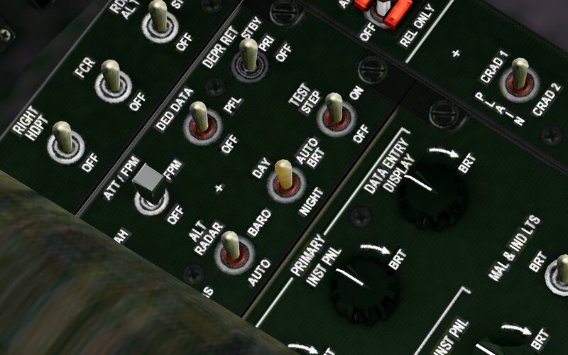 | 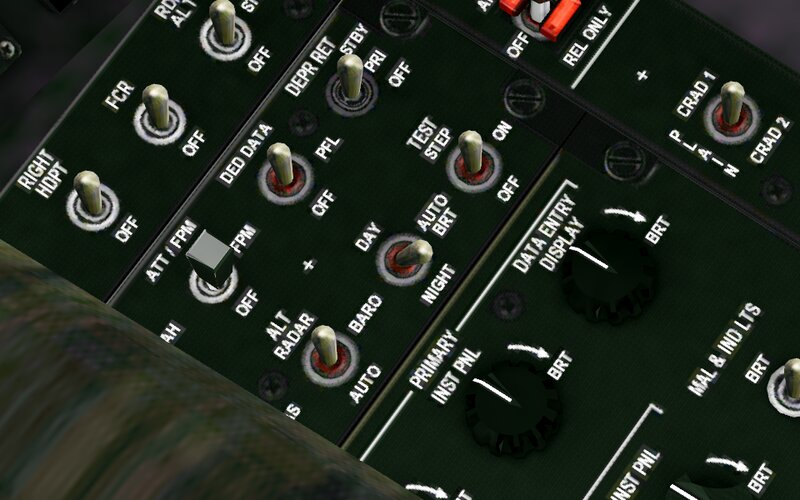 |

The F-35I: the HMD BRT knob on its pedestal (`f35i.glb` node `HMD_BRT`, `f35i_controls.json`) works as the SYM
wheel: the same command `[123, ±25, 0]`, the same steps, and it turns with `Settings.hud_brightness` (100° of travel,
the index up at 50 %; inferred). The helmet's symbols follow the level in the P43 green, as the HUD (§5.1). The MFD
BRT knob beside it (`MFD_BRT`) turns the displays' brightness, `Settings.mfd_brightness` (10–100 %, saved as the
HUD's level; ours, command `[216, ±25, 0]`, no key): the PCD, the standby display and the MFDs of the 3D cockpit, the
F-16s' too (their own BRT rockers are not bound).

The Sufa on Ramon's ILS final, a real render (`modern-iaf/tests/_sym_wheel_shot.gd`): the pointer over the wheel, then
the wheel turned down 24 notches (100 % to 40 %) and the pointer moved away.

| Pointer over the SYM wheel | Turned down |
|---|---|
| 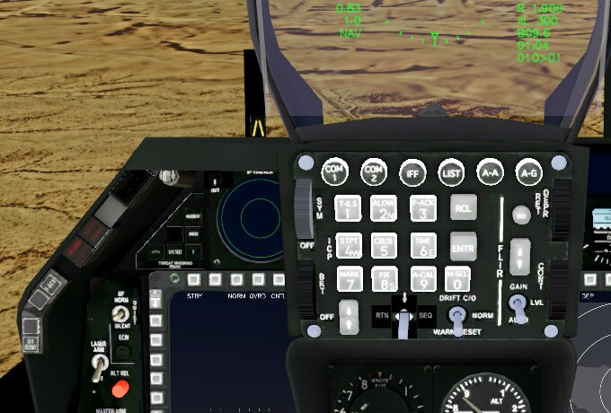 | 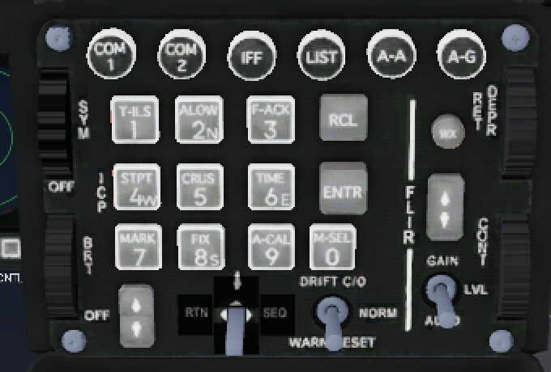 |

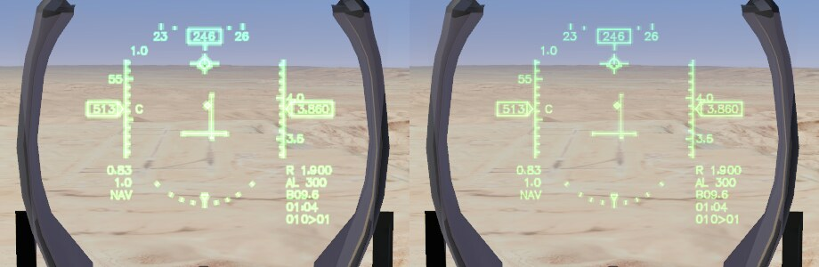

The Sufa at the look study's Shoham pose (HDG 100, 240 m), before and after, 16:58 and 22:00:

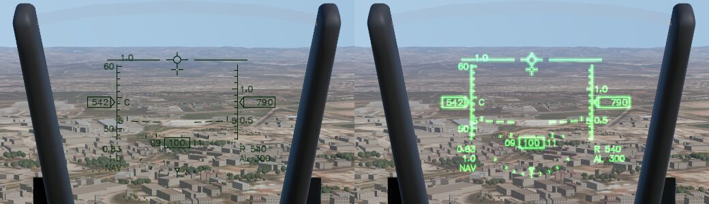
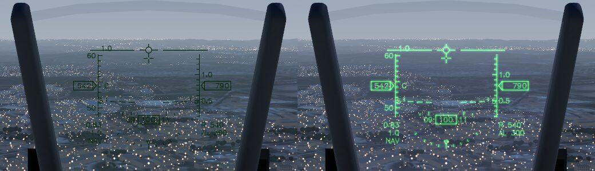

The F-35I has no HUD: its helmet display carries the symbology. It follows the same rules (2026-11-09): the P43
green at the same level, the night floor, Shift + H and the slider. No source gives the helmet display's own hue, so
it takes the F-16's P43 ([docs/real-hud.md](../../docs/real-hud.md#modern-iafs-hud-light)). The F-35I over the Negev
(`_cockpit3d_shot.gd`, C3D_SIM=1 C3D_JET=f35i, looking up 8°), before and after, by day and at 22:00:

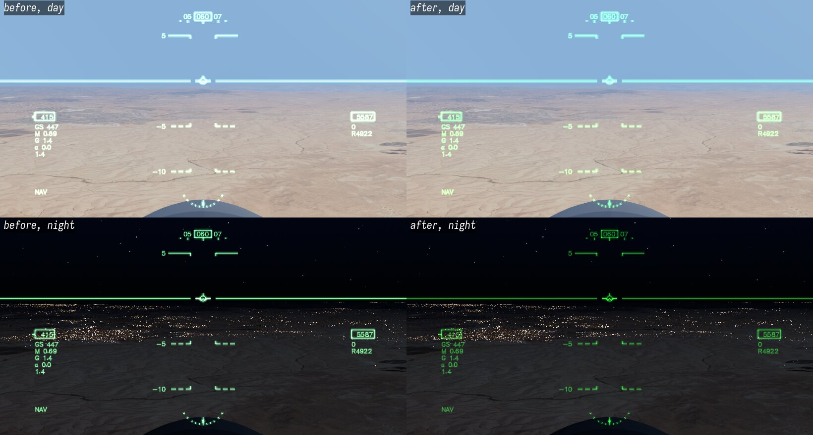

`tests/godot/test_hud.gd` checks the colours (the P43 green by day, the floor at night, the original game's darkest
green at its start); `modern-iaf/tests/test_mvp.gd` `_hud_light` checks them in the sim's cockpit with the key's steps,
the additive blend and the glass, and `_knob` hovers, scrolls and drags the wheel (the F-35I's HMD and MFD BRT
knobs), checks the level, the knob's turn and the stored level.

### 5.2 The start-up switches (2026-11-09)

In the Sufa's and the Barak's 3D cockpit the start-up checklist ([training.md](training.md) §7.1) works with the
mouse too: each step's switch is a control of `f16_controls.json`, and a left click on it sends the same command as
its key. FlightGear models these switches as their own parts, so `tools/f16d/cockpit3d.py` `CONTROLS` makes each one a
node of `f16.glb`, turning on FlightGear's property by FlightGear's mapping (`f16.json`). A switch's table row names
that property and its two positions (`prop`, `on`, `off`); `cockpit3d_controls.gd` `set_switch` puts it there and
`cockpit3d.gd` `switches` turns the node. The sim's flight add-on (`sim_flight.gd` `_sync_switches`) shows each switch
where the flight model has it, every frame: a cold jet's off, a hot jet's on, each one on when its step is taken and
off when it goes back off ("Both ways" below); a refused step leaves its switch off. The original game keeps the
switches as FlightGear models them.

- **The AVIONIC POWER switches** (2026-11-11, from the user's Mac; each its own system since 2026-11-13, "One by one"
  below): each is its own `toggle` in `f16_controls.json`. A click flips that switch alone, with its click
  (`SFX_BUTTON`), and sends its own command, `[219, 1, i]` on and `[219, -1, i]` off (i: MMC 0, ST STA 1, MFD 2,
  UFC 3). Once all four are on the avionics step is done. A switch refused (before the generators) goes back off.
  Ctrl+A throws all four together, both ways.
- **FCR and RDR ALT** (2026-11-13, the switches audit's M1): FlightGear's right console has both as their own objects,
  `fcr-switch` and `rdr-alt-switch` on the SNSR PWR panel, turning on `f16/avionics/power-fcr` (OFF 0 / ON 1) and
  `f16/avionics/power-rdr-alt` (OFF 0 / STBY 1 / ON 2)[^fg-right]; `CONTROLS` makes them the nodes `FCR` and
  `RDR_ALT`. Each is a `toggle` sending its own command (`[219, ±1, 4]`, `[219, ±1, 5]`): a click moves it between
  OFF and ON (RDR ALT skips STBY), with its click. A cold jet has them OFF (as the model shows them unset), a hot jet
  ON; they are no checklist step.

| step | control (node) | place on the jet | command | key | on / off (FlightGear's value) |
|---|---|---|---|---|---|
| 1 | MAIN PWR switch (`MAIN_PWR`) | ELEC panel, left console, beside the throttle[^bms-ramp][^fg-left] | `[210, 0, 0]` | Ctrl+B | MAIN (2) / OFF (0) |
| 2 | JFS switch (`JFS`) | ENG & JET START panel, left console, aft[^bms-ramp][^fg-left] | `[211, 0, 0]` | Ctrl+J | START 2 (1) / OFF (0) |
| 3 | throttle grip (`THROTTLE`) | the throttle, left console | `[5, 0, 0]`, the wheel and a drag (below) | Throttle up | the throttle's own animation: out of OFF |
| 4 | MMC, ST STA, MFD, UFC switches (`AVIONICS_MMC`, `AVIONICS_ST_STA`, `AVIONICS_MFD`, `AVIONICS_UFC`) | AVIONIC POWER panel, right console[^bms-ramp][^fg-right] | a click `[219, ±1, 0..3]`, each its own; Ctrl+A `[213, 0, 0]` all four | Ctrl+A | ON (1) / OFF (0): the key all four, a click its own switch |
| 5 | INS knob (`INS`) | AVIONIC POWER panel, right console[^bms-ramp][^fg-right] | `[214, 0, 0]` | Ctrl+N | STOR HDG (1) / OFF (0) |
| 6 | canopy handle (`CANOPY_HANDLE`, a hit area) | left side, aft of the left console, by the canopy switch[^dcs-canopy] | `[215, 0, 0]` | Ctrl+K | none |
| take-off, landing | landing gear handle (`anim023`) | left auxiliary console (FlightGear's `LeftAuxConsole` `gear_lever`) | `[14, 0, 0]` | G | the handle's own animation (`controls/gear/gear-down`) |
| (sensors) | FCR, RDR ALT switches (`FCR`, `RDR_ALT`) | SNSR PWR panel, right console[^fg-right] | `[219, ±1, 4]`, `[219, ±1, 5]` | none | ON (1) / OFF (0); RDR ALT ON (2) / OFF (0) |

- **The throttle by the mouse** (both F-16s and the F-35I; 2026-11-13, the switches audit's M1): a click adds 5 %
  (Throttle up, command 5, sent on the release), the wheel up adds 5 % and the wheel down takes 5 % (Throttle down,
  command 6), and a left drag moves it a step per 15 px, up or down. The wheel and a drag stop at idle. A drag down
  begun with the throttle already at idle goes over the idle-cutoff detent to OFF (Throttle OFF, command 218,
  [training.md](training.md) §7.2), once a drag: the second, deliberate pull of the real detent (inferred UX). A click,
  the wheel up or a drag up from OFF moves it out of OFF (5 %): the idle step of the start (§7.1). The rows' keys:
  `turn` / `turn_down` (the wheel and the drag), `detent` (`cockpit3d_controls.gd`).

- **The canopy handle** has no part in FlightGear's model, so its row is a `box` with `grip`: a grey metal rod, 3 cm
  thick and 14 cm long, along the left canopy sill's inner face 10 cm aft of the throttle, lit under the pointer
  (`cockpit3d_controls.gd` `_area`). Until 2026-11-11 the box was drawn clear, and it sat under the pilot's left
  shoulder, where no head turn could see it (the Mac play test's finding 11). Its exact place and finish are
  inferred: the sources put the handle on the left side, not where on it. Looked for again on 2026-11-13 with the
  canopy's hinge: no flight-manual text could be read (the Falcon BMS Dash-1 is too large to fetch, the DCS forum
  refuses automated reading), so its place stays the forum's (open).
- **INS: STOR HDG** is position 1, after OFF (FlightGear's knob: OFF 0, NORM 2, NAV 3; STOR HDG between them is
  inferred).
- **The JFS switch** springs back to OFF when the engine sustains itself (52 %), as the real JFS cuts out at 50–54
  %[^jfs50]; the starter step stays done.

The F-35I's start-up works the same way on its own panels (`f35i_controls.json`). Its switches are our model's
(`tools/f35i/cockpit3d.py` `CONTROLS`): bat toggles that lean forward when on and 40° aft when off, each turning on a
property of ours (`f35i/...`) by `f35i.json`'s mapping. The real start is three switch selections, battery, IPP and
engine[^ayton]; which panel holds them, and every place below, is inferred: the photos show the consoles' mix of
switches, not readable labels ([../../docs/f35i.md](../../docs/f35i.md) §4.2).

| step | control (node) | place in our cockpit | command | key | on / off |
|---|---|---|---|---|---|
| 1 | BATT switch (`BATT`) | start panel, left console, forward (first of four) | `[210, 0, 0]` | Ctrl+B | forward (1) / aft (0) |
| 2 | IPP switch (`IPP`) | start panel, second | `[211, 0, 0]` | Ctrl+J | forward (1) / aft (0) |
| 3 | ENG switch (`ENG`, under a red guard) | start panel, third | `[212, 0, 0]` | none | forward (1) / aft (0) |
| 3 | START button (`START`) | start panel, fourth | `[212, 1, 0]` (on only) | none | a push button |
| 3 | throttle (`throttle`) | the throttle, left console | `[5, 0, 0]`, the wheel and a drag (as the F-16's) | Throttle up | the throttle's own animation |
| 4 | canopy lever (`CANOPY`) | left wall just above the console, aft of the throttle's track[^ife-canopy] | `[215, 0, 0]` | Ctrl+K | forward (1, shut) / 40° aft (0, open) |
| take-off, landing | landing gear handle (`gear_handle`) | left of the main panel | `[14, 0, 0]` | G | the handle's own animation |

- **The canopy lever** is yellow, standing up from a dark pivot block on the left wall with CANOPY printed behind it,
  where IndiaFoxtEcho's F-35 has its "canopy control lever"[^ife-canopy] (a simulator, weak; no manual or photo of
  the real jet's left wall was found, open). Its shape and travel are inferred. From 2026-11-09 to 2026-11-13 a
  CANOPY toggle on a small panel of its own aft on the left console (inferred); the lighting panel (FLOOD, CONSOLE,
  NVIS) keeps its place ([../../docs/f35i.md](../../docs/f35i.md) §4.1 "Canopy control").
- **The engine step** is the ENG switch as on the jet (command 212, which no key sends: the step's key stays the
  throttle up from OFF, [training.md](training.md) §7.1); the throttle stays where it is, and the engine runs to idle
  by itself. Moving the throttle up from OFF takes the same step.
- **Not modelled:** the ENG switch's guard stays down (the bat passes under it); the START button does not move.

#### Both ways (2026-11-13, the switches audit's M2)

Every start-up switch goes back off by its key or a click and on again, at any time, on all three jets; the user's
words: mistakes "out of scenario" must be possible. The flight model holds each switch's position, the one source
(`iaf-flight` `sixdof/start.rs`: `Start::press` on, `Start::release` off, `Start::on` the position; `IafFlight`
`start_switch`, `start_on`). A command's p1 says which way: 1 on, −1 off, 0 (the keys, and a click on a switch of its
own) the other way from where it is. The checklist's steps done (`sim_flight.gd` `done`, the card, the notebook)
are the switches on, read each frame: a switch back off undoes its step. The recording gets each change (a
`checklist` event with `"on": false` for one back off), and the debrief counts a step done when its last change is
on (`iaf-tools` `training.rs`).

| switch | off | back on |
|---|---|---|
| MAIN PWR, BATT | no power: the displays, the HUD and the lamps dark; a crank stops; the engine lit runs on (inferred) | the displays after their 3 s warm-up; the INS aligns again |
| JFS, IPP | a crank stops and the engine winds down; once lit, nothing (the engine sustains itself, inferred) | the starter turns the engine again below 20 % |
| throttle (F-16), ENG (F-35I) | the fuel cut: the engine winds down ([training.md](training.md) §7.2) | the start again from the starter |
| AVIONIC POWER (the step) | the four switches off: each one's system down ("One by one" below) | each system after its 3 s warm-up |
| INS knob | the alignment lost | the alignment from the start (90 s), on main power |
| canopy | open (the door sound, `SFX_DOOR_OPEN`) | closed and locked (`SFX_DOOR_CLOSE`) |

- **The INS** needs main power only (the INS knob refused before it, `ins_no_power`): it aligns on the battery with
  the engine stopped, and a shutdown keeps its alignment; main power off loses it (inferred). The Start engine
  command flies the whole checklist with the INS aligned.
- **Open:** the real F-16's MAIN PWR OFF with the engine running (which loads stay up on the engine's own
  generator); the F-35I's BATT and IPP likewise. The INS kept on the aircraft battery through a short power loss.
- **Next (the audit's M3):** the indicator lamps on battery, the JFS RUN light, the INS's ALIGN / RDY and the IPP's
  ready cue read these positions.
- The positions the switches show between OFF and ON (MAIN PWR's BATT, the JFS's START 1, the INS knob's NORM and
  NAV) come with their own steps.

#### One by one (2026-11-13, the switches audit's M2b)

The user: "why moving one button on the avionics/power board move them all?" and "I can't do mistake and switch off
things out of scenario". On the Sufa and the Barak the generators give the displays' power (the flight model's
`power` 2, after a 3 s warm-up); each AVIONIC POWER and SNSR PWR switch then powers its own system, with its own 3 s
warm-up when switched on (`iaf-flight` `start.rs` `Start::system`, the list `SYSTEMS`; `IafFlight` state
`systems`; `cockpit.gd` `up`). The command is 219 for all six, p1 the way (1 on, −1 off, 0 the other way), p2 the
switch (`sim_flight.gd` `SYSTEMS`); no key sends it, Ctrl+A throws the four AVIONIC POWER switches. The avionics
step is done while all four are on; one off undoes it, and the debrief reads that change as the step's.

| switch | its system off | where | source |
|---|---|---|---|
| MMC | no HUD symbology (the HUD layer, the DASH's included, dark): the mission computer draws it | `cockpit.gd` `hud.visible` | the switch: [^fg-right]; the consequence inferred from the switch's name (modular mission computer) |
| ST STA | no store leaves the jet on Space, and a ripple under way stops; the gun fires and the jettison works (inferred) | `player_weapons.gd` `fire_selected` | the switch: [^fg-right]; the consequence inferred (stores stations); the gun's power open |
| MFD | both MFDs dark | `cockpit.gd`, `cockpit3d.gd` `_lighting` | the switch: [^fg-right]; inferred |
| UFC | the DED dark | `cockpit3d.gd` `_lighting` | the switch: [^fg-right]; inferred; the ICP's keys without the UFC open |
| FCR | the radar held off: no picture, no contacts, no lock, its keys do nothing; back on, it waits at OFF for its mode key | `player_weapons.gd` `update` (the radar's damage hold, `IafRadar.set_damaged`) | the switch: [^fg-right]; inferred; the real radar's mode after its power returns open |
| RDR ALT | no radar altitude for the HUD: the Real HUD's `R` and `AL` rows, the GAAF and break-away cues that read it | `hud.gd` `real_hud` | the switch: [^fg-right]; the CARA feeds the ALOW cue[^dash34alow]; the rest inferred; the CARA ALOW and GAAF voices still speak (open) |
| INS knob | (its own: "Both ways" above) needs main power only | `start.rs` | inferred |

- **The F-35I** has no per-system switches: its avionics come with the IPP's and the engine's power, and every
  system is up with the displays (`Start::system` for a jet with a self test). No source names an F-35 switch per
  system; a sourced one would need the F-35's power-up page of the PCD or a flight manual's electrical chapter.
- **The warm-up** of each switch is the displays' 3 s (inferred).
- **A power loss** (main power off, the generators off line) takes every system down with it: the radar too goes to
  OFF and drops its lock, and waits for its mode key once the power is back.

`modern-iaf/tests/test_switches_both_ways.gd` runs each jet's switches off and on after the Start engine command
and checks the position, the consequence, the steps done and the switch shown; on the F-16s it switches each of the
six alone and checks its system down with its consequence, the other five up, and the system back after the warm-up.

The pilot's notebook names each switch and its place under the step's line, and no key
([training.md](training.md) §11; the mission's `training.checklist[].where`, [data-formats.md](data-formats.md) §5).

- **The INS knob** sits on the right console aft of the eye, and from FlightGear's eye the right sill hides most of
  it; the hit test still finds it (the pointer at its place lights and clicks it). Leaning the head over the console:
  open.

The Sufa parked cold at Ramon, a real render (`modern-iaf/tests/_switch_shot.gd`, the view zoomed in, the middle of
the screen): the head turned to the switch, the pointer over it (a warm glow on the lever), then the switch clicked
and the pointer moved away. The MAIN PWR lever goes from OFF over BATT to MAIN PWR; the JFS lever from OFF to
START 2.

| | Pointer over it | Clicked |
|---|---|---|
| MAIN PWR |  | 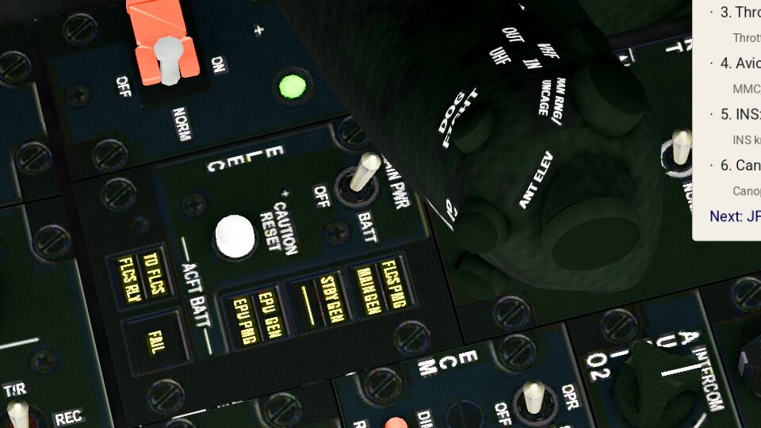 |
| JFS | 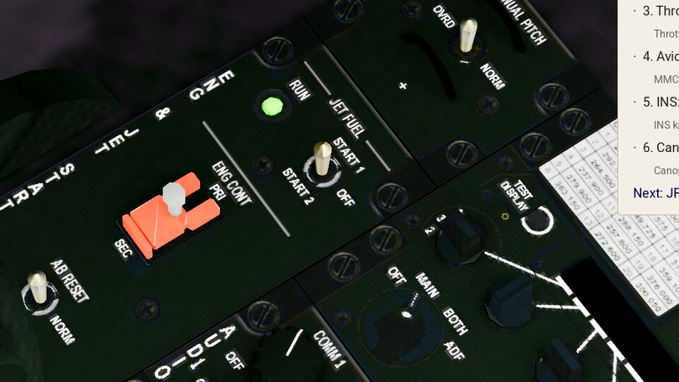 |  |

`modern-iaf/tests/test_mvp.gd` runs the Sufa's and the F-35I's start-up by the mouse (`_click_control`: the head
turned to each control, the pointer's move and click pushed into the window; each control lit, each switch turned,
the card's places shown) and the Barak's by the keys' commands; `_knob` hovers, scrolls and drags the SYM wheel and
the F-35I's HMD and MFD knobs. All pass.

The F-35I parked cold at Nevatim, a real render (`modern-iaf/tests/_switch_shot.gd` with `SHOT_MISSION=2031 SHOT_SWITCHES=BATT,MFD_BRT`): the start
panel's BATT switch and the MFD BRT knob under the pointer.

| BATT switch, pointer over it | MFD BRT knob, pointer over it |
|---|---|
| 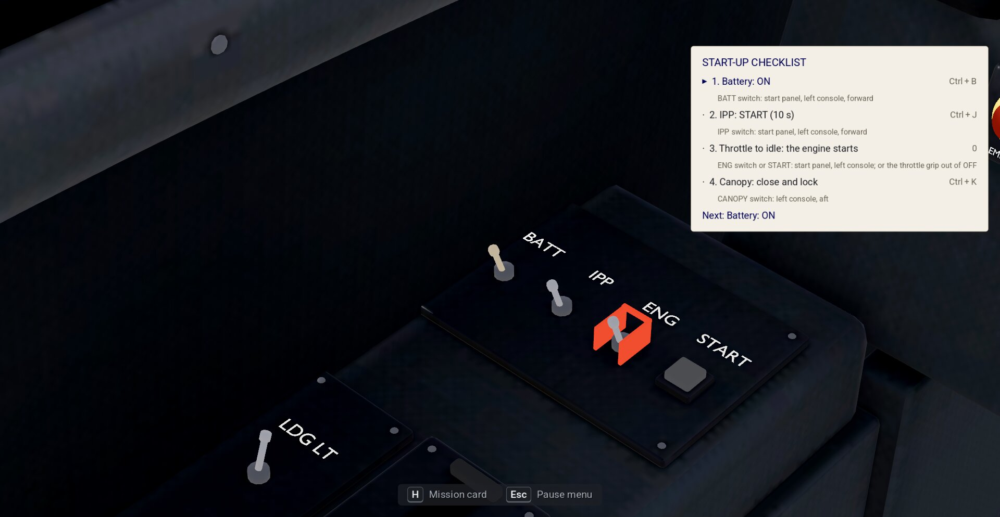 | 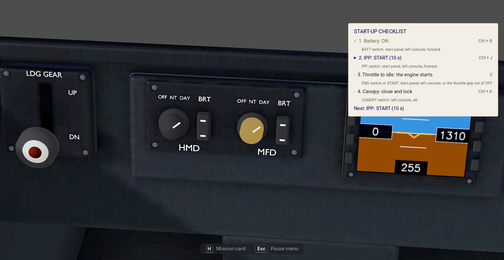 |

### 5.3 The pilot's body (2026-11-09)

The user (2026-11-09): "one can look on his own belly or something". At the head's lowest (60° down, the camera 72°
with the 3D cockpit's own 12°) the Sufa's and the Barak's 3D cockpit showed the seat's well and a black slab where
the pilot sits. A real F-16 pilot looking down sees the legs on the rudder pedals, the right hand on the side-stick
and the left on the throttle.

- **The body** is FlightGear's internal-view pilot, `Models/Pilots/pilot_internalview.ac`: FlightGear's pilot without
  head, helmet and mask, made for the view from the seat (GPL-2.0-or-later, its 3D work by J Maverick 16;
  `shared/extra/models/cockpit3d/SOURCES.md`). `tools/f16d/pilot.py` writes it as `f16_pilot.glb` in the 3D
  cockpit's frame. FlightGear's cockpit no longer shows this pilot (`Models/Cockpit/Main/cockpit.xml` has it commented
  out), so its hands were posed for older grips; its legs reach the pedals as they come. 17,090 triangles, 3.6 MB; the suit's sheet halved to 1024 × 2048, the harness sheet
  2048 × 2048, both as JPEG (Basis Universal's blocks showed as blotches on the vest 0.2 m under the eye).
- **The head bends forward looking down** (`terrain_view.gd` `LOOK_DOWN_LEAN`): from 25° to 60° of head pitch the eye
  moves up to 0.2 m forward, toward the head's yaw (aside, never aft: looking back and down it would undo
  `LOOK_BACK_LEAN`), and 0.06 m down, as a neck bends. Turned about the eye alone, at
  60° down the eye stood over the body's neck opening and looked into the torso (a dark V filled the lower half;
  the coordinator's review, 2026-11-09). Blender renders from the eye: 0.15 m forward still showed a sliver of it,
  0.2 m none. Leaving out the vest and collar instead showed the inside of the torso through the neck opening.
- **The hands on the grips (2026-11-11, the Mac play test's finding 12)**: FlightGear posed the left glove for its
  grip turned about 28° aft, 4 cm inboard of it and 3 cm over it, so it held nothing. `pilot.py` turns the left
  forearm and glove about the throttle's pivot onto the grip's rest pose and moves them onto the grip, fading from the
  elbow (unmoved) to the wrist. Two shape keys, `throttle_idle` and `throttle_full`, turn them 40° either way with
  the grip, so the glove follows the throttle (`cockpit3d.gd` `_pilot_throttle`).
- **The right glove on the stick (2026-11-13, the user: "hands still not on stick")**: FlightGear's fist closed 9 cm
  ahead of the side-stick's grip and 2 cm inboard of it, so looking down the glove hung in the air over the grip.
  `pilot.py` (`STICK_NUDGE`) moves the right forearm and glove onto the grip whole; the upper arm takes up the move,
  from the elbow (all of it) to the shoulder (none). The stick moves a few degrees (a force stick), the glove stays.
  `test_cockpit_view.gd` checks the glove's centre within 3 cm of the grip's on both F-16s. The left glove lay on
  the console 2.5 cm outboard of the throttle's head; it moved 2.5 cm inboard and 1 cm up, the palm over the head.
  At a cold start both hands stay on the grips (the left on the throttle at cutoff, turned with it), as in flight.
- **The left fingers close on the throttle (2026-11-13, the Mac check)**: with the palm on the head, FlightGear's
  thumb and index still spread 3 cm inboard of the grip, so in flight the fingers lay on the MANUAL PITCH and UHF CHAN
  panel beside it. `pilot.py` (`GRIP_*`) draws whatever of the glove lies inboard of the head's middle toward it, from
  none at the wrist to half its offset at the knuckles, and lowers the thumb 1.5 cm along the grip's inboard face.
  `test_cockpit_view.gd` checks, in the rest pose, the palm's centre within 3 cm of the head's top and no finger
  more than 2 cm inboard of the grip nor 2.5 cm ahead of it.
- **Where**: `cockpit3d.gd` hangs `<model>_pilot.glb` beside the model when `Settings.cockpit_pilot_body()` is true:
  true in Modern IAF, false in the original game, whose 3D cockpit stays as it was (docs/cockpit.md "Looking down at
  the pilot"). The body takes the footwell's dim fill (`UNLIT` `pilot_`) and casts no shadow. The cut model leaves
  the rear cockpit's footwell out of the front seat's well (docs/aircraft-models.md §1.4): it stood out of the
  pilot's lap.
- **Cost** on the Iris Xe (1920 × 1080, `_cockpit3d_shot.gd` `C3D_ONLY=down`, the frame's GPU time with the body
  shown and hidden, 60 frames each, both viewports): the frame takes 27–30 ms either way. With the head bent the
  body fills most of the view, and per view it adds −0.5 to +2.0 ms, +1.3 ms on the mean of the six views (before
  the bend −1.3 to +2.4 ms, +0.5 ms on the mean, within the run's noise). It draws only in the cockpit view.

Looking down-left (40° left), down and down-right, at the head's lowest. Top row before, bottom row after. A real
render, `tests/godot/_cockpit3d_shot.gd` with `C3D_SIM=1 C3D_ONLY=down`.

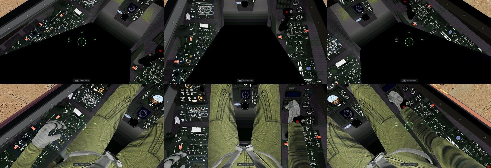
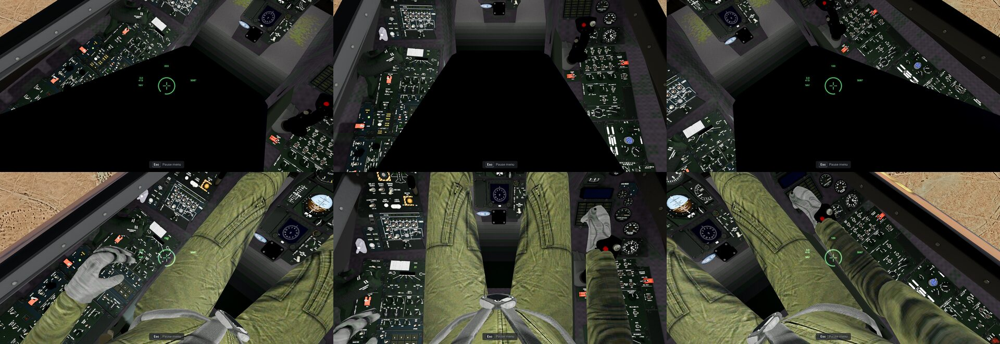

### 5.4 The AoA probe (2026-11-11, from the user's Mac)

On the ground the AoA gauge and the indexer jumped about: the 6-DoF's α is the angle of the body's velocity, which
is near zero and turns every way at a standstill. The jet's probe reads nothing useful there: the F-16's flight
manual, as quoted on a forum, bases every AoA indication on 0° with the nose gear's weight on wheels, the
transmitters being unreliable at slow speed[^dcs-wow]. The 6-DoF's indicated AoA (`sixdof/flight.rs` `probe_aoa`)
rests at 0° below 60 kt calibrated (`PROBE_MIN_KT`, inferred: the source gives the weight-on-wheels rule, no
airspeed) and follows the flow above it through a 0.25 s lag (`PROBE_TAU`, inferred), so the needle holds at taxi
speed. The flight state's `aoa` (the 3D cockpit's tape, the indexer, the HUD, the recording) is that value; `alpha`
stays the true angle.

Modern IAF only, by the flight model rather than a Settings switch: the original model's α is a smoothed state of
its own that does not jump on the ground, so the original game is unchanged. `test_mvp.gd` `_roll` checks 0° below
30 kt and a moving AoA within 1° of the true one from 150 kt.

## 6. Tests and pictures
- `tests/godot/test_cockpit_no_panel.gd`: the profile on the sim's own cockpit dirs (`iaf-sim own`'s), the Sufa, the
  Barak and the F-35I: no panel art loaded, every display file from the sim's dir, the 3D cockpit in the jet's own
  model, the MFDs or PCD drawing into their screens, the HUD and the RWR scope drawn, an F-key snap turning the head,
  Hershey Simplex (`HUD_FONT`) on the HUD's texts and the screens.
- `tests/godot/_cockpit3d_shot.gd` with `C3D_SIM=1`, run with `--path modern-iaf`: the same in a real render, a free
  flight 1,500 m over the Negev west of Beersheba heading 060° (ahead, left, right, down, back and more;
  `C3D_HOUR=22` the night; `C3D_JET=f35i` the F-35I).

### 6.1 The pictures (2026-11-09)

Each picture: ahead, left (80° left, 30° down), right; back, down (25° down; the F-35I's 20°). The sim's key hint
strip ("Esc Pause menu") is part of the view.

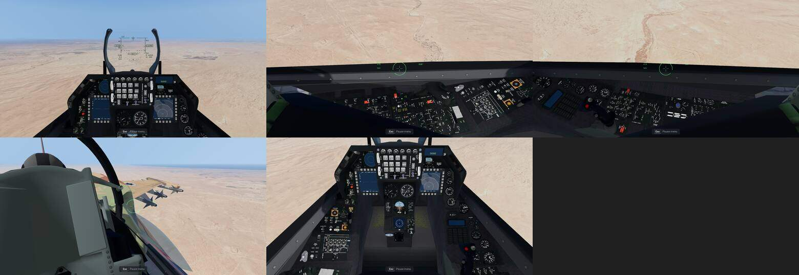
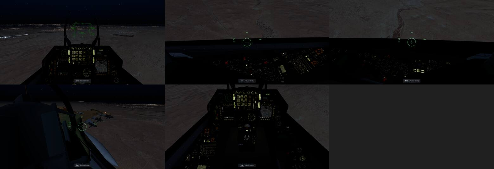

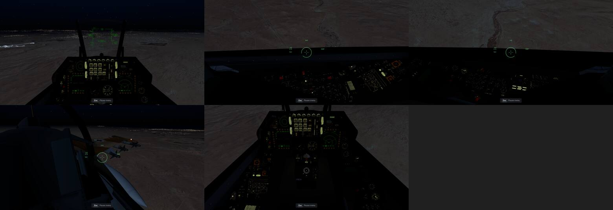
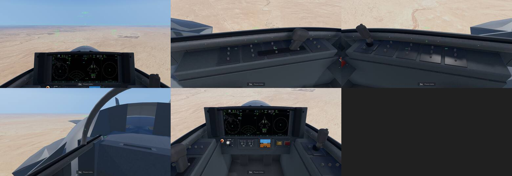
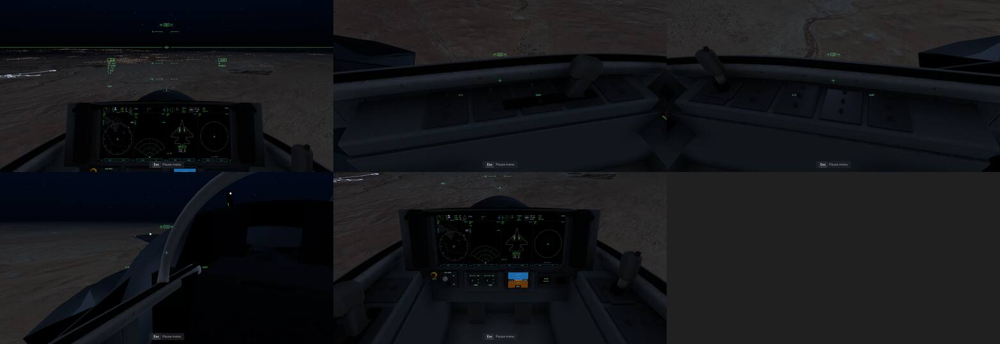

What each view shows, against the cockpit photos the docs use (docs/f16i.md, docs/f35i.md, docs/cockpit.md
"3D cockpit"):
- **Ahead (the F-16s):** the HUD's symbology in Hershey Simplex on the combiner, both MFDs live, the ICP, the DED and
  the RWR scope; no 2D art. As the photos: the frame, the ICP over the two MFDs. These pictures predate the
  HUD's light (§5.1): by day the HUD's green is the original's darkest; at night it is lifted and the flood light
  and backlit labels are on.
- **Left and right (the F-16s):** the side consoles under the canopy sill, the DASH helmet's cue and its numbers on
  the canopy. As the photos' consoles; the panels are FlightGear's flat sheet (no depth in the knobs).
- **Back (the F-16s):** the seat's headrest, the rear cockpit's helmet, the wing with the AIM-9Ms on 9, 8 and 7, the
  canopy frame.
- **Down (the F-16s):** the whole front panel, the gear panel left of the centre pedestal and the side-stick on the right console. The standby ADI ball is
  the model's.
- **The F-35I:** the panoramic display's four portals (TSD, radar, stores, threat display), the helmet's symbology
  over the whole view (its thin green over bright sand is faint, as a real helmet display by day), the side consoles
  with the stick and throttle, the standby display. The back view's seat is a plain block (f35i.md §4.5).

The displays' maps and the RWR glyphs against their references (the RWR sheet beside the 1998 one, docs/rwr.md §4;
the TSD map's reference picture in §8):

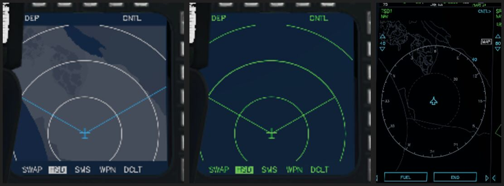
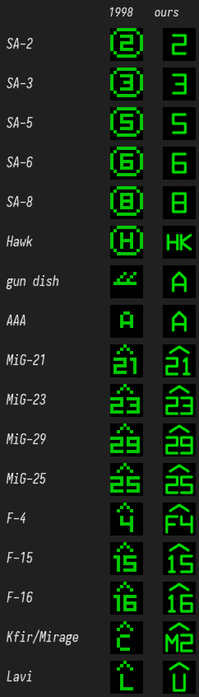

### 6.2 The cockpit at the origin (2026-11-09, the Mac play test's finding 25)

The flight's world is in 32-bit floats about the flight's start (`terrain_view.gd` `world_origin`), so far from the
start every vertex of the cockpit rounds to the step of the jet's position, which the eye 0.5–1 m away sees: the whole
cockpit jumped against the eye ("the entire cockpit shakes", the user on the Mac). The sim draws the cockpit-view
model (with the 3D cockpit, the HUD glass, the stores and the lights on it) in its own world about the origin
(`shared/cockpit/cockpit_origin.gd`, `Settings.cockpit_at_origin()`; the original game keeps it in the flight's world):
- a SubViewport the size of the screen draws that world through a camera that copies the flight camera's place and
  turn in the rig (the head look, the ground clamp), its projection (`cockpit.gd`'s frustum with its offset) and the
  rig's attitude, so the world's directions are the same in both and the sun needs no turning;
- that world's sun copies the flight's direction, colour and energy every frame (one shadow map over 8 m: the canopy
  frame, the HUD and the seat on the panel); its environment copies the flight's once a second (the sky's ambient
  light) without fog, tonemap or glow;
- its picture, linear and untonemapped with its alpha, is laid over the flight's 3D view by a full-screen quad drawn
  last in that view (`cockpit_composite.gdshader`), so the flight's auto exposure, tonemap and anti-aliasing apply to
  the cockpit as before, and the clouds, rain and effects stay outside the canopy; the picture itself is drawn at
  full size with MSAA 4× and no FXAA whenever the flight uses TAA or an upscaler (FSR 1, FSR 2, MetalFX): their
  output loses the alpha, and an opaque cockpit picture lays black over the world (seen on Linux with TAA alone, FSR 1 alone and FSR 2,
  2026-11-12; on the Mac with MetalFX, 2026-11-11); the frame rate with the player's settings stayed within the
  run-to-run noise (32–42 fps either way on the Iris Xe); the 2D layers (the HUD symbology,
  the night vision goggles) lie over both as before; the quad is on the clouds' layer, which the EO sensor's camera
  leaves out, so the TV picture on the MFD shows no cockpit;
- the HUD's clip and the screens' clicks project through that world's camera (`cockpit3d.gd` `camera`), the wingtip
  vapour takes the cockpit's place in the flight's world (`terrain_view.gd` `vapour_state`).

The lights of the flight's world (flares, the muzzle flash, airbase lamps) do not reach the cockpit (inferred: the
cockpit is lit by the sun, the sky and its own flood and panel lights).

Measured by `modern-iaf/tests/_cockpit_shake_probe.gd` (a real render of mission 2012 at 1920 × 1080 on the Iris Xe,
the flight model stopped, the rig moved 0.5 mm a frame D km from the start, 40 frames; the pixel change is the mean
grey-level change between successive frames):

| D | camera ↔ cockpit moved, before / after | panel pixel change per frame, median / max, before | after |
|---|---|---|---|
| 0 | 0.25 mm / 0 | 0.47 / 1.99 | 0 / 0.49 |
| 15 km | 1.1 mm / 0 | 1.14 / 6.8 | 0 / 0.004 |
| 30 km | 3.1 mm / 0 | 0 / 10.5 | 0 / 0.004 |
| 60 km | 4.4 mm / 0 | 0 / 15.5 | 0 / 0.011 |

The worst frame-to-frame change 60 km out, 8× brighter (left: in the flight's world, the cockpit jumps as one piece;
right: in its own world, the cockpit black; what changes there is a terrain tile loading and the info line), and the
view there in both (the same frame):

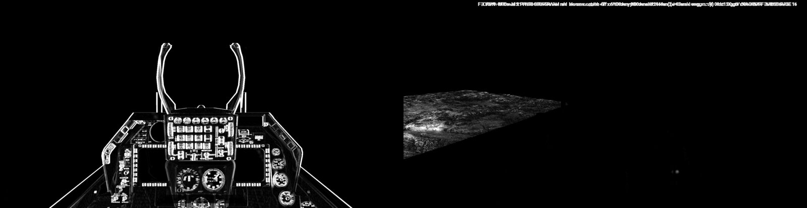
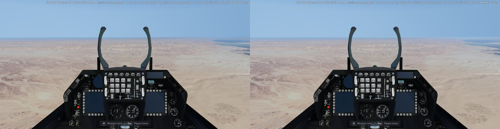

**Cost** (the same probe, the GPU time each viewport takes, 120 frames at the start): before, the flight's viewport
18.8–19.4 ms; after, the flight's 14.3–15.9 ms and the cockpit's 7.7–8.9 ms, so about +4 to +5 ms a frame on the
Iris Xe. Of the cockpit's, MSAA 4× (as the flight's) is about 3.2 ms, its shadow 1.5 ms, the sky's ambient 1 ms
(each measured off once). Kept: MSAA for the panel's printed labels.

- Tried and dropped (2026-11-11, look batch 1 item 3): FXAA in place of MSAA 4× in the cockpit's viewport.
  `modern-iaf/tests/_cockpit_aa_probe.gd` (the Sufa on Ramon's runway, 1920 × 1080, Iris Xe, two interleaved rounds)
  measured the cockpit's viewport at 6.85 / 7.02 ms with MSAA 4× and 4.47 / 4.47 ms with FXAA: 2.4–2.6 ms saved, the
  flight's viewport unchanged (13.2–13.4 ms). The rule was to keep it only within one grey level of today on the HUD
  and the panel's text. The panel's text missed it: the ICP's keys differ by 6.2 levels on average (33 % of their
  pixels by more than one, 12 % by more than eight), the gauges by 3.1 levels (29 %, 7 %); the HUD glass 0.8 levels
  (4 %). Zoomed, FXAA leaves the keys' outlines stair-stepped and blurs their small labels.

## 7. Open
- The F-16s' HUD field (§4) is sized to fit the 3D combiners, smaller than the real HUDs' 20° × 13.5°.
- The gun cross's place under the boresight (inferred).

## 8. Display data

Each jet's cockpit dir holds only what the 3D cockpit's screens draw. Nothing in it comes from the original game's
cockpit folders: the map is OpenStreetMap data, the art is our own drawing. The data lives in
`modern-iaf/data/planes/_shared/cockpit/` (the map and the art, the same for every jet) and
`modern-iaf/data/planes/<jet>/cockpit/` (the jet's layout); `iaf-sim own` compiles both into
`converted/own/cockpits/<jet>/`, the folder the shared readers take as the cockpit dir
([data-formats.md](data-formats.md) §14). The layout has no `"Shared"` key, so every file is read from that folder.

| file (compiled) | read by | what it is | jets | size |
|---|---|---|---|---|
| `rwrsymb.png` | `cockpit.gd draw_rwr_symbols` (the RWR scope) | the RWR glyph sheet: 17 slots of 10 × 10 at scale 4 (40 × 680), green on transparent | the F-16s' RWR scope; the F-35I's copy is not read (its threat display, `pcd_formats.gd` TWD, writes the same codes as text in the display font) | 3 KB |
| `adi.png` | `cockpit.gd _draw_adi`, `lens_adi.gdshader` ([LENHORIZON]) | the attitude ball, 128 × 128 at scale 4 (512 × 512) | all three (the F-35I's layout has no [LENHORIZON], so it never reads it) | 8 KB |
| `map.json` | `cockpit.gd _load_tsd_map` → the HSD (`f16_mfd.gd`), the TSD page (`mfd.gd`), the PCD's TSD (`pcd_formats.gd`) | the TSD map's polygons (EMF-JSON) in the sim's UTM frame | all three | 186 KB |
| `isr.png` | `mfd.gd _isr` (the GM picture under the radar's MAP mode) | land lit, water black, 640 × 832 at 640 m a pixel; its frame is the layout's `MAPFRAME`, which `iaf-sim own` adds | all three | 7 KB |
| `mfds.png` | `mfd.gd _blit` (the 1998 pages' tiles, range and compass sprites), `hud.gd` (the 5 × 5 font, the gun pipper) | the MFD atlas, 264 × 924 at scale 4 (1056 × 3696) | all three | 50 KB |
| `cockpit.json` | `cockpit.gd load_cockpit` | the layout (§4) | all three | 1 KB |

The real formats (the F-16's MFDs, the F-35I's PCD) draw their own vector symbology on a black screen; they take no
background picture from the cockpit dir. The MFD atlas serves the 1998 pages and HUD, which the sim does not show; it
is there so a page or HUD that reaches for it finds our own art.

### MFD atlas

The original `mfds.bmp`'s layout (docs/mfd.md §1), so every source rect the readers cut maps the same: 13 tiles of
132 × 132 (the blank page, RWR, stores, A-A radar, TSD, MAP, FLIR, GMT, TV and four unused) and the sprites in the
corner (the gun pipper, the NAV list's arrows, the 5 × 5 font, the range numbers, the compass letters). Ours: black
screens with rounded corners, the marks in the MFD green (0, 255, 0), labels in our own pixel font (4 × 5 glyphs and a
blank column: A–Z, 0–9 and `. : + - %`; the range numbers 3 × 5, the compass letters 5 × 7). The ground map's fan and
the sensor pages' video box are transparent, so the picture under them shows, as through the original's colour key.
Source: `tools/iaf-2026/cockpit/mfds.svg`.

### RWR glyph sheet

The slots keep the original sheet's order (docs/rwr.md §4, docs/mfd.md "RWR"), so `RWR_GLYPH` maps a type code to the
same slot. The symbols follow the F-16's AN/ALR-56M: a threat shows as its number or letters, an airborne emitter
under an inverted V (the "hat")[^uoaf]; the US tables may differ from the IAF's F-16s[^uoaf]. Which symbol each
type shows:

| slot (y) | type codes | ours | 1998 |
|---|---|---|---|
| 0–40 | 290, 300, 310, 320, 330 (SA-2, -3, -5, -6, -8) | 2, 3, 5, 6, 8 | the number in an octagon |
| 50 | 340 (Hawk) | HK (inferred) | H in an octagon |
| 60 | 360, 380, 390 (gun-dish radar, ships) | A (inferred) | two chevrons |
| 70 | 350 (AAA) | A (inferred) | A |
| 80–110 | 150, 160, 180, 170 (MiG-21, -23, -29, -25) | 21, 23, 29, 25 under the hat | the same |
| 120 | 120, 200 (F-4) | F4 under the hat (inferred) | 4 |
| 130, 140 | 110, 100 (F-15, F-16) | 15, 16 under the hat | the same |
| 150 | 130, 190 (Kfir, Mirage) | M2 under the hat (inferred) | C |
| 160 | 140 (Lavi) | U, an unknown airborne radar, under the hat (inferred) | L |

The glyphs are strokes of a 4 × 6 grid font in the ALR-56M display's green (inferred). The F-35I takes the same sheet:
its threat display's symbols are open. Source: `tools/iaf-2026/cockpit/rwrsymb.svg`.

### ADI ball

The texture `lens_adi.gdshader` samples: columns 64 the centre, the 128 rows 360° of pitch, the horizon at row 62,
nose up toward row 0. Ours: grey sky over black ground with a white horizon, a pitch line every 10°, longer and
numbered (3, 6) every 30°, a ring at the zenith and a crossed ring at the nadir; the lines black on the sky and
white on the ground (the F-16 ADI's grey over black, inferred from cockpit photos). The sim's 3D cockpit draws its
own ADI ball in the model; this file serves a cockpit layout with a [LENHORIZON] section. Source:
`tools/iaf-2026/cockpit/adi.svg`.

### TSD map

The original's map shows the sea and lakes navy, Israel light grey and every other land dark grey. Ours keeps those
colours and adds two greys for the West Bank and Gaza, with OpenStreetMap's geography[^osm]. The data covers both
theatres: the sim's (the UTM 36N box `sim_terrain::BOX`, [terrain.md](terrain.md) §2; 33.08–36.84° E, 29.38–34.04° N)
and the 1998 game's map frame (29.65–38.35° E, 26.99–36.62° N through the georeference), cut at 29.5–38.5° E,
26.85–36.75° N. In the sim each point is in UTM 36N, the sim's world X / Y, and each outline is cut at the box
(`compile_map`), so the map ends with its background where the terrain ends. The original game takes the same map as an
Extras option (Briefing map on Modern, docs/front-end.md §8 "Modern map"): setup's `extras` step compiles it into the
1998 frame (`sim_cockpit::extras`, `Frame::original`), and copies the RWR sheet and the ADI ball for its F-16's real
MFDs (docs/mfd.md §9). Its GM picture takes the terrain from the original's `isr.bmp` (the same 640 × 832 frame): each
land pixel of ours the original's green, the channel the GM page shows; each water pixel dark.

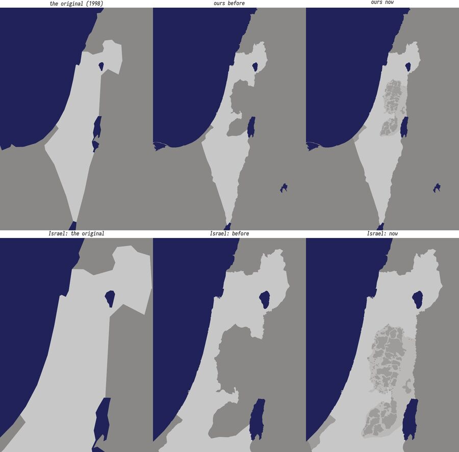

The picture shows each map in longitude / latitude over the theatre (the original's through its frame's corners, so
its edges are approximate); the lower row is Israel, the West Bank and the Golan.

The layers, in paint order:

| layer | colour (RGB) | what it is (OSM) |
|---|---|---|
| `land` | dark grey 137, 136, 135 (the original's) | every land: OSM's simplified land polygons (made from OSM's coastline)[^osmdata] |
| `israel` | light grey 200, 199, 199 (the original's) | Israel: relation 1473946 (boundary=administrative, admin_level=2) |
| `area_c` | light grey 186, 185, 184 | the West Bank's Area C, under Israeli control: relation 3791785 ("Exclusive Israeli control.") |
| `pa` | mid grey 157, 156, 154 | the Palestinian areas outside Israel's control: Area A 3791783 ("Exclusive control of the Palestinian Authority."), Area B 3791784 ("Palestinian civil control and Israeli military control."), Hebron's H1 7391021, and the Gaza Strip 1473938 |
| `lakes` | navy 34, 34, 91 (the original's) | `natural=water` lakes, lagoons and reservoirs of 15 km² or more |

**The user's decision (2026-11-03):** "follow osm, just make sure the west bank you can see what under PA and what
not, golan has updated borders". So:
- **Israel follows OSM.** Its relation holds East Jerusalem and the Golan, and leaves out the rest of the West Bank and
  Gaza. Each boundary layer is its relation's outer rings within the land polygons, so its outline follows the coast.
- **The West Bank** shows who governs each part, from OSM's Oslo II area relations (admin_level=6, source
  geomolg.ps, each with its control in its `description`). Area C's outer ring is the whole West Bank but East
  Jerusalem; the PA's areas are painted over it, in the place of its holes. Hebron's H2 (Israeli control) is a hole in
  Area C that no PA relation covers, so it stays Area C's colour. The colour rule: OSM draws Area C outside Israel's
  border, so it has its own colour, one step darker than Israel's (Israeli control); the PA's areas take the mid grey
  between Area C and the neighbours, so the PA's patches stand out from the land around them.
- **Gaza** takes the PA's colour. OSM maps it as a region (admin_level=4) of the Palestinian Territories (relation
  1703814, with the West Bank), outside Israel, with no tag on who governs it. The user's decision (2026-11-03):
  Gaza keeps the PA's colour, with the other Palestinian areas outside Israel's control.
- **The Golan** is inside Israel's colour up to the 1974 disengagement line. On Israel's relation, every way of the
  border with Syria is tagged `border_type=disengagement line`, `alt_name=A-Line`, `disputed=yes`, `claimed_by=IL`,
  `disputed_by=SY` (UN resolution 497, UNDOF; edited 2025-11-17). The UNDOF buffer zone east of it (old Quneitra) and
  the Syrian side of Mount Hermon are a neighbour's colour.

Every ring is simplified to about 150 m (under one MFD pixel at the HSD's shortest range, inferred). Islands and lakes
under 2 km² are left out, and the PA's patches under 0.3 km² (about 4 HSD pixels across at its shortest range,
inferred; 59 patches, 8 km² in all). The result: land 29 rings (3694 points), Israel 1 (724), Area C 1 (417), the
PA's areas 164 (2766), lakes 17 (2468); the data file 201 KB, map.json 186 KB (the original game's copy 176 KB). The GM picture (`isr.png`) is the same polygons:
every land at 150 of 255 (the PA's areas too), water 0.

Made by `python3 -I tools/iaf-2026/cockpit_displays.py map [--refetch]` (a generic user agent; the boundary
relations from the OSM API's `relation/<id>/full`, the lakes from the Overpass API; the downloads go to their own
folder, `assets/source/osm/tsd_map/`; GDAL's `ogr2ogr` cuts and simplifies). The relations' versions and the fetch
date are in the file's `source`. The RWR sheet and the ADI are rendered by `cockpit_displays.py art`
(`rsvg-convert`).

### Credits the sim's wizard and credits roll need

"TSD map © OpenStreetMap contributors, available under the Open Database Licence (ODbL) 1.0:
openstreetmap.org/copyright" (also in [docs/credits.md](../../docs/credits.md)).

### Open

- `mfd.gd crisp_sprite` reads the RWR glyphs from the install's `rwrsymb.bmp` (Better cockpit "crisp MFD", the 1998
  pages only); the sim does not use it.
- The sim's GM picture: every land at one brightness; its relief and cities are open (the original game's copy takes
  the original's shading, §8 "TSD map").
- The F-35I's threat symbols.
- Rivers are not drawn; the Suez Canal shows only where the land polygons leave it open (a thin line).

[^uoaf]: UOAF codex, "RWR" (Falcon BMS community reference of the US AN/ALR-56: airborne emitters "displayed with an
    inverted V on top of them", "U" unknown and "S" search radars; "Symbology may differ on foreign F16 (IAF, EAF,
    BAF etc ...)"): https://codex.uoaf.net/oldcodex/pages/main/rwr--p746.html
[^osm]: OpenStreetMap contributors, ODbL 1.0, https://www.openstreetmap.org/copyright (the relations Israel 1473946 v345, Area A 3791783 v84, Area B 3791784 v105, Area C 3791785 v182, Hebron H1 7391021 v15, the Gaza Strip 1473938 v101 via the OSM API, fetched 2026-11-03; the lakes via the Overpass API, OSM data of 2026-11-02; the land polygons fetched 2026-11-03).
[^osmdata]: OpenStreetMap Data, "Land polygons" (simplified, EPSG:3857; derived from OSM, ODbL 1.0):
    https://osmdata.openstreetmap.de/data/land-polygons.html

[^hershey]: hershey-fonts, Kamal Mostafa (`futural.jhf`; the Hershey Fonts licence in `COPYING`): https://github.com/kamalmostafa/hershey-fonts
[^heebo]: Heebo, Google Fonts' repository `ofl/heebo` (version 3.100, from github.com/OdedEzer/heebo at 76c7d53; OFL.txt): https://github.com/google/fonts/tree/main/ofl/heebo
[^fg-hud]: FlightGear F-16 wiki, "HUD": the Symbology Intensity wheel at the upper left of the ICP, the other HUD
  controls on the HUD Remote Control Panel on the right console, DAY / AUTO BRT / NIGHT. https://github.com/NikolaiVChr/f16/wiki/HUD
[^bms-ramp]: Falcon BMS forum, "Ramp start?", wedge (post 119008): "ELEC panel (Throttle; below)", "ENG & JET START panel (back – above EXT LIGHTING)", "AVIONICS POWER panel (stick)", "INS knob – ALIGN NORM" (weak: a sim community's checklist), https://forum.falcon-bms.com/post/119133
[^jfs50]: F-16.net forum, "JFS and avionics question" (the flight manual: "As the engine accelerates through 50 % rpm, a sensor causes the JFS to shut down automatically"; about 50 % on a P&W and 54 % on a GE engine), https://www.f-16.net/forum/viewtopic.php?p=13518
[^fg-left]: FlightGear F-16 at ef4f192, `Models/Cockpit/Main/panels_mlu_left-console.xml`: `SW_MAIN_POWER` (knob on `fdm/jsbsim/elec/switches/main-pwr`, 0–2) and `SW_JET_FUEL` (knob on `f16/engine/jfs-start-switch`, −1–1; `Nasal/states_and_autostart.nas`: 1 is START 2), https://github.com/NikolaiVChr/f16
[^fg-right]: FlightGear F-16 at ef4f192, `Models/Cockpit/Main/panels_mlu_right-console.xml`: `mmc-switch`, `st-sta-switch`, `mfd-switch`, `ufc-switch` (knobs on `f16/avionics/power-*`, 0–1) and `INS_knob` (`f16/avionics/ins-knob`; `states_and_autostart.nas`: 2 ALIGN NORM, 3 NAV); `fcr-switch` (knob on `f16/avionics/power-fcr`, 0–1, line 638) and `rdr-alt-switch` (`f16/avionics/power-rdr-alt`, 0–2, line 670), https://github.com/NikolaiVChr/f16
[^dash34alow]: T.O. GR1F-16CJ-34-1-1, p. 1-316 "CARA Altitude Low (CARA ALOW)" (the ALOW cue from the combined altitude radar altimeter), https://falcon.blu3wolf.com/Docs/HAF-F16-34.pdf
[^dcs-canopy]: Eagle Dynamics forum, "Canopy won't lock if I open it and close" (DCS F-16C: the canopy switch on the left, where the canopy handle is; weak: a forum, read through a search summary), https://forum.dcs.world/topic/333905-canopy-wont-lock-if-i-open-it-and-close
[^hoggit-icp]: Hoggit wiki, "Instrument Panel" (DCS F-16C): the HUD's DAY / AUTO / NIGHT symbology brightness
  switch. https://wiki.hoggitworld.com/view/Instrument_Panel
[^hoggit-ip]: Hoggit wiki, "Instrument Panel" (DCS F-16C): the ICP's SYM wheel sets the HUD's brightness. https://wiki.hoggitworld.com/view/Instrument_Panel
[^dcs-wow]: Eagle Dynamics forum, "AOA indicator reading during NLG WOW" (quotes the F-16 dash-1: "When NLG WOW occurs, all AOA indications are based on zero degrees"; weak: a forum quote, the manual not read), https://forum.dcs.world/topic/245600-already-reportedaoa-indicator-reading-during-nlg-wow
[^ayton]: Mark Ayton, "Blue Sky OPS", AIR International, 26 April 2012, quoted on F-16.net, "Engine start up procedure" (three switch selections: battery, IPP, engine), https://www.f-16.net/forum/viewtopic.php?p=317934
[^ife-canopy]: IndiaFoxtEcho, "F-35 Lightning II aircraft for Microsoft Flight Simulator, user manual" (the cockpit's
    left side, item 8 "Canopy control lever"),
    https://orbx-user-guides.storage.googleapis.com/indiafoxtecho-f35-msfs-user-guide-96295d.pdf
