# Modern IAF cockpit

**Terms:** ADI = attitude director indicator (the attitude ball); GM = the radar's ground-map mode; HSD = the F-16's
horizontal situation display; MFD = multi-function display; ODbL = the Open Database Licence (OpenStreetMap's);
OSM = OpenStreetMap; PCD = the F-35I's panoramic cockpit display; RWR = radar warning receiver; TSD = tactical
situation display; "inferred" = our own reasoning; "open" = no source found.

The sim has only the 3D cockpit (plan.md "cockpits"). This page describes what its screens draw and the data they
draw from.

## 1. What each jet draws
| jet | 3D cockpit | HUD | head-down displays |
|---|---|---|---|
| F-16I Sufa (`f16i`) | the F-16's (FlightGear's Block 50/52 panel sheet) | the wide-angle HUD, the Real HUD symbology | both MFDs in the real formats, in colour; the RWR scope, EHSI, DED and fault list on their screens |
| F-16D Barak (`f16`) | the F-16's (the Block 40 panel sheet) | the wide-angle HUD (Barak 2020's new HUD, [avionics-plan.md](avionics-plan.md) B9), the Real HUD symbology | both MFDs in the real formats, in colour (B2); the same small screens |
| F-35I Adir (`f35i`) | ours (`f35i.glb`) | the helmet display over the whole view | the panoramic display with its four portals and the standby display |

The model the 3D cockpit hangs in is ours, never the original's cockpit-view model: the detailed F-16's cut model (`shared/extra/models/f16/f16d.glb`)
for the F-16s and the F-35I's cockpit-view model (`shared/extra/planes/f35i/f35i_bc.gltf`, ours). They draw the seat,
the canopy frame and the wings seen from the seat.

Day and night are the 3D cockpit's own lighting (docs/cockpit.md "3D cockpit": the sun's fill by day, the flood
lights and the lit labels at night); the panel's night art is not used.

## 2. The views
- **Ahead:** the 3D cockpit's wide view (85° across the screen, the head 12° down: the whole front panel in view), zoomed in by + / − and the mouse wheel.
- **Zoom:** + / − and the mouse wheel step from the wide view to the true size (the screen as a window 0.6 m from the
  eye), then on to a narrow view 20° across the screen, where the MFD pages read from the seat. 16 wheel notches
  span the range (`cockpit.gd` `view_3d_focal`, `VIEW_3D_NARROW_DEG`). Each step narrows the view: the true size is
  kept between the wide and the narrow view. The trackpad zooms as the wheel, in the system's scroll direction. One
  scroll zooms one way: a step against the last one taken under 250 ms before is dropped (`Settings.zoom_steps`; macOS
  sends events of the other sign at a scroll's end and in its momentum), and a knob that comes under the pointer during the scroll leaves
  the wheel to the zoom; a switch under the pointer leaves it too (only a knob or lever with a turn takes the wheel).
  The wheel zooms toward the pointer (2026-11-15, the user: "can't zoom in to see things under the throttle"): the
  point under the pointer stays under it while the view narrows, the head turning toward it (`terrain_view.gd`
  `_zoom_cockpit`: the head's bearing and elevation solved so the pointer's ray at the new focal length looks where the
  old one did); + / − zoom about the view's centre. Every jet opens at the wide view with the head straight ahead
  (`modern-iaf/tests/test_cockpit_view.gd`).
- **Hide pilot's body (2026-11-17):** Alt + H hides the pilot's body while held, Alt + G hides or shows it for the
  flight (records 192 / 193 of `data/keys.json`, command 205; the Keys screen's Views group); the body is shown at
  every flight's start. The body never takes the mouse (§5.3).
- **Lean (2026-11-15; one hold control since 2026-11-18, approved):** hold Shift + Left / Right to lean the head 6 cm
  left / right, Shift + Up 10 cm forward, Shift + Down 10 cm back, Shift + Page Up / Page Down (the laptop map: Shift + = / Shift + −) 10 cm up / 15 cm down;
  the head eases there in about 0.2 s and back to the seat on the release (records 126–131 of `data/keys.json`,
  command 204; the Keys screen's Views group rebinds them; `views.gd` `lean`). Forward held longer than 0.8 s goes on
  at 0.3 m/s to 30 cm: with the head down, the F-16's MAX POWER switch behind the throttle's grip. The F-35I's
  forward lean is 2 cm, where its display's bottom edge stays on the screen (`f35i.json` `lean_forward`). The cockpit
  and the HUD glass move against the eye; the HUD's symbols stay on the world, as a collimated HUD's do. From the
  lean toward an F-16's MFD every one of its push buttons and rockers is seen and clicked ("The MFDs from the seat",
  §5.2). The head keeps 13 cm (past the camera's 10 cm near plane) from every surface of the cockpit in 14
  directions, nor passes through one (`cockpit3d.gd` `lean_clear`: the move tested against the cockpit's meshes
  within 60 cm of the eye, the answer kept while the head holds still). The pilot's body hides while the head is off
  the seat: it does not move with the head, and from the seat the left glove covers the ELEC panel's MAIN PWR and the
  legs the lower pedestal. Until 2026-11-18 the keys moved the head at 0.3 m/s within 15 cm aside, 30 cm forward,
  10 cm back, 10 cm up and 15 cm down, and it stayed where the release left it until Look forward; a second set of
  hold keys (Shift + Q / E / K) was built beside them and dropped the same day (the user: "Why need lean in arrows
  and also in other keys?"). Pictures: `modern-iaf/tests/_lean_shot.gd`, `_mfd_view_shot.gd`.
- **Full MFD view (2026-11-18, approved):** Shift + , shows the left MFD close up, Shift + . the right one (the caps
  marked < and >: left and right; records 198 / 199, command 207; on Shift + N / M for some hours, where Shift + N
  is the night-vision goggles' key, `terrain_view.gd` `_own_key`); in the F-35I either key shows the panoramic
  display. The eye goes 40 cm out on the display's normal
  and the view narrows until the display with its push buttons fills nine tenths of the screen's height (the F-35I's:
  of its width), in a quarter of a second; every button is clicked with the mouse there. The same key or Esc goes
  back to the seat's view; the other display's key cuts to that display. The HUD's look-down readout and the
  helmet's symbols are left out of the close-up: they lay over the display's push buttons. The jet flies on and every other key works
  as from the seat; a view that leaves the cockpit ends it (`terrain_view.gd` `mfd_view_key`, `_mfd_step`;
  `cockpit3d.gd` `display_frame`). Pictures: `modern-iaf/tests/_mfd_view_shot.gd`.
- **Mouse look (2026-11-11, the Mac play test's finding 9):** hold the right mouse button and move the mouse to turn
  the head; it stays where the mouse leaves it. A double right-click turns the head back to straight ahead at 45°/s.
  The pointer turns the head twice its angle on the screen (`terrain_view.gd` `MOUSE_LOOK_GAIN`): one screen's width
  of drag turns it about 170°. The left button stays on the cockpit's switches and knobs (§5.1, §5.2). The mouse
  moves the head's angle only: the head does not lean with the mouse (it bends forward on its own looking down, §5.3).
  The pointer hides while the button is held and shows again where it was on release (2026-11-13, the user's Mac: the
  pointer stayed hidden after a look). A release the view does not see (a control under the pointer took it, the
  window lost the focus) and a pause or menu end the look too (`terrain_view.gd` `_look`).
  `Settings.cockpit_mouse_look()`: true in the sim; in the original game the right drag turns the external views only.
- **Free look:** the hat and the mouse turn the head, down to 60° (the panel and consoles).
- **The F-key and Numpad snap views** (F2 back, Numpad 1–9, Alt + 1–9 in the laptop map of front-end.md §9.1; docs/views.md §2) are head poses: the head turns to the
  snap's yaw and pitch while the key is held, and the 3D cockpit turns with it. No 2D panel pans.

## 3. The profile
`modern-iaf/sim_settings.gd` (the sim's `Settings` autoload, README.md):
- `PROFILE` holds `cockpit_3d` = `"3d"`, `hud_style` = `"real"` (the Real HUD) and `real_mfds` = `"real"`, set at
  start and again over any settings file. The sim has no row for them (plan.md "options", "physics").
- `airframe_def(id)` gives each of the sim's planes (the Sufa `f16i`, the Barak `f16`, the F-35I `f35i`) its cockpit
  dir as its `cockpit` (§4). The flight scene's first cockpit is the F-16's from the same key (`cockpit.gd`
  `default_dir`), so the original's F-16 cockpit is never loaded.
- The F-35I's panoramic display is on whenever its cockpit dir's `cockpit.json` has its `[PCD]` section.

## 4. The cockpit dirs
`iaf-sim own` compiles each jet's display data from `modern-iaf/data/planes/_shared/cockpit/` (every jet's) and
`modern-iaf/data/planes/<unit>/cockpit/` (its own) into its cockpit dir `<unit>` under `assets/` (`sim_settings.gd`
`own_cockpits`). The sim reads the link from the planes' definitions (`sim_settings.gd` `_planes`): the unit
`modern-iaf/data/db/units/<unit>.json` names its aircraft definition (`"airframe"`), and a unit with a cockpit folder is
a plane the sim flies:

| jet | unit | aircraft definition | family | cockpit dir |
|---|---|---|---|---|
| Sufa | `f16i` | `f16i` | `f16` | `converted/own/cockpits/f16i` |
| Barak | `f16d` | `f16` | `f16` | `converted/own/cockpits/f16d` |
| F-35I | `f35i` | `f35i` | `f35i` | `converted/own/cockpits/f35i` |

The shared cockpit tables (the HUD's, the real MFD formats, the 3D cockpit's F-16 check, the gauges) key a cockpit on
`Settings.cockpit_folder(dir)`: in the original game the dir's name (`f16`, `phantom` …). The sim's
`cockpit_folder` answers the plane's family: its aircraft definition's `base` (`shared/extra/planes/<id>/airframe.json`),
else its id. The Sufa (base `f16`) and the Barak (the `f16` definition itself) answer `f16`, so they draw as the
F-16's.
Each dir holds, in the shapes `shared/cockpit/cockpit.gd` reads (docs/cockpit.md), only our own files:
- `cockpit.json`: the layout the 3D cockpit reads (below);
- `rwrsymb.png` (the RWR symbols), `map.json` (the TSD map in the EMF-JSON shape `IafEmf` fills), `isr.png` (the
  ground-map picture), `adi.png` (the ADI ball, which the F-16s' layout reads), `mfds.png` (the MFD atlas and its 5 × 5 font): §8.

The cockpit loads with any display file missing: the display that needs it draws without it.

### The layout (`cockpit.json`)
Ours, written for the 3D cockpit; none of the original's numbers. `"image_scale": 4` (the art's), no `"Shared"` key,
no panel art: no `FileName`, no `[PANEL]`, lamps, tapes or gauges (the 3D model draws those). `iaf-sim own` refuses a
layout that borrows (`"Shared"`) or names art. The units:
- **The layout's px:** the original 640 × 480 screen's, whose focal length is 686.2 px (docs/cockpit.md "3D view"),
  so N px from the view's centre line is atan(N / 686.2). The 3D cockpit scales them with its own focal length.
- **Rows** count up from the panel's top. With no panel it sits 50 px over the view's centre (the projection's centre
  row 240 less `MainOffsetY`'s default 190).

`[HUD]` (`hud.gd`, `cockpit.gd`):

| key | F-16s | F-35I | what it is |
|---|---|---|---|
| `BorePositionY` | 16 | 16 | the boresight: the nose, which the 3D camera sees 5.5° over the view's centre (`VIEW_LOOK_DOWN_DEG`): 686.2 · tan 5.5° = 66 px, less the 50; the 3D cockpit looks 12° down (`VIEW_3D_LOOK_DOWN_DEG`), so `view_shift` puts the HUD on the nose |
| `GunRetPositionY` | 11 | 11 | the gun cross, 5 px (0.4°) under the boresight (inferred, as the F-35I's 2D cockpit) |
| `CenterY` | −26 | 16 | the HUD's centre: the F-16s' 3.5° (42 px) under the boresight, the middle of their field; the F-35I's on the boresight |
| `LeftBorder`, `RightBorder` | 72 | 250 | the field's half width: the F-16s' ±6°, the F-35I's ±20° (its helmet's 40° field) |
| `TopBorder`, `BottomBorder` | 66, 67 | 184, 184 | the F-16s' field from 2° over the boresight to 9° under it; the F-35I's ±15° (the helmet's 30°) |
| `Dash` | 1 | 1 | the helmet display once the combiner glass is off the screen (the DASH, the F-35I's helmet); while any of the glass shows, the HUD stays on it (2026-11-11, the Mac play test's finding 10: looking down-left at the dash the HUD jumped off its glass to the DASH) |

The F-16s' field is what fits their combiners from the eye with the Real HUD's data blocks beside it (1.8° outside
the field; docs/cockpit.md "The HUD on its glass": the Sufa's plate reaches +2.6° to −12.8°). The real F-16 HUD shows
20° × 13.5° (`real_hud/mod.rs` `fov_deg`); the 3D combiners are smaller from the eye (inferred). The F-35I's helmet
draws its own layout (`real_hud/f35.rs`); its field bounds only the ILS and steerpoint cues.

`[MFD]`: the F-16s' `LeftActive` / `RightActive` 1, `MiddleActive` 0, the offsets 0 (the screens are the model's,
each its 512 px SubViewport). The F-35I's `Portals`: four, `[x, y, scale, page]`, x every 142 px, y under the
display's strip, scale 142 / 132 (an MFD page across its portal), pages TSD, radar, stores, RWR.

`[PCD]` (the F-35I, `pcd.gd`, `cockpit3d.gd`), in the display's px, 28.4 per inch of its glass (the strip's 15 px are
0.53 in, `FAB_H`; 26 px until 2026-11-17):

| key | value | what it is |
|---|---|---|
| `Rect` | 0, 0, 568, 227 | the glass, 20 × 8 in (`tools/f35i/cockpit3d.py` `PCD`): a 1,704 × 681 px SubViewport at `PCD_PX` 3, the glass's own shape |
| `Esis` | written by `cockpit3d.py` | the standby display, 62 × 49 mm (84 × 66 mm until 2026-11-17), its centre 44 mm right of the glass's (`cockpit3d.py` `ESIS`): a SubViewport of its size × `PCD_PX` |

`[PANELRWR]` `Active` 1 (the F-16s): the jet has an RWR scope (the 3D model's), so the right MFD starts on the TSD
(`cockpit.gd` `_create_mfds`).

## 5. The HUD and display fonts
`Settings.hud_font_path(name)` gives the file of every HUD and display raster font (`hud`, `mfd`, `key`), and
`Settings.display_font(style)` the real display formats' text font (`mono`: the F-16's MFD formats and the 3D
cockpit's small screens; `narrow`: the F-35I's panoramic and standby displays; `hud`: the Real HUD's texts; `ui`: the
sim's own screens). The original game returns its converted `.fnt` and the installed system fonts.

The sim's fonts (the user's decision, 2026-11-03):
- **UI text: Heebo** (Oded Ezer, SIL Open Font License 1.1[^heebo]), version 3.100, the variable font
  (weights 100–900) from Google Fonts' repository: `modern-iaf/data/fonts/Heebo-VariableFont_wght.ttf` (122,012 bytes)
  with its licence `OFL.txt`. Heebo has Hebrew and Latin letters. The sim's Settings make it the default font of every
  Control (`ThemeDB`'s default theme), so the sim's screens use it unless they set their own.
- **HUD, MFD and PCD text: Hershey Simplex** (the user's choice, Approvals A9: our own stroke font if easy, else
  Hershey's; Hershey's was the shorter way). The Roman Simplex stroke font Dr. A. V. Hershey drew at the U. S.
  National Bureau of Standards (1967), from Kamal Mostafa's `futural.jhf`[^hershey] (`tools/iaf-2026/fonts/`), is
  stroked into outlines by `python3 -I tools/iaf-2026/hershey_font.py`: each segment a bar and each vertex a round
  dot, 2 units wide (about a tenth of the capitals' 21), into `modern-iaf/data/fonts/HersheySimplex.ttf` (95 glyphs,
  ASCII 32–126, 45 KB). `sim_settings.gd` `HUD_FONT` names it; `hud_font_path` returns it for every name and
  `display_font` for every style but `ui`: the HUD's strokes thin, the displays' emboldened (as the original's bold
  system fonts). A one-stroke-width line of even weight, as a real HUD's cursive writing (inferred from HUD photos).
  The original game keeps its converted `.fnt`.

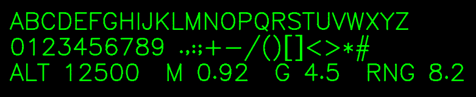

The credit lines the sim's setup wizard (Attributions) and its credits roll show: "Heebo font by Oded Ezer, © 2014 The
Heebo Project Authors, SIL Open Font License 1.1"; for Hershey, the two acknowledgements its terms ask for
(`modern-iaf/data/fonts/HERSHEY.txt`, [docs/credits.md](../../docs/credits.md) "Modern IAF's font").

### 5.1 The HUD's light (2026-11-09)

The user's approval (Approvals A10, proposal 7): "fix the green of the HUD, should be adjustable I think in real".
`Settings.hud_daylight()` is true in the sim ([docs/real-hud.md](../../docs/real-hud.md#modern-iafs-hud-light) has
the sources and the values):
- the HUD in the P43 green, 40 / 255 / 50, at the day level by day, falling to the night floor (136 / 255 of it) as
  the sun sets;
- the symbols drawn over the scene in the original game's thin pen, a faint one-pixel halo around each;
- the combiner glass: the Barak's untinted (`SIM_TINT` 0, 2026-11-13), the Sufa's green as the F-16I photos show it
  (its definition's `hud_tint` 1, 2026-11-18), with no separate edge line; the Sufa's plate a flat rectangle leaning
  aft between straight side plates ([docs/cockpit.md](../../docs/cockpit.md) "3D cockpit");
- the day level is the cockpit's SYM wheel (below), kept in the sim's settings file like a knob's position, with no
  Preferences row (the user, 2026-11-09: "the HUD colour should be adjustable like in the plane, not in
  Preferences!"); Shift + H ("Step HUD brightness", `data/keys.json` record 46, the laptop map the same) steps it in
  eighths in flight and turns the wheel with it.

**The SYM wheel.** On the F-16 the HUD's symbology brightness is the SYM wheel at the upper left of the ICP, under
the HUD; the DAY / AUTO BRT / NIGHT switch sits on the HUD remote control panel on the right console[^fg-hud]
[^hoggit-ip]. FlightGear's model has the wheel (`icp.xml` `sym`, a knob on `f16/avionics/hud-sym`, 240° of travel);
`tools/f16d/cockpit3d.py` `CONTROLS` makes it the node `SYM` of `f16.glb`, turning with `Settings.hud_brightness`.
In the 3D cockpit (Barak, Sufa):
- the pointer over the wheel lights it;
- the mouse wheel over it turns it 2.5 % a notch, a left drag 2.5 % per 10 px (up: brighter), as FlightGear's;
- each step is the HUD key's command `[123, ±25, 0]` (p1: thousandths) through the key path (`terrain_view.gd`
  `_press`), and the level is saved at once.

The layer is general (`shared/cockpit/cockpit3d_controls.gd`, behind `Settings.cockpit_controls()`, true in the sim,
false in the original game): a cockpit's table `<model>_controls.json` beside its model binds a node to a `click`
command (a switch) or a `turn` command (a knob: the wheel, a drag); a guarded switch names its guard's property
(`guard`): while the guard is closed a click only lifts it, the next sends the command (the F-35I's ENG switch,
docs/f35i.md §4.5); a control's hit area is its mesh's own surface: the pointer finds the control whose surface its ray
meets nearest the eye, so the area is never bigger than the part and never a neighbour's (the user, 2026-11-15:
"smaller circles … on the exact shape of the instrument"; until then the mesh's box grown by 4 mm, of the boxes crossed
the nearest centre, which reached past small switches into their neighbours). The surfaces are kept in millimetres:
Godot's ray-triangle test takes a triangle a few millimetres across as parallel to every ray. The flight controls take
no mouse: the throttle and the stick move by the keys and the joystick's stick and
throttle axes only, and animate with them (the user, 2026-11-15: "shouldn't be able to move the throttle or stick from
the mouse"; from 2026-11-13 the throttle grip took clicks, the wheel and drags). The
pointer over a control lights its rim (`material_overlay`, the shader `RIM`): a faint cool white, thin where the part faces
the eye and thicker where its surface turns away, so its own colour and texture still show (2026-11-11; it was a warm
yellow fill, which the user found "too yellowish" and hiding the SYM wheel's texture). The overlay is a mix of low
alpha, not an add: the cockpit's picture is composited by its alpha (`cockpit_composite.gdshader`), and an add pushed
that alpha past 1 and darkened the part (tried 2026-11-11, dropped). The pointer's moves reach the layer in `_input`,
before
the flight's full-view Controls take them, and `cockpit_origin.gd` passes them into the cockpit's own world with the
clicks. The start-up switches are on the same layer (§5.2).

**The DAY / AUTO BRT / NIGHT switch** (2026-11-11). On the F-16 this three-position switch on the HUD remote control
panel (right console, forward) picks the HUD's brightness range: DAY the day range, AUTO BRT the range following the
ambient light, NIGHT the night range[^fg-hud][^hoggit-icp]. Ours, in the Sufa's and the Barak's 3D cockpit:
- DAY: the HUD at the SYM wheel's level at any hour; AUTO: the level by day falling to the night floor as the sun
  sets (as before, the default); NIGHT: the night floor at any hour (`hud.gd` `mode_light`; inferred: no source gives
  the ranges' values);
- the lever is the node `HUD_MODE` of `f16.glb` (`tools/f16d/split_control.py` cuts it out of FlightGear's console
  body, where it has no object of its own, and adds its turn to `f16.json`: 25° forward at DAY, upright at AUTO, 25°
  aft at NIGHT);
- the pointer over it lights it; a click throws it one position down (DAY, AUTO, NIGHT, then back to DAY); the mouse
  wheel up moves it toward DAY, down toward NIGHT; each through command `[217, p1, 0]` (no key sends it);
- the position is kept in the sim's settings file (`Settings.hud_brt_switch`, section `graphics`, 0 DAY, 1 AUTO, 2 NIGHT),
  as a switch stays thrown, with no Settings row. The original game never reads it.

The switch sets the HUD only: the helmet displays (the F-35I's, which has no such switch, and the Sufa's DASH) follow
the sun (AUTO).

| Pointer over the switch (AUTO) | Clicked: NIGHT |
|---|---|
|  | 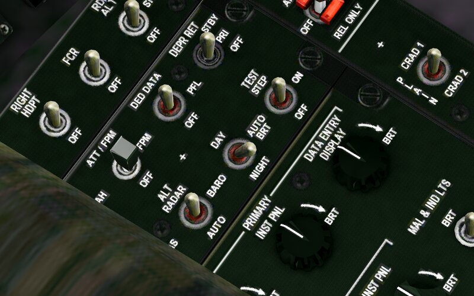 |

The F-35I: the HMD BRT rocker on the top strip of its pedestal (`f35i.glb` node `HMD_BRT`; the strip after the
research, [research/f35-cockpit.md](research/f35-cockpit.md) §2.2) is spring-loaded to its middle: a press pushes it up and steps the HUD's level up 2.5 %, a drag down while held
pushes it down a step (the same command, `[123, ±25, 0]`); let go it springs back (its spring inferred; as every switch
of three positions it leaves the wheel to the view's zoom). The helmet's symbols follow the level in the P43 green, as the HUD (§5.1). The MFD BRT
rocker at the strip's right end (`MFD_BRT`) steps the displays' brightness the same way, `Settings.mfd_brightness`
(10–100 %, saved as the HUD's level; ours, command `[216, ±25, 0]`, no key): the PCD, the standby display and the
MFDs of the 3D cockpit, the F-16s' too (their own BRT rockers are not bound). Until 2026-11-16 both were knobs that
turned with the level.

The Sufa on Ramon's ILS final, a real render (`modern-iaf/tests/_sym_wheel_shot.gd`): the pointer over the wheel, then
the wheel turned down 24 notches (100 % to 40 %) and the pointer moved away.

| Pointer over the SYM wheel | Turned down |
|---|---|
|  |  |

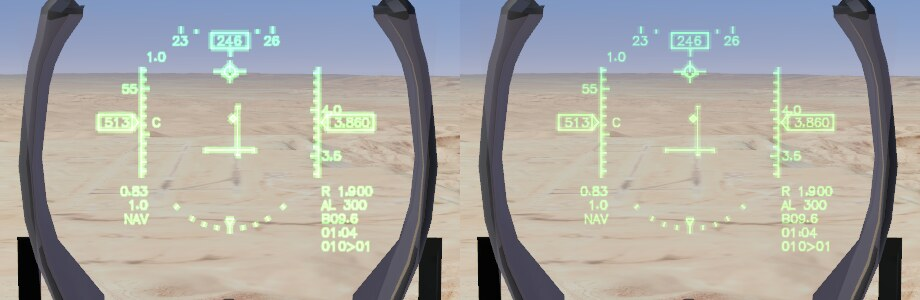

The Sufa at the look study's Shoham pose (HDG 100, 240 m), before and after, 16:58 and 22:00:

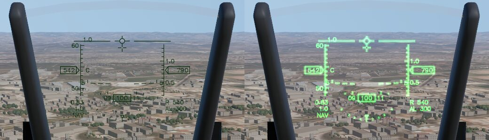

The F-35I has no HUD: its helmet display carries the symbology. It follows the same rules (2026-11-09): the P43
green at the same level, the night floor, Shift + H and the slider. No source gives the helmet display's own hue, so
it takes the F-16's P43 ([docs/real-hud.md](../../docs/real-hud.md#modern-iafs-hud-light)). The F-35I over the Negev
(`_cockpit3d_shot.gd`, C3D_SIM=1 C3D_JET=f35i, looking up 8°), before and after, by day and at 22:00:

`tests/godot/test_hud.gd` checks the colours (the P43 green by day, the floor at night, the original game's darkest
green at its start); `modern-iaf/tests/test_mvp.gd` `_hud_light` checks them in the sim's cockpit with the key's steps,
the additive blend and the glass, and `_knob` hovers, scrolls and drags the wheel (the F-35I's HMD and MFD BRT
knobs), checks the level, the knob's turn and the stored level.

### 5.2 The start-up switches (2026-11-09)

In the Sufa's and the Barak's 3D cockpit the start-up checklist ([training.md](training.md) §7.1) works with the
mouse too: each step's switch is a control of `f16_controls.json`, and a left click on it sends the same command as
its key. FlightGear models these switches as their own parts, so `tools/f16d/cockpit3d.py` `CONTROLS` makes each one a
node of `f16.glb`, turning on FlightGear's property by FlightGear's mapping (`f16.json`). A switch's table row names
that property and its two positions (`prop`, `on`, `off`); `cockpit3d_controls.gd` `set_switch` puts it there and
`cockpit3d.gd` `switches` turns the node. The sim's flight add-on (`sim_flight.gd` `_sync_switches`) shows each switch
where the flight model has it, every frame: a cold jet's off, a hot jet's on, each one on when its step is taken and
off when it goes back off ("Both ways" below); a refused step leaves its switch off. The original game keeps the
switches as FlightGear models them.

- **One click sound a click** (2026-11-17, the user: "the clicks on the panel are happens twice for every click I
  think"): a click on an ICP key entered its key once but sounded three clicks (`SFX_BUTTON` on the press, again from
  the key's command 250, again on the spring-back). A control's move sounds once: not on a push button's or a spring's
  way back to rest, and not when the command it sends played the click itself (`cockpit3d_controls.gd` `put`).
  `modern-iaf/tests/test_one_click.gd`: ICP digits through the pointer (one digit, one sound each), a toggle, MAIN
  PWR, the INS knob.
- **The AVIONIC POWER switches** (2026-11-11, from the user's Mac; each its own system since 2026-11-13, "One by one"
  below): each is its own `toggle` in `f16_controls.json`. A click flips that switch alone, with its click
  (`SFX_BUTTON`), and sends its own command, `[219, 1, i]` on and `[219, -1, i]` off (i: MMC 0, ST STA 1, MFD 2,
  UFC 3). Once all four are on the avionics step is done. A switch refused (before the generators) goes back off.
  Ctrl+A throws all four together: on (with the SNSR PWR panel's FCR, RDR ALT, LEFT HDPT and RIGHT HDPT) while any of the eight is off, off only when all eight are on.
- **FCR and RDR ALT** (2026-11-13, the switches audit's M1): FlightGear's right console has both as their own objects,
  `fcr-switch` and `rdr-alt-switch` on the SNSR PWR panel, turning on `f16/avionics/power-fcr` (OFF 0 / ON 1) and
  `f16/avionics/power-rdr-alt` (OFF 0 / STBY 1 / ON 2)[^fg-right]; `CONTROLS` makes them the nodes `FCR` and
  `RDR_ALT`. FCR is a `toggle` sending `[219, ±1, 4]`: a click moves it between OFF and ON. RDR ALT (since
  2026-11-16) is a switch of three positions sending `[219, -1 / 2 / 1, 5]` for OFF / STBY / RDR ALT (the in-between
  positions below). A cold jet has them OFF (as the model shows them unset), a hot jet
  ON; they are no checklist step.

| step | control (node) | place on the jet | command | key | on / off (FlightGear's value) |
|---|---|---|---|---|---|
| 1 | MAIN PWR switch (`MAIN_PWR`) | ELEC panel, left console, beside the throttle[^bms-ramp][^fg-left] | a key `[210, 0, 0]`; a click `[210, -1 / 2 / 1, 0]` | Ctrl+B | MAIN (2) / BATT (1) / OFF (0) |
| 2 | JFS switch (`JFS`) | ENG & JET START panel, left console, aft[^bms-ramp][^fg-left] | a key `[211, 0, 0]`; a click `[211, -1 / 2 / 1, 0]` | Ctrl+J | START 2 (1) / START 1 (-1) / OFF (0) |
| 3 | throttle (`THROTTLE`, not clickable) | the throttle, left console | its keys (Throttle up, 1) and the throttle lever | Throttle up | the throttle's own animation: out of OFF |
| 4 | MMC, ST STA, MFD, UFC switches (`AVIONICS_MMC`, `AVIONICS_ST_STA`, `AVIONICS_MFD`, `AVIONICS_UFC`) | AVIONIC POWER panel, right console[^bms-ramp][^fg-right] | a click `[219, ±1, 0..3]`, each its own; Ctrl+A `[213, 0, 0]` all four | Ctrl+A | ON (1) / OFF (0): the key all four, a click its own switch |
| 5 | INS knob (`INS`) | AVIONIC POWER panel, right console[^bms-ramp][^fg-right] | `[214, 0, 0]`; the wheel and a drag `[214, ±1, 0]` | Ctrl+N | six positions: OFF (0), STOR HDG (1), NORM (2), NAV (3), IN FLT ALIGN (4), ATT (5); the step done at STOR HDG to IN FLT ALIGN |
| 6 | canopy switch and lock lever (`CANOPY_SWITCH`, `CANOPY_SPIDER`; §5.6) | left side wall under the canopy sill, ahead of the throttle[^milavia-canopy] | the lever `[215, ±1, 0]`; the switch runs the canopy while held | Ctrl+K (the whole sequence) | the switch 22° up (OPEN) / down (CLOSE); the lever 105° up |
| take-off, landing | landing gear handle (`GEAR_LEVER`) | left auxiliary console (FlightGear's `LeftAuxConsole` `gear_lever`) | `[14, 0, 0]` | G | the handle's own animation (`controls/gear/gear-down`) |
| (sensors) | FCR, RDR ALT switches (`FCR`, `RDR_ALT`) | SNSR PWR panel, right console[^fg-right] | `[219, ±1, 4]`, `[219, -1 / 2 / 1, 5]`; Ctrl+A turns both on with the avionics | Ctrl+A (on only) | ON (1) / OFF (0); RDR ALT ON (2) / STBY (1) / OFF (0) |
| (pods) | LEFT HDPT, RIGHT HDPT switches (`l-hdpt-switch`, `r-hdpt-switch`; since 2026-11-17) | SNSR PWR panel, right console[^fg-right] | `[219, ±1, 6]`, `[219, ±1, 7]`: the chin stations' power, RIGHT HDPT the targeting pod's ([weapons.md](weapons.md) §7.2); Ctrl+A turns both on with the avionics | Ctrl+A (on only) | ON (1) / OFF (0) |

- **The throttle by the mouse** (2026-11-13 to 2026-11-15, dropped at the user's word: "shouldn't be able to move
  the throttle or stick from the mouse"): a click and the wheel stepped it 5 %, a drag moved it, a drag down from idle
  went over the detent to OFF. The throttle now moves by its keys and the lever only; OFF is Throttle OFF (Shift + 1).

- **The canopy** closes with its switch and locks with its yellow lever on both F-16s (§5.6, since 2026-11-18); its
  key, Ctrl+K (key record 124), does the whole sequence. **Tried and dropped (2026-11-11 to 2026-11-18):** a canopy
  handle of our own, a grey metal rod 3 cm
  thick and 14 cm long drawn along the left canopy sill's inner face 10 cm aft of the throttle and clicked as the
  step's control (`f16_controls.json` `CANOPY_HANDLE`, a `box` row with `grip`). Its place and shape were inferred
  from a forum's line[^dcs-canopy]; the user on 2026-11-18: "remove the f16 cockpit handle. It isn't right for sure".
  The rod, its click area, the `box` rows' code and the briefing's two canopy pictures went with it.
- **The INS knob** (since 2026-11-15, the user: "Ins prod can't move to all places") turns through FlightGear's six
  positions, 0–5 (its knob animation's range; its HUD shows ALIGN at 2 and 4, NAV at 3)[^fg-right]: OFF, STOR HDG,
  NORM, NAV, IN FLT ALIGN, ATT. The names of 1, 4 and 5 are inferred from the real knob's order (FlightGear names
  only 2 and 3; the real knob's CNTL position has no place in its six). The wheel up and a drag up turn it a position
  on, the wheel down and a drag down a position back, stopping at OFF and ATT; a click and its key (Ctrl+N) turn it
  a position on, ATT going round to OFF. Each turn is command 214 with p1 1 (on), −1 (back) or 0 (the key's round);
  the flight model holds the position (`start.rs` `Start::turn_ins`, `IafFlight.ins_knob`) and the 3D knob shows it.
  The checklist's INS step is done with the knob at an aligning position (not OFF or ATT); a hot jet's stands at
  NAV. Turning into STOR HDG or NORM before the alignment is done starts it again with that mode's length.
- **The JFS switch** springs back to OFF when the engine sustains itself (52 %), as the real JFS cuts out at 50–54
  %[^jfs50]; the starter step stays done.

The F-35I's start-up works the same way on its own panels (`f35i_controls.json`). Its controls are our model's
(`tools/f35i/cockpit3d.py` `controls()`, after [research/f35-cockpit.md](research/f35-cockpit.md) §2), each turning on
a property of ours (`f35i/...`) by `f35i.json`'s mapping. The real start is three switch selections, battery, IPP and
engine[^ayton]. Their panels sit where IndiaFoxtEcho's F-35 puts them (a simulator, weak: the only source for the left
console aft of the throttle, research §2.5); the labels are its, the rest inferred.

| step | control (node) | place in our cockpit | command | key | positions |
|---|---|---|---|---|---|
| 1 | BATT switch (`BATT`) | start panel, left console aft of the throttle, centre | `[210, ±1, 0]` as it moves to or from ON | Ctrl+B | ON forward (1) / OFF (0) / RESET aft (-1) |
| 2 | IPP switch (`IPP`) | start panel, left column, top | `[211, 0, 0]` | Ctrl+J | ON forward (1) / OFF/RESET aft (0) |
| 3 | ENGINE switch (`ENG`, under a red guard) | ENGINE panel, left console just aft of the throttle | `[212, ±1, 0]` as it moves to or from NORM | none | NORM forward (2) / MOTOR (1) / OFF aft (0) |
| 3 | IPP knob (`START`) | start panel, bottom right | `[212, 1, 0]` at START | none | OFF / AUTO / START: START springs back to AUTO, OFF latches |
| 3 | throttle (`throttle`, not clickable) | the throttle, left console | its keys and the throttle lever (as the F-16's) | Throttle up | the throttle's own animation |
| 4 | canopy lever (`CANOPY`) | left wall just above the console, aft of the throttle's track[^ife-canopy] | `[215, 0, 0]` | Ctrl+K | forward (1, shut) / 40° aft (0, open) |
| take-off, landing | landing gear handle (`gear_handle`) | left forward panel under the display's left end, inboard | `[14, 0, 0]` | G | the handle's own animation |

- **The canopy lever** is a flat arm with a T-grip striped yellow and black, on a black quadrant plate on the left wall
  (CANOPY, CLOSE forward, OPEN aft; until round 2 of 2026-11-16 a yellow rod on a pivot block),
  where IndiaFoxtEcho's F-35 has its "canopy control lever"[^ife-canopy] (a simulator, weak; no manual or photo of
  the real jet's left wall was found, open). Its shape and travel are inferred. From 2026-11-09 to 2026-11-13 a
  CANOPY toggle on a small panel of its own aft on the left console (inferred).
- **The engine step** is the ENGINE switch as on the jet (command 212, which no key sends: the step's key stays the
  throttle up from OFF, [training.md](training.md) §7.1); the throttle stays where it is, and the engine runs to idle
  by itself. Moving the throttle up from OFF, or the IPP knob to START, takes the same step.
- **MOTOR and RESET** (research §2.5): the ENGINE switch has its MOTOR position between OFF and NORM and the BATT
  switch its RESET aft of OFF (round 2 of 2026-11-16; `f35i_controls.json` `system` `eng` and `batt`,
  `cockpit3d_controls.gd` `_system_put`). The start model has no dry motoring and no battery reset: MOTOR and RESET
  move the switch and count as off (ENGINE at MOTOR shuts a running engine down, inferred). The IPP switches' legend
  is OFF/RESET, one position. Each switch shows the start model's state: a key moves it too.
- **The IPP knob's spring:** only START springs back to AUTO; OFF latches (the control's `spring` list, `[2]`). Until
  round 2 the layer sprang the whole control, OFF too.
- **Until 2026-11-16** the start panel stood on the left console ahead of the throttle with BATT, IPP, ENG and a START
  push button, all inferred.

#### Both ways (2026-11-13, the switches audit's M2)

Every start-up switch goes back off by its key or a click and on again, at any time, on all three jets; the user's
words: mistakes "out of scenario" must be possible. The flight model holds each switch's position, the one source
(`iaf-flight` `sixdof/start.rs`: `Start::press` on, `Start::release` off, `Start::on` the position; `IafFlight`
`start_switch`, `start_on`). A command's p1 says which way: 1 on, −1 off, 0 (the keys, and a click on a switch of its
own) the other way from where it is. The checklist's steps done (`sim_flight.gd` `done`, the card, the notebook)
are the switches on, read each frame: a switch back off undoes its step. The recording gets each change (a
`checklist` event with `"on": false` for one back off), and the debrief counts a step done when its last change is
on (`iaf-tools` `training.rs`).

| switch | off | back on |
|---|---|---|
| MAIN PWR, BATT | no power: the displays, the HUD and the lamps dark; a crank stops; the engine lit runs on (inferred) | the displays after their 3 s warm-up; the INS aligns again |
| JFS, IPP | a crank stops and the engine winds down; once lit, nothing (the engine sustains itself, inferred) | the starter turns the engine again below 20 % |
| throttle (F-16), ENG (F-35I) | the fuel cut: the engine winds down ([training.md](training.md) §7.2) | the start again from the starter |
| AVIONIC POWER (the step) | the four switches off: each one's system down ("One by one" below) | each system after its 3 s warm-up |
| INS knob | OFF: the alignment lost; ATT (attitude only): lost too | STOR HDG: the stored-heading alignment, 90 s; NORM: the gyrocompass alignment, 8 min; NAV and IN FLT ALIGN go on with the alignment and keep it once done; on main power (inferred) |
| canopy | open (the door sound, `SFX_DOOR_OPEN`) | closed and locked (`SFX_DOOR_CLOSE`); the F-16s' sounds play as the canopy starts to move (§5.6) |

- **The INS** needs main power only (the INS knob refused before it, `ins_no_power`): it aligns on the battery with
  the engine stopped, and a shutdown keeps its alignment; main power off loses it (inferred). The Start engine
  command flies the whole checklist with the INS aligned.
- **Open:** the real F-16's MAIN PWR OFF with the engine running (which loads stay up on the engine's own
  generator); the F-35I's BATT and IPP likewise. The INS kept on the aircraft battery through a short power loss.
- **The lamps on battery (2026-11-17, the lights audit):** MAIN PWR on lights ENGINE, HYD / OIL PRESS, CANOPY (until
  shut), the ELEC panel's MAIN GEN, STBY GEN, FLCS PMG and FLCS RLY, ELEC SYS and MASTER CAUTION; the JFS lights JFS
  RUN and ACFT BATT TO FLCS below 44 %; on the generators they go out (the lamp table:
  [../../docs/cockpit.md](../../docs/cockpit.md) "3D cockpit", Lamps). Next: the INS's ALIGN / RDY and the IPP's ready
  cue.
- **The in-between positions (2026-11-16, finish list C3):** MAIN PWR, the JFS and RDR ALT each have three positions
  in the flight model (`start.rs` `Start::position`, the one source the 3D cockpit shows: `f16_controls.json`
  `system`). MAIN PWR at BATT: the battery's power only (the lamps, the engine gauges, the INS's alignment); the generators
  stay off the buses, so the displays wait for MAIN PWR, and the checklist's main power step waits for it too
  (inferred). The JFS at START 1 starts the engine as START 2 does (one
  accumulator against two; the same timing, inferred); either springs back to OFF once the engine sustains itself.
  RDR ALT at STBY: powered and warmed up, no radar altitude until RDR ALT. A click takes a switch to its next
  position, round from the last to the first; a drag a position either way. The commands 210, 211 and 219 take p1 2
  for the in-between position (`sim_flight.gd` `IN_BETWEEN`); the keys still go OFF / on. The recording's checklist
  event carries the switch's `position` when it changes.

#### One by one (2026-11-13, the switches audit's M2b)

The user: "why moving one button on the avionics/power board move them all?" and "I can't do mistake and switch off
things out of scenario". On the Sufa and the Barak the generators give the displays' power (the flight model's
`power` 2, after a 3 s warm-up); each AVIONIC POWER and SNSR PWR switch then powers its own system, with its own 3 s
warm-up when switched on (`iaf-flight` `start.rs` `Start::system`, the list `SYSTEMS`; `IafFlight` state
`systems`; `cockpit.gd` `up`). The command is 219 for all eight, p1 the way (1 on, −1 off, 0 the other way), p2 the
switch (`sim_flight.gd` `SYSTEMS`); no key sends it, Ctrl+A throws the four AVIONIC POWER switches. Since
2026-11-17 Ctrl+A on also turns the SNSR PWR panel's FCR and RDR ALT on (Ctrl+A off leaves them on; `start.rs`
`press("avionics")`): a start by the keys had left them off, so the radar stayed held at STBY and the Real HUD had no
radar altitude for its break X (the user, 15 Nov: "radar isn't working? can't move out of stby?", "no x on pull
up?!"; `test_sim_radar.gd`). Since the second fix of 17 Nov (the user: "it seems I can't power it", after a Training
lesson by clicks) the key turns all eight on while any is off (`sim_flight.gd` `start_step`; before, with the four
clicked on, it turned them off and never reached the FCR), and every start-up and power switch keeps working after a
lesson's pass (before, `_set_switch` refused them once the lesson was scored, so the FCR could not be powered in the
flight that went on; `test_radar_cold.gd`: each jet's take-off lesson by clicks, then the radar radiates). The avionics step is done while all four are on; one off undoes it, and the debrief
reads that change as the step's.

| switch | its system off | where | source |
|---|---|---|---|
| MMC | no HUD symbology (the HUD layer, the DASH's included, dark): the mission computer draws it | `cockpit.gd` `hud.visible` | the switch: [^fg-right]; the consequence inferred from the switch's name (modular mission computer) |
| ST STA | no store leaves the jet on Space, and a ripple under way stops; the gun fires and the jettison works (inferred) | `player_weapons.gd` `fire_selected` | the switch: [^fg-right]; the consequence inferred (stores stations); the gun's power open |
| MFD | both MFDs dark | `cockpit.gd`, `cockpit3d.gd` `_lighting` | the switch: [^fg-right]; inferred |
| UFC | the DED dark | `cockpit3d.gd` `_lighting` | the switch: [^fg-right]; inferred; the ICP's keys without the UFC open |
| FCR | the radar held off: no picture, no contacts, no lock, its keys do nothing; back on, it waits at OFF for its mode key | `player_weapons.gd` `update` (the radar's damage hold, `IafRadar.set_damaged`) | the switch: [^fg-right]; inferred; the real radar's mode after its power returns open |
| RDR ALT | no radar altitude for the HUD: the Real HUD's `R` and `AL` rows, the GAAF and break-away cues that read it | `hud.gd` `real_hud` | the switch: [^fg-right]; the CARA feeds the ALOW cue[^dash34alow]; the rest inferred; the CARA ALOW and GAAF voices still speak (open) |
| INS knob | (its own: "Both ways" above) needs main power only | `start.rs` | inferred |

- **The F-35I** has no per-system switches: its avionics come with the IPP's and the engine's power, and every
  system is up with the displays (`Start::system` for a jet with a self test). No source names an F-35 switch per
  system; a sourced one would need the F-35's power-up page of the PCD or a flight manual's electrical chapter.
- **The warm-up** of each switch is the displays' 3 s (inferred).
- **A power loss** (main power off, the generators off line) takes every system down with it: the radar too goes to
  OFF and drops its lock, and waits for its mode key once the power is back.

#### Every control (2026-11-15)

The user: "just make all knobs in all planes act as they should". Every control of the F-16s' model is now its own part
that moves, keeps its position and goes through all of its positions both ways, by one rule
(`cockpit3d_controls.gd`, the model's `controls` in `f16.json`; the F-35I's in `f35i.json`, below):

- **Where the positions come from.** The F-16's from FlightGear's own bindings of each `pick` / `knob` / `slider`
  object of the panels the build includes (`tools/f16d/cockpit3d.py` `control_of`: the property, its range, its step,
  a push button's pressed and rest values), about 200 parts; its turn or slide is FlightGear's own animation on that
  property[^fg-left][^fg-right]: 160 controls.
- **The rule.** A switch or a knob of steps: a click the next position, the last going round to the first; a drag a
  step on or back, stopping at the ends; the wheel too on a rotary of four positions or more (on a switch the wheel
  stays the view's zoom). A continuous knob (lighting, volume, brightness): the wheel and a
  drag in steps of 5 %; the HSI's heading and course knobs go round. A push button: down while held, up when let go.
  A spring-loaded switch (MPO, the TEST and RESET positions: inferred from their labels) returns to rest when let go;
  a control with a `spring` list returns to rest only from those positions and latches in the others (the F-35I's
  IPP knob).
  A guarded switch (the EPU): shut, a click lifts the cover first; shutting the cover puts the switch back to NORM.
  MASTER ARM has no cover: the model draws none.
- **Where the position is kept.** The start-up switches' in the flight model (`start.rs`, above); every other one in
  `cockpit3d.gd` `switches`, from the position the model shows it at.
- **Left out:** the trim wheels and knob and the TRIM / AP DISC switch (trim stays as it is), the throttle and the
  stick (keys, joystick and throttle hardware only), the MFDs' push buttons (their own press path). The gear lever is
  the node `GEAR_LEVER` (until 2026-11-15 the unnamed `anim023`).
- Most of these controls move with no system behind them yet ("moves; system not modelled").

The controls of a system the game has work it (2026-11-16; `f16_controls.json` `system`, `cockpit3d_controls.gd`
`_system_put`). Each switch shows its system's state every frame, so its key moves the switch too:

| control | consequence | its key |
|---|---|---|
| MASTER ARM (SIMULATE / OFF / MASTER ARM) | MASTER ARM arms; OFF and SIMULATE are safe (SIMULATE's training mode is not modelled) | Shift+A |
| LASER ARM (OFF / ARM) | ARM lets the targeting pod's laser fire; it starts OFF ([../../docs/mfd.md](../../docs/mfd.md) §9 "Modern MFDs") | Shift+L |
| EMER JETT | the emergency jettison (`player_weapons.gd` `jettison`) | Shift+C |
| ICP A-A / A-G | the next air-to-air / air-to-ground store | `]` / `[` |
| MFD BRT (each MFD) | the displays' brightness, at least 10 %: one setting, so the two rockers move together | - |
| ALT FLAPS (NORM / EXTEND) | the flaps lever | F |
| STORES CONFIG (CAT I / CAT III) | the 6-DoF's CAT III limits (flight-model.md §9.11) | Alt+S (record 205) |
| MANUAL PITCH (MPO, held) | the 6-DoF's manual pitch override | Alt+M held (record 204) |
| HMCS SYM INT | at OFF the helmet display (looking off the HUD) is dark | - |
| MAL & IND LTS (held; a spring, inferred) | every lamp of the cockpit lit while there is power | - |
| MASTER CAUTION | the lamp out until the next caution | - |
| Threat warning MODE / UNKNOWN / TGT SEP (held) | the threat display's PRI / OPEN, unknowns, wider separation ([ews.md](ews.md) §2) | Alt+I / Alt+O / Alt+J |
| CMDS MODE (OFF / STBY / MAN on the model) | the countermeasures' mode ([ews.md](ews.md) §4) | Shift+Y |
| CMDS CH, FL, O1, O2, RWR, JMR, MWS, JETT | the dispensers' power, the inputs that start SEMI / AUTO, JETT's flares ([ews.md](ews.md) §4) | - |
| DL (AVIONIC POWER) | the data link's tracks on the HSD and the FCR ([ews.md](ews.md) §6) | - |
| THREAT / MSL volume | the new-threat and launch tones' volume | - |

The F-35I (2026-11-16, finish list C1b): its model carries the real jet's physical controls as the research found them
([research/f35-cockpit.md](research/f35-cockpit.md) §2), 45 parts on the same rule, their positions in `f35i.json`
`controls` (`tools/f35i/cockpit3d.py` `controls()`). The 21 console switches of our own invention (lights, fuel,
oxygen, countermeasures, IFF; on the real jet these are the PCD's pages) are gone, and so are the standby display's
eight side buttons. Its systems:

| control (node) | consequence | its key |
|---|---|---|
| MASTER ARM (`MASTER_ARM`, SAFE / ARM; the labels inferred) | MASTER ARM arms | Shift+A |
| JETTISON push (`EMER_JETT`, the jettison knob's striped cap; the push inferred) | the emergency jettison | Shift+C |
| HMD rotary (`HMD_MODE`, OFF / NIGHT / AUTO / DAY) | at OFF the helmet display is dark (NIGHT / AUTO / DAY not modelled) | - |
| HMD BRT, MFD BRT rockers | the HUD's and the displays' level, 2.5 % a push (above) | - |
| ALT GEAR EXTENSION (`ALT_GEAR`, under a red guard) | the gear down when it is up | - |
| IPP knob (`START`) at START | the engine start (above) | - |
| MASTER CAUTION push-light | the lamp out until the next caution (no source shows the lamp on the real jet: kept for the game's cautions) | - |

The PARKING BRAKE switch is the flight model's (§5.7). The rest move and keep their position with no system behind
them: JETTISON's ALL / EXT / SEL, LAND/TAXI LIGHTS, HOOK, the VIDEO BRT and CONT rockers, the MFD NIGHT / DAY knob, the three radio knobs, the standby
display's knob, ALIGN and BRT, PEDAL ADJ, AUTO RECOVERY, the BYPASS / NORM / ZEROIZE knob, FCS/ENG RESET, VS BIT, the
throttle's friction and THROTTLE ACTIVE, ICC1, ICC2, CABIN PRESSURE, IPP EMER OFF (guarded), STICK ACTIVE, DEFOG, the
seat's firing handle (pulled while held; ejection stays its key's, so a stray click never fires the seat), SAFE /
ARM / MOH and height switch, the canopy's MDC handle, ENG FIRE. The rudder trim switch is drawn but takes no mouse
(trim stays the keys'). Places and labels whose confidence is low in the research are inferred
([../../docs/f35i.md](../../docs/f35i.md) §4.2).

`modern-iaf/tests/test_controls_all.gd` takes every one of these controls in each jet: the pointer finds it, and it
goes through every position both ways, kept and shown.

Every control is seen to move (2026-11-16, finish list C4). Some of FlightGear's parts have no animation that shows
their position: its push buttons that only light, the MFDs' rockers (factor 0), the PBG TEST button (0.5 mm). The
cockpit gives each such part a move of its own about the face the eye sees (`cockpit3d.gd` `_still_controls`;
inferred): a push button, or a button latched in, goes 2 mm in; a rocker tilts 12° either way of its middle. A
stepping button shows its value by the part it sets: the ASI's bug knob (0 to 850 kt) moves the bug on the dial. Data
fixes in `f16_controls.json`: the right MFD's GAIN rocker has its own property (FlightGear's gives it the left one's),
and the EHSI's M button is a push button. The proof: `modern-iaf/tests/_controls_shot.gd` (a real render) takes
each F-16's every control through its positions and crops the part with what it moves; it prints a control whose
crops are all alike as `STILL`.

Finish list C4b (2026-11-17), the parts that proof still found alike:
- A row's own property (`f16_controls.json` `prop`, laid over the model's) is read from the store as the model's are
  (`cockpit3d.gd` `controls_props`). Until then the M button and the right MFD's GAIN rocker, the two rows whose property is not the model's,
  did not move at all.
- The MFDs' inboard rockers (the left MFD's CON, the right MFD's GAIN and BRT) sit on their bezels as the outboard
  ones do. The throttle's grip stands over MAX POWER from the eye. The MFDs' inboard buttons: "The MFDs from the seat"
  below.

**The MFDs from the seat (2026-11-17).** Until then the centre pedestal between the MFDs hid each MFD's inboard column
of push buttons and its inboard rockers from the seat's eye; they were seen only with the head leaned 10 to 15 cm.
Measured: the cockpit rendered with a camera fitted to a seat-level photo of an F-16C's front cockpit[^f16c-photo]
(`tools/f16d/fit_photo.py`: the camera's place, aim and field of view solved from 30 buttons of both MFDs, the ICP's
six round buttons, the ASI's, altimeter's and ADI's hubs and the DED; residuals 2.0 px rms on the MFDs and 1.6 px on
the ICP of the photo's 360, 4 to 6 px on the dials and the DED). The photo's camera sits 13 cm aft of and 5 cm above
the seat's eye; the MFDs and the ICP stand where the model has them, to about 2 px (5 mm). Off: FlightGear's ICP
housing (`center_console`) stands 1 cm out past the ICP's face on each side and the instruments' hood under it
(`object.002`) 2 cm; on the photo the ICP's outline ends at its thumbwheels and, under the ICP's face, the housing's
and the hood's edges lie 5 px (9 mm) inside it. `tools/f16d/cockpit3d.py` `narrow_pedestal` brings both in to the
photo's: ±7.0 cm beside the ICP's face, ±6.1 cm under it down to the hood's lip over the ASI and the altimeter (the
hood's sides below frame the dials as drawn). Not changed: the seat's eye (the HUD's fit, §4), the MFDs'
and the ICP's places, the AoA indexers.

From the seat's eye, in the view the flight opens with, every push button and rocker of both MFDs is now seen and
clicked but for five: the top two inboard buttons of each MFD (the left MFD's OSBs 6 and 7, the right MFD's 20 and 19)
and the right MFD's GAIN rocker beside them (and the left MFD's SYM rocker, drawn, not a control) stand behind the
ICP's lower corners and its CONT wheel. The photo shows the same: from its camera, further back, the inboard column
shows there only as a thin lit strip beside the ICP's corner. Bringing them into view from the seat would mean lowering the MFDs 2 to 3.5 cm, cutting the ICP's corners, which the
photo does not show, or lowering the eye, which cuts the HUD's picture (tested and dropped, 2026-11-18). The user,
2026-11-18: "Ok hud is more important. So have a lean button + full MFD view". Each of the five is seen and clicked
from the lean toward its MFD (Shift + Left / Shift + Right held, the head 6 cm aside) and from the full MFD view
(Shift + , / Shift + .), both in §2.

The push buttons' functions on keys: the FCR's (mode, range, EXP, submode, OVRD, scan, FZ / SP / CZ / STP), the
formats in turn by DMS left / right, the next station by `[` / `]`, LASR by L. Mouse only: SWAP, DCLT and S-J, the
format menu, the FCR's and HSD's CNTL, the HSD's range and options, the SMS's INV, stations, SGL / PAIR, interval,
pulses, PROF and PRE / VIS, the WPN's and TGP's zoom and WIDE / NARO, the TGP's STBY and CZ, RESET, DTE LOAD and FLCS
BIT.

Test: `modern-iaf/tests/test_mfd_buttons_seen.gd` (both jets: each button and rocker the first surface toward it from
the eye, and pressed by the pointer there: from the seat all but exactly the five, from the lean and from the
full MFD view every one of that MFD's; the full view's return by its key and by Esc; the F-35I's full view). Pictures and the photo overlay:
`modern-iaf/tests/_mfd_osb_shot.gd`.
- The ASI's bug, the M button and MASTER CAUTION move a few pixels at the proof's zoom: the proof compares its crops
  at full size.
- The EHSI's HDG and CRS knobs are plain round knobs: their turn shows on the EHSI, which draws the heading bug and
  the course arrow where they set them (`cockpit3d_display.gd`; 0° until turned, the jet's setting at a cold start is
  open; the shapes inferred).
- The ADV MODE button and its STBY / ACTIVE legends sat behind the face of FlightGear's Block 15 MISC panel: a
  FlightGear `select` on a group hides the meshes in it, and the build hid only single objects
  (`tools/f16d/cockpit3d.py`; the Block 15 panel face and autopilot switch base, the only meshes it left). The button
  goes 3.5 mm in and stays in while selected (FlightGear's), and STBY lights: FlightGear's sheet paints each legend lit
  beside its unlit one, and the cockpit shows the lit one (`f16_controls.json` `lamp`, `lit_uv`; `cockpit3d.gd`
  `_setup_legend_lamps`). With the Sufa's LANTIRN navigation pod, ACTIVE lights instead while automatic TF flies the jet
  ([weapons.md](weapons.md) §7.4). MAL & IND LTS lights both.
- The clock's two knobs set its time a minute a click (FlightGear's `offset-sec`, added to the time of day; the proof
  had seen only its seconds hand run).
- The proof starts each jet first (MAIN PWR, the JFS, idle): the lamps and the EHSI powered.

`modern-iaf/tests/test_switches_both_ways.gd` runs each jet's switches off and on after the Start engine command
and checks the position, the consequence, the steps done and the switch shown; on the F-16s it switches each of the
eight alone and checks its system down with its consequence, the other seven up, and the system back after the warm-up.

The pilot's notebook names each switch and its place under the step's line, and no key
([training.md](training.md) §11; the mission's `training.checklist[].where`, [data-formats.md](data-formats.md) §5).

- **The INS knob** sits on the right console aft of the eye, and from FlightGear's eye the right sill hides most of
  it; the hit test still finds it (the pointer at its place lights and clicks it). Leaning the head over the console:
  open.

The Sufa parked cold at Ramon, a real render (`modern-iaf/tests/_switch_shot.gd`, the view zoomed in, the middle of
the screen): the head turned to the switch, the pointer over it (a warm glow on the lever), then the switch clicked
and the pointer moved away. The MAIN PWR lever goes from OFF over BATT to MAIN PWR; the JFS lever from OFF to
START 2.

| | Pointer over it | Clicked |
|---|---|---|
| MAIN PWR | 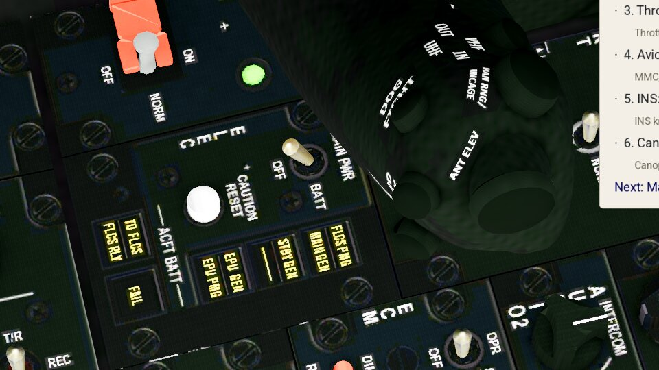 |  |
| JFS | 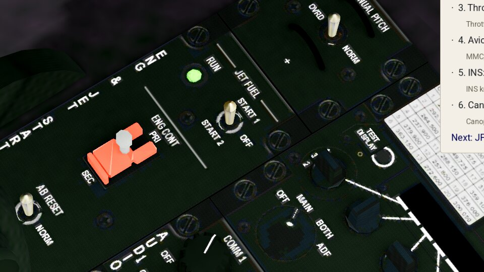 |  |

`modern-iaf/tests/test_mvp.gd` runs the Sufa's and the F-35I's start-up by the mouse (`_click_control`: the head
turned to each control, the pointer's move and click pushed into the window; each control lit, each switch turned,
the card's places shown) and the Barak's by the keys' commands; `_knob` hovers, scrolls and drags the SYM wheel and
the F-35I's HMD and MFD knobs. All pass.

The F-35I parked cold at Nevatim, a real render (`modern-iaf/tests/_switch_shot.gd` with `SHOT_MISSION=2031 SHOT_SWITCHES=BATT,MFD_BRT`): the start
panel's BATT switch and the MFD BRT knob under the pointer.

| BATT switch, pointer over it | MFD BRT knob, pointer over it |
|---|---|
|  |  |

### 5.3 The pilot's body (2026-11-09)

The user (2026-11-09): "one can look on his own belly or something". At the head's lowest (60° down, the camera 72°
with the 3D cockpit's own 12°) the Sufa's and the Barak's 3D cockpit showed the seat's well and a black slab where
the pilot sits. A real F-16 pilot looking down sees the legs on the rudder pedals, the right hand on the side-stick
and the left on the throttle.

- **The body** is FlightGear's internal-view pilot, `Models/Pilots/pilot_internalview.ac`: FlightGear's pilot without
  head, helmet and mask, made for the view from the seat (GPL-2.0-or-later, its 3D work by J Maverick 16;
  `shared/extra/models/cockpit3d/SOURCES.md`). `tools/f16d/pilot.py` writes it as `f16_pilot.glb` in the 3D
  cockpit's frame. FlightGear's cockpit no longer shows this pilot (`Models/Cockpit/Main/cockpit.xml` has it commented
  out), so its hands were posed for older grips; its legs reach the pedals as they come. 17,090 triangles, 3.6 MB; the suit's sheet halved to 1024 × 2048, the harness sheet
  2048 × 2048, both as JPEG (Basis Universal's blocks showed as blotches on the vest 0.2 m under the eye).
- **The head bends forward looking down** (`terrain_view.gd` `LOOK_DOWN_LEAN`): from 25° to 60° of head pitch the eye
  moves up to 0.2 m forward, toward the head's yaw (aside, never aft: looking back and down it would undo
  `LOOK_BACK_LEAN`), and 0.06 m down, as a neck bends. Turned about the eye alone, at
  60° down the eye stood over the body's neck opening and looked into the torso (a dark V filled the lower half;
  the coordinator's review, 2026-11-09). Blender renders from the eye: 0.15 m forward still showed a sliver of it,
  0.2 m none. Leaving out the vest and collar instead showed the inside of the torso through the neck opening.
- **The hands on the grips (2026-11-11, the Mac play test's finding 12)**: FlightGear posed the left glove for its
  grip turned about 28° aft, 4 cm inboard of it and 3 cm over it, so it held nothing. `pilot.py` turns the left
  forearm and glove about the throttle's pivot onto the grip's rest pose and moves them onto the grip, fading from the
  elbow (unmoved) to the wrist. Two shape keys, `throttle_idle` and `throttle_full`, turn them 40° either way with
  the grip, so the glove follows the throttle (`cockpit3d.gd` `_pilot_throttle`).
- **The right glove on the stick (2026-11-13, the user: "hands still not on stick")**: FlightGear's fist closed 9 cm
  ahead of the side-stick's grip and 2 cm inboard of it, so looking down the glove hung in the air over the grip.
  `pilot.py` (`STICK_NUDGE`) moves the right forearm and glove onto the grip whole; the upper arm takes up the move,
  from the elbow (all of it) to the shoulder (none). The stick moves a few degrees (a force stick), the glove stays.
  `test_cockpit_view.gd` checks the glove's centre within 3 cm of the grip's on both F-16s. The left glove lay on
  the console 2.5 cm outboard of the throttle's head; it moved 2.5 cm inboard and 1 cm up, the palm over the head.
  At a cold start both hands stay on the grips (the left on the throttle at cutoff, turned with it), as in flight.
- **The left fingers close on the throttle (2026-11-13, the Mac check)**: with the palm on the head, FlightGear's
  thumb and index still spread 3 cm inboard of the grip, so in flight the fingers lay on the MANUAL PITCH and UHF CHAN
  panel beside it. `pilot.py` (`GRIP_*`) draws whatever of the glove lies inboard of the head's middle toward it, from
  none at the wrist to half its offset at the knuckles, and lowers the thumb 1.5 cm along the grip's inboard face.
  `test_cockpit_view.gd` checks, in the rest pose, the palm's centre within 3 cm of the head's top and no finger
  more than 2 cm inboard of the grip nor 2.5 cm ahead of it.
- **The legs stay still (2026-11-15, the user: "moving the throttle change the left leg?")**: `pilot.py` weighted the
  throttle's shape keys and the stick's nudge by place alone, so they took the left knee and boot too (272 of the
  3,794 moved vertices), and the knee moved with the throttle. Now only the arms' own meshes take them: FlightGear's
  groups `LL-arm` (the left forearm and glove) and `LR-armA` (the right arm), marked before the join. 3,352 vertices
  move, none in a leg. `test_cockpit_view.gd` `_legs_still` checks that no vertex below the thigh's top moves.
- **Where**: `cockpit3d.gd` hangs `<model>_pilot.glb` beside the model when `Settings.cockpit_pilot_body()` is true:
  true in Modern IAF, false in the original game, whose 3D cockpit stays as it was (docs/cockpit.md "Looking down at
  the pilot"). The body takes the footwell's dim fill (`UNLIT` `pilot_`) and casts no shadow. The cut model leaves
  the rear cockpit's footwell out of the front seat's well (docs/aircraft-models.md §1.4): it stood out of the
  pilot's lap.
- **Cost** on the Iris Xe (1920 × 1080, `_cockpit3d_shot.gd` `C3D_ONLY=down`, the frame's GPU time with the body
  shown and hidden, 60 frames each, both viewports): the frame takes 27–30 ms either way. With the head bent the
  body fills most of the view, and per view it adds −0.5 to +2.0 ms, +1.3 ms on the mean of the six views (before
  the bend −1.3 to +2.4 ms, +0.5 ms on the mean, within the run's noise). It draws only in the cockpit view.

- **Over the switches (2026-11-17, the user: "I am unable to click the main power on the second traininig"):** from
  the eye turned to the ELEC panel the left glove and sleeve cover MAIN PWR on the F-16s. The body takes no click
  or hover: the click test meets the controls only (`cockpit3d_controls.gd` `at`), so a click there reaches MAIN
  PWR; the player saw no switch to click. The first lesson rings its current switch and the body is hidden while it
  covers that switch from the eye (`kneeboard.gd` `_covered`, `cockpit3d.gd` `body_covers`, `body_cue`); the
  take-off lessons ring nothing, and Alt + H / Alt + G hide it there (§2). Pictures:
  `modern-iaf/tests/_body_shot.gd`; check: `modern-iaf/tests/test_lesson_clicks.gd`.

Looking down-left (40° left), down and down-right, at the head's lowest. Top row before, bottom row after. A real
render, `tests/godot/_cockpit3d_shot.gd` with `C3D_SIM=1 C3D_ONLY=down`.

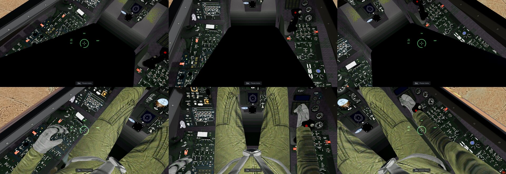

### 5.5 Lighting (2026-11-17, the lights audit part B; approved 17 Nov)

The F-16s' lighting controls work (`cockpit3d.gd` `_lighting`, `_update_instruments`, `ext_lights`;
`aircraft_model.gd` `_panel_lights`; FlightGear's f16.nas and F-16.xml as the source). At each control's rest, as the
model draws it, the cockpit looks as before: by day unchanged, at night the flood and the backlit labels at their
earlier level.

**The lighting panel** (right console). Each knob is continuous: OFF none, its rest as before, its full turn 2.5 times
that (linear either side; inferred).

| Control | What it does |
|---|---|
| PRIMARY CONSOLES / INST PNL | the backlit labels of the consoles / of the instrument panel and its auxiliary consoles |
| FLOOD CONSOLES / INST PNL | the warm flood on the consoles / on the instrument panel |
| DATA ENTRY DISPLAY | the DED's and the pilot fault list's brightness |
| MAL & IND LTS | BRT / DIM, sprung to its middle: every lamp but the indexers dim (half) or bright; the level stays. DIM takes only with PRIMARY INST PNL on; PRIMARY INST PNL off, FLOOD CONSOLES at full or the power off make them bright (T.O. 1F-16A-1 p. 1-155 through FlightGear) |
| NVIS / NORMAL | NVIS holds the lamps dim (inferred). With the night-vision goggles down: NVIS keeps the cockpit's own light out of the tubes, NORMAL lets it glare (below) |
| INDV LTG CONT | dims the AoA indexer and the AR / NWS light, BRT to a quarter at DIM (inferred) |

The cockpit's own light (the flood and the labels) shows at the cockpit's night (`cockpit.night`); by day the sun's fill
outshines it, so the knobs change nothing by day. The DED, the lamps and the HUD follow their controls by day and at
night. The interior lights work without electrical power (ours: a cold cockpit stays readable at night).

**The ICP's BRT wheel** sets the HUD's brightness (its alpha; FlightGear's hud-brt). The SYM wheel and the MFDs' BRT
rockers work as before (§5.2).

**The exterior lights panel** (left console) and the gear panel's **LANDING / TAXI** switch show on the jet's model.
MASTER feeds every light but the landing and taxi light, and the lights need the generators (FlightGear's AC buses).

| Control | What it does |
|---|---|
| WING / TAIL | the red and green wingtip and inlet lights and the white tail light; BRT, OFF, DIM (a fifth) |
| FLASH / STEADY | the position lights blink (1 s, on half of it; inferred) or stay lit |
| ANTI-COLL | the white strobe on the fin |
| FUSELAGE | the white lights on the aft fuselage; BRT, OFF, DIM (0.4) |
| FORM | the pale green formation strips (forward and aft fuselage, fin) at the knob's level; with WING / TAIL off the wingtips glow as formation lights |
| AR | the air refuelling receptacle's light at the knob's level, with the AIR REFUEL door open |
| LANDING / TAXI | with the gear down: the lamp under the nose and a SpotLight3D that lights the ground ahead (LANDING 7.5° wide, 10° below the jet's axis, 250 m; TAXI 30°, 5° below, 100 m; FlightGear's cones); no shadow |

The extra lights sit at FlightGear's spots on our F-16s (the same frame), the formation strips and the receptacle's light
at our own (inferred from photographs). They are drawn 0.3 m nearer than they are (the other jets' lights 2 m), so the
jet's own skin hides those on its far side. Only the player's jet with the 3D cockpit's controls uses the panel; every
other jet, the AI's F-16s too, keeps its navigation lights and strobe always on. The panel's rest is MASTER off: a jet
starts dark until the pilot sets the lights.

The LE FLAPS switch rests at AUTO (it rested at LOCK, while the jet flies AUTO); at LOCK its caution lights.

**The night-vision goggles** (2026-11-19, the user on Approvals A66: "night googles: as suggested"; the options O1–O4
of [research/nvg.md](research/nvg.md) §7). The Sufa and the Barak (their definitions' `nvg`, `data/planes/*.json`)
carry goggles on the pilot's helmet:

- **Down and up.** Shift + N (record 255, command 303; `terrain_view.gd` `_goggles_key`) flips them down before the
  eyes and up again, at any height. A flight starts with them up. The state is Rust's (`iaf_avionics::nvg::Goggles`,
  `IafGoggles`, held by `cockpit.gd` `goggles`). Down, the whole view is the tubes' picture: the night-vision shader of
  [../../docs/rendering.md](../../docs/rendering.md) §8 with the late Gen III tube of today's missions. The US practice
  takes off unaided and flips the goggles down above about 2,000 ft (research §3, second-hand); the sim leaves it to the
  pilot.
- **NVIS / NORMAL.** Down, the switch decides the cockpit's glare in the tubes (`Goggles::glare`, set every frame):
  at NVIS none, the lighting the goggles suit; at NORMAL the shader's `glare` (0.15), which lowers the tubes' gain and
  washes out the picture's lower part, as one light the goggles do not suit degrades their picture (research §3). The
  glare is the same whatever the lighting panel's dimmers and the power (inferred: one level for the cockpit's light). The
  switch's place is the model's (the lighting panel, right console; FlightGear's F-16); NVIS also holds the lamps dim.
- **The helmet display.** While they are down it shows no symbols (`real_hud::Input::goggles_down`): the first JHMCS
  gives the pilot the helmet display or the goggles, never both (research §2.2; inferred for the DASH). The HUD on its
  glass stays, in the tubes' green. The HMCS SYM INT knob at OFF darkens the helmet display the same way.
- **The F-35I** has none: its helmet shows the night camera instead (Alt + F7, [../../docs/f35i.md](../../docs/f35i.md)
  §4.3). Shift + N there says so in the band.

Not started (the user's pick): the exterior lights' covert mode (with the AI wingmen), white phosphor tubes and
ejection with goggles on (O5, O6, O8).

Test: `modern-iaf/tests/test_cockpit_lights.gd` (both jets). Pictures: `modern-iaf/tests/_lights_shot.gd`; the goggles
`modern-iaf/tests/_nvg_shot.gd`.

### 5.6 The F-16s' canopy switch and lock lever (2026-11-18)

The user, 18 Nov 2026: "what about the fix of the canopy handle (bring it back with the right switch and yellow
thingy?)". Both F-16s' 3D cockpit has the canopy switch and the yellow canopy lock lever (the "spider") on the left
side wall under the canopy sill, just aft of the left auxiliary console and above the throttle's forward travel. They
are our own geometry, made by the model builder (`tools/f16d/cockpit3d.py` `canopy_controls`: the nodes
`CANOPY_SWITCH` and `CANOPY_SPIDER` of `f16.glb`, their fittings in the body); FlightGear's cockpit has neither.

**What the pictures show.** Pictures looked at on 2026-11-18; none is in the repo.

| picture | what it is | what it gives |
|---|---|---|
| a Portuguese F-16A, the left auxiliary console seen from inside over the left sill[^milavia-canopy] | the real jet | the lever's place (under the sill's inner edge, outboard of the gear panel's aft corner), its yellow colour, its parts: a block at the hinge, a bar down to a foot, a finger paddle aft of the block, a long leg aft to a T end; grey fittings on the sill. The lever lies down there with the canopy open (a parked display jet) |
| the same jet's throttle from above[^milavia-canopy] | the real jet | the lever's footprint beside the throttle |
| a home cockpit with the lever up, and the part on a bench[^ravico-canopy] | a builder's replica | the lever up stands level into the cockpit over the throttle's forward travel; a toggle switch under it on the wall |
| a printed replica down, half up and up[^dcs-spider] | a builder's replica | the outline seen square on; the toggle stands between the paddle's arm and the long leg, so the lever down holds it centred |

No picture shows a marking on the switch or the lever, so ours carry none. The canopy jettison T-handle is in none of
the pictures and is not modelled. No picture of a two-seater's front cockpit wall was found; the Sufa's and the
Barak's are taken to be the single-seater's (inferred, open). The switch's positions (OPEN up, CLOSE down, sprung to
the centre) and the lever's work (down: the canopy locked and sealed, the CANOPY light out) are the builders' and a
maintainer forum's account[^f16net-canopy], second-hand; the real switch may latch at OPEN (the same builder).

**Fitted to the photo.** `modern-iaf/tests/_canopy_spider_shot.gd` renders the cockpit from the photo's own camera:
`tools/f16d/fit_photo.py <its output> <jet> canopy` solves the camera's place and turn from eleven points of the gear
and MISC panels that both the F-16A and our Block 50 panel have, with the lens known from the picture's data (18 mm
on an APS-C camera: 44.7° high); the points agree within 4.9 px rms on a picture 900 px wide. The lever's station,
its drop under the sill and its size were then fitted to the photo's lever. FlightGear's tub differs from the real one
here: its wall falls away outboard under the sill's lip, out of the seat's sight, and stands nearer the photo's camera
than the real wall. So the lever hangs from under the lip, 15° off the vertical toward the wall, where the seat's eye
sees it, and is 9 cm long with a bar and foot of 8 cm (the replicas suggest about 14 cm; inferred, ±2 cm).

**How it works** (`modern-iaf/flight/sim_flight.gd` `_canopy`, `_canopy_step`; `cockpit3d_controls.gd` systems
`canopy_switch`, `canopy_lock`):

| control | by the mouse | what happens |
|---|---|---|
| canopy switch | hold the click: CLOSE; press and drag up: OPEN; let go: back to the centre | the canopy runs while the switch is held (10 s for the whole travel) and stops when it is let go |
| lock lever | one click: down, the next: up | down only over a canopy fully down (else it stays up): the flight model's canopy step is done and the CANOPY light goes out. Up: unlocked, the light on |
| the lever down over the switch | a click on the switch | lifts the lever first, as a guard |
| Canopy key (Ctrl+K) | | the whole sequence, the other way from now: the canopy down, then the lever down; or the lever up, then the canopy up. A hand on the switch or a click on the lever ends it; a canopy stopped part open closes |

In the air the lever stays down, by the mouse and by the key; on the ground it lifts at any time, a hot start
included (the after-landing card opens the canopy). The door sounds play each time the canopy starts to move, whole
(4 s), so short taps of the switch overlap them; the lever makes the switches' click. The manuals and the checklist
card call the lever the canopy handle, the real jet's name for it.

The CANOPY light (`cockpit3d.gd` lamp `canopy`) is on while the canopy is off its seat or the lever is up. The Start
engine command takes every step at once: the lever goes down and the canopy follows. The F-35I keeps its one CANOPY
switch. The 1998 game's optional 3D F-16 cockpit (Extras "Cockpit": 3D) shares the model and shows the lever down and
the switch; it loads no controls, and its CANOPY light is as before.

Open, for the next Rust slot: the canopy's position, the switch's drive and the lever's interlock live in
`sim_flight.gd` beside the canopy's motion, which was there before; they belong in `crates/iaf-flight` `start.rs`,
which still takes its canopy step over an open canopy when asked directly.

Test: `modern-iaf/tests/test_canopy_spider.gd` (both F-16s by the mouse and the key; the F-35I unchanged). Pictures:
`_canopy_spider_shot.gd` (the photo's camera, the seat's view, lever up and down).

### 5.7 The fuel and brake switches (2026-11-18)

Four switches of the F-16s' 3D cockpit that only moved now work. Their state is the flight model's (`crates/iaf-flight`
`sixdof/flight.rs` `SixDof::set_switch` / `switch`; the tanks in `sixdof/fuel.rs`); a click and a key both send command 270 (p1 the
switch, p2 its position, -1 the next one round; `terrain_view.gd`), and each frame the switch shows the flight model's
state (`cockpit3d_controls.gd` `FUEL_SWITCHES`).

| Switch (node) | Key | What it does |
| --- | --- | --- |
| PARKING BRAKE / ANTI-SKID (`SW_PARKING_BRAKE`; the F-35I's `PARK_BRAKE`) | Shift + G | At PARKING BRAKE the wheel brakes are held on the ground with no brake key held, as with the pedals[^fm-brakes]. A ground start begins with it set (the brake key free); the checklist card's BEFORE TAXI releases it. The autopilot releases it when it takes over (inferred). The real jet has no lamp for it: the switch shows it. |
| MASTER FUEL (`SW_MASTER_FUEL`, its guard `anim048` following it) | Ctrl + F | OFF closes the engine's fuel shut-off valve[^fm-fuel]: the engine flames out and winds down as on an empty tank (its generators off line). The throttle's idle step is refused while it is OFF (fault `no_fuel`). The Start engine command sets it to MASTER. |
| ENG FEED (`SW_KNOB_ENG_FEED`: OFF, NORM, AFT, FWD) | Shift + E (next position) | NORM: the fuel flow proportioner takes half the engine's fuel from each system[^fm-transfer]. AFT / FWD: that system's pumps feed the engine and pump fuel into the other system ("CG moves forward" / "aft")[^fm-feed], here 4,300 lb/h into its reservoir and fuselage tanks (inferred from the timings of the manual's blown-tire landing: FWD empties the forward system in about 9 minutes on the D at 4,000 lb/h from 3,000 lb remaining, leaving about 2,400 lb in the aft[^fm-fwd]; these tanks do it in 9.0 minutes with 2,400 lb left at that rate). OFF: the electric pumps stop and the proportioner still feeds the engine[^fm-feed], so the engine runs on as at NORM (until 2026-11-18 OFF cut the fuel, a misreading). A system that runs dry leaves the rest of the flow to the other (inferred). |
| FUEL QTY SEL (`FQS_sel-knob`: TEST, NORM, RSVR, INT WING, EXT WING, EXT CTR) | Shift + U (next position) | The FUEL QTY gauge's AL and FR pointers and totalizer at the selected tanks[^fm-fqs]: NORM the aft and forward fuselage fuel with their reservoirs; RSVR the reservoirs; INT WING the wing tanks (with the Sufa's conformal tanks: the "INT WING & CFT" position); EXT WING the external wing tanks; EXT CTR the centreline tank on FR, none here (no sim jet carries one), AL at zero; TEST 2,000 lb on each pointer, 6,000 lb on the totalizer and both FUEL LOW lights on. The totalizer shows all the fuel at every position but TEST. NORM also runs the automatic forward fuel transfer[^fm-transfer]; the knob starts at NORM. Since 2026-11-18 the knob is the flight model's switch `fuel_qty_sel` (command 270 p1 3), as the other three. |

**The tanks** (`sixdof/fuel.rs` `Tanks`, every 6-DoF jet). Two systems, aft (left) and forward (right), each a chain
from the engine out: the reservoir (480 lb), the fuselage tanks (A-1: 2,330 lb; F-1 / F-2: 1,410 lb), the internal
wing tank (the jet's internal fuel past the fuselage's 4,700 lb, half each: the Barak's 550 lb, the Sufa's 2,075 lb
with its conformal tank) and the external wing tank (half the external fuel; `set_fuel_capacity`)[^fm-tanks]. Fuel
moves down each chain toward its reservoir, so a chain empties from its far end, the reservoir last[^fm-transfer]. The
F-16D's automatic forward transfer, at NORM: on with the forward fuselage fuel under 1,500 lb and the aft heavier by
more than 900 lb, off at 750 lb[^fm-transfer]. The FWD and AFT FUEL LOW lights: the reservoir under 250 and 400 lb (the
D's figures)[^fm-low], or the knob at TEST. The tank jettison (`set_fuel`) leaves the internal tanks as they are and
drops the external ones. Bingo stays on the total: the real jet's NORM counts the fuselage fuel, the same here since the
fuselage tanks empty last. The original game's model keeps its one tank: the gauge at NORM shows half its internal fuel
on each pointer, FWD FUEL LOW below 800 lb and AFT below 500 lb in all (`fm.rs` `fuel_gauge`, `fuel_low`).

**The STORES CONFIG caution light** (`cockpit3d.gd` `_lamp_on`, `caution_stores_config`) lights while the STORES CONFIG
switch is off the load's category: the light shows "STORES CONFIG switch is in incorrect position or loading category
in SMS software disagrees with actual GP/STORE/LINE loading category"[^fm-stores]. The category is the stores', as the
stores management set counts them (`crates/iaf-avionics` `stores.rs` `Stores::loading_category`): CAT III with an
air-to-ground store or a 600 gal tank on a pylon, else CAT I, and it follows the stores as they are released or
jettisoned. The real list is in the -1-2 stores supplement, which is not public; the flight manual counts air-to-air
missiles and 370 gal tanks with their pylons as category I[^fm-cat]; the rest is inferred. The light, as the other
cautions, lights MASTER CAUTION. Modern IAF's F-16s only: the 1998 game's 3D F-16 cockpit keeps it dark.

The original game's optional 3D F-16 cockpit shares the table: its flight model has none of these switches, so they
move only, as before.

Test: `modern-iaf/tests/test_fuel_brake_switches.gd` (the Barak: the parking brake holds and releases, ENG FEED OFF
keeps the engine running and FWD moves fuel aft, MASTER FUEL flames the engine out, the gauge's readings at NORM, RSVR,
INT WING, TEST and EXT CTR, the FUEL LOW lights, the STORES CONFIG light), `test_switches_click.gd` (the clicks'
commands), `crates/iaf-flight/tests/sixdof.rs` (`the_parking_brake_holds_the_jet`, `master_fuel_off_flames_the_engine_out`,
`eng_feed_and_the_fuel_quantity_selector_work_over_the_tanks`), `sixdof/fuel.rs`'s own tests and `crates/iaf-avionics`
`stores.rs` `the_loading_category_follows_the_air_to_ground_stores`.

### 5.8 DRIFT C/O and the display knobs (2026-11-18)

The ICP's DRIFT C/O switch, its CONT wheel and the two MFDs' CON and GAIN rockers of the F-16s' 3D cockpit work.

| Control (node) | Key | What it does |
| --- | --- | --- |
| DRIFT C/O switch (`drift`: WARN RESET, NORM, DRIFT C/O) | Shift + J (DRIFT C/O and NORM), Ctrl + R (WARN RESET) | DRIFT C/O centres the HUD's flight path marker laterally on the boresight, and the pitch ladder and the cues drawn on the marker with it; NORM shows the marker where the jet goes, drift included[^fm-drift]. WARN RESET puts out the HUD's flashing FUEL cue (the fuel under the bingo) and silences the repeating "Altitude" voice warning[^fm-warn]; each comes back when its condition ends and comes again (the fuel above the bingo and under it again, the jet above ALOW and under it again; inferred). WARN RESET springs back to NORM, and a DRIFT C/O switch moved to WARN RESET passes NORM. The switch starts at NORM. |
| CONT wheel (`cont`) | Ctrl + H (a step down, round from the bottom to the top) | Turned down, the glow round the HUD's symbols rises toward the symbols' own level (0.22 to 0.6 of it): the symbols' edges wash out. Full (its rest) the HUD as before. On the real jet the wheel sets the contrast of the HUD's infrared picture[^fm-icp], which the sim does not draw: this is a stand-in on the symbols (status: partly). |
| CON rockers (`MFD1_MFDButtonCon` left, `MFD2_MFDButtonCon` right) | Shift + 7 (left), Shift + 8 (right) | That display's contrast on the 3D cockpit's screen (the full-MFD view shows the page as drawn): full at rest; turned down, the display's black lifts toward grey (up to a quarter of white added under the page, at the display's brightness; inferred), the other display unchanged. |
| GAIN rockers (`MFD1_MFDButtonGain` left, `MFD2_MFDButtonGain` right) | Shift + 9 (left), Shift + 0 (right) | That display's sensor picture: the radar's ground map (the FCR's A-G picture) and the pod's or the weapon's video, at the rocker's position over its rest (FlightGear's range 1 to 2.5, rest 1.5: the picture as before; inferred), the other display unchanged. |

A click moves the 3D control; the DRIFT C/O switch sends command 252 (p1 6, p2 the position), and its key the same
(p2 -1 flips NORM and DRIFT C/O, 0 WARN RESET). The knobs' keys send command 271 (p1 0 CONT, 1 / 2 the left / right
CON, 3 / 4 the left / right GAIN; p2 0 a step down, round from the bottom to the top, 1 / -1 a step up / down;
`terrain_view.gd`), which steps the knob in the cockpit's one store of positions (`cockpit3d.gd` `DISPLAY_KNOBS`,
`step_knob`). The marker and the FUEL cue are the Real HUD's (`crates/iaf-avionics` `real_hud` `Panel::drift_co`,
`RealHud::warn_reset`; the voice in `flight_sounds.gd` `warn_reset`). The original game's optional 3D F-16 cockpit moves
these controls only; its WARN RESET springs back to NORM as on the real switch.

Test: `modern-iaf/tests/test_display_knobs.gd` (the Barak: DRIFT C/O by its key, WARN RESET puts the FUEL cue out, CONT,
the left CON and GAIN, each display its own), `test_switches_click.gd` (the DRIFT C/O switch's click),
`crates/iaf-avionics` `real_hud::f16` (`drift_cut_out_centres_the_marker`, `warn_reset_puts_the_fuel_cue_out`).

The directions of these controls and of §5.7's four were checked from the pilot's eye (`_controls_shot.gd`, 18 Nov):
PARKING BRAKE up at 1, MASTER FUEL up at MASTER, ENG FEED and FUEL QTY SEL turning clockwise through their labels in
order, DRIFT C/O up at DRIFT C/O and down at WARN RESET, the rockers pressed at their arrow's end as they rise. None
was reversed.

### 5.9 The controls that moved only (2026-11-19)

The user, 18 November 2026: "How much of our controls actually controls?" and "Prefer finishing things before moving
to new things". The status data (`f16_status.json`) listed 47 F-16 controls that moved and did nothing. These now work
the system the sim has behind them; each is a click on the 3D control (no new keys). `cockpit3d.gd` `_systems` reads
the switches each frame; F-ACK and ALT GEAR are table rows with a `system` (`f16_controls.json`).

| control (node) | what it does |
|---|---|
| OXY QTY test (`SW_TEST_OXY`, held) | the LIQUID OXYGEN pointer runs toward 0 (2 L a second, inferred); below 0.5 L OXY LOW and MASTER CAUTION light; let go, the pointer returns and the light goes out[^fm-oxy] |
| EPU (`SW_EPU`, OFF / NORM / ON) and its guard (`SW_EPU_COVER`) | ON runs the EPU; NORM, and OFF in flight once it was at NORM since take-off, runs it when the main and standby generators are off line in flight (the engine stopped, or both generators failed); the guard shut puts the switch at NORM[^fm-epu]. Running: EPU run lit; AIR lit while it is commanded; HYDRAZN lit while the engine is below 80 % rpm (inferred from the EPU check[^fm-epu-check]), and EPU FUEL falls from 100 % over 10 minutes; with no hydrazine left it runs only on bleed air. EPU GEN and EPU PMG light while it is commanded and not running (inferred). The EPU's power and pressure are not separate sources: the jet keeps its hydraulics and power as before |
| HORN SILENCER (`horn_silencer`) | the LG warning horn sounds with TO/LDG CONFIG's gear condition (below 10,000 ft and 190 kt, descending faster than 250 ft a minute, a leg not down and locked); the button silences it until that condition ends[^fm-horn]. The horn is our own tone (800 Hz, a quarter second on and off; inferred), `flight_sounds.gd` `gear_horn` |
| ALT GEAR handle (`alt-gear`) | pulled, the gear comes down when it is up (command 14, as the F-35I's ALT GEAR)[^fm-horn] |
| GND JETT ENABLE (`SW_GND_JETT`) | at ENABLE the emergency and selective jettisons work on the ground too (`player_weapons.gd` `gnd_jett`)[^fm-wow] |
| VOICE MESSAGE (`voice-msg-switch`) | INHIBIT silences every Betty call (`flight_sounds.gd` `vms_inhibit`)[^fm-vms] |
| F-ACK (`f-ack`) | acknowledges the pilot fault list's page: its messages leave the PFLD and their FLCS FAULT, ENGINE FAULT or AVIONICS FAULT light and MASTER CAUTION go out; the system codes stay while the fault does. Pressed with nothing left to acknowledge, it recalls every active fault to the list, their lights staying out; a fault no longer reported is forgotten[^fm-pfld] (`cockpit.gd` `pfl_acked`) |
| COMM 1 knob (`COMM1_KNOB`) | the radio calls' volume, nothing at OFF[^fm-audio]; at the position the model shows it at, the game's level (inferred) |
| ILS knob (`ils-vol-knob`) | at OFF the ILS receiver is off: no ILS on the HUD or the ADI[^fm-audio] (partly: the sim plays no localizer identification) |
| TACAN knob (`tacan-vol-knob`) | at OFF the TACAN is off: no TCN bearing or range on the EHSI[^fm-audio] (partly: no station identification) |
| INTERCOM knob (`intercom-knob`) | the threat warning tones' level, over their own THREAT and MSL knobs[^fm-audio] (partly: the AIM-9's tone keeps its own) |
| MAX POWER (`SW_MAX_POWER`) | nothing: the switch is inoperative on the real jet too[^fm-maxpwr] |
| ALT REL (`alt-rel-button`) | the alternate to the stick's WPN REL button[^d34-altrel]: its press and release are the release key's (commands 64 and 65), so it releases the selected weapon, and in selective jettison the selected store |
| threat display's BRT (`IFF_button`, FlightGear's `f16/ews/rwr-int`, 0.2 to 2) | the azimuth display's light times its position (FlightGear's contrast on its display; inferred); it starts at FlightGear's 1, the light as before |

The lamps and gauges they drive work too: EPU run, AIR, HYDRAZN, EPU GEN, EPU PMG, OXY LOW, EPU FUEL and LIQUID
OXYGEN.

These stay "moves only", each with its reason in the status data: AB RESET / ENG DATA, PBG test, TANK INERTING, COMM
2, the clock's elapsed-time button, TEMP, LEFT HDPT, ENGINE ANTI-ICE, the two ANT SEL switches, the oxygen
regulator's three levers, the KY-58's four knobs and PLAIN / CIPHER, the nuclear consent switch and its cover, IFF
IDENT, the ICP's WX and FLIR rocker, EXT FUEL TRANS, and the CMDS's JMR, O1 and O2 (parked, or no system behind them);
the HUD's TEST switch (ON the first of four test patterns, STEP the others, OFF the normal symbology[^d34-hudtest]: no
picture of the patterns is public, so none is drawn) and GPS power (the GPS corrects the INS's errors[^fm-gps]; the
sim's INS has none, and the GPS bombs take their own fix). Still to wire: the RF switch. The autopilot's PITCH and ROLL
switches work since 2026-11-19 (§5.10).

Test: `modern-iaf/tests/test_move_only_wired.gd` (the Barak on the ground: OXY QTY, the EPU at ON, GND JETT, VOICE
MESSAGE, COMM 1, INTERCOM and ILS at OFF, F-ACK and recall, the horn's loop, ALT REL's release, the threat display's
BRT).

### 5.10 The autopilot's switches (2026-11-19)

The user, 18 November 2026: "yes but I guess the real autopilot will need an investigation and impl like real thing?".
The F-16's own autopilot is modelled from its flight manual ([research/f16-autopilot.md](research/f16-autopilot.md)):
the PITCH switch (ALT HOLD / A/P OFF / ATT HOLD) engages it, the ROLL switch (HDG SEL / ATT HOLD / STRG SEL) picks the
roll mode, and the PITCH switch springs back to A/P OFF, with a line saying why, when a condition holds it off. The
model's node `roll-hold-switch` is PITCH and `pitch-hold-switch` is ROLL (FlightGear's names, the other way round; its
properties are right). Both are rows with a `system` (`f16_controls.json`: `ap_pitch`, `ap_roll`), so a key moves the
switch too. The EHSI's heading marker is HDG SEL's heading; the EHSI's steerpoint is STRG SEL's; AIR REFUEL at OPEN
holds the autopilot off.

| key | control |
|---|---|
| Shift + 2 / Shift + 3 | PITCH a step up (toward ALT HOLD) / down (toward ATT HOLD) |
| Shift + 4 / Shift + 5 | ROLL a step up (toward HDG SEL) / down (toward STRG SEL) |
| Shift + I (held) | the stick's paddle switch: the autopilot interrupted, a TF fly-up held off |
| Shift + 6 | TRIM/AP DISC, NORM / DISC (the model has no MANUAL TRIM panel) |
| Ctrl + L | FLCS RESET (the model has no FLCS RESET switch) |

FLCS A/P FAIL and FLCS A/P DEGR are lines of the pilot fault list (`cockpit3d_display.gd` FAULTS, flags 32 and 33 after
the damage flags: `cockpit.gd` `pfl_flags`), so they light FLCS FAULT and MASTER CAUTION and F-ACK acknowledges them.

Test: `modern-iaf/tests/test_f16_autopilot.gd`.

### 5.11 DED DATA and DEPR RET (2026-11-19)

The HUD remote control panel on the right console has eight switches in two rows: VV/VAH, ATT/FPM, DED DATA and DEPR
RET on top; VELOCITY, ALT, DAY / AUTO BRT / NIGHT and TEST below. FlightGear's console models all eight in those places,
but it turns DED DATA by a script and DEPR RET not at all, so `tools/f16d/cockpit3d.py` leaves both in the console's
body and until 2026-11-19 they worked by their keys only. After a build `tools/f16d/split_control.py` (its header has
the commands) cuts each lever out of the body, as the DAY / AUTO BRT / NIGHT switch (`HUD_MODE`): the nodes
`deddata-switch` and `depr-ret-switch` of `f16.glb`, each turning 35° a step about its base like its neighbours, the
top position forward. Their records (property, three positions, modelled at the middle) are in `f16.json` `controls`
beside their neighbours'; `split_control.py` writes only the turn, so a rebuild needs both records added again.

| Control (node) | Key | What it does |
| --- | --- | --- |
| DED DATA (`deddata-switch`: DED, PFL, OFF) | Alt + D (the next position, round) | DED repeats the DED's five lines low in the HUD, PFL the pilot fault list's, OFF neither ([ufc.md](ufc.md) §4) |
| DEPR RET (`depr-ret-switch`: STBY, PRI, OFF) | Alt + R (the next position, round) | STBY shows the standby reticle, PRI the manual bombing mode's primary reticle, each lowered by the RET DEPR wheel ([weapons.md](weapons.md) §9) |

Both are rows of `f16_controls.json` with a `system` (`hud_ded`, `hud_depr`): a click sends command 252 as the key does
(p1 4 or 5, p2 the position), and each frame the switch shows `cockpit.gd` `hud_panel`, so a key moves the switch too.
They start where `hud_panel` starts: DED DATA at OFF, DEPR RET at PRI. The original game's optional 3D F-16 cockpit
shows them on the same model; there, as its other HUD panel switches, they stay as modelled (no clickable controls,
and command 252 needs the UFC).

Test: `modern-iaf/tests/test_radar_cold.gd` `_hud_panel` (a click on each moves its setting and changes the HUD).

### 5.4 The AoA probe (2026-11-11, from the user's Mac)

On the ground the AoA gauge and the indexer jumped about: the 6-DoF's α is the angle of the body's velocity, which
is near zero and turns every way at a standstill. The jet's probe reads nothing useful there: the F-16's flight
manual, as quoted on a forum, bases every AoA indication on 0° with the nose gear's weight on wheels, the
transmitters being unreliable at slow speed[^dcs-wow]. The 6-DoF's indicated AoA (`sixdof/flight.rs` `probe_aoa`)
rests at 0° below 60 kt calibrated (`PROBE_MIN_KT`, inferred: the source gives the weight-on-wheels rule, no
airspeed) and follows the flow above it through a 0.25 s lag (`PROBE_TAU`, inferred), so the needle holds at taxi
speed. The flight state's `aoa` (the 3D cockpit's tape, the indexer, the HUD, the recording) is that value; `alpha`
stays the true angle.

Modern IAF only, by the flight model rather than a Settings switch: the original model's α is a smoothed state of
its own that does not jump on the ground, so the original game is unchanged. `test_mvp.gd` `_roll` checks 0° below
30 kt and a moving AoA within 1° of the true one from 150 kt.

## 6. Tests and pictures
- `tests/godot/test_cockpit_no_panel.gd`: the profile on the sim's own cockpit dirs (`iaf-sim own`'s), the Sufa, the
  Barak and the F-35I: no panel art loaded, every display file from the sim's dir, the 3D cockpit in the jet's own
  model, the MFDs or PCD drawing into their screens, the HUD and the RWR scope drawn, an F-key snap turning the head,
  Hershey Simplex (`HUD_FONT`) on the HUD's texts and the screens.
- `tests/godot/_cockpit3d_shot.gd` with `C3D_SIM=1`, run with `--path modern-iaf`: the same in a real render, a free
  flight 1,500 m over the Negev west of Beersheba heading 060° (ahead, left, right, down, back and more;
  `C3D_HOUR=22` the night; `C3D_JET=f35i` the F-35I).

### 6.1 The pictures (2026-11-09)

Each picture: ahead, left (80° left, 30° down), right; back, down (25° down; the F-35I's 20°). The sim's key hint
strip ("Esc Pause menu") is part of these pictures; it was removed from the flight on 2026-11-15 (front-end.md §8).

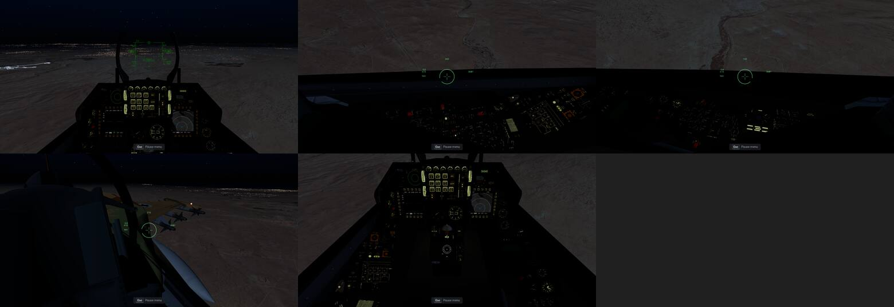
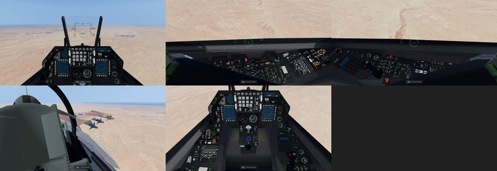
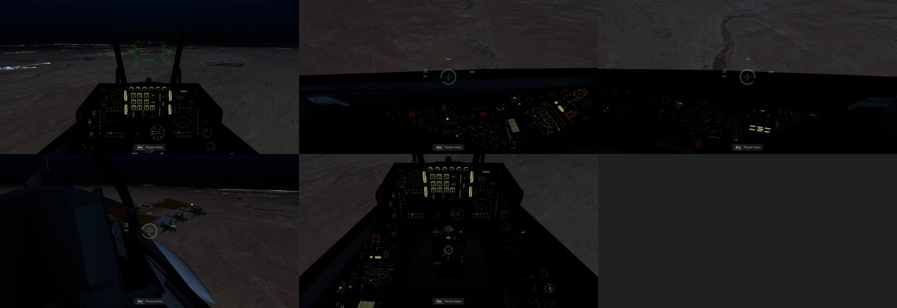

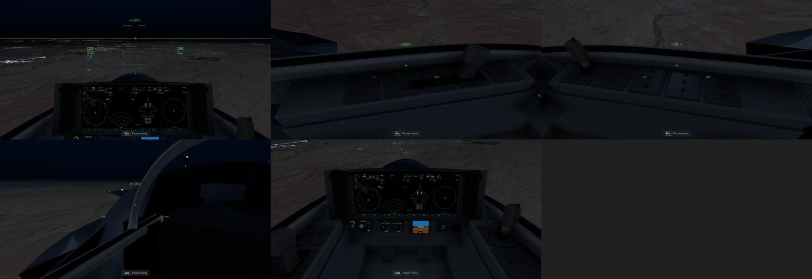

What each view shows, against the cockpit photos the docs use (docs/f16i.md, docs/f35i.md, docs/cockpit.md
"3D cockpit"):
- **Ahead (the F-16s):** the HUD's symbology in Hershey Simplex on the combiner, both MFDs live, the ICP, the DED and
  the RWR scope; no 2D art. As the photos: the frame, the ICP over the two MFDs. These pictures predate the
  HUD's light (§5.1): by day the HUD's green is the original's darkest; at night it is lifted and the flood light
  and backlit labels are on.
- **Left and right (the F-16s):** the side consoles under the canopy sill, the DASH helmet's cue and its numbers on
  the canopy. As the photos' consoles; the panels are FlightGear's flat sheet (no depth in the knobs).
- **Back (the F-16s):** the seat's headrest, the rear cockpit's helmet, the wing with the AIM-9Ms on 9, 8 and 7, the
  canopy frame.
- **Down (the F-16s):** the whole front panel, the gear panel left of the centre pedestal and the side-stick on the right console. The standby ADI ball is
  the model's.
- **The F-35I:** the panoramic display's four portals (TSD, radar, stores, threat display), the helmet's symbology
  over the whole view (its thin green over bright sand is faint, as a real helmet display by day), the side consoles
  with the stick and throttle, the standby display. The back view's seat is a plain block (f35i.md §4.5).

The displays' maps and the RWR glyphs against their references (the RWR sheet beside the 1998 one, docs/rwr.md §4;
the TSD map's reference picture in §8):

 B3), the F-35I's TSD (the coast and borders as lines)](pictures/cockpit/maps.jpg)

### 6.2 The cockpit at the origin (2026-11-09, the Mac play test's finding 25)

The flight's world is in 32-bit floats about the flight's start (`terrain_view.gd` `world_origin`), so far from the
start every vertex of the cockpit rounds to the step of the jet's position, which the eye 0.5–1 m away sees: the whole
cockpit jumped against the eye ("the entire cockpit shakes", the user on the Mac). The sim draws the cockpit-view
model (with the 3D cockpit, the HUD glass, the stores and the lights on it) in its own world about the origin
(`shared/cockpit/cockpit_origin.gd`, `Settings.cockpit_at_origin()`; the original game keeps it in the flight's world):
- a SubViewport the size of the screen draws that world through a camera that copies the flight camera's place and
  turn in the rig (the head look, the ground clamp), its projection (`cockpit.gd`'s frustum with its offset) and the
  rig's attitude, so the world's directions are the same in both and the sun needs no turning;
- that world's sun copies the flight's direction, colour and energy every frame (one shadow map over 8 m: the canopy
  frame, the HUD and the seat on the panel); its environment copies the flight's once a second (the sky's ambient
  light) without fog, tonemap or glow;
- its picture, linear and untonemapped with its alpha, is laid over the flight's 3D view by a full-screen quad drawn
  last in that view (`cockpit_composite.gdshader`), so the flight's auto exposure, tonemap and anti-aliasing apply to
  the cockpit as before, and the clouds, rain and effects stay outside the canopy; the picture itself is drawn at
  full size with MSAA 4× and no FXAA whenever the flight uses TAA or an upscaler (FSR 1, FSR 2, MetalFX): their
  output loses the alpha, and an opaque cockpit picture lays black over the world (seen on Linux with TAA alone, FSR 1 alone and FSR 2,
  2026-11-12; on the Mac with MetalFX, 2026-11-11); the frame rate with the player's settings stayed within the
  run-to-run noise (32–42 fps either way on the Iris Xe); the 2D layers (the HUD symbology,
  the night vision goggles) lie over both as before; the quad is on the clouds' layer, which the EO sensor's camera
  leaves out, so the TV picture on the MFD shows no cockpit;
- the HUD's clip and the screens' clicks project through that world's camera (`cockpit3d.gd` `camera`), the wingtip
  vapour takes the cockpit's place in the flight's world (`terrain_view.gd` `vapour_state`).

The lights of the flight's world (flares, the muzzle flash, airbase lamps) do not reach the cockpit (inferred: the
cockpit is lit by the sun, the sky and its own flood and panel lights).

Measured by `modern-iaf/tests/_cockpit_shake_probe.gd` (a real render of mission 2012 at 1920 × 1080 on the Iris Xe,
the flight model stopped, the rig moved 0.5 mm a frame D km from the start, 40 frames; the pixel change is the mean
grey-level change between successive frames):

| D | camera ↔ cockpit moved, before / after | panel pixel change per frame, median / max, before | after |
|---|---|---|---|
| 0 | 0.25 mm / 0 | 0.47 / 1.99 | 0 / 0.49 |
| 15 km | 1.1 mm / 0 | 1.14 / 6.8 | 0 / 0.004 |
| 30 km | 3.1 mm / 0 | 0 / 10.5 | 0 / 0.004 |
| 60 km | 4.4 mm / 0 | 0 / 15.5 | 0 / 0.011 |

The worst frame-to-frame change 60 km out, 8× brighter (left: in the flight's world, the cockpit jumps as one piece;
right: in its own world, the cockpit black; what changes there is a terrain tile loading and the info line), and the
view there in both (the same frame):

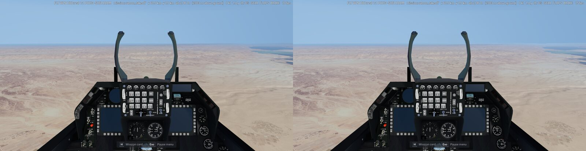

**Cost** (the same probe, the GPU time each viewport takes, 120 frames at the start): before, the flight's viewport
18.8–19.4 ms; after, the flight's 14.3–15.9 ms and the cockpit's 7.7–8.9 ms, so about +4 to +5 ms a frame on the
Iris Xe. Of the cockpit's, MSAA 4× (as the flight's) is about 3.2 ms, its shadow 1.5 ms, the sky's ambient 1 ms
(each measured off once). Kept: MSAA for the panel's printed labels.

- Tried and dropped (2026-11-11, look batch 1 item 3): FXAA in place of MSAA 4× in the cockpit's viewport.
  `modern-iaf/tests/_cockpit_aa_probe.gd` (the Sufa on Ramon's runway, 1920 × 1080, Iris Xe, two interleaved rounds)
  measured the cockpit's viewport at 6.85 / 7.02 ms with MSAA 4× and 4.47 / 4.47 ms with FXAA: 2.4–2.6 ms saved, the
  flight's viewport unchanged (13.2–13.4 ms). The rule was to keep it only within one grey level of today on the HUD
  and the panel's text. The panel's text missed it: the ICP's keys differ by 6.2 levels on average (33 % of their
  pixels by more than one, 12 % by more than eight), the gauges by 3.1 levels (29 %, 7 %); the HUD glass 0.8 levels
  (4 %). Zoomed, FXAA leaves the keys' outlines stair-stepped and blurs their small labels.

### 6.3 The cockpit sharp with Upscaling (2026-11-17, the Mac play test of 15 Nov; the steady grey 2026-11-18)

With Upscaling Quality or Balanced the flight's 3D view renders at 0.77 / 0.67 of the window and is scaled up; the
composite (§6.2) lays the cockpit inside that view, so its labels, displays and lamps came out as soft as the world.
While the view is upscaled, `cockpit_origin.gd` lays the cockpit's picture a second time, at the window's
resolution, on a canvas layer under every other one (`cockpit_sharp.gdshader`, layer −2: the rain on the canopy, the
cloud whiteout and the goggles at −1 stay over it):
- the composite stays as it is: the flight's auto exposure still counts the cockpit, and at the cockpit's outline
  the layer blends by the picture's alpha over the upscaled view, so the world seen past the canopy frame, the HUD
  glass and the seat is the view's own;
- the layer tone maps the picture itself: a minimal AgX taken as gamma 2.2 and encoded as sRGB, with the flight's
  adjustments (brightness, contrast, saturation), fitted to 400 cockpit pixels of a day render at 0.015 rms;
- the flight's exposure of each frame is measured: a grey of known light (0.18) stands in the view's top left 8 × 8
  pixels, and the layer reads its middle back and looks its exposure up in a table (`exposure_lut`, the tone map
  inverted for that grey); the layer fills that corner (16 pixels of the window) with the view's colour next to it;
- the grey is solid geometry at the near plane that holds still on the screen (`cockpit_probe.gdshader`), so it
  writes the corner's depth and motion vectors and a temporal upscaler keeps the corner's own history; the composite
  draws the same grey over it as the view's last thing. Drawn by the composite's transparent quad alone (17 Nov) the
  grey had the motion of the world behind it: MetalFX temporal mixed the sky into it while the head turned, and the
  cockpit flashed white (docs/rendering.md §3.2). The layer appears 4 frames after the grey (`SETTLE`: on a switch
  into the cockpit the corner's history is the grey's by then);
- Upscaling off draws neither the layer nor the grey: the view is as before. The original game's 3D cockpit (Extras
  "Cockpit": 3D) is drawn in its own world too while Upscaling is on (`terrain_view.gd` `_spawn_cockpit`), so it gets
  the same layer.

The backlit labels' pass (`cockpit3d_backlight.gdshader`) lowered the picture's alpha (`blend_add`), so at night the
ground showed through every backlit panel in the composite (the ICP and the gauges dark). It now adds its light as a
premultiplied colour of no cover (alpha 0): the panels at night are whole with Upscaling off too.

Measured with `modern-iaf/tests/_cockpit_sharp_shot.gd` (the Sufa on Ramon's final, 1920 × 994, Upscaling Quality,
Iris Xe, 20 s each, two interleaved rounds): the flight's viewport 19.37 / 19.09 ms GPU without the layer and
19.59 / 19.29 ms with it (+0.2 ms), the frame 27.72 / 27.35 ms and 27.95 / 27.52 ms.

Measured with `modern-iaf/tests/_cockpit_flash_shot.gd` on the user's Mac (M4 Pro, 2026-11-18, a real window of
1920 × 1080, the Sufa, a 15 s head pan from the lesson's start, then the layer taken away for 20 frames and back): the largest change of the cockpit's mean brightness
from one frame to the next, and the frames over 0.04.

| lesson | Quality, MetalFX temporal | Quality, MetalFX spatial | Upscaling off |
|---|---|---|---|
| 1 (`ramon_startup`) | 0.0136, 0 | 0.0151, 0 | 0.0128, 0 |
| 2 (`ramon_takeoff`) | 0.0149, 0 | 0.0175, 0 | 0.0136, 0 |

With the transparent grey of 17 Nov the first lesson under MetalFX temporal gave 0.158 and 7 frames; the grey as the
window showed it ran from 0.38 to 0.78 then and runs from 0.42 to 0.51 now (the auto exposure's own travel). Frame
cost: the Mac holds its 60 Hz with and without the layer (the hidden window is capped there, so a difference under
the cap is not measured); the Iris Xe at Quality, 10 s each, two interleaved rounds: 15.67 / 14.21 ms GPU without the
layer, 14.29 / 14.17 ms with it.

- Tried and dropped (2026-11-17): the picture's detail carried onto the upscaled view by the ratio of the two over a
  small box (no exposure needed). By day it matched; at night the box's mix of bright labels and black panel gave the
  labels a halo and a washed panel, and its 9 + 9 taps cost +3 ms. A bisection for the exposure in every pixel cost
  +4.7 ms; the table does it once.

## 7. Open
- The F-16s' HUD field (§4) is sized to fit the 3D combiners, smaller than the real HUDs' 20° × 13.5°.
- The gun cross's place under the boresight (inferred).

## 8. Display data

Each jet's cockpit dir holds only what the 3D cockpit's screens draw. Nothing in it comes from the original game's
cockpit folders: the map is OpenStreetMap data, the art is our own drawing. The data lives in
`modern-iaf/data/planes/_shared/cockpit/` (the map and the art, the same for every jet) and
`modern-iaf/data/planes/<jet>/cockpit/` (the jet's layout); `iaf-sim own` compiles both into
`converted/own/cockpits/<jet>/`, the folder the shared readers take as the cockpit dir
([data-formats.md](data-formats.md) §14). The layout has no `"Shared"` key, so every file is read from that folder.

| file (compiled) | read by | what it is | jets | size |
|---|---|---|---|---|
| `rwrsymb.png` | `cockpit.gd draw_rwr_symbols` (the RWR scope) | the RWR glyph sheet: 17 slots of 10 × 10 at scale 4 (40 × 680), green on transparent | the F-16s' RWR scope; the F-35I's copy is not read (its threat display, `pcd_formats.gd` TWD, writes the same codes as text in the display font) | 3 KB |
| `adi.png` | `cockpit.gd _draw_adi`, `lens_adi.gdshader` ([LENHORIZON]) | the attitude ball, 128 × 128 at scale 4 (512 × 512) | all three (the F-35I's layout has no [LENHORIZON], so it never reads it) | 8 KB |
| `map.json` | `cockpit.gd _load_tsd_map` → the HSD (`f16_mfd.gd`), the TSD page (`mfd.gd`), the PCD's TSD (`pcd_formats.gd`) | the TSD map's polygons (EMF-JSON) in the sim's UTM frame | all three | 186 KB |
| `isr.png` | `mfd.gd _isr` (the GM picture under the radar's MAP mode) | land lit, water black, 640 × 832 at 640 m a pixel; its frame is the layout's `MAPFRAME`, which `iaf-sim own` adds | all three | 7 KB |
| `mfds.png` | `mfd.gd _blit` (the 1998 pages' tiles, range and compass sprites), `hud.gd` (the 5 × 5 font, the gun pipper) | the MFD atlas, 264 × 924 at scale 4 (1056 × 3696) | all three | 50 KB |
| `cockpit.json` | `cockpit.gd load_cockpit` | the layout (§4) | all three | 1 KB |

The real formats (the F-16's MFDs, the F-35I's PCD) draw their own vector symbology on a black screen; they take no
background picture from the cockpit dir. The MFD atlas serves the 1998 pages and HUD, which the sim does not show; it
is there so a page or HUD that reaches for it finds our own art.

### MFD atlas

The original `mfds.bmp`'s layout (docs/mfd.md §1), so every source rect the readers cut maps the same: 13 tiles of
132 × 132 (the blank page, RWR, stores, A-A radar, TSD, MAP, FLIR, GMT, TV and four unused) and the sprites in the
corner (the gun pipper, the NAV list's arrows, the 5 × 5 font, the range numbers, the compass letters). Ours: black
screens with rounded corners, the marks in the MFD green (0, 255, 0), labels in our own pixel font (4 × 5 glyphs and a
blank column: A–Z, 0–9 and `. : + - %`; the range numbers 3 × 5, the compass letters 5 × 7). The ground map's fan and
the sensor pages' video box are transparent, so the picture under them shows, as through the original's colour key.
Source: `tools/iaf-2026/cockpit/mfds.svg`.

### RWR glyph sheet

The slots keep the original sheet's order (docs/rwr.md §4, docs/mfd.md "RWR"), so `RWR_GLYPH` maps a type code to the
same slot. The symbols follow the F-16's AN/ALR-56M: a threat shows as its number or letters, an airborne emitter
under an inverted V (the "hat")[^uoaf]; the US tables may differ from the IAF's F-16s[^uoaf]. Which symbol each
type shows:

| slot (y) | type codes | ours | 1998 |
|---|---|---|---|
| 0–40 | 290, 300, 310, 320, 330 (SA-2, -3, -5, -6, -8) | 2, 3, 5, 6, 8 | the number in an octagon |
| 50 | 340 (Hawk) | HK (inferred) | H in an octagon |
| 60 | 360, 380, 390 (gun-dish radar, ships) | A (inferred) | two chevrons |
| 70 | 350 (AAA) | A (inferred) | A |
| 80–110 | 150, 160, 180, 170 (MiG-21, -23, -29, -25) | 21, 23, 29, 25 under the hat | the same |
| 120 | 120, 200 (F-4) | F4 under the hat (inferred) | 4 |
| 130, 140 | 110, 100 (F-15, F-16) | 15, 16 under the hat | the same |
| 150 | 130, 190 (Kfir, Mirage) | M2 under the hat (inferred) | C |
| 160 | 140 (Lavi) | U, an unknown airborne radar, under the hat (inferred) | L |

The glyphs are strokes of a 4 × 6 grid font in the ALR-56M display's green (inferred). The F-35I takes the same sheet:
its threat display's symbols are open. Source: `tools/iaf-2026/cockpit/rwrsymb.svg`.

### ADI ball

The texture `lens_adi.gdshader` samples: columns 64 the centre, the 128 rows 360° of pitch, the horizon at row 62,
nose up toward row 0. Ours: grey sky over black ground with a white horizon, a pitch line every 10°, longer and
numbered (3, 6) every 30°, a ring at the zenith and a crossed ring at the nadir; the lines black on the sky and
white on the ground (the F-16 ADI's grey over black, inferred from cockpit photos). The sim's 3D cockpit draws its
own ADI ball in the model; this file serves a cockpit layout with a [LENHORIZON] section. Source:
`tools/iaf-2026/cockpit/adi.svg`.

### TSD map

The original's map shows the sea and lakes navy, Israel light grey and every other land dark grey. Ours keeps those
colours and adds two greys for the West Bank and Gaza, with OpenStreetMap's geography[^osm]. The data covers both
theatres: the sim's (the UTM 36N box `sim_terrain::BOX`, [terrain.md](terrain.md) §2; 33.08–36.84° E, 29.38–34.04° N)
and the 1998 game's map frame (29.65–38.35° E, 26.99–36.62° N through the georeference), cut at 29.5–38.5° E,
26.85–36.75° N. In the sim each point is in UTM 36N, the sim's world X / Y, and each outline is cut at the box
(`compile_map`), so the map ends with its background where the terrain ends. The original game takes the same map as an
Extras option (Briefing map on Modern, docs/front-end.md §8 "Modern map"): setup's `extras` step compiles it into the
1998 frame (`sim_cockpit::extras`, `Frame::original`), and copies the RWR sheet and the ADI ball for its F-16's real
MFDs (docs/mfd.md §9). Its GM picture takes the terrain from the original's `isr.bmp` (the same 640 × 832 frame): each
land pixel of ours the original's green, the channel the GM page shows; each water pixel dark.

The picture shows each map in longitude / latitude over the theatre (the original's through its frame's corners, so
its edges are approximate); the lower row is Israel, the West Bank and the Golan.

The layers, in paint order:

| layer | colour (RGB) | what it is (OSM) |
|---|---|---|
| `land` | dark grey 137, 136, 135 (the original's) | every land: OSM's simplified land polygons (made from OSM's coastline)[^osmdata] |
| `israel` | light grey 200, 199, 199 (the original's) | Israel: relation 1473946 (boundary=administrative, admin_level=2) |
| `area_c` | light grey 186, 185, 184 | the West Bank's Area C, under Israeli control: relation 3791785 ("Exclusive Israeli control.") |
| `pa` | mid grey 157, 156, 154 | the Palestinian areas outside Israel's control: Area A 3791783 ("Exclusive control of the Palestinian Authority."), Area B 3791784 ("Palestinian civil control and Israeli military control."), Hebron's H1 7391021, and the Gaza Strip 1473938 |
| `lakes` | navy 34, 34, 91 (the original's) | `natural=water` lakes, lagoons and reservoirs of 15 km² or more |

**The user's decision (2026-11-03):** "follow osm, just make sure the west bank you can see what under PA and what
not, golan has updated borders". So:
- **Israel follows OSM.** Its relation holds East Jerusalem and the Golan, and leaves out the rest of the West Bank and
  Gaza. Each boundary layer is its relation's outer rings within the land polygons, so its outline follows the coast.
- **The West Bank** shows who governs each part, from OSM's Oslo II area relations (admin_level=6, source
  geomolg.ps, each with its control in its `description`). Area C's outer ring is the whole West Bank but East
  Jerusalem; the PA's areas are painted over it, in the place of its holes. Hebron's H2 (Israeli control) is a hole in
  Area C that no PA relation covers, so it stays Area C's colour. The colour rule: OSM draws Area C outside Israel's
  border, so it has its own colour, one step darker than Israel's (Israeli control); the PA's areas take the mid grey
  between Area C and the neighbours, so the PA's patches stand out from the land around them.
- **Gaza** takes the PA's colour. OSM maps it as a region (admin_level=4) of the Palestinian Territories (relation
  1703814, with the West Bank), outside Israel, with no tag on who governs it. The user's decision (2026-11-03):
  Gaza keeps the PA's colour, with the other Palestinian areas outside Israel's control.
- **The Golan** is inside Israel's colour up to the 1974 disengagement line. On Israel's relation, every way of the
  border with Syria is tagged `border_type=disengagement line`, `alt_name=A-Line`, `disputed=yes`, `claimed_by=IL`,
  `disputed_by=SY` (UN resolution 497, UNDOF; edited 2025-11-17). The UNDOF buffer zone east of it (old Quneitra) and
  the Syrian side of Mount Hermon are a neighbour's colour.

Every ring is simplified to about 150 m (under one MFD pixel at the HSD's shortest range, inferred). Islands and lakes
under 2 km² are left out, and the PA's patches under 0.3 km² (about 4 HSD pixels across at its shortest range,
inferred; 59 patches, 8 km² in all). The result: land 29 rings (3694 points), Israel 1 (724), Area C 1 (417), the
PA's areas 164 (2766), lakes 17 (2468); the data file 201 KB, map.json 186 KB (the original game's copy 176 KB). The GM picture (`isr.png`) is the same polygons:
every land at 150 of 255 (the PA's areas too), water 0.

Made by `python3 -I tools/iaf-2026/cockpit_displays.py map [--refetch]` (a generic user agent; the boundary
relations from the OSM API's `relation/<id>/full`, the lakes from the Overpass API; the downloads go to their own
folder, `assets/source/osm/tsd_map/`; GDAL's `ogr2ogr` cuts and simplifies). The relations' versions and the fetch
date are in the file's `source`. The RWR sheet and the ADI are rendered by `cockpit_displays.py art`
(`rsvg-convert`).

### Credits the sim's wizard and credits roll need

"TSD map © OpenStreetMap contributors, available under the Open Database Licence (ODbL) 1.0:
openstreetmap.org/copyright" (also in [docs/credits.md](../../docs/credits.md)).

### Open

- `mfd.gd crisp_sprite` reads the RWR glyphs from the install's `rwrsymb.bmp` (Better cockpit "crisp MFD", the 1998
  pages only); the sim does not use it.
- The sim's GM picture: every land at one brightness; its relief and cities are open (the original game's copy takes
  the original's shading, §8 "TSD map").
- The F-35I's threat symbols.
- Rivers are not drawn; the Suez Canal shows only where the land polygons leave it open (a thin line).

[^uoaf]: UOAF codex, "RWR" (Falcon BMS community reference of the US AN/ALR-56: airborne emitters "displayed with an
    inverted V on top of them", "U" unknown and "S" search radars; "Symbology may differ on foreign F16 (IAF, EAF,
    BAF etc ...)"): https://codex.uoaf.net/oldcodex/pages/main/rwr--p746.html
[^osm]: OpenStreetMap contributors, ODbL 1.0, https://www.openstreetmap.org/copyright (the relations Israel 1473946 v345, Area A 3791783 v84, Area B 3791784 v105, Area C 3791785 v182, Hebron H1 7391021 v15, the Gaza Strip 1473938 v101 via the OSM API, fetched 2026-11-03; the lakes via the Overpass API, OSM data of 2026-11-02; the land polygons fetched 2026-11-03).
[^osmdata]: OpenStreetMap Data, "Land polygons" (simplified, EPSG:3857; derived from OSM, ODbL 1.0):
    https://osmdata.openstreetmap.de/data/land-polygons.html

[^hershey]: hershey-fonts, Kamal Mostafa (`futural.jhf`; the Hershey Fonts licence in `COPYING`): https://github.com/kamalmostafa/hershey-fonts
[^heebo]: Heebo, Google Fonts' repository `ofl/heebo` (version 3.100, from github.com/OdedEzer/heebo at 76c7d53; OFL.txt): https://github.com/google/fonts/tree/main/ofl/heebo
[^fg-hud]: FlightGear F-16 wiki, "HUD": the Symbology Intensity wheel at the upper left of the ICP, the other HUD
  controls on the HUD Remote Control Panel on the right console, DAY / AUTO BRT / NIGHT. https://github.com/NikolaiVChr/f16/wiki/HUD
[^bms-ramp]: Falcon BMS forum, "Ramp start?", wedge (post 119008): "ELEC panel (Throttle; below)", "ENG & JET START panel (back – above EXT LIGHTING)", "AVIONICS POWER panel (stick)", "INS knob – ALIGN NORM" (weak: a sim community's checklist), https://forum.falcon-bms.com/post/119133
[^jfs50]: F-16.net forum, "JFS and avionics question" (the flight manual: "As the engine accelerates through 50 % rpm, a sensor causes the JFS to shut down automatically"; about 50 % on a P&W and 54 % on a GE engine), https://www.f-16.net/forum/viewtopic.php?p=13518
[^fg-left]: FlightGear F-16 at ef4f192, `Models/Cockpit/Main/panels_mlu_left-console.xml`: `SW_MAIN_POWER` (knob on `fdm/jsbsim/elec/switches/main-pwr`, 0–2) and `SW_JET_FUEL` (knob on `f16/engine/jfs-start-switch`, −1–1; `Nasal/states_and_autostart.nas`: 1 is START 2), https://github.com/NikolaiVChr/f16
[^fg-right]: FlightGear F-16 at ef4f192, `Models/Cockpit/Main/panels_mlu_right-console.xml`: `mmc-switch`, `st-sta-switch`, `mfd-switch`, `ufc-switch` (knobs on `f16/avionics/power-*`, 0–1) and `INS_knob` (`f16/avionics/ins-knob`; `states_and_autostart.nas`: 2 ALIGN NORM, 3 NAV); `fcr-switch` (knob on `f16/avionics/power-fcr`, 0–1, line 638) and `rdr-alt-switch` (`f16/avionics/power-rdr-alt`, 0–2, line 670), https://github.com/NikolaiVChr/f16
[^dash34alow]: T.O. GR1F-16CJ-34-1-1, p. 1-316 "CARA Altitude Low (CARA ALOW)" (the ALOW cue from the combined altitude radar altimeter), https://falcon.blu3wolf.com/Docs/HAF-F16-34.pdf
[^milavia-canopy]: MILAVIA, "F-16A Walk-Around & Cockpit" (a Portuguese Air Force F-16A; photos by Filipe André Vales Chaves, 2008), pictures 30 and 31, https://milavia.net/specials/walk-around-portuguese-f-16a/
[^ravico-canopy]: Red Dog's cockpit blog, "Canopy motor and spider" (2021; a home cockpit, not the jet), http://www.ravico.com/reddog_sim/2021/01/26/canopy-motor-and-spider/
[^dcs-spider]: Eagle Dynamics forum, "Spider switch design" (a printed replica, not the jet), https://forum.dcs.world/topic/285796-spider-switch-design
[^f16net-canopy]: F-16.net forum, "Canopy switches" (maintainers on the lock hooks and the yellow handle that inflates the seal and puts the canopy light out; a forum), https://www.f-16.net/forum/viewtopic.php?t=4818
[^dcs-canopy]: Eagle Dynamics forum, "Canopy won't lock if I open it and close" (DCS F-16C: the canopy switch on the left, where the canopy handle is; weak: a forum, read through a search summary), https://forum.dcs.world/topic/333905-canopy-wont-lock-if-i-open-it-and-close
[^hoggit-icp]: Hoggit wiki, "Instrument Panel" (DCS F-16C): the HUD's DAY / AUTO / NIGHT symbology brightness
  switch. https://wiki.hoggitworld.com/view/Instrument_Panel
[^hoggit-ip]: Hoggit wiki, "Instrument Panel" (DCS F-16C): the ICP's SYM wheel sets the HUD's brightness. https://wiki.hoggitworld.com/view/Instrument_Panel
[^dcs-wow]: Eagle Dynamics forum, "AOA indicator reading during NLG WOW" (quotes the F-16 dash-1: "When NLG WOW occurs, all AOA indications are based on zero degrees"; weak: a forum quote, the manual not read), https://forum.dcs.world/topic/245600-already-reportedaoa-indicator-reading-during-nlg-wow
[^ayton]: Mark Ayton, "Blue Sky OPS", AIR International, 26 April 2012, quoted on F-16.net, "Engine start up procedure" (three switch selections: battery, IPP, engine), https://www.f-16.net/forum/viewtopic.php?p=317934
[^ife-canopy]: IndiaFoxtEcho, "F-35 Lightning II aircraft for Microsoft Flight Simulator, user manual" (the cockpit's
    left side, item 8 "Canopy control lever"),
    https://orbx-user-guides.storage.googleapis.com/indiafoxtecho-f35-msfs-user-guide-96295d.pdf
[^f16c-photo]: US Air Force, "F-16C cockpit" (the front cockpit from about the seat, public domain), Wikimedia Commons, https://commons.wikimedia.org/wiki/File:F-16C_cockpit_m02006112700032.jpg
[^fm-brakes]: T.O. GR1F-16CJ-1 (the HAF F-16C/D flight manual, public copy https://archive.org/details/haf-f-16), pages 1-110, 1-111, 1-116 and 1-117 (the wheel brakes, the ANTI-SKID switch's PARKING BRAKE position), and section II "After landing", the caution of page 2-27 (the parking brake holds the jet before a flight, with cold brakes).
[^fm-fuel]: T.O. GR1F-16CJ-1, page 1-72 (the MASTER FUEL switch opens the main fuel shut-off valve to the engine).
[^fm-feed]: T.O. GR1F-16CJ-1, figure 1-23, page 1-73 (ENG FEED: OFF "Deenergizes all electric-driven pumps. Engine supplied by FFP"; NORM "Energizes all pumps. CG maintained automatically"; AFT and FWD "Energizes pumps in aft [forward] tanks and opens crossfeed valve. Fuel is transferred from aft [forward] tanks to the engine and forward [aft] tanks").
[^fm-transfer]: T.O. GR1F-16CJ-1, page 1-61 (the forward and aft tank systems, the order of transfer, the fuel flow proportioner's equal flow from each reservoir, the automatic forward fuel transfer and its thresholds).
[^fm-fwd]: T.O. GR1F-16CJ-1, section III, "Landing with a blown nose gear tire", page 3-136 ("At 3000 pounds fuel remaining, place ENG FEED knob to FWD … Emptying forward tank system takes approximately C 15 minutes, D 9 minutes if fuel flow is 4000 pph").
[^fm-tanks]: T.O. GR1F-16CJ-1, figure 1-22, sheets 1 and 2, pages 1-70 and 1-71 (each tank's quantity and the FUEL QTY SEL position that shows it; the F-16D with JP-5/8: NORM AL 2,810 lb, FR 1,890 lb, RSVR 480 lb each, INT WING 550 lb each, 2,080 lb with the CFTs).
[^fm-low]: T.O. GR1F-16CJ-1, page 1-74 (FWD FUEL LOW below 400 lb, D 250 lb; AFT FUEL LOW below 250 lb, D 400 lb).
[^fm-stores]: T.O. GR1F-16CJ-1, figure 3-2, sheet 6 (the caution light analysis: STORES CONFIG).
[^fm-cat]: T.O. GR1F-16CJ-1, section V, "Prohibited maneuvers", page 5-3 (symmetric category I loadings with missiles or suspension equipment at stations 3, 4, 6 or 7), and the note on the bank angle change limit before "AOA and rolling limitations", page 5-4 (category I loadings with 370-gallon tanks plus suspension equipment on stations 3 and 7).
[^fm-fqs]: T.O. GR1F-16CJ-1, figure 1-24, pages 1-75 and 1-76 (the fuel quantity indicator and FUEL QTY SEL).
[^fm-warn]: T.O. GR1F-16CJ-1, page 1-77 (the FUEL mnemonic "may be manually reset by placing the WARN RESET switch to WARN RESET"), page 1-145 (WARN RESET resets the voice warnings) and figure 3-1, sheet 5 (a flashing FUEL reset by WARN RESET on the ICP).
[^fm-drift]: Inferred from the switch's name and FlightGear's F-16 (`Nasal/HUD/HUD_main.nas`: at DRIFT C/O the marker's x is the HUD's centre); T.O. GR1F-16CJ-1 does not describe the switch (open).
[^fm-icp]: Inferred from the wheel's label and FlightGear's F-16 (`Nasal/HUD/HUD_main.nas`, the CONT and BRT wheels set the HUD's FLIR picture); T.O. GR1F-16CJ-1 does not describe the wheels (open).
[^fm-oxy]: T.O. GR1F-16CJ-1 (https://archive.org/details/haf-f-16), figure 1-71, sheet 3, page 1-179 (OXY QTY "Drives pointer ccw toward 0. As pointer passes 0.5 liter, OXY LOW caution light comes on"; OXY LOW below 0.5 liter).
[^fm-epu]: T.O. GR1F-16CJ-1, page 1-99 (the EPU switch's OFF, NORM and ON; the guard holds it at NORM; the EPU run, HYDRAZN and AIR lights; EPU FUEL in percent of hydrazine) and section III, page 3-100 ("the EPU should provide a minimum operation of 10 minutes (HYDRAZN light on)").
[^fm-epu-check]: T.O. GR1F-16CJ-1, section II, page 2-19 (the EPU check: if the run light does not come on, "advance the throttle to idle rpm plus … 10 percent (85 percent rpm maximum)").
[^fm-horn]: T.O. GR1F-16CJ-1, page 1-106 (the ALT GEAR handle; the LG warning horn, "an intermittent fixed volume signal which sounds in the headset", and its conditions; HORN SILENCER: "If the warning condition is eliminated, the horn resets").
[^fm-wow]: T.O. GR1F-16CJ-1, figure 1-38, page 1-107 (the WOW switches: on the ground stores are emergency jettisoned only with GND JETT ENABLE in ENABLE).
[^fm-vms]: T.O. GR1F-16CJ-1, page 1-146 ("Placing the switch to INHIBIT disables all voice messages").
[^d34-altrel]: T.O. GR1F-16CJ-34-1-1 (https://falcon.blu3wolf.com/Docs/HAF-F16-34.pdf), page 1-33 ("The ALT REL button ... provides an alternate to the WPN REL button on the stick"); T.O. GR1F-16CJ-1, selective jettison, "WPN REL or ALT REL button - Depress".
[^d34-hudtest]: T.O. GR1F-16CJ-34-1-1, page 1-158 ("The TEST switch controls selection of the four HUD test patterns. The ON position selects the first test pattern, the STEP position selects the other test patterns, and the OFF position returns the HUD to normal symbology").
[^fm-gps]: T.O. GR1F-16CJ-1, page 1-200 ("The FCC uses this data to reduce inertial navigation errors and enable accurate weapon delivery solutions").
[^fm-pfld]: T.O. GR1F-16CJ-1, pages 1-146 and 1-147 (the PFLD; F-ACK acknowledges a caution level fault, clearing it from the PFLD and putting out its caution light and MASTER CAUTION; later presses recall the faults still reported).
[^fm-audio]: T.O. GR1F-16CJ-1, figure 1-79, pages 1-188 to 1-190 (COMM 1: "The OFF position removes power from the UHF radio"; ILS and TACAN: OFF removes power from the receiver, clockwise the identification's volume; INTERCOM: the volume of the AIM-9 tone and the threat warning tones).
[^fm-maxpwr]: T.O. GR1F-16CJ-1, pages 1-39 (PW 229) and 1-53 (GE 129): "The MAX POWER switch … is inoperative".
