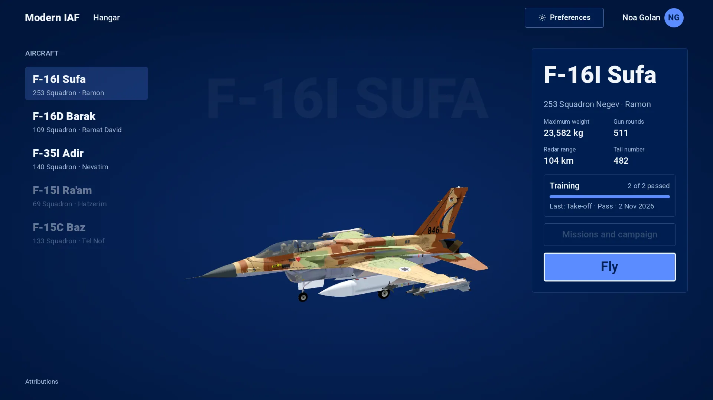
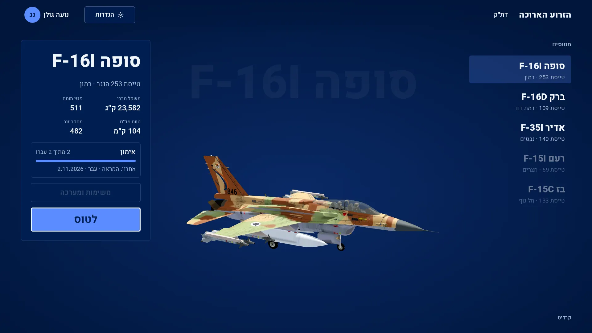
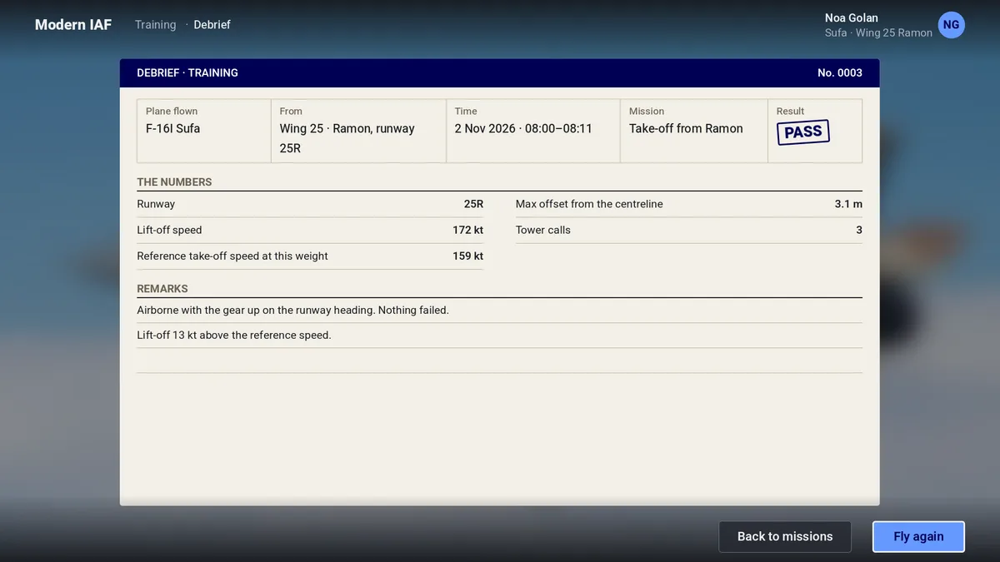
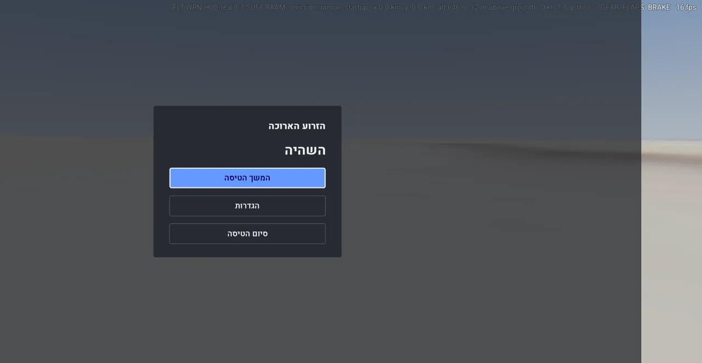
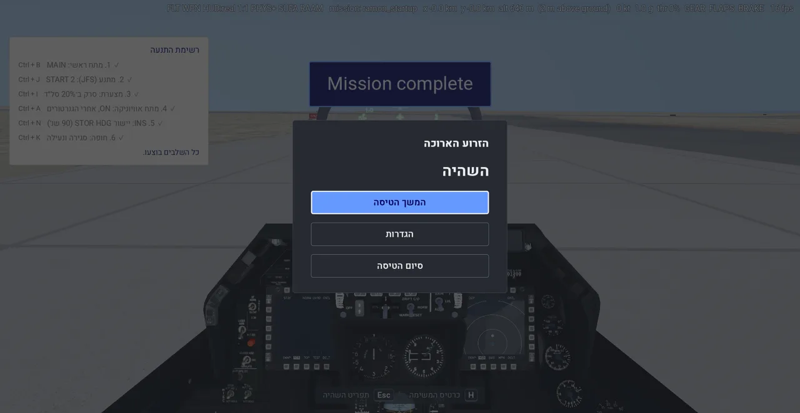
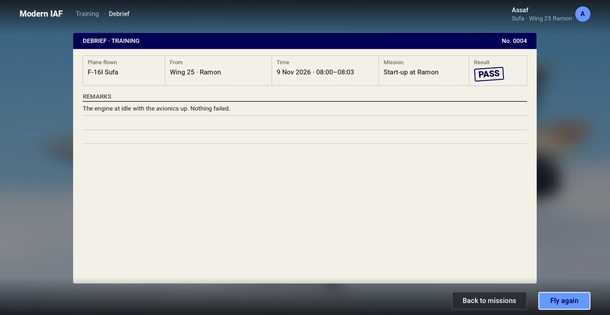
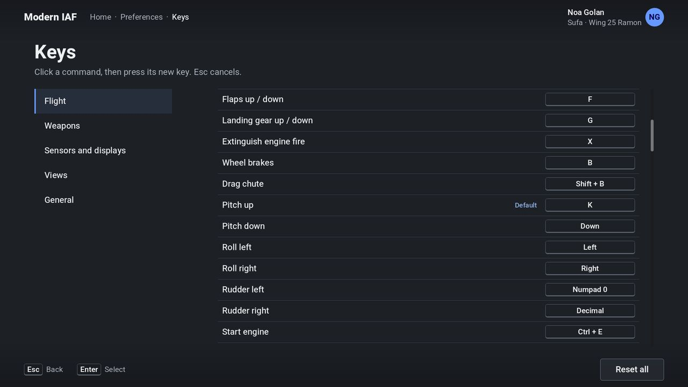
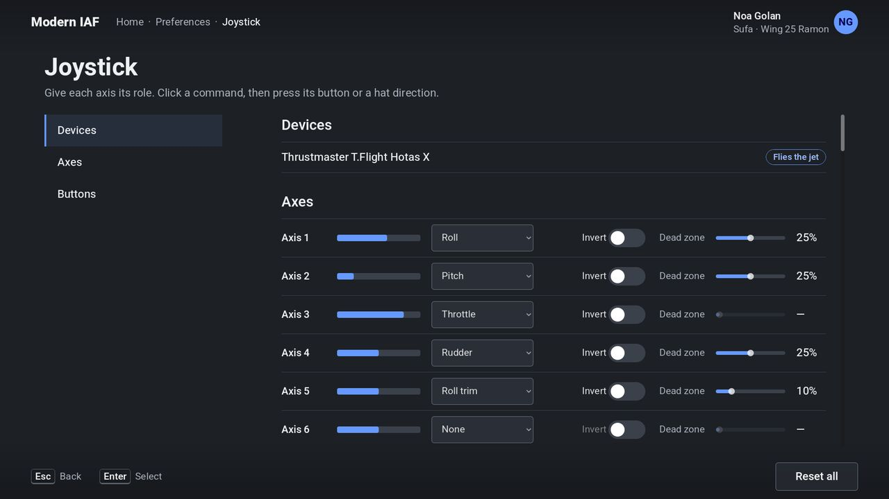
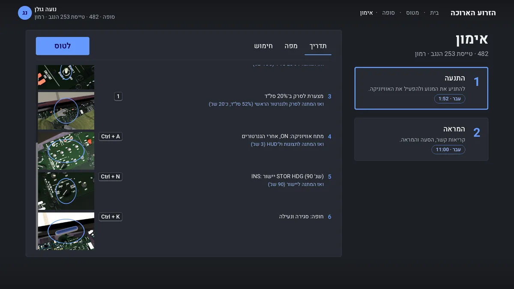
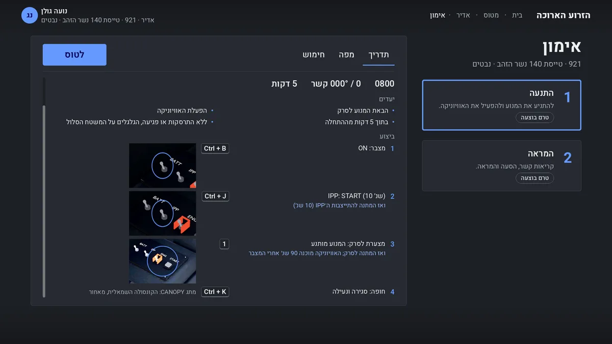

# Modern IAF's front end

**Terms:** front end = the screens before and after a flight; inline start / end = the side a line of text starts / ends
on (the left / right in English, the right / left in Hebrew); debrief record = the scorer's JSON for one flight
([training.md](training.md) §4); pilot log = the record of every attempt ([training.md](training.md) §9).

The front end (item [E2](plan.md#e2-the-front-end)) is the sim's main scene, `modern-iaf/main.tscn`. `./start-modern-iaf` opens it.
It builds the round-3 design the user approved on 3 November 2026: one screen per step, in Hebrew and English, with the
Heebo font. Since 13 November 2026 it wears the roundel-blue theme (§4) and opens on the Hangar (§12), the first screen
of the menu redesign the user approved then (A25).

```sh
./start-modern-iaf                     # the Hangar (the first start: the Pilot screen makes the profile first)
./start-modern-iaf -- --mission 2011   # flies that mission at once, then shows its debrief
```

The window opens plain in the front end's background colour (#00163C, no Godot splash image) until the Hangar draws.

## 1. The screens

| screen | what it does | English | Hebrew |
|---|---|---|---|
| Hangar | the first screen (§12): the jets at the inline start, the picked one turning in 3D in the middle with its full name faint behind it, its card at the inline end (squadron and base, facts, the training's progress, Missions and campaign greyed, Fly); Preferences and the pilot in the top bar, Attributions at the foot |  |  |
| Pick a mission | the missions beside the picked one's briefing (§10) on three pages: Briefing (base, runway and heading, time, wind, time allowed, objectives, how), Map (one zoomable map) and Arming (the jet's front view with its stores, its weights); Fly |  |  |
| Preferences | the sections Graphics, Language, Sound and Devices listed at the inline start; the picked one's settings open beside them as controls: dropdown, switch, slider, radio list; Devices has the afterburner detent (§9.2) |  |  |
| Debrief | the record as a sheet: Plane flown, From, Time, Mission, Result, the mission's goals (a take-off: runway, lift-off and reference speed, centreline offset, tower calls; a start-up: none), Remarks (the fail reason first, or that it passed; the lift-off against the reference); Back to missions, Fly again |  |  |
| Pilot | the Hangar → the pilot: the picture in a service ID photo's fixed 3:4 frame (a click on it, or Choose a picture…, opens the system's file dialog), the name and the nickname, and the logbook (§3) with its Pilot log button; the footer's Reset the log, Delete profile, Change pilot, Back and Save (§3) |  |  |
| Create your pilot | the first start, before the Hangar: the Pilot screen with Save only (§3) |  |  |
| Reset the log | the Pilot screen's Reset: a warning modal, then a second confirm (§3) |  |  |
| Pilots | the Pilot screen's Change pilot: every pilot with a name, the active one marked Current; New pilot (§3) |  |  |
| Pilot log | the Pilot screen → Pilot log: every attempt, newest first; a row opens its debrief; Back to the Pilot screen |  |  |
| Attributions | the setup wizard's list of sources and licences, the jet models and photos with them; the Hangar's foot opens it |  |  |

At a training mission's goal a banner over the view says "Mission complete" and "Fly on, or Esc → End the flight for
the debrief" for 10 s; the flight goes on until the player ends it (the user, 2026-11-13: "on mission complete - allow
to keep flying"), the pass kept. A fail shows "Fail" and the reason; about 5 s later the flight ends into its debrief
([training.md](training.md) §9).

Over a flight, Esc opens the pause menu: Continue the flight, Preferences, End the flight. It is laid out on the
front end's canvas scaled to the window and centred by a container, so it sits in the middle at any window size and in
either language (the Mac run of 2026-11-08: in Hebrew in a 2560 × 1440 window the overlay mirrored its own position
by its unscaled width and sat off the right edge, its buttons' labels outside the screen). Ending a training flight
scores it as it stands and opens its debrief; a flight that was not scored goes back to the Hangar. The sheet shows only
the record's `goals` ([training.md](training.md) §4); every other number stays in the record file.

| the Hebrew pause menu before the fix (2026-11-08) | after |
|---|---|
|  |  |

| screen | English | Hebrew |
|---|---|---|
| the pause menu over the flight |  |  |
| a failed debrief (a take-off with the gear never raised) |  |  |
| the debrief of that flight |  |  |

Keys: Enter picks the focused control, Esc goes one screen back (on the Hangar it asks "Quit the sim?", Cancel focused),
the arrow keys and Tab move the focus. The bottom bar holds a credit where a screen shows one (the Map's) and the
screen's buttons; it shows no key hints (the user, 2026-11-09: "this is
obvious and people will use mouse anyway"). Every breadcrumb in the top bar but the current one opens its
screen (a jet's name: the Hangar; Training: the jet's missions); the picks are kept.

| screen | English | Hebrew |
|---|---|---|
| Preferences: Graphics |  |  |
| Preferences: Sound |  |  |
| Preferences: Devices |  |  |
| Preferences: Language |  |  |

## 2. The flow

The Hangar → Fly → Pick a mission → Fly → the flight → the debrief → the Hangar. Every start opens the Hangar with the
jet picked last (flown or picked), else the first, the Sufa; the earlier rule of no jet picked on entry (2026-11-09,
2026-11-11) went with Home and Pick a plane, since the Hangar always shows a jet. Esc on Pick a mission, the
Preferences, the debrief and Attributions goes back to the Hangar. The breadcrumbs: Hangar · the jet · Training (Pick a
mission) · Debrief; the Hangar's crumb and the jet's open the Hangar.

The Ra'am (F-15I, `f15i`) and the Baz (F-15C, `f15c`) are listed after the three flyable jets, disabled until the sim
flies them (the user, 2026-11-10 and A25): the row dimmed, no click, no focus, no text on why. Each row shows the full
name, the squadron's number and the base like the others (`SOON` in `front_end.gd`; the squadrons in the Hatzerim and
Tel Nof base files, airbases.md §3). Making one flyable moves its row from `SOON` to `JETS`.

- **The plane:** a row's click stores the unit (`Settings.sim_jet`: `f16i`, `f16d` or `f35i`; `settings.cfg` section
  `[sim]`, key `jet`) and sets the F-16 switch (`Settings.set_jet`).
- **The missions:** the compiled list `assets/converted/modern-iaf/missions/missionlist.json` (`iaf-sim missions`), each
  read from its readable file `modern-iaf/data/missions/<name>.json`, kept when its player unit is the picked jet and it
  has `training` rules, in menu-id order.
- **Fly:** `flight/fly.gd` `start(menu id)` loads the compiled mission, picks the mission's jet (a `--mission` run)
  and changes to the flight scene.
- **Back to missions** on a debrief opens that mission's jet with the flown mission picked.
- **Fly again** on a debrief opens the same screen on the flown mission's briefing (its Briefing page first, the
  loadout as left) with Fly focused: Enter or a click on Fly starts the flight.
- **The flight's end:** the flight scene returns to `Settings.front_end_scene()` (`res://main.tscn`). When the flight
  stored a sortie (`flight/sim_flight.gd` sets `Settings.flown_sortie`), the front end opens its debrief.

## 3. The data it reads

| what | where | written by |
|---|---|---|
| the sorties and their debrief records | `user://modern-iaf.sqlite` (tests: `<temp>/modern-iaf-records-<pid>/`, the run's own), `Settings.records_db()`, read through `IafPilotLog` ([storage.md](storage.md) §5) | `sim_flight.gd` at the scoring: the scorer's record plus `flight`, `date` (the end, local time) and `elapsed_s` (the flight's length, s) |
| the picked jet | `user://settings.cfg` `[sim] jet` | the front end |
| the jet photos | `modern-iaf/data/photos/` (§5) | — |

The pilot's profile (the Pilot screen) is in the records database's `pilots` row ([storage.md](storage.md) §5): the
name, the nickname and the picture, a copy of the chosen file in `pictures/` beside the database. Every screen's top
bar shows the nickname, else the name, else the computer's user name; on the Hangar the nickname, the name under it and
the picture are one button (hover, pressed and focus in the crumbs' look) that opens the Pilot screen; with a picture, the picture in a small 3:4
frame in place of the initials' disc. The picture keeps square corners and no round mask, as a service ID photo; it is
cropped to fill the frame.

**The Pilot screen** (2026-11-10, the user's findings on it):

- **A draft until Save.** The name, the nickname and a newly chosen picture change nothing until Save (primary, at
  the footer's end, greyed without a name), which stores them and opens the Hangar; the picture file is copied beside
  the database then. Back (and Esc) opens the Hangar, after a modal "Discard the changes?" (Discard / Keep editing) when
  something changed; Change pilot and the Hangar crumb ask the same. The empty fields show hints ("Full name", "For example: Viper"): the nickname field used to show
  the pilot's name in grey, which read as text that no click could edit.
- **The picture** opens the file dialog on a click, as Choose a picture… does.
- **The logbook** beside the profile (`IafPilotLog.logbook`): per plane flown, most hours first, its flight time
  (`clock`) and its flights, passes and fails, then each mission flown on it with its passes and fails. A sortie
  stored before the records kept its plane counts for its mission's jet (the readable mission's `start.unit`).
  Its **Pilot log** button opens the Pilot log, every attempt with its debrief: the one way there since Home's
  Pilot log entry went (the user, 2026-11-11).
- **Reset the log** (greyed with no flights) opens a modal, "Reset the pilot log?" / "לאפס את יומן הטיסות?", then a
  second one, "Reset for good?" / "לאפס סופית?"; each has Reset / לאפס and Cancel, Cancel focused and Esc closing it.
  Reset deletes the pilot's sorties and their debriefs; the name, nickname and picture stay.
- **Delete profile** opens a modal, "Delete the profile?" / "למחוק את הפרופיל?", then "Delete for good?" /
  "למחוק סופית?", each with Delete / למחוק and Cancel. Delete removes the pilot: its sorties and debriefs, its
  loadouts, its profile and its picture file (`IafPilotLog.delete_pilot`). The pilot list opens next, or Create your
  pilot when no other pilot is left.
- **The fields** show only their labels and hints, no text on where the nickname shows.
- **Several pilots.** Change pilot opens the pilot list: each pilot with a name (picture or initials, nickname, name),
  Current on the active one. A click makes that pilot active and opens the Hangar; New pilot opens the Pilot screen empty,
  and its Save makes the pilot and makes it active. The active pilot is `Settings.pilot_id`, kept in `settings.cfg`
  `[sim] pilot` (the default pilot 14 before any pick).
- **The first start.** While the active pilot has no name stored, the Hangar's place is taken by the Pilot screen titled
  "Create your pilot" with only Save (Esc stays); Save stores the profile on the active pilot, its imported sorties
  kept, and opens the Hangar. When the records hold other pilots with a name, the pilot list opens instead.
- **The modal** is the sim's: the screen dimmed, a panel with the title, the text, the safe choice and the action;
  mirrored in Hebrew. The Hebrew texts are in the infinitive, gender neutral.

The debrief's number is its sortie's id, the sortie's place among all stored flights, oldest first. The Hangar's training progress
and Pick a mission's status and best time are `IafPilotLog.summary`'s. Its Time is the day, then the mission's clock from its start (the mission's `time`) to the start plus
`elapsed_s`. The pilot's name is the profile's nickname or name, else the computer's user name. The Remarks are
the record's fail reasons, then what its
numbers say: the lift-off speed against the reference speed for the weight, and the largest offset from the
centreline in the roll.

## 4. Look and layout

- **Palette** (the roundel-blue theme, the user's A25, 2026-11-13: "use the deep blue from the roundel"): background
  `#00163C`, panels `#001E50` (the roundel's blue as Wikimedia Commons draws it, not an official specification),
  raised panels and hover `#0A2A66`, fields `#00194A`, lines `#1D3A70`, borders `#5A73A3`, text `#F2F5FA` / `#A9B8D4`,
  the one accent `#5B8CFF` with `#001E50` on it, links `#A8C3FF`; the debrief paper `#f3efe6` with rules `#b9b09c`
  stays. Every text pair passes WCAG AA. All in `modern-iaf/menu/look.gd`, which builds the theme on the wizard's Heebo
  (`setup/wizard_theme.gd`); every sim screen (the front end, the loading screen, the pause menu, the flight's
  overlays) takes its colours from there. The setup wizard keeps Godot's default dark theme (`wizard_theme.gd`). Until
  2026-11-13: the round-3 slate (`#1d2025`, `#262a31`, accent `#6699ff`).
- **A list that picks one** (the Hangar's jets): the picked row filled in the accent's tint, the focus a 2 px accent
  ring; no bar at the row's side (the user, 2026-11-13).
- **Sizes:** every screen lays out on a 1920 × 1080 canvas that the window shows scaled to its height (stretch mode
  "canvas items", aspect "expand"); the body text is 21 px, 1.9 % of the height, as in the mock-ups. The front end sets
  the scaling only while it is the scene, so the flight keeps the project's own. Over a flight the pause menu scales
  itself the same way.
- **Hebrew:** the front end's layout direction is right to left, so Godot mirrors the containers, the anchors, the
  labels' alignment, the sliders, the progress bar, the toggles (on: the knob at the inline end) and the radio lists.
  The photos and the Hangar's jet never flip (their tail numbers would read backwards). Latin
  codes (F-16I, 25R, 08:00) run left to right inside the Hebrew lines; "MSAA 4×" carries a left-to-right mark.
- **Strings:** `modern-iaf/menu/strings_en.json` and `strings_he.json`, formal and gender-neutral (infinitives: לטוס,
  להתניע, לבקש). The Language row switches every string at once. The briefing's objectives and steps are the
  rules' (§10). A training mission's title is its
  kind ("Take-off", "המראה"; the missions' `title`, the user, 2026-11-09): the base is its own field everywhere it
  shows (the briefing, the loading screen's second line, the debrief's From).
- **The jet's name** is its code and name, "F-16I Sufa" / "F-16I סופה", wherever it shows (the user, A25), from one
  function, `full_name`. In Hebrew it starts with a right-to-left mark: a Label takes its paragraph's direction from
  the first strong letter, so without it the line turned left to right and read "סופה F-16I", the code last (the
  user, A31). `test_hangar.gd` checks the code's place on every label that names a jet.
- **The jet's subtitle** (the top bar, Pick a mission, the briefing): its tail number, its
  squadron and its base, "846 · 201 Squadron The One · Ramon", "846 · טייסת 201 האחת · רמון" (the user, 2026-11-09: the
  wing is the base, so it is left out). The tail number is the unit record's `tail`, the number painted on the jet's model
  ([data-formats.md](data-formats.md) §3); the squadron is its airbase file's
  ([airbases.md](airbases.md) §3).
- **Preferences:** one screen: the sections listed at the inline start, the picked one's rows beside them (Graphics
  until one is picked; the user, 2026-11-09, of the screen per section: "I liked it more before"). The section's pane
  scrolls over its full height, its scroll bar running from its top to its bottom. A row shows its name and its
  control, no line under it; a greyed row says why (Scenery without its setup step, §4). Over a flight Esc on the
  Preferences goes back to the pause menu; the Keys and Joystick screens go back to the Preferences on Devices. Tried
  2026-11-08 and dropped 2026-11-09: one screen per section, the list as cards with the rows' names under each
  section. Realism and aids have no switch (plan.md "physics";
  the user, 2026-11-08): the sim's `PROFILE` (`modern-iaf/sim_settings.gd`) fixes the original Gameplay page's aids off
  (easy landing, unlimited fuel, no damage, no crashes, no G effects…) and the look switches to the sim's own
  (Detailed airbases, water, night lights; the ground textures and roads whenever their data exist), so
  none of them is a row. The weather is the mission's (no Rain row). The rows reborn shows too (anti-aliasing,
  upscaling, long shadows, clouds, scenery, full screen, language) take their choices and when each can be picked from
  the same source as reborn's Extras page, `shared/util/pref_choices.gd`; the sim keeps only the list of its rows
  (`PREFS`) and names each choice by its own strings (`<setting>_<value>`). The temporal upscaler reads MetalFX on a
  Mac and FSR 2 elsewhere (`RenderOptions.temporal_name()`; "FSR 2" everywhere before 2026-11-14). Volumetric clouds
  are greyed where they cannot draw (`VolumetricClouds.supported()`). Graphics → "Buildings and trees" is the shared Scenery setting (Off / On / Detailed, On by
  default, [scenery.md](scenery.md) §6); without setup's optional scenery step it is greyed at Off, with a note
  naming that step. The HUD's brightness has no row: it is the cockpit's SYM wheel and its DAY / AUTO BRT / NIGHT
  switch ([cockpit.md](cockpit.md) §5.1;
  the mouse: §9.1).
- **Sound samples:** moving a Sound slider plays a short clip of its class at the new level, on that slider's bus, from
  the sim's own clips (`converted/own/resource/soundfiles`, `SoundTable`): Engine the engine
  (`SFX_START_ENGINE`), Effects the master caution tone (`SFX_WARNING` `WRN_MASTER`, the effects' class), Radio
  voices a tower call (`twr_takeoff.wav`). Betty's calls ride the Radio voices bus too, so the tower call stands for
  them. A sample still playing follows the slider; another slider's starts in its place.

## 5. The photos

Six Wikimedia Commons photos, downscaled, credited on Attributions and in [../../docs/credits.md](../../docs/credits.md) "Modern IAF's photos". The list with each page:
`modern-iaf/data/photos/SOURCES.md`. Round 3's Barak photo was CC BY-SA; the front end uses a CC BY 2.0 one instead.
Since the Hangar (2026-11-13) only their blurred copies show, behind the debrief; Home, Pick a plane and Training,
which showed them whole with their credits, are gone.

## 6. Checks

- `modern-iaf/tests/test_front_end.gd` walks the Hangar → Pick a mission → the debrief of a stored record → the
  Hangar in English and Hebrew: the texts, each jet's card with its squadron, the mission list, the layout direction;
  the plane pick; the Ra'am's and the Baz's rows greyed and not pickable; the Preferences' controls and the live language switch; the Pilot log
  and Attributions. With `-- --fly` it also flies Ramon's start-up from the mission screen to a pass, opens the pause
  menu, ends the flight and finds that flight's debrief. Run in a real render through `tools/godot_window.sh` it is
  the real run (`SHOT_DIR=<dir>` saves the two pictures of §1's second table).
  It also checks the first start (the Pilot screen before the Hangar, Save only with a name typed through real input
  events, Esc staying, Save storing the name on the active pilot and opening the Hangar), no Pilot log entry on the
  Hangar, the Pilot screen's Pilot log button opening the Pilot log, the breadcrumbs, each
  Preferences section opening beside the list on the same screen (its pane over 700 px high, on the inline-end side),
  no line under an option, no aid, realism or weather row and no read of the original's data, the
  sim's settings (no aid on, the log dumps naming only the sim's settings), F1–F4 opening no pause menu, and the
  pause menu inside viewports of 1920 × 1080, 2560 × 1440 and 1280 × 800 in both languages, and the Pilot screen in
  both languages: the Hangar's pilot name opens it, the nickname field shows a hint and takes a click and typed keys, the
  logbook's Sufa with its counts and per-mission passes and fails, Back's discard prompt (Keep editing keeps the
  draft), a click on the picture opening the file picker, a file that is no picture refused, a picture shown in its
  3:4 frame and copied beside the records only on Save, Save opening the Hangar with the nickname and the name under it;
  then Change pilot: the list marking the active pilot, New pilot making a second pilot, active, with an empty log,
  its sortie kept through Reset's first modal and deleted by the second (the other pilot's log kept), and the list
  picking the first pilot back.
- The briefing (§10): the title as the kind, the time as "0800", the wind as "000° / 0 kt" ("קשר"), the take-off's
  four objectives, its runway with the heading, its four steps in a four-column table, the three tabs mirrored and
  the arrow keys between them; the six take-off steps (each tower call its own, with its pick and the answer to wait
  for); the wind's figures left to right; the subtitle with the tail number and no wing; the Arming
  page's own Sufa drawing with a slot per station (the wing slots in station order 9 to 1, apart; the tanks in the
  second row straight under 4 and 6), each store's name as its tooltip, the title "Sufa · F-16I · 846" with the Latin
  and digits isolated, no F-16C, the rounds, chaff, flares, fuel, take-off weight and maximum weight each a field,
  centred, no credit on Briefing or Arming, the Map's credit at the footer's inline end, the Adir's own drawing; the start-up's steps with their switches and waits;
  the map over the page with the screen's aspect, the ground colour, roads, Mitzpe Ramon, the airbase, taxi and
  route, the credit; the wheel zooms around the pointer and the scale bar follows, a drag scrolls, a double click
  resets, + zooms, an arrow scrolls the focused map (not the tabs), 0 resets; the page kept for the next mission; the
  start-up's six checklist steps with their keys.
- `cargo test -p iaf-tools --lib briefing`: the map of Ramon's take-off (the base, the taxi from the parking spot to
  the lineup, the waypoint west-south-west of it, the aspect, the fills inside the map, the base's shapes, the towns
  inside it only), of every start-up and take-off; the Sufa's and the F-35I's stores.
- `modern-iaf/tests/test_hangar.gd` checks the Hangar (§12) in English and Hebrew: the first screen, the jet picked
  last (else the first) picked, the five rows with the full names, the F-15s greyed with no focus and no text, a click
  picking the Barak (the F-16 switch) and the Adir with their cards and models, the card's facts and training,
  Missions and campaign greyed with no tooltip, Preferences and the pilot in the top bar, the mirrored sides, Fly to
  Pick a mission and the Hangar crumb back, Esc's quit prompt, the turntable rendering nothing once hidden.
- `modern-iaf/tests/_hangar_shot.gd` takes the Hangar's pictures with each jet, Pick a mission and the Preferences at
  1920 × 1080 and 2560 × 1440 in both languages, prints the turntable's measured render time and, with `STILLS=1`,
  writes the stills of `data/hangar/` (its header).
- `modern-iaf/tests/_front_end_shot.gd` takes §1's pictures at 1920 × 1080 (its header), and the failed debrief.
- `modern-iaf/tests/test_flight_ui.gd` checks §8 in both languages.

## 7. The loading screen

**The preload (2026-11-14):** while the mission page is open, the ground around the picked mission's start and the
flight's models load in the background with reborn's preload (`shared/terrain/terrain_preload.gd`, which reborn runs
on its TSD): the mission page sets the mission up (`flight/fly.gd prepare`), aims the preload at the start
(`MissionRuntime.player_start`) and polls it each frame (`front_end.gd _preload_ground`); another mission re-aims it,
leaving the page drops it. Fly waits for the flight scene's load on menu frames (`TerrainPreload.fly`, reborn's Fly
too) and the flight's terrain takes the loaded nodes. A `--mission` start loads cold, as before.
`modern-iaf/tests/test_terrain_preload.gd` checks it on the 1:1 theatre (388 nodes at Ramon). Measured on the Mac
(Metal, a real 1920 × 1080 window, Ramon take-off after 6 s on the page, warm, three runs each): Fly to the first
flying frame 2.3–2.7 s before, 1.7–2.8 s with the preload. The ground's decode was not what the start waited for
there: the step "The ground around the base" still takes about 1.2 s, the near scenery being drawn
(`scenery.ground_ready()`), not the ground's textures.

While a flight waits for its ground, the sim shows its own loading screen, `modern-iaf/flight/loading_screen.gd`. The
flight scene asks `Settings.loading_screen_scene()` for it; the original game keeps its menu-art screen
(`shared/terrain/loading_screen.gd`). It reads nothing of the original game's art.

The screen is one panel in the front end's look (§4, `modern-iaf/menu/look.gd`). It shows:

- the mission's title in the sim's language (the compiled mission's `sim.title`; without a mission, the sim's name);
- its base's name ("Ramon", "רמון"; no wing: the wing is the base), from the compiled mission's `sim.base`
  (`iaf-sim missions`);
- a progress bar and, under it, the loading step under way. The flight names each real phase of its start
  (`terrain_view.gd _loading_step` → the screen's `step(name, done)`); the bar takes each phase's share (`STEPS`),
  smoothed and never going back. The original game's screen shows the ground's progress alone, as before.

| step | what loads | share of the bar | first start | warm |
|---|---|---|---|---|
| The mission | the start, the player's jet chosen, its models (the jet, the 3D cockpit, the pilot's body, the stores, the mission's) handed to worker threads to parse (`TerrainPreload.prefetch_flight`) | 0–1 % | 0.3 s | 0.3 s |
| Buildings, trees and sounds | the models' detail textures, the scenery's materials drawn once, the sounds, the radio, the training run | 1–5 % | 1.3 s | 1.1 s |
| Effects and damage | explosions, smoke trails, the systems damage, drawn once | 5–15 % | 3.7 s | 0.3 s |
| The flight model | the flight overlay, the flight model's start | 15–27 % | 1.6 s | 0.1 s |
| The jet | the jet model, placed and drawn once | 27–32 % | 0.2 s | 0.2 s |
| The cockpit | the cockpit cut from the jet model, the 3D cockpit and the pilot's body, drawn once | 32–38 % | 2.6 s | 0.6 s |
| The weapons and the views | the views, the weapons and their stores, the cockpit and the HUD drawn once | 38–75 % | 4.1 s | 0.1 s |
| The ground around the base | the terrain near the jet at full detail (`ground_progress()`) | 75–88 % | 4.3 s | 1.8 s |
| The mission's models | the mission's models parsed ahead | 88–90 % | none left | none left |
| The views | the external view drawn once for its shaders, the last scenery | 90–100 % | 0.3 s | 0.3 s |
| **The start** | from the flight scene to the flight | | **18.1 s** | **4.4 s** |

Measured on the development laptop (Intel Iris Xe, a real window, `--mission 2012`, 2026-11-10). "First start": a new
`user://` (Godot's shader cache empty) with Mesa's cache off; "warm": the same again. Most of a first start is the
graphics' shaders, compiled by Godot as each part is first drawn (behind the loading screen); Godot keeps them in
`user://shader_cache` for the next start. Before this change the same start took 26–48 s first and 5.1 s warm: the jet,
its cockpit and its weapons came in one frame (11.9 s on a first start, 3.4 s warm, the jet and 3D cockpit models parsed
on the main thread), and the bar sat on "The jet on the ground, its weapons and views" through it. On a Mac (Metal)
the shaders compile about ten times slower: the same frame took 134 s there.

The steps split the work so that each part's first drawing falls in its own frame: the bar moves between them and the
step under it names the part being prepared. A frame longer than 2 s (shaders being compiled) adds a line under the
step: "A first start after an update prepares the graphics for this computer once: it takes longer." A single frame
cannot show progress inside it: the drawing of the screen waits for the same compilation.

The log names every step with its time since the screen opened (`loading: terrain at 2250 ms`), every sub-step with its
own time (`loading:   cockpit cut 213 ms`), and the end (`loading: done at 4199 ms`).

**The watchdog.** The loading must end. The screen opens the crash page (§11) and logs `hang: the loading stopped at
<step> (<why>); waiting for <what>` (the ground's share, the near nodes still blocked, the height under the jet, the
scenery, the models left to parse, the views) when:
- the flight is paused under it (only the player's own pause or menu may pause it);
- its step and progress do not change for 30 s while frames still run.

A main thread that draws no frame for 30 s gets `hang: no frame for 30 s; loading step <step>, after <sub-step>` from
the log's own thread (docs/logs.md §2): the line names what never returned.

On 2026-11-10 a mission card opened at the start under the loading screen and froze the flight, so the loading never
ended (the user's Mac). That card is gone since 2026-11-13; `modern-iaf/tests/test_start_watch.gd` checks that the
loading finishes and the flight runs.

In Hebrew the page is mirrored: the bar fills from the inline start, the right.

| English | Hebrew |
|---|---|
|  |  |

`modern-iaf/tests/_loading_shot.gd` takes these pictures (its header).

## 8. Over the flight: the radio lines, the key hint

The sim draws its own text over the flight in the front end's look (`modern-iaf/flight/flight_ui.gd`, Heebo, look.gd's
palette, on the 1080-high canvas scaled to the window), mirrored in Hebrew; the original game's console and panels
stay the original's (`terrain_view.gd _on_subtitle` hands each line to the flight add-on when it has a `subtitle()`).

- **A clean start:** a flight starts with the flight running and nothing over it but the key hint (the user,
  2026-11-13). A start-up mission starts with the pilot's notebook raised; H (the Checklist notebook key) raises and stows it ([training.md](training.md) §11). The mission's goals
  are in the briefing (§10), the panel's live "To complete: …" line, the completion message and the debrief
  ([training.md](training.md) §3). The in-flight mission card on H was
  removed on 2026-11-13 (the user's order); H is the notebook's key since the same day (record 118).
- **The radio lines and messages** show in a strip centred at the top, over the sky rather than the cockpit's panel,
  the newest at the bottom, three at most, each for 8 s, wholly in the game's language ([training.md](training.md)
  §8). A radio line shows as its voice starts, not at the menu's pick: the pilot's call after its key click, the
  tower's answer after the pilot's call and the gap (the user, 2026-11-13: "comms subtitle should show up as talking";
  `radio.gd cue_subtitle`, `flight_sounds.gd phrase_cue`: a mark in the speech channel's queue). A line without a clip
  (no sound file) shows at once. The text is subtitle size, 20 px at 1080 (the Mac play test, 2026-11-11: 26 px was too big).
- **The panel** at the inline-start top (the left in English, the right in Hebrew) holds the radio menu (Ctrl+T) and
  the training result. Its text runs in the language's direction; the panel itself keeps the root's direction and
  takes its side from its anchors. Until 2026-11-13 the panel was set right-to-left too, and Godot mirrors such a
  control's anchors, so in Hebrew the radio menu and "To complete" stood at the top left (the Mac run of 2026-11-13).
- **The info line** (F12, at the top left): the mission's name and the frames per second (`Settings.info_line_full`
  false; the original game's line also holds the modes, the place, the speed and the controls).
- **The key hint** at the bottom: Esc and the pause menu. It shows for the first 8 s after the loading screen and
  for 4 s after a language change, then fades out. It is hidden while the pilot's notebook is raised (the user,
  2026-11-10: the hint stays out of the way of the narrative). The pause menu's own key hints are separate.
  The text stands 18 px from its key cap. At 12 px the Hebrew "תפריט השהיה" read as touching the Esc cap on the
  Mac (2026-11-13). Measured: no glyph reaches past its advance, so the ink gap was the full 12 px (18 px on the
  Mac's screen), but Heebo's ת has no side bearing and the cockpit shows through the gap. `test_flight_ui.gd`
  measures the gap on the glyphs' bitmaps in both languages.

A language switched over the flight (Esc → Preferences → Language) applies at once to the key hint, the panel (an
open radio menu at once, a training line at the next frame's score), the pilot's notebook ([training.md](training.md)
§11) and the radio lines: `radio.gd` keeps each line it prints in both languages (`subtitles`, the pilot's call from
`sim_flight.gd pick`), so a line shown, or still waiting for its voice, shows in the language of the moment.
Before 2026-11-13 a line kept the language it was said in: the Mac's take-off pictures, switched to Hebrew after the
calls, showed the tower's lines in English under a Hebrew "To complete" panel. `modern-iaf/tests/test_flight_ui.gd`
checks the layout at a start in each language and after a switch each way, and the band's lines after a switch.

| | English | Hebrew |
|---|---|---|
| the strip after a tower call, the key hint still showing |  |  |
| 10 s into the flight: the key hint faded out |  |  |

## 9. Keys and Joystick

Preferences → Devices has two rows that open their own screens: **Keys** and **Joystick**. Esc on either goes back to
the Preferences on Devices. Both read and write one file, the device store (§9.4). A change applies at once: the front end's
next flight reads it, and over a flight the Preferences apply it when they close.

### 9.1 Keys

The screen lists every command of the sim's key table (`modern-iaf/data/keys.json`) that has a `group`, in five groups:
Flight, Weapons, Sensors and displays, Views, General. The tabs on the inline-start side scroll to each group, and the tab of the group at the
top of the list lights as the list scrolls (`front_end.gd spy`; the Joystick screen's Devices, Axes and Buttons too).
Back in the bottom bar, as Esc, goes to the Preferences on Devices; the top bar's breadcrumbs read Hangar · Preferences ·
Devices · Keys. A row shows the command and its key; on macOS a key with Ctrl shows as ⌘ and one with Alt as Option
(`KeyTable.mac_symbols`, which the sim sets; the 1998 game keeps Cmd and Alt; docs/controls.md §2). The
table's records without a group are the commands the sim lacks (the chat, the wingman orders, the debug keys, the
screen capture): no row.

- **Rebind:** click a row, and its key reads "Press a key…". The next key with its one modifier (Ctrl / Cmd, Shift,
  Alt) becomes the command's key. Esc cancels; a lone modifier waits for the key.
- **Conflict:** a key another command already has opens a line under the row: "K already runs “Pitch up”." Its
  choices: **Swap** (the other command takes this one's old key), **Use it here** (the other command has no key then),
  **Cancel**. The check covers every record of the table, listed or not, since the flight runs the first record bound
  to a key.
- **Default** shows on a changed row and puts that command back to the table's key. **Reset all** in the bottom bar
  puts every key back.

**The laptop map.** A laptop has no numpad, so on macOS the sim starts from the laptop map: the same table with the
keys of `keys.json`'s `laptop` column (compiled into `converted/own/keys_laptop.json`; `Settings.laptop_keys`). A Mac
with a full keyboard gets it too; Rebind puts any command back on the numpad. Default and Reset all go back to the
laptop map there. The commands it moves:

| Command | Key | Laptop map |
|---|---|---|
| Rudder left / right | Numpad 0 / Decimal | Z / X |
| Weapon page full screen | Z | Shift + Z |
| Extinguish engine fire | X | Shift + X |
| Look back-left, back, back-right | Numpad 1, 2, 3 | Alt + 1, 2, 3 |
| Look left, forward, right | Numpad 4, 5, 6 | Alt + 4, 5, 6 |
| Look front-left, up, front-right | Numpad 7, 8, 9 | Alt + 7, 8, 9 |
| Zoom (numpad) | Numpad − / + | none: − / = |

**One head-look set.** The sim's head look is the snap views (records 28–36: the numpad, Option + 1–9 on the laptop
map; the hat sends the same views in its eight directions) and the mouse (the right button held). The 1998 game's duplicates are empty slots in
the sim's table: F2 rear view (record 74, the same as Look back) and the free look on Shift + the numpad and Shift + the
arrows (records 86–93). The 1998 game keeps all of them.

The key table has no trim command (the trim is the joystick's rocker), so trim needs no laptop key.

**The mouse in the 3D cockpit.** The pointer works the cockpit's controls (`Settings.cockpit_controls()`,
[cockpit.md](cockpit.md) §5.1): over a control it lights it, the wheel and a left drag turn a knob, a left click
works a switch, each through the key's own command. The F-16s' controls: the SYM wheel, the HUD's brightness, which
Shift + H also steps (its position kept in the sim's settings file, not in the device store), the HUD's DAY / AUTO
BRT / NIGHT switch (kept there too), and the start-up
checklist's switches (MAIN PWR, JFS, the throttle, the AVIONIC POWER switches, the INS knob, the canopy handle;
[cockpit.md](cockpit.md) §5.2). The pilot's notebook names each step's
switch and its place under its line, and no key ([training.md](training.md) §11).

| | English | Hebrew |
|---|---|---|
| Pitch up rebound to K |  |  |
| K pressed for Pitch down |  |  |

### 9.2 Joystick

With no joystick connected the Devices section's Joystick row is greyed, its Change off, and it says "No joystick
connected."; it comes alive when one is plugged in (`Input.joy_connection_changed` builds the section again). Tests see
only their fake joysticks (`Joystick.device()`).

Back in the bottom bar and the breadcrumbs Hangar · Preferences · Devices · Joystick work as on the Keys screen; the
side list (Devices, Axes, Buttons) follows the scroll.

- **Devices:** every connected joystick by name. The first one flies the jet ("Flies the jet"); the others are listed
  only. Without one the screen says so.
- **Axes:** the six axes Godot reports (fewer when the device's USB descriptor says so, `Joystick.axis_count`). Each
  row has a live bar, the axis' role, Invert and a dead zone (0–50 %). The roles: Roll, Pitch, Throttle, Rudder, Roll
  trim (the throttle rocker, docs/controls.md §5.2), None. A role sits on one axis: giving it to another axis leaves
  the old one with None. The bar shows the axis as the flight reads it (`Joystick.role_value`: the role's invert,
  dead zone and sense), so the dead zone is visible as the bar's still centre and the bar fills the way the jet
  responds: the throttle lever forward is a full bar (full power), the stick pushed forward a full pitch bar. The
  throttle has no centre and no dead zone. Tested on the Mac 2026-11-11: the bars showed Godot's raw reading, where a
  lever or stick pushed forward is −1, so the throttle's bar was empty at full power while the flight (and the 1998
  game) read it right. The one sense now lives in `joystick.gd` (`SENSE`, `shaped`), which the poller and the bars both
  read.
- **Buttons:** the Keys screen's list with the joystick's buttons. Click a row, then press a button. Conflicts, Default and Reset all work as on the Keys screen. The hat is not a button here: it is the
  1998 game's POV, read by the same code (`Joystick.poll`), its eight directions the snap views (up, right, back, left
  and the corner views front-right, back-right, back-left, front-left). Tested on the Mac 2026-11-11: the sim had
  turned the hat into four buttons of its own, so the diagonals did nothing; reborn's hat had them all along.
- **Reset all** puts the buttons and the axes back to the defaults.

The Joystick screen has no rows for the Devices group's choices (Flight controls, Rudder, Throttle, Afterburner detent,
Stick response): they stay in the Preferences.

**Afterburner detent** (Preferences → Devices, greyed with no joystick): the throttle lever's click where the
afterburner starts, as the 1998 game's Devices "Detent = MIL" (docs/controls.md §5). Put the lever in its click and
choose Set at lever: the row then reads "At n%" (the lever's raw position) and that position gives military power, the
travel past it the afterburner (`Joystick.detent_choice` and `detent_map`, the code reborn's page runs). With the lever
in its click the engine is at military with the burner off; the burner lights 4 points past it
(`modern-iaf/tests/test_detent.gd`). Off puts the lever back to linear. One setting
(`Settings.throttle_detent`) for the throttle role's axis. A role with no axis leaves its keys working, as Keyboard does: with Roll on None and
Pitch on an axis, the roll keys roll the jet while the stick pitches it (`Joystick.stick_mixed`).

| English | Hebrew |
|---|---|
|  |  |

In Hebrew the screens are mirrored; the key names and the device name run left to right, and the axis bars keep the
stick's own direction (right is right). The dropdowns draw the same box both ways: right to left Godot draws an
OptionButton's `*_mirrored` boxes, so `look.gd` sets them to the left-to-right ones.

### 9.3 Device maps

A known joystick gets its own defaults from a device map in `modern-iaf/data/devices/` (JSON): `match` (a part of the
device's name, case ignored), `axes` (role → Godot axis) and `buttons` (key-table record → button). The
map replaces the table's whole button column for that device: a record it leaves out has no button. The first map
whose `match` is in the name wins (file-name order); a device with no map takes the table's own buttons and axes 0–4.

| file | device | axes | buttons |
|---|---|---|---|
| `hotas_x.json` | Thrustmaster T.Flight Hotas X | roll 0, pitch 1, throttle 2, rudder 3 (the twist), roll trim 4 (the rocker, 5-axis mode) | 1 gun, 2 release, 3 next target, 4 flares, 5 chaff, 6 master mode, 7 radar mode, 8 drop lock, 9 gear, 10 flaps, 11 wheel brakes, 12 autopilot; the hat: the snap views in eight directions (the 1998 game's) |

The Hotas X's axes are the ones docs/controls.md §5.2 found on that stick. The button choice is ours (inferred: the
trigger fires the gun, the buttons next to it release and pick targets).

### 9.4 The device store

The store is `user://devices.json`, written compact and only with what differs from the defaults:

```json
{"keys":{"24":37},"buttons":{"64":5},"axes":{"pitch":{"axis":3,"invert":true,"dead":0.1},"rudder":{"axis":-1}}}
```

- `keys`: record → key, DIK | modifiers << 16 as `key_table.gd` stores it (0 = no key).
- `buttons`: record → the joystick's 0-based button, −1 = none.
- `axes`: role (`roll`, `pitch`, `throttle`, `rudder`, `trim`) → `axis` (−1 = none), `invert`, `dead` (0–0.9). An
  absent field is the default: the device map's axis (else 0–4 in role order), no invert, and the dead zone of
  `joystick.gd` (25 % on the stick and the rudder, 5 % with Stick response Soft centre, 10 % on the rocker). A dead
  zone outside 0–0.9 in a hand-edited file reads as its nearest end.

A missing or corrupt file reads as an empty store: every default.

Tests and pictures use a temporary file (`Settings.devices_path`, or in isolated runs a file of the process in the
temporary folder, so no run reads another's).

The logic is Rust's: `iaf_tools::devices` (unit tests in the same file) behind `IafDevices`
(`crates/iaf-godot/src/devices.rs`):

| function | does |
|---|---|
| `find_map(dir, name)` | the device map for a joystick's name, "" = none |
| `keys(table, store, map)` | the key table with the map's buttons and the store's keys and buttons in it, each record with `default_key` and `default_joystick` |
| `conflict(table, store, map, record, column, value)` | the other record bound to `value` in `column` ("key" / "button"), −1 = none |
| `bind(table, store, map, record, column, value)` | binds and writes; the entry goes when it is the default again |
| `reset(store, record, column)` | one record (−1: every record) back to its default |
| `reset_joystick(store)` | every button and axis back |
| `axes(store, map, soft)` | every role's axis, invert and dead zone |
| `set_axis(store, map, role, axis, invert, dead, soft)` | sets a role; a role on that axis gives it up |

How the flight reads it:

- **Keys and buttons:** the flight's key table is `KeyTable.load_table()`, whose contents come from
  `Settings.key_table_data()`. The original game returns the file as it is; the sim returns `IafDevices.keys` over
  its own table, the connected joystick's map and the store. The flight loads it at its start and again when the
  Preferences close over it (`terrain_view.gd _apply_preferences`).
- **Axes:** `Settings.apply_devices()` (at start, on every Preferences save, when a joystick connects) sets
  `Settings.joy_axes` to the roles' axes, `Joystick.tune` to their invert and dead zone, Roll trim on while the trim
  role has an axis. The hat is the original's POV snap views in both games.
  `joystick.gd` reads them each poll. The original game leaves `tune` empty, so its joystick is
  unchanged (`tests/godot/test_joystick.gd`, `test_controls.gd`, `test_keyboard_stick.gd`).
- **The maps' folder:** `Settings.joy_maps_dir()`: the original game's `menu/joy` in the install (its `.joy` files),
  the sim's `modern-iaf/data/devices`, where the shared `.joy` reader finds none and so reads no install. A missing
  folder is skipped.

### 9.5 Checks

- `modern-iaf/tests/test_devices.gd`: the Devices rows open both screens in English and Hebrew; Pitch up bound to K by a
  synthetic key reaches the flight's key table; K for Pitch down shows the conflict, Swap trades them; Esc cancels;
  Default and Reset all; with a fake joystick, axis 4 given the pitch inverted with a 10 % dead zone drives the
  poller's stick y (+100 at +1, 0 inside the dead zone, +50 at 0.55); a button and the hat bound by pressing them;
  the axis mapping against the 1998 game's table (with the Hotas X's defaults every role sends reborn's event at five
  positions, every bar has its event's sign and size, the lever forward is a full throttle bar); the hat through the
  1998 game's poller (up then up-right sends the front-right view, centred releases it) and binds nothing; 98 commands listed, no free look;
  the Hotas X's map; with `Settings.laptop_keys` on, the laptop map: the rudder on Z / X, no key on two records, no
  numpad key, a stored key wins over it. `iaf-sim own`'s unit test checks the laptop table compiles the same way.
- `modern-iaf/tests/test_m0_boot.gd` connects a fake joystick: the probe's gate line stays at 0 refused paths.
- `modern-iaf/tests/_devices_shot.gd` takes §9's pictures (its header).

## 10. The mission briefing

Selecting a mission on Pick a mission shows its briefing beside the list (the user, 2026-11-09: "briefing, with map,
when selecting a mission"; his verdicts A14 the same day gave it its pages). Three tabs at its top, Briefing, Map and
Arming (חימוש), switch the pages; so do the arrow keys (toward the inline end: the next page), except while the map has the
focus. The page shown stays for the next mission picked; entering the screen again (from the Hangar, the breadcrumbs, the Preferences) opens it on Briefing with the map at the whole map. Fly / לטוס beside the tabs starts the mission from any page.

**Briefing:**
- **The heading:** the title (the mission's kind) and the jet's subtitle (§4).
- **The facts:** the runway end and its grid heading ("25R · 246°"; a take-off only), the time as military time
  ("0800"), the wind as pilots read it, direction and speed ("250° / 8 kt", "250° / 8 קשר"; calm is "000° / 0 kt"),
  from the mission's `wind_from` and `wind_kt`, the time allowed. Both languages keep the digits left to right.
  The heading is the grid one, the number the HUD and the compass read (the sim's world is grid north), as in the
  pilot's notebook and airbases.json; before 2026-11-13 the briefing said true 247° for Ramon's 25R, the HUD 246°.
- **Objectives:** what the scorer judges ([training.md](training.md) §3), in the rules' figures: a start-up's engine
  at idle and avionics up; a take-off from its runway and the climb-out with the gear up on the runway heading
  (`heading_tolerance_deg`); then the time allowed and the at-once fails (§3.0).
- **How:** the steps, each with the key as bound, the switch and its place, and the state to wait for (the user,
  2026-11-09). A start-up's are its checklist (the rules' `checklist`, [training.md](training.md) §7.1): the line, its
  `where` (the switch's name as the panel labels it and its panel) and its `wait` (the JFS's 20 % RPM, the idle with
  the main generator, the INS's 90 s), the same data the pilot's notebook shows in flight. Beside each step, in
  place of its `where` text, a picture of its switch cut from the jet's own 3D cockpit (the user, 2026-11-10: "the
  briefing should show the switch and state you need to wait"): the switch as the cold jet has it, a ring in the
  accent colour round it, 210 × 140 on the page, its `where` as the picture's tooltip; the state to wait for under
  the step in the accent's text colour. The pictures are `modern-iaf/data/switches/<unit>/<step>.webp` (300 × 200,
  the step ids of `sim_flight.gd` `STEP_IDS`), committed beside the jet photos and made by
  `modern-iaf/tests/_switch_crops.gd` (its header) from each jet's start-up mission: for each step the head turns to
  the clickable controls whose command is the step's ([cockpit.md](cockpit.md) §5.2; the F-16's four AVIONIC POWER
  switches in one ring, the F-35I's engine step its ENG switch and START button, the F-16's its throttle with the
  pilot's glove on it; the pilot's body hidden for the rest). A step without a picture shows its `where` text, as
  before: the F-35I's canopy, whose switch our model puts behind the seat's side (status.md, Open).
  Run the tool again when a cockpit model or a control's place changes.

  A take-off's are its `steps` ([training.md](training.md) §8): each call to the tower on its own at its place
  (request start-up, start the
  engine, request taxi once at idle with the avionics up, taxi short of the runway, request take-off), its key with
  the menu's pick ("Ctrl + T, 2") and the tower's answer to wait for, then the take-off on the runway heading with the
  gear up.
- **The facts' figures:** each value's figures are a label of their own, left to right, and its unit a label beside
  them, so "16,069 / 23,582 ק״ג", "000° / 0 קשר" and "25R · 246°" keep their order in a Hebrew line.

| the Sufa's start-up, scrolled to its last steps | the Adir's |
|---|---|
|  |  |

**Map:** one map over the whole page, north up, that zooms and scrolls. The mouse wheel zooms around the pointer
(1× to 32×, 1.25× a notch; one way per scroll, as the cockpit's zoom: `Settings.zoom_steps` drops the reverse steps a
Mac's scroll ends with), a drag with the left or middle button scrolls, a double click shows the whole map again;
on a trackpad a two-finger scroll (`InputEventPanGesture`, and a wheel's horizontal notches) scrolls and a pinch
(`InputEventMagnifyGesture`) zooms around the pointer; with the focus (a click, a scroll or a pinch on the map), + and
− zoom, the arrows scroll and 0 resets. The view's centre stays on the map, so a drag moves it at every zoom, the
whole map too (fixed 2026-11-10, the Mac's P1: at 1× the view was held on the whole map, so a drag did nothing, and a
trackpad's scroll and pinch arrive as gesture events, which the map did not handle, so it could not be zoomed in to
make a drag move). It draws:
- the theatre's ground colour (its level-5 colour nodes, 32 m a pixel, [terrain.md](terrain.md) §3, resampled once
  by `IafBriefing.ground`; without them the TSD map's polygons, `converted/own/cockpits/<jet>/map.json`,
  [data-formats.md](data-formats.md) §14);
- the main roads (motorway to secondary, the theatre's road layer `roads/main.bin`, [data-formats.md](data-formats.md)
  §15) over a dark casing;
- the towns' names in the game's language (OpenStreetMap's places, `places.json`; the villages only where fewer than
  six towns and cities are in the map; a name that would cover an earlier label is left out);
- the whole airbase as filled shapes: the aprons and the shelters' pads, the taxiways and the stopways at their
  widths, the runways at their widths; zoomed in (from 0.15 px a metre) their dashed centrelines, the parking spots,
  the runways' designators at their ends and the start spot's label;
- the taxi from the parking spot to the lineup as a dashed line (the base's departure route, the one the sim's AI
  taxis), the start, the route from the lineup through the mission's waypoints with an arrow, the runway end and its
  heading beside the first leg, the base's label at the whole map's zoom.

The whole map holds the runways, the start and the route with 6 km around them, at least 50 km across. A north arrow
(true north: the map is UTM 36N's grid, about 1° off) and a scale bar (100 m to 50 km, the longest within a quarter
of the width) follow the zoom. The map never mirrors; in Hebrew its north arrow and scale bar swap corners. Its
credit, OpenStreetMap's, is in the footer on this page. Tested 2026-11-09 and dropped: the area beside a separate close-up of the
base; one zoomable map shows both and leaves each the whole page (the user's A14, round 4).

**Arming:** the jet's name, type and tail number ("Sufa · F-16I · 846"; the Latin and the digits in isolates, so
Hebrew reads "סופה · F-16I · 846" in order), its front view in light lines traced from our own
model (`modern-iaf/data/drawings/<jet>_front.png`: the Sufa from `f16i.glb` with its two seats, conformal tanks and
spine, the Barak from `f16d.glb`, the Adir from `f35i.gltf`; `modern-iaf/tests/_jet_fronts.gd` renders each from the
front with its surfaces coloured by their normals and traces the edges 2–3 px wide, the clean airframe only (the user's
A15 round 3: the F-35I's `Pylon*` nodes hidden, the F-16's pylons and wingtip rails, part of its one mesh, cut out by
boxes from under each station to just below the wing; the slots' leaders stand for the stations); `<jet>_front.json` places the
stations, the model's hardpoints `F16_SIM_STATIONS` and the Adir's descriptor stations projected, its bay stations
where the bays open under the fuselage), centred, as wide as the room left by the slots (at most 62 % of its width). Under the jet, one
slot per station (after the original's Arming screen, [the original's front end](../../docs/front-end.md) §15: a box per station in station order,
joined to its station by a line): a thin rounded frame, 88 × 80 px for every station of every jet, with the
station's number on its top edge, the store's side view fitted by its longest side into one 76 × 24 px picture box
(the same box for every store, so a drop tank and a missile take the same room; the user, 2026-11-10;
`modern-iaf/data/stores/<weapon id>.png`, our store models rendered by `modern-iaf/tests/_store_pictures.gd`) and its
short name under it on up to two lines ("AIM-9M", "370 gal drop tank", "בידון 370 גלון"; also the tooltip). An empty station shows its
empty slot. The wing stations' slots form one row in station order, 9 to 1 left to right as the front view shows them;
the inboard stations' (4, 5, 6: the drop tanks) a second row, each straight under its station. Each slot's leader runs
straight up to its station, or up to the station's height and across to it, none crossing another
(`menu/arming_drawing.gd`; each slot is a Control of its own, a drop target). The
drawing never mirrors: station 1, the left wing tip, is on the viewer's right. The stores are the pilot's loadout for
the jet (the loadout editor below), by default the unit record's (`pylons`,
[data-formats.md](data-formats.md) §3; the Sufa and the Barak: an AIM-9M on 1, 2, 3, 7, 8 and 9, a 370 gal drop tank
on 4 and 6; the Adir: an AIM-120 on 5 and 7). A slot and an inventory entry name the store by its short name where
the full one runs long ("GBU-31" for "GBU-31 JDAM", "370 gal tank"); the full name is the tooltip. The Adir's eleven stations but 6, laid out as the F-16's (the user's
A15 round 2): the wing stations' slots one row in station order (11, 10, 9 on the left, 3, 2, 1 on the right), their
leaders as the F-16's; its bays' four (the record's `internal`) a second row in order (8, 7, 5, 4), centred under the
fuselage, each marked "internal" / "פנימי" on its bottom edge. The two bays are outlined on the fuselage in the
drawing's line style; each bay slot's leader runs up from its middle, across in the gap over the bay row (the outer
pair higher than the inner, so none crosses) and straight up under its station to its bay's outline. Every slot is
the Sufa's size and spacing.

**The inventory:** a column on the drawing's block-end side (the right in English, the left in Hebrew), 150 px wide,
headed "Available" / "זמין": the stores the jet may carry (the record's `inventory`), grouped under small headings
air-to-air, air-to-ground (by the weapon's kind; a record's `role` "ground" puts an air-to-ground missile there) and
drop tanks, two to a row, each its picture in the slots' picture box, its caption and, where the record gives a count,
the ones left (`count` less those on the jet, per bomb: "× 4"; no record gives one yet). The slots show what is on the
jet, so the inventory shows no "on the jet" line (the user's A15 round 2). The column scrolls when its entries outgrow
the page (the Sufa's thirteen fit). Each entry is one Control (`arming_drawing.gd` `Item`). A store without a model of
ours shows a flat silhouette (`data/stores/SOURCES.md`). Under the drawing, centred: the gun's rounds, the chaff, the flares (`loadout`),
the fuel (the 6-DoF jet's internal fuel, `iaf_flight::sixdof::jets`, and the drop tanks' on the jet), the take-off
weight (the 6-DoF's empty weight + internal fuel + the stores' `kg`, the tanks' fuel among them) and, a field of its
own, the jet's maximum weight (the record's `max_takeoff_kg`; the Sufa: 6,254 kg of fuel, 16,069 kg and 23,582 kg).
`IafBriefing.arming(unit, weapons, loadout)` answers the figures (`briefing::arming`).

**The loadout editor** (the user, 2026-11-10: "can we already select ammunition?"):
- **Drag and drop.** A store drags from the inventory onto a slot, from a slot onto another slot, or from a slot back
  onto the inventory column. While it is dragged, its picture rides on the pointer at the slots' picture box size,
  lifted a little over its shadow, and every slot whose station takes it, an empty one too, is framed in the accent
  colour and tinted, the others dimmed, so the player sees where it can go before the drop. An empty station keeps
  its empty slot (the frame and the number). A store on a slot that holds another sends that one back to the
  inventory.
- **Racks.** Where the record's `allowed` gives a station a rack (three Mk 82 on a TER-9/A on the F-16s' 3 / 7 and
  4 / 6, two GBU-38 on a BRU-57/A on 3 / 7, four GBU-39 on a BRU-61/A in the Adir's bays 4 / 8), a drop hangs the full
  rack (as many as are left); the slot shows the rack's bar with the stores two to a row under it and a "×3" badge
  on its frame's corner; the inventory counts per store; the weight adds each store and the rack's `rack_kg` (the TER-9/A 47.6 kg, the BRU-57/A 120.2 kg, the BRU-61/A
  147 kg). In flight the station carries that many (`Settings.arm_loadouts`' count) and the rack's weight and drag
  (`sim_load`'s third and fourth values, `stores.rs` `rack_kg` / `rack_drag`); the rack stays on the jet when its
  stores go.
- **What a station takes.** The unit record's `allowed`, station by station ([data-formats.md](data-formats.md) §3:
  the table with its sources and what is inferred). A refused drop
  leaves the loadout as it was; its slot shakes for a quarter of a second with its frame in the warning colour, no
  text.
- **Pairs.** A drop also fills the mirror station (3 with 7, 4 with 6, the Adir's 4 with 8; the stations numbered
  from the left wing tip, so station n's mirror is the highest + 1 − n) where that takes the store, as real loadouts
  are symmetric; with Shift held, the one station only. Back to the inventory, the mirror's store goes too when it is
  the same store. A move takes the pair along.
- **The keyboard and the joystick.** The arrow keys reach the slots (they switch the briefing's pages only while the
  focus is outside the Arming page); Enter on a slot picks it and puts the focus on the first inventory entry its
  station takes; the arrows move through the inventory, Enter hangs the store (both of the pair unless Shift is
  held). An "Empty" / "ריק" entry heads the inventory while a picked slot holds a store: Enter there takes it off.
  Esc leaves the slot as it was.
- **Not yet flyable.** A store whose record has no model of ours (the Delilah, the 600 US gal tank: the inventory's
  silhouettes) is greyed in the inventory: it neither drags nor takes the focus, and nothing says why (the user, A15
  round 3: "disabled for now"). Its record stays.
- **The rack's count.** The "×n" badge on a rack's slot is a control: a click takes one store off, from one back to the
  full rack (a TER 3 → 2 → 1 → 3, a BRU-57/A 2 → 1 → 2), the pair along unless Shift is held, the weight and the
  inventory following (`loadout::cycle`). The keyboard: Enter on the slot, then Enter on the store it holds.
- **The wings' balance.** The stores' rolling moment (each station's stores and rack at its distance from the jet's
  middle in the drawing) against the record's `lateral_limit_kgm` (the F-16s: 25,020 ft-lb, 3,459 kg·m,
  [data-formats.md](data-formats.md) §3); past it the figures row adds "Imbalance" / "חוסר איזון" in amber with the
  left and right wings' difference in kg. A warning: Fly stays on unless the record's `lateral_limit_hard` is true.
  The Adir's limit is open, so it shows none.
- **The figures** follow each change: the fuel, the take-off weight against the maximum. Over the maximum the
  take-off weight reads in the warning colour and Fly is off (no sourced loadout reaches a jet's maximum:
  `loadout::tests` hangs the heaviest store on every station of the Sufa and the Adir and stays under it).
- **Kept per pilot per jet** in the records database (`loadouts`, [storage.md](storage.md) §5), stored at each change.
  Reset ("Reset" / "לאפס", beside the jet's name, off while the loadout is the record's) brings back the record's
  default.
- **In flight.** Fly hands the stored loadout to the mission start (`flight/fly.gd` `arm`): pylons A..I as the engine
  holds them (`IafBriefing.sim_load`: each store's weapon record number and count, or the record's `sim`, the
  `modern_weapons.gd` record flown in its place: the GBU-31's 1003; and its rack's kg and drag) in
  `Settings.arm_loadouts` for the player's flight, which the stores code loads in place of the record's pylons
  (`player_weapons.gd` `_armed`): their mass and drag through the stores weight path, the tanks' fuel, their models
  on the jet. The gun rounds, chaff and flares stay the record's.
- **A mission that fixes the loadout** (`fixed_loadout: true` in its readable file, [data-formats.md](data-formats.md)
  §5) shows the record's default read-only: no drag, no Reset, nothing said about it. No training mission fixes it.
- **The rules are Rust's:** `iaf_tools::loadout` (`crates/iaf-tools/src/loadout.rs`: `allowed`, `mirror`, `put`,
  `take`, `shift`, `sim_load`) behind `IafBriefing.put / take / shift / sim_load`; the weights `briefing::arming`;
  the store `pilot_log::loadout / set_loadout` behind `IafPilotLog`. `menu/front_end.gd` and `menu/arming_drawing.gd`
  only drag, drop and display.
- **Checks:** `cargo test -p iaf-tools --lib loadout` (the Sufa's rules, pairs, racks, moves and pylons; the Adir's
  bays, the AIM-9X on the wingtips only, the GBU-39 rack; the badge's cycle; a one-sided load past the Sufa's limit; the heaviest loadouts under the maximum; the store round trip
  and the version-3 file migrated); `modern-iaf/tests/test_front_end.gd` (a refused drop, a pair, the figures, the
  long inventory, a tank pair back, the keyboard path, a TER on 4 / 6, its badge 3 → 2, the Delilah disabled, a
  one-sided load's imbalance warning, the flight's pylons, a lowered maximum, Reset;
  both languages); `test_mvp.gd --only loadout` (a take-off with MK-84s on 3 / 7 and three Mk 82 on 4 / 6: the pylons
  and counts, the stores' mass, no tanks' fuel, the bomb's model, the gun's rounds). `modern-iaf/tests/_loadout_shot.gd` takes the pictures; `modern-iaf/tests/_store_pictures.gd` renders the stores'.

The footer carries a credit on the Map page only, OpenStreetMap's, at the footer's inline end (right in English, left
in Hebrew) in 16 px type. The Arming drawing is our own render of our own models; the attribution those models need
(the FlightGear F-16, GPL; andertan's F-35, CC BY 4.0) is in docs/credits.md, the setup wizard's Attributions and the
credits roll.

The geometry is Rust's: `iaf_tools::briefing` (`crates/iaf-tools/src/briefing.rs`) behind `IafBriefing.map(mission,
airbases, map, aspect)` (`crates/iaf-godot/src/briefing.rs`) reads the readable mission, the airbase files and the
compiled map, and answers the map in its own metres (x east, y south from its north-west
corner):

| key | meaning |
|---|---|
| `base`, `runway`, `heading` | the base's name, the take-off runway end and its grid heading (null for a start-up) |
| `north` | true north as a grid bearing (deg) |
| `size`, `extent` | the map's width and height (m) and its box in the sim's frame, at the screen's aspect: the runways, the start and the route with 6 km around them, at least 50 km on the shorter side |
| `fills` | the map's polygons cut to the map, in paint order: `color` and `tris` (triangles, `iaf_formats::emf::fill_triangles`, as `IafEmf`) |
| `runways` | each `[x0, y0, x1, y1, width, designator 0, designator 1]` |
| `taxiways`, `stopways`, `aprons`, `shelters`, `parking` | the base's paved shapes (`{w, pts}` for a taxiway) and spots |
| `roads`, `places` | the map's main roads (`{class, pts}`) and towns (`{kind, en, he, at}`) |
| `start`, `taxi`, `route` | the start; the taxi (the base's departure route, `sim_bases::routes`, when the runway is the base's take-off end); the lineup and the waypoints |

`IafBriefing.ground(theatre, extent, width)` answers the area's ground colour as {w, h, rgb} (`briefing::ground`).
`IafBriefing.arming(unit, weapons)` answers the Arming page's figures (`briefing::arming`).
`modern-iaf/menu/briefing_map.gd` draws the maps. `modern-iaf/tests/_briefing_shot.gd` takes the pictures (its header).

| | English | Hebrew |
|---|---|---|
| start-up at Ramon (2011) |  |  |
| take-off from Ramon (2012) |  |  |
| the take-off's Map page |  |  |
| the map zoomed in on the start |  |  |
| the take-off's Arming page |  |  |
| the Barak's Arming page (take-off from Ramat David) |  |  |
| the Adir's Arming page (take-off from Nevatim) |  |  |

## 11. The crash page

Every failure the sim cannot go on from ends on one page, never in an empty world or a loading screen that never ends
(the user, 2026-11-10: "every error is a crash"). `Settings.crash(what, step)` (`modern-iaf/sim_settings.gd`) opens
it over everything, on its own canvas layer, and pauses the game under it. The log gets `crash: <what> (loading step
<step>)`; a flight's start then stops building, and its last line is `loading: stopped at <step> by the crash page`.
A scripted start (`tests/godot/base.gd` `start_mission`) fails at once with `RESULT FAIL` (2026-11-11: a bench whose
settings asked the sim for the original's cloud art crashed at the start, and the log read as a hang after its steps). `modern-iaf/menu/crash_page.gd` draws it in
the front end's look (§4), mirrored in Hebrew. It shows:

- the title "Modern IAF stopped" ("הזרוע הארוכה נעצרה");
- what failed, in one line;
- the loading step it happened in, when it happened during a flight's start;
- the log file's path (docs/logs.md);
- **Report the problem on GitHub:** opens a new issue on `github.com/assapir/iaf-reborn` in the browser
  (`OS.shell_open`). The title is the failure's line. The body holds the step, the build (the extension's commit, the
  Godot version), the OS and its version, the GPU, its vendor, the renderer and the driver API, then the log's last 60
  lines. The link stays within 8,000 characters: the log's oldest lines go first;
- **Quit.**

What opens it:

| failure | where |
|---|---|
| any error (`push_error`, a script error, an engine error, a shader error) while a flight starts | the timed log (`shared/util/timed_log.gd`) hands it to `Settings`; `Settings.loading_step` set from the flight scene's start to its 10th frame after the loading (step "first frames", `terrain_view.gd _first_frames`) |
| the loading stopped (paused under the screen, or no progress for 30 s) | the loading screen's watchdog (§7) |
| a shader in use that did not compile, or a shader error in the log, after the first 10 frames | `Settings.flight_drawn` (§11.1) |
| a mission the compiled list lacks | `flight/fly.gd start` |
| the terrain's `meta.json` missing | `shared/terrain/terrain.gd` |

The original game keeps its behaviour: there `Settings.crash` does nothing more than the error already in the log.

`modern-iaf/tests/test_start_watch.gd` opens it three times headless (a shader that does not compile, a pause under the loading screen, a missing mission) and checks
the issue link's title and body fields, its length cut, and both buttons.

### 11.1 Finding a graphics failure: the shader check and the bisect switch

After a flight's first 10 frames the sim logs every shader the scene draws with (`shader: ok <file> (<n> uniforms)`, the
sub-viewports' too) and a summary (`shaders: 24 in use, 0 failed, 0 shader errors logged`). A shader failed when its
uniform list is empty while its code declares uniforms (the compile failed), or when the log caught a `SHADER ERROR` or
an error naming a shader or the Metal driver. Any failure opens the crash page with the shader files. The log also
times the first world frame (`loading: first world frame drawn at <ms>`) and the 10th.

The bisect switch turns graphics features off for one run, whatever the settings say:

    IAF_SAFE=all ./start-modern-iaf            # every feature below off
    IAF_SAFE=sky,water,clouds ./start-modern-iaf
    ./start-modern-iaf --safe sky,water        # the same as a flag (Windows: .\start-modern-iaf.ps1 --safe sky)

| name | off means |
|---|---|
| `sky` | the plain gradient sky instead of the Atmospheric (`atmosphere.gdshader`) |
| `grading` | colour grading Original |
| `closeup` | no terrain close up |
| `textures` | the ambientCG ground textures off |
| `water` | the flat water |
| `clouds` | no volumetric clouds |
| `scenery` | no buildings or trees |
| `shadows` | no sun shadows |
| `taa` | MSAA 4× instead of TAA or the temporal upscaler (MetalFX / FSR 2) |
| `upscaling` | the 3D view at full size |
| `cockpit_origin` | the cockpit drawn in the flight's world (no `cockpit_composite.gdshader` over the view) |
| `patches` | the terrain close up's colour patches off (`terrain_patches` 0) |
| `glass` | no combiner glass in the 3D cockpit; the HUD drawn plain (no `hud_glass.gdshader`: unclipped, not added) |
| `hudglow` | the HUD drawn over the scene in its plain colours, not added as light |

Each name in force is logged at the start (`safe: sky off (sky atmospheric -> original)`); an unknown name is a warning. The
settings file keeps the player's own values. To find a failure, start with `all`, then turn half the names back on per
run. `test_start_watch.gd` checks that each name turns its feature off and that a flight starts with all of them.

## 12. The Hangar

The Hangar is the sim's first screen (the user's A25, 2026-11-13: "hanger is great idea"; "home should be replaced with
hangar everywhere", Hebrew דת״ק). It replaces Home, Pick a plane and the jet's Training page. The mock-ups it follows:
round 3 of the menu ideas (`r3_hangar_en.png`, `r3_hangar_he.png`, outside the repo).

| what | where, from what |
|---|---|
| the top bar | the sim's name and the Hangar crumb; Preferences (a gear and the word) and the pilot (the nickname, the name under it, the picture or initials: one button to the Pilot screen) at the inline end |
| the jets | at the inline start under "Aircraft" / "מטוסים": the full name ("F-16I Sufa"), the squadron's number and the base; the Ra'am and the Baz greyed (§2). A click, or Enter on the focused row, picks the jet; the arrows move between the rows and on to the card |
| the jet | in the middle, turning slowly (8° a second), a mouse drag turns it by hand; its full name in large faint letters behind it; no help line (the user: "it should be obvious you can use the mouse") |
| the card | at the inline end: the full name, then this jet's own data, the same three for every jet (the user, A31: "Just the specific plane data"): Squadron (its number and name, the airbase file's), Base and Tail number (the unit record's, the number painted on the model); no type figures (weight, gun rounds, radar range: tried 13 November and dropped by the user). Then the training (passed of all, the bar, the last flight on the jet), Missions and campaign (greyed, no tooltip), Fly (focused on entry; opens Pick a mission) |
| the foot | Attributions at the inline start: the models' and photos' credits live there (`docs/credits.md`; the FlightGear F-16 is GPL, the F-35I CC BY 4.0, neither asks for a line on the screen) |

**The turning jet** is `shared/aircraft/turntable.gd`: the flight's own model through `AircraftModel.create` (the same
file, descriptor and gear-down ground pose as the flight; the plane folder is the aircraft definition's base, else its
id), with the stores hung as the flight hangs them (`PlayerWeapons` store models, `IafStores` slots, bombs and tanks by
their top from the station's lugs). The stores are the loadout the briefing's Arming page shows: the pilot's for the
jet, else the unit record's (the missions' own), each on the pylon its real station maps to (`IafBriefing.arming`'s
slot `pylon`: the F-35I's station 5 is D); the F-35I's bay stores stay inside its shut bays, as in flight. It renders in a SubViewport of its own world at the window's pixel size
of its area (the canvas is scaled to the window, so a SubViewportContainer would render at the canvas size and blur),
with MSAA 4× and one shadowed sun, and only while it is shown: a hidden or freed turntable, or a minimised window,
renders nothing. When the model does not load (no `assets/converted/own/planes/f16` before setup), a still picture of
the jet takes its place, `modern-iaf/data/hangar/<unit>.webp` (rendered by `_hangar_shot.gd` `STILLS=1`).

**Frame cost** (`_hangar_shot.gd`, the user's Mac, 13 November 2026): the turntable adds about 1.3 ms of GPU time a
frame at both 1920 × 1080 (its area 1070 × 800 px) and 2560 × 1440 (1426 × 1066 px), and 0.1 ms of the renderer's
CPU time. On the Iris Xe laptop (`COST_ONLY=1`, 1920 × 1080): the turntable 7.1 ms of the GPU's time, the whole
Hangar frame 14.2 ms with it (7.1 ms without), about 70 frames a second, so it draws every frame at full quality. The
in-flight graphics budget (about 1 ms for an extra) does not apply: nothing else is drawn on the menu. A 30 Hz cap
would come in only if the whole frame passed 16 ms.

**Esc** on the Hangar asks "Quit the sim?" / "לצאת מהסימולטור?" (Cancel focused); Home's Quit and its greyed Guides
went with Home.
