# IAF 2026: scenery, roads and city lights

**Terms:** OSM = OpenStreetMap; UTM 36N = Universal Transverse Mercator zone 36 north (EPSG:32636, the sim's frame,
[terrain.md](terrain.md) §2); node = a square of the theatre's tree (a level-1 node is 2,048 m); cell = the scenery
file of one level-1 node; "inferred" = our own reasoning; "open" = no source found.

The sim's theatre has the original game's optional scenery (docs/scenery.md): 3D buildings and trees, the road layer
drawn on the ground, the city lights at night. `iaf-sim scenery` (plan.md item B3) makes them from the same open data
as the original game's, by the same code, placed in the sim's UTM frame over the whole theatre.

```sh
cargo build --release -p iaf-setup --bin iaf-sim
target/release/iaf-sim scenery [assets-dir (assets)]   # needs GDAL; iaf-sim all runs it too
```

## 1. Sources

The sources are the original game's (docs/scenery.md §1.1, the files and their SHA-256 in
`crates/iaf-tools/src/thirdparty.rs`): Geofabrik's OSM extracts of 2026-01-01 (Israel and Palestine, Lebanon, Syria,
Jordan, Egypt, Cyprus), Microsoft's Global ML Building Footprints, JRC's GHS-BUILT-H building heights and ETH Zürich's
canopy heights. No new source: their credits are in [docs/credits.md](../../docs/credits.md), and the scenery's
`manifest.json` holds the `attribution` lines the sim's credits roll shows.

The download cache is shared with the original game: `assets/source/scenery/` and `assets/source/roads/`. The step
downloads only what the cache lacks, and only the tiles whose box meets the theatre: of the Microsoft quadkey files
and the ETH tiles, those in or around the theatre (76 of 165 Microsoft files and 6 of 10 ETH tiles; Cyprus and the
Nile delta lie outside it). A file that fails to download is logged and left out (its area has no buildings or trees);
only the Israel and Palestine extract and the Survey layer's own files (`SCENERY`) are required.

## 2. The frame

Every place goes from WGS84 to UTM 36N (`sim_bases::utm36n`, checked against GDAL to 1 cm) through a bilinear grid of
0.005° (`scenery::Warp`, as the original's georeference), so a building's world X / Y are its UTM easting and northing
([terrain.md](terrain.md) §2). The original's code takes the frame as a parameter: `scenery::Frame` (`Game`, the
1998 georeference; `Utm`, the sim's theatre with its `x_shift` / `y_shift`) gives the node rects and the gathering;
`iaf_avionics::roads::Frame` cuts the road layer's blocks (a level-3 node, 8,192 m) in the theatre's frame and is
written into the road manifest's `frame`, which `IafRoads` reads (the 1998 frame without it).

The cell files keep the original's format (`iaf_avionics::scenery`): world metres as f32. At the theatre's northings
(3.2–3.8 million) an f32 holds 0.25 m steps, so a corner lies within 0.13 m of its place (tested: a house at Ramon's
reference point lands 0.5 m or less from GDAL's UTM, the test's bound is 5 m).

## 3. What the step makes

| Path (under `assets/`) | What |
|---|---|
| `converted/terrain/israel/scenery/L1/s_<i>_<j>.bin` | one cell per level-1 node of the theatre with a building or tree |
| `converted/terrain/israel/scenery/lights/L1/s_<i>_<j>.bin` | the city lights' stand-ins where a town's footprints are sparse (docs/rendering.md §5.1) |
| `converted/terrain/israel/scenery/manifest.json` | `release`, `generator`, `kinds` (both), `made_from` (the stamp), `frame` ("EPSG:32636"), `attribution`, `licence`, the counts |
| `converted/terrain/israel/scenery/theatre.json` | the cells under `israel`: `shared/terrain/scenery.gd` streams them whatever the imagery |
| `converted/terrain/israel/places.json` | OpenStreetMap's cities, towns and villages with their English and Hebrew names, UTM 36N: the briefing's map |
| `converted/terrain/israel/roads/` | the road layer (docs/scenery.md §6): `main.bin`, `L3/r_<i>_<j>.bin`, `manifest.json` with `frame` |

They lie beside the theatre because their node keys belong to its frame: a theatre built over another box has other
keys. The sim finds them through `Settings.scenery_dir()` and `Settings.roads_dir()` (`modern-iaf/sim_settings.gd`);
`Settings.scenery_everywhere()` is true in the sim, so the scenery shows over its own ground (the original game shows
it over a Survey 2 m layer only). The road layer's probe (`ground_roads.gd` `available()`) asks for
`Settings.roads_dir()`'s `main.bin`, so the sim turns Roads Detailed on whenever setup made its layer, and off,
without reading an original path, when it did not. Its cost in the sim: 500 m over Tel Aviv and Beersheba
(2026-11-12, the probe's "no roads" case, three rounds on a busy machine) within the noise of about 1 ms; open: a
measurement on a quiet machine. (Until 2026-11-12 the probe asked for the original's `roads/`, so
the sim never drew its roads; `modern-iaf/tests/test_sim_look.gd` checks it).

How a cell is made is the original's (docs/scenery.md §1.2), with these differences:

| | The original game | IAF 2026 |
|---|---|---|
| Nodes | the Survey layer's (4,664), then the rest of the theatre's | every level-1 node of the theatre (42,500) in one run |
| Trees | one per 10 m canopy cell over the Survey layer, 20 m beyond | 10 m in every 32.8 km block that holds a Survey 2 m node, 20 m elsewhere |
| Roof colour | the photo's or the 1998 art's pixels | the theatre's own colour node under the footprint: 2 m Survey, else 8 m, else 32 m Sentinel-2; both looks the same |
| Where nothing stands | the sea, the airbases' footprints, the kept target insets, the missions' units and routes, World scale Real's sites | §4 |
| Light cells | the buildings the cells leave out, and the stand-ins | the stand-ins only: the cells stand everywhere |

## 4. Exclusion zones

`sim_scenery::open_at` decides where a building's corner or a tree may stand:

- **Water and runways**: land in the sim's `terraintype.dat` (`iaf-sim airbases`), outside a runway's rectangle,
  and outside the inland water's own polygons (`water.json` beside the theatre, [terrain.md](terrain.md) §11), not
  only its 64 m grid.
- **The photo's water**: within 1 km of a water body, no tree on a blue-green photo pixel (green over red by 20 or
  more, blue at least red; inferred from the tiles). OpenStreetMap leaves part of the Dead Sea Works' pan at Ein Bokek
  unmapped, and the canopy map reads 33 m "trees" over it.
- **The airbases**: outside each of the four bases' OSM outline (`boundary` in `modern-iaf/data/airbases/<icao>.json`).
  The bases' own buildings (hangars, shelters, the tower) are left to the airbases' models (Detailed airbases).
- **Paved ground** (the original's rule): no tree and no Microsoft footprint on OSM's roads, railways, runways,
  taxiways and aprons; OSM's own buildings stay.

The road layer's pieces over the same zones keep the off-ground flag (the map draws them, the ground does not).

The sim's missions place no units outside the bases yet, so there is no unit clearance (the original's
`scenery::clears`); open: when the sim has ground units (item D2).

## 5. The step

`iaf-sim scenery` (`crates/iaf-tools/src/sim_scenery.rs`):

1. Reads the theatre's `meta.json` (it must be the UTM theatre), the sim's `terraintype.dat` and the four bases.
2. Downloads what the shared cache lacks (§1).
3. The stamps: the road layer's and the cells' `made_from` each hash the scenery's release (the original's
   generator and pinned inputs), this step's version (`sim_scenery::VERSION`), the SHA-256 of each file that layer
   reads (a file that failed to download counts as missing, so the next run tries it again), the theatre's
   `meta.json`, the `terraintype.dat` bytes, `water.json` and the bases' outlines; the cells' also each roof image's
   name, size and modification time (the theatre's `L1`, `L3`, `L5` colour nodes). `meta.json`'s `built_from` holds
   the terrain's inputs, not its code: a redo or new terrain code rewrites the nodes with the same `meta.json`, so the
   images' times are what tells the cells their roofs changed. When both match, the step ends at once ("scenery: up
   to date"), before any download.
4. The road layer (`roads::make`, the original's), cut to the theatre's box.
5. The cells: the original's `scenery::sources` (ogr2ogr per OSM extract, the Microsoft files, GHS-BUILT-H, the canopy
   VRT) gathered per node, then per block of 16 × 16 nodes on every core `scenery::build_cell` and
   `scenery::fill_lights`. The cut extracts (`scenery/.work`) are removed at the end.

`iaf-sim all` runs it after `iaf-sim airbases` when the terrain is built; a failure there (no GDAL, offline) is
logged and the rest goes on: the sim flies without scenery. Nothing of the original game's data is read; the
original's own `scenery` step (docs/scenery.md §1.6) and its files are unchanged.

Measured on this machine (Intel laptop, 8 threads, `nice -n 15`, the cache full), 2026-11-03:

| | |
|---|---|
| Time | 3 min 0 s on a quiet machine (the road layer about 40 s); up to 14 min with another session building |
| Peak memory | 2.9 GB (the shell's `time`, max RSS) |
| Cells | 19,326 cells with 5,524,096 buildings (1,954,586 from OSM) and 44,601,934 trees; 2,485 light cells with 354,003 stand-ins; 1.06 GB |
| Roads | 708,848 ways (motorway 5,513, trunk 15,443, primary 12,155, secondary 26,484, tertiary 57,863, minor 372,493, service 120,757, track 95,721, rail 2,419), 7,471,926 points; `main.bin` 9.9 MB, 1,722 blocks, 118 MB |

## 6. Cost

Intel Iris Xe (TigerLake GT2), 2560 × 1440, `modern-iaf/tests/_flight_bench.gd` (the original's bench from the sim's
`ramon_takeoff` start) with `BENCH_BEST=1 BENCH_LEGS=500:150:15` (500 m above the ground, 150 m/s for 15 s),
`BENCH_SET=scenery=off` then `on`, two runs each under the shared GPU lock, the machine otherwise quiet (load
0.8–1.4), 2026-11-03:

| Over (`BENCH_AT`, UTM) | Scenery Off | On | lost | GPU Off → On | primitives Off → On | video memory |
|---|---|---|---|---|---|---|
| Ramon, the base and the desert west of it (657300,3403800) | 59.0, 58.6 fps | 59.0, 57.3 fps | 1.5 % | 16.7 → 17.0 ms | 589 k → 599 k | 1.09 → 1.10 GB |
| Tel Aviv, the city centre (668000,3550689) | 56.7, 54.5 fps | 47.6, 47.3 fps | 15 % | 17.7 → 20.6 ms | 573 k → 1,000 k | 1.34 → 1.58 GB |

Over Ramon the cost is within the scenery's budget (docs/scenery.md §3.1: 7 % lost at 1,500 m over the Survey
layer). Over Tel Aviv it is twice that: the theatre's densest town (the primitives drawn nearly double),
the same order as the original game's own dense-town figure (docs/scenery.md §3.1: 46 → 36 fps, 22 %, at 150 m). The
original game shows no scenery over Tel Aviv's centre (a kept target inset), so there is no like-for-like figure
there: its bench at the same place gave 66 → 64 fps with 3 k more primitives. The frame stays under 21.2 ms (p95
23.7 ms); the worst frame 37.7 ms against 33.4 ms without (the cells' upload). Open: a lighter far model for the
sim's towns: Far towns, below.

**Far towns** (Graphics → MORE, both games; the sim's profile picks Light, the original game's default is Full):
Light draws a dense cell's far ring (2.5–4.5 km) with its buildings of 15 m or 1,000 m² and up only
(docs/scenery.md §3.1). Its look: beyond 2.5 km a dense town shows its towers and halls; the low blocks show from
2.5 km in. A first look, taken with the machine busy (load 12, so the frame rates do not count): over Tel Aviv the
GPU took 16.5 ms with Scenery Off, 25.6 ms On, and 21.3 ms with no far ring at all.

Far towns' cost, 2026-11-09, commit b4dc7a15: Intel Iris Xe (TigerLake GT2), 2560 × 1440,
`modern-iaf/tests/_flight_bench.gd` from `ramon_takeoff` with `BENCH_BEST=1 BENCH_LEGS=500:150:15` and
`BENCH_SET=scenery=off`, `scenery=on,scenery_far=light` or `scenery=on,scenery_far=full`, each with `blackbox=false`
(with the recorder on, the training check ends the flight when the bench moves the jet off the runway). Three runs
each under the shared GPU lock, interleaved, no other Godot, cargo or Blender running, load 1.1–1.9. Frame: the
median of the three runs' average frame time (the bench prints the average); video memory: the highest of the three
runs' values at the leg's end; "lost": the frame time added over Off.

| Over (`BENCH_AT`, UTM) | Off | Light | Full | lost: Light, Full | GPU Off / Light / Full | primitives Off / Light / Full | video memory Off / Light / Full |
|---|---|---|---|---|---|---|---|
| Tel Aviv, the city centre (668000,3550689) | 22.45 ms | 25.83 ms | 26.38 ms | +15 %, +18 % | 21.7 / 24.9 / 25.0 ms | 593 k / 1,061 k / 1,067 k | 1,424 / 1,601 / 1,622 MB |
| Beersheba (668500,3455500) | 22.24 ms | 25.68 ms | 26.46 ms | +15 %, +19 % | 21.7 / 25.1 / 25.7 ms | 594 k / 847 k / 890 k | 1,391 / 1,525 / 1,551 MB |

Both modes cost more than the scenery's budget (docs/scenery.md §3.1: 7 %): Light about twice it, Full a little more.
Light saves only 0.5–0.8 ms (2–3 %) against Full, and 20–30 MB: the cost is the near model's (the 2.5 km round the
jet), not the far ring's (inferred). The first Tel Aviv Off run gave 17.36 ms, near the 2026-11-03 figure (17.6 ms,
56.7 fps); the next five Off runs gave 21.9–22.5 ms, so the frame is likely the laptop's warm state (inferred), the
same for every mode benched after it.

**The scenery's cost by part, and the cuts that keep the picture** (2026-11-11, look batch 1 item 5):
`modern-iaf/tests/_scenery_probe.gd` holds the jet still 500 m above Tel Aviv's centre (`--at 668000 3550689 530 330 0
--freeze`) and Beersheba's (`--at 668500 3455500 780 330 0 --freeze`), the cockpit view, the sim's defaults (Scenery
On, Far towns Light, Shadow reach Far; Roads Original: until 2026-11-12 the sim never drew its road layer), waits until every cell around is
built, then measures the flight viewport's GPU time over 120 frames with each part hidden in turn. Six rounds,
interleaved; the median of rounds 2–6 (their spread 0.1–0.3 ms). Intel Iris Xe, the window 1920 × 994, under the shared
GPU lock, no other Godot running. The jet stands still, so the cells' building and upload (the CPU's share while
flying) are left out.

| GPU time of the part (ms) | Tel Aviv: before | cut 1 | cut 2 | Beersheba: before | cut 1 | cut 2 |
|---|---|---|---|---|---|---|
| the whole scenery | 3.67 | 3.27 | 3.07 | 3.14 | 2.97 | 2.70 |
| share of the frame without it | 17 % | 15 % | 14 % | 15 % | 14 % | 13 % |
| the near buildings (to 2.5 km), their shadows included | | 2.28 | 2.01 | | 2.15 | 1.94 |
| their shadows alone | | 0.54 | 0.36 | | 0.49 | 0.32 |
| the far ring's buildings (2.5–4.5 km) | | 0.16 | 0.18 | | 0.62 | 0.54 |
| the trees' far model (from 200 m; the full model is beyond reach at 500 m) | | 0.59 | 0.56 | | 0.18 | 0.15 |
| the roof items, the roads | | 0 (Detailed only; no road layer at the time) | | | 0 | |

- **Cut 1, the buildings' colours per vertex** (`scenery.gdshader`): the palette, the photo's lightening and the
  roofs' far colour are worked out per vertex, not per pixel. Each building's face has one colour (every vertex of a
  face carries the same COLOR), so the picture stays the same. The old shader measured 0.40 ms (Tel Aviv) and 0.17 ms
  (Beersheba) more than the new one; a copy of the new shader measured the same way gave +0.13 and −0.01 ms, so the
  cut is about 0.3 and 0.2 ms.
- **Cut 2, the buildings in 250 m tiles** (`crates/iaf-godot/src/scenery.rs` `BUILDING_TILE_M`; 500 m before): Godot
  culls each tile's mesh as a whole, and smaller tiles leave out more of the buildings off screen, beyond the near
  model's 2.5 km or within it for the far ring. Each mesh's range now reaches half its own box's diagonal past its
  model's (the tight bound for any building's centre in it; `scenery.gd` `_upload`), and the main thread uploads
  pieces up to 60,000 vertices a frame instead of one piece (about three times the pieces). 0.20 ms (Tel Aviv) and 0.27 ms
  (Beersheba), most of it in the shadows. The render thread's CPU time grows 1.20 → 1.36 ms and 1.31 → 1.48 ms (the
  buildings' nodes: 517 → 1,523 near meshes over Tel Aviv); the frame is the GPU's (24 ms).
- **The pictures** before and after both cuts: no pixel of the town differs by more than one grey level. Over Tel
  Aviv the sea's waves move between any two pictures (up to 8 levels between two pictures of one build), so the
  comparison takes the town below the sea line; over Beersheba the whole view (the frame-rate readout left out).

What costs, from these and the tries below: the near buildings' geometry, not their pixels. At 1280 × 720 (a quarter
of the pixels) they cost the same 2.3 ms, and a shader with no per-pixel work (a flat colour) saves only 0.46 ms of
it. Their vertices go through the depth pre-pass, the opaque pass and the shadow pass (Godot's GPU profile: 0.3, 0.9
and 0.5 ms). The rest is over the 7 % budget (1.5 ms here); each further cut changes the look: the near buildings'
shadows (0.36 ms), the near model to 1.5 km (0.37 ms, the low blocks gone from 1.5 km with Far towns Light), the trees'
far model (0.56 ms over Tel Aviv).

- Tried and dropped (2026-11-11), each the same picture and no measurable gain: the damage byte read per vertex
  instead of per pixel (−0.02 to −0.08 ms against a copy of the shader, within the spread); the trees in 250 m tiles as
  well (−0.06 ms, three times the trees' nodes).

- Tried and dropped (2026-11-11): the near buildings casting the sun's shadow to 750 m only (the sun's third split),
  through a shadow-only copy of each tile. It saved 0.27 ms (24.13 against 24.40 ms, four rounds), and to 1,500 m
  nothing measurable. The buildings 0.7–1 km away lost their shadows on the street in the picture.

## 7. Pictures

Real-render pictures (`tests/godot/_imagery_shot.gd` in the sim: `SHOT_LAYERS=sim`, `SHOT_SET`, `SHOT_HOUR`,
`SHOT_HIDE_JET`), each compared with the theatre's own Survey / Sentinel-2 tiles of the same place: Ramon from 500 m,
Beersheba and Tel Aviv from 1,000 m, the Dead Sea shore at Ein Bokek, Tel Aviv at night with the city lights, and the
same with every graphics option on. Seen 2026-11-03:

- The buildings stand on the photo's: from above (Beersheba, 300 m) the blocks fill the photo's footprints and the
  streets stay clear; the river bed, the park and the industrial zone sit where the satellite shows them.
- The walls read grey where the photo's town is beige: the walls take half the photo's colour lightened toward
  plaster (docs/scenery.md §3), and the haze greys them further (terrain.md §9).
- Ramon from 500 m shows almost nothing: the desert around the base has no buildings, and the base's own are left
  to the airbases' models.
- At the Dead Sea, canopy trees stood in the evaporation pan at Ein Bokek. The water polygons' test and the photo's
  water test (§4) took the large clumps away (seen from above); from the shore (2026-11-08, below) no tree stands
  in the pan.
- At 22:00 the sky and the ground stay a dusk blue; the window and street lights show over the whole city (the shared
  night look).

In the repo (2026-11-08, Scenery On, 1920 × 1080 scaled to 1200 px; the pose after each, `--at` in UTM metres with
`--freeze`):

| Where | Picture |
|---|---|
| Ramon, on the taxiway north of the Sufa's spot: the hold sign "07R-25L" 39 m ahead, a direction sign beyond (cockpit, `658872 3405362 648 334`) | 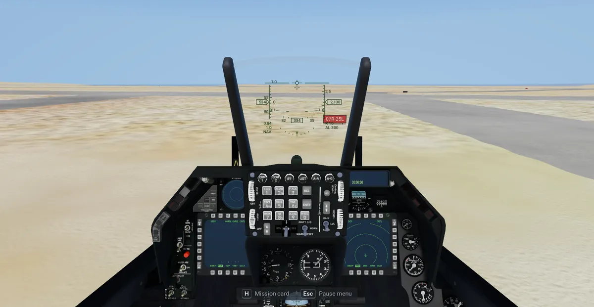 |
| The shore south of Tel Aviv toward Ashdod, 800 m (`662200 3542000 800 202`, `SHOT_ORBIT=180,25,400`; before: [shore_before.webp](pictures/scenery/shore_before.webp)) | 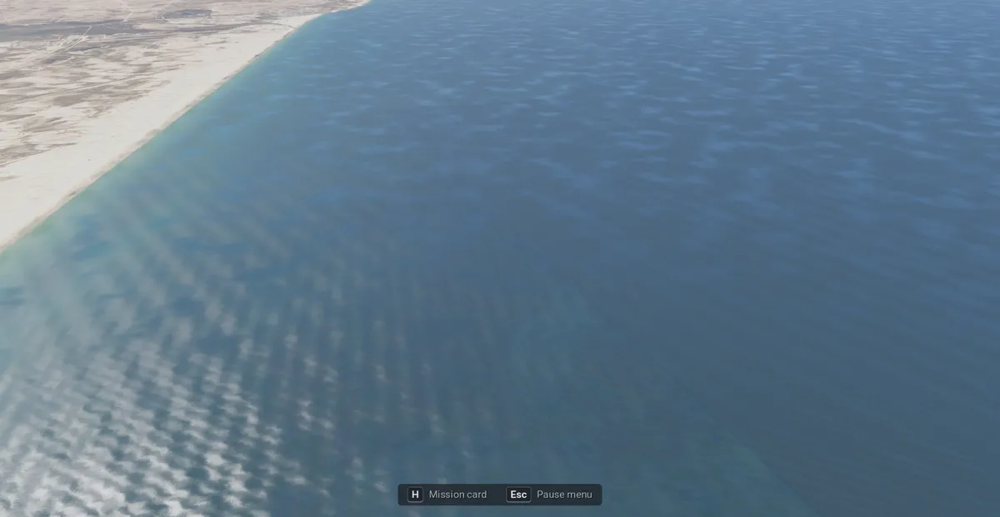 |
| Beersheba from 1,000 m, day (`668500 3455500 1000 20`, `SHOT_ORBIT=180,15,200`) | 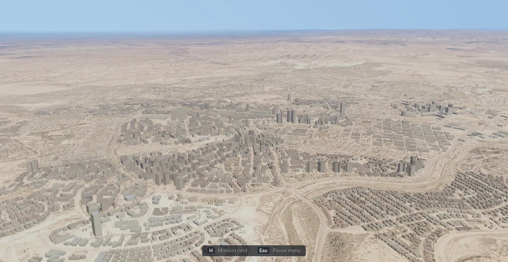 |
| The same at 22:00 (`SHOT_HOUR=22`) | 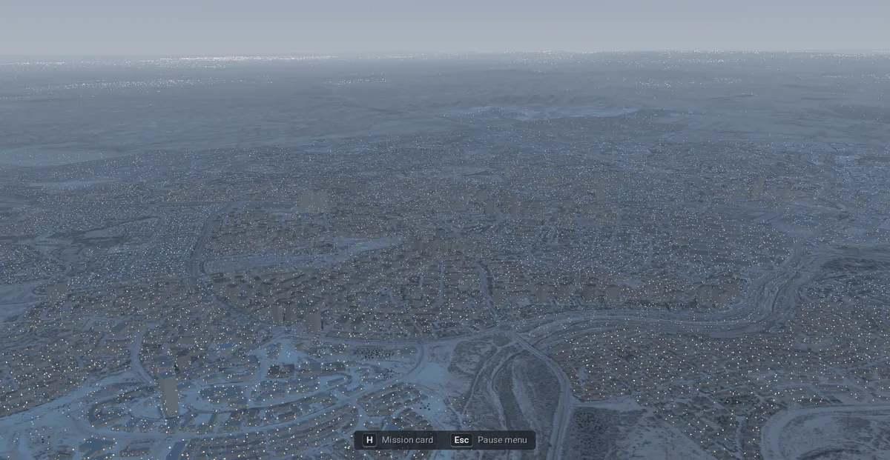 |
| Tel Aviv from 1,000 m, day, looking north along the coast (`667500 3548000 1000 15`, `SHOT_ORBIT=180,15,200`; before: [telaviv_day_before.webp](pictures/scenery/telaviv_day_before.webp)) | 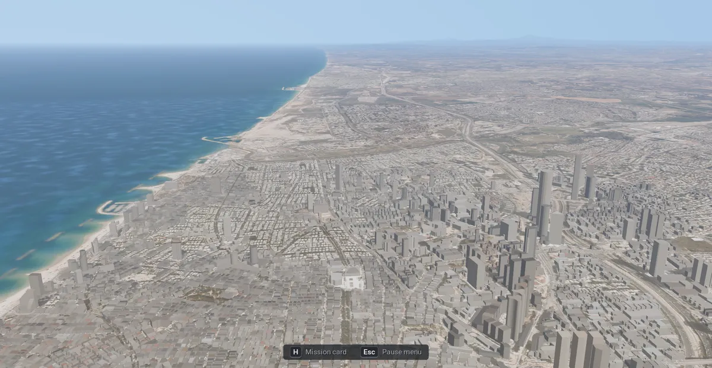 |
| The Dead Sea shore at Ein Bokek, 280 m over the water, looking north (`725300 3451300 -150 345`, `SHOT_ORBIT=180,20,300`; before: [deadsea_shore_before.webp](pictures/scenery/deadsea_shore_before.webp)) | 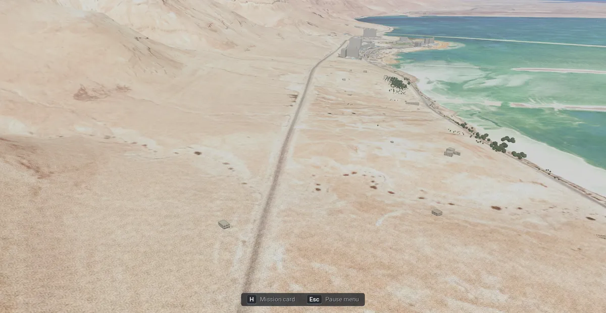 |

Seen in them: the signs stand beside the taxiway, legible at 40 m. The beach is clean, with no white edge, and the
sea is one surface out to the horizon. Beersheba's blocks, towers and the river bed match the photo; at 22:00 the town
is a dusk blue with its lights. Tel Aviv's towers stand along the Ayalon and in the centre, the low blocks between
them follow the streets. Wrong in it: every building is one grey, with no roof colour seen from 1,000 m. At Ein Bokek
the hotels, the palms along the beach and the pan's dikes sit where the photo has them, and no tree stands in the
pan. Wrong in it: the road is a flat grey band.

**Building colours: Palette** (2026-11-09, the look study's proposal 2; the sim's profile; docs/scenery.md §3.4).
Before, every building read grey or taupe from a few hundred metres: the walls faded to the roof photo's grey-brown.
Now each wall keeps its own palette colour, warmed toward cream and lit brighter, and the light flat and gabled roofs
are lifted out of the photo's grey. Rendered with `tests/godot/_imagery_shot.gd` (`SHOT_LAYERS=sim`, all settings on:
`SHOT_SET=antialiasing=msaa4_fxaa,shadows=true,terrain_detail=1.0,clouds=volumetric,scenery=detailed` plus
`building_palette=false` / `true`), 1920 × 1080 scaled to 1200 px, at the look study's poses:

| Where | Photo (before) | Palette (after) |
|---|---|---|
| Shoham, cockpit, 16:58 (`672750 3537452 240 100 0`, `SHOT_HOUR=16.97`) | 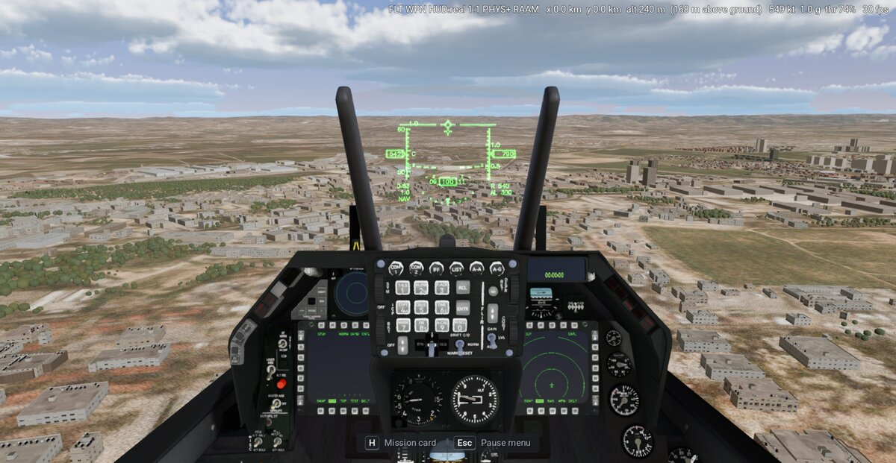 |  |
| Beersheba, external, 500 m above the town, 11:00 (`668500 3455500 780 20 0`, `SHOT_ORBIT=180,15,200`) | 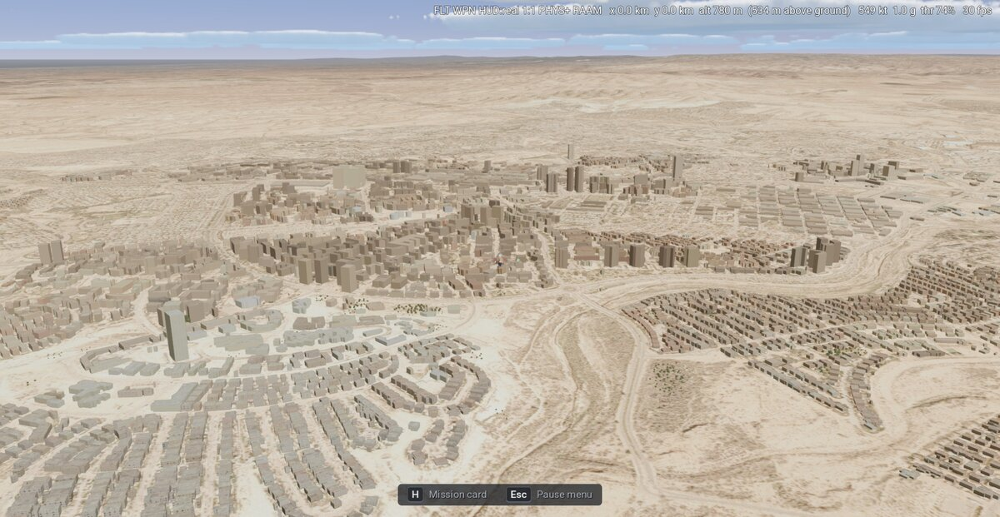 | 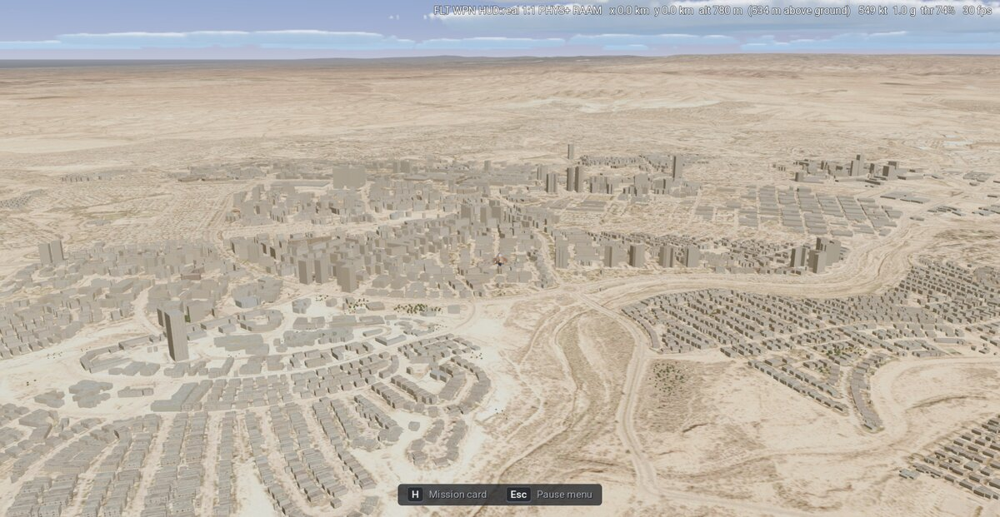 |

Sampled colours (sRGB, 0–255; box means on sunlit walls, and the mean of every building pixel that changed):

| | Photo | Palette | The reference (Epic Fury, beside Shoham) |
|---|---|---|---|
| Shoham, two near walls | (148, 145, 140), (143, 139, 132) | (169, 162, 152), (162, 155, 143) | lit (218, 198, 176), shaded (181, 160, 138) |
| Shoham, every changed building pixel | (140, 132, 121) | (157, 149, 135) | |
| Beersheba, three tower walls | (157, 141, 119), (166, 151, 130), (186, 171, 151) | (158, 146, 127), (173, 163, 147), (194, 183, 167) | |
| Beersheba, every changed building pixel | (163, 148, 129) | (170, 161, 146) | |

Seen: the walls are lighter by 10–20 levels and read as pale plaster and stone rather than taupe; the far town is
light, with the tiled roofs reddish. Still apart from the reference: its lit walls are 40–50 levels brighter and
warmer (blue about 0.8 of red against our 0.9). The rest of the gap is the scene's exposure and the sky's blue ambient
light on the walls (the look study's proposal 1, another change), not the walls' albedo (inferred).

Tried and dropped (2026-11-09): the palette alone at gain 0.65 and cap 0.65, without the warming toward cream. Its
walls read cool grey (Beersheba's changed pixels (159, 152, 140), bluer than Photo's), so the walls are now mixed 50 %
toward cream (sRGB 0.93, 0.85, 0.72) at gain 0.7, cap 0.7, concrete included.

Cost: the Shoham pose, Detailed, Clouds Flat, `_imagery_shot.gd`'s 180-frame rate with vsync off, Photo and Palette
interleaved three times each under the GPU lock, Intel Iris Xe, 1920 × 1080: Photo 35.4, 35.3, 35.4 fps (mean
28.28 ms), Palette 35.2, 35.3, 35.2 fps (mean 28.38 ms): about +0.1 ms, the size of the measuring step (0.1 fps).
No new data, 0 MB.

**Town labels** (2026-11-09, the look study's proposal 3; docs/scenery.md §3.5). **Dropped from the sim 2026-11-11**
after the user's Mac play test: the sim's profile fixes `town_labels` off and Preferences has no row for it; the 1998
game keeps them (Extras → "Town labels"). What was built and measured: each city's and town's name over the view
within 25 km, in Hebrew or English with the language, as the reference's "שוהם". Rendered with `tests/godot/_imagery_shot.gd` (`SHOT_LAYERS=sim`, all settings on as above
plus `town_labels=true` and `language=he` / `en`), 1920 × 1080 scaled to 1200 px:

| Where | Picture |
|---|---|
| Shoham, cockpit, 16:58, Hebrew (`672750 3537452 240 100 0`, `SHOT_HOUR=16.97`) |  |
| The same in English | 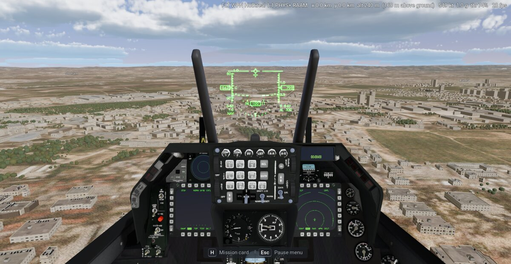 |
| Beersheba, external, 500 m above the town, Hebrew (`668500 3455500 780 20 0`, `SHOT_ORBIT=180,15,200`) |  |

Seen: Shoham's name sits on the horizon at the left, as in the reference; Lod, Ramla and Modi'in stand at their
places. The canopy bow cuts Modi'in-Maccabim-Re'ut's label where it crosses it, and the HUD draws over the labels.
Beersheba's name stands over the town centre; a dark edge keeps it legible on the light sand.

Cost: the labels' per-frame work (the `_process` of `town_labels.gd`), timed over 200 calls at each pose in the same
runs, Intel Iris Xe: 0.068 ms (Shoham, Hebrew, 6 labels), 0.077 ms (English), 0.025 ms (Beersheba, 3 labels). The
places in range are chosen again twice a second; the drawing is a few text draws. Data: `places.json`, 350 KB.

**Towns in the air photo's colours, the roads to the buildings' range** (2026-11-13, the look study A20, approved
by the user on its round 7 pictures; `Settings.scenery_ortho()`, true in the sim, false in the original game). The
user, over Tel Aviv at 500 m: "why do the buildings look so pale with no colours?", and later "roads still seem to be
missing". What the sim draws now:

- **Roofs**: each flat roof in its own colour from the air photo, the median of the theatre's colour pixels inside its
  footprint (the Survey of Israel's 2 m photo, Sentinel-2 where it has none; already in the data), lit to an albedo
  (× 0.85, at most 0.75), with solar water heaters: a dark panel and a white tank in some 3.5 m cells, a density per
  building. Gabled roofs stay clay. (Scenery Detailed keeps its own near roof materials.)
- **Walls**: the palette's own colours (white and Bauhaus white, cream, peach, ochre, pink, sand stone, grey concrete;
  no cream mix, no photo mix, chroma × 1.2, each building 75–100 % bright). A plaster wall's group comes from the air
  photo in a 2 m ring around its footprint (the wall tops and the street beside it): a warm ring picks the warm
  plasters, a light neutral one the whites, a dark one the weathered greys. `iaf-sim scenery` stores the ring's median
  in the building's 1998-colour slot (the sim has one photo; `iaf_avionics::scenery::Colours::Ring`). Where the theatre
  has only Sentinel-2 (10 m pixels) the ring is under a pixel wide, so most buildings there take the roof's median.
- **Wall detail**: ribbon windows that stay bands far away, a dark line at the top 0.5 m of every wall (the parapet),
  the sunward wall lit warm (× 1.06 / 1.0 / 0.9), the wall away from the sun × 0.55, and the lowest 10 m a shade darker
  with less sky light (a street-canyon term; no neighbour lookup).
- **City ground**: until 2026-11-13 the gold tint of Colour grading Natural left built-up ground grey (the tint's
  brightness without its colour). The tint is gone ([terrain.md](terrain.md) §15), so
  the streets keep the photo's own grey with no test of their own.
- **Roads** (Roads Detailed, docs/rendering.md §1.8): the road mask at 6 m texels over
  12.3 km instead of 2 m over 4.1 km, every road drawn to 5.5 km (was 1.5 km) as dark asphalt (sRGB 70 / 70 / 72),
  2.5 m wider each side (the carriageway with its kerb lane, as the photo shows the street), and the fade where the 2 m
  photo already shows the street capped at 30 % (it hid every city street from 500 m).

Measured over Tel Aviv's streets (the pixels the tint changes; mean sRGB): no tint 164 / 153 / 136, before 158 / 140 /
96, now 163 / 150 / 128; open land keeps the gold (139 / 128 / 101). Iris Xe cost, from the study's rounds over Tel Aviv at 500 m (2026-11-12): the roads to 5.5 km +0.1–0.2 ms, the grey-ground test about +0.3 ms, the buildings' shader within the noise (open: one clean before / after bench). Pictures (1920 × 1080,
the Tel Aviv crop 1400 × 700, scaled to 1000 px; Ramon looks toward the base's access road, the base's own roads
are off the ground layer):

| Where | Before | After |
|---|---|---|
| Tel Aviv, 500 m, the Yarkon and the port (`668000 3550689 530 330 0`, `SHOT_ORBIT=180,15,200`) | 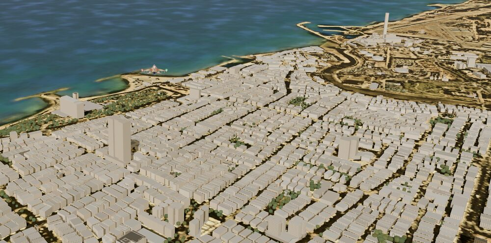 | 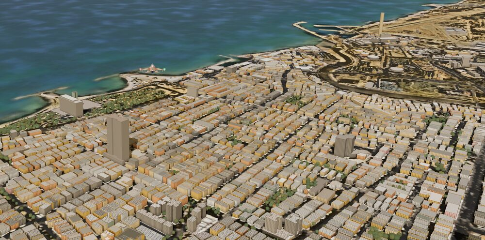 |
| Ramon, the access road (`661500 3402000 1140 15 0`, `SHOT_ORBIT=180,15,150`) | 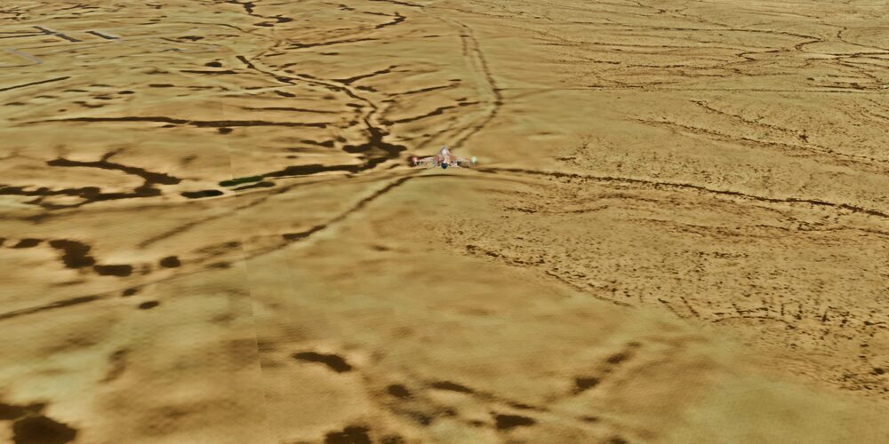 | 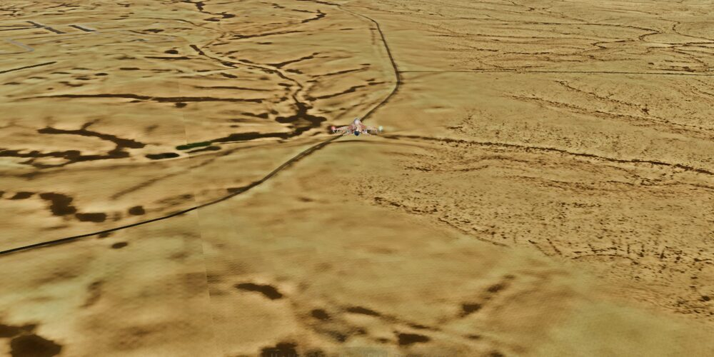 |

Tried and dropped (2026-11-12, the study's rounds): a cream mix reduced to a quarter (the walls only turned whiter);
dark roof and window variants without the ring (the panels read as one beige mass at 500 m); the main roads as
separate ribbons out to 9 km (+0.5 ms, faint); two extra photo reads for the grey-ground test (+1.5 ms; the grade's own
32 m mean serves). Open: the grounding round (far shadows, contact shading, pavements beside the roads).

**Wall shading and long shadows** (2026-11-09, the look study's proposal 5, approved as A10; docs/scenery.md §3.4,
docs/rendering.md §3.1). Two changes:

- **Wall shading**, always with the scenery (both games): a wall turned away from the sun takes less of the sky's
  light. The term is Lambert-like: the wall's level normal against the sun's level direction (the global shader
  parameter `scenery_sun`, set with the time of day), applied as the wall's ambient occlusion (`wall_shade()` in
  `shared/terrain/scenery_palette.gdshaderinc`). The wall facing away from a low sun keeps 40 % of its sky light, a
  side wall 70 %, a sunward wall all of it; at night nothing changes.
- **Shadow reach Far** (the sim's Graphics row "Long shadows", on by default; the original's Graphics → MORE "Shadow
  reach", Original by default): the sun's shadows reach 2.5 km from the camera instead of 400 m, with the splits at
  40 m, 200 m and 750 m, and the near building model (to 2.5 km) casts shadows on the streets. Before, no building cast
  a shadow: the photo under the town already holds its shadows.

Rendered as the colours above (all settings on, `building_palette=true`), 1920 × 1080 scaled to 960 px; the Beersheba
pictures are the town centre cut from the frame:

| Where | Before | After (wall shading, Long shadows) |
|---|---|---|
| Shoham, cockpit, 16:58 (`672750 3537452 240 100 0`, `SHOT_HOUR=16.97`) | 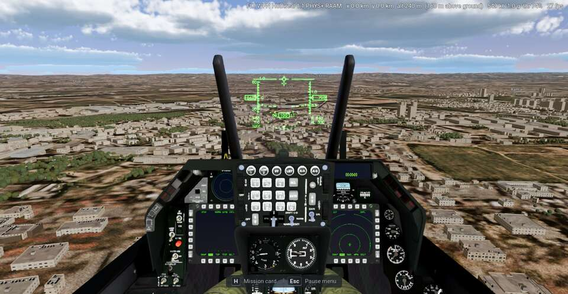 | 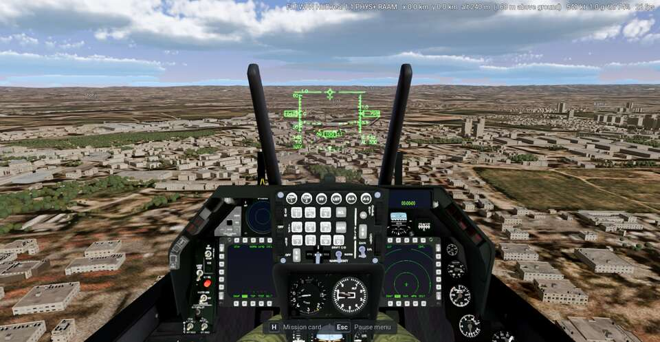 |
| Beersheba, external, 500 m above the town, 11:00 (`668500 3455500 780 20 0`, `SHOT_ORBIT=180,15,200`) | 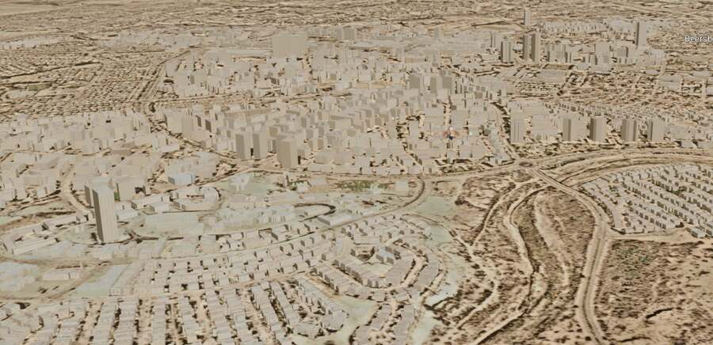 | 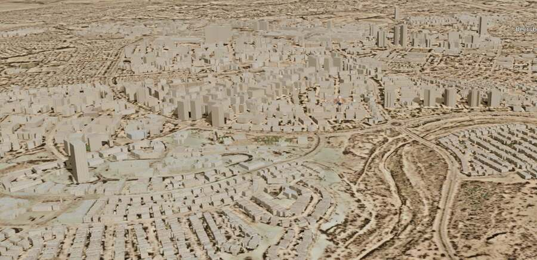 |

Seen: at Beersheba the towers and blocks now cast shadows north-north-west onto the streets and the lower roofs. At Shoham
the change is small: the camera looks east with the sun behind it, so the walls it sees are sunlit or side walls and
the shadows fall behind the blocks. In both frames 4–5 % of the town's pixels changed by more than 4 %; the frame's
mean level fell by 1–1.5 levels. Wall shading alone changed under 0.1 % of the pixels by more than 2 %: the walls the
cameras see at these hours face the sun, and the fog's light floors the shaded side.

Cost (2026-11-09), Intel Iris Xe (TigerLake GT2), 2560 × 1440, `modern-iaf/tests/_flight_bench.gd` with `BENCH_BEST=1
BENCH_AT=668000,3550689 BENCH_LEGS=500:150:15 BENCH_SET=scenery=on,blackbox=false` (Tel Aviv, 500 m), A and B
interleaved under the GPU lock. Godot fell back to the Wayland window with vsync forced on, for both sides alike. The
first run of each series was dropped: it ran about 8 ms faster with a cool GPU (28.2 and 32.7 ms).

| Change | Off: frame (GPU) | On: frame (GPU) | Cost | Draw calls, primitives | Video memory |
|---|---|---|---|---|---|
| Wall shading (mission clock) | 36.04, 36.21, 35.88 ms (mean 36.04; GPU 27.29) | 36.27, 35.68, 36.07 ms (mean 36.01; GPU 26.90) | none measurable | the same | 0 MB |
| Shadow reach Far (`BENCH_HOUR=11`) | 36.03, 36.01, 36.33 ms (mean 36.12; GPU 26.92) | 36.56, 36.45, 36.95 ms (mean 36.65; GPU 27.46) | +0.5 ms (1.5 %) | +40, +125 k | 0 MB (the 4096² atlas is the same) |

Both fit the Iris Xe budget, so Far is on by default in the sim.

Fixed on 2026-11-08 (the "before" pictures above):

- **The white patch on the sea off Tel Aviv** (off Herzliya, in fact): the Survey sheets' white no-data in a theatre
  built before the photo was cut to the coastline ([terrain.md](terrain.md) §12).
- **The sea's two blues in steps**: two seams. The 2 m photo's lighter sea beyond the coastline's 300 m reach ended at
  the sheets' straight edges; now the sea is Sentinel-2's from the beach out. And Sentinel-2's sea, whose pixels end
  in straight blocks offshore, met a darker fill; the fill is now the composite's own open-sea tone
  ([terrain.md](terrain.md) §3, §12).
- **The orange speckle near the camera at Ein Bokek**: the shared Terrain close up's colour patches, which turn pale
  ground orange; the sim draws its grain and relief only ([terrain.md](terrain.md) §13).

## 8. Checks

- `cargo test --release -p iaf-tools --lib sim_scenery`: a building at its lat / lon in UTM (within 5 m; 0.5 m in
  fact), the exclusion zones (sea, lake, runway, a pond the grid misses, inside a base's outline; the desert beside
  open), the photo's water test, the tiles' and countries' boxes and the downloads the theatre needs.
- `cargo test --release -p iaf-tools --lib sim_bases`: the inverse projection, the water flags, the water polygons'
  filters and their twins, `water.json` read back (terrain.md §11).
- `cargo test --release -p iaf-avionics --lib`: the frame's nodes in both frames (`frame`), the light far model
  (`scenery`).
- The original game: `tests/godot/test_scenery.gd`, `test_terrain.gd`, `test_startup.gd`, `test_ground_roads.gd`; its
  road layer, scenery cells, light cells and manifests built byte for byte as on main: checked again on
  2026-11-08 on the final branch against main 15067824 (`iaf-scenery roads`, then `build` and `lights` with `--near
  340250,612940,6`, each from a scratch root over the same inputs): 3,546 files, the same SHA-256 each (the whole
  road layer, 21 cells, their light cells, the manifests). The rest of the theatre (`build_theatre`, run by `build`)
  stopped with GDAL's PROJ errors on both. In the sim: `modern-iaf/tests/test_mvp.gd` and the M0
  probe.

## 9. Open

- **The scenery over a dense town costs twice its budget** (measured 2026-11-09 and 2026-11-11, §6): 14 % of the GPU
  time over Tel Aviv at 500 m and 13 % over Beersheba after the two cuts that keep the picture (the budget: 7 %). The
  near buildings' geometry takes 2.0 ms of the 3.1 ms; each further cut changes the look.
- **Unit clearances**: when the sim has ground units (§4).
- **The rest of the theatre in the byte check**: `build_theatre` with `--near` stopped on PROJ's "moll: Invalid
  latitude" on main and on the branch alike (§8).
- **Pictures in the repo**: Ramon from 500 m, Tel Aviv at night, Tel Aviv with Far towns Full and Light, and the
  Graphics → MORE page with the Far towns row.
- **The open sea's faint line**: fixed in the build (2026-11-11, [terrain.md](terrain.md) §3); a theatre built before
  shows it until it is built again.
- **The bases' buildings**: the hangars and shelters are the airbases' models' (item B2's open points).
- **Kinds**: the sim makes both buildings and trees; one row turns both on (Preferences → Graphics → "Buildings and
  trees", [front-end.md](front-end.md) §4); a choice between them is open.
