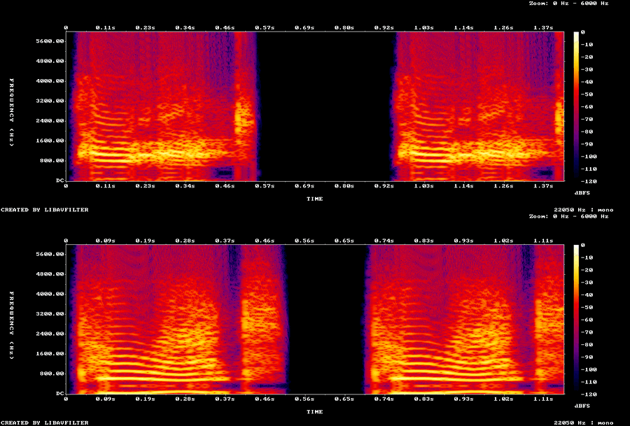

# Modern IAF: sounds, voices and keys

**Terms:** AB = afterburner; Betty = the cockpit's recorded voice warnings; IPA = the International Phonetic Alphabet;
particle = one word file of a radio phrase (docs/radio.md §1); TTS = text to speech; VMS = the F-16's Voice Message
System; vrms = the RMS of the samples above 2 % of the peak (the pauses left out), in dB of full scale.

2 November 2026 (item E1b). The sim plays its own sounds and voices and reads its own key table. All three are
authored in `modern-iaf/data/` and compiled by `iaf-sim own` into the files and shapes the shared readers already read
(`sound_table.gd`, `radio.gd`, `key_table.gd`). Nothing comes from the original game: every clip is an openly
licensed recording, a tone we computed or our TTS. The readers take these files under `Settings.own_dir()` and
`Settings.keys_file()`, which the sim's settings point at `converted/own/` (item A1).

| what | authored in | made by | compiled to (under `assets/`) |
|---|---|---|---|
| sound effects | `data/sounds/*.ogg`, `soundprop.json` | `tools/iaf-2026/sounds.py` | `converted/own/resource/soundfiles/soundprop.trx` + clips |
| voices, radio phrases | `data/sounds/voices.json` | `iaf-sim voices` (Kokoro, §5) | the same folder: `phrasetemplates.trx`, `phraseparticalsdata.trx` + clips |
| keys | `data/keys.json` | by hand | `converted/own/keys.json` |

```sh
cargo run --release -p iaf-tools --bin iaf-sim -- own        # or: all
VENV/bin/python -I tools/iaf-2026/sounds.py DL      # remakes the effects from the downloads in DL
IAF_KOKORO_PYTHON=VENV/bin/python cargo run --release -p iaf-tools --bin iaf-sim -- voices   # remakes the voices (§5)
```
`sounds.py`'s header gives its setup (a venv with numpy and scipy; ffmpeg with libvorbis); `tools/iaf-2026/kokoro_tts.py`'s
header gives Kokoro's (§5.3). A new `voices` run remakes every clip; Kokoro's output may differ slightly between
machines and versions (inferred).

## 1. The sound set
One clip per sound code the shared flight code plays (docs/sound.md §3–§5): 29 CC0 recordings from freesound[^fs], one
clip made from one of them (the afterburner's light-off, §1.2) and 8 computed tones (with the JFS whine, §1.4). Each clip's source, author, licence and cut: [SOURCES.md](../data/sounds/SOURCES.md).
- **Format:** 22050 Hz mono Ogg Vorbis, quality 4 (about 45 kbit/s), named by code
  (`sfx_weapon_exploded_ost_bomb.ogg`); since 3 November 2026 (item E1c), before that 16-bit WAV. `sound_table.gd`
  opens a clip by its extension, and a name "x.wav" the code opens by name (`KCH2.WAV`, `EndWorld.wav`,
  `cock_g_02.wav`) falls back to "x.ogg". `iaf-sim own` refuses a clip in any other format. The scripts write the
  ogg directly; no WAV is kept in the repository.
- **Processing** (`sounds.py`): the cut; 5 ms fade in and 50 ms fade out, or for a loop the last 0.25 s cross-faded
  into the start (equal power); the tail below −50 dB of the peak cut; the level set as vrms; a soft limit at −1 dBFS.
  The recordings are freesound's HQ previews (Ogg Vorbis, 44.1 / 48 kHz): the original files need a login.
- **Rows** (`soundprop.json`, 114 rows): the columns of docs/sound.md §1 by name (`category` engine / effect /
  speech, `play` loop / once, `3d`, `min_m` / `max_m`, `volume_in` / `volume_out`, `channel`). The weapon sub codes
  share clips by kind: every missile one launch, flight loop and explosion; every bomb one release, fall loop and
  explosion. `SFX_DRY_THRUST` and `SFX_AFTERBURNER_THRUST` (AB stages 1 and 2) share the AB loop, which the sim plays at
  its own pitch (§1.2); `SFX_AB_LIGHT` is the sim's own row for the light-off, `SFX_JFS` for the JFS whine (§1.4). Our values (inferred): the engine at 0.6
  in the cockpit, the gear and flaps at 0.75, explosions heard to 3 km.
- **By name** (`soundprop.json` `by_name`): the files the shared code opens by name, not by code: `cock_g_02.wav`
  (the G strain, `g_effects.gd`), `endworld.wav` (the map edge, `terrain_view.gd`), `kch2.wav` (the radio click,
  `radio.gd`), `key_on.ogg` and `key_off.ogg` (the keyed quiet around a radio call, §5.2). `g_effects.gd`'s `cock_bty_over.wav` is left out: the VMS has no Over-G voice, so it stays silent.
- **Silent on purpose:** a code with no row plays nothing (`flight_sounds.gd play`): Betty's missile, Over-G and
  spin calls (§3).
- `SFX_WIND` (§1.6) and `SFX_DOOR_CLOSE` (§1.7) play in the sim since 9 November 2026; `SFX_DOOR_OPEN` since 13
  November 2026, when the canopy switch goes back off ([cockpit.md](cockpit.md) §5.2 "Both ways").

### 1.1 Listening notes
Measured, not heard: a human listening pass at game volume is still open. Every clip below has no clipped sample,
less than 0.4 s of near-silence at its ends, and (loops) no seam as Godot plays it (§1.10). The
original's clips of the same codes were measured for level only: ours are mostly within 3 dB.

| clip | s | vrms dB | peak dB | listen for |
|---|---|---|---|---|
| `cock_g_02` | 3.27 | -22.0 | -11.6 | a man's effort grunts for the G strain; check it does not sound comic |
| `sfx_ab_light` | 1.20 | -19.0 | -8.1 | the light-off thump under the rising burner (§1.2) |
| `sfx_afterburner_thrust` | 3.00 | -8.3 | -1.0 | two RNLAF F-16s taking off, equalised and flattened (§1.2) |
| `sfx_aircraft_exploded` | 2.34 | -11.3 | -1.0 | a DoD video blast |
| `sfx_aircraft_fired_weapon_ost_bomb` | 0.40 | -14.4 | -1.3 | a metal clonk as the rack release |
| `sfx_aircraft_fired_weapon_ost_flare` | 1.00 | -14.0 | -4.5 | a vintage flare gun; the shells falling to the floor may be in the cut |
| `sfx_aircraft_fired_weapon_ost_gunbullet` | 1.09 | -12.0 | -2.9 | M61A2 burst loop at 100 rounds a second (§1.5): check for a rhythm break at the seam |
| `sfx_aircraft_fired_weapon_ost_heatmissile` | 3.00 | -13.3 | -1.1 | a ground anti-tank launch standing in for an air-launched missile |
| `sfx_button` | 0.35 | -20.0 | -2.5 | a guitar-pedal toggle; longer than the original's 30 ms click |
| `sfx_door_close` | 4.25 | -18.0 | -2.7 | cut by the loudness envelope only; check the lock thump is in it |
| `sfx_door_open` | 3.75 | -18.0 | -4.2 | the canopy motor's second run (§1.7; USC vintage optical recording, noisy) |
| `sfx_entity_fired_weapon_ost_gunbullet` | 1.25 | -14.0 | -8.8 | Phalanx burst as the AI's gun and AAA |
| `sfx_fire_extinguisher` | 1.20 | -17.2 | -1.2 | one burst of a real extinguisher |
| `sfx_flaps` | 2.50 | -14.0 | -2.2 | 3 dB quieter than the original's; a steady motor, cut at 2.5 s with a fade |
| `sfx_jfs` | 1.00 | -20.0 | -9.0 | our JFS whine (§1.4): check it does not sound like an organ |
| `sfx_ir_lock` | 1.00 | -16.0 | -14.5 | our lock tone |
| `sfx_ir_seek` | 1.00 | -18.0 | -15.4 | our growl; compare with a real AIM-9 tone |
| `sfx_landing` | 0.10 | – | – | silence (engine off) |
| `sfx_landing_gear` | 4.00 | -10.1 | -1.1 | 3 dB quieter than the original's; recorded for a flight sim (Aces High II) by its author |
| `sfx_object_specific_ost_bomb` | 3.00 | -24.0 | -13.7 | a falling whistle looped: may sound odd when it repeats |
| `sfx_object_specific_ost_heatmissile` | 3.00 | -20.0 | -10.8 | rocket roar loop for every missile's flight |
| `sfx_screech` | 2.75 | -16.7 | -1.0 | a metal sheet scrape for a belly landing |
| `sfx_speed_breakes` | 1.35 | -18.3 | -1.1 | a forklift's hydraulics: check it reads as an air brake |
| `sfx_speed_breakes_loop` | 6.00 | -20.0 | -8.8 | KC-135 camera wind (also SFX_WIND): check it is not too hissy in the cockpit |
| `sfx_splash` | 2.17 | -13.0 | -1.0 | a mix of CC0 splashes |
| `sfx_start_engine` | 3.00 | -14.0 | -2.4 | a parked F-16's idle; check it still sounds right pitched up to 1.375 at full dry power |
| `sfx_touchdown` | 0.45 | -13.0 | -2.4 | an airplane tyre skid with a 60 Hz thump (§1.8) |
| `sfx_warning_wrn_aoa` | 1.00 | -24.0 | -20.9 | our beeps, 7 dB louder than the original's quiet tone |
| `sfx_warning_wrn_master` | 0.45 | -20.0 | -16.9 | ours; the original had no file |
| `sfx_warning_wrn_missile_launch` | 1.00 | -20.0 | -17.0 | our warble |
| `sfx_warning_wrn_new_guy` | 0.35 | -24.0 | -20.8 | our three beeps, much louder than the original's (-38 dB) |
| `sfx_weapon_exploded_ost_bomb` | 1.68 | -10.3 | -1.1 | 1.7 s, shorter than the original's 5.5 s: may need a longer rumble |
| `sfx_weapon_exploded_ost_gunbullet` | 0.45 | -12.5 | -1.1 | coins on a music stand pitched down (bullet hits) |
| `sfx_weapon_exploded_ost_rocket` | 0.85 | -14.9 | -1.0 | a firework bang for rocket, chaff and flare bursts |
| `sfx_weapon_hit_target` | 3.62 | -14.9 | -1.0 | a debris crash |

### 1.2 The afterburner against a real F-16
9 November 2026 (the Mac play test's finding 27: "is the AB start really sound like that?"). Measured with ffmpeg and
numpy / scipy, not heard: spectrograms, 50 ms level envelopes and the time to 10 % and 90 % of each step, on three
references:
- an F-16 engine run with the afterburner in a hush house[^hush]: three light-offs and four cuts at close range (the
  camera's microphone clips 14 % of the burner's samples, so its steps are a lower bound);
- an F-16's afterburner take-off at Oshkosh 2021[^osh];
- two RNLAF F-16s taking off at Leeuwarden, two CC0 recordings[^rr1][^rr2].

The engine model behind the references is open (the F-16 flies the F100 or the F110). The two videos are references
only: nothing of them ships, and their audio was deleted after the measurements. FlightGear's F-16 sounds were not
compared (open).

**When the sound changes.** The shared code swaps the engine loop when the flight model's afterburner stage changes
(docs/sound.md §3): stage 1 (minimum burner) at the AB detent, stage 2 above 87.5 % throttle. The sim's 6-DoF
engine ([flight-model.md](flight-model.md) §9.7) reports stage 1 once its power passes military and stage 2 at 75 %
power, about 0.1 s later with the throttle at maximum, so the burner sounds as soon as the core is at military. The
real engine's light-off delay after the detent is open: no reference shows the throttle.

**What differed** (before = the sim until this change, after = now; `measure.py` in the review folder, below):

| | references | before | after |
|---|---|---|---|
| light-off: the level's rise, onset to 90 % | 1.2–2.4 s (hush house) | 0.2 s | 1.3 s |
| light-off: the rise | 11–15 dB (hush house), 14 dB (Oshkosh) | 3 dB | 6 dB |
| light-off: the swell below 150 Hz over the steady burner | 1–3 dB, at 0.3–1 s | none (the loop's own 3 dB wobble) | 3.7 dB |
| cut: the level's fall, onset to 90 % | 0.8–1.0 s | at once | 0.7 s |
| cut: the fall | 12–15 dB | 2 dB | 6 dB |
| the burner's power below 150 Hz / 150–1500 Hz / above 1.5 kHz | −13 / −1 / −9 dB (hush house), −17 / 0 / −16 dB (Leeuwarden), −2 / −6 / −10 dB (Oshkosh) | −2 / −5 / −13 dB | −10.5 / −1 / −11 dB |
| the burner's spectral centroid | 700–800 Hz (Oshkosh 470 Hz) | 380 Hz | 510 Hz |
| the loop | steady | a pulse every 2.1 s (a 2.5 s cut of a fading recording played at 1.2) | steady |

- **The thump.** At light-off the hush house shows the burner rising over one to two seconds, with the band below
  150 Hz swelling 1–3 dB over its steady level, not a sharp bang (inferred: the zones fill one after the other,
  [flight-model.md](../../docs/flight-model.md) §10.2). The sim swapped loops in one frame with no swell.
- **The rumble.** The old loop (a turbojet afterburner of unnamed type, played 3 semitones up) put most of its power
  below 150 Hz: a boom. Two of the three references put it at 150–1500 Hz: a tearing roar. The Oshkosh video's power
  below 150 Hz is likely wind on its microphone (inferred).
- **The level against the dry engine.** Outside, the references jump 11–15 dB at light-off; the sim's burner was 2 dB
  over its dry loop. The level in the cockpit is open (no recording).
- **The cut's tail.** The references fall over about a second; the sim cut at once, with the old loop restarted.

**What the sim does now** (`Settings.ab_sound_real()`, true in the sim, false in the original game, whose rule and
clips are unchanged; `flight_sounds.gd`):
- the burner loop is a cut of the Leeuwarden take-off[^rr1] at its closest pass, 16.5–19.5 s, the band below 150 Hz
  down 12 dB and above 1.5 kHz up 16 dB (the recording was made far down the runway, where the air takes the highs
  and the ground adds rumble: inferred), then flattened over 0.5 s so it does not pulse; played at its own pitch for
  both stages, with no restart from stage 1 to stage 2;
- at light-off the burner rises from 12 dB under its level over 1.5 s (smoothstep) while the dry loop fades out over
  the same time, and `sfx_ab_light` plays: the burner's band below 150 Hz under a swell that peaks at 0.3 s and ends
  at 1.2 s;
- at the cut the dry loop starts at once and the burner fades out over 1.3 s (raised cosine) on a second player,
  from the level it had (a cut during the rise fades from that lower level); lit again while that tail fades, the
  burner goes on from the tail's place in the loop and rises from the tail's level;
- the burner loop is set 6 dB over the dry loop (−8 and −14 dB vrms; the dry loop 2 dB quieter than before), a step
  between the references' outside jump and no change (inferred, open for the cockpit).

Before / after renders of the same throttle moves (dry at military, the burner at 3 s, the cut at 9 s), their
spectrograms, the references beside them and the spectra are in the review folder
(`~/.claude/iaf-2026-pages/sound/`, notes.md lists the files). Checks: `test_mvp.gd` (the sim's rule), the original's
`test_sounds.gd` (its rule, no thump, no tail).

### 1.3 The core sounds against real references (Approvals item A12)
9 November 2026. The same method as §1.2: each sound the sim plays, its clip, the code that plays it and its timing,
measured against references with ffmpeg and numpy / scipy, not heard. The YouTube references are for comparison only:
nothing of them ships, and their audio was deleted after the measurements. The fixes are the sim's alone: the shared
code takes them through `Settings.core_sound_real()` (true in the sim, false in the original game, whose rule and
clips are unchanged; `test_sounds.gd` checks that). Before / after renders, their spectrograms and the reference
figures are in the review folder (`~/.claude/iaf-2026-pages/sound/core/`, notes.md lists the files).

| sound | what differed (before) | the reference | now |
|---|---|---|---|
| the dry engine (§1.3) | the idle recording played 4.2 semitones up at idle (pitch 1.275) and 1.375 at military: 8 % from idle to military, at one level | an F-16's spool tone at 2.8 kHz at idle rises past 6 kHz on the run-up[^hush]: at least 2× | its own pitch at idle, 1.3 at military; 6 dB quieter at idle |
| the start (§1.4) | from the first crank the idle loop at pitch 1.13–1.18, at full level; no JFS, no light-off | the JFS whine: partials at 2126, 3252, 4247, 5259, 6401 Hz, 20–30 dB over the broadband, rising from half that pitch over about 15 s[^start] | the JFS whine, the engine's pitch and level by its RPM, a light-off thump, the JFS winding down at the generators |
| the gun (§1.5) | 48 rounds a second (the recording's own rate) | 105 rounds a second, two F-16 firing videos[^gun1][^gun2]; the M61A1 fires 6,000 a minute | 100 rounds a second |
| the wind (§1.6) | silent (no caller) | open: the cockpit videos' sound is the intercom | the KC-135 wind loop, its amplitude as the dynamic pressure |
| the canopy (§1.7) | silent (no caller); the opening clip was the library's spoken slate | — | the closing plays at the checklist's canopy step; the opening clip is the motor |
| the touchdown (§1.8) | a bicycle brake's squeal: two tones at 1.6 and 3.3 kHz, 0.55 s | an airplane tyre skid (CC0[^skid]): broadband 0.2–4 kHz, 0.35 s | that skid with a 60 Hz thump under it, 0.45 s |
| gear and flaps | the gear clip (a flight-sim recording) runs 3.5 s against the sim's 3 s gear travel; the flaps clip is a steady motor whine, its centroid at 3.8 kHz | open: no usable recording | unchanged (open) |
| the tower's key clicks | none: a call's particles played alone | a tower frequency on a scanner[^mco] | the radio's keyed quiet, §5.2 |

**The dry engine.** `flight_sounds.gd` plays `sfx_start_engine.ogg` (a parked F-16's idle) below the burner. The
original's rule pitches it as (RPM + 0.5) × 0.25 + 1 (FUN_004c3e00), so the sim's idle (60 % RPM) played at 1.275
and military at 1.375. Now: pitch 1 at idle, rising linearly to 1.3 at military; the level 6 dB under the row's at
idle, rising linearly in dB to the row's at military, so the burner's step over military (§1.2) stays 6 dB. The
real spool tones rise at least 2× from idle (hush house[^hush]); a broadband loop pitched that far sounds like a
cartoon, so 1.3 is a middle (inferred). The idle-to-military level step in the cockpit is open; 6 dB is inferred.

### 1.4 The start
The sim's start by keys (training.md §7.1): the JFS cranks the engine 0 → 20 % RPM in 15 s, the throttle to idle,
the light-off 5 s later, 20 → 60 % in 15 s, the main generator at 52 %. Before, the engine loop started with the
crank at pitch 1.13 and full level. Two F-16 start videos[^start][^kf16] show the JFS whine first: a set of
partials, the strongest at 2126 Hz and 3252 Hz, rising from about half their pitch over 8–15 s, then steady while the
engine spools. Now:
- **The JFS:** `sfx_jfs.ogg`, computed (`sounds.py` `jfs`): those five partials (and a weak 1063 Hz) at their
  measured levels, wandering 0.3 % in speed, on 1/f noise above 300 Hz. It spools from half pitch over 10 s (between
  the references' 8 and 15 s) while the start runs, and winds down over 3 s (the reference's fall takes 3–4 s[^start])
  once the RPM reaches 52 %, the main generator on line[^f16net]: the generators coming on line are heard as the JFS
  winding down (inferred). The F-35I's IPP plays the same whine (inferred).
- **The engine:** below idle the loop's pitch is RPM / 60 % (at least 0.3) and its level falls as (RPM / 60 %)^1.5:
  14 dB under idle at 20 % (inferred).
- **The shutdown** (the throttle to OFF, training.md §7.2): no sound of its own. The RPM's run-down drives the same
  loop: its pitch falls with the RPM to 0.3 at 18 % and its level as (RPM / 60 %)^1.5, so the engine pitches down and
  fades over about 20 s and goes silent at the stop (inferred). A restart plays the JFS whine again.
- **The light-off:** `SFX_AB_LIGHT` (the burner's low thump, §1.2) 6 dB down as the engine lights (inferred: the
  references' level rises about 6 dB over several seconds there, with no sharp bang).

### 1.5 The gun
`player_weapons.gd` loops `SFX_AIRCRAFT_FIRED_WEAPON` / `OST_GUNBULLET` from the first round to the trigger's
release. The clip (Seidhepriest's M61A2 recording) repeats 48.4 times a second: half the M61A1's 6,000 rounds a
minute. Two F-16 firing videos[^gun1][^gun2] buzz at 105 rounds a second. `sounds.py` `gun_rate` now finds each shot
on the recording's envelope and lays it down every 220 samples (100.2 a second) under a Hann window two periods long
(pitch-synchronous overlap-add): the shot keeps its sound, only the rate changes. The loop's cross-fade starts on a
shot. Its centroid moved from 716 to 848 Hz (the references: 311–675 Hz). Open: the barrels' spin-up (about 0.4 s)
and wind-down; the AI's gun (a Phalanx at 79 a second) is unchanged.

### 1.6 The wind
`SFX_WIND` had a row and no caller. Now, from 30 kt, the sim loops it (the KC-135 recording the air brake also uses)
with its amplitude as the dynamic pressure, (KCAS / 450 kt)²: 12 dB under its row's level at 225 kt (inferred: the
pressure under a turbulent boundary layer grows with the dynamic pressure). Since 9 November 2026 (A13) the amplitude
stops at the row's level from 450 kt: without the cap it was 8 dB over at 700 kt. Open: the cockpit's own wind
spectrum, and the air brake's loop over it. The cockpit's level: §1.9.

### 1.7 The canopy
`SFX_DOOR_CLOSE` (craigsmith's USC recording of a jet's canopy closing, its 4 s motor run to the lock) now plays at
the start-up checklist's canopy step (`sim_flight.gd`). `sfx_door_open.ogg` was the recording's first 4 s, the
library's spoken slate (speech formants every 0.3 s); it is now the motor's second run (21.25–25 s), still with no
caller. Open: a real F-16 canopy's run time (the references could not separate it from the ground power).

### 1.8 The touchdown
`flight_sounds.gd` plays `SFX_TOUCHDOWN` when the wheels touch with the gear down. The clip was a bicycle tyre's
squeal: two steady tones at 1.6 and 3.3 kHz for 0.55 s. Now it is craigsmith's USC airplane tyre skid[^skid]
(0.15–0.6 s): broadband 0.2–4 kHz, 0.35 s, with a 60 Hz thump falling over 0.12 s under it, the struts (inferred).

### 1.9 The cockpit sound model (Approvals item A13)
9 November 2026 (the user, after A12: the gun sounded too loud for inside the canopy). A pilot in a closed F-16
cockpit hears two kinds of sound. The radio, Betty and the cockpit's tones come through the helmet's earphones. Every
other sound comes from outside. It passes through the canopy and the helmet's ear cups, and those take away more of
the highs than of the lows. The sim plays it that way when `Settings.cockpit_sound_model()` is true (in the sim; false
in the original game, whose buses and volumes are unchanged; `test_sounds.gd` checks that).

**What the sources say.**
- Fighter cockpits are loud: 97–106 dB(A) in the cockpit and 83–100 dB(A) at the ear canal in flight, with the
  helmets taking 10–21 dB(A) in flight as in the lab (Finnish Air Force pilots)[^kuronen]; 110 dB(A) in another
  fighter cockpit[^cn]. The airflow over the canopy (its boundary layer) is a main source, which at high speed can
  matter more than the engine[^kus]. Above 88 dB(A) noise interferes with speech in a cockpit[^ac20].
- The HGU-55/P's ear cups (passive, the lab mean, ANSI S12.6 Method A)[^gentex]:

| octave | 125 | 250 | 500 | 1k | 2k | 4k | 8k Hz |
|---|---|---|---|---|---|---|---|
| attenuation, dB | 17.8 | 18.9 | 25.1 | 37.5 | 42.2 | 53.0 | 52.2 |

- The F-16A's canopy is one piece of polycarbonate about 0.75 in (19 mm) thick[^canopy]. No measured transmission loss
  of it was found (open). Ours is the field-incidence mass law, 20·log10(f·m) − 47 dB with m = 22.9 kg/m², capped at
  35 dB (inferred: above that the frame and the structure carry the sound around the glass): 22, 28, 34, 35, 35,
  35 dB from 125 Hz to 4 kHz.

**The model** (`iaf_flight::cockpit_sound`, its bridge `IafCockpitSound`, `sound_buses.gd`):
- **The loss.** Canopy plus ear cups: 40, 47, 59, 73, 77, 88 dB from 125 Hz to 4 kHz. Its overall size does not
  matter in a game's mix, only its shape: one low-pass, 12 dB per octave at 166 Hz with Q 0.5, fits the shape within
  2.9 dB RMS from 125 Hz to 4 kHz (`lowpass_fit`; the clips are 22050 Hz, little energy above that). Godot plays it
  as `AudioEffectLowPassFilter` with `db` = FILTER_6DB (Godot's one-biquad setting, 12 dB per octave) and resonance
  0.5 (its Q).
- **The classes.** Each sound code is in one class (`class_of`; unknown codes are world):

| class | sounds | level from the cockpit | set by |
|---|---|---|---|
| inside | Betty, the radio and its key clicks, the warning and seeker tones, the switches, the G strain | unchanged | — |
| engine | the engine loops, the burner and its light-off, the JFS | +6.9 dB | the dry loop at military 6 LU under the radio (−19 LUFS; inferred: speech over the noise) |
| airframe | the wind, the air brake, the gear, the flaps, the canopy's motor, the touchdown, the screech, hits on the jet, the extinguisher | +10.4 dB | the wind at 450 kt as loud as the engine at military (inferred) |
| weapons | the own gun, launches, releases, flares | −2.5 dB through a 700 Hz low-pass | the gun 5 dB over the engine and the wind at 450 kt (the reference below) |
| world | explosions, the AI's guns and engines, the missiles in flight | +6.9 dB | the engine's path (the clips' outside levels are balanced already) |

- **The weapons' path.** The M61 sits in the fuselage under and left of the pilot, so its sound comes mostly through
  the structure, not the canopy. The weapons play through the same filter at 700 Hz (inferred), which keeps the gun's
  buzz.

  The levels are over 0 dB because the low-pass takes most of a clip's loudness. They were set by measuring the
  clips through the low-pass with ffmpeg's EBU R128 (`render.py` in the review folder).
- **The buses.** An outside sound plays on `IafCanopy_<class>_<category bus>`, made on first use: the low-pass, the
  class's level (an amplify effect) and a hard limiter after it (an own hit or explosion through +7–10 dB would
  clip; a bus's own volume comes after its effects, so the level is an effect), sent on to its category bus,
  so the Preferences' volumes still apply. An outside row plays at its outside volume (`volume_out`) both ways: the
  bus gives the cockpit's level, so the rows' inside volumes (the engine's 0.6) are not used.
- **The view.** `flight_sounds.gd` tells `SoundBuses.set_view()` the view every frame. From an external view (chase,
  F10, the outside cameras; `terrain_view.in_cockpit` false) the canopy buses bypass their effects at 0 dB: every
  sound at its row's outside volume, unmuffled.

**The gun against a cockpit recording.** The F-16 videos found carry the intercom (HUD tapes) or the outside (ground
films). An F-15D back-seat video[^f15d] has the cockpit's own sound: two bursts of about 1 s at 101–102 rounds a
second (the M61A1). Each rises over the 2 s before it by +4.8 and +3.1 dB broadband (RMS), +7.1 and +3.8 dB below
600 Hz, +1.9 dB from 500 Hz to 4 kHz: the gun is a low buzz just over the noise. The sim's burst over the engine at
military and the wind at 450 kt rose +5.7 dB, at full brightness. The first A13 render put the gun on the canopy's
166 Hz curve at +1.1 dB: +4.1 dB broadband, but +0.7 dB from 300 Hz to 2 kHz and no 100 Hz line in the envelope. The
broadband rise was the low rumble, and the user's verdict was "the gun can't be heard at all". Now, through 700 Hz at
−2.5 dB, the burst rises +4.8 dB broadband (the reference's upper burst) and +4.3 dB from 100 Hz to 2 kHz (4th-order
band-pass, where its buzz lives), with its 100 Hz line back. The F-15's gun is in the
right wing root, the F-16's in the left strake behind the cockpit, so the F-16's may be louder (open). The video was
used for measurement only; its audio was deleted after.

**Before and after** (the review folder `~/.claude/iaf-2026-pages/sound/cockpit/`, notes.md lists the files):

| render | before | after |
|---|---|---|
| the engine at idle / military | −23.5 / −18.5 LUFS | −28.1 / −25.0 LUFS, low-passed |
| the gun over the engine and the wind at 450 kt, broadband / 100 Hz–2 kHz | +5.7 / +5.4 dB | +4.8 / +4.3 dB (first A13 render: +4.1 / +2.7, inaudible) |
| the wind at 300 / 600 kt | −27.1 / −15.1 LUFS | −32.1 / −25.0 LUFS (capped) |
| a radio call (−19.1 LUFS) over the engine at military and the wind at 300 kt | the noise 1.2 LU over the call | the call 5.2 LU over the noise |

Open: the canopy's real transmission loss; the helmet in flight (the lab figures and the shape only); the cockpit's
air-conditioning hiss (not played); the engine and wind levels by ear (the user's listening, A13).

### 1.10 The loop seams
11 November 2026. Every clip the sound table plays as a loop (12 clips: the dry engine, the burner, the JFS, the
air brake's and the wind's airflow, both guns, the missile's and the bomb's flight, the two IR tones, the AoA and the
launch warnings) was played through Godot's own Ogg decoder (`AudioStreamPlayback.mix_audio`, the mix rate at the
clips' 22050 Hz) for three turns and measured at the loop point against the rest of the clip: the sample step, the
step of the slope, the energy above 5 kHz in 3 ms windows (a click), the level of the 50 ms on each side and the
spectrum of the 23 ms on each side. Measured, not heard.
- **Godot loops at the Ogg's end granule.** `flight_sounds.gd _looped` sets `loop = true` (no loop offset); Godot
  plays each turn at exactly the clip's length (the last page's granule) and repeats it sample for sample, so
  Vorbis's block padding never plays. ffmpeg, by contrast, drops the last 256 samples of a clip held in a single audio
  page (`sfx_warning_wrn_missile_launch`, `sfx_landing`): a measurement through ffmpeg shows a seam Godot does not play.
- **The recorded loops** (`sounds.py finish`): the cut ends where the cross-fade's tail begins, so the loop point
  is the recording's own continuous signal; their steps at the loop point lie inside the clip's own spread. The
  M61's buzz keeps its 10 ms shot grid through the cross-fade (its peaks jitter by a few ms mid-fade, where two shots'
  waveforms sum).
- **`sfx_warning_wrn_aoa` clicked:** its first beep began at half level, the 4 ms ramp's first half cut off at the
  clip's start, so the energy above 5 kHz at the loop point was 6.3 times the clip's largest elsewhere (its other
  beep onsets). `sounds.py beeps(loop=True)` now wraps the ramp around the clip's end: 0.93 times, like the other
  onsets; the level and the beeps are unchanged.
- **The engine's changes** (§1.2, §1.9) do not click: the dry loop's pitch and gain are continuous in the RPM, the
  burner's rise and the tail's fade are per-frame volume steps Godot ramps across each mix, and a swapped loop goes
  on in the tail player from its own place.

The review folder `~/.claude/iaf-2026-pages/sound/loops/` holds the plot and `before_` / `after_` clips. While at it:
`sounds.py ogg()` clipped the 16-bit samples `finish` hands it to ±1, which would have written every clip as a
square wave on the next run; it now writes them as they are (the committed tones remake bit for bit).

## 2. Earlier voice chains (2–8 November 2026, replaced)
E1b (2 November) and E1c (3–8 November) made the voices with Piper text to speech and its `radio_voice.py`
(removed on 9 November; in the history). The user's verdict of 3 November on them: Betty was not intense like the real
one, the speech did not flow between words, the voices sounded British, and the clips were WAV. What was tried, the
result, and why it was dropped:
- E1b: Piper `en_US-kristin-medium` for Betty, "Pull up. Pull up." in one pass: 160–180 Hz, the pause between the
  repeats left to Piper (0.15 s). Kristin stays at 160–200 Hz however far it is shifted.
- E1c: Piper `en_US-ljspeech-high`, +3 semitones (rubberband), a presence and a nasal peak, 8:1 compression, each word
  said twice 0.4 s apart; 253 Hz, −16 LUFS. Dropped for Kokoro (§5): a less synthetic voice, and its pace and
  pause measured against the real calls (§5.1) are shorter.
- E1c: Piper's en_US male voices `john` and `norman` for the tower and the pilot (`joe`, `mike`, `bryce`, `ryan`,
  `hfc_male` and `libritts_r` dropped for their licence lineage). What sounded British in them is the LibriVox
  readers' book narration, which Piper copies (inferred).
- E1c: the tower's calls as whole sentences, heads and runways cut at the pause of a ";" found by its loudness (a
  third of the runways cut wrong when the last pause was used: a stop's closure in "six" is a pause too). Kokoro gives
  each word's time, so §5.2 cuts there.

## 3. The voices
Four Kokoro voices[^kokoro], all American English (Kokoro's `a` language); §5 gives the model, the chains and the
licence:

| role | Kokoro voice, speed | speaks |
|---|---|---|
| Betty | `af_heart`, 1.3, +3 semitones | the VMS calls |
| tower | `am_michael`, 1.1 | the tower's phrases, the friendly-fire call, the map edge |
| pilot | `am_puck`, 1.1 | the player's radio-menu calls (helmet chain, §5.2), "Roger", eject, the friendly-fire calls of the target and the wingman |
| AWACS | `am_fenrir`, 1.1 | nothing yet: `radio.gd`'s AWACS templates have no particles (§7) |

**Choice** (9 November 2026; the user on 3 November: "less British", American or neutral voices). Kokoro's
American voices graded best by its own VOICES.md[^kokoro]: `af_heart` (A) and `af_bella` (A−) among the women,
`am_michael`, `am_puck` and `am_fenrir` (C+, the best men's grade) among the men. For Betty eleven female voices said
"Pull up! Pull up!"; `af_heart` and `af_sarah` had the highest pitch (232 and 226 Hz), `af_heart` the higher grade.
The tower and the pilot are two different men so a call and its answer are told apart; the AWACS a third.

**Betty** follows the F-16 VMS, as [real-betty.md](../../docs/real-betty.md) §5 proposes for all three jets (the
Sufa and the Barak are F-16s; the F-35I's set is open, so it takes the same):

| sub code | says | why |
|---|---|---|
| `BTY_ALT`, `BTY_PULL_UP`, `BTY_CAUTION` | "Altitude. Altitude." / "Pull up. Pull up." / "Caution. Caution." | VMS |
| `BTY_FIRE`, `BTY_ENGINE` | "Warning. Warning." | the VMS says WARNING for a fire or an engine failure |
| `BTY_FUEL`, `BTY_BINGO` | "Bingo. Bingo." | the VMS's fuel call |
| `BTY_MISS`, `BTY_OVER_G`, `BTY_SPIN` | nothing (no row) | not in the VMS list; the launch has the RWR tone |
| `BTY_LOCK`, `BTY_CHAFF_FLARE`, `BTY_LOW`, `BTY_OUT`, `BTY_COUNTER`, `BTY_JAMMER`, `BTY_DATA`, `BTY_IFF` | the word | VMS; our sub codes, no caller yet |

Each warning is said twice, as in both reference recordings (§5.1). Betty is about 4 dB louder than the other speech
(§8; the original's Betty is about −17 dB vrms).

**The tower** speaks through the original's phrase engine (docs/radio.md §1): `iaf-sim own` writes
`phrasetemplates.trx` and `phraseparticalsdata.trx` from `voices.json` (`templates`, `particles`), with our own
wording. The templates are the ones `radio.gd` calls (`ACFT_TAXI_TO_RUNWAY`, `ACFT_CLEAR_TO_LINEUP` / `_NW`,
`ACFT_HOLD_POS`, `ACFT_CLEAR_TO_TAKEOFF`, `ACFT_PROCEED_TO_RUNWAY`, `ACFT_CLEAR_TO_LAND` / `_NW`,
`ACFT_GO_AROUND_RUNWAY`, `ACFT_TAXI_TO_PARK`, `ACFT_GEARS_NOT_OPEN`, `ACFT_ROGER`) plus `ACFT_CLEAR_TO_START` for
the radio menu's start-up request, the four calls of a phase without clearance (`ACFT_NO_START_CLEARANCE` "Alpha,
engine start without clearance", `ACFT_NO_TAXI_CLEARANCE`, `ACFT_NO_RUNWAY_CLEARANCE`, `ACFT_NO_TAKEOFF_CLEARANCE`;
each a particle and a joined clip per callsign) and `ACFT_WRONG_RUNWAY` (`%S1 , ON_RWY %D1 , CLEARED_RWY %D2`: "Alpha,
you are on runway 7 left, the assigned runway is 25 right"; [training.md](training.md) §3.3), `ACFT_NEGATIVE` (`%S1 ,
NEGATIVE_HOLD , %S2`: "Alpha, negative, hold position, request line-up first", a call out of order, training.md §8);
the pilot's
`REQ_LINEUP` ("request line-up", whole per base for Alpha) for the menu's line-up call (item E3b, [training.md](training.md) §8: the menu's three requests use
`ACFT_CLEAR_TO_START`, `ACFT_TAXI_TO_RUNWAY`, `ACFT_CLEAR_TO_LINEUP` / `_NW`, `ACFT_HOLD_POS`, `ACFT_CLEAR_TO_TAKEOFF`). Example: `ACFT_TAXI_TO_RUNWAY` = `%S1 , %S2 , TAXI_RWY %D1` → "Alpha, good morning, taxi
to runway 25 right". The particles cover the callsigns Alpha–Delta, the greetings, the winds 10 / 15 / 20 kt, every
runway number 1–36 (spoken digit by digit, "two five") and the letters `RWY_L` / `RWY_R` / `RWY_C`.

**Fluent phrases** (3 November 2026, item E1c; the user: the TTS is "not fluent between words"). E1b played a call
as five to seven separate clips ("Alpha" "," "good morning" "," "taxi to runway" "two five" "right"), each said on
its own. Since E1c a run of particles can be one clip, said in one breath: a joined particle, its key the parts'
keys joined by "+" (`ALPHA_T+,+MORNING+,+TAXI_RWY`). `radio.gd` `joined_wavs()` plays the longest run of a call's
keys that has a joined clip (docs/radio.md §5); the original game's particle files have none. Every combination as
one clip would be 4 callsigns × 24 spoken runways (the 22 real ends of the four bases plus Ramon's 24 and Ramat
David's 26, which RunwayNumber / 10 gives) × 12 runway calls (taxi × 3 greetings, line up and land × calm and 3 winds,
proceed) + 24 calls without a runway = 1176 clips (about 150 MB as WAV). The set holds 108 joined or re-said clips
instead (2.3 MB for every sim clip as ogg):

| clips | count | said as |
|---|---|---|
| whole calls the training missions make | 12 | "Alpha, good morning, taxi to runway two five right." and "Alpha, line up runway two five right, wind calm." for the runway each mission's tower says (24, 25, 25R, 26, 26L, 27) |
| calls without a runway | 24 | "Alpha, hold position.": 4 callsigns × start, hold, take-off, go around, taxi to parking, gear |
| the head of a runway call | 24 | "Alpha, good morning, taxi to runway": 4 callsigns × taxi × 3 greetings, line up, proceed, land |
| a runway | 48 | "two five" / "two six left": numbers 1–36 and the 12 lettered ends |

A head is cut from the sentence "Alpha, good morning, taxi to runway; two seven." before the number, so it ends with
the voice still rising; a runway from "Taxi to runway; two six left." after the ";". The cut is at Kokoro's own word
timing (`kokoro_tts.py` reports the end of the word before the ";" and the start of the word after it; `sim_voices.rs`
`cut()` keeps 30 ms past each). Any other call (a wind, another runway) plays a head, a runway and the wind's
particles: two joins in place of six. In the sim every call is framed by `key_on.ogg` and `key_off.ogg` (§5.2).

## 4. Keys
`data/keys.json` holds 127 commands: the 117 of docs/controls.md §3, our own Start engine (Ctrl+E, command 200, a
hidden developer shortcut: [training.md](training.md) §7), an empty slot (record 118, the mission card's until
2026-11-13), the six start-up checklist steps (Ctrl+B, J, I, A, N, K; commands 210–215: training.md §7.1) Master arm
(Shift+A, command 202: [weapons.md](weapons.md) §3) and the Checklist notebook (K, command 203:
[training.md](training.md) §11), each with our own English and Hebrew labels, the default key as text ("Ctrl + Q"), the joystick button, the press / release commands and `shown`. `iaf-sim own` compiles it to
the shape of `iaf-convert keys`' output (records with `dik` / `modifiers` / `label` / `label_he`, `key_names`,
`modifiers`, `button_format`). It refuses:
- a key name outside our scancode table, which holds exactly the keys `key_table.gd` can press (a test reads the
  reader's `DIK_TO_KEY`);
- two records on one key and modifier;
- a shown record without a label. Records 115 and 116 have none, so the "All keys on the Keyboard page" list leaves
  them out, as the original's does.

Records 108–114 (the original's cheats) are labelled by what they do (docs/controls.md §4), and records 92 / 93 by
their press command (the doc's names for them look swapped).

## 5. The voices: Kokoro, Betty's chain and the radio chain
9 November 2026 (item A5). `iaf-sim voices` (`crates/iaf-tools/src/sim_voices.rs`) makes every speech clip:
1. Kokoro-82M v1.0[^kokoro] says each `voices.json` line in one pass (`tools/iaf-2026/kokoro_tts.py`, the only
   Python step: Kokoro is a PyTorch model), in the role's voice and speed, as 24 kHz float;
2. Rust trims it and runs Betty's chain (§5.1) or the radio chain (§5.2);
3. ffmpeg writes it as 22050 Hz mono Ogg Vorbis, quality 4, into `modern-iaf/data/sounds/`, which ships the clips;
4. `sim::own_sounds` compiles the sound folder into `assets/converted/own/resource/soundfiles/`, as `iaf-sim own`
   (the wizard's "sounds, voices and keys" step) does.
The set is 151 clips plus four computed ones (`kch2`, `key_on`, `key_off`, `twr_pause`); a full run takes about
3 minutes on 4 CPU cores. `iaf-sim voices --only <name part>` remakes some clips; `iaf-sim voices --say <role>
<mode> <text> <out.ogg>` makes one line (the approval samples).

### 5.1 Betty
The user on 3 November: Betty must be intense, like the real one. The F-16's voice is Erica Lane's[^wiki]. The real calls are a clipped, firm female voice,
each warning said twice with a short gap. Two public recordings were measured (used for comparison only, never
shipped; F0 by autocorrelation of the voiced 30 ms frames, words and gaps from 10 ms frames over 10 % of the
loudest):
- Boeing's 2016 video on the F/A-18's voice, Leslie Shook[^boeing]: "Pull up, pull up", "Roll right", "Bingo".
- An upload of the F-16's VMS calls[^vms] (its source is not stated; "Altitude", "Pull up", "Warning", "Bingo").

| call | measure | F/A-18 (Boeing) | F-16 VMS upload | ours |
|---|---|---|---|---|
| Pull up | one word / gap between the two | about 0.45 s / 0.10–0.17 s | 0.36–0.46 s / 0.08 s | 0.45 s / 0.22 s |
| Pull up | F0 median | 350 Hz | 269 Hz | 269 Hz |
| Altitude | one word | – | about 0.5 s | 0.53 s |
| Warning, Bingo | F0 median | 262 Hz (Bingo) | 235, 223 Hz | 251, 256 Hz |
| all | crest factor (peak over RMS) | 12–14 dB | 10–12 dB | 8–10 dB |

Both recordings sit within about 230–1800 Hz (5–95 % of the energy; they are video soundtracks, so their band
says little about the cockpit's). Our band is 250–4000 Hz, which keeps the words clear in engine noise (inferred).
The chain (`BETTY`): Kokoro `af_heart` at speed 1.3 says the word once ("Pull up!"); ffmpeg rubberband raises it
3 semitones with the formants kept; high-pass 250 Hz and low-pass 4 kHz (4th-order Butterworth); a presence peak
+5 dB at 2.5 kHz; an 8:1 compressor above −26 dB (2 ms attack, 60 ms release); the voiced RMS to −13 dB with a soft
limit at −2 dBFS; the low-pass again on the limiter's harmonics; the word twice, 0.2 s apart. Kokoro's raw voice
is 220–230 Hz, under both references, hence the 3 semitones. The 0.2 s gap lies between the F-16 upload's
0.08 s ("Pull up") and 0.23–0.27 s ("Bingo"); the user's ear decides (§7). Before (E1c, §2) and after, "Pull up" twice, 0–6 kHz:



### 5.2 The radio chain
The tower, the pilot and the AWACS (`RADIO`): pre-emphasis (x[n] − 0.9 x[n−1], a headset microphone's lift);
light drive (30 % through tanh(2.5 x)); band-pass 300–3000 Hz (4th-order Butterworth each side); a 4:1 compressor
above −24 dB (5 ms attack, 80 ms release); the voiced RMS to −17.9 dB (the level of `shared/extra/tower_numbers`,
which match the original speech) with a soft limit at −2 dBFS; the band-pass again on the limiter's harmonics (8th
order in all); band-passed hiss at −42 dB under the whole clip.

**The player's own calls** (item A21, approved by the user 2026-11-12: "we should hear our voice also asking, not
only the tower response") use the same chain heard from an oxygen-mask microphone inside the helmet (`HELMET` in
`sim_voices.rs`, mode `helmet` in `voices.json`; inferred values): pre-emphasis 0.75 instead of 0.9 and the band's top
at 2600 Hz instead of 3000 Hz (less air), +4 dB at 500 Hz, Q 0.9 (more low-mid). `sim_flight.gd` `pick()` says the
call (`PILOT_CALL` = `%S1 , %S2 , %S3`: the tower's address `<BASE>_TWR`, the callsign `<NAME>_P`, `REQ_<ID>`) framed
by the key clicks, then `radio_gap.ogg` (0.6 s of silence, `RADIO_GAP`: the controller's reply, inferred), then the
tower's answer. Each base × Alpha × the four requests (start-up, taxi, take-off, landing) is one joined clip
("Ramon tower, Alpha, request start-up."); the parts (4 towers, Alpha–Delta, 4 requests) cover the other callsigns.

A transmission plays like a receiver's squelch (9 November 2026; the user: "missing a bit of a quiet before / after
like a real radio"). Measured on a scanner recording of Orlando's tower frequency[^mco] (minutes 5–10, 77 openings,
70 with a voice; the squelch open where the voice band rises from the closed level, about 12 dB, to the carrier's,
about 41 dB; a word is 30 ms or more 12 dB over the carrier, so the 10–20 ms key click is not a word):

| | median | quartiles | 10–90 % |
|---|---|---|---|
| squelch open → voice | 60 ms | 10–120 ms | 10–150 ms |
| voice → squelch closed | 150 ms | 95–230 ms | 70–300 ms |

The keys (`KEY` in `sim_voices.rs`), each a computed, seeded clip:
- `key_on.ogg`: 0.1 s of quiet, the press-to-talk click (2 ms of noise under a Hann window), 0.15 s of carrier hiss
  at the clip's hiss level (the upper quartile's lead: a scanner's recording loses some of it, inferred);
- `key_off.ogg`: 0.15 s of carrier hiss (the median tail), an 80 ms squelch burst falling away, the click, 0.2 s of
  quiet.

A `radio` clip (eject, the friendly-fire calls, the map edge) carries both. A tower call is several clips back to
back, so they carry only the hiss and `radio.gd` `say()` plays `key_on.ogg` before them and `key_off.ogg` after them
when `Settings.radio_key_clicks()` is true: in the sim; the original game plays its particles alone. `kch2.ogg` (the
click when no tower answers) is the key-off; `twr_pause.ogg` (the "," particle) 0.2 s of hiss. All noise is
computed and seeded.

### 5.3 Setup and licences
Kokoro runs only where the clips are made, never at the player's setup: the clips ship in the repository.
- **Setup** (once, outside the repo): `python3 -m venv --system-site-packages VENV`, then `VENV/bin/pip install
  "kokoro>=0.9.4" scipy num2words spacy phonemizer-fork espeakng-loader`, the system packages `espeak-ng` and ffmpeg
  with libvorbis and rubberband. The model and voice packs download from Hugging Face into its cache on the first run
  (about 330 MB); spaCy downloads `en_core_web_sm`.
- **Licences**, checked on the model card and repository[^kokoro] on 9 November 2026: the model is Apache-2.0; the
  voice packs (`voices/*.pt`) are files of the same repository, which declares Apache-2.0 and gives them no other
  licence; the training data is public-domain, permissively licensed (Apache, MIT) and synthetic speech, plus two
  CC BY sets the card names: Koniwa `tnc` (CC BY 3.0) and SIWIS (CC BY 4.0). The `kokoro` and `misaki` Python packages
  are Apache-2.0; espeak-ng (GPL-3.0) runs only while the clips are made and is not shipped. The credit lines: §6.

### 5.4 Hebrew: English only for now
Piper's only Hebrew voice is `he_IL-saspeech-medium`. It is trained on SASPEECH[^saspeech], whose licence is custom
and non-commercial: the recordings belong to the Israeli Public Broadcasting Corporation (Kan), the speaker is the
journalist Shaul Amsterdamski, and broadcast use and anything that suggests Kan's endorsement are not allowed. That
is not an open licence like the rest of the sim's data. The options were: ship SASPEECH clips under its
non-commercial terms, English only for now, or record Hebrew ourselves; the user chose English only for now
(2026-11-03, plan.md). No Hebrew clip is rendered or committed. `voices.json` `he` holds the Hebrew lines' texts and IPA ready to
render with a Hebrew voice. Kokoro has no Hebrew voice. Tested 2026-11-02: Piper's Hebrew phonemizer (Nakdimon diacritics, then rule-based
IPA) puts the stress on the last syllable of almost every word ("mˈigdal" for migdˈal, "ʁuχˈa" for ʁˈuaχ), with or
without diacritics in the text; hand-written IPA fixes it, so every Hebrew line carries its IPA. A sample tower call
was made with it for the user's approval (not in the repo).


The subtitles do not wait: every tower particle has its Hebrew text (`text_he`, gender-neutral: "אישור המראה",
"הסעה למסלול", "המתנה במקום"), compiled by `iaf-sim own` into `phraseparticles_he.trx`. In Hebrew `radio.gd` prints
the phrase from those while it plays the English clips ([training.md](training.md) §8).

## 6. Credits the sim's wizard and credits roll need
The setup wizard (item A3) and the credits roll live outside this branch's folders; they need these lines (also in
[docs/credits.md](../../docs/credits.md)):
- **Sound effects** (freesound.org, CC0): ikbenraar, pillwave, 77Pacer, nuckan, qubodup, Seidhepriest,
  Jetrod, craigsmith (the USC Gold / Red / Sunset Editorial libraries), LilMati, Rudmer_Rotteveel, pushkin, xkeril,
  elliott.klein, DeqstersLab, SoundDesignForYou, tranzfusion.
- **Voices:** Kokoro-82M v1.0 by hexgrad (Apache-2.0), the voices af_heart, am_michael, am_puck and am_fenrir;
  trained on public-domain, permissively licensed and synthetic speech and on Koniwa tnc (CC BY 3.0) and SIWIS
  (CC BY 4.0).
- **Hebrew voice:** only if option 1 of §5 is chosen: SASPEECH, © Kan, the Israeli Public Broadcasting Corporation,
  non-commercial licence.

## 7. Open
- A human listening pass at game volume (§1.1), and the user's verdict on the Kokoro voices and Betty's pace, pitch
  and gap (§5.1; the clips on the approval page, item A5).
- Loops as Ogg Vorbis: a looped ogg may click at its seam where the WAV did not (listen to the engine, the gun and the
  air-brake wind).
- The Hebrew voice (§5.4).
- The AWACS, wingman-command, waypoint and flight-report phrases (`radio.gd`'s other templates have no particles yet,
  so they are silent); the AWACS voice and chain are ready (§3, §5.2).
- The pilot's calls as Bravo–Delta play part by part (only Alpha has whole-call clips), and the callsigns past Delta
  have no particle (the tower's set stops there too).
- The cockpit sound model (§1.9): the canopy's real transmission loss, the helmet in flight, the air-conditioning
  hiss, and the user's listening.
- The core sounds (§1.3–§1.8): the cockpit's idle-to-military step, the wind's real spectrum, the gun's spin-up, a
  real canopy's run time, the gear and flaps clips against a real F-16, the F-35I's own IPP.
- One engine sound set for all three jets (one clip per code in the shared table).
- The afterburner (§1.2): the light-off delay after the detent, the level in the cockpit, a comparison with
  FlightGear's F-16 sounds, and the F-35I's F135, which shares the F-16's burner.

## 8. Checks
- `cargo test -p iaf-tools --lib sim::`: every row's clip and every particle's clip exists and is a 22050 Hz mono
  Ogg Vorbis file; every joined particle names particles, and the training missions' calls have their joined clips;
  every code the shared code plays has a row and every file it opens by name exists; the templates `radio.gd`
  calls exist and name only particles; a stale file is removed; the key table has 120 records, labels where shown, no
  key bound twice, and only keys the reader can press.
- `cargo test -p iaf-flight --lib cockpit_sound`: the classes, the mass law and the low-pass's fit, the levels.
- `modern-iaf/tests/test_mvp.gd`: the classes' buses, the low-pass and the engine's level from the cockpit, unmuffled
  from outside and muffled again back in the cockpit; the wind capped at 700 kt. The original's `test_sounds.gd`: the
  model off, the category buses only.
- `modern-iaf/tests/test_m0_boot.gd`: every row's clip and every particle's clip of the compiled tables opens in Godot
  as Ogg Vorbis, and `KCH2.WAV`, `EndWorld.wav`, `cock_g_02.wav` open their ogg (2026-11-03).
- `modern-iaf/tests/test_radio_calls.gd`: the pilot's start-up call in one clip, framed by the keys, the gap, then
  the tower; the band's two lines in that order; the taxi greeting by the sim's table at 04, 08, 14, 16, 20 and
  23 h (2026-11-12).
- `cargo test -p iaf-tools --lib sim_voices`: the band-pass passes 1 kHz and cuts 100 Hz and 6 kHz by over 20 dB;
  the compressor's ratio; Betty's level, peak and repeat; a radio clip is a phrase plus both keys; the keys' quiet, lead and tail.
- Measured with ffmpeg's EBU R128 (a clip padded with 0.5 s of silence), 9 November 2026; no clip reaches full scale:

| clips | count | integrated loudness | true peak |
|---|---|---|---|
| Betty | 13 | −16.7 … −14.3 LUFS | ≤ −2.8 dBTP |
| whole calls and joined runs (phrase) | 36 | −19.6 … −18.6 LUFS | ≤ −1.7 dBTP |
| heads of runway calls | 24 | −19.5 … −18.6 LUFS | ≤ −2.4 dBTP |
| runways | 48 | −20.9 … −17.3 LUFS | ≤ −2.2 dBTP |
| particles | 25 | −21.0 … −18.0 LUFS | ≤ −2.6 dBTP |
| radio (eject, friendly fire, map edge) | 5 | −20.3 … −18.6 LUFS | ≤ −1.8 dBTP |

[^fs]: Freesound, each sound's page linked in SOURCES.md; CC0 1.0: https://creativecommons.org/publicdomain/zero/1.0/
[^hush]: "F-16 Engine run with afterburner in hush house", YouTube (reference only): https://www.youtube.com/watch?v=IYQT__FP5_w
[^osh]: "F-16 Fighting Falcon Afterburner Takeoff at Oshkosh 2021", YouTube (reference only): https://www.youtube.com/watch?v=itiPxCPupiA
[^rr1]: Rudmer_Rotteveel, "2 Royal Dutch Airforce F-16 Fighting Falcons flyby", freesound, CC0 1.0: https://freesound.org/people/Rudmer_Rotteveel/sounds/343746/
[^rr2]: Rudmer_Rotteveel, "2 RNLAF F-16 Fighting Falcons flyby (noisy/with birds)", freesound, CC0 1.0: https://freesound.org/people/Rudmer_Rotteveel/sounds/343747/
[^start]: "F16 Engine Start Sequence", YouTube (reference only): https://www.youtube.com/watch?v=dRa-Hm9D9bg
[^kf16]: "Engine starting ROKAF KF-16C", YouTube (reference only): https://www.youtube.com/watch?v=FRoIYw2rMa0
[^f16net]: F-16.net forum, "JFS and avionics question" (the flight manual: "As the engine accelerates through 50 % rpm, a sensor causes the JFS to shut down automatically"), https://www.f-16.net/forum/viewtopic.php?p=13518
[^gun1]: "F-16 Fighting Falcon Firing 20 mm M61A1 six-barrel Gatling gun", YouTube (reference only): https://www.youtube.com/watch?v=kcBfNBZ1i-4
[^gun2]: "F-16 Firing M61A1 Vulcan cannon", YouTube (reference only): https://www.youtube.com/watch?v=armF8r9fW9k
[^skid]: craigsmith, "R02-24-Airplane Tire Skid.wav", freesound, CC0 1.0: https://freesound.org/people/craigsmith/sounds/479498/
[^wiki]: Wikipedia, "Voice warning system" (Erica Lane, the F-16's voice; Edworthy et al. on pitch and urgency):
    https://en.wikipedia.org/wiki/Voice_warning_system
[^kokoro]: Kokoro-82M, model card (licence, training data, the CC BY sets) and VOICES.md (the voices' grades): https://huggingface.co/hexgrad/Kokoro-82M
[^boeing]: Boeing, "“Bitchin’ Betty” Says Farewell: Beloved Voice Behind Boeing’s F/A-18 Super Hornet Retires", YouTube, 7 March 2016 (reference only): https://www.youtube.com/watch?v=yx7-yvXf6f8
[^mco]: The Radio Bunker, "Orlando International Airport Air Traffic Control (ATC) Recording 9/4/23", YouTube, 4 September 2023, an unedited scanner recording (reference only): https://www.youtube.com/watch?v=fN27WatToP8
[^vms]: Recep Yünce, "F-16 Voice Warning System & Alarms", YouTube, 18 June 2021 (reference only; the source of the recording is not stated): https://www.youtube.com/watch?v=LtyxrdLwVsU
[^saspeech]: OpenSLR, "SASPEECH" (SLR134), licence summary: https://www.openslr.org/134/
[^gentex]: Gentex Corporation, "ANR Technology for HGU-55/P" data sheet, rev. 2022-06-13 (passive attenuation mean and
    standard deviation by octave, ANSI S12.6-2016 Method A): https://shop.gentexcorp.com/content/ANR_Technology_55P_Gentex_Data_Sheet.pdf
[^kuronen]: P. Kuronen, "Military aviation noise: noise-induced hearing impairment and noise protection", University of
    Oulu, 2004 (abstract): https://urn.fi/URN:ISBN:9514274261
[^cn]: "Effect of fighter cockpit noise on pilot hearing" (Chinese), PubMed 11541270 (abstract: 110 dB(A) in the
    cockpit): https://pubmed.ncbi.nlm.nih.gov/11541270/
[^kus]: Kuş and Zafer, ICCFD12 (2024) paper 2-B-01, the boundary-layer noise of a Falcon-type canopy:
    https://www.iccfd.org/iccfd12/assets/pdf/papers/ICCFD12_Paper_2-B-01.pdf
[^ac20]: FAA, Advisory Circular AC 20-133, "Cockpit Noise and Speech Interference Between Crewmembers":
    https://www.faa.gov/documentLibrary/media/Advisory_Circular/AC_20-133.pdf
[^canopy]: DTIC ADA239984 (the F-16A's canopy: monolithic polycarbonate about three quarters of an inch thick):
    https://apps.dtic.mil/sti/pdfs/ADA239984.pdf
[^f15d]: Matt Dunn, "F 15D Incentive Flight Strafing 20MM", YouTube, 19 December 2015 (reference only; the bursts at
    11:21 and 12:48): https://www.youtube.com/watch?v=5OxjiD3uaE8
