# Modern IAF: the terrain

**Terms:** DEM = digital elevation model (the ground's heights); GLO-30 = the Copernicus DEM at 30 m; S2 =
Sentinel-2 (the ESA satellite pictures); UTM 36N = Universal Transverse Mercator zone 36 north (EPSG:32636); ITM =
Israeli Transverse Mercator (EPSG:2039, the Survey of Israel's grid); node = one 1024² tile of the theatre tree; level
L = a node covers 1024 · 2^L m with a pixel of 2^L m; "inferred" = our own reasoning; "open" = no source found.

The sim's terrain is one theatre at 1:1 built from open data by `iaf-sim terrain` (plan.md item B1): heights from the
Copernicus DEM, colour from Sentinel-2 everywhere and from the Survey of Israel's 2 m photo over Israel. It is written
in the same shape as the original game's converted theatre, so `shared/terrain/terrain.gd` and `IafHeights` read it
with no change of their own.

```sh
cargo build --release -p iaf-tools --bin iaf-sim
target/release/iaf-sim terrain [assets] [--box E0 N0 E1 N1] [--out DIR] [--threads N]   # needs GDAL and curl
```

The setup wizard runs it as its first step ([setup.md](setup.md)). A run resumes: finished work units are marked in
`<out>/.work/`, and every download stays in `assets/source/` (§1.1), so a second build, or the original game's
imagery setup, reads it from there. A finished run is stamped in `meta.json` (`built_from`: the box, the
detail area and the sheet ZIPs' names and sizes); a run with the same inputs ends at once ("up to date"). To build
again, delete `meta.json` (and `.work/done_*` for the units to redo).

## 1. Sources

| what | source | licence | how it is read |
|---|---|---|---|
| heights | Copernicus DEM GLO-30[^dem] | Copernicus WorldDEM-30 licence[^dem-licence]: free use, the notices of §5 | 1° tiles (Cloud-Optimised GeoTIFF, one band, about 40 MB) from the public AWS bucket `copernicus-dem-30m`[^dem-aws], downloaded once into `assets/source/dem/` (a `.none` mark for a cell with no tile: open sea) by the shared fetcher `imagery_run::fetch_dem` |
| colour, whole box | ESA WorldCover 2021 Sentinel-2 RGBNIR composite, 10 m[^wc] | CC BY 4.0 | the 1° tiles (Cloud-Optimised GeoTIFF) in `assets/source/imagery/sentinel2/`, shared with `iaf-imagery sentinel2` (docs/imagery.md §2); four bands (red, green, blue, near infrared: the colour and the water test), 10 m, about 650 MB per tile. The 14 tiles under the 8 m nodes are downloaded whole there first (8.28 GB); the 7 read only at 32 m (west of 34° E: N29–N31 E033; north of 34° N: N34 E033–E036, 2.34 GB whole) are never downloaded whole: on the first build the theatre's window of each tile's 20 m overview is cut over the network (range reads) into `<tile>_20m.tif` beside them (about 0.34 GB for the 7, estimated 2026-11-09 from a local cut of N31E034; its `.ok` mark names the window), and every later build reads that file with no network; a tile the cache holds whole is used as it is |
| colour, Israel | Survey of Israel orthophoto 2015, 2 m[^soi] | data.gov.il open licence | the sheet ZIPs already in `assets/source/imagery/mapi2015/` (`iaf-imagery fetch-mapi2015`); nothing is downloaded for this step |
| airbase outlines | OpenStreetMap, the four bases' `boundary` in `modern-iaf/data/airbases/` ([airbases.md](airbases.md))[^osm] | ODbL 1.0 | §4 |

### 1.1 The download cache

Every source is read from `assets/source/` first; only what is missing goes over the network, into the same folder
under the same name, so the next run of either game finds it. The log says per source what was reused and what
was fetched (MB).

| what | where | name | complete when |
|---|---|---|---|
| GLO-30 tiles | `assets/source/dem/` | `Copernicus_DSM_COG_10_N31_00_E034_00_DEM.tif`, or `….none` for an open-sea cell | the file is there (renamed from `.part` only after curl ended cleanly with HTTP 200 or 206; a `.part` that begins as a TIFF resumes, any other is dropped) |
| WorldCover tile list | `assets/source/imagery/sentinel2/` | `listing_N31.tsv` (tile, bytes) per latitude band | the file is there: it is written whole (a `.tmp` renamed) and only from an answer that lists tiles on one page; an empty or first-page answer is refused and asked again next run |
| WorldCover tiles | `assets/source/imagery/sentinel2/` | the bucket's own: `ESA_WorldCover_10m_2021_v200_N31E034_S2RGBNIR.tif` | its size is the listed one (a `.part` resumes; a `.lock` beside it lets one run at a time write it, so both games can build at once) |
| Survey sheets | `assets/source/imagery/mapi2015/` | `<sheet>.zip`, the original's (`iaf-imagery fetch-mapi2015`) | never downloaded here |
| Survey sheet measurements (extent, levels) | `assets/converted/imagery/.work/mapi2015/sheets.tsv`, the original's | copied into `.work/` on a first run; a line counts when its ZIP's size and date match | measuring 102 sheets takes about 13 min |
| airbase outlines | `modern-iaf/data/airbases/` (in the repo) | | never downloaded here |

A complete cache (the whole tiles, the edge tiles' 20 m extracts) needs no network. The 32 m nodes read every tile
at 20 m through one VRT (`s2_20m.vrt`): a whole tile through its first overview, an edge tile's extract as it is;
the pixels are the same as the 20 m overview read over the network before (checked 2026-11-09 on N31E034 / N32E034:
the 32 m warp identical, byte for byte). Without the network, cutting a missing extract stops the build with "the
20 m extract (offline? run again when online)". A tile download must leave 5 GB free on the disk
(`imagery_run::S2_KEEP_FREE`); a tile with no room is read over the network as before (`/vsicurl/`, range reads)
and the log warns. The free space is measured once per run (with `df`; Windows has none, so there is no check
there): if another job fills the disk meanwhile, the download stops with "disk full: free space and run again". The sim's theatre reads 21 WorldCover tiles (10.62 GB whole) and downloads 14 of them (8.28 GB, 2026-11-09; before, all 21); the original's whole `sentinel2` layer
up to about 28 GB. The original game's imagery setup uses the same cache (docs/imagery.md §2), and an uninstall keeps
it (`iaf_setup::KEPT` holds `source/imagery`).

GLO-30 is a surface model: its heights include buildings and trees, above the EGM2008 geoid (≈ mean sea level)[^dem].
Nothing is read from `assets/install`.

## 2. The frame and the box

The frame is UTM 36N with 1 terrain unit = 1 m. Terrain unit (tx, ty) is easting `E0 + tx`, northing `N1 − ty`, so
the engine's world X / Y (metres east / north) are the UTM easting / northing themselves. B2b places an airbase by
converting its lat / lon to UTM 36N (`gdaltransform -s_srs EPSG:4326 -t_srs EPSG:32636`, or any UTM formula) and
uses the numbers as world X / Y; no other step.

`meta.json` holds the georeference: `units_to_metres` 1, `x_shift` = E0, `y_shift` = N1, `crs` "EPSG:32636", raw
height = 5000 + 10 · metres (`sea_level_raw` 5000, `height_scale` 10: 0.1 m steps from −500 m to 6,053 m; the Dead
Sea shore is −430 m, Mount Hermon 2,814 m).

The box (`sim_terrain::BOX`), UTM 36N metres, corners on multiples of 1024 m:

| | E0 | N0 | E1 | N1 | size |
|---|---|---|---|---|---|
| theatre | 507,904 | 3,255,296 | 855,040 | 3,766,272 | 347 × 511 km |
| detail area (`DETAIL`) | 611,000 | 3,258,000 | 786,500 | 3,694,000 | Israel's bounding box: lon 34.2–35.95° E, lat 29.45–33.35° N |

The theatre is the four bases with at least 150 km around each: Ramon (659,428 E, 3,405,964 N) and Hatzerim (658,381,
3,456,728) set the west edge (−150.5 km), Ramon the south (−150.7 km), Ramat David (704,340, 3,616,248) the east
(+150.7 km) and the north (+150.0 km); Nevatim (691,678, 3,454,398) lies inside all four. In lon / lat it spans about 33.08–36.84°
E and 29.38–34.04° N: the Sinai's north, Jordan to Amman's east, Lebanon to Beirut, Syria to Damascus.

The box meets 21 WorldCover tiles. Seven lie outside the 8 m nodes and are read at 32 m only (2026-11-09, measured
by sampling the box every 1.7 km): N29E033 (the Sinai west of 34° E in the box's south-west corner, about 3 % of the
theatre), N30E033 and N31E033 (the Sinai's north and the sea off it), and N34E033–N34E036 (a strip 4 km deep along
the north edge; N34E036 meets the box only in a 58 m sliver at its north-east). They stay in the box: the 150 km
around each base is the theatre's rule; they cost one cut of their 20 m overview's window, kept (§1), not a download of the whole tile.

## 3. Detail by area

| level (m per pixel) | where | from |
|---|---|---|
| 1 (2 m) | where a Survey sheet has pixels, off the airbases | the Survey photo over the 8 m node (§4) |
| 2 (4 m) | over the level-1 nodes | their children; a missing child: the 8 m node |
| 3 (8 m) | the detail area, in whole level-5 nodes (32.8 km) | Sentinel-2, bilinear |
| 4 (16 m) | the detail area | the 8 m nodes |
| 5 (32 m) | outside the detail area | Sentinel-2's overviews, averaged |
| 5–11 | everywhere | their children |
| heights 6–11 (64 m … 2 km) | everywhere | GLO-30 averaged to a 64 m grid (the level-6 texel), point-sampled for the coarser levels |

The open sea has no Sentinel-2 pixels away from the coast: it takes one colour (`SEA`, RGB 53, 72, 82) at the DEM's
0 m. That is the composite's own open-sea tone where its pixels end, measured 2026-11-08 at five places off Tel Aviv
and Ashdod (50–56, 69–76, 81–83). Until then the fill was 30, 52, 78, a darker navy picked by eye, and the composite's
edge, which runs in straight blocks, showed as steps between two blues. `iaf-sim terrain` repaints the old fill in a
theatre built before (`repaint_sea`, once; the stamp's "sea" holds the colour). The faint line where the composite's pixels end was its 20 m overviews' edge: averaged with the no-data (zero),
the 32 m nodes' last one or two pixels before the fill came out darker than both the fill and the sea inside (off El
Arish, 51, 69, 79 against the fill's 53, 72, 82 and the composite's 62, 87, 94; measured 2026-11-11). The 8 m nodes'
bilinear warp skips the no-data, so their edge keeps the composite's own colour. Since 2026-11-11 the 32 m nodes take
the fill within two pixels of the no-data (`RIM`). A theatre built before gets the clean edge when it is built again:
by Setup's terrain redo, or when its Survey sheets, airbase layouts or box change (its 32 m units are marked
`s2_32m_rim`, so that rebuild makes them again; it reads the composite's tiles, which it reads for the 8 m nodes
anyway). Where the composite's edge runs along a unit's border, the no-data across the border is outside the unit's
warp, so a short stretch of the rim can stay there.
  - Tried and dropped (2026-11-11): the rim trimmed in a built theatre's JPEGs (no tiles needed). The rim's pixels
    cannot be told from the composite's own dark sea after JPEG (off Lebanon the composite's sea is darker than
    the fill, so the trim moved its edge by two pixels instead), and every trimmed node lost a JPEG generation.

The renderer draws the ground with one vertex per height texel at levels 0–2, so the drawn surface is GLO-30 at 64 m
(the original's level 6 was 79 m). Finer heights (a level-5 height level, 32 m) are possible later: the shape allows any
`height_level`, but the probe and the weapons' height field would need a check.

## 4. The pipeline

Steps 2 and 3–4 run at the same time on two branches: the heights (half the workers) and the colour. A failure in
one stops the other at its next check, and Cancel stops a download within a second. At most 4 downloads run at once
(the DEM tiles one by one, the WorldCover tiles 3 at once), all with the setup's stall rule (`thirdparty::CURL_PATIENCE`:
under 1 kB/s for 60 s is a stall, 5 retries, a `.part` resumes). Step 5 waits for both branches. The log names
each step and sub-step (`heights:`, `sentinel-2:`, `survey:`, `levels:`) and ends with one summary line (`terrain
done in …`). Every 15 s a download in progress adds a line: the WorldCover tiles' "downloaded X of Y MB, rate, time
left" over the tiles still to fetch, a DEM tile's MB so far; the colour match logs every 10 sheets.

1. **Box**: its lon / lat extent through `gdaltransform`.
2. **Heights**: the GLO-30 tiles over the extent (curl, `-A "iaf-reborn terrain setup (curl)"`, 4 retries;
   only a missing key, 404 or 403 with `NoSuchKey`, marks a cell as open sea), one VRT,
   one `gdalwarp` to the 64 m UTM grid (average, nodata = 0 m), then the `h_<i>_<j>.png` nodes of levels 6–11 (R = high
   byte, G = low byte, 1025² with the neighbour's first row and column, as `terrain::theatre`).
3. **Sentinel-2**: the WorldCover tiles in the extent from the cache (§1.1): a VRT over the 10 m tiles for the 8 m nodes, one at 20 m (the tiles' first overviews and the edge tiles' extracts) for the 32 m nodes. Work units: level-7 nodes for the 32 m nodes,
   level-5 nodes for the 8 m nodes; each is one `gdalwarp` to UTM, then `imagery::tone` (the WorldCover layer's
   modern colours) per pixel.
4. **Survey of Israel**: one VRT over the sheets within 2 km of a work unit (EPSG:2039, white = no data), kept as
   `.work/soi.vrt` and reused while its stamp (`soi.vrt.stamp`: gdalbuildvrt's options, each sheet's full GDAL path,
   its ZIP's size and modification time) is the same. A ZIP replaced by one of the same size and modification time
   keeps the old VRT, as it keeps its line in `sheets.tsv`; delete `.work/soi.vrt` then. Work units: level-4 nodes
   (16.4 km, 8192² px at 2 m). Per pixel: the sheet's levels (`imagery::sheet_levels`, haze and exposure, blended
   across sheet borders), then the sheet's colour match to Sentinel-2 (a scale and offset per band from both images'
   mean and spread over the sheet at 40 m, cached in `.work/gains.tsv`), laid over the 8 m node upsampled.
   - **Airbases**: the published Survey photo paints the military bases over with made-up ground (checked at Ramon:
     no runway in sheet SVT). Inside the four bases' OSM outlines and 160 m beyond, with the Survey fading back in
     over the next 160 m, the 8 m Sentinel-2 node shows instead (a 10 m mask: the outline rasterised, grown by 240 m,
     blurred over ± 80 m; a base counts for a unit when its outline's bounding box comes within 340 m).
5. **Coarser levels**: levels 2 and 4–11 from their four children (Triangle filter).
6. **`meta.json`**: the node lists per level, the georeference, `attribution` (§5) and `notice` (the DEM's liability
   sentence).

## 5. Credits the sim must show

The Copernicus WorldDEM-30 licence, Article 6, asks for these lines verbatim with every distribution of modified data
(we ship a converted copy)[^dem-licence]:

- (b) "produced using Copernicus WorldDEM-30 © DLR e.V. 2010-2014 and © Airbus Defence and Space GmbH 2014-2018
  provided under COPERNICUS by the European Union and ESA; all rights reserved"
- (c) "The organisations in charge of the Copernicus programme by law or by delegation do not incur any liability for
  any use of the Copernicus WorldDEM-30"

With the imagery's lines ("Contains modified Copernicus Sentinel data (2021) processed by ESA WorldCover consortium;
ESA WorldCover project 2021 (CC BY 4.0)"; "© Survey of Israel 2015, via data.gov.il") they are `ATTRIBUTION` and
`DEM_LIABILITY` in `crates/iaf-tools/src/sim_terrain.rs` and in the theatre's `meta.json`. The sim's setup wizard
(item A3) lists them on its Attributions page and the credits roll shows them; [docs/credits.md](../../docs/credits.md)
"Modern IAF data" names them.

## 6. Flying it in the original game

The original game can fly the sim's theatre for a look (screenshots, checks): the environment variable
`IAF_THEATRE=<name>` makes `Settings.theatre_dir()` answer `converted/terrain/<name>`. A theatre whose `meta.json`
has `crs` turns off what belongs to the 1998 frame: the imagery layers, `terraintype.dat` (all ground is land) and
World scale Real's base move. Missions still start at their 1998 positions, so fly free (no mission) with `--at`:

```sh
tools/godot_window.sh IAF_DEFAULT_SETTINGS=1 IAF_THEATRE=israel SHOT_DIR=/tmp/shots SHOT_NAME=ramon \
    SHOT_LAYERS=original SHOT_ORBIT=180,8,45 -- --log-file /tmp/shot.log --path iaf-reborn --resolution 1600x900 \
    -s ../tests/godot/_imagery_shot.gd -- --at 655800 3402500 930 55 -4 --freeze
```

In the sim (`modern-iaf/sim_settings.gd`) `theatre_dir()` is always `converted/terrain/israel`. The M0 probe
(`modern-iaf/tests/test_m0_boot.gd`) flies 5 s over the theatre's centre and checks the heights at the jet and that it
is above them.

## 7. Sizes and times

Measured on this Linux laptop (8 threads, `nice -n 15`, 4 workers), 2026-11-03.

| run | DEM tiles | output | time |
|---|---|---|---|
| 60 km box around Ramon (`--box 628736 3375104 690176 3436544`) | 2 tiles, 72 MB | 302 MB (L1 816 nodes, L2 206, L3 64) | 9 min (heights 14 s, 8 m nodes 1 min, colour match 4 min, Survey 4 min) |
| the theatre (§2) | 21 tiles, 627 MB (the other 3 cells are open sea) | 3.57 GB: L1 7,266 nodes, L2 1,894, L3 1,320, L4 336, L5 176, L6 48 colour + 48 height, L7–L11 19 + 19 | 1 h 42 min: DEM 2 min, Sentinel-2 21 min (32 m 9 units, 8 m 84 units; network-bound), colour match of 102 sheets 7 min, Survey 166 units 68 min, coarser levels and `meta.json` 3 min |

**With the shared cache (2026-11-08)**, on a 10 km box around Ramon (`--box 654336 3400960 664576 3411200`,
1 DEM tile, 1 WorldCover tile, 5 sheets, 52 files), `nice -n 15`, 4 workers; the outputs of all three runs are
byte-identical (every `L*` file and `meta.json` compared):

| run | time | peak memory (the process and its GDAL children) |
|---|---|---|
| before (streaming, the sheets measured again) | 31 min 18 s: 8 m node 35 s, measuring all 102 sheets and the colour match 30 min | 1.23 GB |
| after, cold (the tile fetched into the cache, 666 MB in 2 min 25 s; the sheet measurements reused) | 4 min 44 s: 8 m node 4 s, colour match 4 min 25 s | 1.23 GB |
| after, warm, network blocked (`https_proxy` / `GDAL_HTTP_PROXY` on a closed port) | succeeded with no network and the same bytes; 1 h 02 min, the machine at a load of 20–39 from other jobs (the colour match 39 min, cold 4 min 25 s), so the time is not comparable: the DEM and the tile steps took 0 s, the 8 m node 1 min 7 s | 1.26 GB |

**The Survey VRT over the nearby sheets only, kept (2026-11-08)**, the same 10 km box, `nice -n 15`, 4 workers, the
DEM and WorldCover tile cached and the sheet measurements reused; "warm" is a second run with `.work/` kept and
`meta.json` removed (a rebuild after an input changed). The VRT used to cover all 102 sheets, opening each inside its
ZIP (about 2 min 30 s on this laptop at a load of 5); now it covers the sheets within 2 km of a work unit (5 sheets
here) and is reused while its stamp is the same. Both builds' outputs are byte-identical (all 53 files, `L*` and
`meta.json`, compared):

| run | before | after |
|---|---|---|
| cold (a new output folder) | 3 min 09 s (VRT and colour match 2 min 47 s, Survey unit 19 s) | 58 s (VRT and colour match 34 s, Survey unit 22 s) |
| warm (`.work/` kept) | 2 min 47 s (the VRT 2 min 28 s) | 3 s (the VRT reused) |

The peak stays the colour-match and Survey workers' (4 GDAL warps at once); the heights branch adds the DEM grid
(about 170 MB for the whole theatre) while it runs.

The whole theatre was not rebuilt for this change (it would download 11.4 GB of tiles; this laptop had 15 GB free).
Estimated from the step times above: cold, the DEM (2 min) runs beside the tile downloads (11.4 GB, about 25–40 min
at the 4.6 MB/s measured per transfer, 3 at once) and the 8 m / 32 m nodes then read local files (4 s per 8 m unit
instead of 35 s streamed); warm, no download at all and Sentinel-2 drops from 21 min to about 6 min, so the build is
about 1 h 25 min, the Survey's 68 min dominating (estimate). Measuring the sheets (13 min) is reused from the
original's `sheets.tsv` when the original built its Survey layer.

The full build ran in three goes (a reset connection during the DEM download and two colour-match bugs, fixed in
the same change); the times above add up the parts. The disk had 23 GB free before and needs the output plus the DEM
cache (≈ 4.2 GB) and up to 1 GB of temporary rasters in `.work/` while it runs.

## 8. Checks

- `cargo test -p iaf-tools --lib sim_terrain`: the tile writer on a box of two level-6 nodes (height encoding, shared
  node edges, the east edge, level 7, the parents up to level 11, `meta.json`), the DEM reader on a synthetic lon / lat
  grid (the 64 m grid's values against `gdaltransform`), the tile names.
- The M0 probe's terrain checks (§6).
- The pictures over Ramon at 500 m and 5,000 m beside the satellite picture ("IAF 2026 Progress" page).

## 9. Why the desert renders pale

The in-game desert over Ramon is much paler than the satellite picture. Measured 2026-11-03 on a 4 × 4 km square of
open desert south-west of the base (UTM 652–656 km E, 3,398–3,402 km N), mean RGB:

| what | R | G | B |
|---|---|---|---|
| the written tiles: 2 m Survey (L1) / 8 m Sentinel-2 (L3) | 242 / 246 | 209 / 212 | 167 / 171 |
| the Sentinel-2 composite there, cut with GDAL (the same tone without its saturation step) | 243 | 212 | 176 |
| the rendered ground (500 m shot, the lower half of the frame) | 203 | 192 | 183 |
| the same spot in the original game's 1998 theatre, same renderer and settings | 182 | 180 | 186 |
| the same spot with the Survey layer `mapi2015_modern` in the 1998 frame | 93 | 98 | 103 |

The tiles hold the satellite's colours, so the colour match is right. The renderer takes the colour out: the haze and
the light of the shared terrain shader turn bright sand toward the sky's grey-white, and the 1998 art at the same spot
renders even paler. That belongs to the renderer's look (`shared/terrain/terrain.gdshader`, the sky and fog), not to
the terrain data; the pictures (`pale500` in the progress page's B1 section) set the three side by side.

### 9.1 Against the original game (B4, 2026-11-09)

Picture pairs at the same place and hour (11:00), 1920 × 994, `tests/godot/_imagery_shot.gd` with Scenery On, the
jet hidden, the external view (`SHOT_ORBIT`). The original game flies its best look: Imagery Israel Survey 2 m modern,
outside Sentinel-2 modern, Ground textures ambientCG, Terrain close up, Sky Atmospheric, Water, Roads, Airbases,
Night lights, Models Detailed, Model detail ambientCG. The sim flies its profile (Sky Levant). The poses (sim UTM 36N
metres; the original's engine metres from `iaf-terrain game`):

- Tel Aviv, 500 m, looking north along the coast: `667500 3548000 500 15`, orbit `180,15,200`.
- The Negev south-west of Ramon, ≈ 500 m above the ground: `654000 3400000 1250 20`, orbit `180,15,150`.
- Fields in the Jezreel Valley, ≈ 100 m: `712043 3611416 160 20`, orbit `180,10,150`.

Mean sRGB of the same boxes (sand: the Negev's lower 400 rows; field: the valley's rows 580–930; town: Tel Aviv's
centre, rows 580–910; sea: Tel Aviv's 300 × 150 px offshore):

| | sand | field | town | sea |
|---|---|---|---|---|
| the original game | 114 / 114 / 113 | 118 / 103 / 102 | 124 / 131 / 145 | 79 / 115 / 164 |
| the sim before | 208 / 192 / 171 | 155 / 125 / 95 | 159 / 151 / 139 | 86 / 106 / 118 |
| the sim after | 176 / 151 / 119 | 131 / 95 / 61 | 168 / 158 / 142 | 74 / 97 / 114 |

The sim's sand stays lighter than the original's: that is the Survey sheet's grey, not a target. The field's
luminance is within 5 % of the original's (102 against 106), the town 22 % lighter (158 against 130: the 3D
buildings' walls, not the ground), the sea 14 % darker (95 against 111).

Sharpness and local contrast of the same pictures, on rows 560–930 in luminance: the variance of the Laplacian (fine
edges) and the mean standard deviation within 32 px windows (local contrast):

| | Tel Aviv | the Negev | the fields | Ein Bokek |
|---|---|---|---|---|
| the original game | 3,337 / 54.9 | 76.7 / 9.11 | 168 / 9.62 | — |
| the sim before | 338 / 18.9 | 12.0 / 2.63 | 243 / 11.3 | 146 / 7.77 |
| the sim, first grade (by the pixel's luminance) | 364 / 20.6 | 4.8 / 1.67 | 199 / 10.7 | — |
| the sim after | 674 / 27.9 | 73.2 / 7.66 | 325 / 15.2 | 286 / 15.1 |

Why the sim's ground was soft, measured on 2026-11-09:

- **The photo itself**: both games read the Survey 2 m photo at 2 m (the sim's level 1, the original's level 1 at
  2.5 m), with the same filtering (the shared shader, 16× anisotropic with the close up). But the sim's colour match
  to Sentinel-2 scales each sheet to the satellite's spread at 40 m: the Negev sheet MZR by 0.63 / 0.71 / 0.62
  (`.work/gains.tsv`). Its tile under the Negev pose (L1 71 / 178) has a 32 px spread of 5.2 at a mean of 212; the
  original's (L1 182 / 256) 9.9 at a mean of 87, so the wadis are five times fainter against the ground. The
  shared shader raised the photo's 4–32 m band in the sim by 2.5 from 2026-11-09 to 2026-11-13 (`terrain_photo_detail`,
  dropped, §15). Open: a colour match that keeps the photo's own spread (§10).
- **The first grade**: its knee by each pixel's own luminance flattened the bright ground's detail (the Negev's
  Laplacian 12 → 4.8). It now divides by the neighbourhood's mean.
- **The haze**: Sky Levant's haze lowers the Negev's Laplacian by about a third against Atmospheric (49 against 74
  with the detail raised 2×; not changed here: the sky item's).
- **Tel Aviv**: the sim draws the 3D buildings over the photo; the original game shows no scenery over the city's
  centre (a kept target inset), so its picture is the photo with its dark shadows. With Scenery Off the sim's frame
  measures 2,970 / 63.0, the original's level. The difference is the buildings' flat walls (the building colours
  item), not the ground.
- **Not a cause**: the ground textures' farther layer (Ein Bokek 285 with it, 285 without), the textures' mip bias
  and filtering (the shared defaults in both games).
- **Ein Bokek**: its pale marl's detail doubled (146 → 286): with the grade it leaves the tone mapper's shoulder, so
  the photo's own mottle and the close up's patches show. With the patches at 0.4 it reads as a fine brown texture,
  with no orange speckle (checked at full size).

What differed, and what the sim does now:

- **The Survey colour correction**: the original's "modern" layer is each sheet auto-levelled on its own
  (docs/imagery.md §4); the sim's 2 m photo is colour-matched to Sentinel-2's 8 m nodes (§3). The sim keeps its own:
  the original's Negev sheet renders grey (sand 114 / 114 / 113), the real chalk and loess are tan. Its "warm" fix
  for those grey hills (`terrain_warm`) stays off in the sim, whose photo is already tan.
- **Exposure and tone mapping**: the same shared scene and AgX tone mapper in both. The sim's tiles are brighter than
  the original's layer, so the same light washed them out more: the photo is lit a second time, and AgX pulls bright
  ground to grey-white. Fixed then by Colour grading Natural in the sim's profile (until 2026-11-13, §15; docs/rendering.md §1.9): the albedo
  toward a real reflectance, contrast 1.15 and saturation 1.1 after the tone mapper, the exposure target 0.6.
- **The ground textures**: both draw them; the sim's own setup now fetches them (its optional step `sim-textures`,
  [setup.md](setup.md)), where it relied on the original game's setup before. Farther out they now hold as the land
  cover's material at 8 × size, and a macro tint varies the ground (docs/rendering.md §1.4; §13.1).
- **The close-up grain**: the same in both (Terrain close up on).
- **The patches**: off in the sim since 2026-11-08 (the orange speckle at Ein Bokek); now on in tone only (§13). The
  speckle stays gone (the pictures below, checked at full size).
- **The sea**: the sim's sea is Sentinel-2's, under the Levant sky's warm grey haze: grey-teal where the original's is
  a deep blue. Open: the Levant haze's colour over water.
- **Double lighting**: the albedo knee above. Dark ground (the fields) changes little; the bright desert most.

| Original game | Sim before | Sim after |
|---|---|---|
| 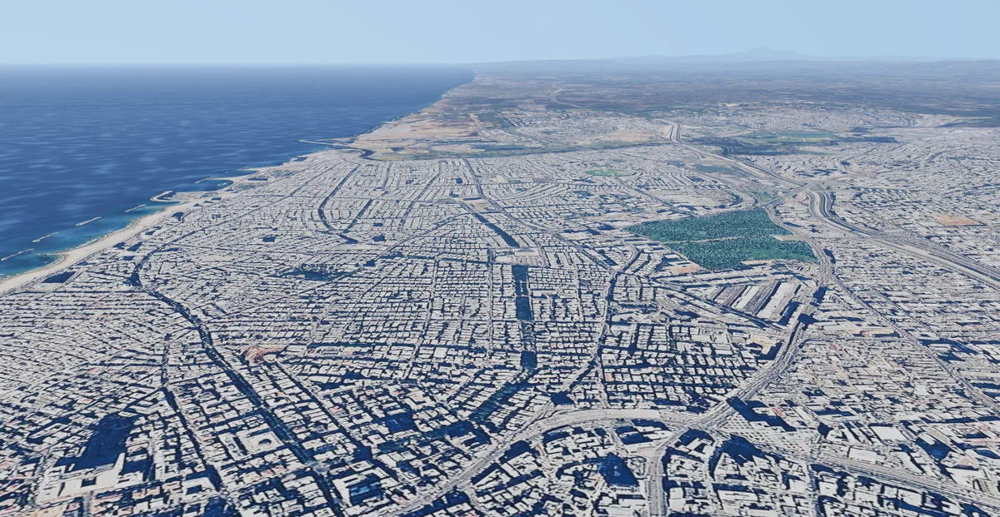 | 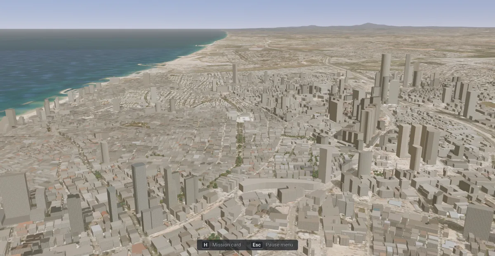 | 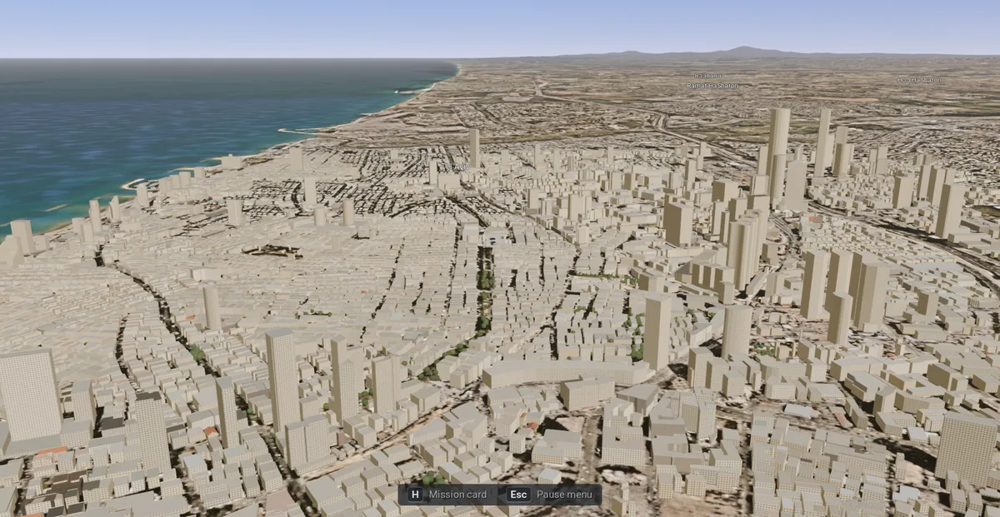 |
| 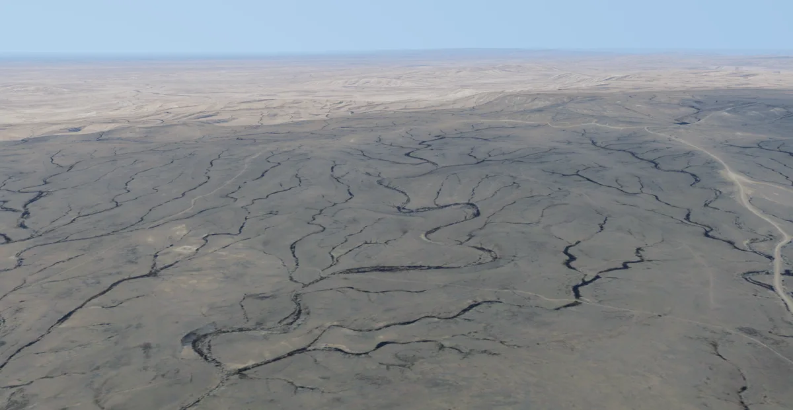 | 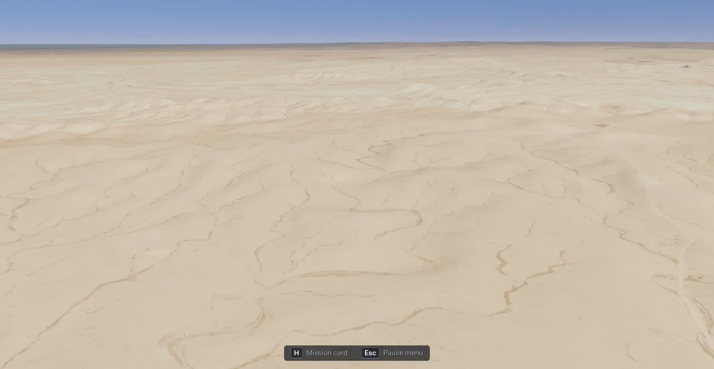 | 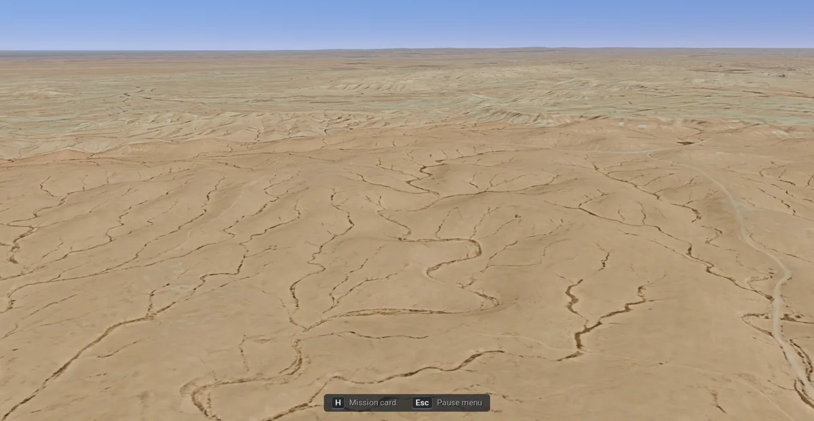 |
| 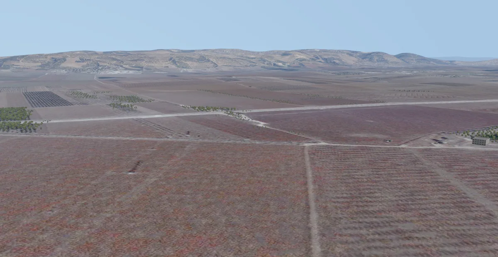 | 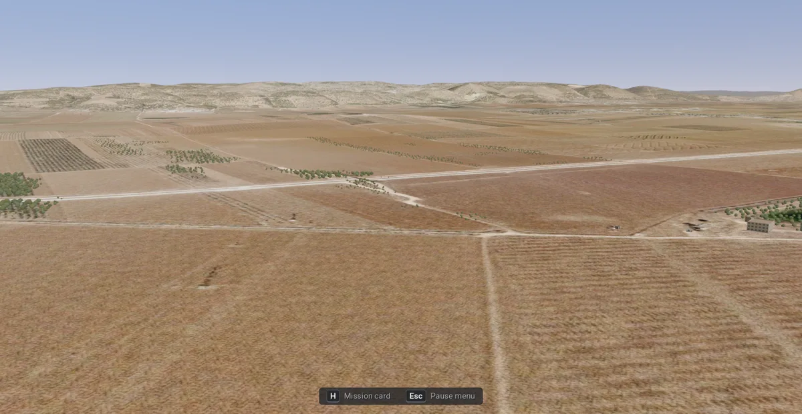 | 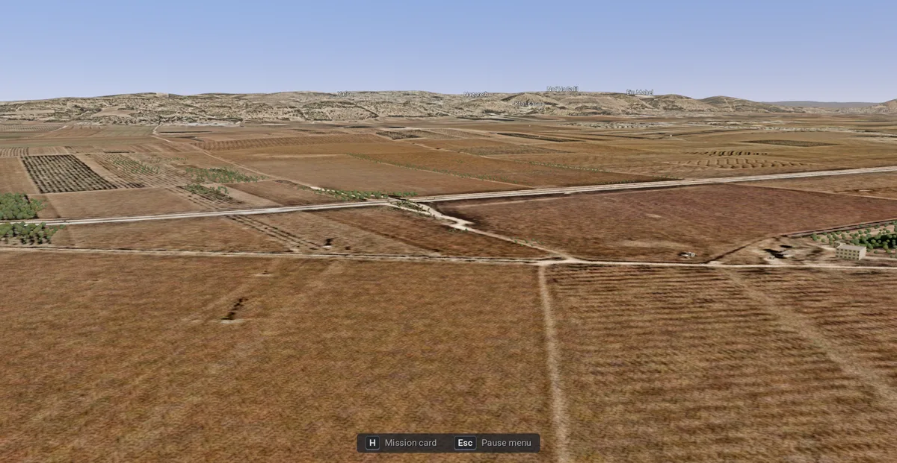 |

The Dead Sea shore at Ein Bokek, the patches in tone only (`725300 3451300 -150 345`, orbit `180,20,300`):

| Before | After |
|---|---|
| 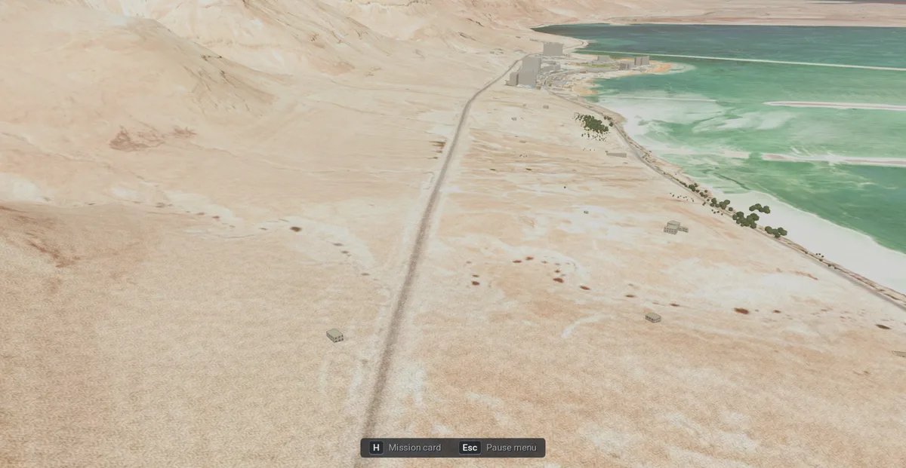 | 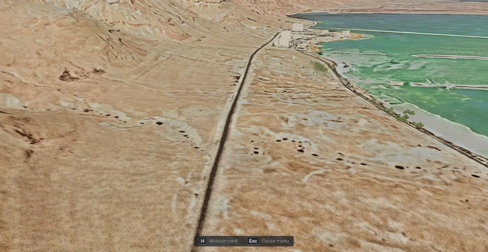 |

Cost on this laptop's Intel Iris Xe at 1920 × 1080, 2026-11-09, over the Jezreel fields at 100 m (the pose above),
measured as the original's Ground textures were: `tests/godot/_airbase_shot.gd` with `SHOT_BENCH`, 12 pairs of 120
frames switching one global in place, the median of the GPU time's differences (the machine was busy, so the whole
frame's times scatter by ± 3 ms; the GPU medians hold):

- Ground textures (`ground_tex`) on this branch: +1.05 ms GPU (quartiles +0.91 / +1.45); +1.20 ms in a second run
  (+1.13 / +1.46). The same switch on main at
  the same pose: −0.23 ms (−0.63 / +0.21): at 100 m the near textures do not resolve, so the +1.05 ms is the new far
  layer and macro tint.
- The albedo knee (`terrain_grade`): +0.08 ms GPU 500 m over the Negev (−0.03 / +0.12).
- The photo's detail (`terrain_photo_detail`): +0.69 ms GPU 500 m over the Negev (+0.58 / +0.80). The contrast and saturation
  adjustments are one more full-screen pass (estimated 0.1–0.2 ms; the bench does not switch it).
- Video memory: no new textures (the far layer reads the same material arrays, the macro tint the close up's noise):
  0 MB.

The original game with the new rows off is unchanged. Two renders on main and two on this branch with the exposure
fixed (Sky Original) over the Jezreel fields are identical pixel for pixel (0 px differ between any two; checked again
after the photo's detail was added). At Tel Aviv the sea's waves and the trees move between any two runs, so no run
there is exact: the branch differs from main by 27,456 and 41,889 px, main's own two runs by 21,461 (on land alone
5,278 and 7,289 against main's 4,219; the largest change 28 levels). `test_terrain.gd` checks the parameters: with the defaults the knee and the ground textures are
off, the patches keep their hue, the Environment's adjustments are Godot's defaults, and the exposure target is as
before. With the Atmospheric sky the auto-exposure adapts by the frame's time, so two builds that run at different
speeds differ by about 1.5 levels over the whole picture (measured: main against this branch, while two runs of one
build agree within 0.1 level on average).

## 10. Open

- **The colour match's spread** (the follow-up to §9.1): `sheet_gains` (`crates/iaf-tools/src/sim_terrain.rs`)
  scales each Survey sheet's spread to Sentinel-2's at 40 m, which leaves the photo's local detail 0.6–0.7 as strong
  in the Negev. The shader raised it back from 2026-11-09 to 2026-11-13 (`terrain_photo_detail` 2.5, then 4.5;
  dropped, §15). The fix ordered on 2026-11-13: the photo levelled per sheet as the original game's (no match to
  Sentinel-2), its coarser levels built from it; a rebuild of the theatre (CPU only, no download).
- **Other censored sites**: the Survey photo also paints over military sites other than the four bases; there the
  made-up ground shows (open: no list of them).
- **Survey and Sentinel-2 look**: the per-sheet colour match leaves the 2 m photo crisper and a little lighter than
  the 8 m nodes around it; the step shows at an airbase outline and at the coverage's edge.
- **Heights at 64 m**: §3.

## 11. Inland water

`iaf-sim airbases` writes the sim's `terraintype.dat` ([data-formats.md](data-formats.md) §12). Besides the sea and
the runways it flags inland water (0x2) on its 64 m grid: OpenStreetMap's standing water[^osm], cut from the extracts
the road layer reads (Israel and Palestine, Lebanon, Syria, Jordan, Egypt; [scenery.md](scenery.md) §1). A body is
kept when it is:

- a lake, reservoir, pond, lagoon or salt pond: a `natural=water`, `landuse=reservoir` or `landuse=salt_pond` polygon
  whose `water` tag names standing water (a river's, stream's or canal's polygon is its bed, and stays land);
- there all year: not tagged `intermittent` or `seasonal` (the desert's salt pans, dry in the satellite's pictures,
  such as the 148 km² sabkha east of Ma'an);
- 10 ha or more (`WATER_MIN_M2`, about 24 grid cells; inferred: a smaller body is a cell or two).

Its islands (inner rings) stay land, and the sea's flag wins where both are. The polygons are also saved beside the
theatre (`water.json`): the scenery keeps its trees and buildings off them ([scenery.md](scenery.md) §4).

Measured 2026-11-03: 316 bodies, 1,144 km²; the cut takes about 40 s of the step's 47 s.

The flight model takes both waters as water (`SURFACE_WATER` 0x6), and the water shader (Preferences "Water",
docs/rendering.md §1.3) draws waves on the photo's blue-green pixels inside them. The heights are the DEM's: GLO-30
edits each lake to one flat surface, and the step logs that surface's median for the lakes over 50 km²:

| Water body | Area (OSM) | Surface in the DEM | Published level |
|---|---|---|---|
| The Dead Sea (northern basin) | 602 km² | −427.0 m | −427.8 m in January 2013[^ds2013]; −439.78 m in 2025, falling more than 1 m a year[^ds2025] |
| The Sea of Galilee | 168 km² | −214.5 m | between −215 and −209 m with the rain; the lower red line −213.2 m, the record low −214.87 m (November 2001)[^kin] |
| The Dead Sea Works' evaporation pans (Israel) | 59 and 76 km² | −390 m, −391 m | open |
| The Arab Potash Company's evaporation pans (Jordan) | 101 km² | −395 m | open |

The DEM's surfaces are those of its radar passes (2011–2015, inferred from the levels: the Dead Sea's −427 m matches
early 2013). The Dead Sea has fallen about 13 m since, so the theatre's lake lies 13 m above today's; its shore is the
OSM polygon of 2026, smaller than the DEM's flat surface, so the exposed seabed between them is land at −427 m
(open: lowering the lake to today's level).

## 12. The coastline

OpenStreetMap's coastline (`natural=coastline`)[^osm] is the sea's one boundary near the shore (2026-11-08,
`crates/iaf-tools/src/sim_coast.rs`). Its ways keep the land on their left and the water on their right (the OSM
rule); within 300 m of them (`COAST_REACH_M`) that side decides, farther out the DEM's 0 m cells joined to the edge
do (`sea_cells`):

- **The colour**: with the Survey, the sea is Sentinel-2's from the beach out. The 2 m photo gives way to it on the
  coastline's water side, and beyond the coastline's reach wherever the 8 m Sentinel-2 nodes show open water joined
  to that side (`ShoreSea`: `imagery::is_photo_water`, a fill from the coastline's water cells, so an inland pond
  keeps the photo). Near the coast the photo's near-white pixels (all bands 235 or more: the sheets' white no-data
  with its JPEG noise) are left out too. The Survey units the coastline comes near have their own marks
  (`survey_2m_sea`), so they run again once; the theatre's `built_from` holds the extracts' hashes and the rule
  ("shore": 2).
  - Before the coastline (a Mac run, 2026-11-08), the sheets' white border showed as white patches off Tel Aviv and
    Ashdod. With the coastline alone, the photo still covered the sea beyond its 300 m reach: its levelled sea is a
    lighter grey-blue than Sentinel-2's and ends at the sheets' straight edges, so offshore two blues met in steps.
  - Measured on this machine's theatre (2026-11-08): it was built on 2026-11-03, before the coastline, so its
    `.work` had no shore marks. The white four-sided patch off Herzliya in the Tel Aviv picture (node L1 78/100–101,
    about 668.4–668.8 km E) was the sheets' no-data, 255 in every band after the levels; Sentinel-2's node there is
    clean sea. The light blocks offshore were the photo's sea. Both are gone after the rule above.
  - Tried and dropped (2026-11-08): the sea beyond the reach from Sentinel-2's own bands (near-infrared below green)
    warped per unit from the composite's tiles. It worked the same, but it reads the tiles again, and a theatre whose
    tile cache was cleared then downloads (or streams) 9.4 GB. The 8 m nodes the run wrote already hold the same
    water.
- **The surface flags**: `terraintype.dat`'s sea follows the coastline to 16 m (`COAST_LEAF_M`) within its reach; the
  flight model's water test and the water shader's mask (96 m texels, docs/rendering.md §1.3) read it.

The shore south of Tel Aviv from 800 m (2026-11-08; [scenery.md](scenery.md) §7), before and after: the teal near
the beach met the old navy fill in a straight-edged step; after, the sea is Sentinel-2's out to the fill of its tone.

| Before | After |
|---|---|
| 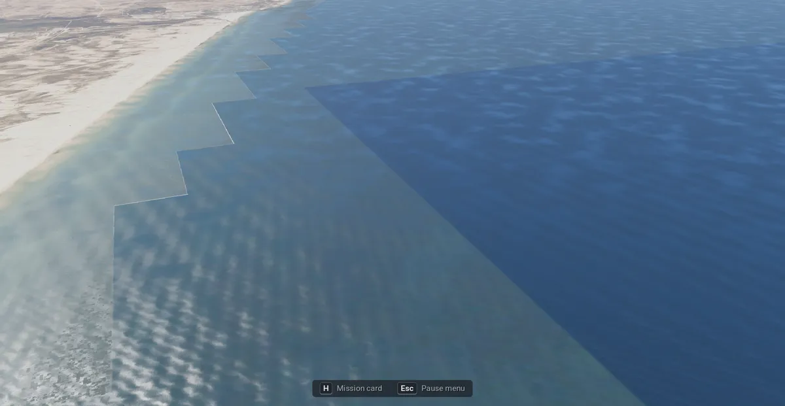 | 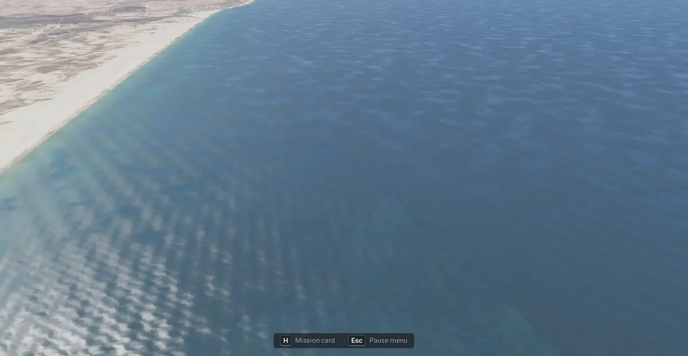 |

The extracts are the ones the inland water is cut from (§11), downloaded by `iaf-sim terrain` (with the Survey) and
`iaf-sim airbases` when missing. Where an extract has no coastline (Saudi Arabia's shore of the Gulf of Aqaba is in
none of them) the DEM decides.

Check: `cargo test -p iaf-tools --lib sim_coast` (the sides, a corner, the reach) and `sim_terrain::tests::
the_shore_follows_the_coastline` (data: 50 points along the coastline from Tel Aviv to Ashdod, 20 m seaward sea and no
near-white pixel, 20 m landward land, 1 km seaward the 2 m colour equal to the 8 m Sentinel-2 node's where that shows
water, at 25 points or more; skipped on a theatre built before the coastline).

## 13. The ground close up

The shared Terrain close up (docs/rendering.md §1.1, on in the sim's profile) adds a grain and normal detail near the
camera, and in the original game also colour patches: about 40 m and 9 m, toward a deeper, more saturated version of
the ground's colour or a paler one. The sim keeps the grain and the normal detail and draws no patches (the shader
global `terrain_patches` is 0 in `modern-iaf/project.godot`, 1 in the original game's).

Measured 2026-11-08 at Ein Bokek, 300 m behind the jet over the Dead Sea shore (the same pose as [scenery.md](scenery.md)
§7): the coarse orange speckle on the pale marl near the camera went away with the close up off, and with the patches
off alone; with the grain off alone it stayed. The deeper colour (c² / luminance) of a pale beige is orange, and the
2 m photo needs no made-up patches. The original game's picture at the same settings is unchanged, pixel for pixel.

From 2026-11-09 to 2026-11-13 the sim drew the patches in tone only: the global `terrain_patch_hue` 0, so a patch
was the ground's own colour × 0.7 or × 1.2, never a deeper hue, at 0.4 of the original's strength. Since 2026-11-13
the sim draws them as the original game does (§15). With the colour grading
the pale marl no longer sits in the tone mapper's shoulder, so full-strength patches read as a brown mottle at Ein
Bokek from 300 m (measured 2026-11-09: 32 px luminance spread 16.3 at 1, 15.1 at 0.4).

### 13.1 The land cover

The ground textures (docs/rendering.md §1.4) pick a material per pixel: grass, sand, gravel, soil, rock, and in an
airbase asphalt and concrete. The sim's sources were checked for land-cover classes on 2026-11-09:

- `terraintype.dat` and `IafSurface`: only water (0x2, 0x4, island 0x8) and runways (0x10). No land cover.
- ESA WorldCover: setup reads the Sentinel-2 RGBNIR composite, not the class map. Three of its tiles are on disk
  (`assets/source/imagery/sentinel2`, 1.2 GB); the rest are read over the network. The theatre's tiles keep red,
  green and blue only, so the near-infrared band (an NDVI) is not there at run time either. The class map would be a
  new download (open).

So the land cover is a proxy: the photo's colour, compared in ≈ sRGB. Green is grass, pale is sand, saturated brown
is soil, the rest gravel, and the terrain's slope over ≈ 30° is rock. Since 2026-11-09 that choice also holds
farther out, with the same material at 8 times its size, so a field reads as grass to a few hundred metres. The
upgrade path is OpenStreetMap's land use (farmland, orchard, forest, scrub, residential) from the extract setup
already downloads, rasterised beside the water flags (open).

## 14. The sky and the horizon haze

Since 2026-11-13 the sim flies the Atmospheric sky, as the original game at its best (§15). From 2026-11-09 to then its
profile flew the shared Sky row's Levant value (docs/rendering.md §1.2 "Sky Levant", the look study's proposal 4): the Atmospheric sky with a deeper blue up high, a warm haze band low on the horizon, and the
far land's haze warm brown-grey in place of a cool blue-white. The original game keeps its own Sky row's default.

Measured at the look study's Shoham pose (`--at 672750 3537452 240 100 0 --freeze`, heading 100°, the sim's defaults,
`tests/godot/_imagery_shot.gd` with `SHOT_SCENERY=on`, 1920 × 994). Each value is the mean sRGB of a box: up high is
500 × 30 px at the frame's top (about 28° above the horizon), above the horizon is 500 × 12 px just above it, and the
haze band is 500 × 12 px over the far hills just below it. The reference (the study's Epic Fury picture, 1920 × 1089,
mostly cloudy up high) is sampled in a blue gap at its top left, and in 300 px boxes above and below its horizon.

| Hour | Up high, before → after | Above the horizon, before → after | Haze band, before → after |
|---|---|---|---|
| 07:00 | 182, 201, 218 → 154, 169, 196 | 180, 199, 215 → 193, 191, 199 | 142, 158, 185 → 139, 130, 127 |
| 12:00 | 158, 192, 224 → 143, 164, 203 | 163, 195, 224 → 186, 190, 208 | 160, 168, 187 → 169, 157, 145 |
| 16:58 | 169, 200, 227 → 148, 172, 208 | 177, 206, 228 → 188, 195, 213 | 155, 165, 187 → 159, 147, 138 |
| Reference, 16:58 | 118, 127, 142 | 186, 190, 197 | 116, 112, 101 |

The haze band turned from blue (blue 185–187) to warm grey (red above blue), and the sky above the horizon from blue
to a pale, warm grey close to the reference's. The sky up high is deeper (blue over red 1.4 in place of 1.2–1.3).
The reference's haze band is darker and browner: its ground is darker, and its sky is overcast up high (open: a
darker haze would need the ground's colours too).

| Hour | Before | After |
|---|---|---|
| 07:00 | 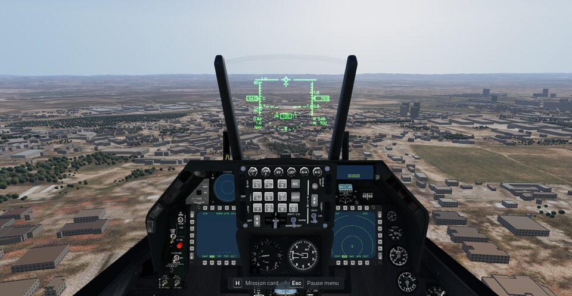 | 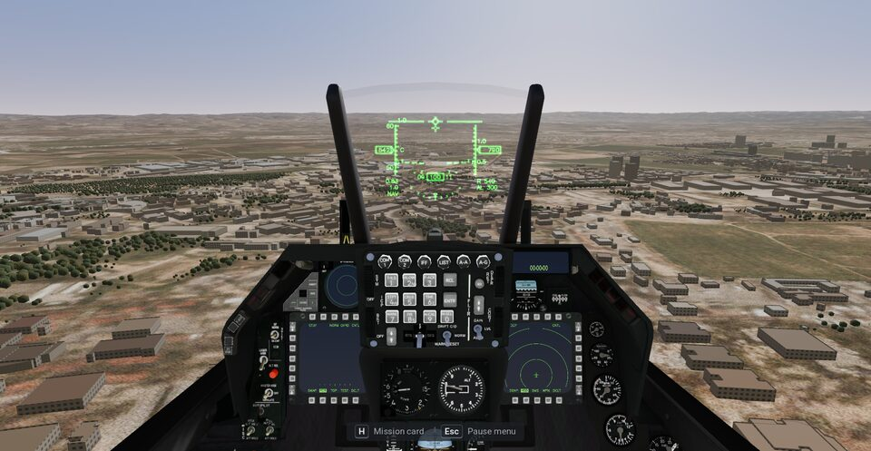 |
| 12:00 | 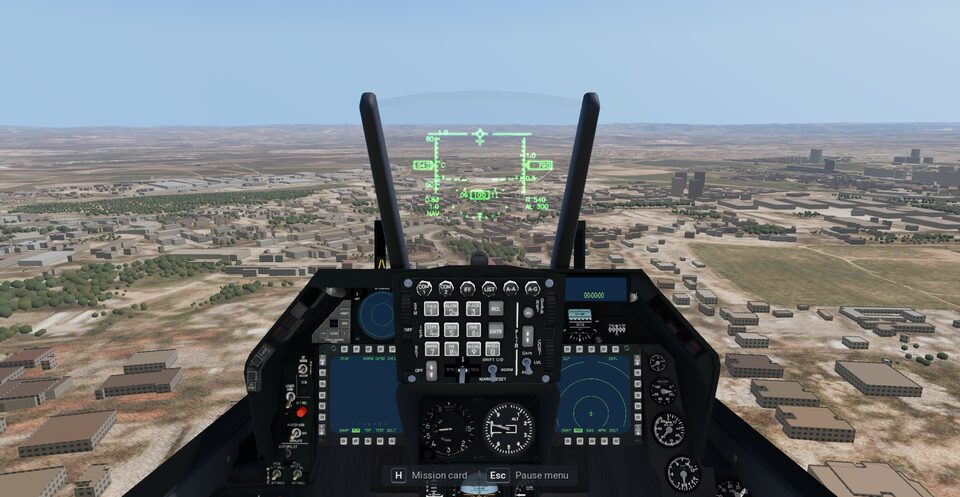 | 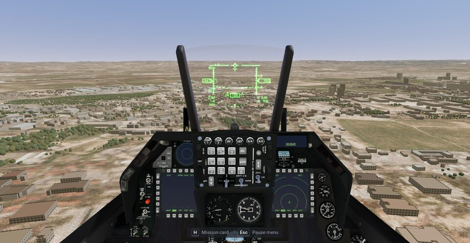 |
| 16:58 | 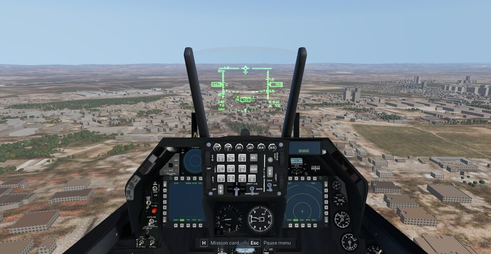 | 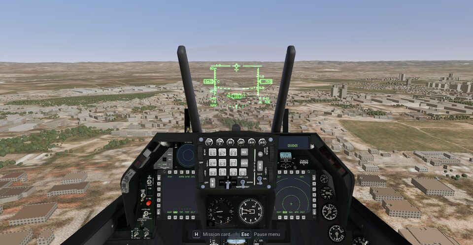 |


## 15. The ground as the original game's (2026-11-13)

Since 2026-11-13 the sim renders its ground on the original game's path with the original game's values, as its
player flies it at its best (Imagery Survey 2 m modern, Sky Atmospheric, Colour grading Original, Terrain close up,
Water). The user, that day, comparing the two: "the ground (terrain itself) in reborn look so much better, just copy
what it does … it all should be shared between." What changed in the sim:

- **The shader globals are one set**: the same values in both projects' `project.godot`; the sim's own
  (`terrain_grade_tint`, `terrain_photo_detail`, `terrain_patch_hue`, `terrain_patches` 0.4) are gone, and the
  globals and shader code that only they used with them.
- **Sky Atmospheric and Colour grading Original** in the sim's profile (`sim_settings.gd` PROFILE), the original
  game's values. Sky Levant and Natural stay the original game's own Preferences choices.
- **Kept**: the A20 towns and roads (the roofs' and walls' colours, the roads to 5.5 km); the ground textures
  (ambientCG) and the Detailed airbases.
- **Open**: the data. The sim's 2 m photo is still matched to Sentinel-2 (§3, `sheet_gains`), brighter and flatter
  than the original game's, so the ground reads pale (the "after" column).

Same place, hour (11:00), camera and settings, scenery off (pictures: `_imagery_shot.gd` on the Mac, 1920 × 1080):

| | The original game | The sim before | The sim after |
|---|---|---|---|
| The Judean hills by Jerusalem | 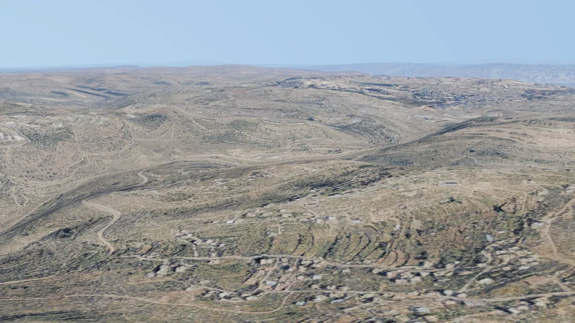 | 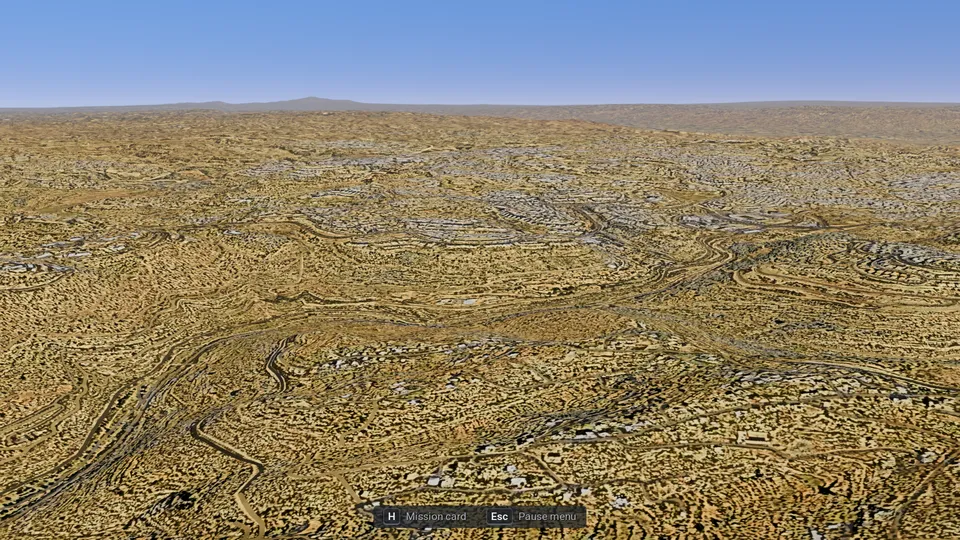 | 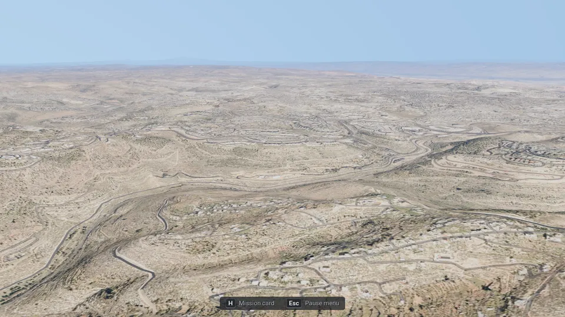 |
| The Negev south-west of Ramon | 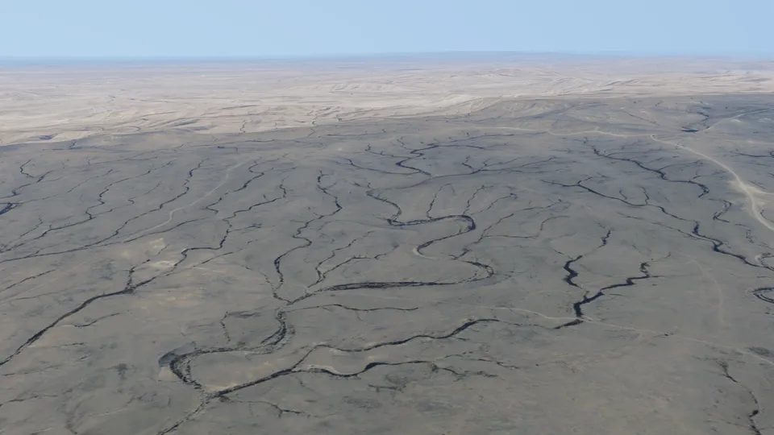 | 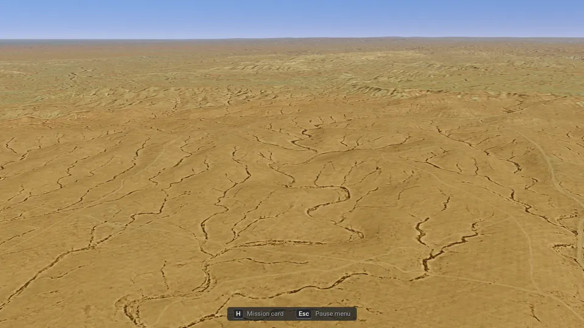 | 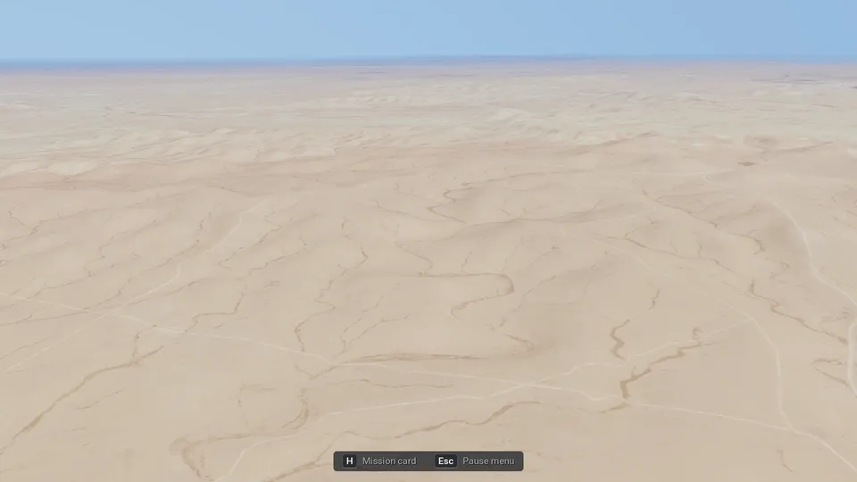 |

Mean sRGB of the frames' lower 45 % (the original game / the sim before / the sim after): Ramon 115 / 116 / 114,
167 / 134 / 73, 201 / 186 / 168; the fields 131 / 115 / 114, 124 / 83 / 30, 158 / 126 / 99; Tel Aviv 131 / 137 / 151,
110 / 100 / 86, 159 / 153 / 147; Jerusalem 135 / 130 / 121, 132 / 112 / 68, 170 / 160 / 146. The original game's
pictures are the same before and after, pixel for pixel. Frame cost: none (the sim's shader does less: no detail
gain's two samples, no tint).

### 15.1 Tried and dropped: the ground against a photo (A17, 2026-11-11 to 2026-11-13)

Dropped on 2026-11-13 by the user's verdict above: the gold tint and the detail gain turned the Judean hills into a
harsh, noisy gold with a black speckle (the "before" column; the Mac's maximum-settings showcase of that day showed
the same), nothing like the original game's photo. The Levant sky (A16, "the haze stays") went with it. What A17 was:

The reference is a photo of Makhtesh Ramon from the air in the late afternoon: "Israel-2013-Aerial 00-Negev-Makhtesh
Ramon" by Godot13[^ramon-photo]. It is a comparison only; no pixel of it is in the game. Against it the sim's ground
was salmon-grey where the photo's is golden, and flat in its local contrast. The look study (look batch 1) proposed
three causes; the user approved the first two. The third, the haze, stays as it is (A16).

What the sim's profile did (each project's own shader globals in `project.godot`):

- **Golden sunlight on the ground**: with Colour grading Natural, the land's albedo is multiplied by
  `terrain_grade_tint` after the grade's knee (docs/rendering.md §1.9): 0.86 / 0.78 / 0.43 in the sim, white in the
  original game. The sea, inland water and the Detailed airbases' pavement (its white paint stays white) keep their
  own colour. The tint is the same at every hour (open: a tint that follows the sun's height). The study's proposal was the sun's colour
  1.0 / 0.86 / 0.58; a tint on the albedo reaches the same target without turning the jets and the buildings gold.
  The value was fitted at the Ramon view to the photo's ground (the auto-exposure takes back part of any darkening).
- **The photo's detail ×4.5** (`terrain_photo_detail`, was 2.5).
- **Grey towns** (2026-11-13, A20, [scenery.md](scenery.md) §7): the tint leaves built-up ground grey, the tint's
  brightness without its colour. Built-up is the photo's own grey: its chroma (≈ sRGB) under 0.11–0.16 at the ≈ 32 m
  mean and 0.15–0.20 at the pixel (Tel Aviv's centre averages 0.10, open land 0.16–0.33). The streets of Tel Aviv: 158
  / 140 / 96 before, 163 / 150 / 128 after (164 / 153 / 136 without the tint); open land keeps the gold.

The poses: `look_shot.gd` (the study's tool, the chase camera at the hidden jet), 1920 × 1080:

- Ramon: `--at 674117 3387642 1300 75 0 --freeze`, 37° across, 6° down, 16:30.
- Tel Aviv: `--at 667500 3548000 500 15 0 --freeze`, 70° across, 15° down, 11:00.
- The Jezreel fields: `--at 712043 3611416 160 20 0 --freeze`, 70° across, 10° down, 11:00.

Measured on the frame's lower 45 % (mean sRGB), and as the study measured the spread: the standard deviation of the
HSL lightness over rows 267–486 (the far ground at Ramon). The photo's: ground 149 / 118 / 63, spread 23.4.

| View | Ground before → after | Spread before → after |
|---|---|---|
| Ramon | 160 / 134 / 105 → 150 / 118 / 66 | 13.9 → 18.4 |
| Tel Aviv | 158 / 148 / 132 → 156 / 145 / 125 | 43.6 → 46.7 |
| The fields | 130 / 94 / 60 → 122 / 81 / 27 | 28.5 → 32.9 |

At Tel Aviv and over the fields that band holds the horizon, the sea and the buildings, so its spread is above the
desert photo's before the change. The noise check there is on the ground alone:

- The fields, the frame's lower 45 %: 18.4 → 18.5, within 23.4 (at 100 m the detail gain fades out under 700 m, so
  the close ground is unchanged).
- Tel Aviv with Scenery off, the land right of the coast (60 % × 45 % of the frame from 768, 594): 64.6 → 65.6
  (+1.5 %). The city's photo is that contrasty itself (streets, roofs, shadows); the change adds little.
- The fine grain (the luminance minus its 2 px blur, the lower 45 %): Ramon 10.6 → 14.7 (the photo 11.6), Tel Aviv
  17.3 → 18.2, the fields 9.8 → 9.7.

Checked at full size: no speckle; the fields read a deeper gold-brown, Tel Aviv's open ground and streets a warmer
sand.

Cost on this laptop's Intel Iris Xe, the GPU time over 120 frames, three before / after pairs switched in place in
one run (the median): Ramon 28.56 → 28.50 ms, Tel Aviv 34.38 → 34.29 ms, the fields 20.76 → 20.78 ms. Both are free:
the tint is one multiply, and the detail gain is the same code with another factor. Video memory: 0 MB.

| | Before | After |
|---|---|---|
| Ramon | 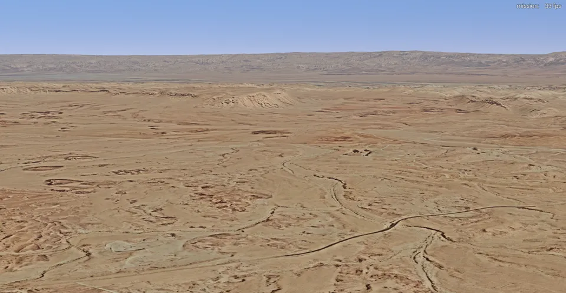 | 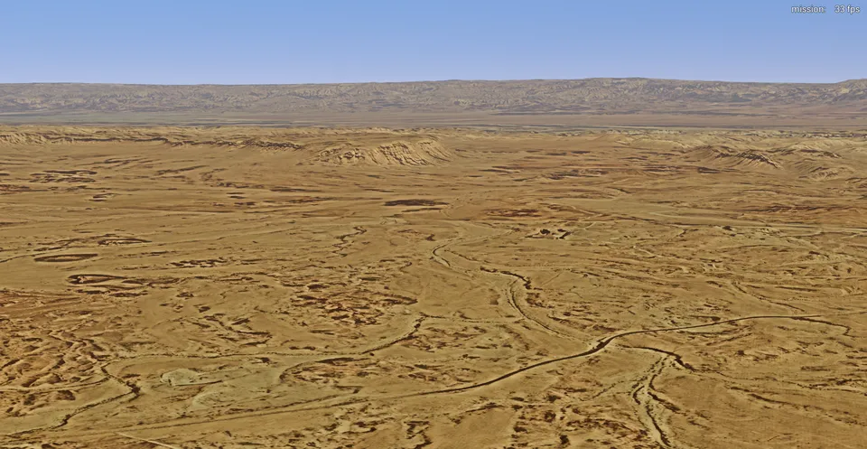 |
| Tel Aviv | 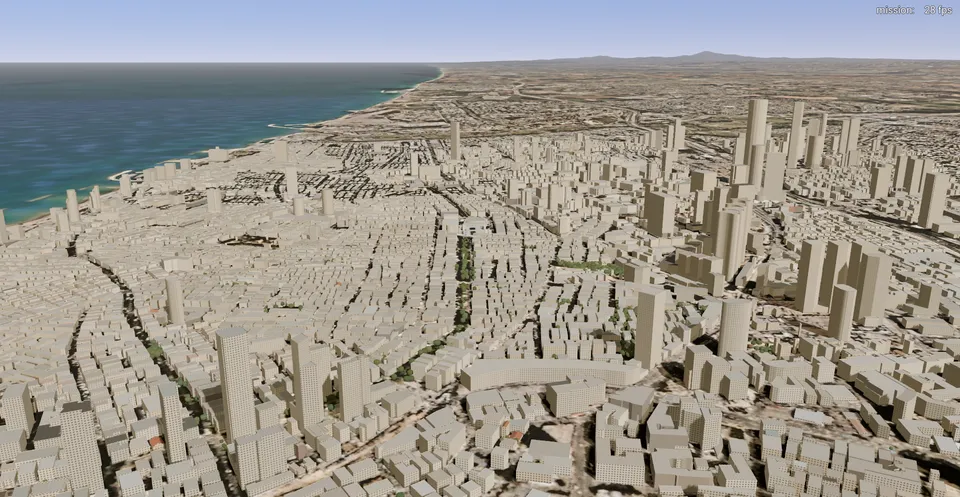 | 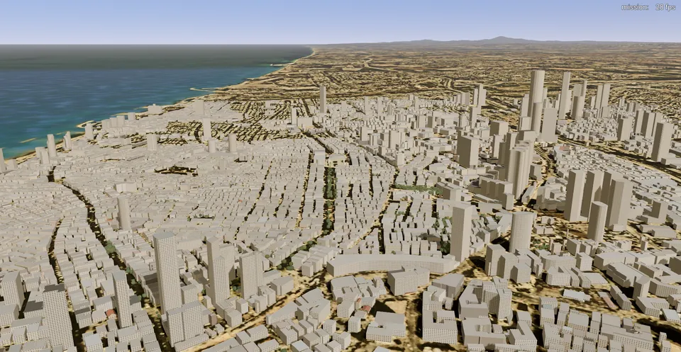 |
| The fields | 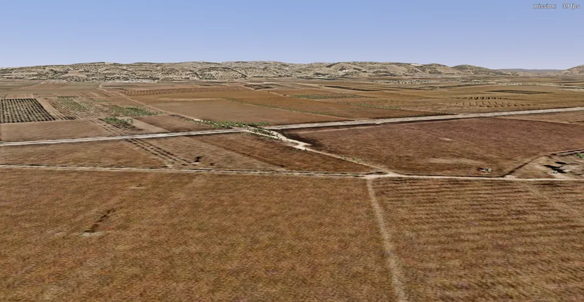 | 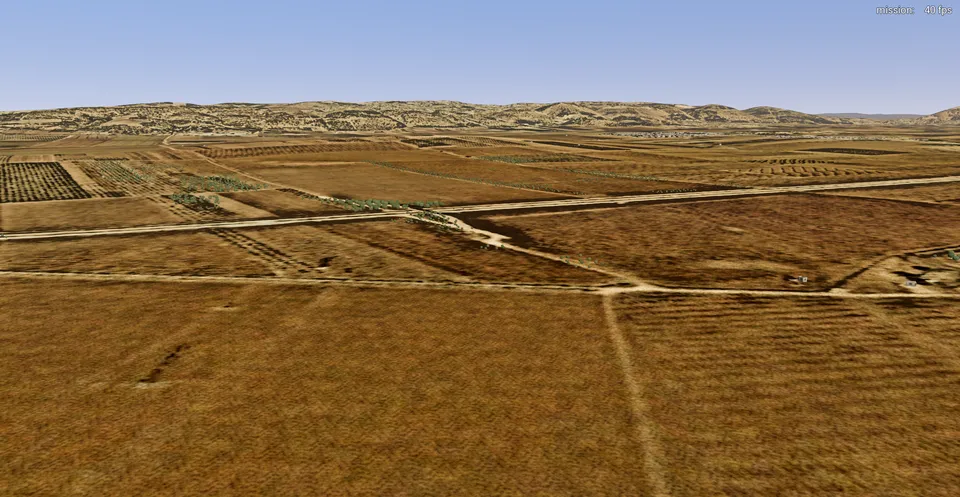 |

[^dem]: ESA, "Copernicus DEM: Product Handbook" and the collection description, https://dataspace.copernicus.eu/explore-data/data-collections/copernicus-contributing-missions/collections-description/COP-DEM
[^dem-licence]: "Licence for the use of the Copernicus WorldDEM-30", Article 6, read 2026-11-02, https://documentation.dataspace.copernicus.eu/APIs/SentinelHub/Data/DEM/resources/license/License-COPDEM-30.pdf
[^dem-aws]: Registry of Open Data on AWS, "Copernicus Digital Elevation Model (DEM)", https://registry.opendata.aws/copernicus-dem/
[^wc]: ESA WorldCover 2021 Sentinel-2 RGBNIR composite, "Contains modified Copernicus Sentinel data (2021) processed by ESA WorldCover consortium" (CC BY 4.0), https://esa-worldcover.org
[^soi]: Survey of Israel, orthophoto 2015, 2 m, via data.gov.il (docs/imagery-sources.md §2.1)
[^osm]: OpenStreetMap contributors, ODbL 1.0, https://www.openstreetmap.org/copyright
[^ds2013]: The Jerusalem Post, "Despite winter storms Dead Sea water level continues to fall" (the Water Authority's
    Hydrological Service: 427.82 m below sea level in early January), https://www.jpost.com/Enviro-Tech/Despite-winter-storms-Dead-Sea-water-level-continues-to-fall-337432
[^ds2025]: Wikipedia, "Dead Sea" (read 2026-11-03: "As of 2025, the lake's surface is 439.78 metres below sea level"),
    https://en.wikipedia.org/wiki/Dead_Sea
[^kin]: Wikipedia, "Sea of Galilee" (read 2026-11-03: the level between 215 and 209 m below sea level, the red lines
    208.9 and 213.2 m, the lowest level since 1969 in November 2001), https://en.wikipedia.org/wiki/Sea_of_Galilee
[^ramon-photo]: Godot13, "Israel-2013-Aerial 00-Negev-Makhtesh Ramon", 2013-03-28, CC BY-SA 4.0, Wikimedia Commons,
    https://commons.wikimedia.org/wiki/File:Israel-2013-Aerial_00-Negev-Makhtesh_Ramon.jpg
