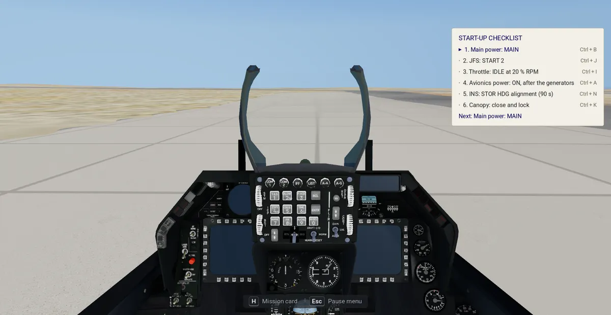
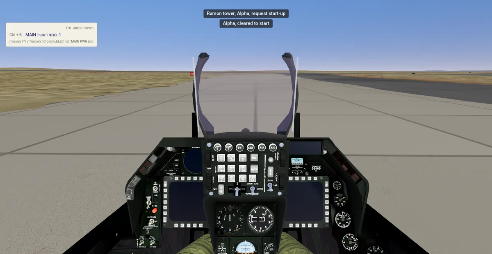
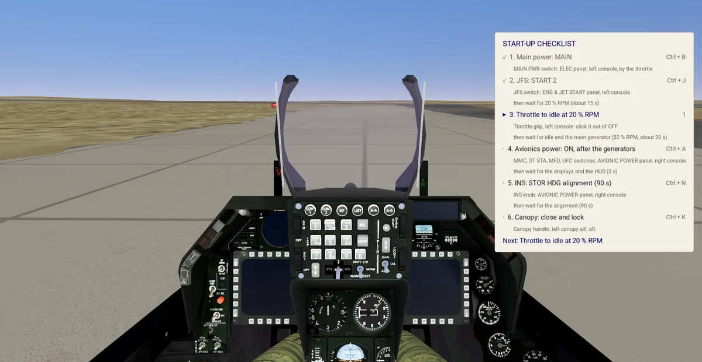
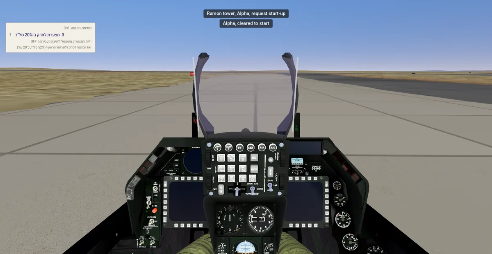
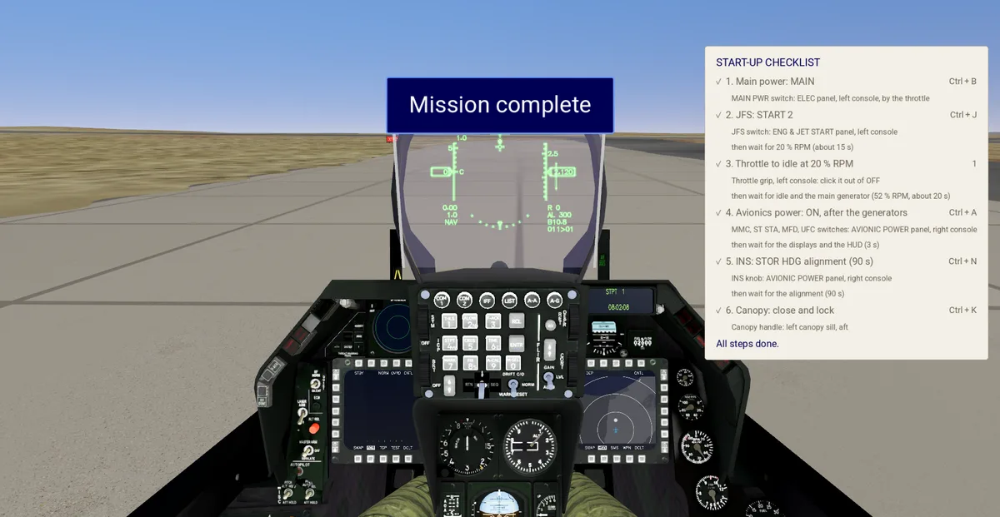
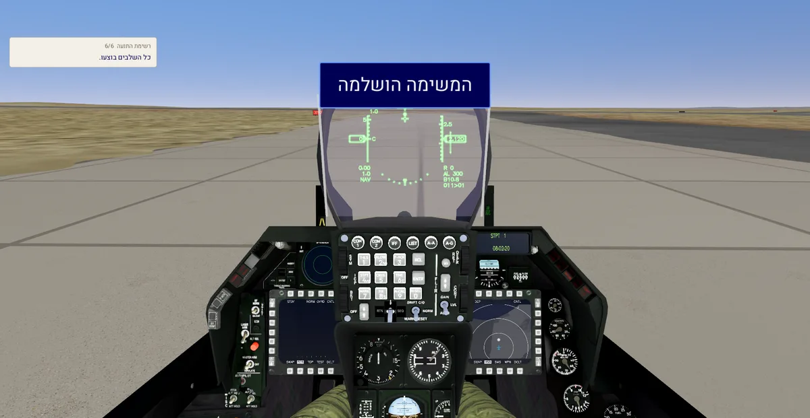
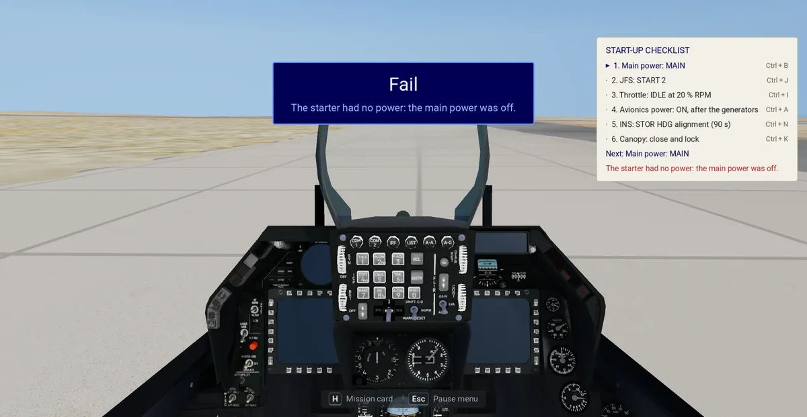
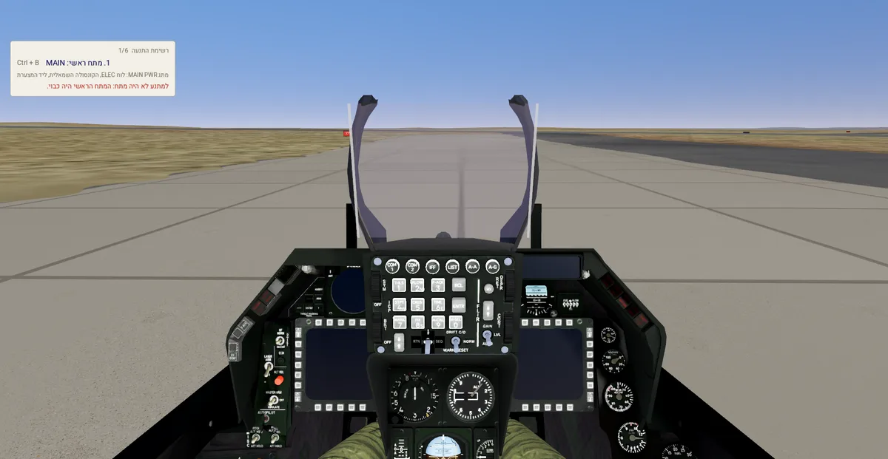

# Modern IAF training: pass / fail rules and the debrief

**Terms:** blackbox = the flight recorder's JSON Lines file ([../../docs/blackbox.schema.json](../../docs/blackbox.schema.json));
engine frame = the game's world metres (X east, Y north, [../../docs/georef.md](../../docs/georef.md)); runway start = where the
declared runway begins ([airbases.md](airbases.md) §4); "inferred" = our own reasoning; "open" = no source found.

The scoring core (item E3a, plan.md) reads a recorded flight and a training mission and says pass or fail, with the
debrief's numbers. It is pure Rust. Since item E3b (2026-11-03) the game runs both training missions without the front
end: the jet parked cold, one start command (§7), the radio menu and the tower (§8), scoring at the mission's end with
the debrief record and the pilot log (§9), and a probe that flies both missions for each jet (§10). The front end
(item E2, [front-end.md](front-end.md)) shows the record as its debrief sheet.

```sh
cargo run -p iaf-tools --bin iaf-training -- score <flight.jsonl> modern-iaf/data/missions/ramon_takeoff.json [airbases-dir] [--json debrief.json]
```

The airbases folder defaults to `airbases` beside the mission file's folder (`modern-iaf/data/airbases`), from any
working folder; a missing folder stops the run with its name.

## 1. Where the code is, and why
`crates/iaf-tools/src/training.rs` (module `training`) and the bin `iaf-training`. The module sits in iaf-tools beside
the georeference (`georef.rs`) and the mission compiler (`sim.rs`), whose data readers, source checks and `place()`
it uses: the compiler checks the rules with the same parser the scorer uses. The module is plain Rust over JSON in
and JSON out, ready for E3b to call through a small `iaf-godot` class.

## 2. Positions: the engine frame
The recorder logs scene metres (x east, z south) from the terrain's origin. The scorer turns each sample into the
engine frame, `(origin.x + x, origin.y − z)`, and turns the two ends of the mission's runway (lat / lon in the airbase
file) into the same frame with `Georef::geo_to_engine`, the call the mission compiler uses to place the jet. Two
reasons to work in the engine frame:
- the recorded heading is the engine frame's, so it compares with the runway's engine-frame heading directly (the
  warp turns true headings by a little, which a per-sample lat / lon conversion would have to undo);
- only two points per runway are converted, not every sample.

Near a base the engine frame is real metres to within the warp's local stretch ([../../docs/georef.md](../../docs/georef.md)),
so lengths in metres are real ones (inferred). When item B1's 1:1 terrain replaces the georeference, the scorer
follows the compiler, since both call the same function.

## 3. The rules (mission JSON, `"training"`)
Each figure has a source in the mission's `sources` (`"training.time_budget_s"` …), checked by the compiler
([data-formats.md](data-formats.md) §5).

| field | start-up | take-off | default | source |
|---|---|---|---|---|
| `kind` | `"startup"` | `"takeoff"` | — | — |
| `time_budget_s` | idle with avionics up by then | airborne, gear up, on heading by then | 120 s / 900 s | inferred |
| `end_hold_s` | the mission ends this long after its goal | the same | 5 s | inferred: time to see the result before the debrief |
| `goals` | the debrief items the sheet shows, in order (§4) | the same | `[]` / `["runway", "liftoff_speed", "reference_speed", "max_centreline_offset", "tower_calls"]` | — (not a figure) |
| `heading_tolerance_deg` | — | ± from the runway heading | 10° | inferred |
| `empty_kg` | — | gross weight = this + the recorded fuel | F-16: 8,573 kg; F-35I: 13,290 kg | F-16C Block 50 / 52[^w-f16]; F-35A[^w-f35]; the IAF jets' own weights inferred the same |
| `takeoff_kt` | — | reference take-off speed by gross weight: `[[kg, kt], …]`, linear between, held at the ends | F-16: [[9072, 130], [21772, 214]]; F-35I: [[13290, 165]] | F-16: 70 kt + 3 kt per 1000 lb[^bms]; F-35: about 165 kt[^wn] |

The two take-off speed sources are weak (a forum post quoting a pilot's rule, a news photo page); no public flight
manual gives the F-16's or the F-35's take-off speeds by weight (open). Checked once more against them on
2026-11-02: at 30,000 lb the rule gives 160 kt, and the forum's figures (rotate at 170 kt with an air-to-air load,
180 kt heavy[^bms]) lie 10–20 kt above it, as the rotation 10–15 kt before the take-off speed implies (inferred). The
reference speed is a debrief number only; no rule fails on it.

### 3.0 Every mission: fail at once
Since 2026-11-08 (the user's Mac play test: a crash in the start-up still passed) any of these ends a training
mission at once as a Fail, with its reason first in the debrief:

| reason | the recording's event | the game's live check (`Watch::check`, `IafTraining.check`) |
|---|---|---|
| `ejected` | `eject` | the pilot ejected |
| `crash` | `crash` | the jet crashed |
| `damage` | `hit` (any damage to the jet) | the player's unit's damage above 0 |
| `off_pavement` | `surface` with `paved` false | on the ground with the jet's centre off the base's pavement |

The pavement is the mission's base from its airbase file (`sim_bases::Base::paved`), the same shapes the paved
mask is drawn from ([data-formats.md](data-formats.md) §12): within half the width of a runway's, stopway's or
taxiway's centreline (a taxiway without an OSM width: 23 m), or inside an apron or a shelter's pad, with a 5 m
margin past every edge (`PAVEMENT_MARGIN_M`, inferred: OSM draws centrelines and outlines, not the paved fillets
where a taxiway meets a runway or turns; the probe's Sufa, cutting a corner onto runway 07R at Ramon, passed its edge
by 0.05 m). The jet's centre is checked, not each wheel (inferred: a centre off the edge puts a main wheel off it; a wheel-by-wheel check would
fail a jet on the OSM shapes' rough edges). The live check writes the `surface` event, so the recording carries the
reason.

### 3.1 Start-up: pass
- The engine started (the recorder's `engine` column turns true),
- the engine at idle and the avionics up within `time_budget_s` of the flight's start, and
- nothing failed (§3.0) to the mission's end: `end_hold_s` after the goal, or when the player ends the flight.

Modern IAF's recorder (version 2, §9) has an `rpm` and an `avionics` column, and the scorer reads them:
- **idle** = the first sample with the engine running at 60 % RPM or more (the 6-DoF's idle, §7);
- **avionics up** = the first sample whose `avionics` is true.

A recording without those columns (version 1, the original game's recorder) is scored from the model instead: idle
= the engine start + 4 s (the original model's ground start winds the RPM up from 0 at 15 %/s to the 60 % idle,
[../../docs/flight-model.md](../../docs/flight-model.md) §10.2), avionics up = idle (inferred: once the F-16's engine
is self-sustaining, at about 52 % RPM, it drives the main and standby generators[^f16net]); the debrief notes both.

### 3.2 Take-off: pass
All of:
- nothing failed (§3.0) to the mission's end;
- a lift-off (the first sample off the ground after one on it that stays off it for 1 s, or to the recording's end; inferred);
- the roll started on the mission's runway (inside its length and width) and ran toward the far end;
- every sample of the roll stayed on the runway (else: excursion);
- some sample after the lift-off is airborne, gear up, heading within `heading_tolerance_deg` of the runway's, and
  within `time_budget_s`.

The roll starts at the slowest sample on the runway between the jet's entry onto it and its last sample below
30 kt before the lift-off: the stop on the lineup point, or the entry of a rolling take-off (inferred). The lineup
heading is the heading at that stop, or, in a rolling take-off, where the roll passes 30 kt. The rotation is the first sample of the roll
with the pitch 2° above the roll's first sample (inferred). "On the runway" is the jet's centre within half the
runway's width of the centreline (inferred).

Fail reasons, in the order checked: the §3.0 reason first (the earliest event); then `no_start`, `not_done` (the
engine never at idle with the avionics up), `over_time` (start-up); `no_liftoff`, `wrong_runway`, `excursion`,
`gear_down`, `over_time`, `off_heading` (take-off; after a §3.0 fail the climb-out is not judged).

## 4. The debrief record
`Debrief::to_json` (`iaf-training score … --json`): `mission`, `kind`, `pass`, `reasons` (ids), `items` (each `id`,
`value` rounded to 0.1 or null, `unit`, optional `text` (a name in place of the value) and `note` id), `goals` (the
rules' `goals`) and `strings` `{"en": {id: text}, "he": {id: text}}` with every id the record names. The CLI prints
the English summary.

The record keeps every item; the debrief sheet ([front-end.md](front-end.md)) shows only the `goals` (the user,
2026-11-08: "no one cares how long it took to start or how many times I moved the throttle unless it is a goal"):

| mission | the sheet shows |
|---|---|
| start-up | pass / fail and the reason (no goals) |
| take-off | the runway used, the lift-off speed and the reference speed, the max offset from the centreline, the tower calls |

| id | unit | meaning |
|---|---|---|
| `time_to_idle` | s | from the flight's start; note `from_spool` while the recorder has no RPM column |
| `time_to_avionics` | s | note `with_idle` while it has no avionics column |
| `throttle_moves` | — | runs of samples in which the lever moves more than 0.005 |
| `faults` | — | note `none_modelled`: the flight model has no hot or hung start |
| `taxi_time` | s | from the first sample above 1 kt to the roll's start |
| `runway` | — | `text`: the runway end the roll ran on ("25R"), from the base's runways; note `not_reached` off every runway |
| `lineup_heading_error` | deg | the lineup heading (§3.2) − the runway's |
| `roll_start_from_runway_start` | m | along the centreline from the runway start (100 m from the lineup point) |
| `roll_length` | m | the roll's start to the lift-off, along the centreline |
| `runway_left` | m | from the lift-off to the far end's runway start |
| `rotation_speed`, `liftoff_speed` | kt | true airspeed (the recorder's) |
| `gross_weight`, `reference_speed` | kg, kt | `empty_kg` + fuel at the lift-off; `takeoff_kt` at that weight |
| `gear_up_height`, `gear_up_time` | m, s | the first airborne sample with the gear up: height above the terrain, time after the lift-off |
| `roll_heading_deviation`, `max_centreline_offset` | deg, m | the largest over the roll |
| `tower_calls` | — | the `radio` events |
| `cut_lines` | — | only when the recording's last line was cut off mid-write (the game stopped while writing) and skipped; a bad line elsewhere refuses the recording |

## 5. Checks
`cargo test -p iaf-tools --lib training`: three synthetic take-offs from Ramon 25R built in the test (a clean one, a
gear-down climb-out, a runway excursion, a crash on the roll (fails at once, the crash first), damage, the wheels
off the pavement (the live check: the parking spot and the lineup paved, 200 m beside the runway not); also a rolling take-off, a one-sample glitch off the ground while
taxiing, a rotation on the lift-off sample, a recording cut mid-line at its end), a synthetic start-up (a pass at its end with no goals, a crash with the crash first, over the budget, never started), and the
newest real recording in the flights folder (`user://flights`: `~/.local/share/godot/app_userdata/iaf-reborn/flights`
on Linux, `~/Library/Application Support/Godot/app_userdata/iaf-reborn/flights` on macOS, or `IAF_FLIGHTS`) scored
against Ramon's take-off, skipped with a message when there is none. `IAF_TRAINING_WRITE=<dir>` keeps the synthetic
flights as JSONL. `cargo test -p iaf-tools --test training_cli`: the CLI from another working folder, a missing
airbases folder and a `--json` without a file. `sim::tests::training_rules_are_checked`: a training figure without a source and an unknown kind
are refused, an unknown goal is refused, and every take-off mission's runway is an end of its base's airbase file.

## 6. Open
- The flaperons' droop with the gear handle down: the 6-DoF has no trailing-edge flap.
- The F-16I's, F-16D's and F-35I's own empty weights and take-off speeds by weight (open).
- A start-up fault model (hot / hung start): none in the flight model.
- The roll's start and rotation thresholds checked against a real flight of each mission by the user.
- The 6-DoF's take-off roll is short (flight-model.md §9.6): the probe's Sufa lifts off after about 465 m at 180 kt.

## 7. The start in the game
A take-off flight opens with the mission card ([front-end.md](front-end.md) §8): the objective and the keys that
matter, the flight frozen until it closes, so reading it costs nothing of the time budget. H opens it again. A
start-up flight opens with its checklist card only (§7.1; the Mac play test, 2026-11-11), the flight running; H opens
the mission card there too.

The sim's jet starts parked cold: on its spot (airbases.md §9), engine off, no RPM, no electrical power, every screen,
the HUD and the lamps dark (`cockpit.power` 0). The throttle starts nothing (`Settings.throttle_starts_engine`, false
in the sim; in the original game any throttle command starts the engine at once, as before, on either flight model).
The start-up checklist by keys (§7.1) runs the jet's start sequence step by step; one command, **Start engine**
(Ctrl+E, record 117 of the sim's own `keys.json`, command 200, `IafFlight.start_engine`, a hidden developer shortcut
since 2026-11-08: not in the key list), runs it all at once
(`crates/iaf-flight/src/sixdof/start.rs`), which the flight model steps every frame:

| step | F-16I Sufa, F-16D Barak (JFS) | F-35I Adir (IPP) | source |
|---|---|---|---|
| the command | battery on: the lamps and engine gauges live (`power` 1) | the same | inferred |
| starter | the JFS cranks the engine at once | the IPP runs 10 s, then cranks | F-35: three selections, battery, IPP, engine[^ayton]; the 10 s inferred |
| crank | 0 → 20 % RPM in 15 s | the same | 20 %: the throttle to idle at 20 % RPM minimum[^chk]; the 15 s inferred |
| light-off | 5 s after the fuel on | the same | inferred (open: no light-off time found in a primary source) |
| to idle | 20 → 60 % in 15 s, then the engine runs (thrust, fuel flow) | the same | 60 %: the 6-DoF's idle (flight-model.md §9.7); the 15 s inferred |
| main generator | at 52 % RPM: the engine self-sustaining, the JFS off | — | about 52 %[^f16net], the JFS cut at 50–54 %[^jfs50] |
| displays and HUD up (`power` 2) | 3 s after the generator | 3 s after the IPP runs | the 3 s warm-up inferred |
| avionics up (`avionics`) | with the displays | 90 s after the command | F-35: "after 90 seconds … ready"[^ayton] |
| sum | idle and avionics at 35 s | displays 13 s, idle 45 s, avionics 90 s | |
| engine stopped (`set_engine_on(false)`, the ejection) | no RPM; the power as it was; a new command starts from the beginning | the same | inferred |

The F-15I's (no mission flies it yet) is the F-16's (inferred). The F-35I's engine steps are the F-16's: no public
figure (inferred). The sound: the JFS's (the IPP's) whine, the engine clip of E1b (`SFX_START_ENGINE`) with its
pitch and level by the RPM, a light-off thump, and the JFS winding down at the generators ([sound.md](sound.md) §1.4). The probe measures 37 s to idle
for the F-16s and 47 s / 92 s for the F-35I (the recorder samples 10 times a second; the scene takes a few frames).

### 7.1 The start-up checklist by keys
Since 2026-11-08 (the user: "the first mission, which is just one click, is pointless") the start-up mission is the
real start by keys, step by step. A small card at the top right (the top left in Hebrew) shows one step at a time, in
English and Hebrew: the title with the step's number ("START-UP CHECKLIST  2/6"), the step with its key, its switch's
place, the state to wait for, and a fault in red; the next step replaces it once it is taken, "All steps done." after
the last (the Mac play test, 2026-11-11: the whole list was too big). Each step but the idle is a key of the sim's own `keys.json` (records 119–124, commands 210–215, the card naming each
key as bound, Cmd for Ctrl on macOS; `iaf-sim own` refuses a key bound twice). The flight model takes each step
(`Start::press` in `crates/iaf-flight/src/sixdof/start.rs`, `IafFlight.start_step`); a step out of order has its
consequence and returns a fault, which ends the mission at once as a Fail with that fault first (§3.0).

The idle step has no key (the user, 2026-11-09): moving the throttle up from OFF, by its keys or the axis, is the step,
as the real throttle's idle-cutoff detent, once the starter step (JFS / IPP) is done (before it the throttle moves
alone and starts nothing). OFF is the throttle's bottom (2 % allowed for a lever's noise); a lever already up goes to OFF first. The card names the Throttle idle key (record 7, the 1 key) on that line (the user, 2026-11-09: "we have 1 for throttle"); the axis, the 0 key (Throttle up 5 %) and the 1 key all make the step (the 1 key sets the throttle to idle, which is OFF, so the key itself takes the step at OFF);
record 121 stays an empty slot of `keys.json`, and the Keys screen lists no command for it. The step reaches the flight
model and the recording as the key did (`sim_flight.gd _throttle_step`), so the scorer reads the same `checklist`
event. The jet does not shut down when the throttle goes back to OFF (open).

| # | F-16I Sufa, F-16D Barak | key | timing | out of order | source |
|---|---|---|---|---|---|
| 1 | Main power: MAIN (the battery on) | Ctrl+B | at once | — | the checklist's order[^chk] |
| 2 | JFS: START 2 | Ctrl+J | cranks the engine to 20 % RPM in 15 s, then holds there | before main power: nothing runs, `no_power` | [^chk]; the 15 s inferred |
| 3 | Throttle to idle at 20 % RPM | the throttle up from OFF | light-off 5 s later, idle 15 s after it; the main generator at 52 %, the JFS off | below 20 %: a hot start, the engine shut down, `hot_start`; no rotation: no light-off, `no_rotation`; never: the JFS holds at 20 % | 20 % minimum[^chk]; 52 %[^f16net]; the times inferred |
| 4 | Avionics power: ON, after the generators | Ctrl+A | the displays and the HUD 3 s later | before the generators: no power, `avionics_early` | inferred (the avionics go on after the engine start in the checklist[^chk]) |
| 5 | INS: stored-heading alignment | Ctrl+N | aligned 90 s later: the avionics up | without avionics power: `ins_no_power` | 90 s[^ins] (a full alignment takes about 8 minutes[^ins]) |
| 6 | Canopy: close and lock | Ctrl+K | at once | any time | [^chk] |

| # | F-35I Adir | key | timing | out of order | source |
|---|---|---|---|---|---|
| 1 | Battery: ON | Ctrl+B | at once | — | battery, IPP, engine[^ayton] |
| 2 | IPP: START | Ctrl+J | runs 10 s, then holds | before the battery: `no_power` | [^ayton]; the 10 s inferred |
| 3 | Throttle to idle: the engine starts | the throttle up from OFF (in the 3D cockpit also the ENG switch or START, [cockpit.md](cockpit.md) §5.2) | cranks, lights and runs to idle by itself (the F-16's figures); the displays on the IPP's power | before the IPP: `no_ipp`; before the IPP is up to speed: `ipp_not_ready` | [^ayton]; inferred |
| 4 | Canopy: close and lock | Ctrl+K | at once | any time | inferred |

Each step's `wait` (mission data) says the state to wait for before the next step, in the table's figures (the JFS's
20 % RPM, the idle with the main generator, the displays, the INS's 90 s; the IPP's 10 s); the checklist card and the
briefing's How show it under the step ([front-end.md](front-end.md) §10).

The avionics of the F-35I report ready 90 s after the battery[^ayton]. The mission passes when every step is done
(`skip_<step>` names a step never taken), the engine idles and the avionics are up within the time budget (5 min,
inferred), and nothing failed, at its end. The steps and their card lines are mission data (`training.checklist`,
[data-formats.md](data-formats.md) §5); each key press is a `checklist` event in the recording (`step`, and `fault`
when it was refused). The take-off missions still start cold: the same keys start the jet there, without a card.

| the card | English | Hebrew |
|---|---|---|
| at the start, the start-up call in the band |  |  |
| mid-sequence |  |  |
| done: "Mission complete" |  |  |
| the JFS before the main power: Fail |  |  |

`modern-iaf/tests/_checklist_shot.gd` takes these pictures in a real render (its header); the docs keep them 1200 px
wide.

## 8. The radio menu and the tower
The **Call the tower** key (Ctrl+T) opens a numbered list over the view of the calls that fit the moment; a listed
call's number picks it, any other key closes the list. A call that does not fit is not listed, and no key makes it
(since 2026-11-09, the user: the menu offers only the call that fits the moment):

| call | English | Hebrew | listed when | the tower answers |
|---|---|---|---|---|
| start-up | Request start-up | בקשת התנעה | on the ground with the engine off | "Alpha, cleared to start" (`ACFT_CLEAR_TO_START`) |
| taxi | Request taxi | בקשת הסעה | on the ground with the engine running and the avionics up, taxi not yet (also after a start without start-up approval) | with the engine running: "Alpha, good morning, taxi to runway 25 right" (`ACFT_TAXI_TO_RUNWAY`); else "hold position" |
| take-off | Request take-off | בקשת המראה | on the ground at the holding point or past it (no farther from the lineup point than the holding point plus 50 m, inferred; the holding point is the base's taxi-out path's last point before the lineup, `iaf.ibx` `FromTaxiPt`) with taxi approved, take-off not yet | the original tower's rule on the ground (docs/radio.md §2 `ground()`): lined up in the lineup zone: "cleared for take-off"; 200–400 m from the lineup point with the runway clear: "line up runway 25 right, wind calm"; else "hold position" |
| landing | Contact tower (landing) | קריאה למגדל (נחיתה) | in the air | the original's Ctrl+T (docs/radio.md §2): "proceed to runway …" in the air |

A call is approved by the tower's answer named in its row; "hold position" or "line up" leaves the call listed to ask
again. The rule is `training::radio_calls` (`crates/iaf-tools/src/training.rs`, `IafTraining.radio_calls`);
`sim_flight.gd` lists its result. Between the calls (the engine starting, the taxi to the holding point) the list holds
"No call fits now" ("אין קריאה מתאימה כעת"). A flight that starts on the ground with the engine running (at the
lineup point) has taxi approved, so take-off is listed at once.

The pilot's call is printed ("Ramon tower, Alpha, request taxi"), the tower's answer printed and spoken by the English
TTS tower of E1b (sound.md §3), then the pilot's "Roger". The lines show in the sim's band over the flight
([front-end.md](front-end.md) §8), wholly in the game's language: in Hebrew the pilot's call ("מגדל רמון, Alpha,
בקשת הסעה") and the tower's answer from each phrase particle's Hebrew text (`text_he` in
`modern-iaf/data/sounds/voices.json`, compiled into `phraseparticles_he.trx`: "Alpha, בוקר טוב, הסעה למסלול 25 ימני");
only the callsigns and the runway numbers stay Latin and digits. The voice stays English until the Hebrew voice's
licence is decided (sound.md §5.4). The
tower is the base within 18.54 km: every base of the own `iaf.ibx` talks (Ramon, Ramat David, Hatzerim, Nevatim;
`Settings.tower_bases`); the mission's base's tower names the mission's runway (`"runway"`), the others their own. A request leaves the tower's
state machine as it is. In the menu the tower no longer talks on
its own on the ground (the original game's tower is unchanged). Each pick is a `radio` event in the recording (§9),
which the debrief counts as `tower_calls`. The scorer has no rule on the calls (a take-off without them still passes).

A take-off mission's `training.steps` (mission data) lists the pilot's sequence for the briefing's How: each call
on its own at its place (request start-up before the engine start, taxi once at idle with the avionics up, take-off
from short of the runway), each with its key, the menu's pick and the answer to wait for (the table above).

Taxi: the jet taxis on the base's taxiways to the lineup (the probe follows the own `iaf.ibx`'s taxi path). The
take-off passes by §3.2.

## 9. Scoring in the game, the debrief record and the pilot log
`modern-iaf/flight/sim_flight.gd` (the sim's part of the flight scene, `Settings.flight_addon`) runs a mission whose
compiled file has `sim.training` with an `IafTraining` (crates/iaf-godot/src/training.rs) opened on the readable
mission `modern-iaf/data/missions/<id>.json` and the airbase files:
- every frame `IafTraining.check` (§3.0) decides whether the mission failed; on a fail the mission ends at once
  (off the pavement: a `surface` event first);
- a start-up is scored once the engine idles with the avionics up, a take-off once airborne with the gear up (then
  every 3 s until it passes); a pass holds `end_hold_s` (`IafTraining.end_hold_s`), then the mission ends and is
  scored again; 5 s past its time budget it ends as scored;
- the player ending the flight first (Esc → End the flight, Ctrl+Q) ends the mission there, scored as it stands;
- at the goal a banner in the front end's look (navy, Heebo) says "Mission complete" / "המשימה הושלמה"; a fail
  shows "Fail" with the reason that ended it; 5 s later (real time; a pass: when its hold ends) the flight ends into
  the debrief;
- an ejection ends the sortie (`Settings.eject_ends_sortie`, the sim only): every sound and the radio stop at once
  (`flight_sounds.gd silence`, no radio menu), the view stays outside on the seat and the jet at any height (no
  FlyTSD), the recording gets an `eject` event and the mission fails with `ejected` first. The original game's
  ejection runs as before (tests/godot/test_eject.gd);
- `IafTraining.score(recording, mission, airbases)` runs `training::score_files` on the recording so far, with the
  live check's reason first;
- the debrief record (§4, plus `flight`: the recording's path, `date`: the end, `elapsed_s`: the flight's length) is
  stored as a sortie of the pilot (the default pilot 14 until E2's pilot list) in the records database
  `user://modern-iaf.sqlite` (`IafPilotLog.log_sortie`, [storage.md](storage.md) §5), and `Settings.flown_sortie`
  names it for the front end;
- ending the flight opens the front end's debrief sheet.

Scoring needs the recorder (Extras, on by default): with it off the flight is not scored (a warning in the log). Tests
record beside the records database, in a temporary folder. The recorder's version 2 (`Settings.blackbox_version`, [data-formats.md](data-formats.md) §13) adds `rpm`
(%) and `avionics`.

`tools/flight_timeline.py <recording> --debrief <debrief.json> [--html f.html]` (a record out of the database:
[storage.md](storage.md) §5) shows the debrief with the flight's
timeline (the radio calls, the lift-off) and the start's steps from the RPM column.

## 10. The probe and a real run
`modern-iaf/tests/test_mvp.gd` (item F's probe, started here) flies both missions for the Sufa (Ramon), the Barak
(Ramat David) and the F-35I (Nevatim) headless with scripted inputs at 6× time: the start-up (cold, the throttle
starts nothing, the checklist by its keys, the columns, the sortie's debrief, its pass in the pilot log; the JFS before the main
power fails at once) and the take-off (the three radio
calls and their answers, a taxi along the base's taxi path to the lineup (on the taxi line, slowing to 2.5 m/s
through each turn: off the pavement fails, §3.0), the roll on the centreline, the rotation,
gear up, the debrief's goals), each ending in Pass, and a crash in the Sufa's start-up ending it at once in a Fail
with the crash first. `-- --jet f16i` / `-- --only startup` narrow it. Item F adds the front end, Hebrew, the
temp-root run and the other platforms.

`./start-modern-iaf -- --mission <id>` flies one mission at once (`modern-iaf/flight/fly.gd`), then shows its debrief: 2011 / 2012 Ramon
start-up / take-off, 2021 / 2022 Ramat David, 2031 / 2032 Nevatim.
`modern-iaf/tests/_training_shot.gd` takes the pictures in a real render (its header).

[^ins]: F-16.net forum, "INS alignment time and time to takeoff from cold start" (a normal alignment about 8 minutes, a stored-heading alignment about 90 s), https://www.f-16.net/forum/viewtopic.php?p=7943; Eagle Dynamics forum, "What is the difference between stored INS align and normal INS align in the F-16C Viper", https://forum.dcs.world/topic/267433-what-is-the-difference-between-stored-ins-align-and-normal-ins-align-in-the-f-16c-viper (both weak: forums)
[^w-f16]: Wikipedia, "General Dynamics F-16 Fighting Falcon", Specifications (F-16C Block 50 / 52): empty weight 18,900 lb (8,573 kg), https://en.wikipedia.org/wiki/General_Dynamics_F-16_Fighting_Falcon
[^w-f35]: Wikipedia, "Lockheed Martin F-35 Lightning II", Specifications (F-35A): empty weight 29,300 lb (13,290 kg), https://en.wikipedia.org/wiki/Lockheed_Martin_F-35_Lightning_II
[^bms]: Falcon BMS forum, "Rotation speed" (the take-off speed 70 kt plus 3 kt per 1000 lb of gross weight; rotate at 170 kt with an air-to-air load, 180 kt heavy), https://forum.falcon-bms.com/post/314659
[^wn]: WION, the F-35's minimum lift-off speed about 165 kt (weak), https://www.wionews.com/photos/how-does-the-f-35-fighter-jet-stand-out-in-takeoff-speed-and-design-here-s-its-minimum-lift-off-speed-1752767093279
[^ayton]: Mark Ayton, "Blue Sky OPS", AIR International, 26 April 2012, quoted on F-16.net, "Engine start up procedure" (three switch selections: battery, IPP, engine; "After 90 seconds, if there are no problems, the aircraft declares itself ready for flight"), https://www.f-16.net/forum/viewtopic.php?p=317934
[^chk]: F-16 checklist (sim community, after the T.O. checklist; weak): "THROTTLE – Advance to IDLE (20% RPM Min)", https://www.scribd.com/document/38303072/Checklist-Main
[^jfs50]: F-16.net forum, "JFS and avionics question" (the flight manual: "As the engine accelerates through 50 % rpm, a sensor causes the JFS to shut down automatically"; about 50 % on a P&W and 54 % on a GE engine), https://www.f-16.net/forum/viewtopic.php?p=13518
[^f16net]: F-16.net forum, "Main PWR on the F-16", Davis83, 7 December 2010 (the engine self-sustaining at about 52 % RPM, the JFS disengaged, the engine driving the hydraulic pumps and the main and standby generators), https://www.f-16.net/forum/viewtopic.php?p=186672
