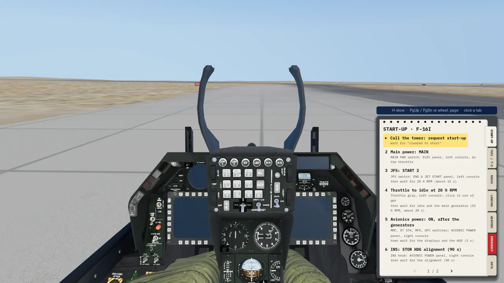
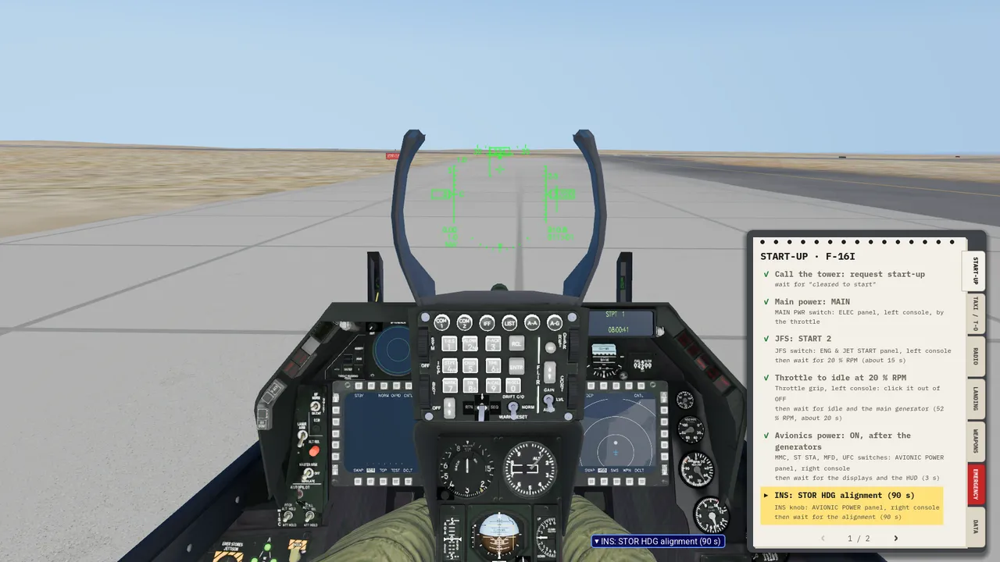
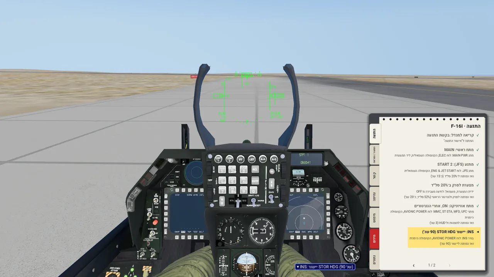
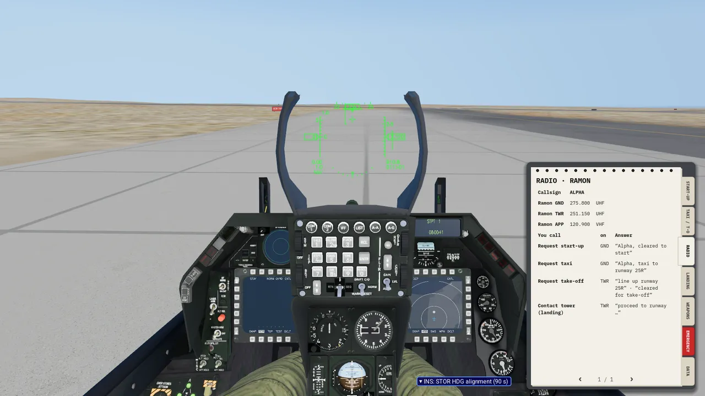
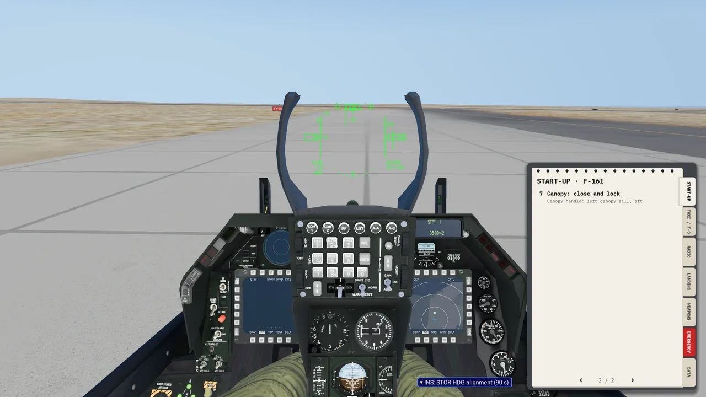
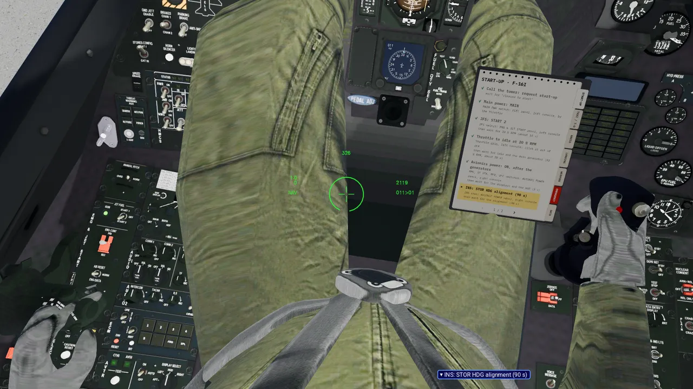
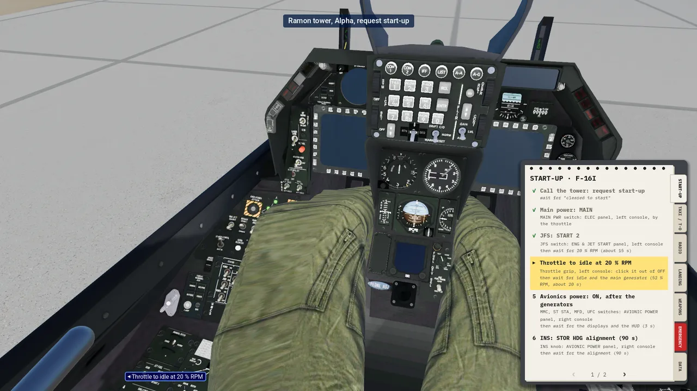
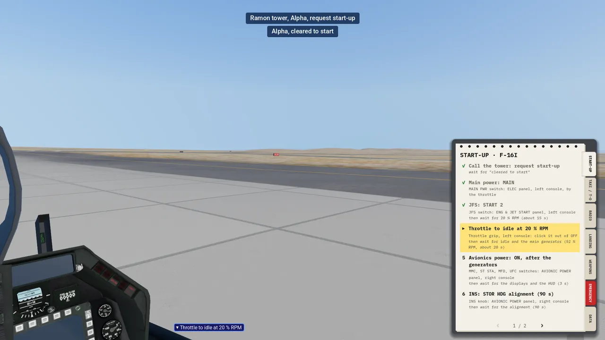

# Modern IAF training: pass / fail rules and the debrief

**Terms:** blackbox = the flight recorder's JSON Lines file ([../../docs/blackbox.schema.json](../../docs/blackbox.schema.json));
engine frame = the game's world metres (X east, Y north, [../../docs/georef.md](../../docs/georef.md)); runway start = where the
declared runway begins ([airbases.md](airbases.md) §4); "inferred" = our own reasoning; "open" = no source found.

The scoring core (item E3a, plan.md) reads a recorded flight and a training mission and says pass or fail, with the
debrief's numbers. It is pure Rust. Since item E3b (2026-11-03) the game runs both training missions without the front
end: the jet parked cold, one start command (§7), the radio menu and the tower (§8), scoring at the mission's end with
the debrief record and the pilot log (§9), and a probe that flies both missions for each jet (§10). The front end
(item E2, [front-end.md](front-end.md)) shows the record as its debrief sheet.

```sh
cargo run -p iaf-tools --bin iaf-training -- score <flight.jsonl> modern-iaf/data/missions/ramon_takeoff.json [airbases-dir] [--json debrief.json]
```

The airbases folder defaults to `airbases` beside the mission file's folder (`modern-iaf/data/airbases`), from any
working folder; a missing folder stops the run with its name.

## 1. Where the code is, and why
`crates/iaf-tools/src/training.rs` (module `training`) and the bin `iaf-training`. The module sits in iaf-tools beside
the georeference (`georef.rs`) and the mission compiler (`sim.rs`), whose data readers, source checks and `place()`
it uses: the compiler checks the rules with the same parser the scorer uses. The module is plain Rust over JSON in
and JSON out, ready for E3b to call through a small `iaf-godot` class.

## 2. Positions: the engine frame
The recorder logs scene metres (x east, z south) from the terrain's origin. The scorer turns each sample into the
engine frame, `(origin.x + x, origin.y − z)`, and turns the two ends of the mission's runway (lat / lon in the airbase
file) into the same frame with `Georef::geo_to_engine`, the call the mission compiler uses to place the jet. Two
reasons to work in the engine frame:
- the recorded heading is the engine frame's, so it compares with the runway's engine-frame heading directly (the
  warp turns true headings by a little, which a per-sample lat / lon conversion would have to undo);
- only two points per runway are converted, not every sample.

Near a base the engine frame is real metres to within the warp's local stretch ([../../docs/georef.md](../../docs/georef.md)),
so lengths in metres are real ones (inferred). When item B1's 1:1 terrain replaces the georeference, the scorer
follows the compiler, since both call the same function.

## 3. The rules (mission JSON, `"training"`)
Each figure has a source in the mission's `sources` (`"training.time_budget_s"` …), checked by the compiler
([data-formats.md](data-formats.md) §5).

| field | start-up | take-off | default | source |
|---|---|---|---|---|
| `kind` | `"startup"` | `"takeoff"` | — | — |
| `air_kills`, `ground_kills` | — | — (a range's, §3.4) | 2 and 2 in the range missions | inferred |
| `time_budget_s` | idle with avionics up by then | airborne, gear up, on heading by then | 120 s / 900 s | inferred |
| `end_hold_s` | a fail shows its reason this long before the debrief (a pass: the flight pauses for Continue or Debrief, §9) | the same | 5 s | inferred: time to see the result before the debrief |
| `goals` | the debrief items the sheet shows, in order (§4) | the same | `[]` / `["runway", "liftoff_speed", "reference_speed", "max_centreline_offset", "tower_calls"]` | — (not a figure) |
| `heading_tolerance_deg` | — | ± from the runway heading | 10° | inferred |
| `empty_kg` | — | gross weight = this + the recorded fuel | F-16: 8,573 kg; F-35I: 13,290 kg | F-16C Block 50 / 52[^w-f16]; F-35A[^w-f35]; the IAF jets' own weights inferred the same |
| `takeoff_kt` | — | reference take-off speed by gross weight: `[[kg, kt], …]`, linear between, held at the ends | F-16: [[9072, 130], [21772, 214]]; F-35I: [[13290, 165]] | F-16: 70 kt + 3 kt per 1000 lb[^bms]; F-35: about 165 kt[^wn] |

The two take-off speed sources are weak (a forum post quoting a pilot's rule, a news photo page); no public flight
manual gives the F-16's or the F-35's take-off speeds by weight (open). Checked once more against them on
2026-11-02: at 30,000 lb the rule gives 160 kt, and the forum's figures (rotate at 170 kt with an air-to-air load,
180 kt heavy[^bms]) lie 10–20 kt above it, as the rotation 10–15 kt before the take-off speed implies (inferred). The
reference speed is a debrief number only; no rule fails on it.

### 3.0 Every mission: fail at once
Since 2026-11-08 (the user's Mac play test: a crash in the start-up still passed) any of these ends a training
mission at once as a Fail, with its reason first in the debrief:

| reason | the recording's event | the game's live check (`Watch::check`, `IafTraining.check`) |
|---|---|---|
| `ejected` | `eject` | the pilot ejected |
| `crash` | `crash` | the jet crashed |
| `damage` | `hit` (any damage to the jet) | the player's unit's damage above 0 |
| `off_pavement` | `surface` with `paved` false | on the ground with the jet's centre off the base's pavement |
| a phase without clearance, `wrong_runway` (§3.3) | `clearance` with its `reason` | `Watch::check`'s clearance and runway rules |

The pavement is the mission's base from its airbase file (`sim_bases::Base::paved`), the same shapes the paved
mask is drawn from ([data-formats.md](data-formats.md) §12): within half the width of a runway's, stopway's or
taxiway's centreline (a taxiway without an OSM width: 23 m), or inside an apron or a shelter's pad, with a 5 m
margin past every edge (`PAVEMENT_MARGIN_M`, inferred: OSM draws centrelines and outlines, not the paved fillets
where a taxiway meets a runway or turns; the probe's Sufa, cutting a corner onto runway 07R at Ramon, passed its edge
by 0.05 m). The jet's centre is checked, not each wheel (inferred: a centre off the edge puts a main wheel off it; a wheel-by-wheel check would
fail a jet on the OSM shapes' rough edges). The live check writes the `surface` event, so the recording carries the
reason.

### 3.1 Start-up: pass
- The engine started (the recorder's `engine` column turns true),
- the engine at idle and the avionics up within `time_budget_s` of the flight's start, and
- nothing failed (§3.0) up to the goal; the pass is kept, whatever follows.

Modern IAF's recorder (version 2, §9) has an `rpm` and an `avionics` column, and the scorer reads them:
- **idle** = the first sample with the engine running at 60 % RPM or more (the 6-DoF's idle, §7);
- **avionics up** = the first sample whose `avionics` is true.

A recording without those columns (version 1, the original game's recorder) is scored from the model instead: idle
= the engine start + 4 s (the original model's ground start winds the RPM up from 0 at 15 %/s to the 60 % idle,
[../../docs/flight-model.md](../../docs/flight-model.md) §10.2), avionics up = idle (inferred: once the F-16's engine
is self-sustaining, at about 52 % RPM, it drives the main and standby generators[^f16net]); the debrief notes both.

### 3.2 Take-off: pass
All of:
- nothing failed (§3.0) to the mission's end;
- a lift-off (the first sample off the ground after one on it that stays off it for 1 s, or to the recording's end; inferred);
- the roll started on the mission's runway (inside its length and width) and ran toward the far end;
- every sample of the roll stayed on the runway (else: excursion);
- some sample after the lift-off is airborne, gear up, heading within `heading_tolerance_deg` of the runway's, and
  within `time_budget_s`.

The roll starts at the slowest sample on the runway between the jet's entry onto it and its last sample below
30 kt before the lift-off: the stop on the lineup point, or the entry of a rolling take-off (inferred). The lineup
heading is the heading at that stop, or, in a rolling take-off, where the roll passes 30 kt. The rotation is the first sample of the roll
with the pitch 2° above the roll's first sample (inferred). "On the runway" is the jet's centre within half the
runway's width of the centreline (inferred).

Fail reasons, in the order checked: the §3.0 reason first (the earliest event); then `no_start`, `not_done` (the
engine never at idle with the avionics up), `over_time` (start-up); `no_liftoff`, `wrong_runway`, `excursion`,
`gear_down`, `over_time`, `off_heading` (take-off; after a §3.0 fail the climb-out is not judged).

**The four-ship (2026-11-19).** `ramon_four_ship` (Sufa, menu 2014) is a take-off lesson with three AI wingmen, Kidon
1-2 to 1-4, in the next shelters ([ai-plan.md](ai-plan.md) F1). The tower's start-up clearance clears the whole flight: the
wingmen start their engines 3 s apart, taxi behind the player in order and take off in a stream, then join the
player in fingertip. The pass is the player's take-off above; the wingmen do not change it. A Take-off kneeboard page
that looks a lesson up by base takes Ramon's Take-off lesson (2012), the first by menu id.

### 3.3 The tower's clearances and the runway
Since 2026-11-13 (the user: "missions should fail if I start without tower permissions"; "I need to be able to call
tower to align and for take off") a mission's `training.clearances` (mission data: the three take-off missions
`["startup", "taxi", "takeoff"]`; since 2026-11-15 the three start-up missions `["startup", "taxi"]`, with the tower's
start-up call as the briefing's first step, the user: "I started without tower permissions and the mission didn't
failed") makes each phase wait for its clearance. Doing it first fails the mission at once (§3.0's pattern: the banner with the reason,
the debrief 5 s later), the tower says so once (sound.md §3) and the recording gets `{"event": "clearance",
"reason": …}`. `Watch::check` in `crates/iaf-tools/src/training.rs` decides; the clearances come from the tower's
answers so far (`Cleared::of`, the same state the radio menu lists its calls from):

| phase | detected when | cleared by | reason | the tower |
|---|---|---|---|---|
| `startup` | the engine turning: RPM 5 % or more (`ENGINE_TURNING_RPM`; a cold engine reads 0, the starter cranks it to 20 %) | "cleared to start" | `no_start_clearance` | "Kidon 1, engine start without clearance" / "כידון 1, התנעה ללא אישור" |
| `taxi` | on the ground, the jet's centre more than 10 m from where it first stood (`TAXI_MOVED_M`, inferred: more than brake creep or the start's jolt) | "taxi to runway …" | `no_taxi_clearance` | "Kidon 1, taxi without clearance" / "כידון 1, הסעה ללא אישור" |
| `takeoff`: entering the runway | on the ground, the centre within half the width of the mission's runway's centreline (the airbase file) | "line up …" or "cleared for take-off" | `no_runway_clearance` | "Kidon 1, runway entry without clearance" / "כידון 1, כניסה למסלול ללא אישור" |
| `takeoff`: the roll | on that runway faster than 30 kt (`ROLL_START_KT`, the roll's start in §3.2) | "cleared for take-off" | `no_takeoff_clearance` | "Kidon 1, take-off without clearance" / "כידון 1, המראה ללא אישור" |

A call asked and answered "hold position" clears nothing; the answer is decided at the pick, so no call is pending.
A clearance stays valid afterwards (a restart needs no new start-up call). The player reads each clearance back in the
player's voice ("Taxi to runway 25 right, Kidon 1": [sound.md](sound.md) §3); the readback is spoken only. A
flight that starts with the engine running holds the start, taxi and line-up clearances.

**The runway in use** is the mission's `runway`, or that runway's other end when the mission's wind blows from more
than 90° off it at 5 kt or more (the tower's rule, [../../docs/autopilot.md](../../docs/autopilot.md) §2.4;
`sim_bases::Base::mission_runway`). The tower, the scoring (`Watch`, the debrief's track), the briefing's map and
facts, the Missions screen and the notebook all name that end. On a base turned into the wind the jet taxis to the
main end's holding point, asks for line-up there and backtracks down the runway to the other end; the line-up call is
marked and cleared at that holding point (`radio.gd` `entry_of`).

**The wrong runway.** In a take-off mission the jet on the ground, on a runway of the base and lined up within 30°
(`LINED_UP_DEG`, inferred: a jet crossing at 90° is not lined up) of an end other than the mission's
(`Watch::wrong_runway`; the designators are the airbase file's, the ones the tower names) gets a warning: the tower
says once per end "Kidon 1, you are on runway 7 left, the assigned runway is 25 right" ("כידון 1, על מסלול 7 שמאל,
המסלול שהוקצה 25 ימין") and the panel shows "Wrong runway: this is 07L, the assigned one is 25R." while it lasts. Lining
up there only warns; the roll there (faster than 30 kt) fails at once with `wrong_runway`.

### 3.4 Weapons range: pass
Since 2026-11-17 (avionics-plan.md §6 slice 1; the user: "avionics and playability is the next big thing") each
flyable jet has a range mission: `ramon_range` (Sufa, menu 2013), `ramat_david_range` (Barak, 2023) and
`nevatim_range` (Adir, 2033), `kind` `"range"`. Like every lesson it starts cold at the parking spot with the tower's
clearances (§3.3; the user's rule of 12 Nov: every lesson starts cold). The route's first steerpoint is the air range,
the second the ground targets ([data-formats.md](data-formats.md) §5.1):

| range | air | ground |
|---|---|---|
| Ramon, Nevatim | over the open Negev between Ramon and Revivim (centre 31.05° N 34.72° E) | four retired airframes in the Halutza sands, 31.02° N 34.57° E |
| Ramat David | over the sea west of Haifa (32.85° N 34.72° E) | four on the Golan plateau, 33.02° N 35.74° E |

The places are inferred: open ground the theatre's scenery shows no building on within 1 km; a real range's place is
not published. The five drones: Drone 1 on a 30 km racetrack at 15,000 ft (co-altitude with the route), Drone 2 low
(about 500 m above the ground or the sea), Drone 3 weaving at 20,000 ft and breaking away from a jet inside 9 km
(brain `drone_evade`), and Drones 4, a pair of F-35s on a 50 km box at 25,000 ft with their radars on (brain
`drone_radar`: the player's RWR hears their lock). They are red for the exercise and never shoot. Their decisions run
on Modern IAF's AI (`iaf_ai::target`, [../../docs/ai.md](../../docs/ai.md) §21).

The ground targets are six: the four parked airframes, Target 5 (a hulk towed on a loop beside them, the radar's GMT
target) and Target 6 (a target barge at sea, the radar's SEA target); any two pass.

**The range's load (2026-11-18; the user: the lesson could not be passed as briefed, its load had no bombs).** A
range mission carries its own `loadout` ([data-formats.md](data-formats.md) §5): the Sufa and the Barak four AIM-9M,
two 370 gal tanks and six Mk 82 on two triple racks (stations 3 and 7); the Adir four AIM-120 and two GBU-31 in the
bays (stations 4 and 8), which fall on the CCIP mark without a planned target ([docs/weapons.md](../../docs/weapons.md)
§13.2). The loads are inferred. A pilot's own loadout for the jet still takes the mission's place; the Loadout
screen's Mission row brings it back. `iaf-tools`' test `every_lesson_load_can_pass_its_lesson` holds every range
mission's load to its pass rule: no unmet need, a gun or a missile for each air kill it asks for, a bomb for each
ground kill.

Pass, all of:
- nothing failed (§3.0) to the mission's end;
- the recorder's `kill` events (a unit the player destroyed; `"air": true` for an aircraft) count at least `air_kills`
  aircraft and `ground_kills` ground units;
- the last kill it needs within `time_budget_s` (45 min) of the start.

Fail reasons: the §3.0 reason first; then `no_liftoff`, `short_air_kills`, `short_ground_kills`, `over_time`. The
game scores the recording every 3 s once airborne (`sim_flight.gd`); a pass pauses the flight under the
"accomplished" panel (§9). The debrief's goal rows: drones shot down, ground targets destroyed, the time; its items
the two counts and the tower calls. The "Next time" tip names the radar lock and the gun or a missile for the
drones, the bombs' release for the ground targets.

## 4. The debrief record
`Debrief::to_json` (`iaf-training score … --json`): `mission`, `kind`, `pass`, `reasons` (ids), `items` (each `id`,
`value` rounded to 0.1 or null, `unit`, optional `text` (a name in place of the value) and `note` id), `goals` (the
rules' `goals`), `checks` (the sheet's goals, below), `next` (the "Next time" line, `{"en", "he"}`, or null) and
`strings` `{"en": {id: text}, "he": {id: text}}` with every id the record names. The CLI prints the English summary.

The record keeps every item; the debrief sheet ([front-end.md](front-end.md) §13) shows the `checks` (the user,
2026-11-08: "no one cares how long it took to start or how many times I moved the throttle unless it is a goal").
Each check has `id`, `label` (`{"en", "he"}`), `target` (`value` or `text`, `unit`; `max: true` an upper limit,
`tol` a tolerance), `flown` (the same, `value` null when not reached) and `mark` (`ok`; `warn`: off the mark, the
mission still passes; `fail`). A record from before `checks` shows its `goals` items.

| mission | the checks |
|---|---|
| start-up | idle with the avionics up within the time budget; the card items the lesson names ticked (§12) |
| take-off | the runway (the mission's against the one rolled on), within the time budget (the first airborne sample with the gear up on the heading), the gear up on the runway heading (± `heading_tolerance_deg`), the centreline offset over the roll (at most half the runway's width; `fail` on an excursion), the lift-off speed against the reference (`warn` beyond 10 kt, inferred: the reference table's own step), the tower calls (one each for the start-up and the taxi, two for the take-off; `warn` when fewer) |

`next` is the tip for the reason that failed the flight first (off the pavement, an excursion, the wrong runway, no
lift-off, no engine start, a phase without clearance), else for the first check not `ok` (the lift-off: "Start the
rotation at" the reference less 10 kt, inferred), none when all are met.

### 4.1 The flight's track
`training::track` (`IafTraining.track(flight, mission, airbases)`, `Track::to_json`) is the debrief's view of a
recording: its samples thinned to at most 1,200, each with `t` (s from the start), `at` (the sim's frame, UTM 36N, a
flat [x, y, …]), `speed_kt`, `agl_ft`, `g` (empty without the column) and `phase`; `runs` (each phase's span,
`{phase, from, to}`); `marks` (`{id, t, graph, value}`: the rotation and its load, the lift-off and its speed, the
gear up and its height, the highest load in the air from 1.3 g; touchdowns, crashes, hits and ejections with no graph);
`pins` (start, lift-off, end: a sample index) and the names in English and Hebrew. The phases (`PHASES`): start-up
until the jet first moves faster than 1 kt; on the ground the taxi, a hold where it stands 5 s or longer (inferred:
a shorter stop is part of the taxi); the roll from its start (§3.2 on the mission's runway, else the last moment below
30 kt) to the lift-off; airborne after it.

| id | unit | meaning |
|---|---|---|
| `time_to_idle` | s | from the flight's start; note `from_spool` while the recorder has no RPM column |
| `time_to_avionics` | s | note `with_idle` while it has no avionics column |
| `throttle_moves` | — | runs of samples in which the lever moves more than 0.005 |
| `faults` | — | note `none_modelled`: the flight model has no hot or hung start |
| `taxi_time` | s | from the first sample above 1 kt to the roll's start |
| `runway` | — | `text`: the runway end the roll ran on ("25R"), from the base's runways; note `not_reached` off every runway |
| `lineup_heading_error` | deg | the lineup heading (§3.2) − the runway's |
| `roll_start_from_runway_start` | m | along the centreline from the runway start (100 m from the lineup point) |
| `roll_length` | m | the roll's start to the lift-off, along the centreline |
| `runway_left` | m | from the lift-off to the far end's runway start |
| `rotation_speed`, `liftoff_speed` | kt | true airspeed (the recorder's) |
| `gross_weight`, `reference_speed` | kg, kt | `empty_kg` + fuel at the lift-off; `takeoff_kt` at that weight |
| `gear_up_height`, `gear_up_time` | m, s | the first airborne sample with the gear up: height above the terrain, time after the lift-off |
| `roll_heading_deviation`, `max_centreline_offset` | deg, m | the largest over the roll |
| `tower_calls` | — | the `radio` events |
| `cut_lines` | — | only when the recording's last line was cut off mid-write (the game stopped while writing) and skipped; a bad line elsewhere refuses the recording |

## 5. Checks
`cargo test -p iaf-tools --lib training`: three synthetic take-offs from Ramon 25R built in the test (a clean one, a
gear-down climb-out, a runway excursion, a crash on the roll (fails at once, the crash first), damage, the wheels
off the pavement (the live check: the parking spot and the lineup paved, 200 m beside the runway not); also a rolling take-off, a one-sample glitch off the ground while
taxiing, a rotation on the lift-off sample, a recording cut mid-line at its end), a synthetic start-up (a pass at its end with no goals, a crash with the crash first, over the budget, never started), the sample take-off `modern-iaf/tests/data/ramon_takeoff_flight.jsonl` (written by `sample_flight.py` beside it: its checks, marks and Next time; its track's phases, marks and pins; a long flight thinned keeping the lift-off), and the
newest real recording in the flights folder (`user://flights`: `~/.local/share/godot/app_userdata/iaf-reborn/flights`
on Linux, `~/Library/Application Support/Godot/app_userdata/iaf-reborn/flights` on macOS, or `IAF_FLIGHTS`) scored
against Ramon's take-off, skipped with a message when there is none. `IAF_TRAINING_WRITE=<dir>` keeps the synthetic
flights as JSONL. `cargo test -p iaf-tools --test training_cli`: the CLI from another working folder, a missing
airbases folder and a `--json` without a file. `sim::tests::training_rules_are_checked`: a training figure without a source and an unknown kind
are refused, an unknown goal is refused, and every take-off mission's runway is an end of its base's airbase file.

## 6. Open
- The F-16I's, F-16D's and F-35I's own empty weights and take-off speeds by weight (open).
- A start-up fault model (hot / hung start): none in the flight model.
- The roll's start and rotation thresholds checked against a real flight of each mission by the user.
- Radio calls and the ground flow around the checklist are a manual topic (the pilot's manual, planned separately); the
  card (§12) holds no radio call.

## 7. The start in the game
A flight starts with a clean view, the flight running (the user, 2026-11-13; [front-end.md](front-end.md) §8). The
objective is in the briefing ([front-end.md](front-end.md) §10). A start-up flight starts with the pilot's notebook raised at its START-UP
page (§11; 2026-11-13, in place of the checklist card of the Mac play test, 2026-11-11).

The sim's jet starts parked cold: on its spot (airbases.md §9), engine off, no RPM, no electrical power, every screen,
the HUD and the lamps dark (`cockpit.power` 0). The throttle starts nothing (`Settings.throttle_starts_engine`, false
in the sim; in the original game any throttle command starts the engine at once, as before, on either flight model).
The start-up checklist by keys (§7.1) runs the jet's start sequence step by step; one command, **Start engine**
(Ctrl+E, record 117 of the sim's own `keys.json`, command 200, `IafFlight.start_engine`, a hidden developer shortcut
since 2026-11-08: not in the key list), runs it all at once
(`crates/iaf-flight/src/sixdof/start.rs`), which the flight model steps every frame:

| step | F-16I Sufa, F-16D Barak (JFS) | F-35I Adir (IPP) | source |
|---|---|---|---|
| the command | battery on: the lamps and engine gauges live (`power` 1) | the same | inferred |
| starter | the JFS cranks the engine at once | the IPP runs 10 s, then cranks | F-35: three selections, battery, IPP, engine[^ayton]; the 10 s inferred |
| crank | 0 → 20 % RPM in 15 s | the same | 20 %: the throttle to idle at 20 % RPM minimum[^chk]; the 15 s inferred |
| light-off | 5 s after the fuel on | the same | inferred (open: no light-off time found in a primary source) |
| to idle | 20 → 60 % in 15 s, then the engine runs (thrust, fuel flow) | the same | 60 %: the 6-DoF's idle (flight-model.md §9.7); the 15 s inferred |
| main generator | at 52 % RPM: the engine self-sustaining, the JFS off | — | about 52 %[^f16net], the JFS cut at 50–54 %[^jfs50] |
| displays and HUD up (`power` 2) | 3 s after the generator | 3 s after the IPP runs | the 3 s warm-up inferred |
| avionics up (`avionics`) | with the displays | 90 s after the command | F-35: "after 90 seconds … ready"[^ayton] |
| sum | idle and avionics at 35 s | displays 13 s, idle 45 s, avionics 90 s | |
| throttle to OFF (§7.2) | the fuel cut: the engine winds down, the generators off at 52 %, stopped after about a minute | the same | §7.2 |
| engine stopped (`set_engine_on(false)`, the ejection) | no RPM; the power as it was; a new command starts from the beginning | the same | inferred |

The F-15I's (no mission flies it yet) is the F-16's (inferred). The F-35I's engine steps are the F-16's: no public
figure (inferred). The sound: the JFS's (the IPP's) whine, the engine clip of E1b (`SFX_START_ENGINE`) with its
pitch and level by the RPM, a light-off thump, and the JFS winding down at the generators ([sound.md](sound.md) §1.4). The probe measures 37 s to idle
for the F-16s and 47 s / 92 s for the F-35I (the recorder samples 10 times a second; the scene takes a few frames).

### 7.1 The start-up checklist by keys
Since 2026-11-08 (the user: "the first mission, which is just one click, is pointless") the start-up mission is the
real start by keys, step by step. The pilot's notebook (§11) shows the steps among the card's items on its CHECKLIST
page (§12; START-UP until 2026-11-17), in English and
Hebrew: each step with its switch's name and place and the state to wait for, the steps taken ticked, the step to take
now marked, and a fault in red under it. Since 2026-11-13 it names no key (the user: "lets remove the kb hints"): the
briefing's How and the Keys screen list the keys. The F-16s' canopy step is its switch and its lock lever
([cockpit.md](cockpit.md) §5.6). Each step but the idle is a key of the sim's own
`keys.json` (records 119–124,
commands 210–215; `iaf-sim own` refuses a key bound twice) and a click on its switch in the 3D cockpit
([cockpit.md](cockpit.md) §5.2). The flight model takes each step
(`Start::press` in `crates/iaf-flight/src/sixdof/start.rs`, `IafFlight.start_step`); a step out of order has its
consequence and returns a fault, which ends the mission at once as a Fail with that fault first (§3.0).

The idle step has no key (the user, 2026-11-09): moving the throttle up from OFF, by its keys or the axis, is the step,
as the real throttle's idle-cutoff detent, once the starter step (JFS / IPP) is done (before it the throttle moves
alone and starts nothing). OFF is the throttle's bottom (2 % allowed for a lever's noise); a lever already up goes to OFF first. The briefing's How names the Throttle idle key (record 7, the 1 key) on that line (the user, 2026-11-09: "we have 1 for throttle"); the axis, the 0 key (Throttle up 5 %) and the 1 key all make the step (the 1 key sets the throttle to idle, which is OFF, so the key itself takes the step at OFF);
The step reaches the flight model and the recording as the key did (`sim_flight.gd _throttle_step`), so the scorer
reads the same `checklist` event. The throttle goes back to OFF by its own key, Throttle OFF (§7.2).

| # | F-16I Sufa, F-16D Barak | key | timing | out of order | source |
|---|---|---|---|---|---|
| 1 | Main power: MAIN (the battery on) | Ctrl+B | at once | — | the checklist's order[^chk] |
| 2 | JFS: START 2 | Ctrl+J | cranks the engine to 20 % RPM in 15 s, then holds there | before main power: nothing runs, `no_power` | [^chk]; the 15 s inferred |
| 3 | Throttle to idle at 20 % RPM | the throttle up from OFF | light-off 5 s later, idle 15 s after it; the main generator at 52 %, the JFS off | below 20 %: a hot start, the engine shut down, `hot_start`; no rotation: no light-off, `no_rotation`; never: the JFS holds at 20 % | 20 % minimum[^chk]; 52 %[^f16net]; the times inferred |
| 4 | Avionics power: the four AVIONIC POWER switches ON, after the generators | Ctrl+A (or a click on each; the key also turns the SNSR PWR panel's FCR and RDR ALT on; it turns the four off only with all six on) | each switch's system 3 s later ([cockpit.md](cockpit.md) §5.2 "One by one") | before the generators: no power, `avionics_early` | inferred (the avionics go on after the engine start in the checklist[^chk]) |
| 5 | INS: STOR HDG, wait, then NAV | Ctrl+N or a click: the knob one position on (OFF, STOR HDG, NORM, NAV, …) | aligned 90 s after STOR HDG (ALIGN on the HUD, flashing when done; the DED's INS page, LIST then 6, counts it); the step is done at NAV once aligned (since 2026-11-17: until then the lesson's pass waited 90 s in silence after the last step) | without main power: `ins_no_power` | 90 s[^ins] (a full alignment takes about 8 minutes[^ins]) |
| 6 | Canopy: close and lock | Ctrl+K, or the canopy switch held and then the lock lever ([cockpit.md](cockpit.md) §5.6) | when the canopy is down and the lever goes down; the canopy, up 34° at the cold start, comes down over 10 s | any time; taxiing with it up has no consequence | [^chk]; 10 s[^fgcanopy]; 34° measured on a side photo[^f16canopy] (`shared/extra/planes/f16/airframe.json` `canopy_deg`) |

| # | F-35I Adir | key | timing | out of order | source |
|---|---|---|---|---|---|
| 1 | Battery: ON | Ctrl+B | at once | — | battery, IPP, engine[^ayton] |
| 2 | IPP: START | Ctrl+J | runs 10 s, then holds | before the battery: `no_power` | [^ayton]; the 10 s inferred |
| 3 | Throttle to idle: the engine starts | the throttle up from OFF (in the 3D cockpit also the ENGINE switch or the IPP knob to START, [cockpit.md](cockpit.md) §5.2) | cranks, lights and runs to idle by itself (the F-16's figures); the displays on the IPP's power | before the IPP: `no_ipp`; before the IPP is up to speed: `ipp_not_ready` | [^ayton]; inferred |
| 4 | Canopy: close and lock | Ctrl+K | at once; the canopy, its aft end up 30° about its front hinge at the cold start, comes down over 10 s | any time; taxiing with it up has no consequence | inferred (front-hinged: [f35i.md](../../docs/f35i.md) §4; 30° and the time FlightGear's F-16's[^fgcanopy]) |

**The step's lines (2026-11-17, the user: "it needs 2 clicks. the checklist isn't clear enough", "I also see align on
the hud but no idea how to do that", "it takes to long after finishing the startup to get the mission accomplished
screen").** Each line says the position wanted and how to get there when it is more than one action (MAIN PWR: two
clicks, OFF, BATT, MAIN PWR; the INS: one click to STOR HDG, then two on to NAV), and a wait for a value says WAIT
before the next action (the JFS's 20 % RPM before the throttle). Under the current step the notebook says what it
still misses, one line in blue, and the ring's label says the same (`kneeboard.gd` `hint`): at BATT one more click; the
RPM so far of 20 %; a throttle not at OFF; the AVIONIC POWER switches still off; the INS's seconds left (NORM: its 8
minutes), then the knob to NAV; with every step done, the F-35I's self test still running. A later step taken while an
earlier one is open is ticked; the earlier step stays the current one, ringed, with its line of what is missing. The
end: the INS's 90 s alignment, which came as a silent wait after the last step (about 89 s after the canopy, measured
as the time from the canopy to the alignment's end), is now the INS step with its countdown; the pass comes at the
next score (every 3 s) after the knob reaches NAV (0.7 s; `modern-iaf/tests/test_lesson_steps.gd`). Every Training lesson that starts cold rings the start-up's
current switch (until 2026-11-17 only the start-up lesson did).

Each step's `wait` (mission data) says the state to wait for before the next step, in the table's figures (the JFS's
20 % RPM, the idle with the main generator, the displays, the INS's 90 s; the IPP's 10 s); the notebook shows it under the step. The briefing's text says the same in prose, its paragraphs with the steps'
switch pictures from the 3D cockpit ([front-end.md](front-end.md) §10).

The avionics of the F-35I report ready 90 s after the battery[^ayton].

### 7.2 The shutdown: the throttle to OFF
**Throttle OFF** (Shift+1, record 121 of the sim's `keys.json`, command 218) moves the throttle over the idle-cutoff
detent to OFF, which cuts the engine's fuel (T.O. checklist: "Retard THROTTLE to OFF"[^ep]). The 1 key and the axis
stop at idle: OFF takes its own key, as the real throttle's detent takes a deliberate move. The 3D cockpit's throttle
takes no mouse (2026-11-15, [cockpit.md](cockpit.md) §5.2). The flight model
(`Start::cut_off` in `crates/iaf-flight/src/sixdof/start.rs`, `IafFlight.start_step("cutoff")`) then runs the
shutdown:

| what | when, from idle | source |
|---|---|---|
| thrust and fuel flow | none at once | the fuel cut |
| RPM | falls as e^(−t / 15 s): 52 % after 2 s, 20 % after 16 s, stopped (below 1 %) after 61 s | inferred: "about a minute"; with the fuel cut the RPM dies slowly[^bmshot] |
| main generator | off line below 52 %: the displays, the HUD and the avionics dark (`power` 1, the battery), the INS to align again | the generator's on-line RPM on the way up[^f16net], taken for the way down (inferred) |
| FTIT | falls with the RPM (`EngineTemps`, [cockpit.md](cockpit.md)) | inferred |
| sound | the engine loop pitches down and fades with the RPM, silent at the stop ([sound.md](sound.md) §1.4) | inferred |
| the F-35I | the same figures; its displays also drop at 52 % (the IPP is off once the engine runs) | inferred |

A restart is the start's own steps: the starter (Ctrl+J) once the RPM is below 20 % (the RPM it cranks to; before
that the key does nothing; inferred), then the throttle up from OFF at 20 % (§7.1), or Start engine (Ctrl+E) once
below 20 %; the starter above 20 % is the fault `starter_high` and the key is taken again later. An engine started by Start engine or running from the flight's start (an airborne start) lights from the starter
alone, as Start engine does (inferred: no checklist was flown to give the throttle's step). Before the starter step the
throttle moves alone. A cut-off with no fault (a cold or cranking engine) leaves the steps taken as they were.

**In the air** (2026-11-25, `start.rs`, test `in_the_air_the_engine_windmills_the_epu_holds_and_the_throttle_relights`
and `master_fuel_off_flames_the_engine_out`), after the throttle to OFF or a flame-out:

| what | in the sim | source |
|---|---|---|
| RPM | runs down toward the windmill's RPM, 0.08 % per KCAS (20 % at 250 kt, 24 % at 300 kt), not to a stop; on the ground to a stop as above | the airflow spins the core to "20–25 %" in a dive (secondary)[^boltepu]; the line through it inferred |
| airstart | the throttle up from OFF (the F-35I's engine start) lights an engine windmilling at 12 % or more: the light-off, then idle at the start's rate, the generators at 52 % | below 12 % the main fuel pump gives too little flow (secondary, a study set's figure)[^f16num] |
| JFS-assisted airstart | below 12 %: the starter, then the throttle at 20 %, as on the ground; the F-16's JFS only below 20,000 ft and 400 KCAS (else the fault `starter_envelope`) | the dash-1's airstart, as the F-16 manual chapter quotes it (secondary)[^boltepu][^f16num] |
| F-16 EPU | starts by itself with the generators off line in flight (the EPU switch at NORM, cockpit3d.gd `_epu`); while it runs the displays and the avionics stay up (`IafFlight.set_epu`); its 10 minutes of hydrazine spent, or the switch at OFF, they go dark | "approximately 10–15 minutes" (secondary)[^boltepu]; the hydrazine's 10 min as the gauge (cockpit.md) |
| F-35I IPP | keeps the displays up in the air with no limit | inferred: the IPP is the jet's only power source besides the engine's generator; no figure is public |
| F-15I, MiG-29A | no emergency power: the displays go at 52 % | inferred: none sourced |

The throttle's idle step in the air needs no starter step (`sim_flight.gd` `_idle_step_due`, `start_on("airstart")`).
Not modelled: SEC, a hot start or stall in the air start, the time to light at height.

The recording gets a `checklist` event with step `cutoff` and its fault: `shutdown` (the engine was running) or
`no_start` (it was lighting or accelerating to idle). A cold or cranking engine has nothing to cut: no fault. In a
training mission the fault fails it at once (§3.0) with "Engine shutdown: the throttle went to OFF with the engine
running." first in the debrief. The mission passes when every card item it asks for is
ticked (`skip_<step>` names a start-up step never taken, `skip_item` any other item), the engine idles and the avionics
are up within the time budget (10 min since 2026-11-17, inferred), and nothing failed, at its end. The items' lines are
the jet's card (§12); the lesson's `training.checklist` names them ([data-formats.md](data-formats.md) §5). Each key
press or switch is a `checklist` event in the recording (`step`, and `fault` when it was refused), each card item
ticked or unticked one with `item`. The take-off missions still start cold: the same keys start the jet there, the notebook stowed.

The notebook's pictures are in §11.

## 8. The radio menu and the tower
The **Call the tower** key (Ctrl+T) opens a numbered list over the view; a call's number picks it, any other key
closes the list, and since 2026-11-15 it closes by itself 6 s after it opened (or after a held key) when no call was picked
(`sim_flight.gd` `MENU_S`; the user: "the radio menu should disappear after few seconds if not in use"; the original
game has no such menu, so the time is inferred). Opened again it lists the calls of that moment. Since 2026-11-13 (the user: "all radio calls should always be available. on ground show only starting
calls, in the air show landing") the list holds every ground call on the ground (start-up, taxi, line-up, take-off,
always 1–4) and the landing call in the air (`training::radio_calls`). The menu marks no call: until 2026-11-17 the call a
training mission expected next carried "(next)" / "(הבאה)" (the user: "remove the (next) from the raio menu");
`training::next_call` (the "marked when" column) still tells the lesson which call comes next. A ground call made before
the clearance it follows (take-off before line-up, line-up before taxi, taxi before start-up;
`training::missing_before`) gets "Kidon 1, negative, hold position, request line-up first" ("כידון 1, שלילי, המתנה במקום,
יש לבקש כניסה למסלול קודם"; `ACFT_NEGATIVE`) and clears nothing; a call repeated gets its answer again. A wrong call
alone never fails a mission; acting without the clearance does (§3.3). No "say again" or "radio check" call exists;
the air has only the landing call (open: the calls the landing and navigation lessons need, such as joining the
pattern, final and go-around, have no tower lines yet). The list's first page is 1 Tower (the calls above), 2 Wingmen and 3 AWACS (dimmed: it
reports by itself, no request exists). In a four-ship ([ai-plan.md](ai-plan.md) F5) Wingmen lists the
flight's addressees, each opening its page of commands to the wingmen (0 goes back; every line is also clickable;
the game manual's "Commands to your wingmen").

| call | English | Hebrew | marked when | the tower answers |
|---|---|---|---|---|
| start-up | Request start-up | בקשת התנעה | on the ground with the engine off | "Kidon 1, cleared to start" (`ACFT_CLEAR_TO_START`) |
| taxi | Request taxi | בקשת הסעה | on the ground with the engine running and the avionics up, taxi not yet (also after a start without start-up approval) | with the engine running: "Kidon 1, good morning, taxi to runway 25 right" (`ACFT_TAXI_TO_RUNWAY`); else "hold position" |
| line-up | Request line-up | בקשת כניסה למסלול | on the ground at the holding point or past it (no farther from the lineup point than the holding point plus 50 m, inferred; the holding point is the base's taxi-out path's last point before the lineup, `iaf.ibx` `FromTaxiPt`; on a base turned into the wind the main end's lineup, where the backtrack starts) with taxi approved, line-up not yet (since 2026-11-13) | within 400 m of the lineup point (or, turned into the wind, of the runway's entry) with the runway clear: "line up runway 25 right, wind calm" (`ACFT_CLEAR_TO_LINEUP_NW`; ours: the original's band starts 200 m out, which leaves out the holding point); else "hold position" |
| take-off | Request take-off | בקשת המראה | at the holding point or past it with line-up approved, take-off not yet | the original tower's rule on the ground (docs/radio.md §2 `ground()`): lined up in the lineup zone: "Kidon 1, wind calm, runway 25 right, cleared for take-off" (the wind and the runway ours, [sound.md](sound.md) §3); 200–400 m from the lineup point with the runway clear: "line up runway 25 right, wind calm"; else "hold position" |
| landing | Contact tower (landing) | קריאה למגדל (נחיתה) | in the air | the original's Ctrl+T (docs/radio.md §2): "proceed to runway …" in the air |

A call is approved by the tower's answer named in its row; "hold position" or "line up" leaves it unapproved, to ask
again. The rules are in `crates/iaf-tools/src/training.rs` (`IafTraining.radio_calls`, `next_call`,
`missing_before`); `sim_flight.gd` lists their result. Between the calls (the engine starting, the taxi to the holding
point) no call is marked. A flight that starts on the ground with the engine running (at the lineup point) has taxi
and line-up approved, so take-off is marked at once.

The pilot's call is printed and spoken by the pilot's voice through the helmet chain ("Ramon tower, Kidon 1, request
taxi"; sound.md §5.2), then 0.6 s of quiet, then the tower's answer printed and spoken by the tower's voice (sound.md
§3), then the pilot's "Roger". The landing call is "request landing" to the radio's current base, then the
original's Ctrl+T. The taxi greeting follows the mission's clock (its start time plus the sim time): good
morning 05:00–12:00, good afternoon 12:00–17:00, good evening 17:00–05:00 (`Settings.tower_greeting` in
`modern-iaf/sim_settings.gd`; the original game keeps its own table, docs/radio.md §2 code 0;
`modern-iaf/tests/test_radio_calls.gd` at 04, 08, 14, 16, 20 and 23 h). The lines show in the sim's band over the flight
([front-end.md](front-end.md) §8), wholly in the game's language: in Hebrew the pilot's call ("מגדל רמון, כידון 1,
בקשת הסעה") and the tower's answer from each phrase particle's Hebrew text (`text_he` in
`modern-iaf/data/sounds/voices.json`, compiled into `phraseparticles_he.trx`: "כידון 1, בוקר טוב, הסעה למסלול 25 ימין");
only the runway numbers stay digits. The voice speaks the game's language too (sound.md §3.1). The
tower is the base within 18.54 km: every base of the own `iaf.ibx` talks (Ramon, Ramat David, Hatzerim, Nevatim;
`Settings.tower_bases`); the mission's base's tower names the mission's runway (`"runway"`), the others their own. A request leaves the tower's
state machine as it is. In the menu the tower no longer talks on
its own on the ground (the original game's tower is unchanged). Each pick is a `radio` event in the recording (§9),
which the debrief counts as `tower_calls`. The scorer has no rule on the calls (a take-off without them still passes).

A take-off mission's `training.steps` (mission data) lists the pilot's sequence for the notebook's TAXI / T-O page
(the briefing tells it in prose, its `briefing.how`): each call
on its own at its place (request start-up before the engine start, taxi once at idle with the avionics up, line-up at
the holding point, take-off once lined up), each with its key, the menu's pick and the answer to wait for (the table
above). The picks are the menu's fixed order: start-up 1, taxi 2, line-up 3, take-off 4.

Taxi: the jet taxis on the base's taxiways to the lineup (the probe follows the own `iaf.ibx`'s taxi path). The
take-off passes by §3.2.

## 9. Scoring in the game, the debrief record and the pilot log
`modern-iaf/flight/sim_flight.gd` (the sim's part of the flight scene, `Settings.flight_addon`) runs a mission whose
compiled file has `sim.training` with an `IafTraining` (crates/iaf-godot/src/training.rs) opened on the readable
mission `modern-iaf/data/missions/<id>.json` and the airbase files:
- every frame `IafTraining.check` (§3.0) decides whether the mission failed; on a fail the mission ends at once
  (off the pavement: a `surface` event first);
- a start-up is scored once the engine idles with the avionics up, a take-off once airborne (then every 3 s until it
  passes; since 2026-11-13 also with the gear down, the user: "why I didn't get completed mission … after I
  airborned?"). A goal still missing shows in the panel ("To complete: raise the gear." / "To complete: climb out on
  the runway heading with the gear up."); a take-off that cannot pass any more (`wrong_runway`, `excursion`,
  `over_time`) ends at once as a Fail; a pass is stored at once and kept (since 2026-11-13); 5 s past its time
  budget it ends as scored;
- the player ending the flight first (Esc → End the flight, Ctrl+Q) ends the mission there, scored as it stands;
- at the goal (since 2026-11-15, the user: "it pause and show 'continue/debrief' buttons") the flight pauses under
  the front end's panel "Mission accomplished" / "המשימה הושלמה בהצלחה" (`front_end.gd _page_accomplished`, opened
  by `sim_flight.gd _accomplished` through `terrain_view.gd _open_front_end("done")`): Continue the flight (also Esc)
  resumes it and the panel does not come back; Debrief ends the flight into the debrief. The panel opens once the
  radio's phrase channel has said what it had queued (`flight_sounds.gd phrase_cue`), so the pause never cuts a
  voice. No radio line announces the pass;
- a fail shows a banner in the front end's look (navy, Heebo) with "Fail" and the reason that ended it, and 5 s later
  (real time, `end_hold_s`) the flight ends into the debrief;
- an ejection ends the sortie (`Settings.eject_ends_sortie`, the sim only): every sound and the radio stop at once
  (`flight_sounds.gd silence`, no radio menu), the view stays outside on the seat and the jet at any height (no
  FlyTSD), the recording gets an `eject` event and the mission fails with `ejected` first. The original game's
  ejection runs as before (tests/godot/test_eject.gd);
- `IafTraining.score(recording, mission, airbases)` runs `training::score_files` on the recording so far, with the
  live check's reason first;
- the debrief record (§4, plus `flight`: the recording's path, `date`: the end, `elapsed_s`: the flight's length) is
  stored as a sortie of the pilot (the default pilot 14 until E2's pilot list) in the records database
  `user://modern-iaf.sqlite` (`IafPilotLog.log_sortie`, [storage.md](storage.md) §5), and `Settings.flown_sortie`
  names it for the front end;
- ending the flight opens the front end's debrief sheet.

Scoring needs the recorder (Extras, on by default): with it off the flight is not scored (a warning in the log). Tests
record beside the records database, in a temporary folder. The recorder's version 2 (`Settings.blackbox_version`, [data-formats.md](data-formats.md) §13) adds `rpm`
(%) and `avionics`.

`tools/flight_timeline.py <recording> --debrief <debrief.json> [--html f.html]` (a record out of the database:
[storage.md](storage.md) §5) shows the debrief with the flight's
timeline (the radio calls, the lift-off) and the start's steps from the RPM column.

## 10. The probe and a real run
`modern-iaf/tests/test_mvp.gd` (item F's probe, started here; `-- --only clearance`: each §3.3 phase done without
its clearance, the Sufa, fails with its reason, the tower's line once and the recording's event) flies both missions for the Sufa (Ramon), the Barak
(Ramat David) and the F-35I (Nevatim) headless with scripted inputs at 6× time: the start-up (cold, the throttle
starts nothing, the checklist by its keys, the columns, the sortie's debrief, its pass in the pilot log; the JFS before the main
power fails at once) and the take-off (the four radio
calls and their answers, line-up at the holding point, a taxi along the base's taxi path to the lineup (on the taxi line, slowing to 2.5 m/s
through each turn: off the pavement fails, §3.0), the roll on the centreline, the rotation,
gear up, the debrief's goals), each ending in Pass, and a crash in the Sufa's start-up ending it at once in a Fail
with the crash first. `-- --jet f16i` / `-- --only startup` narrow it. Item F adds the front end, Hebrew, the
temp-root run and the other platforms.

`./start-modern-iaf -- --mission <id>` flies one mission at once (`modern-iaf/flight/fly.gd`), then shows its debrief: 2011 / 2012 Ramon
start-up / take-off, 2021 / 2022 Ramat David, 2031 / 2032 Nevatim.
`modern-iaf/tests/_training_shot.gd` takes the pictures in a real render (its header).

## 11. The pilot's checklist notebook
Since 2026-11-13 (the user's decisions: "a checklist notebook that opens on a key press, in every mission"; look A of
the second mock-up approved the same day) every flight of the sim carries a paper notebook on the pilot's right thigh.
`modern-iaf/flight/notebook.gd` draws the notebook; `modern-iaf/flight/kneeboard.gd` fills it from the flight and
places it; `sim_flight.gd` holds one and passes it the key and the checklist's steps.

**The key.** Checklist notebook, in Hebrew בד"ח (the user, 2026-11-13) (H; record 118 of the sim's `keys.json`, command 203; the Keys screen rebinds it as any
other) raises it and stows it again. The flight keeps running. The notebook itself names no key. On 2026-11-13 it moved
from K to its own key (the user: "Give notebook its own key"): K had shared it with the GPS bomb's PRE / VIS switch
([weapons.md](../../docs/weapons.md) §13.2), which has K to itself again.

**Stowed** it lies on the right thigh in the 3D cockpit, a 13 cm board (its place and tilt per cockpit model:
`stowed` in `data/notebook.json`). The notebook is drawn into a texture only when its page changes (a step taken, a
turn), so stowed it costs one textured quad.

**Raised** it is a 460 x 620 px panel (at the 1080-high canvas) at the screen's lower right, 26 px from the edge, in
Hebrew too (the thigh's side), never the screen's centre. A start-up mission starts with it raised at its CHECKLIST
page; every other flight starts with it stowed. In Hebrew the page is mirrored: the tabs run down the board's left
edge, the text right to left.

**The tabs and the pages.**

| tab (English / Hebrew) | the page | from |
|---|---|---|
| CHECKLIST / בד"ח (START-UP / התנעה until 2026-11-17) | the jet's checklist card (§12), section by section: each item's line, how to do it (`how`: the clicks, the waits), its switch and place (`where`); the items whose check holds ticked (a switch back off unticks its item, [cockpit.md](cockpit.md) "Both ways"), ○ on an item read and acknowledged, the item to do now on a yellow band with ▶ (◀ in Hebrew), a refused step's fault in red under it | the jet's card, `data/checklists` (§12); a start-up lesson's tower call above it |
| TAXI / T-O / הסעה / המראה | the radio calls, the taxi and the take-off as numbered steps, the runway's designator, heading, length and elevation | the take-off mission's `training.steps` (§8) of the flight's base (else its jet); the base's airbase file |
| RADIO / קשר | the callsign, the base's frequencies (name, MHz, VHF / UHF), the four calls with the frequency to call on and the tower's answer | `data/notebook.json` `radio` and `calls`; the call names are the radio menu's (`sim_flight.gd` `ITEMS`) |
| LANDING / נחיתה | the call, the gear, the final's AOA, the touchdown, the throttle to OFF on the spot | `data/notebook.json` `pages.<f16 / f35i>.landing` |
| WEAPONS / חימוש | arming (ST STA on the F-16s, MASTER ARM, the gear up), air-to-ground (the stores from the Arming page, the master mode and the CCIP cue, the release, the jettison) and air-to-air (the master mode, the radar lock, the release, the gun); each step with its switch, its place and its key as bound: the one page with keys, as the weapons' controls have no switch to click (2026-11-14, [weapons.md](weapons.md) §5) | `pages.<family>.weapons` (`key`: a record of `data/keys.json`) |
| EMERGENCY / חירום (a red tab, a red strip down the page) | the hot start, an engine fire on the ground, the ejection | `pages.<family>.emergency` |
| DATA / נתונים | the mission, the base and its ICAO code, the time, the wind, the jet, the runway, the route's first point | the mission's readable file; the airbase file |

A section is cut into pages that fit the paper: its blocks (a step, a table, a heading) are measured at the page's
width and the page breaks between them. The pages turn by:
- a click on a tab: that section's first page;
- the page's own ‹ and › at its foot, with the section's page count between them ("1 / 2"; the user's "a clear way
  to move to the next page in the same section");
- the mouse wheel over the notebook, and the notebook's page keys while it is raised (key-table records 222 / 223,
  command 203 p1 -1 / 1: Page Up / Page Down, the laptop map's Option + Space / Shift + Space; since 2026-11-18, before
  that keys `kneeboard.gd` read by itself).

Past a section's last page the next section's first page opens; back from its first page, the previous section's
last. ‹ dims on the notebook's first page, › on its last. On the CHECKLIST tab the page follows the item to do now.

**No key hints, no title, no clip** (the user, 2026-11-13: "lets remove the kb hints"): the steps name the switch and
its place. In the pilot's first start-up mission only a help line stands over the raised notebook ("H stow · Page Up /
Page Down or wheel: page · click a tab", the keys as bound); `notebook_help_seen` in the settings file's `[sim]` section
remembers it.

**The training highlight.** In a start-up training mission an outline (the sim's sky blue, 2 px on a dark 4.5 px edge)
follows the shape of the current step's switch: the controls of the 3D cockpit that send its command
(`<model>_controls.json`, the F-16's engine step the throttle grip; its avionics step the AVIONIC POWER switches still
off, command 219, one fewer at each switch thrown: until 2026-11-15 that step showed nothing, its parts sought by the
step's key command 213, which those switches never send; the user: "it never shows the avionics panel to turn it
on"), each its mesh's points projected through the
cockpit's camera every frame, their convex hull drawn 3 px outside. A step may also watch a gauge (`gauges` in
`data/notebook.json`: the F-16's RPM gauge for the idle step, labelled "RPM · watch 20 %"): its dial is drawn as the
ellipse it shows, a circle of `radius_m` round its needle's turning centre in the plane square to the needle's axis
(the model's animation, `f16.json`). Since 2026-11-15 (the user: "smaller circles around the thing … on the exact shape
of the instrument"); until then a circle round the part's projected box, 6 px out with a 14 px glow, and the gauge's
on the NOZ POS gauge above the RPM's (node `anim067`, now `anim069`). A part out of the view (or behind the eye) gets a
pointer at the screen's edge toward it, with the step's line ("▼ Throttle to idle at 20 % RPM"). When the raised
notebook would cover an outline, it slides down its side to 18 px below it (at least 220 px of it left on the screen),
else up above it. While the pilot's body covers the ringed switch from the eye (the F-16s' left glove over MAIN PWR)
the body is hidden ([cockpit.md](cockpit.md) §5.3). Pictures: `modern-iaf/tests/_click_areas_shot.gd`.

**Every checklist switch clickable.** With no key hints, each step's switch must answer the mouse. On the pages:

| page | step | clickable |
|---|---|---|
| CHECKLIST | every start-up step of the Sufa, the Barak and the Adir: MAIN PWR, JFS, the four AVIONIC POWER switches, the INS knob; BATT, IPP, ENG / START, CANOPY; the throttle out of OFF by its keys or lever (no mouse since 2026-11-15); the F-16s' canopy switch and lock lever (since 2026-11-18) | yes, except the throttle ([cockpit.md](cockpit.md) §5.2, §5.6; `test_mvp.gd` clicks each, the F-35I's CANOPY included) |
| LANDING | the landing gear handle (both cockpits) | yes since 2026-11-13: the G key's command, refused on the ground |
| LANDING, EMERGENCY | the throttle to OFF over the idle detent | no: the throttle takes no mouse; OFF is Throttle OFF (Shift + 1) |
| LANDING | the wheel brakes (the rudder pedals) | no: no pedal part answers the mouse (open) |
| EMERGENCY | JFS OFF, MAIN PWR OFF, BATT OFF | the F-16s' yes: a click goes round to OFF, a drag down too (since 2026-11-16, [cockpit.md](cockpit.md) §5.2); the F-35I's BATT: a click turns it on only (open) |
| EMERGENCY | the ejection handle | no: no part of the seat answers the mouse (open) |
| WEAPONS (ARMING) | FCR, RDR ALT | yes: their own switches on the SNSR PWR panel (cockpit.md §5.2); Ctrl+A turns them on with the avionics since 2026-11-17 |

**The radio frequencies.** `data/notebook.json` `radio`, by base, in MHz. Published: Ramon APP 120.9[^oa-llrm],
Ramat David TWR 118.6 and APP 125.8[^oa-llrd], Nevatim APP 120.9[^oa-llnv]. Every other frequency (the ground and the
tower at Ramon and Nevatim, Ramat David's ground, all of Hatzerim's) is invented: no published military frequency was
found. The page shows them all alike. The calls' "on" (ground for the start-up and the taxi, the tower for the
take-off and the landing) is inferred: the sim has one tower voice for all four.

**The other pages' sources.** The F-16's hot start follows the T.O. checklist's steps[^ep] (weak); the fire on the
ground, the ejection and the F-35I's pages are inferred; the F-16's on-speed AOA of 13° is open (no primary source
checked).

**The frame cost** (`_notebook_shot.gd` with `NB_BENCH=1`, 1920 x 1080, this Linux laptop's Intel Iris Xe, 300 frames
each, the scripts' process time and the GPU's render time of the window and the cockpit's world):

| head and notebook | GPU, notebook off | GPU, notebook on | the notebook's script |
|---|---|---|---|
| stowed, looking ahead (the thigh out of view) | 26.3 ms | 29.8 ms | 0.022 ms |
| stowed, looking down at it | 43.2 ms | 44.2 ms | 0.031 ms |
| raised | 34.1 ms | 28.5 ms | 0.011 ms |
| raised, the training ring in view | 32.4 ms | 32.5 ms | 0.015 ms |

Measured 2026-11-16. The GPU's frame time moves by several ms from run to run on this laptop (the "raised" row is
faster with the notebook on), so the notebook's GPU cost is within that noise; its script costs under 0.04 ms a
frame.

**The pictures** (`modern-iaf/tests/_notebook_shot.gd`, a real render, its header):

| | |
|---|---|
|  |  |
|  |  |
|  |  |
|  |  |

Taken 2026-11-16 at 1920 x 1080 on this Linux laptop.

**Checks.** `modern-iaf/tests/test_notebook.gd` (headless): the start-up mission raises it at START-UP with the first
step current and no key on the page, the help line once, H stows it into the thigh's texture and raises it (K leaves it), a step
ticks, a tab click, the wheel, PgUp / PgDn and the page's ‹ › turn it across the sections, every section has a page,
RADIO holds Ramon's frequencies, the board at the right edge, the JFS step's mark, Hebrew mirrored, a take-off flight
stowed with the Sufa's start-up checklist and runway 25R on TAXI / T-O. `test_mvp.gd` and `test_flight_ui.gd` read the
current step from the notebook.

**Open.** The GUIDE tab (the jet's pilot guide from one source shared with the original game's guides, and the front
end's Guides screen drawing the same pages) is the next part. Gauge rings for the other steps; the throttle OFF, the
brakes, the ejection handle and the switches' OFF positions by the mouse.


## 12. The jet's checklist card
Since 2026-11-17 (the user: "the checklist isn't clear enough. we also need to make the checklist full", "try to find a
real checklist and use it", "right now the checklist is very training specfic", "ok so all of this should be part of
the checklist, ya? turning radar on etc") each jet carries one real checklist, the same card in every mission: the
notebook's first tab, CHECKLIST / בד"ח (§11). The card is the jet's data, not a lesson's:
`modern-iaf/data/checklists/f16.json` (the F-16I Sufa and the F-16D Barak, one cockpit) and `f35i.json` (the F-35I
Adir); `modern-iaf/flight/card.gd` ticks it.

**The source.** The F-16 card follows the real F-16C/D normal procedures: their sections and their order[^haf], cross
checked with a checklist card derived from the real one for Falcon BMS[^bmscl]. Each item is written in our own words:
the switch, then its position. Radio calls, ground-crew items (chocks, pins, the fireguard) and the "as required" items
of systems the sim lacks are left off; the radio calls and the ground flow around the checklist are a manual topic
(planned separately). The F-35 card holds the one public start flow: the battery, the IPP, the engine and the 90 s self
test[^ayton], and the items a public US Air Force instruction requires of an F-35A pilot[^afi]. That instruction holds
no switch-by-switch checklist (it leaves the checklists to the jet's flight manual); it sets scattered requirements,
and the card takes these, each where its phase is: the ejection seat's survival kit switch at AUTO (its paragraph
3.1.3) and loose items stowed before the start (3.1.2, 3.3.1), the helmet display tested and adjusted by the pilot
before the flight (3.19.2), the ops check in the climb or at level-off with its six items (3.14.1, 3.14.2), the "gear
down" report before the runway's threshold (3.15.4.2) and the walk-around after the shutdown (3.28). All six are read
and acknowledged: the sim has no control or radio call for them. Its figures stand in the "how" line of the matching
item: the taxi speed, 30 kt and 10 kt in turns (3.4.1), with the brakes and steering check; the normal recovery fuel,
2,500 lb at the final approach fix (3.20.3), with the joker and bingo fuel; the "minimum fuel" call at 1,800 lb and
the "emergency fuel" call at 1,200 lb (3.20.4), with the ops check. Every other item and its section are inferred
from the F-16's and from our cockpit (no public F-35 checklist was found). The Hebrew section names are the field's:
the checklist is בד"ח (בדיקות חיוניות), its parts
"בדיקות לפני המראה", "אחרי המראה", "לפני נחיתה", "אחרי נחיתה"[^bdh]; the switches keep their English labels, as
painted in the cockpit. Hebrew terms found in use: תצוגת קסדה (the helmet display)[^hmdhe], מעצורי אוויר (the
speedbrakes)[^airbrake], פגיעת ציפור (a bird strike)[^birdhe]. Open, no source found in the search of 2026-11-18 and
written as plain descriptions: ערכת הישרדות (the survival kit), חליפת ג'י (the G-suit), גובה תא (the cabin
altitude), בדיקה חיצונית אחרי הטיסה (the post-flight walk-around), the Hebrew wording of the radio reports.

**The wording** (the user's rules for the manuals, 18 November 2026, hold for the card). An item names its control as
the panel does (IPP – ON, DIGITAL BACKUP – BACKUP, SEAT – ARMED, in Hebrew text too), with the panel's position
names. Where the cockpit's data holds the reaction to an action (a lamp, a readout: the `sim` notes of
`modern-iaf/manuals/text/en/<cockpit>/systems.json`), the "how" line states it: the RUN light with the JFS, the DBU
ON lights, the radar altitude on the HUD, the F-35I's handle light and its display 3 s after the IPP. A card line
describes the jet; what a lesson asks and how it is marked is the lesson's text (§7, §10).

**Where ours differs from the source** (all inferred):
- The INS: the source aligns at NORM (about 8 minutes); the card aligns at STOR HDG (90 s), the source's quick-response
  alignment[^haf], then NAV in BEFORE TAXI as the source has it.
- LEFT HDPT and RIGHT HDPT: the source has them "as required"; the card turns both on, for the chin pods the IAF
  jets carry (the navigation pod on 5L, the targeting pod on 5R). Since this change the targeting pod has power only
  with RIGHT HDPT on ([weapons.md](weapons.md) §7.2); both are switches of the flight model (`start.rs` `SYSTEMS`,
  [cockpit.md](cockpit.md) §5.2), on in a jet that starts hot, and Ctrl+A turns them on with the avionics.
- The EPU check: the source runs it before take-off with the engine at a raised RPM; the card has the EPU switch to
  OFF and back to NORM after the start (the source's items 31 and 33), as the sim has no EPU.
- The landing light: the source's take-off has none; the card turns LANDING on before take-off and off after it.
- The F-35I's LAND/TAXI positions (OFF, TAXI, LAND) and its PARKING BRAKE are our cockpit's (research/f35-cockpit.md).

**The sections and items.** F-16: BEFORE STARTING ENGINE, STARTING ENGINE, AFTER ENGINE START, BEFORE TAXI, TAXI,
BEFORE TAKEOFF, AFTER TAKEOFF, BEFORE LANDING, AFTER LANDING, PRIOR TO ENGINE SHUTDOWN, ENGINE SHUTDOWN: 68 items, 53
checked by the sim and 15 read and acknowledged. F-35I: the same sections less PRIOR TO ENGINE SHUTDOWN: 38 items, 28
checked and 10 read and acknowledged (since 2026-11-25 the F-16's two speed brake items and the F-35I's two seat items
are checked; [cockpit.md](cockpit.md) §5.12).

**An item** (`data/checklists/*.json`, [data-formats.md](data-formats.md) §5) has its line (`en`, `he`), how to do it
when that is more than one action or a wait (`how`: "two clicks …", "WAIT for 20 % RPM"), the switch's place (`where`),
the controls the training ring outlines (`control`, the 3D cockpit's node names) and its `check`, the state that ticks
it:

| check | ticked when |
|---|---|
| `step` | the flight model's start-up step is done (§7.1: MAIN PWR at MAIN PWR, the JFS, the idle, the four AVIONIC POWER switches, the INS at NAV aligned, the canopy) |
| `set` | each control is at its position (or within `[lo, hi]`) |
| `test` | each control has been at its test position (a held test switch's moment: `cockpit3d_controls.gd` `moved`) |
| `lamp_off` | that cockpit lamp is dark (MASTER CAUTION, CANOPY, ENGINE) |
| `state` | the flight state's values (the generators' power, the engine running, the F-35I's self test) |
| `gear` | the gear handle up or down |
| `throttle_off` | the throttle at OFF |
| `speedbrake` | the speed brakes `closed` (also when never opened), or `cycled`: seen open since the flight began and closed now |

An item with no `check` is read and acknowledged: its system is not modelled (the oxygen, the IFF, the trim, the
F-16's ejection safety lever). The notebook shows it with ○ and "Read and acknowledge: not modelled in the sim"; it is never
the current item.

**How it runs.** The sections run in order. The current section is the first with a checked item still open, and its
first open item is the current one: on a yellow band in the notebook and, in a Training lesson that starts cold, ringed
in the 3D cockpit (§11). In the current section a switch put back unticks its item; the sections before it stay done.
AFTER TAKEOFF waits for the air, BEFORE LANDING for the approach (airborne, descending below 3,000 ft above the ground,
and on until the jet lands or climbs above 3,000 ft again; inferred), AFTER LANDING and the shutdown for the ground
after a flight. Once airborne (or landed) the card goes on at
that phase's first section even with an earlier item left open. A jet
that starts hot opens the card at BEFORE TAXI, one that starts in the air at AFTER TAKEOFF. Each item ticked or
unticked is a `checklist` event in the recording (`item`: its id; `"on": false` unticked), which the start-up
lessons' scorer reads.

**The lessons.** A lesson keeps its own prompts (the tower calls and their waits, the TAXI / T-O page) and names the
card's items it asks for: the start-up lessons' `training.checklist` lists every checked item from BEFORE STARTING
ENGINE through BEFORE TAXI (33 for the F-16s, 14 for the F-35I), and their time budget is 10 minutes (it was 5 for the
six steps). The scorer fails an item not ticked with its own line for the start-up's six steps and "Skipped: a
checklist item" for the rest. The take-off lessons show and ring the same card; they are scored as before.

**Checks.** `modern-iaf/tests/test_checklist_card.gd` (headless, each jet): the take-off lesson flown from a cold jet
by exactly the card's items, each by real clicks on its controls (`test_mvp.gd` `_fly_card`), the taxi, BEFORE TAKEOFF
at the hold, the take-off and AFTER TAKEOFF; then the radar radiates, the INS is in NAV and aligned with its
steerpoints, no ALIGN on the HUD, RDR ALT gives the radar altitude, the targeting pod works (the F-16s) and no caution
is lit. Then the Sufa's weapons range as an ordinary sortie: the card opens on the notebook, its current item on the
page in English and Hebrew, and a click ticks it. `test_mvp.gd`, `test_lesson_steps.gd`, `test_notebook.gd` and
`test_radar_cold.gd` fly the lessons by the card.

`modern-iaf/tests/test_card_landing.gd` (headless, each jet) proves the rest of the card in the same flight. After
AFTER TAKEOFF a scripted pilot (stick, throttle, rudder and brakes; no autopilot) climbs above 3,000 ft, flies 24 km
back along the runway's line, descends to 750 m, turns onto the final, follows a 2.5° path at 13° angle of attack,
flares and stops on the runway. BEFORE LANDING is done by clicks in that descent, then AFTER LANDING, PRIOR TO ENGINE
SHUTDOWN (the F-16s) and ENGINE SHUTDOWN on the runway. It checks
that BEFORE LANDING waits above 3,000 ft and opens on the descent, that each section's items tick in the card's order
(an item whose control is already in place, as MASTER ARM at OFF, is ticked as its section opens), that every checked
item of the card is ticked, and that the jet ends cold: the engine off, no electrical power, the displays dark. Its
first runs found that BEFORE LANDING never opened in the air: the rule read a height above the ground from the flight's
state, which holds none; `card.gd` now takes the ground under the jet from the terrain. With that mended, one dip
after the take-off opened it for the rest of the flight; a climb above 3,000 ft closes it again. Tried and dropped
(2026-11-18): the autopilot's NAV to a landing waypoint as the test's pilot. With the Sufa it slowed to 151 kt at idle
with the gear up and sank into the ground at "landing step 5" (the 1998 landing circuit lands the 6-DoF jets since
2026-11-18, [flight-model.md](flight-model.md) §9.6; the test keeps its own pilot).

[^ins]: F-16.net forum, "INS alignment time and time to takeoff from cold start" (a normal alignment about 8 minutes, a stored-heading alignment about 90 s), https://www.f-16.net/forum/viewtopic.php?p=7943; Eagle Dynamics forum, "What is the difference between stored INS align and normal INS align in the F-16C Viper", https://forum.dcs.world/topic/267433-what-is-the-difference-between-stored-ins-align-and-normal-ins-align-in-the-f-16c-viper (both weak: forums)
[^w-f16]: Wikipedia, "General Dynamics F-16 Fighting Falcon", Specifications (F-16C Block 50 / 52): empty weight 18,900 lb (8,573 kg), https://en.wikipedia.org/wiki/General_Dynamics_F-16_Fighting_Falcon
[^w-f35]: Wikipedia, "Lockheed Martin F-35 Lightning II", Specifications (F-35A): empty weight 29,300 lb (13,290 kg), https://en.wikipedia.org/wiki/Lockheed_Martin_F-35_Lightning_II
[^bms]: Falcon BMS forum, "Rotation speed" (the take-off speed 70 kt plus 3 kt per 1000 lb of gross weight; rotate at 170 kt with an air-to-air load, 180 kt heavy), https://forum.falcon-bms.com/post/314659
[^wn]: WION, the F-35's minimum lift-off speed about 165 kt (weak), https://www.wionews.com/photos/how-does-the-f-35-fighter-jet-stand-out-in-takeoff-speed-and-design-here-s-its-minimum-lift-off-speed-1752767093279
[^ayton]: Mark Ayton, "Blue Sky OPS", AIR International, 26 April 2012, quoted on F-16.net, "Engine start up procedure" (three switch selections: battery, IPP, engine; "After 90 seconds, if there are no problems, the aircraft declares itself ready for flight"), https://www.f-16.net/forum/viewtopic.php?p=317934
[^ep]: F-16 emergency procedures flashcards (sim community, after the T.O.; weak): "Retard THROTTLE to OFF, MONITOR FTIT indicator, If FTIT remains above 500C, MOTOR ENGINE with JFS until FTIT is below 200C", https://m.brainscape.com/flashcards/6169806/packs/9535586
[^bmshot]: Falcon BMS forum, "Recover from hot start" (a player: after the throttle to cutoff the "RPM die slowly"; weak: a forum, a simulation), https://forum.falcon-bms.com/post/267868
[^fgcanopy]: FlightGear F-16 (github.com/NikolaiVChr/f16 at ef4f192, GPL-2.0-or-later): `Models/F-16.xml`, the canopy's rotate animation (`canopy/position-norm` × 30°, centred aft of the cockpit), and `Systems/jsb-controls.xml`, `fcs/canopy-control-1` (shut to open in 10 s), https://github.com/NikolaiVChr/f16/blob/ef4f192f06243cf4061c2be794511db0576ac2f9/Systems/jsb-controls.xml
[^f16canopy]: Wikimedia Commons, "F-16 Vipers NL Air Force Days (9320352297)" (an F-16AM, its canopy up, seen from the side; the frame's lower edge 32.7° over the sill's 2.5°), https://commons.wikimedia.org/wiki/File:F-16_Vipers_NL_Air_Force_Days_(9320352297)_(2).jpg
[^chk]: F-16 checklist (sim community, after the T.O. checklist; weak): "THROTTLE – Advance to IDLE (20% RPM Min)", https://www.scribd.com/document/38303072/Checklist-Main
[^jfs50]: F-16.net forum, "JFS and avionics question" (the flight manual: "As the engine accelerates through 50 % rpm, a sensor causes the JFS to shut down automatically"; about 50 % on a P&W and 54 % on a GE engine), https://www.f-16.net/forum/viewtopic.php?p=13518
[^f16net]: F-16.net forum, "Main PWR on the F-16", Davis83, 7 December 2010 (the engine self-sustaining at about 52 % RPM, the JFS disengaged, the engine driving the hydraulic pumps and the main and standby generators), https://www.f-16.net/forum/viewtopic.php?p=186672
[^oa-llrm]: OurAirports, Ramon Airbase (LLRM), frequencies: APP 120.9 MHz, https://ourairports.com/airports/LLRM/
[^oa-llrd]: OurAirports, Ramat David Airbase (LLRD), frequencies: TWR 118.6 MHz, APP 125.8 MHz, https://ourairports.com/airports/LLRD/
[^oa-llnv]: OurAirports, Nevatim Airbase (LLNV), frequencies: APP 120.9 MHz, https://ourairports.com/airports/LLNV/
[^haf]: Lockheed Martin, T.O. GR1F-16CJ-1, Flight Manual, Hellenic Air Force F-16C/D Block 50/52+, 15 October 2002, change 1 of 15 June 2003, section II "Normal Procedures" (the parent text of the -1CL-1 checklist), pp. 2-3 to 2-30; the scramble's STOR HDG alignment p. 2-30; a public copy, https://archive.org/details/haf-f-16
[^bmscl]: Combat sim checklists, Falcon BMS "Main Volume" (derived from the -1CL-1; weak: a simulation's), http://www.ravico.com/ST/Download/Checklists/BMS/Checklists/1107_02_main.pdf
[^afi]: US Air Force, Air Force Instruction 11-2F-35A, Volume 3, "F-35A Operations Procedures", 7 June 2012 (OPR ACC/A3TO; its cover: "RELEASABILITY: There are no releasability restrictions on this publication"; a text of the jet's development years, which leaves limits and checklists to the flight manual), published on the Air Force's e-Publishing site, https://www.e-publishing.af.mil
[^hmdhe]: Hebrew Wikipedia, "תצוגת קסדה עילית", through its mirror https://www.hamichlol.org.il/תצוגת_קסדה_עילית
[^airbrake]: Hebrew Wikipedia, "ספוילר (תעופה)" ("מעצורי אוויר, המגדילים משמעותית את כוח הגרר"; second-hand: read in a search engine's quote of the mirror's page), https://www.hamichlol.org.il/מחבלי_זרימה
[^birdhe]: Maariv, "הפחד הגדול של כל טייס: ציפורים במסלול ההמראה והנחיתה" (the press's term, "פגיעת ציפור"; second-hand: a search engine's listing), https://www.maariv.co.il/lifestyle/travel/article-1169648
[^bdh]: Hebrew Wikipedia, "בדיקות חיוניות" (בד"ח: the checklist booklet; its sections before and after the take-off and the landing), through its mirror https://www.hamichlol.org.il/בדיקות_חיוניות
[^boltepu]: BoltFlight, "F-16 Emergency Power Unit (EPU): Function, Operation, and Safety" (the EPU "for approximately 10-15 minutes when the main engine fails"; it engages by itself on an engine shutdown in the air; the windmill "increasing RPM to 20-25%"; the JFS-assisted airstart "below 20,000 feet and airspeed is under 400 knots"; secondary), https://boltflight.com/f-16-emergency-power-unit-epu-function-operation-and-safety/
[^f16num]: Brainscape, "F-16 by the numbers" flashcards (12 % RPM: below it the main fuel pump does not give enough flow for an airstart; 20,000 ft / 400 kt for the JFS; secondary, a study set; second-hand: a search engine's listing), https://brainscape.com/flashcards/f-16-by-the-numbers-8760536/packs/14965827
