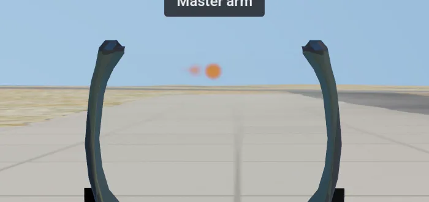

# Modern IAF's weapons

**Terms:** bdb = the object database the sim compiles (`sim.bdb`, [data-formats.md](data-formats.md) §2); tick = one
gun shot of the shared code, every 0.2 s ([../../docs/weapons.md](../../docs/weapons.md) §3); master arm = the switch
that lets a weapon fire.

The sim flies the shared weapons code of the original game ([../../docs/weapons.md](../../docs/weapons.md)) with its
own data. Today its jets carry the gun, chaff and flares.

## 1. The gun's rounds
Each flyable jet's rounds are its unit record's `loadout` entry for the gun (`data/db/units/<id>.json`). `iaf-sim db`
compiles the count into the bdb as station 9's count, and the gun counts it down to empty. Weapon data Real's per-type
table (`real_weapons.gd` `GUN_ROUNDS`) is the original game's; the sim keeps the bdb's count
(`Settings.real_bdb()`).

| jet | gun | rounds | source |
|---|---|---|---|
| Sufa (`f16i`) | M61A1 20 mm | 511 | the F-16's[^gdots]; the two-seat Sufa's count is not published (inferred the same) |
| Barak (`f16d`) | M61A1 20 mm | 511 | as the Sufa |
| F-35I (`f35i`) | GAU-22/A 25 mm (the 20 mm record's damage stands in) | 180 | the F-35A's[^w-f35] |

The M61A1 fires 6,000 rounds a minute[^w-m61]: 20 rounds a tick, so 511 rounds last 5.1 s. The F-35I fires its
GAU-22/A's 3,300 rounds a minute at 1,040 m/s (its definition's `gun`, the shared `real_weapons.gd` `jet_gun` the
MiGs' guns use; [../../docs/f35i.md](../../docs/f35i.md) §3): 11 rounds a tick, so 180 rounds last 3.3 s.

`iaf-sim db` refuses a unit that has an `airframe` (a flyable jet) and no gun count, so no jet flies with an empty or
endless gun.

## 2. The gun's and the effects' art
`iaf-sim own` draws the gun's art and the effects' sprites from formulas (no source image; ours: the gun's in
`crates/iaf-tools/src/sim.rs`, the effects' in `sim_effects.rs`) into the original's resource layout,
`converted/own/resource/3dobjects/`:

| file | drawn as | look |
|---|---|---|
| `gunfire.tga` | the muzzle flash: the original's two crossed quads, 0.6 m wide, 0.85–1.15 m long, while the gun fires | a flame white-hot at the muzzle, tapering forward to an orange tip |
| `tracer.tga` | a tracer per round slot (one a tick): two crossed quads 0.4 m wide and 18 m long behind the round, and an orange head the same size on screen at any distance (about 15 px at 1080 lines), so a round seen end on from the cockpit still shows | a hot head fading to a red-orange tail; near the muzzle the streak is no longer than the way flown |
| `afterburn.png` | the afterburner: two nested cones from the nozzle, added (`afterburner.gd`) | a blue-white core at the nozzle, then yellow-white and orange fading to the tip, three shock diamonds as brighter bands |
| `missflr.png` | a flare (`decoy_fx.gd`) and a missile's motor glow without Detailed effects (`trails.gd`) | a white-hot point about 1 m across in a tight yellow glow, a faint warm halo, clear well inside the rim: released flares show as separate bright points |
| `chaff.png` | the chaff pieces (`decoy_fx.gd`) | grey foil with bright glints |
| `trail.png` | the smoke trails without Detailed effects, the wingtip trails (`trails.gd`) | white smoke, dense when young, wider and thinner with age |
| `w_splash.png`, `w_circle.png` | a hit's splash and ring on the water (`damage_effects.gd`) | a spray column wide at the water; a foam ring |

`player_weapons.gd` reads the gun's two from `Settings.own_dir()`, the same path that gives the original game its install's
`gunfire.tga`. The effects read theirs through `Settings.effect_art(rel)`: the converted original sprite in the
original game, the file of the same name here.

The chaff and flare records give their decoys a slow ejection (`motion` `_velocityJump` 10, `_limitVel` 5, inferred):
the shared decoy flight ([../../docs/weapons.md](../../docs/weapons.md) §10) then lasts about 0.85 s at 250 m/s.
Until 2026-11-14 they took the reader's gun-round defaults (1,200 m/s), so each decoy reached its end point 200 m aft
in 0.13 s and was never seen.
Each burning flare trails a thin smoke ribbon (`trails.gd` `FLARE`: 0.2 m wide at the flare, 1.2 s, drawn with
`trail.png`; `decoy_fx.gd` when not `original_art()`) in place of the original's white puffs (3.2 → 9.6 m every
1/30 s), which around the sim's sprites read as one cloud of smoke.

**Open:** a bomb's hit on the ground draws the shared grey smoke domes, the same as the original game; the sim has no
fire, dust or debris look of its own yet.

A gun record without a model (the sim's `20mm.json`) draws its rounds as tracers; the original's gun
record has a model and draws it as before.

A 1.2 s burst at Ramon, from the cockpit (top) and the chase view (bottom), the graphics options at their best
(`modern-iaf/tests/_gun_shot.gd`):

## 3. Master arm
Every sim flight starts with the master arm safe (`Settings.starts_safe()`): the gun trigger (Tab) and the weapon
release (Space) fire nothing. **Master arm** (Shift+A, record 125 of `data/keys.json`, command 202) switches between
safe and armed, and the band shows "Master arm" or "Master safe". The original game has no master arm and no key sends
command 202, so its weapons stay armed.

The original's gear-down rule still holds when armed: with the gear handle down the gun fires only with Safety off
([../../docs/weapons.md](../../docs/weapons.md) §3).

## 4. The original's fixes the sim keeps on
The sim turns on the shared fixes of the original game's weapon and damage bugs (`sim_settings.gd` `_apply_profile`;
each one's original and fixed behaviour in [../../docs/deviations.md](../../docs/deviations.md) §2):

| switch | what the sim gets |
|---|---|
| `wind` | the mission's wind drifts the falling stores (CCIP follows), moves the AI jets and turns the runways into it |
| `fix_bomb_burst` | a bomb bursts at the ground, not up to about 70 m under it |
| `fix_ghost_collision` | no collisions with hidden units or wrecks |
| `fix_lock_threat` | a radar lock makes the player the locked enemy's threat |
| `fix_fall_heading` | a falling jet keeps its heading |
| `fix_skill_damage` | enemies take the same damage at every AI level |

## 5. Tests
- `cargo test -p iaf-tools --lib sim::`: the bdb holds 511 / 511 / 180 rounds; a flyable jet without a gun count is
  refused; `iaf-sim own` writes both images (the flash opaque at the muzzle, clear at the corners).
- `modern-iaf/tests/test_sim_gun.gd`: the Sufa's take-off mission starts with 511 rounds and the master arm safe; the
  trigger fires nothing while safe; Shift+A arms; the tracers fly; the gun empties in 5.1 s and then fires nothing;
  the F-35I's gun record fires 11 rounds a tick at 1,040 m/s; the bomb fixes are on and a 20 kt wind reaches the
  falling stores.

[^gdots]: General Dynamics OTS, "F-16 20mm Gatling gun system" (511 rounds), https://www.gd-ots.com/wp-content/uploads/2017/11/F-16.pdf
[^w-f35]: Wikipedia, "Lockheed Martin F-35 Lightning II" (GAU-22/A, 180 rounds in the F-35A), https://en.wikipedia.org/wiki/Lockheed_Martin_F-35_Lightning_II
[^w-m61]: Wikipedia, "M61 Vulcan" (6,000 rounds per minute), https://en.wikipedia.org/wiki/M61_Vulcan
