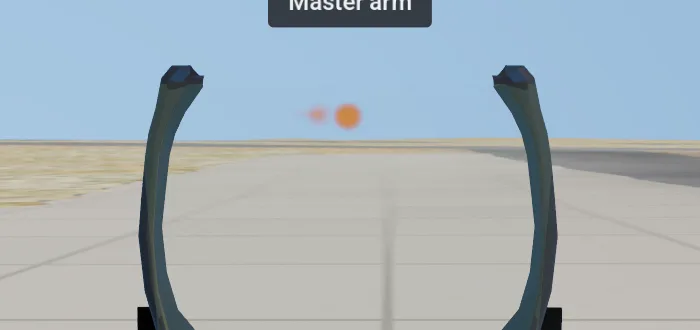
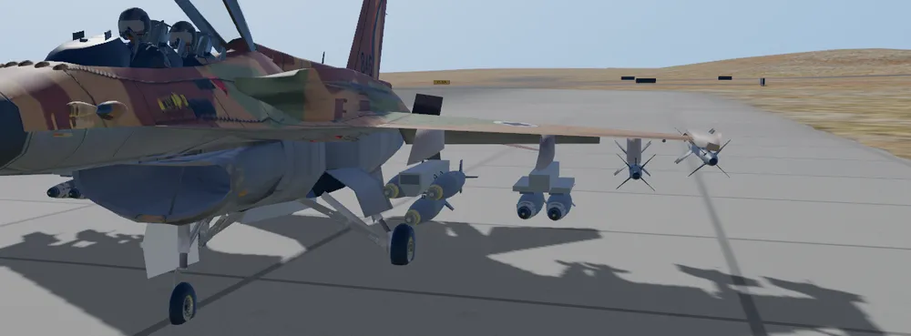
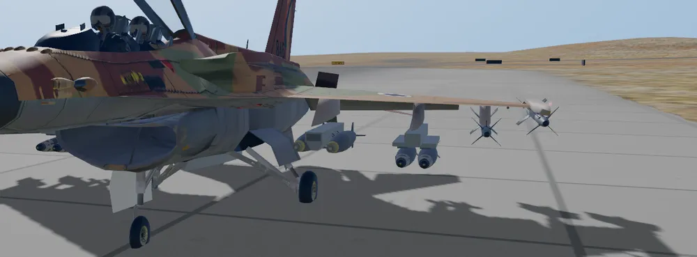

# Modern IAF's weapons

**Terms:** bdb = the object database the sim compiles (`sim.bdb`, [data-formats.md](data-formats.md) §2); tick = one
gun shot of the shared code, every 0.2 s ([../../docs/weapons.md](../../docs/weapons.md) §3); master arm = the switch
that lets a weapon fire.

The sim flies the shared weapons code of the original game ([../../docs/weapons.md](../../docs/weapons.md)) with its
own data: the gun, chaff and flares, and the stores the briefing's Arming page hangs (bombs, guided bombs, missiles,
tanks), which drop and fire in every flight (§4).

## 1. The gun's rounds
Each flyable jet's rounds are its unit record's `loadout` entry for the gun (`data/db/units/<id>.json`). `iaf-sim db`
compiles the count into the bdb as station 9's count, and the gun counts it down to empty. Weapon data Real's per-type
table (`real_weapons.gd` `GUN_ROUNDS`) is the original game's; the sim keeps the bdb's count
(`Settings.real_bdb()`).

| jet | gun | rounds | source |
|---|---|---|---|
| Sufa (`f16i`) | M61A1 20 mm | 511 | the F-16's[^gdots]; the two-seat Sufa's count is not published (inferred the same) |
| Barak (`f16d`) | M61A1 20 mm | 511 | as the Sufa |
| F-35I (`f35i`) | GAU-22/A 25 mm (the 20 mm record's damage stands in) | 180 | the F-35A's[^w-f35] |

The M61A1 fires 6,000 rounds a minute[^w-m61]: 20 rounds a tick, so 511 rounds last 5.1 s. The F-35I fires its
GAU-22/A's 3,300 rounds a minute at 1,040 m/s (its definition's `gun`, the shared `real_weapons.gd` `jet_gun` the
MiGs' guns use; [../../docs/f35i.md](../../docs/f35i.md) §3): 11 rounds a tick, so 180 rounds last 3.3 s.

`iaf-sim db` refuses a unit that has an `airframe` (a flyable jet) and no gun count, so no jet flies with an empty or
endless gun.

The rounds fly the shared Weapon data Real ballistics (the sim fixes `weapon_data` "real"): the jet's velocity plus
the muzzle velocity, the M56's drag (sea-level 3,450 → 1,677 ft/s over 1,000 m, fitted to the GD-OTS chart) scaled
by the air density, and gravity. The HUD's EEGS funnel reads the same time of flight, so a round passes through the
funnel's centre at its range. The GAU-22/A's 25 mm round flies the M56's drag (inferred: no public drag figure for
the PGU-47 / PGU-48). Figures, sources and tests: [../../docs/real-weapons.md](../../docs/real-weapons.md) §1.4.

## 2. The gun's and the effects' art
`iaf-sim own` draws the gun's art and the effects' sprites from formulas (no source image; ours: the gun's in
`crates/iaf-tools/src/sim.rs`, the effects' in `sim_effects.rs`) into the original's resource layout,
`converted/own/resource/3dobjects/`:

| file | drawn as | look |
|---|---|---|
| `gunfire.tga` | the muzzle flash: the original's two crossed quads, 0.6 m wide, 0.85–1.15 m long, while the gun fires | a flame white-hot at the muzzle, tapering forward to an orange tip |
| `tracer.tga` | a tracer per round slot (one a tick): two crossed quads 0.4 m wide and 18 m long behind the round, and an orange head the same size on screen at any distance (about 5 px at 1080 lines; 15 px until 2026-11-17), so a round seen end on from the cockpit still shows; the tracer shows for the first 1 s of the round's flight (inferred; until 2026-11-17 its whole flight, the user: "flare of bullets stay for too long and are too big") | a hot head fading to a red-orange tail; near the muzzle the streak is no longer than the way flown |
| `afterburn.png` | the afterburner: two nested cones from the nozzle, added (`afterburner.gd`) | a blue-white core at the nozzle, then yellow-white and orange fading to the tip, three shock diamonds as brighter bands |
| `missflr.png` | a flare (`decoy_fx.gd`) and a missile's motor glow without Detailed effects (`trails.gd`) | a white-hot point about 1 m across in a tight yellow glow, a faint warm halo, clear well inside the rim: released flares show as separate bright points |
| `chaff.png` | the chaff pieces (`decoy_fx.gd`) | grey foil with bright glints |
| `trail.png` | the smoke trails without Detailed effects, the wingtip trails (`trails.gd`) | white smoke, dense when young, wider and thinner with age |
| `w_splash.png`, `w_circle.png` | a hit's splash and ring on the water (`damage_effects.gd`) | a spray column wide at the water; a foam ring |

`player_weapons.gd` reads the gun's two from `Settings.own_dir()`, the same path that gives the original game its install's
`gunfire.tga`. The effects read theirs through `Settings.effect_art(rel)`: the converted original sprite in the
original game, the file of the same name here.

The chaff and flare records give their decoys a flight of their own (`motion`, inferred), through the shared decoy
flight ([../../docs/weapons.md](../../docs/weapons.md) §10): the decoy leaves at the jet's speed toward an aim point
2 km ahead and a little below (`_fireEndVec` 0, 2000, -60 for a flare, -30 for chaff) and slows at `_absAcceleration`
(flare -40, chaff -150 m/s²) to 5 m/s, so it falls back behind the jet as drag would slow it. At 250 m/s a flare is
about 20 m off the jet after 1 s and 80 m behind after 2 s, and burns to the 4 s cap; chaff stops in the air about 75 m
behind after 1 s. A chase view behind the jet sees the flares leave under its tail.
Until 2026-11-14 the decoys took the reader's gun-round defaults (1,200 m/s) and were never seen. From 2026-11-14 to
2026-11-16 they flew 200 m aft at |V| + 10 m/s (the original's `_fireEndVec`) and ended there in about 0.85 s: seen
from ahead, but from behind the jet (an F-35I picture shoot, 2026-11-16) they had passed the camera before any picture.
`test_sim_gun.gd` checks both flights.
Each burning flare trails a thin smoke ribbon (`trails.gd` `FLARE`: 0.2 m wide at the flare, 1.2 s, drawn with
`trail.png`; `decoy_fx.gd` when not `original_art()`) in place of the original's white puffs (3.2 → 9.6 m every
1/30 s), which around the sim's sprites read as one cloud of smoke.

**Open:** a bomb's hit on the ground draws the shared grey smoke domes, the same as the original game; the sim has no
fire, dust or debris look of its own yet.

A gun record without a model (the sim's `20mm.json`) draws its rounds as tracers; the original's gun
record has a model and draws it as before.

A 1.2 s burst at Ramon, from the cockpit (top) and the chase view (bottom), the graphics options at their best
(`modern-iaf/tests/_gun_shot.gd`):

## 3. Master arm
Every sim flight starts with the master arm safe (`Settings.starts_safe()`): the gun trigger (Tab) and the weapon
release (Space) fire nothing. **Master arm** (Shift+A, record 125 of `data/keys.json`, command 202) switches between
safe and armed, and the band shows "Master arm" or "Master safe". The original game has no master arm and no key sends
command 202, so its weapons stay armed.

The original's gear-down rule still holds when armed: with the gear handle down the gun fires only with Safety off
([../../docs/weapons.md](../../docs/weapons.md) §3).

## 4. The original's fixes the sim keeps on
The sim turns on the shared fixes of the original game's weapon and damage bugs (`sim_settings.gd` `_apply_profile`;
each one's original and fixed behaviour in [../../docs/deviations.md](../../docs/deviations.md) §2):

| switch | what the sim gets |
|---|---|
| `wind` | the mission's wind drifts the falling stores (CCIP follows), moves the AI jets and turns the runways into it |
| `fix_bomb_burst` | a bomb bursts at the ground, not up to about 70 m under it |
| `fix_ghost_collision` | no collisions with hidden units or wrecks |
| `fix_lock_threat` | a radar lock makes the player the locked enemy's threat |
| `fix_fall_heading` | a falling jet keeps its heading |
| `fix_skill_damage` | enemies take the same damage at every AI level |

## 5. Dropping and firing in flight
The unguided bombs fall by gravity and their own drag (C_D 0.45 on each body's sourced diameter) through the
mission's wind, nothing steering them, and the CCIP pipper runs the same fall, so the bomb lands on the pipper
([../../docs/real-weapons.md](../../docs/real-weapons.md) §1.10).

Every sim flight carries the pilot's loadout from the briefing's Arming page (`fly.gd` `arm`, [front-end.md](front-end.md)
§10); a training mission goes on after its pass, so after the take-off the player can use them. The shared weapons code
runs them unchanged: the release, the bomb's fall, its burst on the terrain with the shared explosion, the missiles and
the gun.

| step | the Sufa / the Barak | the F-35I | key (default) | key record |
|---|---|---|---|---|
| the stores | hung on the Arming page before Fly (the record's default carries no bombs) | the same | — | — |
| power | ST STA on (with the avionics: Ctrl+A, or the start-up's four AVIONIC POWER switches) | — | Ctrl+A | 122 |
| master arm | MASTER ARM to ARM: every flight starts SAFE (§3) | the same | Shift+A | 125 |
| gear | up: nothing releases with the gear handle down | the same | G | 20 |
| bombs | A-G: the HUD's CCIP pipper (HUD mode 5) | A-G: the CCIP cue (a GPS bomb, HUD mode 6) | `[` | 65 |
| release | the pickle held: the bombs leave as a pair once the pipper reaches the aim point | held: the bay doors open, the bombs leave, the doors close | Space | 69 |
| jettison | the emergency jettison: every store and rack but the A-A missiles and the pods in one press; the SMS's S-J, then the pickle: the selected store's stations | every store but the A-A missiles and the pods, the bays' once the doors are open | Shift+C | 72 |
| missiles | A-A: the AIM-9M's seeker circle | A-A: the AIM-120 (it waits for the bay doors) | `]` | 66 |
| next target | the radar locks the next target (the Sufa: each press bugs the next target; TMS up or a click on the bug locks it) | the same | Enter | 58 |
| the Sufa's radar | the real FCR's TMS, submodes, scan width and bars, antenna elevation, OVRD and EXP ([../../docs/radar.md](../../docs/radar.md) §9.4) | — | `/`, Shift+`/`, `;`, Shift+`;`, `'`, Shift+`'`, Ctrl+`'`, Alt+Up / Down, Ctrl+`/`, Ctrl+`;`; the cursor on Ctrl+arrows | 132–142, 48–51 |
| the Sufa's ground map | GM's OSBs 7–10: FZ, SP, CZ, STP / TGT; in A-G the TMS keys designate or track and Ctrl+`;` steps EXP / DBS1 / DBS2 ([../../docs/radar.md](../../docs/radar.md) §9.7) | — | Alt+`;`, Alt+`'`, Alt+`/`, Alt+`.` | 143–146 |
| the F-16 MFDs | DMS (the SOI, each MFD's next format); LASER ARM ([../../docs/mfd.md](../../docs/mfd.md) §9 "Modern MFDs") | — | Ctrl+Page Up / Down, Ctrl+`[` / `]`; Shift+L | 147–151 |
| gun | the trigger held | the same | Tab | 64 |

**Every store drawn on its rack (2026-11-15).** A station that holds several stores shows each of them, on the Loadout
screen's jet, the Hangar's and in flight alike (`shared/weapons/stores.gd` `place` / `rack_layout`,
`player_weapons.gd` `hang`): the Sufa's and the Barak's three Mk 82 hang on a TER-9/A, two on its shoulders turned
45° toward it and one under it; two GBU-38 hang side by side under a BRU-57/A; the Adir's four GBU-39 sit on their
BRU-61/A as before. The racks are our own models (`shared/extra/models/stores/ter9.glb`, `bru57.glb`, made by
`tools/stores/build.gd`; their sizes are inferred: no published dimensions were found). The original's slots
([../../docs/weapons.md](../../docs/weapons.md) §2.2) come from the original store model's `pilon` helper, which the sim has no install for: they put
every store of a station on one point, so a full TER showed as one bomb (the user, 15 Nov: "if it includes 4 bombs
the visual show only 1"). A release takes the store of the last slot first (the TER's lower one); the others stay
drawn, and the rack stays when the last one goes. Reborn keeps the original's layout.

| the Sufa with two GBU-38 on 3 / 7 and three Mk 82 on 4 / 6 | one Mk 82 released from 4 |
|---|---|
|  |  |

**The stores page.** The F-16s' SMS (the right MFD's format; [../../docs/mfd.md](../../docs/mfd.md) §9) and the
F-35I's SMS portal ([../../docs/f35i.md](../../docs/f35i.md)) are the original game's real formats on the shared
stores state: every station's store and count as hung on the Arming page, the selected weapon and its page (A-G with
CCIP, AAM, GUN) following `[`, `]` and the page's own OSBs, the counts going down with each release and the stations
emptying on a jettison. The sim adds its two switches: the F-16 SMS shows RDY only with the master arm on ARM and ST
STA powered, the F-35I's shows ARM or SAFE over the weapon (inferred).

A training mission's live check (training.md §3.0) runs only until its pass, so a release after the take-off fails
nothing; before the pass the release is blocked on the ground anyway (the gear handle down).

The checklist notebook's WEAPONS tab (key H; [training.md](training.md) §11) lists these steps per jet family, each
with its switch, its place and its key as bound (the weapons' controls have no switch to click in the cockpit).

**The Delilah (2026-11-14).** Dropped for now (the user): no station lists it and no default carries it. It needs a
powered cruise-missile flight class the engine does not have, and flew as a glide bomb. Its weapon record
(`data/db/weapons/delilah.json`) and the shared record (`modern_weapons.gd` 1012) stay; the original game never
offered it.

**Limits and doors.** A bomb leaves only at 600 KCAS or less and in a dive of 60° or less; the jettisoned stores fall
unarmed; the F-35I's bay doors open in 0.47 s, shut 0.5 s after the release and add 50 to the drag index while open
(sources and the inferred figures in [../../docs/real-weapons.md](../../docs/real-weapons.md) §1.11).

## 6. Tests
- `cargo test -p iaf-tools --lib sim::`: the bdb holds 511 / 511 / 180 rounds; a flyable jet without a gun count is
  refused; `iaf-sim own` writes both images (the flash opaque at the muzzle, clear at the corners).
- `modern-iaf/tests/test_weapons_flight.gd`: each jet's take-off mission set up as the front end's Fly with bombs from
  the Arming page (six Mk 82 on the F-16s, two GBU-31 in the F-35I's bays), put in the air after its pass: the master
  arm starts safe, Shift+A arms, ST STA is up, `[` selects the bombs (CCIP), Space releases, the bomb is drawn, falls
  over a kilometre and is gone at the terrain (its burst); Shift+C empties the rest; `]` and Space launch a missile
  (the F-35I's from its bay) that flies away from the jet; Tab fires the
  gun. The stores page agrees at each step: the bombs on their stations before arming, the selected weapon the HUD's,
  no RDY while safe and RDY once armed, the counts after the release, the stations empty after the jettison.
- `modern-iaf/tests/test_mvp.gd --only loadout`: three Mk 82 on a TER drawn apart, the rack on the jet; after one
  release the other two still hang.
- `modern-iaf/tests/test_sim_release.gd`: one of the Sufa's two MK-84 released (SGL) in level flight: the flight
  model's mass drops by the bomb's 925 kg, the drag index it is given drops by the bomb's on one wing, and the moment of the other bomb
  rolls the jet hands off ([flight-model.md](flight-model.md) §9.12).
- `modern-iaf/tests/test_sim_jettison.gd`: the Sufa refuses a Mk 82 release over 600 KCAS and in a 65° dive; S-J and
  Space drop six Mk 82 with their two TER-9/A (the 6-DoF's mass and drag index fall by theirs, the tanks and missiles
  stay, the bombs fall unarmed); Shift+C then drops both tanks in one press (mass −2 × 201 kg plus the fuel above the
  internal, fuel at the internal, drag index −2 × 19.1), the four AIM-9M stay. The F-35I's Shift+C opens the bay
  doors; the GBU-31s leave 0.47 s later with the doors' drag index on, and the doors are shut within 2 s.
- `modern-iaf/tests/_weapons_shot.gd` (real render): the same flown from the front end, the start-up, the tower and the
  take-off included; the pictures of the bombs leaving, the burst, the missile, the gun and the notebook tab.
- `modern-iaf/tests/test_sim_gun.gd`: the Sufa's take-off mission starts with 511 rounds and the master arm safe; the
  trigger fires nothing while safe; Shift+A arms; the tracers fly; the gun empties in 5.1 s and then fires nothing;
  the F-35I's gun record fires 11 rounds a tick at 1,040 m/s; the bomb fixes are on and a 20 kt wind reaches the
  falling stores.

## 7. The targeting pod and the laser bombs
The user's yes of 17 November 2026 ([avionics-plan.md](avionics-plan.md) §8, item 2): the Litening pod and the GBU-10, GBU-12 and GBU-16 on the
Sufa and the Barak (the F-16I carries all three and the Litening II[^sufa-at]). Their records:

| store | record | weight | stations | model |
|---|---|---|---|---|
| Litening targeting pod (SMS name `TGP`) | `data/db/weapons/litening.json`, kind `pod` (660) | 208 kg[^w-litening] | 5, the chin | our LANTIRN pod (`flrpod.glb`) standing in |
| GBU-12 Paveway II | `gbu-12.json`, kind `laser_bomb` (650) | 230 kg[^w-gbu12] | 3, 4, 6, 7 | the Mk 82 with the Paveway kit (`mk82lb.glb`) |
| GBU-16 Paveway II | `gbu-16.json` | 450 kg[^w-gbu16] | 3, 4, 6, 7 | `mk83lb.glb` |
| GBU-10 Paveway II | `gbu-10.json` | 910 kg[^w-gbu10] | 3, 4, 6, 7 | `mk84lb.glb` |

- **The chin.** The real F-16 hangs its targeting pod on a chin hardpoint under the intake[^twz-litening] (the right
  one on the Sufa, inferred from photos). The sim's nine pylons are the stations 1–9; station 5, the centreline, takes
  no sim store, so the sim numbers the chin station 5 and hangs it under the right intake (`sim.rs`
  `F16_SIM_STATIONS` StationE, `F16_SIM_LUGS`). The briefing's balance takes it on the jet's middle (its 0.3 m offset
  inferred as negligible).
- **The pod.** `player_weapons.gd` takes a store named TGP (or the 1998 game's FLIR) as the targeting pod: the TGP
  format ([../../docs/mfd.md](../../docs/mfd.md) §9 "Modern MFDs"), its picture, the track modes, the laser.
- **The laser bombs** fly the shared laser path ([../../docs/weapons.md](../../docs/weapons.md) §9.8): released as
  bombs on the CCIP rules, guided onto the laser spot while the laser fires (within 60° of the line to the bomb's
  point), else to the bomb's CCIP point. Their motion is the shared guided motion's defaults (`guided.rs`
  `GuidedMotion::default`; no new performance modelling, avionics-plan.md §7).
- **The flow** on the range: A-G with a GBU selected, the radar's ground map designates a hulk, the TGP the SOI
  (DMS), TMS down slaves the pod there (or TMS up / right tracks what is under its cross), LASER ARM (Shift+L), L
  fires the laser, MASTER ARM, the pickle. Test: `modern-iaf/tests/test_sim_mfd.gd` (a GBU-12 hits Target 1).

[^gdots]: General Dynamics OTS, "F-16 20mm Gatling gun system" (511 rounds), https://www.gd-ots.com/wp-content/uploads/2017/11/F-16.pdf
[^w-f35]: Wikipedia, "Lockheed Martin F-35 Lightning II" (GAU-22/A, 180 rounds in the F-35A), https://en.wikipedia.org/wiki/Lockheed_Martin_F-35_Lightning_II
[^w-m61]: Wikipedia, "M61 Vulcan" (6,000 rounds per minute), https://en.wikipedia.org/wiki/M61_Vulcan
[^sufa-at]: Airforce Technology, "F-16I Soufa Multirole Fighter, Israel" (GBU-10 / 12 / 16 carried, the Litening II
    pod): https://www.airforce-technology.com/projects/f-16i-soufa/
[^w-litening]: Wikipedia, "LITENING" (208 kg; the F-16I Sufa's Litening C4): https://en.wikipedia.org/wiki/LITENING
[^w-gbu12]: Wikipedia, "GBU-12 Paveway II" (230 kg): https://en.wikipedia.org/wiki/GBU-12_Paveway_II
[^w-gbu16]: Wikipedia, "GBU-16 Paveway II" (450 kg): https://en.wikipedia.org/wiki/GBU-16_Paveway_II
[^w-gbu10]: Wikipedia, "GBU-10 Paveway II" (910 kg): https://en.wikipedia.org/wiki/GBU-10_Paveway_II
[^twz-litening]: The War Zone, "We talk new features on the Litening large aperture targeting pod" (a Litening on the
    usual chin station of an F-16C):
    https://www.twz.com/news-features/we-talk-new-features-on-the-litening-large-aperture-targeting-pod
